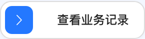

# 清爽蓝白后台：组件动效与状态实现

这是 [后台风格配方](recipes/clean-admin.md) 的动效部分，几何与状态见 [组件规范](admin-components.md)，页面组合见 [逐页提示词](admin-pages.md)。目标是将同一套动画写进实际项目的可复用组件；参数和触发语义必须同时保留。按页面使用相关行，不能因为清单完整就让页面同时播放所有效果。

## 运行基线

曲线 `spring = cubic-bezier(.2,.75,.25,1)` 是平滑偏出场曲线，不是物理弹簧，也没有回弹过冲。按压／颜色变化多用120–180ms，组件位置切换约240–300ms；`ease` 在下面表示参考代码的具体原值。忠实复刻时按表实现，不用另一份通用缓动配方批量覆盖这些已有参数。

状态动画由实际交互或请求驱动；等待完成不依赖动效结束。鼠标离开、快速切换、Escape、路由离开和卸载都须清理对应任务。循环只在busy时运行；静态会话骨架没有shimmer、logo飞入或假的加载进度。减弱动态见末尾规则。

## 动效覆盖清单

| 组件／场景 | 触发 → 可见变化 | 时间与曲线 | 实现与终态约束 |
|---|---|---|---|
| 普通主／次按钮 | hover改表面／边界，按下scale(.975)，松开恢复 | transform120ms ease；背景／阴影160ms ease | 禁用不执行也不按压，焦点环保留；标题操作38px高 |
| 箭头蓝底展开按钮 | hover或focus-visible：左蓝块铺满、三点出现、白字；离开收回 | width300ms spring；文字／三点180ms ease；按压150ms | 下方有完整片段，外层宽度不变化 |
| 图标／表格操作按钮 | hover显背景与边界，按下轻移或缩放 | 160–200ms ease；表格按下translateY(1px) | 不能改变整行布局，保留操作名称 |
| 侧栏项 | hover浅蓝，选中蓝色渐变，图标底座与计数转白 | 颜色120ms ease、阴影160ms | active由当前路由驱动，不创建假页签选中 |
| 侧栏折叠／手机导航 | 桌面64px窄栏与完整栏互换；手机从左进入 | width／transform260ms spring | 桌面壳层88px／256px；手机背景不可交互、焦点返回 |
| 打开的页面页签 | 标记移动到当前页签的位置并匹配宽度 | transform／width300ms spring，文字160ms | ResizeObserver与rAF测量；不滚动整个文档、不夺焦点 |
| 分段选择 | 同一蓝色背景滑到选中项、白字切换 | transform280ms spring；文字160ms | radiogroup、单一Tab入口、方向键／Home／End；默认值需有效 |
| 数字滚动 | 旧数字向上85%淡出，新数字从下85%进入 | 每段180ms spring，opacity180ms ease | 按位Transition out-in；从右侧稳定key，分隔符不占等宽数位 |
| 状态徽标 | 同一位置图标缩小旋出、下一个放大归位；文案同步 | 图标／opacity每段140ms ease | out-in；scale(.5)、进-40deg／退40deg；loading图标900ms linear转圈 |
| 大KPI | hover上移3px并增加阴影 | transform／shadow180ms ease | 入场动画结束须释放transform，或用外层做入场 |
| KPI圆形箭头 | 始终可见；入口hover／focus-visible由右上转右向，圆面变亮；离开复原 | rotate(-40deg→0)200ms ease | 外层32px、箭头15px；点击直达该指标真实页面，非菜单或Toast；不移动数值或hint |
| 普通摘要卡 | hover上移2px，轻边界变化 | transform180ms ease、边界160ms | 四色是装饰分类，不替代业务状态 |
| 快捷操作卡 | hover图标rotate(-7deg) scale(1.08)，右箭头右移3px | 图标260ms spring；右箭头220ms spring；颜色160–180ms | 卡片外层轻上移2px；focus也须有可见反馈 |
| 产品卡 | hover上移3px、蓝边、阴影加深 | transform220ms spring；border／shadow180ms | 三列布局稳定，菜单开合不让卡片抖动 |
| 分组展开按钮 | 箭头翻转、内容连续展开或收起 | 箭头240ms spring；内容280ms cubic-bezier(.4,0,.2,1) | 使用真实高度，能中途反向；同步修正页底滚动 |
| 目录／排查／记录行 | hover浅蓝，当前项左3px强调；末尾箭头右移3px | 背景140–180ms ease，箭头160ms | 行内菜单与选择控件保持独立点击语义 |
| 表格与复制按钮 | hover／选中背景、复制反馈浮层进入退出 | 行背景140–160ms；复制按钮140ms | selected保留checkbox；复制失败显真实原因 |
| 多选浮动操作栏 | 至少一条选择时从下14px、scale(.96)淡入 | 入opacity220ms ease、transform300ms spring；退150ms ease | 固定居中保留translateX(-50%)；清空选择时退出，不能遮住分页 |
| 页内容入场 | view从opacity .72到1；页标题从下5px进入 | view160ms ease-out；标题220ms ease-out | 不把换页做大幅弹跳；不每次刷新重放整个壳层 |
| KPI错峰 | 四个卡依次从下5px淡入 | 240ms；延后0／30／60／90ms | 不把动画延迟用于隐藏已完成数据 |
| 用户中心内容 | 内容面从下4px、opacity .4入场 | 180ms ease-out | 保留当前表单编辑值，不为动画重建输入 |
| 文档中心 | 整体从下7px淡入；目录／工具轻变色 | 入380ms cubic-bezier(.2,.72,.2,1)；控件160–180ms | 目录滚动距离≤2屏且未减弱动态才smooth，远距离直接定位 |
| 概览活动卡 | 从下8px淡入；活动行hover轻亮 | 入420ms ease；行背景160ms | 只对首次内容呈现用；同卡不要叠两条transform动画 |
| 进度环 | 实际占比改变时环线补到新位置 | stroke-dashoffset400ms spring | r51、周长2π×51、线宽6；0总量显示暂无数据，不伪造百分比 |
| 刷新按钮 | busy时转圈+外框向外淡出的波纹 | spin720ms linear循环；pulse900ms ease-out | pulse从opacity .42/scale .76到0/1.08，75%完成；busy结束停循环 |
| Tooltip／菜单／Popover | hover或聚焦后浮出、离开收回；菜单点击展开 | 此风格Tooltip show-after180ms、hide-after100ms、offset8px；库自身过渡 | 使用同主题面与三角；别给库过渡再套一层随机动画 |
| 弹窗／详情抽屉／消息 | 按现有库的进入退出与遮罩呈现 | 保留库实际主题过渡值，不另猜一个固定时长 | 关闭阶段结束才卸载；焦点、Escape、遮罩规则按职责 |
| 账号提醒弹窗 | 从下6px、scale .985、透明进入 | 200ms cubic-bezier(.2,.8,.2,1) | 退出沿用弹窗库；不要两个层同时缩放同一面板 |
| 重认证提示 | 从下7px、scale .985、透明进入 | 200ms cubic-bezier(.2,.8,.2,1) | 倒计时由真实会话策略确定，不把动画当注销条件 |
| 登录品牌标记 | hover轻上移1px、rotate(-2deg)、scale(1.03) | 220ms cubic-bezier(.2,.8,.2,1) | 只是标记微反馈，不让整页长期漂浮 |
| 登录输入／提交 | focus边框／光环、密码显隐、错误行、忙碌箭头／文案 | 输入背景／阴影200ms ease；按钮复用上方 | 显隐保留输入值／焦点；用户名／密码autocomplete正确 |
| 拼图验证 | 指针拖动块与轨道1:1；验证中转圈，错误可重试 | 拖动无easing；验证spinner800ms linear | 轨道50px、thumb48px；用range支持键盘，ready后聚焦滑块 |
| 保存设置 | dirty→保存中→成功绿面→恢复，spinner | 表面180ms ease；spinner720ms linear；成功反馈1600ms | 原视觉有约450ms最短反馈窗口；新产品不以它阻挡已完成结果或导航 |
| 备份／任务运行 | 运行状态珠呼吸，动作图标转圈，完成切状态 | 珠1250ms ease-in-out；通用spin800ms；测试720ms、目标运行780ms linear | 珠50% scale1.06与7px柔环；任务结束停止，不展示真实日志作素材 |
| 发布校验与图表加载 | 对应busy图标旋转，图表局部降透明与轻模糊 | 校验850ms linear；图表spinner720ms linear | 已加载数据优先保留；不让加载遮罩成为状态唯一说明 |
| 静态加载骨架 | 等会话／数据时保留壳层与块状占位 | 无循环动效 | 不把静态原型误补成shimmer或重复入场 |

原样式中旧版本的 `view-in`、`console-view-in` 和历史滑块 `.04s left` 还可能存在，但最终页面已由后层规则与当前组件覆盖；不要把这些历史规则再次叠加。上表按职责归并同类效果，库内置的Select、Switch、Checkbox、Dialog、Drawer等保留库自己的可访问行为和实际过渡，不重造一套隐含时序。

## KPI圆形跳转入口

概览大KPI右上角使用独立圆形导航入口，完整结构、颜色和CSS见 [组件规范的大KPI合同](admin-components.md#clean-admin-metric-contract)。默认黑15%圆面、白28%边、箭头−40deg；入口hover／focus-visible时白24%圆面、箭头0deg，200ms ease；离开或失焦恢复。桌面32×32，≤600时40×40。父卡上移3px与此旋转分属不同层；初次入场结束不能继续占用父卡transform。

点击或键盘Enter直接进入真实业务路由；动画不延迟跳转，不自动另开窗口。鼠标只停在卡片其他区域时是卡片抬升，停到圆入口才触发箭头旋转；键盘聚焦入口也得到完整反馈。减弱动态下直接切换箭头终态，取消位移和过渡。导航链接不套提交按钮的loading、成功或disabled状态。

此圆形入口与下方的蓝块铺满／三点按钮属于两个不同组件：圆形入口没有三点、展开底色或文字推移，不能相互替换。验收必须检查默认、旋转中间态、悬停终态、离开、键盘聚焦、真实跳转及返回后状态。

## 箭头展开按钮：结构、状态与样式




关键是外层按钮宽度稳定，左蓝块绝对定位且在文字下方展开；箭头与三点属于蓝块内部。不是让一个普通蓝色按钮增长，也不是“hover时把文字往右推”。三点只是静态小圆点淡入，没有跳动循环。

以下片段在目标项目内可直接改为其组件；箭头可替换为项目自己的SVG图标。外层保留真正button、type及业务click；默认最低高38px、圆角11px、左文字留白56px、右15px。focus-visible与hover同态。

```html
<button type="button" class="console-arrow-button">
  <span class="arrow-expansion" aria-hidden="true">
    <svg viewBox="0 0 24 24" fill="none" stroke="currentColor" stroke-width="1.8">
      <path d="m9 5 7 7-7 7" />
    </svg>
    <i></i><i></i><i></i>
  </span>
  <span class="arrow-button-label">查看业务记录</span>
</button>
```

```css
.console-arrow-button {
  position:relative; isolation:isolate; display:inline-flex; align-items:center;
  min-height:38px; padding:0 15px 0 56px; overflow:hidden;
  border:1px solid var(--line); border-radius:11px;
  background:var(--panel); color:var(--text); box-shadow:var(--shadow-sm);
  font:500 12px var(--sans); cursor:pointer;
  transition:transform 150ms ease,border-color 180ms ease;
}
.arrow-expansion {
  position:absolute; z-index:-1; top:4px; bottom:4px; left:4px; width:28px;
  display:flex; align-items:center; gap:5px; padding:0 7px; border-radius:7px;
  background:var(--accent); color:var(--accent-ink);
  transition:width 300ms cubic-bezier(.2,.75,.25,1);
}
.arrow-expansion svg { flex:0 0 14px; width:14px; height:14px; display:block; }
.arrow-expansion i {
  flex-shrink:0; width:2px; height:2px; border-radius:50%;
  background:currentColor; opacity:0; transition:opacity 180ms ease;
}
.arrow-button-label { transition:color 180ms ease; }
.console-arrow-button:is(:hover,:focus-visible):not(:disabled) { border-color:var(--accent); }
.console-arrow-button:is(:hover,:focus-visible):not(:disabled) .arrow-expansion { width:calc(100% - 8px); }
.console-arrow-button:is(:hover,:focus-visible):not(:disabled) .arrow-button-label { color:var(--accent-ink); }
.console-arrow-button:is(:hover,:focus-visible):not(:disabled) .arrow-expansion i { opacity:.7; }
.console-arrow-button:active:not(:disabled) { transform:scale(.975); }
.console-arrow-button:focus-visible { outline:2px solid var(--accent); outline-offset:3px; }
.console-arrow-button:disabled { opacity:.5; cursor:not-allowed; }
@media(prefers-reduced-motion:reduce) {
  .console-arrow-button,.arrow-expansion,.arrow-expansion i,.arrow-button-label { transition:none; }
  .console-arrow-button:active:not(:disabled) { transform:none; }
}
```

蓝块是局部绝对层，动画width不参与周围布局。若目标项目统一要求仅transform，可将蓝色装饰面分离并对它scaleX；箭头与小点必须另放不缩放层，并复测视觉，不能直接把上面整个蓝块scaleX导致图标变形。较长按钮文案先留足箭头和三个点的固定区域；禁用组件不因hover误展开。

## 分段滑块与页面页签

分段筛选的完整结构、默认／选中／hover／focus／disabled、计数、窄屏与键盘实现见 [菜单与筛选规范](admin-navigation.md#clean-admin-segmented)。不能仅执行下面的动画摘要而沿用另一套按钮外观。

分段选择用一个共享indicator，不在各项分别淡入蓝底。容器padding4px、圆角11px、高38px起；内部indicator从left4px、top/bottom4px开始，宽`(100%−8px)/N`，圆角7px，蓝色渐变`#3484ff → #1764e7`。以自身宽度为基准`translateX(index×100%)`，280ms spring移动；indicator不接收指针。

数据只有一个modelValue；左右键循环，Home/End首尾；只有当前选项tabindex0，其他−1。如果初始值不在options中，使用第一个有效值或显式空选项，同时保证视觉与aria-checked一致；不要让画出的第一段选中但全组都不可Tab进入。`role=radio`必须在radiogroup中，selected值与chip计数同步。

页面页签宽度可不等：渲染后测量当前项offsetLeft／offsetWidth，更新共享标记的transform／width，300ms spring；ResizeObserver监听轨道尺寸，watch当前页与打开列表后nextTick再测量。rAF只合并测量，不每帧无条件轮询。当前项在轨道外时只调整轨道scrollLeft，不能用默认scrollIntoView拉动整个文档。关闭项时选中邻页，清理observer和待执行frame。

## 数字、徽标与进度

```css
.number-slot { display:inline-flex; overflow:hidden; line-height:1.2; }
.number-slot.is-digit { width:.64em; justify-content:center; }
.number-roll-enter-active,.number-roll-leave-active {
  transition:transform 180ms cubic-bezier(.2,.75,.25,1),opacity 180ms ease;
}
.number-roll-enter-from { transform:translateY(85%); opacity:0; }
.number-roll-leave-to { transform:translateY(-85%); opacity:0; }
.badge-swap-enter-active,.badge-swap-leave-active {
  transition:transform 140ms ease,opacity 140ms ease;
}
.badge-swap-enter-from { opacity:0; transform:scale(.5) rotate(-40deg); }
.badge-swap-leave-to { opacity:0; transform:scale(.5) rotate(40deg); }
```

数字格式化后逐字符显示，数位key取`digits.length-index`，每个字符再以digit作子key配合out-in过渡。屏幕阅读器读完整格式化值，动画字形aria-hidden；分隔符与小数点不误当数字。位数变化、1000→999、快速连续更新也要验证。数值一旦变化立即反映真实目标，不用计时器慢慢制造虚假中间业务数。

徽标只替换状态图标，外部胶囊位置稳定，label与tone同一数据源；loading图标循环，success／warning／danger／info静止。进度环按`ratio = total>0 ? clamp(value/total,0,1) : 0`，dasharray为2π×51，dashoffset=周长×(1−ratio)；配文字与可访问名称，减弱动态时直接到真实比例。

## 折叠、滚动与打断

分类目录的内容高度不固定，使用Web Animations API从当前可见height／opacity到真实展开height或0。280ms，`cubic-bezier(.4,0,.2,1)`。新反向动作开始前读取当前getBoundingClientRect().height与computed opacity并写回，取消旧animation后由当前帧接管；不能先清空height导致闪回自然高度。

实现时需同时处理这些状态：

1. 每个元素仅一个运行状态，保存animation、rAF、done、opening、滚动锁及临时占位。新动作以当前画面接管；旧finished回调先核对身份，避免关闭新动画。
2. 收起前预留必要文档空间，再测量收起后最大scrollTop；若当前在页底，仅把scrollTop同步插值到合法目标，防止浏览器先夹紧滚动位置。滚动校正和高度使用同一动画progress。
3. 期间临时关闭scrollingElement的overflow-anchor与smooth scroll，结束恢复原内联值；多实例共享时用引用计数锁，不能互相提前恢复。
4. 收起内容立即inert，避免Tab落入不可见控件。完全收起才由框架移除；完成或卸载清理height／opacity／overflow／inert、占位、监听与frame，不残留空白。
5. 用户wheel／touchstart／滚动按键优先，中止自动滚动拉回；减弱动态时立即切状态并仅作必要的合法scrollTop修正。

框架入口可以是Vue的`Transition :css="false"`，分别接enter／leave／enter-cancelled／leave-cancelled；其他框架按相同生命周期实现。若已有库能完整提供反向接管与滚动处理，复用而不重复执行两条高度动画。

## 登录、浮层与任务反馈

- 登录页品牌标记可响应hover，输入focus光环与密码显隐不丢值。提交只有真实状态`idle → validating → challenge / error → authenticating → success / error`，忙碌时重复提交被抑制；失败保留用户名，密码处理服从目标安全逻辑，不将凭据写入日志、截图、localStorage或示例文档。
- 拼图的piece与thumb跟随输入，不加拖尾easing；滑块用range保留左右键和aria-valuetext。挑战图加载完成才可操作；验证中禁拖动并转圈，拒绝时显示原因与重试。图内拼图、透明块和背景必须来自同一次挑战；本配方图片只展示虚构拼图，不提供认证算法。
- 文字提示复用库的hover/focus和180/100ms时序。菜单点击展开；Dialog、Drawer按其职责处理focus trap、关闭、Esc和return-focus。手机导航要可关闭、背景inert，桌面常驻侧栏不误标为模态对话框。
- 账号提醒和重认证弹窗的入场是面板级200ms动画；只保留一个负责scale／translate的层，库遮罩可淡入。对于库已自带相同面板动画的目标，合并替换相应过渡，不能嵌套双重缩放。
- 刷新与任务反馈的spinner仅在busy时出现。成功切绿面、错误保留能重试的说明。备份、校验和签名相关内容只取视觉状态，不复制原服务行为、安全策略或实际运行日志。
- Toast／复制反馈短时呈现不夺取输入焦点；保留失败的行内信息。保存按钮有dirty、saving、saved与error状态，成功反馈约1600ms可自然消退，新编辑立刻清除旧成功提示。

## 减弱动态与检查

对本次移植组件局部设置`prefers-reduced-motion: reduce`：取消位移、scale、旋转、错峰、环线补间与循环；保留文字、颜色、图标和必要的短淡入或直接切换。WAAPI开始前读偏好，运行中偏好变化时也完成或取消当前动效并清理状态。不要靠全局`* { animation:none }`覆盖目标项目所有无关组件。

同一个元素的入场`animation-fill-mode:both/forwards`会在结束后继续占用transform，导致hover的translateY失效。用外层入场／内层hover，或进入完成后释放动画；不能只看到静态截图便宣称hover已正常。

实际核对：箭头默认／中间／铺满／离开／快速反复／键盘focus／disabled；普通按钮按压与重复提交；分段键盘与指示器位置；数字位数变化；徽标循环停止；展开反向与页底收起；页签resize／溢出；图表比例；弹窗抽屉Escape与焦点；手机导航；等待失败重试；路由离开与卸载清理。参考图是终态证据，只有运行中的检查才能证明连续动画及状态切换。
