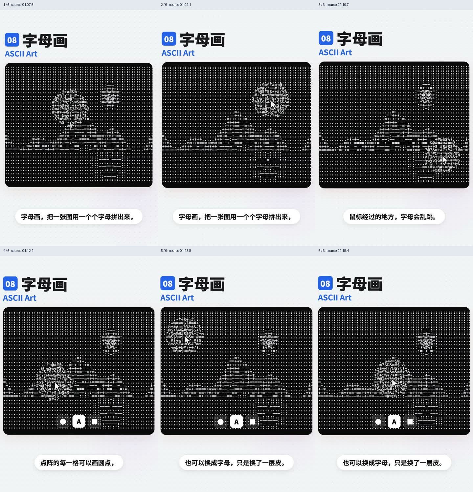

# 背景特效

来源：`13种背景特效解读.mp4`。时间为原片绝对时间，片段按原速播放。

GIF 看连续运动，六帧图看状态变化。参考视频包含讲解者的鼠标、选框和字幕；这些演示标注不属于待实现产品。

## 目录

- [极光 / Aurora](#aurora)
- [流动渐变 / Mesh Gradient](#mesh-gradient)
- [粒子波浪 / Particle Wave](#particle-wave)
- [点阵地球 / Dotted Globe](#dotted-globe)
- [流体 / Fluid / Shader](#fluid)
- [光束 / Beams](#beams)
- [字符雨 / Matrix Rain](#matrix-rain)
- [字母画 / ASCII Art](#ascii-art)
- [点阵背景 / Dot Grid](#dot-grid)
- [透视网格 / Retro Grid](#retro-grid)
- [星空穿梭 / Starfield](#starfield)
- [噪点颗粒 / Grain](#grain)
- [渐变背景 / Gradient](#gradient)

## 极光 / Aurora

- 标识：`backgrounds/aurora`；类型：组件／效果。
- 原视频：`13种背景特效解读.mp4`，00:08.1–00:15.5。
- 视频要点：彩色光团缓慢漂浮并互相融合，呈现极光氛围；示例用于科技、AI 产品首屏。
- 指令例句：首屏背景使用缓慢融合的 Aurora 极光，保持标题清晰。
- 参考：[GIF 动图](../assets/gifs/backgrounds/aurora.gif) · [六帧对照图](../assets/filmstrips/backgrounds/aurora.jpg)。

## 流动渐变 / Mesh Gradient

- 标识：`backgrounds/mesh-gradient`；类型：组件／效果。
- 原视频：`13种背景特效解读.mp4`，00:16.3–00:23.6。
- 视频要点：多种颜色如丝绸般揉合并缓慢流动；例子为支付、金融网站首屏。
- 指令例句：用柔和缓慢流动的 Mesh Gradient 作为首屏背景。
- 参考：[GIF 动图](../assets/gifs/backgrounds/mesh-gradient.gif) · [六帧对照图](../assets/filmstrips/backgrounds/mesh-gradient.jpg)。

## 粒子波浪 / Particle Wave

- 标识：`backgrounds/particle-wave`；类型：组件／效果。
- 原视频：`13种背景特效解读.mp4`，00:25.3–00:31.5。
- 视频要点：大量小点组成起伏网面，像波浪；鼠标经过时附近粒子被推开。
- 指令例句：用起伏的粒子网面呈现 Particle Wave，鼠标附近粒子避让。
- 参考：[GIF 动图](../assets/gifs/backgrounds/particle-wave.gif) · [六帧对照图](../assets/filmstrips/backgrounds/particle-wave.jpg)。

## 点阵地球 / Dotted Globe

- 标识：`backgrounds/dotted-globe`；类型：组件／效果。
- 原视频：`13种背景特效解读.mp4`，00:32.3–00:40.5。
- 视频要点：圆点组成的地球缓慢旋转，发光弧线连接城市；用于全球业务和数据展示。
- 指令例句：在全球业务区域展示旋转点阵地球与城市连线。
- 参考：[GIF 动图](../assets/gifs/backgrounds/dotted-globe.gif) · [六帧对照图](../assets/filmstrips/backgrounds/dotted-globe.jpg)。

## 流体 / Fluid / Shader

- 标识：`backgrounds/fluid`；类型：组件／效果。
- 原视频：`13种背景特效解读.mp4`，00:41.3–00:51.4。
- 视频要点：鼠标移动搅动彩色烟雾，随后缓慢消散；视频提及 Shader 作为这类效果的技术关键词。
- 指令例句：添加随鼠标搅动、离开后逐渐消散的 Fluid 背景。
- 参考：[GIF 动图](../assets/gifs/backgrounds/fluid.gif) · [六帧对照图](../assets/filmstrips/backgrounds/fluid.jpg)。

## 光束 / Beams

- 标识：`backgrounds/beams`；类型：组件／效果。
- 原视频：`13种背景特效解读.mp4`，00:53.1–00:58.6。
- 视频要点：多道光从上方扫下或向外放射，像舞台追光；适合发布会风格首屏。
- 指令例句：首屏背景加入有方向性的 Beams 光束扫动。
- 参考：[GIF 动图](../assets/gifs/backgrounds/beams.gif) · [六帧对照图](../assets/filmstrips/backgrounds/beams.jpg)。

## 字符雨 / Matrix Rain

- 标识：`backgrounds/matrix-rain`；类型：组件／效果。
- 原视频：`13种背景特效解读.mp4`，01:00.3–01:05.6。
- 视频要点：绿色字符按竖列向下落，形成黑客帝国式效果；适合编程和安全主题。
- 指令例句：背景使用竖列绿色字符向下落的 Matrix Rain。
- 参考：[GIF 动图](../assets/gifs/backgrounds/matrix-rain.gif) · [六帧对照图](../assets/filmstrips/backgrounds/matrix-rain.jpg)。

## 字母画 / ASCII Art

- 标识：`backgrounds/ascii-art`；类型：组件／效果。
- 原视频：`13种背景特效解读.mp4`，01:07.3–01:15.6。
- 视频要点：用字符矩阵拼出图像，鼠标经过时附近字符乱跳；视频将其与点阵同一网格的不同表现作比较。
- 指令例句：用字符网格组成图像，指针附近字符产生扰动。
- 参考：[GIF 动图](../assets/gifs/backgrounds/ascii-art.gif) · [六帧对照图](../assets/filmstrips/backgrounds/ascii-art.jpg)。

## 点阵背景 / Dot Grid

- 标识：`backgrounds/dot-grid`；类型：组件／效果。
- 原视频：`13种背景特效解读.mp4`，01:17.3–01:23.4。
- 视频要点：规则小圆点铺满背景，鼠标附近的点变大、发光；整体较克制。
- 指令例句：用规则 Dot Grid 背景，只有指针附近点轻微放大和提亮。
- 参考：[GIF 动图](../assets/gifs/backgrounds/dot-grid.gif) · [六帧对照图](../assets/filmstrips/backgrounds/dot-grid.jpg)。

## 透视网格 / Retro Grid

- 标识：`backgrounds/retro-grid`；类型：组件／效果。
- 原视频：`13种背景特效解读.mp4`，01:24.3–01:31.7。
- 视频要点：地面发光网格向地平线延伸，具有复古赛博纵深；例子为音乐、游戏、潮牌页面。
- 指令例句：加入朝地平线延伸的 Retro Grid 背景。
- 参考：[GIF 动图](../assets/gifs/backgrounds/retro-grid.gif) · [六帧对照图](../assets/filmstrips/backgrounds/retro-grid.jpg)。

## 星空穿梭 / Starfield

- 标识：`backgrounds/starfield`；类型：组件／效果。
- 原视频：`13种背景特效解读.mp4`，01:33.3–01:39.5。
- 视频要点：星点朝观察者飞来，形成太空穿越；示例建议用于开场或过渡。
- 指令例句：过渡区域使用星点朝镜头飞来的 Starfield。
- 参考：[GIF 动图](../assets/gifs/backgrounds/starfield.gif) · [六帧对照图](../assets/filmstrips/backgrounds/starfield.jpg)。

## 噪点颗粒 / Grain

- 标识：`backgrounds/grain`；类型：组件／效果。
- 原视频：`13种背景特效解读.mp4`，01:40.3–01:48.6。
- 视频要点：铺一层细小颗粒增加老照片质感；该段同时建议一页选一种主背景效果，避免堆叠。
- 指令例句：给背景增加低强度细颗粒，避免与其他强动态背景叠加。
- 参考：[GIF 动图](../assets/gifs/backgrounds/grain.gif) · [六帧对照图](../assets/filmstrips/backgrounds/grain.jpg)。

## 渐变背景 / Gradient

- 标识：`backgrounds/gradient`；类型：组件／效果。
- 原视频：`13种背景特效解读.mp4`，01:50.2–01:54.5。
- 视频要点：从一种颜色过渡到另一种颜色；该段以基础渐变作对照，没有要求流动。
- 指令例句：使用干净的基础渐变，不把静态渐变误做成流体。
- 参考：[GIF 动图](../assets/gifs/backgrounds/gradient.gif) · [六帧对照图](../assets/filmstrips/backgrounds/gradient.jpg)。

