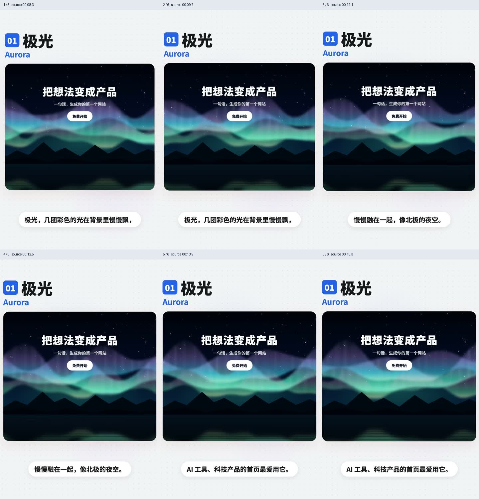
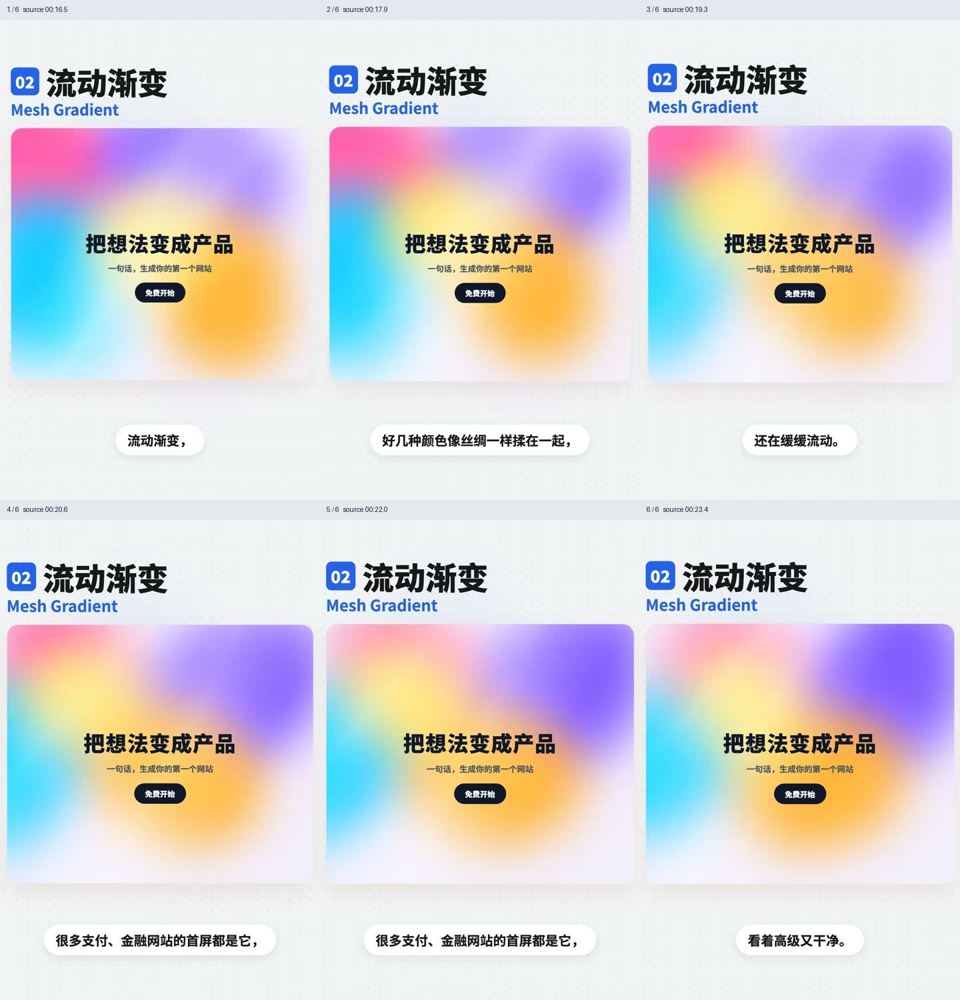
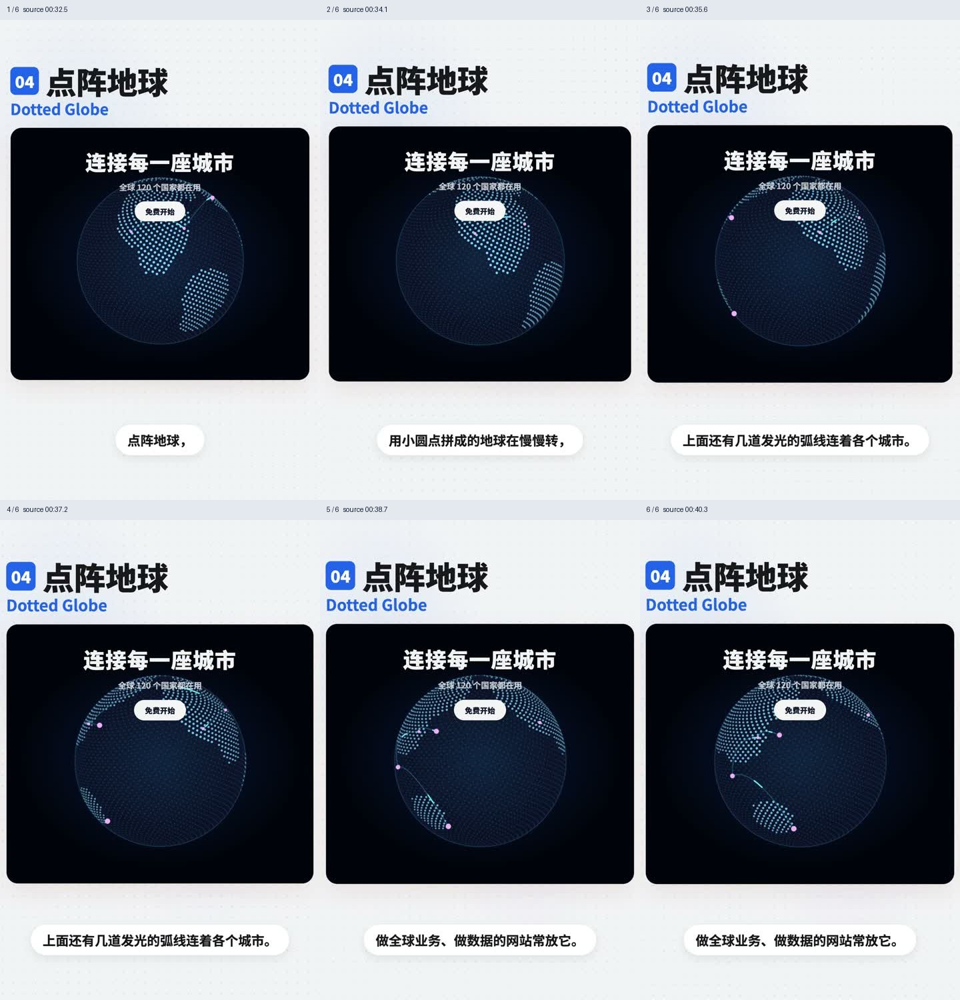
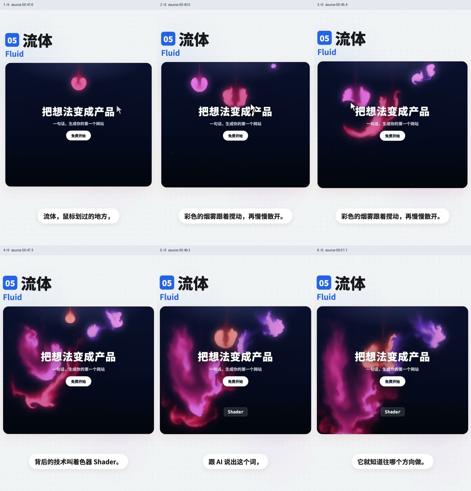
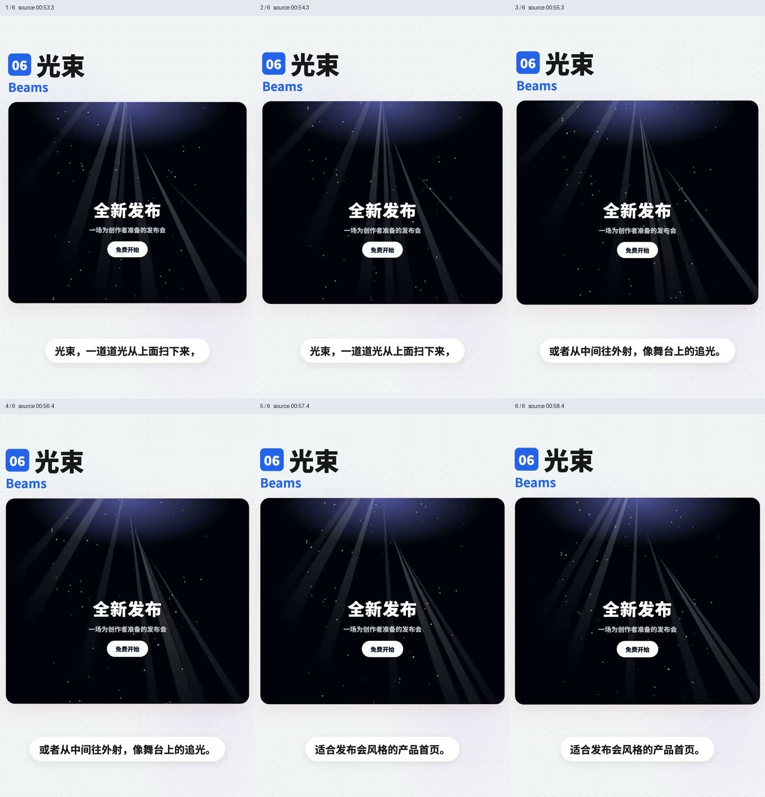
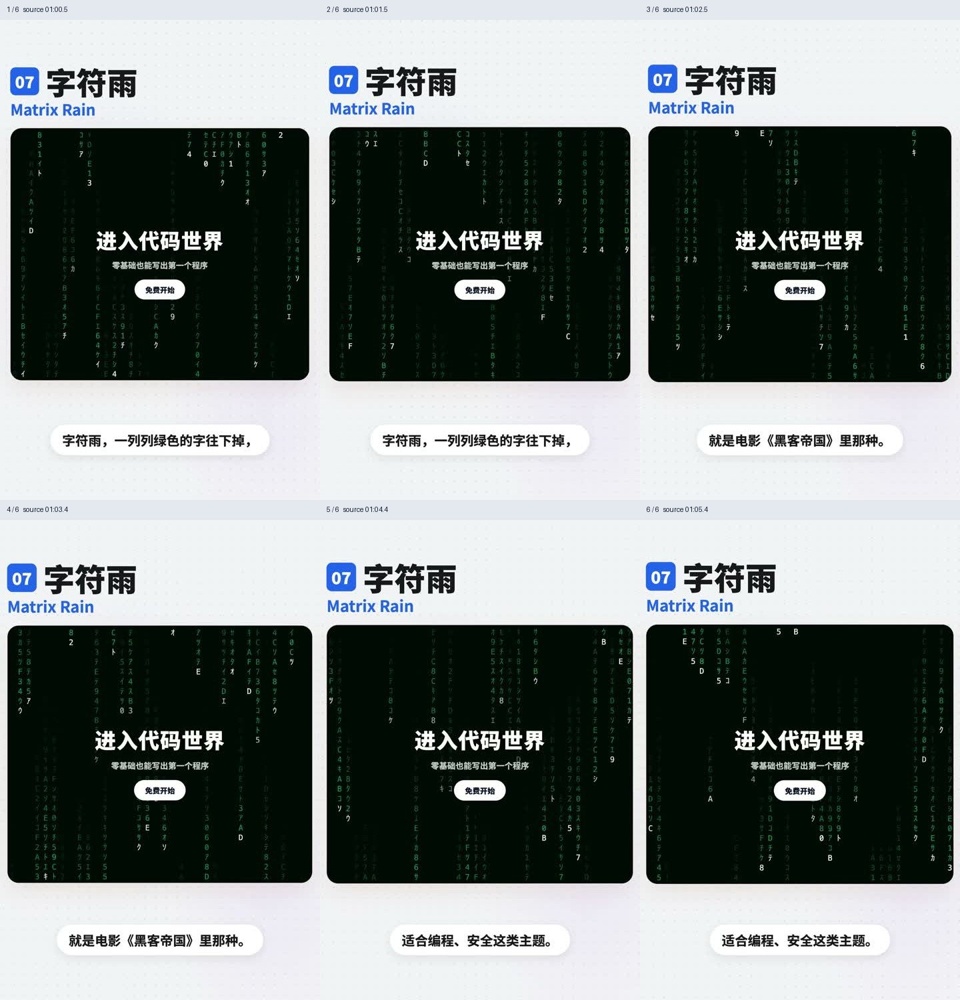
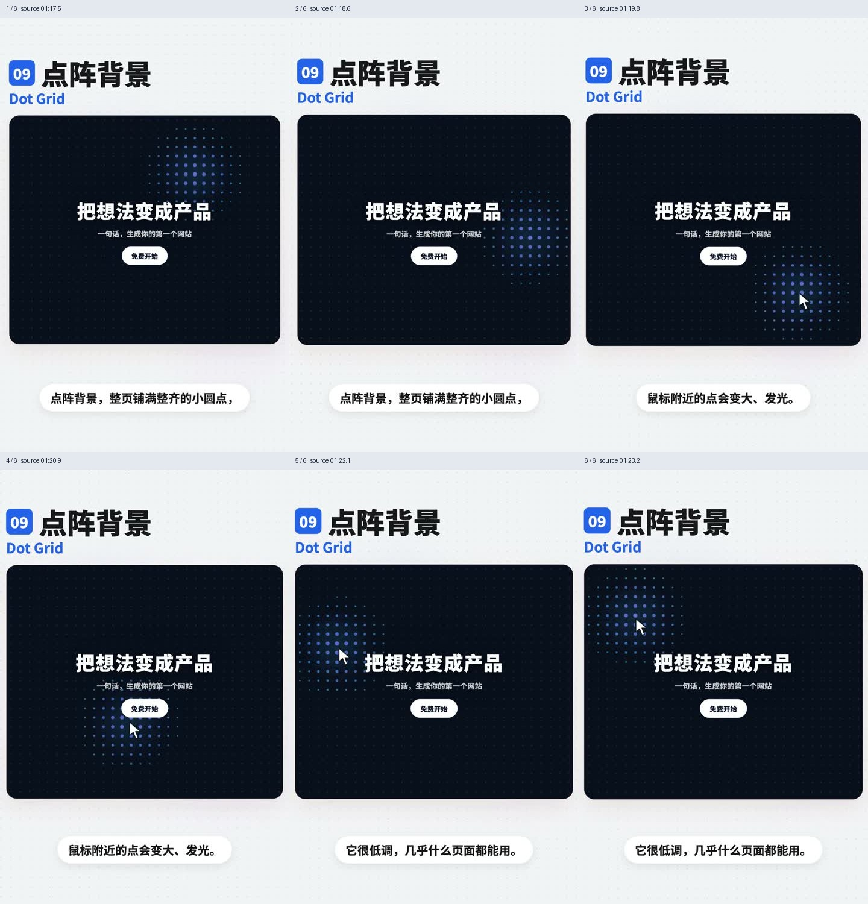
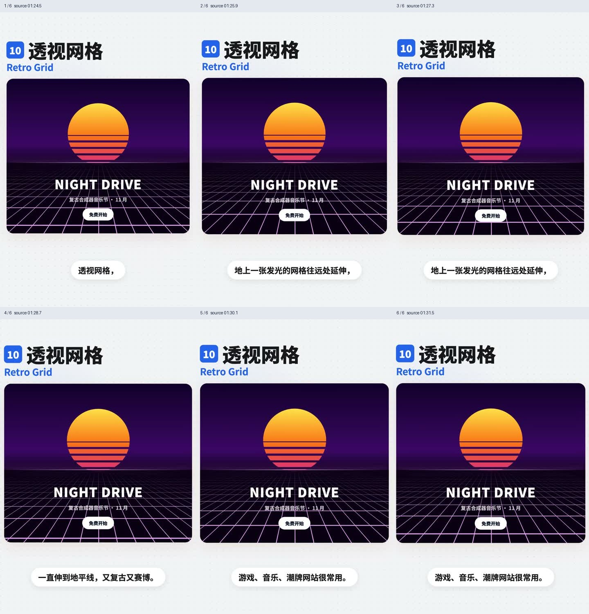
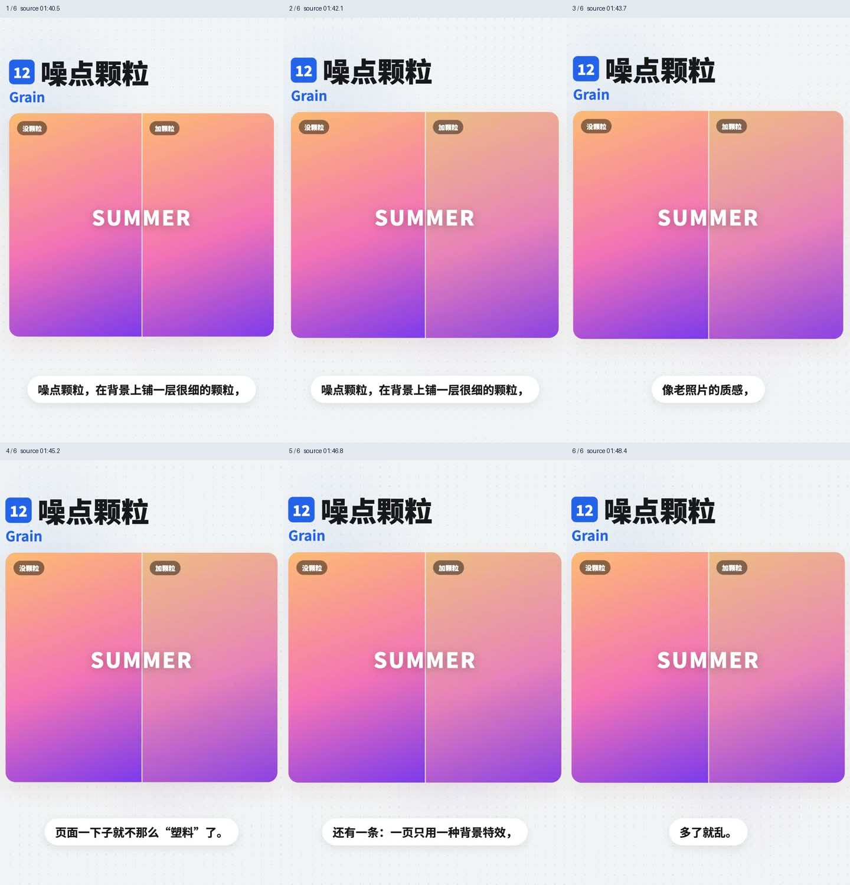
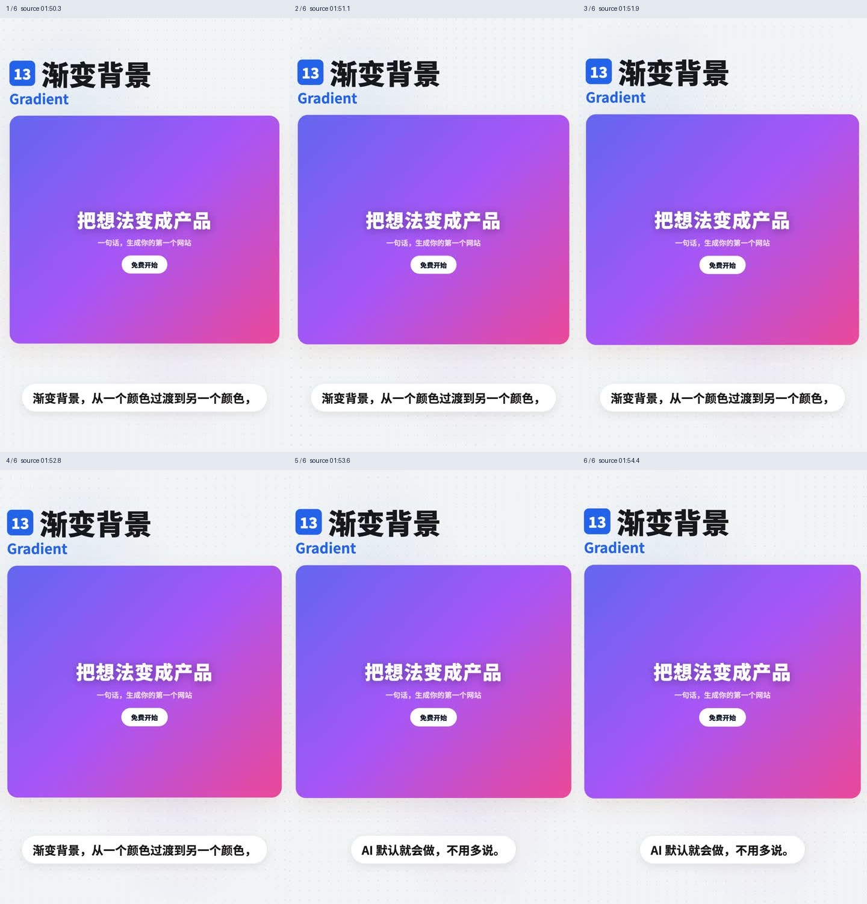

# 背景特效

六帧图看主要状态，不能证明连续运动和短暂状态。按当前项目需求实现目标组件的交互与动效。

## 目录

- [极光 / Aurora](#aurora)
- [流动渐变 / Mesh Gradient](#mesh-gradient)
- [粒子波浪 / Particle Wave](#particle-wave)
- [点阵地球 / Dotted Globe](#dotted-globe)
- [流体 / Fluid / Shader](#fluid)
- [光束 / Beams](#beams)
- [字符雨 / Matrix Rain](#matrix-rain)
- [点阵背景 / Dot Grid](#dot-grid)
- [透视网格 / Retro Grid](#retro-grid)
- [星空穿梭 / Starfield](#starfield)
- [噪点颗粒 / Grain](#grain)
- [渐变背景 / Gradient](#gradient)
- [可调 ASCII 与有序抖色 / Parametric ASCII and Ordered Dither](#ascii-dither)

## 极光 / Aurora

- 标识：`backgrounds/aurora`；类型：组件／效果。
- 效果要点：彩色光团缓慢漂浮并互相融合，呈现极光氛围；示例用于科技、AI 产品首屏。
- 指令例句：首屏背景使用缓慢融合的 Aurora 极光，保持标题清晰。
- 媒体取舍：保留 GIF＋JPG。光团漂移与融合是效果主体，需保留连续变化。
- 参考：[GIF 动图](https://raw.githubusercontent.com/dqzboy/ui-atlas/e6aa0d641c224a2cb4c8bd4262a4d18f5c7e1e22/assets/gifs/backgrounds/aurora.gif) · [六帧对照图](https://raw.githubusercontent.com/dqzboy/ui-atlas/e6aa0d641c224a2cb4c8bd4262a4d18f5c7e1e22/assets/filmstrips/backgrounds/aurora.jpg)。

## 流动渐变 / Mesh Gradient

- 标识：`backgrounds/mesh-gradient`；类型：组件／效果。
- 效果要点：多种颜色如丝绸般揉合并缓慢流动；例子为支付、金融网站首屏。
- 指令例句：用柔和缓慢流动的 Mesh Gradient 作为首屏背景。
- 媒体取舍：保留 GIF＋JPG。色块缓慢流动与混合是效果主体，区别于静态渐变。
- 参考：[GIF 动图](https://raw.githubusercontent.com/dqzboy/ui-atlas/e6aa0d641c224a2cb4c8bd4262a4d18f5c7e1e22/assets/gifs/backgrounds/mesh-gradient.gif) · [六帧对照图](https://raw.githubusercontent.com/dqzboy/ui-atlas/e6aa0d641c224a2cb4c8bd4262a4d18f5c7e1e22/assets/filmstrips/backgrounds/mesh-gradient.jpg)。

## 粒子波浪 / Particle Wave

- 标识：`backgrounds/particle-wave`；类型：组件／效果。
- 效果要点：大量小点组成起伏网面，像波浪；鼠标经过时附近粒子被推开。
- 指令例句：用起伏的粒子网面呈现 Particle Wave，鼠标附近粒子避让。
- 媒体取舍：保留 GIF＋JPG。需看粒子网面的起伏及指针附近的避让过程。
- 参考：[GIF 动图](https://raw.githubusercontent.com/dqzboy/ui-atlas/e6aa0d641c224a2cb4c8bd4262a4d18f5c7e1e22/assets/gifs/backgrounds/particle-wave.gif) · [六帧对照图](https://raw.githubusercontent.com/dqzboy/ui-atlas/e6aa0d641c224a2cb4c8bd4262a4d18f5c7e1e22/assets/filmstrips/backgrounds/particle-wave.jpg)。

## 点阵地球 / Dotted Globe

- 标识：`backgrounds/dotted-globe`；类型：组件／效果。
- 效果要点：圆点组成的地球缓慢旋转，发光弧线连接城市；用于全球业务和数据展示。
- 指令例句：在全球业务区域展示旋转点阵地球与城市连线。
- 媒体取舍：保留 GIF＋JPG。需看地球旋转与城市连线变化，图片只显示某一角度。
- 参考：[GIF 动图](https://raw.githubusercontent.com/dqzboy/ui-atlas/e6aa0d641c224a2cb4c8bd4262a4d18f5c7e1e22/assets/gifs/backgrounds/dotted-globe.gif) · [六帧对照图](https://raw.githubusercontent.com/dqzboy/ui-atlas/e6aa0d641c224a2cb4c8bd4262a4d18f5c7e1e22/assets/filmstrips/backgrounds/dotted-globe.jpg)。

## 流体 / Fluid / Shader

- 标识：`backgrounds/fluid`；类型：组件／效果。
- 效果要点：鼠标移动搅动彩色烟雾，随后缓慢消散；这类效果可使用 Shader 实现，具体技术由项目需求决定。
- 指令例句：添加随鼠标搅动、离开后逐渐消散的 Fluid 背景。
- 媒体取舍：保留 GIF＋JPG。需看指针搅动后烟雾生成、扩散与消散的过程。
- 参考：[GIF 动图](https://raw.githubusercontent.com/dqzboy/ui-atlas/e6aa0d641c224a2cb4c8bd4262a4d18f5c7e1e22/assets/gifs/backgrounds/fluid.gif) · [六帧对照图](https://raw.githubusercontent.com/dqzboy/ui-atlas/e6aa0d641c224a2cb4c8bd4262a4d18f5c7e1e22/assets/filmstrips/backgrounds/fluid.jpg)。

## 光束 / Beams

- 标识：`backgrounds/beams`；类型：组件／效果。
- 效果要点：多道光从上方扫下或向外放射，像舞台追光；适合发布会风格首屏。
- 指令例句：首屏背景加入有方向性的 Beams 光束扫动。
- 媒体取舍：保留 GIF＋JPG。光束扫动的方向、轨迹与循环是参考重点。
- 参考：[GIF 动图](https://raw.githubusercontent.com/dqzboy/ui-atlas/e6aa0d641c224a2cb4c8bd4262a4d18f5c7e1e22/assets/gifs/backgrounds/beams.gif) · [六帧对照图](https://raw.githubusercontent.com/dqzboy/ui-atlas/e6aa0d641c224a2cb4c8bd4262a4d18f5c7e1e22/assets/filmstrips/backgrounds/beams.jpg)。

## 字符雨 / Matrix Rain

- 标识：`backgrounds/matrix-rain`；类型：组件／效果。
- 效果要点：绿色字符按竖列向下落，形成黑客帝国式效果；适合编程和安全主题。
- 指令例句：背景使用竖列绿色字符向下落的 Matrix Rain。
- 媒体取舍：保留 GIF＋JPG。字符按竖列下落的方向与节奏依赖连续画面。
- 参考：[GIF 动图](https://raw.githubusercontent.com/dqzboy/ui-atlas/e6aa0d641c224a2cb4c8bd4262a4d18f5c7e1e22/assets/gifs/backgrounds/matrix-rain.gif) · [六帧对照图](https://raw.githubusercontent.com/dqzboy/ui-atlas/e6aa0d641c224a2cb4c8bd4262a4d18f5c7e1e22/assets/filmstrips/backgrounds/matrix-rain.jpg)。

## 点阵背景 / Dot Grid

- 标识：`backgrounds/dot-grid`；类型：组件／效果。
- 效果要点：规则小圆点铺满背景，鼠标附近的点变大、发光；整体较克制。
- 指令例句：用规则 Dot Grid 背景，只有指针附近点轻微放大和提亮。
- 媒体取舍：保留 GIF＋JPG。需看局部提亮和放大如何跟随指针移动。
- 参考：[GIF 动图](https://raw.githubusercontent.com/dqzboy/ui-atlas/e6aa0d641c224a2cb4c8bd4262a4d18f5c7e1e22/assets/gifs/backgrounds/dot-grid.gif) · [六帧对照图](https://raw.githubusercontent.com/dqzboy/ui-atlas/e6aa0d641c224a2cb4c8bd4262a4d18f5c7e1e22/assets/filmstrips/backgrounds/dot-grid.jpg)。

## 透视网格 / Retro Grid

- 标识：`backgrounds/retro-grid`；类型：组件／效果。
- 效果要点：地面发光网格向地平线延伸，具有复古赛博纵深；例子为音乐、游戏、潮牌页面。
- 指令例句：加入朝地平线延伸的 Retro Grid 背景。
- 媒体取舍：保留 GIF＋JPG。需保留透视网格的流动观感；只参考网格构图时查看 JPG 即可。
- 参考：[GIF 动图](https://raw.githubusercontent.com/dqzboy/ui-atlas/e6aa0d641c224a2cb4c8bd4262a4d18f5c7e1e22/assets/gifs/backgrounds/retro-grid.gif) · [六帧对照图](https://raw.githubusercontent.com/dqzboy/ui-atlas/e6aa0d641c224a2cb4c8bd4262a4d18f5c7e1e22/assets/filmstrips/backgrounds/retro-grid.jpg)。

## 星空穿梭 / Starfield

- 标识：`backgrounds/starfield`；类型：组件／效果。
- 效果要点：星点朝观察者飞来，形成太空穿越；示例建议用于开场或过渡。
- 指令例句：过渡区域使用星点朝镜头飞来的 Starfield。
- 媒体取舍：保留 GIF＋JPG。星点迎面运动与透视速度差不能由单图表达。
- 参考：[GIF 动图](https://raw.githubusercontent.com/dqzboy/ui-atlas/e6aa0d641c224a2cb4c8bd4262a4d18f5c7e1e22/assets/gifs/backgrounds/starfield.gif) · [六帧对照图](https://raw.githubusercontent.com/dqzboy/ui-atlas/e6aa0d641c224a2cb4c8bd4262a4d18f5c7e1e22/assets/filmstrips/backgrounds/starfield.jpg)。

## 噪点颗粒 / Grain

- 标识：`backgrounds/grain`；类型：组件／效果。
- 效果要点：铺一层细小颗粒增加老照片质感；建议一页选一种主背景效果，避免堆叠。
- 指令例句：给背景增加低强度细颗粒，避免与其他强动态背景叠加。
- 媒体取舍：仅保留 JPG。重点是颗粒纹理的强弱与质感，图片足够，不要求动态噪点。
- 参考：[六帧对照图](https://raw.githubusercontent.com/dqzboy/ui-atlas/e6aa0d641c224a2cb4c8bd4262a4d18f5c7e1e22/assets/filmstrips/backgrounds/grain.jpg)。

## 渐变背景 / Gradient

- 标识：`backgrounds/gradient`；类型：组件／效果。
- 效果要点：从一种颜色过渡到另一种颜色；基础渐变可保持静态，不要求持续流动。
- 指令例句：使用干净的基础渐变，不把静态渐变误做成流体。
- 媒体取舍：仅保留 JPG。基础静态渐变只需颜色与构图参考，不引入持续流动。
- 参考：[六帧对照图](https://raw.githubusercontent.com/dqzboy/ui-atlas/e6aa0d641c224a2cb4c8bd4262a4d18f5c7e1e22/assets/filmstrips/backgrounds/gradient.jpg)。

## 可调 ASCII 与有序抖色 / Parametric ASCII and Ordered Dither

- 标识：`backgrounds/ascii-dither`；类型：组件／效果。
- 效果要点：对指定图片或视频做 ASCII 字符取样或 4×4 Bayer 有序抖色，支持遮罩、调色板、取样方向、强度、大小和间距。
- 实现关注：ASCII 按亮度映射字符密度；Dither 用 Bayer 阈值量化每个通道。各滤镜分别保存设置；推荐 ASCII 为 mask 90、暗部取样、strength 100、size 37、spacing 0；Dither 为 88 / 100 / 15 / 0。这些是 0–100 控件值，不是像素。实际 ASCII 字号映射 7–24px，Dither 块大小映射 2–9px。采样画布长边约 480px，输出限制 DPR 和像素预算；静图按变更重绘，视频只在播放且可见时绘制。
- 验证重点：检查原图覆盖关系、圆角、亮暗主题、切换设置的记忆与重置、跨域或视频无法读像素时的原素材回退；减弱动态时暂停装饰视频。
- 指令例句：参考 backgrounds/ascii-dither，对指定图片或视频做 ASCII 字符取样或 4×4 Bayer 有序抖色，支持遮罩、调色板、取样方向、强度、大小和间距。
- [完整实现配方与提示词](recipes/ascii-dither.md)；证据类型：文字配方，未附动画。
