# 按钮、状态与选项

六帧图看主要状态，不能证明连续运动和短暂状态。按当前项目需求实现目标组件的交互与动效。

## 目录

- [按钮层级总览 / Button hierarchy](#button-hierarchy)
- [主按钮 / Primary Button](#primary-button)
- [次按钮 / Secondary Button](#secondary-button)
- [线框按钮 / Outline Button](#outline-button)
- [文字按钮 / Text Button](#text-button)
- [危险按钮 / Danger Button](#danger-button)
- [幽灵按钮 / Ghost Button](#ghost-button)
- [图标按钮 / Icon Button](#icon-button)
- [胶囊按钮 / Pill Button](#pill-button)
- [按钮组 / Button Group](#button-group)
- [分割按钮 / Split Button](#split-button)
- [悬浮按钮 / Floating Action Button / FAB](#fab)
- [按钮主次纠正 / Hierarchy correction](#hierarchy-correction)
- [悬停 / Hover](#hover)
- [按下 / Pressed](#pressed)
- [焦点 / Focus](#focus)
- [加载中 / Loading](#loading)
- [成功 / Success](#success)
- [禁用 / Disabled](#disabled)
- [按钮反馈补全 / Button feedback correction](#state-correction)
- [开关 / Switch / Toggle](#switch)
- [复选框 / Checkbox](#checkbox)
- [半选 / Indeterminate](#indeterminate)
- [单选框 / Radio](#radio)
- [分段控制器 / Segmented Control / Toggle Group](#segmented-control)
- [切换按钮 / Toggle Button](#toggle-button)
- [可选标签 / Chip](#chip)
- [计数器 / Stepper / Number Input](#stepper)
- [开关和选项选型 / Control selection](#control-selection)
- [有点击手感的拟物按钮 / Tactile Skeuomorphic Button](#tactile-button)

## 按钮层级总览 / Button hierarchy

- 标识：`buttons-controls/button-hierarchy`；类型：选型／纠错。
- 效果要点：按钮要按动作重要程度建立主次，通过不同视觉权重区分。
- 指令例句：先根据任务重要程度确定操作层级，再选择按钮样式。
- 媒体取舍：仅保留静态图片（JPG／PNG）。主次视觉权重与层级对照由图片表达。
- 参考：[六帧对照图](../assets/filmstrips/buttons-controls/button-hierarchy.jpg)。

<!-- ui-atlas:details buttons-controls/button-hierarchy -->
- 原尺寸图片：[01 · 800×600](../assets/details/buttons-controls/button-hierarchy.png)。
- 清晰度边界：从现存 GIF 解出原尺寸独立帧，避免总览缩图和二次 JPEG 压缩；GIF 的分辨率、色彩与源压缩限制仍在。

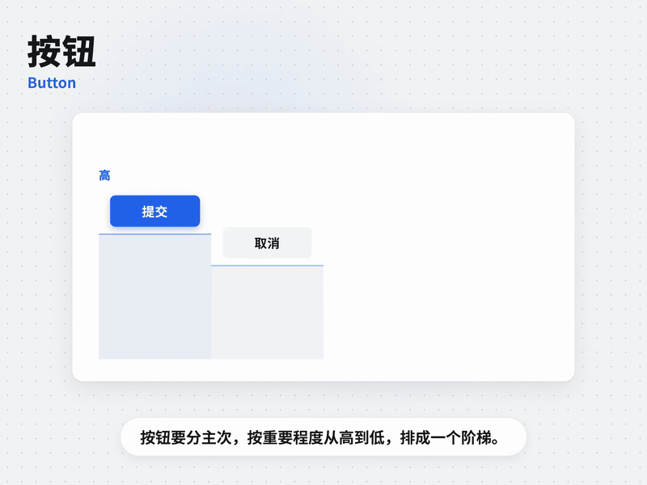
<!-- /ui-atlas:details -->

## 主按钮 / Primary Button

- 标识：`buttons-controls/primary-button`；类型：组件／效果。
- 效果要点：颜色最重最显眼，承载提交、付款等关键动作；建议一个操作区域突出一个主按钮。
- 指令例句：提交用主按钮，同一区域只突出一个关键动作。
- 媒体取舍：仅保留静态图片（JPG／PNG）。重点是主操作的视觉权重与位置，图片足够。
- 参考：[六帧对照图](../assets/filmstrips/buttons-controls/primary-button.jpg)。

<!-- ui-atlas:details buttons-controls/primary-button -->
- 原尺寸图片：[01 · 800×600](../assets/details/buttons-controls/primary-button.png)。
- 清晰度边界：从现存 GIF 解出原尺寸独立帧，避免总览缩图和二次 JPEG 压缩；GIF 的分辨率、色彩与源压缩限制仍在。

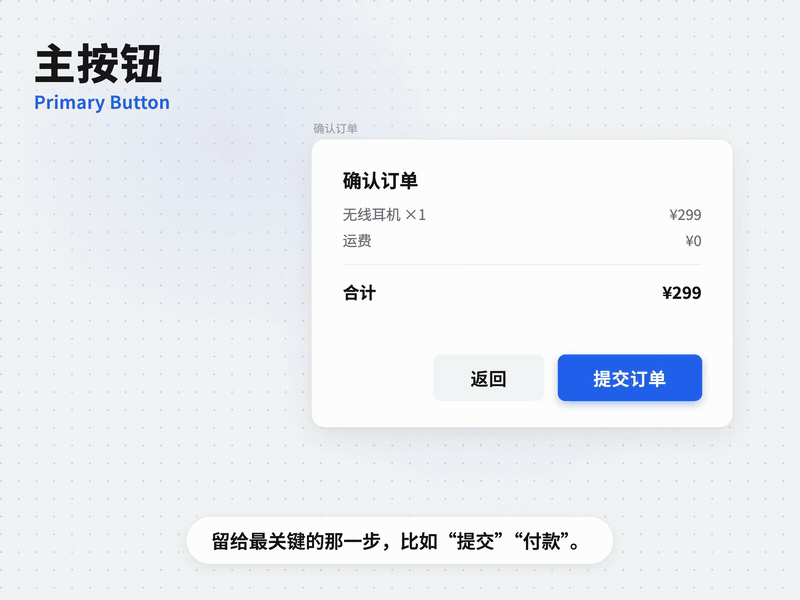
<!-- /ui-atlas:details -->

## 次按钮 / Secondary Button

- 标识：`buttons-controls/secondary-button`；类型：组件／效果。
- 效果要点：视觉权重比主按钮轻，通常承载取消和返回。
- 指令例句：取消和返回使用低于主操作权重的次按钮。
- 媒体取舍：仅保留静态图片（JPG／PNG）。重点是次操作的视觉权重，图片足够。
- 参考：[六帧对照图](../assets/filmstrips/buttons-controls/secondary-button.jpg)。

<!-- ui-atlas:details buttons-controls/secondary-button -->
- 原尺寸图片：[01 · 800×600](../assets/details/buttons-controls/secondary-button.png)。
- 清晰度边界：从现存 GIF 解出原尺寸独立帧，避免总览缩图和二次 JPEG 压缩；GIF 的分辨率、色彩与源压缩限制仍在。

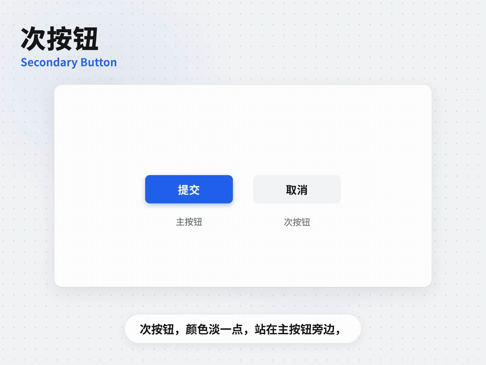
<!-- /ui-atlas:details -->

## 线框按钮 / Outline Button

- 标识：`buttons-controls/outline-button`；类型：组件／效果。
- 效果要点：只有轮廓边框、内部留空，示例视觉较轻；具体层级应结合现有设计系统。
- 指令例句：使用保留边框、无实色填充的线框按钮。
- 媒体取舍：仅保留静态图片（JPG／PNG）。边框与无填充形态属于静态样式。
- 参考：[六帧对照图](../assets/filmstrips/buttons-controls/outline-button.jpg)。

<!-- ui-atlas:details buttons-controls/outline-button -->
- 原尺寸图片：[01 · 800×600](../assets/details/buttons-controls/outline-button.png)。
- 清晰度边界：从现存 GIF 解出原尺寸独立帧，避免总览缩图和二次 JPEG 压缩；GIF 的分辨率、色彩与源压缩限制仍在。

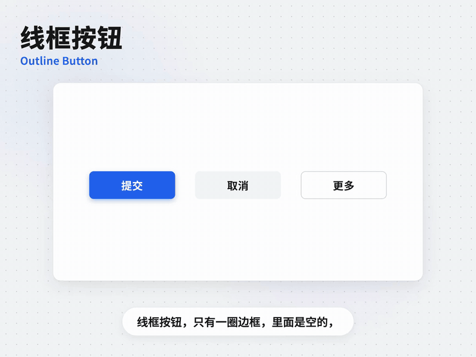
<!-- /ui-atlas:details -->

## 文字按钮 / Text Button

- 标识：`buttons-controls/text-button`；类型：组件／效果。
- 效果要点：像一行文字，视觉较弱；例子为登录表单的忘记密码入口。
- 指令例句：忘记密码采用文字形式的轻量操作入口。
- 媒体取舍：仅保留静态图片（JPG／PNG）。文字入口的视觉层级属于静态样式。
- 参考：[六帧对照图](../assets/filmstrips/buttons-controls/text-button.jpg)。

<!-- ui-atlas:details buttons-controls/text-button -->
- 原尺寸图片：[01 · 800×600](../assets/details/buttons-controls/text-button.png)。
- 清晰度边界：从现存 GIF 解出原尺寸独立帧，避免总览缩图和二次 JPEG 压缩；GIF 的分辨率、色彩与源压缩限制仍在。

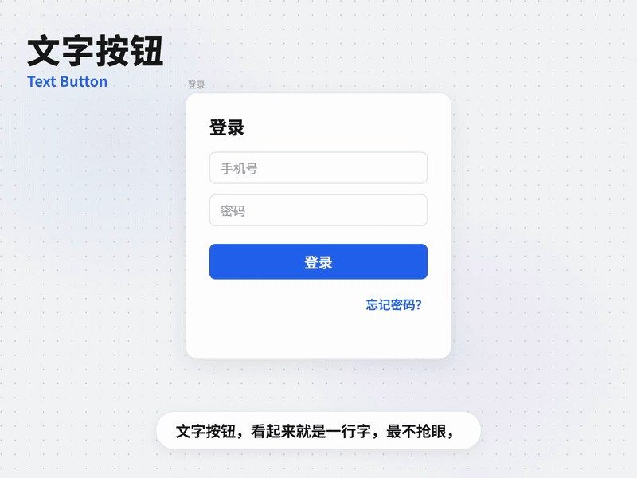
<!-- /ui-atlas:details -->

## 危险按钮 / Danger Button

- 标识：`buttons-controls/danger-button`；类型：组件／效果。
- 效果要点：红色表达删除、注销等有破坏性的动作，让用户辨认后果。
- 指令例句：删除操作使用危险样式并配合明确的动作文字。
- 媒体取舍：仅保留静态图片（JPG／PNG）。危险色与动作文字属于静态语义表达。
- 参考：[六帧对照图](../assets/filmstrips/buttons-controls/danger-button.jpg)。

<!-- ui-atlas:details buttons-controls/danger-button -->
- 原尺寸图片：[01 · 800×600](../assets/details/buttons-controls/danger-button.png)。
- 清晰度边界：从现存 GIF 解出原尺寸独立帧，避免总览缩图和二次 JPEG 压缩；GIF 的分辨率、色彩与源压缩限制仍在。

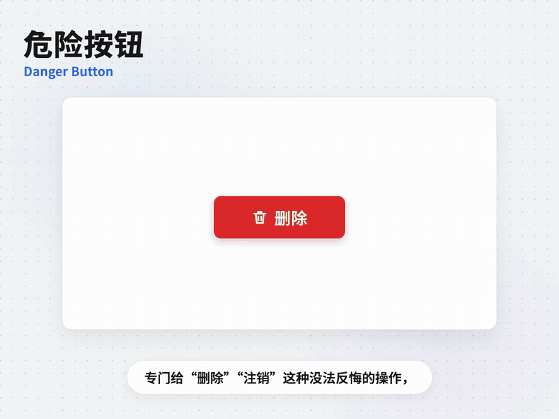
<!-- /ui-atlas:details -->

## 幽灵按钮 / Ghost Button

- 标识：`buttons-controls/ghost-button`；类型：组件／效果。
- 效果要点：示例无边框，平时背景很轻，悬停显现；用于图片或深色背景。命名在不同组件库可能有差异。
- 指令例句：按参考使用轻背景、无边框的 Ghost 样式，悬停增强可见性。
- 媒体取舍：仅保留静态图片（JPG／PNG）。默认与悬停外观对照足够，没有必须观察的独特轨迹。
- 参考：[六帧对照图](../assets/filmstrips/buttons-controls/ghost-button.jpg)。

<!-- ui-atlas:details buttons-controls/ghost-button -->
- 原尺寸图片：[01 · 800×600](../assets/details/buttons-controls/ghost-button-01.png) · [02 · 800×600](../assets/details/buttons-controls/ghost-button-02.png)。
- 多图用途：分别展示默认与悬停外观。
- 清晰度边界：从现存 GIF 解出原尺寸独立帧，避免总览缩图和二次 JPEG 压缩；GIF 的分辨率、色彩与源压缩限制仍在。

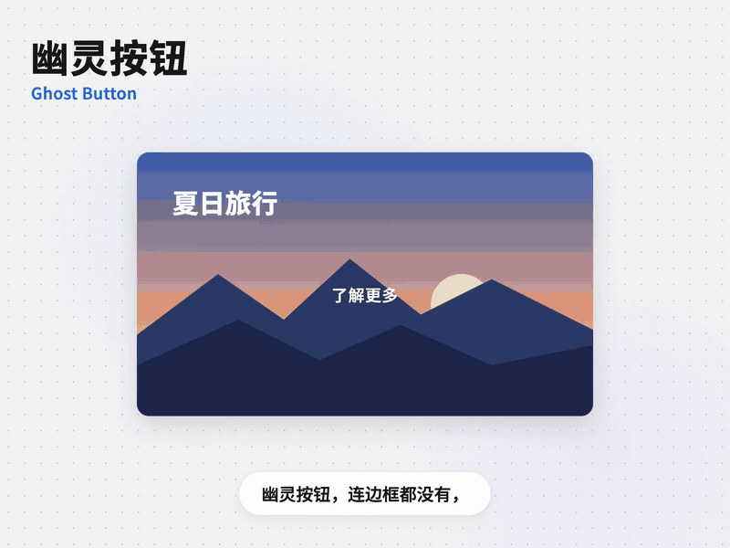
<!-- /ui-atlas:details -->

## 图标按钮 / Icon Button

- 标识：`buttons-controls/icon-button`；类型：组件／效果。
- 效果要点：仅图标表达关闭、更多等操作；图标含义不清楚时增加文字。
- 指令例句：明确操作可使用图标按钮，含义不直观时附可见文字。
- 媒体取舍：仅保留静态图片（JPG／PNG）。图标含义、尺寸和文字辅助属于静态可辨识性参考。
- 参考：[六帧对照图](../assets/filmstrips/buttons-controls/icon-button.jpg)。

<!-- ui-atlas:details buttons-controls/icon-button -->
- 原尺寸图片：[01 · 800×600](../assets/details/buttons-controls/icon-button.png)。
- 清晰度边界：从现存 GIF 解出原尺寸独立帧，避免总览缩图和二次 JPEG 压缩；GIF 的分辨率、色彩与源压缩限制仍在。

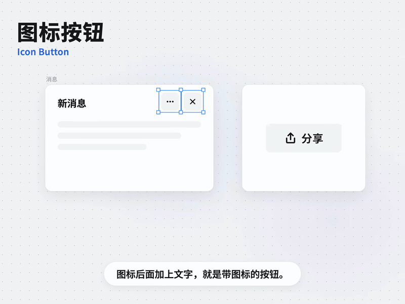
<!-- /ui-atlas:details -->

## 胶囊按钮 / Pill Button

- 标识：`buttons-controls/pill-button`；类型：组件／效果。
- 效果要点：两端完全圆润；这是一种形状，不代表主次级别，主按钮和次按钮都可采用。
- 指令例句：将指定按钮改成胶囊形，保持原有主次层级。
- 媒体取舍：仅保留静态图片（JPG／PNG）。胶囊是形状，图片足够，不要求额外运动。
- 参考：[六帧对照图](../assets/filmstrips/buttons-controls/pill-button.jpg)。

<!-- ui-atlas:details buttons-controls/pill-button -->
- 原尺寸图片：[01 · 800×600](../assets/details/buttons-controls/pill-button.png)。
- 清晰度边界：从现存 GIF 解出原尺寸独立帧，避免总览缩图和二次 JPEG 压缩；GIF 的分辨率、色彩与源压缩限制仍在。

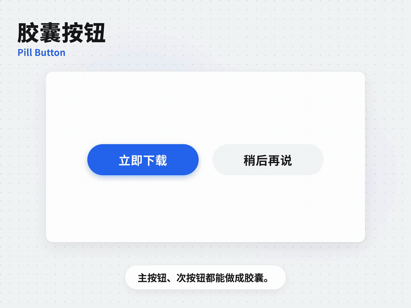
<!-- /ui-atlas:details -->

## 按钮组 / Button Group

- 标识：`buttons-controls/button-group`；类型：组件／效果。
- 效果要点：相关操作紧邻成组，如加粗、斜体、下划线；分组本身不决定是否单选。
- 指令例句：把相关格式操作排成按钮组，保留各自独立状态。
- 媒体取舍：仅保留静态图片（JPG／PNG）。分组排布与独立选中态由图片表达。
- 参考：[六帧对照图](../assets/filmstrips/buttons-controls/button-group.jpg)。

<!-- ui-atlas:details buttons-controls/button-group -->
- 原尺寸图片：[01 · 800×600](../assets/details/buttons-controls/button-group.png)。
- 清晰度边界：从现存 GIF 解出原尺寸独立帧，避免总览缩图和二次 JPEG 压缩；GIF 的分辨率、色彩与源压缩限制仍在。

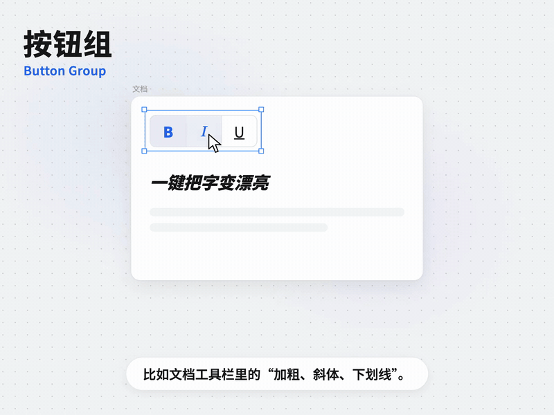
<!-- /ui-atlas:details -->

## 分割按钮 / Split Button

- 标识：`buttons-controls/split-button`；类型：组件／效果。
- 效果要点：左侧直接执行常用动作，右侧箭头展开替代动作；示例保存与另存为。
- 指令例句：保存按钮右侧分出菜单箭头，放入另存为选项。
- 媒体取舍：仅保留静态图片（JPG／PNG）。主动作和菜单入口的分工由状态图表达。
- 参考：[六帧对照图](../assets/filmstrips/buttons-controls/split-button.jpg)。

<!-- ui-atlas:details buttons-controls/split-button -->
- 原尺寸图片：[01 · 800×600](../assets/details/buttons-controls/split-button.png)。
- 清晰度边界：从现存 GIF 解出原尺寸独立帧，避免总览缩图和二次 JPEG 压缩；GIF 的分辨率、色彩与源压缩限制仍在。

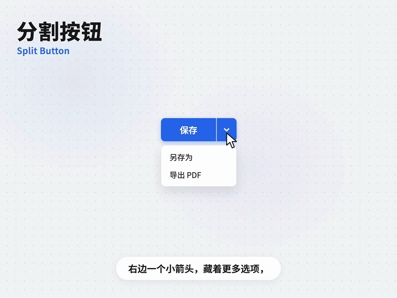
<!-- /ui-atlas:details -->

## 悬浮按钮 / Floating Action Button / FAB

- 标识：`buttons-controls/fab`；类型：组件／效果。
- 效果要点：圆形按钮固定于视口右下，页面滚动时位置不变；用于页面高频核心动作如发帖。
- 指令例句：移动列表右下固定一个发帖 FAB，避免遮挡正文和系统安全区。
- 媒体取舍：仅保留静态图片（JPG／PNG）。固定位置、尺寸与安全区由图片和文字表达，运行时仍需滚动核对。
- 参考：[六帧对照图](../assets/filmstrips/buttons-controls/fab.jpg)。

<!-- ui-atlas:details buttons-controls/fab -->
- 原尺寸图片：[01 · 800×600](../assets/details/buttons-controls/fab.png)。
- 清晰度边界：从现存 GIF 解出原尺寸独立帧，避免总览缩图和二次 JPEG 压缩；GIF 的分辨率、色彩与源压缩限制仍在。

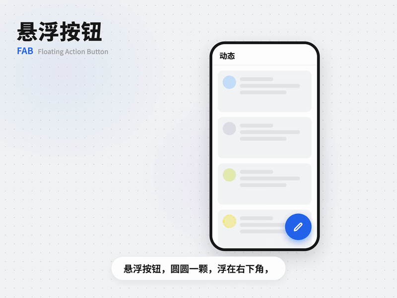
<!-- /ui-atlas:details -->

## 按钮主次纠正 / Hierarchy correction

- 标识：`buttons-controls/hierarchy-correction`；类型：选型／纠错。
- 效果要点：将全部长一样的按钮区分为提交主按钮、取消次按钮、删除危险按钮，并保持一个区域一个主要动作。
- 指令例句：提交用主按钮，取消用次按钮，删除用危险按钮。
- 媒体取舍：仅保留静态图片（JPG／PNG）。提交、取消和删除的前后层级对照由图片表达。
- 参考：[六帧对照图](../assets/filmstrips/buttons-controls/hierarchy-correction.jpg)。

<!-- ui-atlas:details buttons-controls/hierarchy-correction -->
- 原尺寸图片：[01 · 800×600](../assets/details/buttons-controls/hierarchy-correction.png)。
- 清晰度边界：从现存 GIF 解出原尺寸独立帧，避免总览缩图和二次 JPEG 压缩；GIF 的分辨率、色彩与源压缩限制仍在。

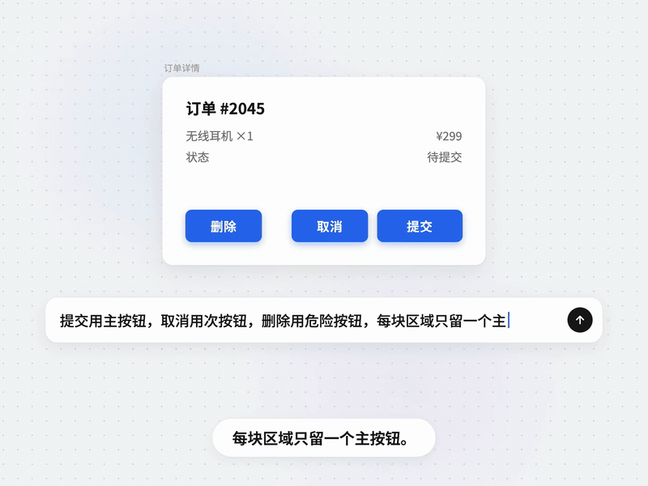
<!-- /ui-atlas:details -->

## 悬停 / Hover

- 标识：`buttons-controls/hover`；类型：组件／效果。
- 效果要点：默认状态在鼠标进入后变亮或轻微抬起，表达可点击。
- 指令例句：按钮悬停时轻微提亮，保持层级和尺寸稳定。
- 媒体取舍：仅保留静态图片（JPG／PNG）。默认与提亮后的状态图足够；若需要上浮过程，选 hover-lift。
- 参考：[六帧对照图](../assets/filmstrips/buttons-controls/hover.jpg)。

<!-- ui-atlas:details buttons-controls/hover -->
- 原尺寸图片：[01 · 800×600](../assets/details/buttons-controls/hover-01.png) · [02 · 800×600](../assets/details/buttons-controls/hover-02.png)。
- 多图用途：分别展示默认与悬停提亮状态。
- 清晰度边界：从现存 GIF 解出原尺寸独立帧，避免总览缩图和二次 JPEG 压缩；GIF 的分辨率、色彩与源压缩限制仍在。

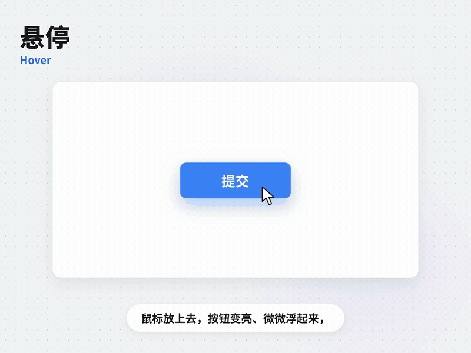
<!-- /ui-atlas:details -->

## 按下 / Pressed

- 标识：`buttons-controls/pressed`；类型：组件／效果。
- 效果要点：按住的一瞬间略微缩小或下压，表达收到输入。
- 指令例句：按钮按下时短暂轻微缩小，松开恢复。
- 媒体取舍：保留 GIF＋静态图片。下压仅在 GIF 尾帧短暂出现，现有六帧图漏掉；保留 GIF，松开恢复仍需在项目中验证。
- 参考：[GIF 动图](../assets/gifs/buttons-controls/pressed.gif) · [六帧对照图](../assets/filmstrips/buttons-controls/pressed.jpg)。

<!-- ui-atlas:details buttons-controls/pressed -->
- 原尺寸图片：[01 · 800×600](../assets/details/buttons-controls/pressed.png)。
- 连续效果：[GIF · 800×600](../assets/gifs/buttons-controls/pressed.gif)。
- 清晰度边界：从现存 GIF 解出原尺寸独立帧，避免总览缩图和二次 JPEG 压缩；GIF 的分辨率、色彩与源压缩限制仍在。 最后一张独立图补充原 GIF 尾部的短暂按下状态；松开恢复仍需在项目中验证。

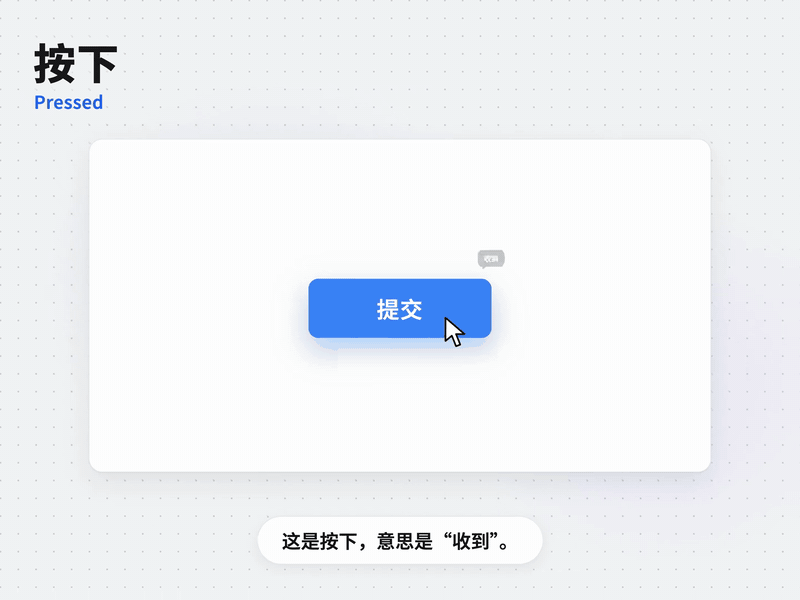
<!-- /ui-atlas:details -->

## 焦点 / Focus

- 标识：`buttons-controls/focus`；类型：组件／效果。
- 效果要点：用 Tab 选中按钮时出现外圈，帮助键盘用户判断当前位置。
- 指令例句：保留清楚的键盘焦点环，并验证 Tab 顺序。
- 媒体取舍：仅保留静态图片（JPG／PNG）。焦点环外观由图片表达，Tab 顺序需在实际项目验证。
- 参考：[六帧对照图](../assets/filmstrips/buttons-controls/focus.jpg)。

<!-- ui-atlas:details buttons-controls/focus -->
- 原尺寸图片：[01 · 800×600](../assets/details/buttons-controls/focus-01.png) · [02 · 800×600](../assets/details/buttons-controls/focus-02.png)。
- 多图用途：分别展示输入框与按钮上的焦点环。
- 清晰度边界：从现存 GIF 解出原尺寸独立帧，避免总览缩图和二次 JPEG 压缩；GIF 的分辨率、色彩与源压缩限制仍在。

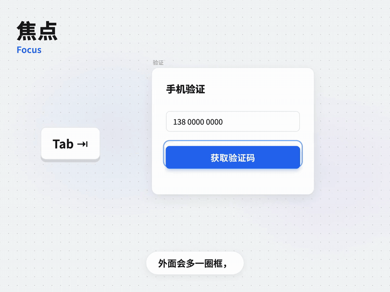
<!-- /ui-atlas:details -->

## 加载中 / Loading

- 标识：`buttons-controls/loading`；类型：组件／效果。
- 效果要点：提交后按钮出现转圈并阻止重复点击，表达任务处理中。
- 指令例句：请求未结束时显示加载指示并阻止重复提交。
- 媒体取舍：保留 GIF＋静态图片。旋转指示持续运动，需看加载期间的动态反馈。
- 参考：[GIF 动图](../assets/gifs/buttons-controls/loading.gif) · [六帧对照图](../assets/filmstrips/buttons-controls/loading.jpg)。

<!-- ui-atlas:details buttons-controls/loading -->
- 原尺寸图片：[01 · 800×600](../assets/details/buttons-controls/loading.png)。
- 连续效果：[GIF · 800×600](../assets/gifs/buttons-controls/loading.gif)。
- 清晰度边界：从现存 GIF 解出原尺寸独立帧，避免总览缩图和二次 JPEG 压缩；GIF 的分辨率、色彩与源压缩限制仍在。

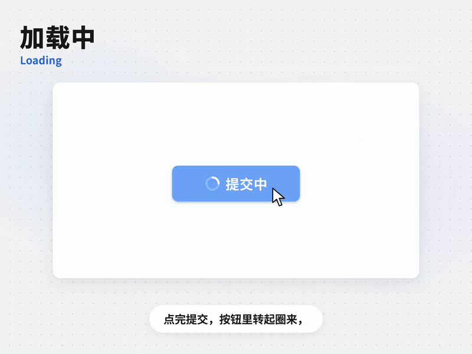
<!-- /ui-atlas:details -->

## 成功 / Success

- 标识：`buttons-controls/success`；类型：组件／效果。
- 效果要点：加载结束后用对勾确认完成。
- 指令例句：提交成功后将加载指示转成成功对勾。
- 媒体取舍：仅保留静态图片（JPG／PNG）。加载与成功对勾两种状态足够，没有独立的变形动画要求。
- 参考：[六帧对照图](../assets/filmstrips/buttons-controls/success.jpg)。

<!-- ui-atlas:details buttons-controls/success -->
- 原尺寸图片：[01 · 800×600](../assets/details/buttons-controls/success-01.png) · [02 · 800×600](../assets/details/buttons-controls/success-02.png)。
- 多图用途：分别展示加载中与提交成功状态。
- 清晰度边界：从现存 GIF 解出原尺寸独立帧，避免总览缩图和二次 JPEG 压缩；GIF 的分辨率、色彩与源压缩限制仍在。

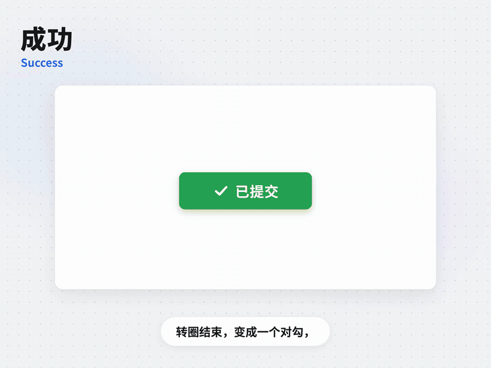
<!-- /ui-atlas:details -->

## 禁用 / Disabled

- 标识：`buttons-controls/disabled`；类型：组件／效果。
- 效果要点：不满足条件时按钮变灰且不可操作，例子为表单未填写完整。
- 指令例句：条件未满足时使用实际禁用状态，并让用户可理解尚缺什么。
- 媒体取舍：仅保留静态图片（JPG／PNG）。禁用外观及原因说明由图片和文字表达。
- 参考：[六帧对照图](../assets/filmstrips/buttons-controls/disabled.jpg)。

<!-- ui-atlas:details buttons-controls/disabled -->
- 原尺寸图片：[01 · 800×600](../assets/details/buttons-controls/disabled.png)。
- 清晰度边界：从现存 GIF 解出原尺寸独立帧，避免总览缩图和二次 JPEG 压缩；GIF 的分辨率、色彩与源压缩限制仍在。

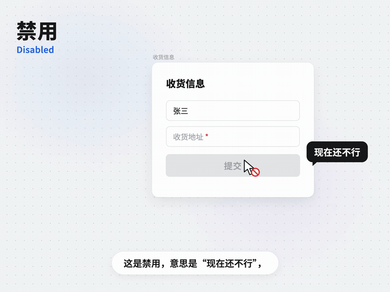
<!-- /ui-atlas:details -->

## 按钮反馈补全 / Button feedback correction

- 标识：`buttons-controls/state-correction`；类型：选型／纠错。
- 效果要点：缺少反馈会让操作结果不明确，应补充悬停、按下和提交加载防连点。
- 指令例句：为现有按钮补上悬停、按下及提交加载状态，防止重复点击。
- 媒体取舍：仅保留静态图片（JPG／PNG）。补全反馈的规则与前后对照由图片表达，按压和旋转分别路由至动态条目。
- 参考：[六帧对照图](../assets/filmstrips/buttons-controls/state-correction.jpg)。

<!-- ui-atlas:details buttons-controls/state-correction -->
- 原尺寸图片：[01 · 800×600](../assets/details/buttons-controls/state-correction.png)。
- 清晰度边界：从现存 GIF 解出原尺寸独立帧，避免总览缩图和二次 JPEG 压缩；GIF 的分辨率、色彩与源压缩限制仍在。

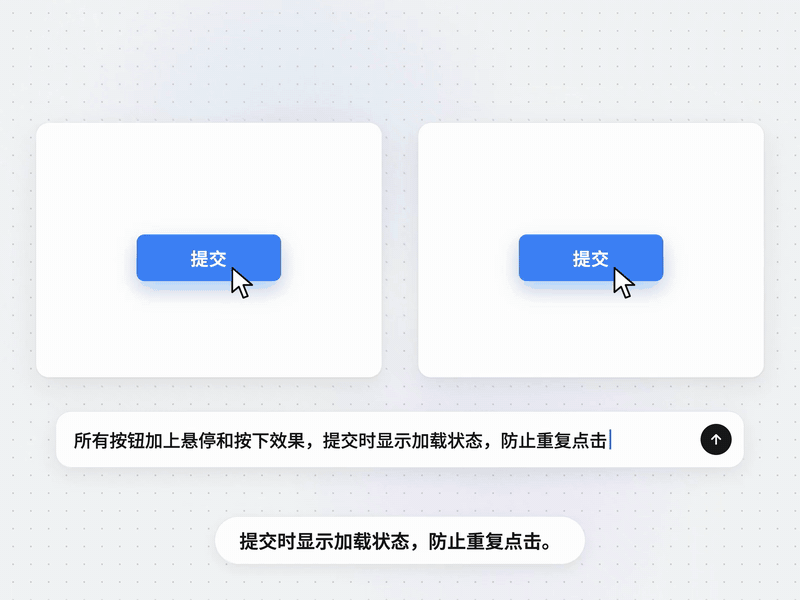
<!-- /ui-atlas:details -->

## 开关 / Switch / Toggle

- 标识：`buttons-controls/switch`；类型：组件／效果。
- 效果要点：二元开闭，一拨即生效；示例为深色模式。核心区别是即时应用。
- 指令例句：深色模式使用开关，切换立即生效。
- 媒体取舍：仅保留静态图片（JPG／PNG）。核心是即时应用的开闭语义，状态图足够；特殊涟漪另见 switch-group-ripple。
- 参考：[六帧对照图](../assets/filmstrips/buttons-controls/switch.jpg)。

<!-- ui-atlas:details buttons-controls/switch -->
- 原尺寸图片：[01 · 800×600](../assets/details/buttons-controls/switch-01.png) · [02 · 800×600](../assets/details/buttons-controls/switch-02.png)。
- 多图用途：分别展示关闭与开启后的外观及主题变化。
- 清晰度边界：从现存 GIF 解出原尺寸独立帧，避免总览缩图和二次 JPEG 压缩；GIF 的分辨率、色彩与源压缩限制仍在。

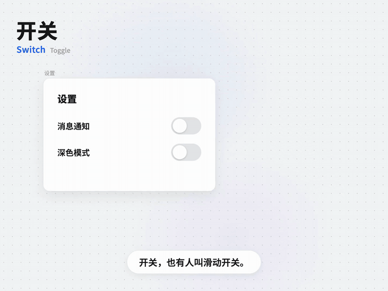
<!-- /ui-atlas:details -->

## 复选框 / Checkbox

- 标识：`buttons-controls/checkbox`；类型：组件／效果。
- 效果要点：方形勾选，可同时选择多项；示例为先编辑偏好再保存，与即时开关区分。
- 指令例句：多个通知偏好使用复选框，统一保存后生效。
- 媒体取舍：仅保留静态图片（JPG／PNG）。多选与统一保存的语义由状态图和文字表达。
- 参考：[六帧对照图](../assets/filmstrips/buttons-controls/checkbox.jpg)。

<!-- ui-atlas:details buttons-controls/checkbox -->
- 原尺寸图片：[01 · 800×600](../assets/details/buttons-controls/checkbox.png)。
- 清晰度边界：从现存 GIF 解出原尺寸独立帧，避免总览缩图和二次 JPEG 压缩；GIF 的分辨率、色彩与源压缩限制仍在。

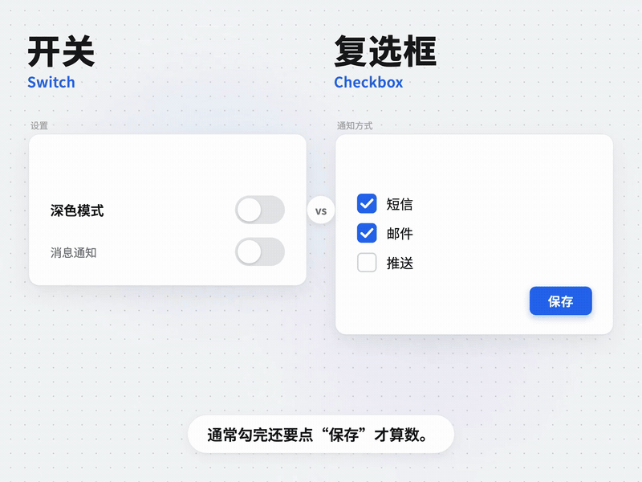
<!-- /ui-atlas:details -->

## 半选 / Indeterminate

- 标识：`buttons-controls/indeterminate`；类型：组件／效果。
- 效果要点：子选项只选择部分时，父级全选框显示横线，表示混合状态。
- 指令例句：全选框准确反映全选、全不选和部分选中的状态。
- 媒体取舍：仅保留静态图片（JPG／PNG）。全选、半选和全不选可由状态图片表达。
- 参考：[六帧对照图](../assets/filmstrips/buttons-controls/indeterminate.jpg)。

<!-- ui-atlas:details buttons-controls/indeterminate -->
- 原尺寸图片：[01 · 800×600](../assets/details/buttons-controls/indeterminate-01.png) · [02 · 800×600](../assets/details/buttons-controls/indeterminate-02.png) · [03 · 800×600](../assets/details/buttons-controls/indeterminate-03.png)。
- 多图用途：分别展示全不选、半选与全选状态。
- 清晰度边界：从现存 GIF 解出原尺寸独立帧，避免总览缩图和二次 JPEG 压缩；GIF 的分辨率、色彩与源压缩限制仍在。

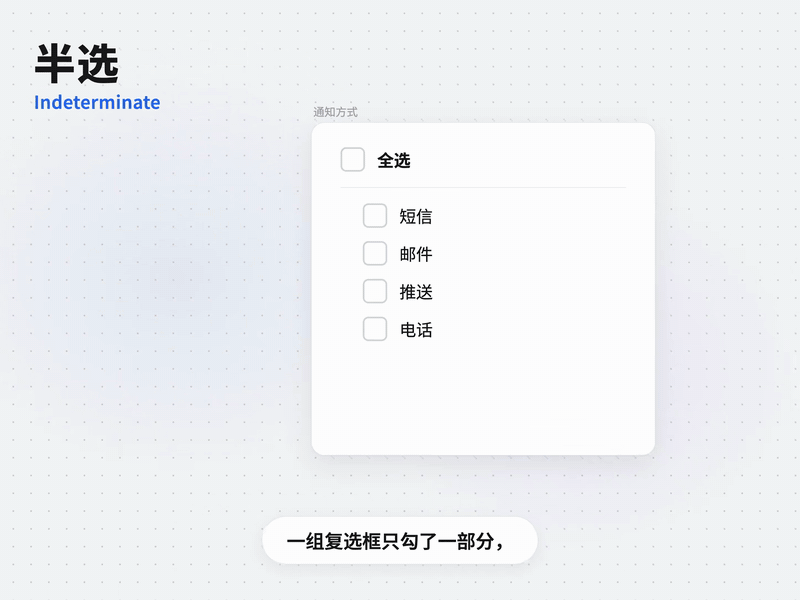
<!-- /ui-atlas:details -->

## 单选框 / Radio

- 标识：`buttons-controls/radio`；类型：组件／效果。
- 效果要点：同组只能选一项，选择新项时自动取消旧项。
- 指令例句：套餐选项使用同一组单选框，只允许选择一个。
- 媒体取舍：仅保留静态图片（JPG／PNG）。互斥选择关系可由状态图和文字表达。
- 参考：[六帧对照图](../assets/filmstrips/buttons-controls/radio.jpg)。

<!-- ui-atlas:details buttons-controls/radio -->
- 原尺寸图片：[01 · 800×600](../assets/details/buttons-controls/radio.png)。
- 清晰度边界：从现存 GIF 解出原尺寸独立帧，避免总览缩图和二次 JPEG 压缩；GIF 的分辨率、色彩与源压缩限制仍在。

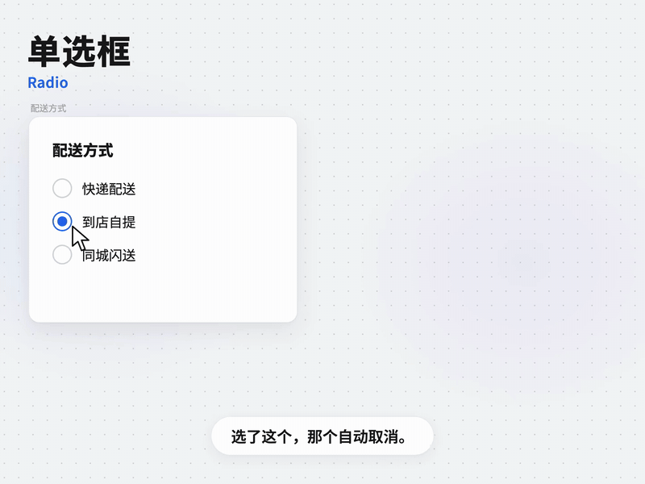
<!-- /ui-atlas:details -->

## 分段控制器 / Segmented Control / Toggle Group

- 标识：`buttons-controls/segmented-control`；类型：组件／效果。
- 效果要点：少量选项横向连成一条，选中底块滑向新选项；示例日、周、月，这里为单选模式。
- 指令例句：日周月切换使用单选分段控制器，选中底块平滑移动。
- 媒体取舍：保留 GIF＋静态图片。需看选中底块滑向另一项，而非只更换选中颜色。
- 参考：[GIF 动图](../assets/gifs/buttons-controls/segmented-control.gif) · [六帧对照图](../assets/filmstrips/buttons-controls/segmented-control.jpg)。

<!-- ui-atlas:details buttons-controls/segmented-control -->
- 原尺寸图片：[01 · 800×600](../assets/details/buttons-controls/segmented-control.png)。
- 连续效果：[GIF · 800×600](../assets/gifs/buttons-controls/segmented-control.gif)。
- 清晰度边界：从现存 GIF 解出原尺寸独立帧，避免总览缩图和二次 JPEG 压缩；GIF 的分辨率、色彩与源压缩限制仍在。

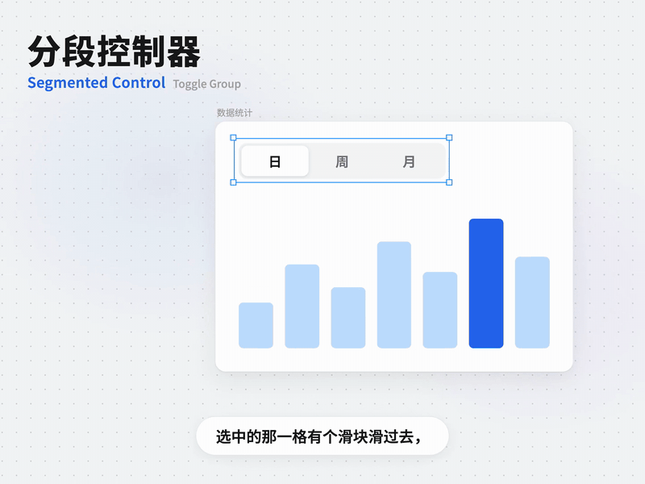
<!-- /ui-atlas:details -->

## 切换按钮 / Toggle Button

- 标识：`buttons-controls/toggle-button`；类型：组件／效果。
- 效果要点：点一次进入选中状态，再点取消；示例为点赞和收藏。
- 指令例句：收藏按钮支持选中与取消选中两种状态。
- 媒体取舍：仅保留静态图片（JPG／PNG）。选中和取消的外观对照足够，无特殊运动要求。
- 参考：[六帧对照图](../assets/filmstrips/buttons-controls/toggle-button.jpg)。

<!-- ui-atlas:details buttons-controls/toggle-button -->
- 原尺寸图片：[01 · 800×600](../assets/details/buttons-controls/toggle-button.png)。
- 清晰度边界：从现存 GIF 解出原尺寸独立帧，避免总览缩图和二次 JPEG 压缩；GIF 的分辨率、色彩与源压缩限制仍在。

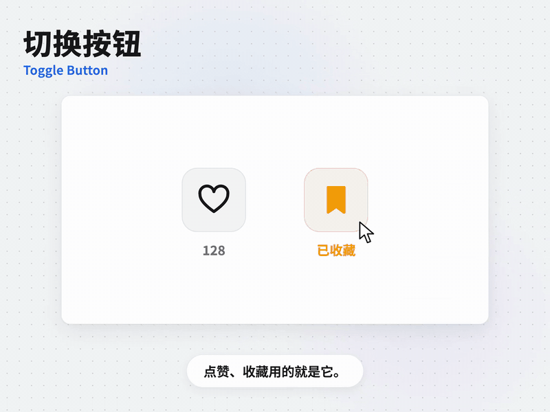
<!-- /ui-atlas:details -->

## 可选标签 / Chip

- 标识：`buttons-controls/chip`；类型：组件／效果。
- 效果要点：可点击选择的圆角标签，示例为满减、免配送费等筛选项。
- 指令例句：筛选条件采用可选 Chip，清楚区分选中和未选中。
- 媒体取舍：仅保留静态图片（JPG／PNG）。选中与未选中的筛选样式可由图片表达。
- 参考：[六帧对照图](../assets/filmstrips/buttons-controls/chip.jpg)。

<!-- ui-atlas:details buttons-controls/chip -->
- 原尺寸图片：[01 · 800×600](../assets/details/buttons-controls/chip.png)。
- 清晰度边界：从现存 GIF 解出原尺寸独立帧，避免总览缩图和二次 JPEG 压缩；GIF 的分辨率、色彩与源压缩限制仍在。

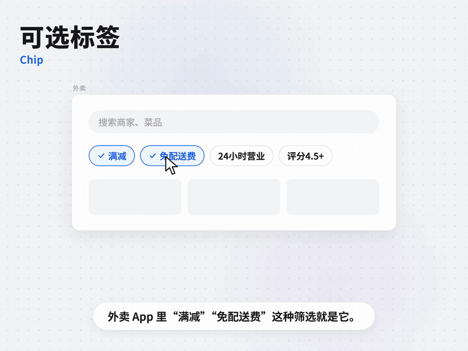
<!-- /ui-atlas:details -->

## 计数器 / Stepper / Number Input

- 标识：`buttons-controls/stepper`；类型：组件／效果。
- 效果要点：数字位于中间，左减右加，用于购物车数量；可采用带加减按钮的数字输入框。
- 指令例句：数量使用带加减按钮的数字输入框。
- 媒体取舍：仅保留静态图片（JPG／PNG）。加减入口、当前值和边界规则可由图片加文字表达。
- 参考：[六帧对照图](../assets/filmstrips/buttons-controls/stepper.jpg)。

<!-- ui-atlas:details buttons-controls/stepper -->
- 原尺寸图片：[01 · 800×600](../assets/details/buttons-controls/stepper.png)。
- 清晰度边界：从现存 GIF 解出原尺寸独立帧，避免总览缩图和二次 JPEG 压缩；GIF 的分辨率、色彩与源压缩限制仍在。

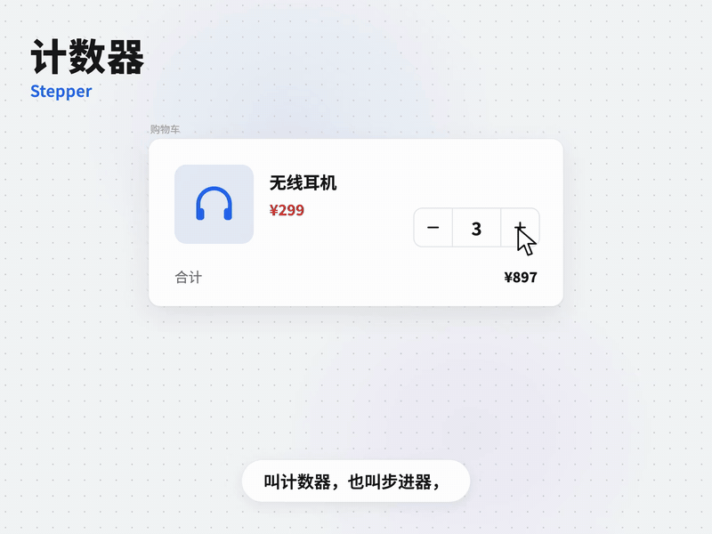
<!-- /ui-atlas:details -->

## 开关和选项选型 / Control selection

- 标识：`buttons-controls/control-selection`；类型：选型／纠错。
- 效果要点：一个二元设置且立即生效用开关；可选多个用复选框；多选一时按选项数量和空间选分段控制器或单选框。
- 指令例句：按即时生效、多选或单选的语义选择控件。
- 媒体取舍：仅保留静态图片（JPG／PNG）。属于开关、多选和单选的语义选型，图片和规则足够。
- 参考：[六帧对照图](../assets/filmstrips/buttons-controls/control-selection.jpg)。

<!-- ui-atlas:details buttons-controls/control-selection -->
- 原尺寸图片：[01 · 800×600](../assets/details/buttons-controls/control-selection.png)。
- 清晰度边界：从现存 GIF 解出原尺寸独立帧，避免总览缩图和二次 JPEG 压缩；GIF 的分辨率、色彩与源压缩限制仍在。

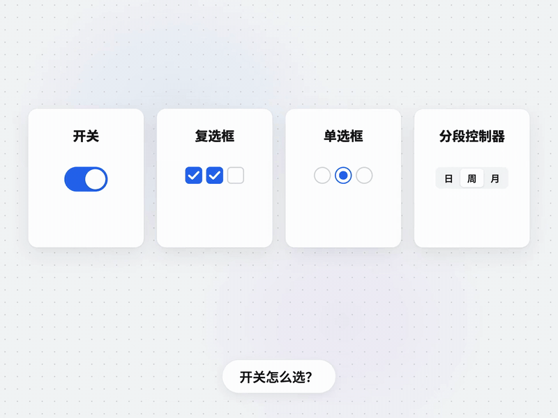
<!-- /ui-atlas:details -->

## 有点击手感的拟物按钮 / Tactile Skeuomorphic Button

- 标识：`buttons-controls/tactile-button`；类型：组件／效果。
- 效果要点：primary、secondary、tertiary、ghost、text 五种层级共享五层材质 token；按下时位移、渐变和阴影同步改变，尺寸随字号成比例缩放。
- 实现关注：五层依次为面色渐变、边框、顶部内高光、底部内暗边、接触与抬升双投影。14px 字号下高 40px、圆角 10px、横向内边距 18px；用 u = 字号 / 14 缩放全部长度。按下位移 1px、反转渐变、收拢投影；transform / shadow / color 起点为 120 / 140 / 160ms。静止与按下的内阴影层数一致，避免插值跳变。
- 验证重点：检查五种变体在 hover、pressed、focus-visible、disabled 下的层级和圆角对齐；14px 与 16px 尺寸的材质同步缩放。
- 指令例句：参考 buttons-controls/tactile-button，primary、secondary、tertiary、ghost、text 五种层级共享五层材质 token；按下时位移、渐变和阴影同步改变，尺寸随字号成比例缩放。
- [完整配方与效果参考](recipes/tactile-button.md) · [效果图](../assets/recipes/tactile-button.jpg)。
- 媒体取舍：高清图片用于观察五种按钮的层级、边缘和阴影；按压过程按配方在实际项目中核对。
