# 按钮、状态与选项

静态图用于查看构图与可见状态，连续运动和短暂状态需在实际项目验证。按当前项目需求实现目标组件的交互与动效。

## 目录

- [按钮层级总览](#button-hierarchy)
- [主按钮](#primary-button)
- [次按钮](#secondary-button)
- [线框按钮](#outline-button)
- [文字按钮](#text-button)
- [危险按钮](#danger-button)
- [幽灵按钮](#ghost-button)
- [图标按钮](#icon-button)
- [胶囊按钮](#pill-button)
- [按钮组](#button-group)
- [分割按钮](#split-button)
- [悬浮按钮](#fab)
- [按钮主次纠正](#hierarchy-correction)
- [悬停](#hover)
- [按下](#pressed)
- [焦点](#focus)
- [加载中](#loading)
- [成功](#success)
- [禁用](#disabled)
- [按钮反馈补全](#state-correction)
- [开关](#switch)
- [复选框](#checkbox)
- [半选](#indeterminate)
- [单选框](#radio)
- [分段控制器](#segmented-control)
- [切换按钮](#toggle-button)
- [可选标签](#chip)
- [计数器](#stepper)
- [开关和选项选型](#control-selection)
- [有点击手感的拟物按钮](#tactile-button)
- [粒子爆开按钮](#particle-burst)
- [液态展开按钮](#gooey-button)
- [星光按钮](#sparkle-button)
- [霓虹发光按钮](#glow-button)
- [变形提交按钮](#morphing-button)
- [长按确认](#hold-to-confirm)
- [滑动确认](#slide-to-confirm)
- [立体按压按钮](#push-3d-button)
- [点击波纹按钮](#ripple-button)
- [悬停填充按钮](#hover-fill)
- [按钮文字翻滚](#text-roll)
- [图标变形按钮](#icon-morph)
- [悬停变色按钮](#hover-color)

## 按钮层级总览 / Button hierarchy

- 标识：`buttons-controls/button-hierarchy`；类型：选型／纠错。
- 效果要点：按钮要按动作重要程度建立主次，通过不同视觉权重区分。
- 指令例句：先根据任务重要程度确定操作层级，再选择按钮样式。
- 媒体取舍：主次视觉权重与层级对照由图片表达。

<!-- ui-atlas:details buttons-controls/button-hierarchy -->
- 原尺寸图片：[01 · 2880×1770](../assets/details/buttons-controls/button-hierarchy-hd-01.webp)。
- 清晰度边界：从 2160 像素高的原片按原像素裁切，WebP 质量 95，不放大、不锐化、不涂抹；静态帧不能证明完整运动。

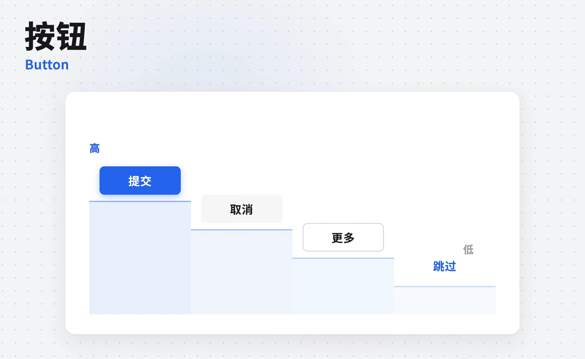
<!-- /ui-atlas:details -->

## 主按钮 / Primary Button

- 标识：`buttons-controls/primary-button`；类型：组件／效果。
- 效果要点：颜色最重最显眼，承载提交、付款等关键动作；建议一个操作区域突出一个主按钮。
- 指令例句：提交用主按钮，同一区域只突出一个关键动作。
- 媒体取舍：重点是主操作的视觉权重与位置，图片足够。

<!-- ui-atlas:details buttons-controls/primary-button -->
- 原尺寸图片：[01 · 2880×1770](../assets/details/buttons-controls/primary-button-hd-01.webp)。
- 清晰度边界：从 2160 像素高的原片按原像素裁切，WebP 质量 95，不放大、不锐化、不涂抹；静态帧不能证明完整运动。

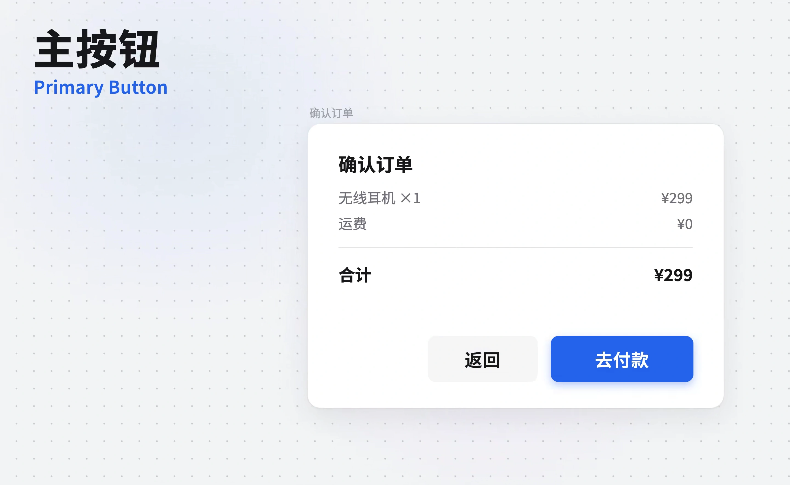
<!-- /ui-atlas:details -->

## 次按钮 / Secondary Button

- 标识：`buttons-controls/secondary-button`；类型：组件／效果。
- 效果要点：视觉权重比主按钮轻，通常承载取消和返回。
- 指令例句：取消和返回使用低于主操作权重的次按钮。
- 媒体取舍：重点是次操作的视觉权重，图片足够。

<!-- ui-atlas:details buttons-controls/secondary-button -->
- 原尺寸图片：[01 · 2880×1770](../assets/details/buttons-controls/secondary-button-hd-01.webp)。
- 清晰度边界：从 2160 像素高的原片按原像素裁切，WebP 质量 95，不放大、不锐化、不涂抹；静态帧不能证明完整运动。

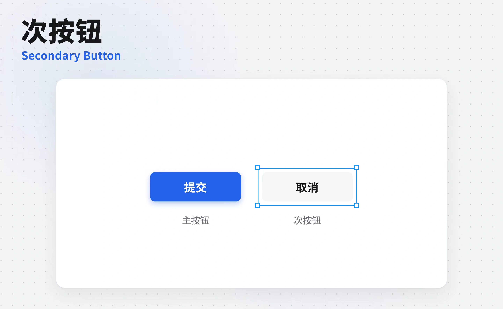
<!-- /ui-atlas:details -->

## 线框按钮 / Outline Button

- 标识：`buttons-controls/outline-button`；类型：组件／效果。
- 效果要点：只有轮廓边框、内部留空，示例视觉较轻；具体层级应结合现有设计系统。
- 指令例句：使用保留边框、无实色填充的线框按钮。
- 媒体取舍：边框与无填充形态属于静态样式。

<!-- ui-atlas:details buttons-controls/outline-button -->
- 原尺寸图片：[01 · 2880×1770](../assets/details/buttons-controls/outline-button-hd-01.webp)。
- 清晰度边界：从 2160 像素高的原片按原像素裁切，WebP 质量 95，不放大、不锐化、不涂抹；静态帧不能证明完整运动。

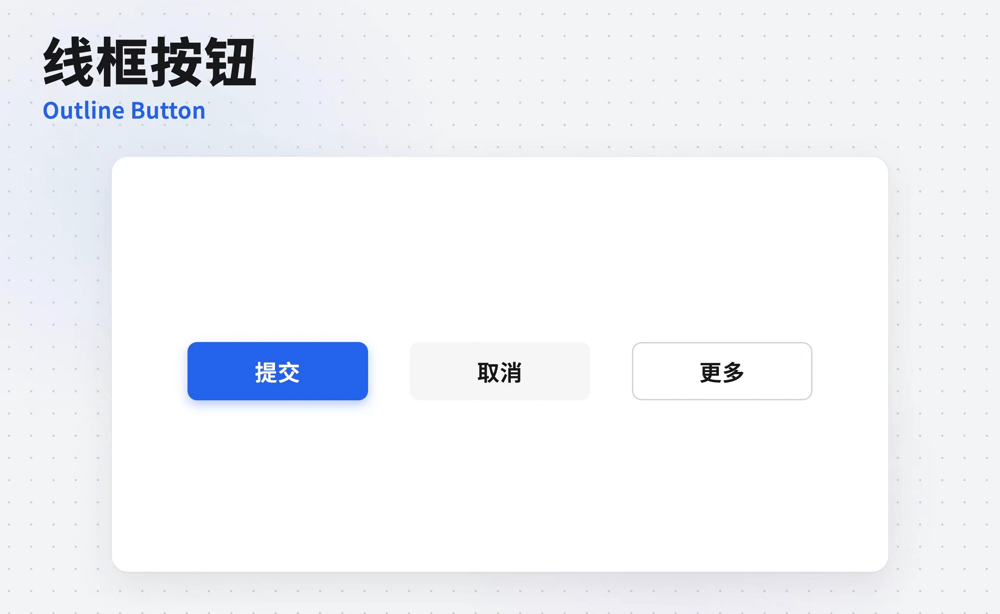
<!-- /ui-atlas:details -->

## 文字按钮 / Text Button

- 标识：`buttons-controls/text-button`；类型：组件／效果。
- 效果要点：像一行文字，视觉较弱；例子为登录表单的忘记密码入口。
- 指令例句：忘记密码采用文字形式的轻量操作入口。
- 媒体取舍：文字入口的视觉层级属于静态样式。

<!-- ui-atlas:details buttons-controls/text-button -->
- 原尺寸图片：[01 · 2880×1770](../assets/details/buttons-controls/text-button-hd-01.webp)。
- 清晰度边界：从 2160 像素高的原片按原像素裁切，WebP 质量 95，不放大、不锐化、不涂抹；静态帧不能证明完整运动。

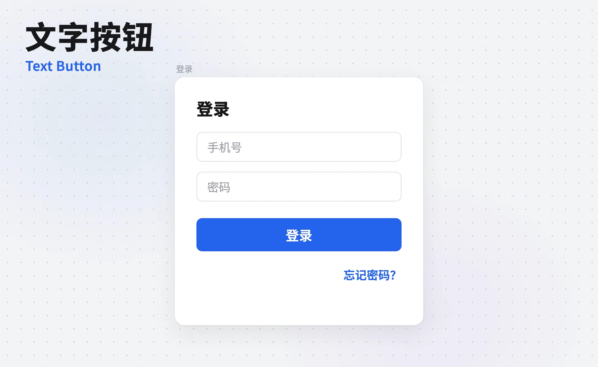
<!-- /ui-atlas:details -->

## 危险按钮 / Danger Button

- 标识：`buttons-controls/danger-button`；类型：组件／效果。
- 效果要点：红色表达删除、注销等有破坏性的动作，让用户辨认后果。
- 指令例句：删除操作使用危险样式并配合明确的动作文字。
- 媒体取舍：危险色与动作文字属于静态语义表达。

<!-- ui-atlas:details buttons-controls/danger-button -->
- 原尺寸图片：[01 · 2880×1770](../assets/details/buttons-controls/danger-button-hd-01.webp)。
- 清晰度边界：从 2160 像素高的原片按原像素裁切，WebP 质量 95，不放大、不锐化、不涂抹；静态帧不能证明完整运动。

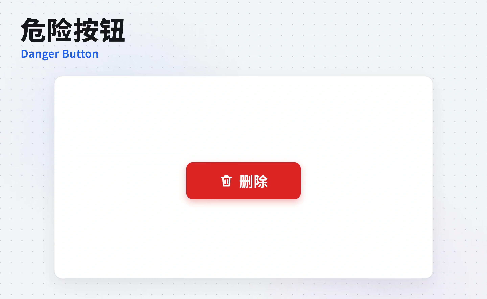
<!-- /ui-atlas:details -->

## 幽灵按钮 / Ghost Button

- 标识：`buttons-controls/ghost-button`；类型：组件／效果。
- 效果要点：示例无边框，平时背景很轻，悬停显现；用于图片或深色背景。命名在不同组件库可能有差异。
- 指令例句：按参考使用轻背景、无边框的 Ghost 样式，悬停增强可见性。
- 媒体取舍：默认与悬停外观对照足够，没有必须观察的独特轨迹。

<!-- ui-atlas:details buttons-controls/ghost-button -->
- 原尺寸图片：[01 · 2880×1770](../assets/details/buttons-controls/ghost-button-hd-01.webp)。
- 清晰度边界：从 2160 像素高的原片按原像素裁切，WebP 质量 95，不放大、不锐化、不涂抹；静态帧不能证明完整运动。

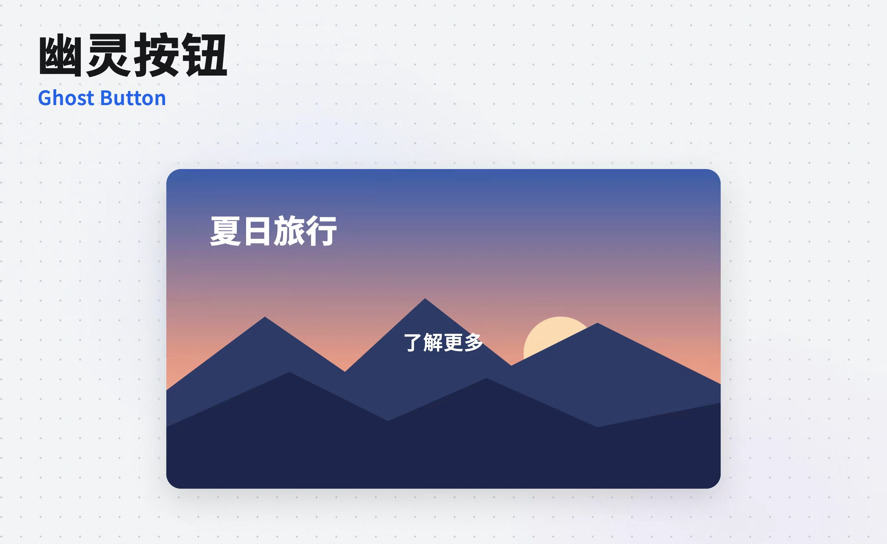
<!-- /ui-atlas:details -->

## 图标按钮 / Icon Button

- 标识：`buttons-controls/icon-button`；类型：组件／效果。
- 效果要点：仅图标表达关闭、更多等操作；图标含义不清楚时增加文字。
- 指令例句：明确操作可使用图标按钮，含义不直观时附可见文字。
- 媒体取舍：图标含义、尺寸和文字辅助属于静态可辨识性参考。

<!-- ui-atlas:details buttons-controls/icon-button -->
- 原尺寸图片：[01 · 2880×1770](../assets/details/buttons-controls/icon-button-hd-01.webp)。
- 清晰度边界：从 2160 像素高的原片按原像素裁切，WebP 质量 95，不放大、不锐化、不涂抹；静态帧不能证明完整运动。

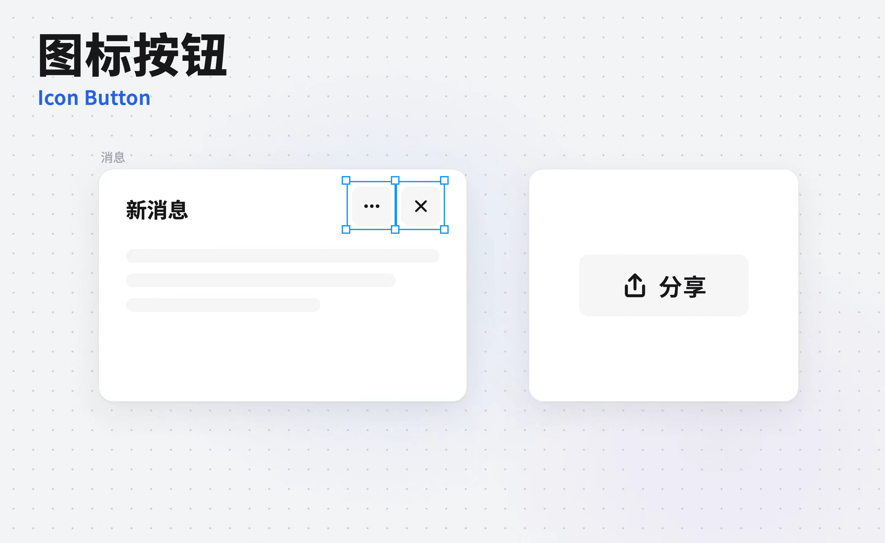
<!-- /ui-atlas:details -->

## 胶囊按钮 / Pill Button

- 标识：`buttons-controls/pill-button`；类型：组件／效果。
- 效果要点：两端完全圆润；这是一种形状，不代表主次级别，主按钮和次按钮都可采用。
- 指令例句：将指定按钮改成胶囊形，保持原有主次层级。
- 媒体取舍：胶囊是形状，图片足够，不要求额外运动。

<!-- ui-atlas:details buttons-controls/pill-button -->
- 原尺寸图片：[01 · 2880×1770](../assets/details/buttons-controls/pill-button-hd-01.webp)。
- 清晰度边界：从 2160 像素高的原片按原像素裁切，WebP 质量 95，不放大、不锐化、不涂抹；静态帧不能证明完整运动。

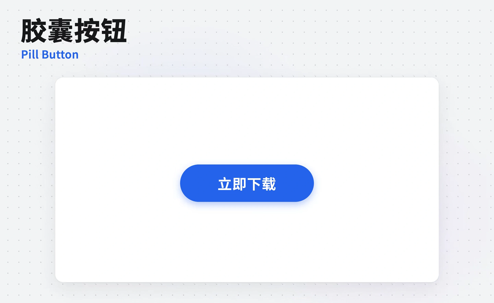
<!-- /ui-atlas:details -->

## 按钮组 / Button Group

- 标识：`buttons-controls/button-group`；类型：组件／效果。
- 效果要点：相关操作紧邻成组，如加粗、斜体、下划线；分组本身不决定是否单选。
- 指令例句：把相关格式操作排成按钮组，保留各自独立状态。
- 媒体取舍：分组排布与独立选中态由图片表达。

<!-- ui-atlas:details buttons-controls/button-group -->
- 原尺寸图片：[01 · 2880×1770](../assets/details/buttons-controls/button-group-hd-01.webp)。
- 清晰度边界：从 2160 像素高的原片按原像素裁切，WebP 质量 95，不放大、不锐化、不涂抹；静态帧不能证明完整运动。

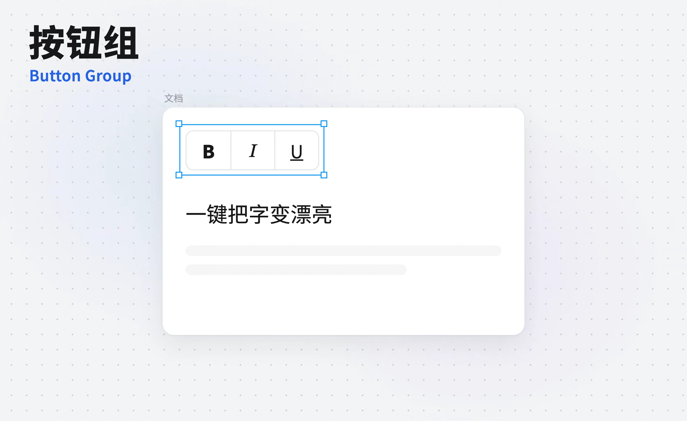
<!-- /ui-atlas:details -->

## 分割按钮 / Split Button

- 标识：`buttons-controls/split-button`；类型：组件／效果。
- 效果要点：左侧直接执行常用动作，右侧箭头展开替代动作；示例保存与另存为。
- 指令例句：保存按钮右侧分出菜单箭头，放入另存为选项。
- 媒体取舍：主动作和菜单入口的分工由状态图表达。

<!-- ui-atlas:details buttons-controls/split-button -->
- 原尺寸图片：[01 · 2880×1770](../assets/details/buttons-controls/split-button-hd-01.webp)。
- 清晰度边界：从 2160 像素高的原片按原像素裁切，WebP 质量 95，不放大、不锐化、不涂抹；静态帧不能证明完整运动。

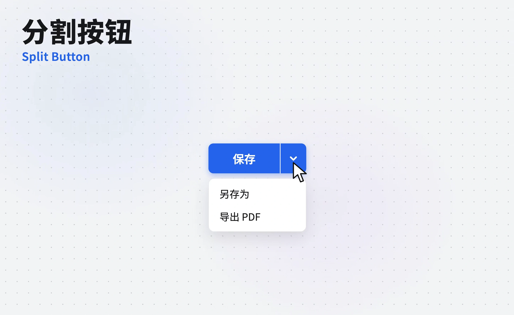
<!-- /ui-atlas:details -->

## 悬浮按钮 / Floating Action Button / FAB

- 标识：`buttons-controls/fab`；类型：组件／效果。
- 效果要点：圆形按钮固定于视口右下，页面滚动时位置不变；用于页面高频核心动作如发帖。
- 指令例句：移动列表右下固定一个发帖 FAB，避免遮挡正文和系统安全区。
- 媒体取舍：固定位置、尺寸与安全区由图片和文字表达，运行时仍需滚动核对。

<!-- ui-atlas:details buttons-controls/fab -->
- 原尺寸图片：[01 · 2880×1770](../assets/details/buttons-controls/fab-hd-01.webp)。
- 清晰度边界：从 2160 像素高的原片按原像素裁切，WebP 质量 95，不放大、不锐化、不涂抹；静态帧不能证明完整运动。

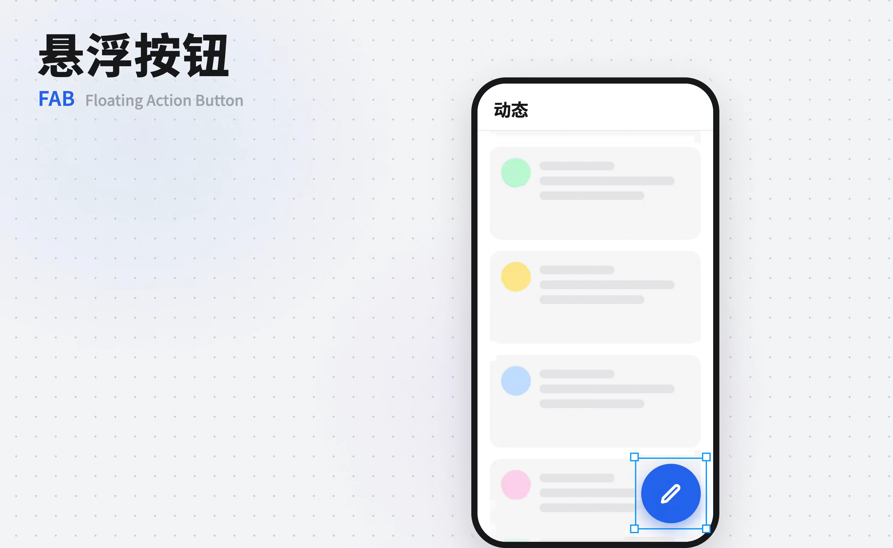
<!-- /ui-atlas:details -->

## 按钮主次纠正 / Hierarchy correction

- 标识：`buttons-controls/hierarchy-correction`；类型：选型／纠错。
- 效果要点：将全部长一样的按钮区分为提交主按钮、取消次按钮、删除危险按钮，并保持一个区域一个主要动作。
- 指令例句：提交用主按钮，取消用次按钮，删除用危险按钮。
- 媒体取舍：提交、取消和删除的前后层级对照由图片表达。

<!-- ui-atlas:details buttons-controls/hierarchy-correction -->
- 原尺寸图片：[01 · 2880×1770](../assets/details/buttons-controls/hierarchy-correction-hd-01.webp) · [02 · 2880×1770](../assets/details/buttons-controls/hierarchy-correction-hd-02.webp)。
- 多图用途：提交、取消和删除的前后层级对照由图片表达。
- 清晰度边界：从 2160 像素高的原片按原像素裁切，WebP 质量 95，不放大、不锐化、不涂抹；静态帧不能证明完整运动。

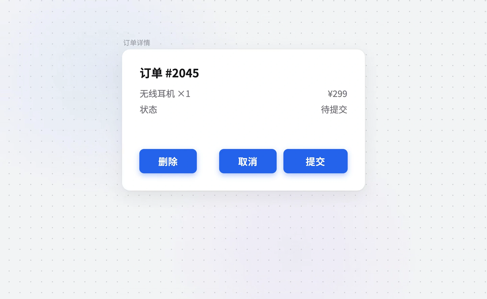
<!-- /ui-atlas:details -->

## 悬停 / Hover

- 标识：`buttons-controls/hover`；类型：组件／效果。
- 效果要点：默认状态在鼠标进入后变亮或轻微抬起，表达可点击。
- 指令例句：按钮悬停时轻微提亮，保持层级和尺寸稳定。
- 媒体取舍：默认与提亮后的状态图足够；若需要上浮过程，选 hover-lift。

<!-- ui-atlas:details buttons-controls/hover -->
- 原尺寸图片：[01 · 2880×1770](../assets/details/buttons-controls/hover-hd-01.webp)。
- 清晰度边界：从 2160 像素高的原片按原像素裁切，WebP 质量 95，不放大、不锐化、不涂抹；静态帧不能证明完整运动。

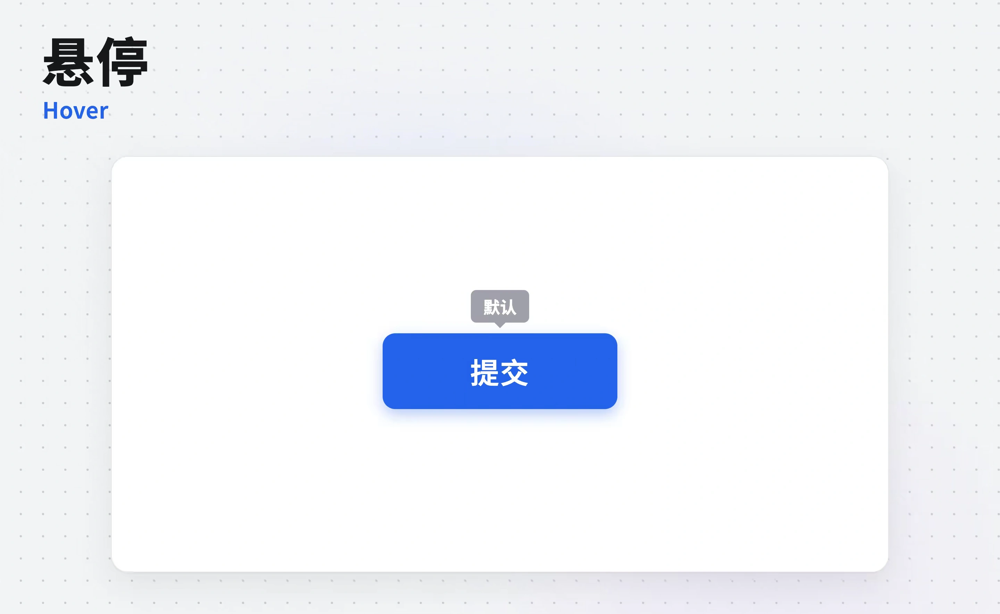
<!-- /ui-atlas:details -->

## 按下 / Pressed

- 标识：`buttons-controls/pressed`；类型：组件／效果。
- 效果要点：按住的一瞬间略微缩小或下压，表达收到输入。
- 指令例句：按钮按下时短暂轻微缩小，松开恢复。
- 媒体取舍：保留静态效果图与实现说明；连续路径、触发顺序、节奏和短暂状态需在项目中实际验证。

<!-- ui-atlas:details buttons-controls/pressed -->
- 原尺寸图片：[01 · 2880×1770](../assets/details/buttons-controls/pressed-hd-01.webp)。
- 清晰度边界：从 2160 像素高的原片按原像素裁切，WebP 质量 95，不放大、不锐化、不涂抹；静态帧不能证明完整运动。

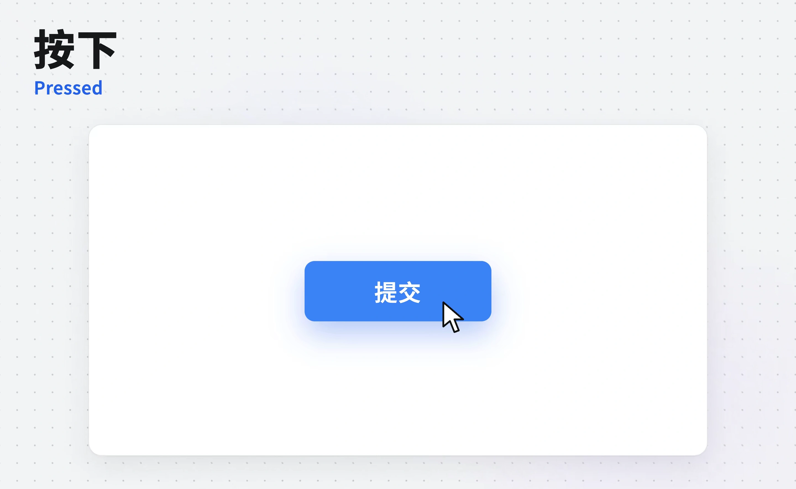
<!-- /ui-atlas:details -->

## 焦点 / Focus

- 标识：`buttons-controls/focus`；类型：组件／效果。
- 效果要点：用 Tab 选中按钮时出现外圈，帮助键盘用户判断当前位置。
- 指令例句：保留清楚的键盘焦点环，并验证 Tab 顺序。
- 媒体取舍：焦点环外观由图片表达，Tab 顺序需在实际项目验证。

<!-- ui-atlas:details buttons-controls/focus -->
- 原尺寸图片：[01 · 2880×1770](../assets/details/buttons-controls/focus-hd-01.webp)。
- 清晰度边界：从 2160 像素高的原片按原像素裁切，WebP 质量 95，不放大、不锐化、不涂抹；静态帧不能证明完整运动。

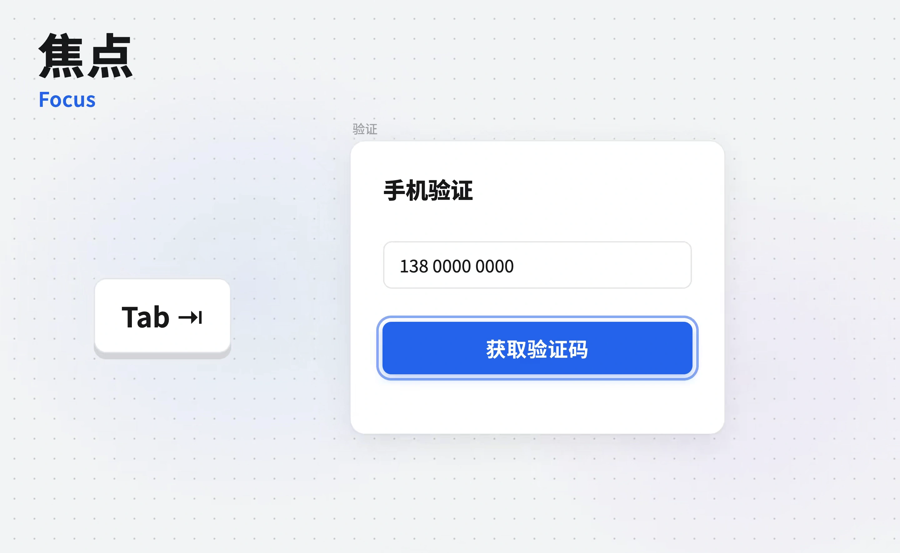
<!-- /ui-atlas:details -->

## 加载中 / Loading

- 标识：`buttons-controls/loading`；类型：组件／效果。
- 效果要点：提交后按钮出现转圈并阻止重复点击，表达任务处理中。
- 指令例句：请求未结束时显示加载指示并阻止重复提交。
- 媒体取舍：保留静态效果图与实现说明；连续路径、触发顺序、节奏和短暂状态需在项目中实际验证。

<!-- ui-atlas:details buttons-controls/loading -->
- 原尺寸图片：[01 · 2880×1770](../assets/details/buttons-controls/loading-hd-01.webp)。
- 清晰度边界：从 2160 像素高的原片按原像素裁切，WebP 质量 95，不放大、不锐化、不涂抹；静态帧不能证明完整运动。

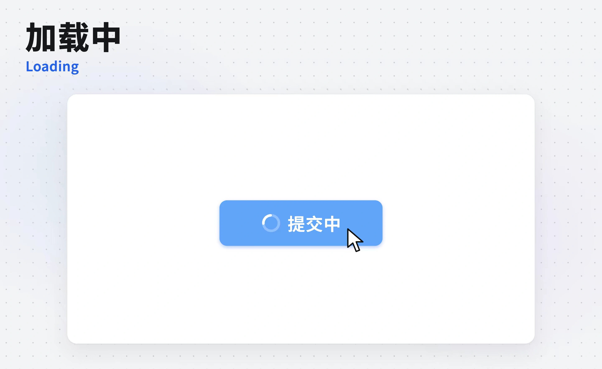
<!-- /ui-atlas:details -->

## 成功 / Success

- 标识：`buttons-controls/success`；类型：组件／效果。
- 效果要点：加载结束后用对勾确认完成。
- 指令例句：提交成功后将加载指示转成成功对勾。
- 媒体取舍：加载与成功对勾两种状态足够，没有独立的变形动画要求。

<!-- ui-atlas:details buttons-controls/success -->
- 原尺寸图片：[01 · 2880×1770](../assets/details/buttons-controls/success-hd-01.webp)。
- 清晰度边界：从 2160 像素高的原片按原像素裁切，WebP 质量 95，不放大、不锐化、不涂抹；静态帧不能证明完整运动。

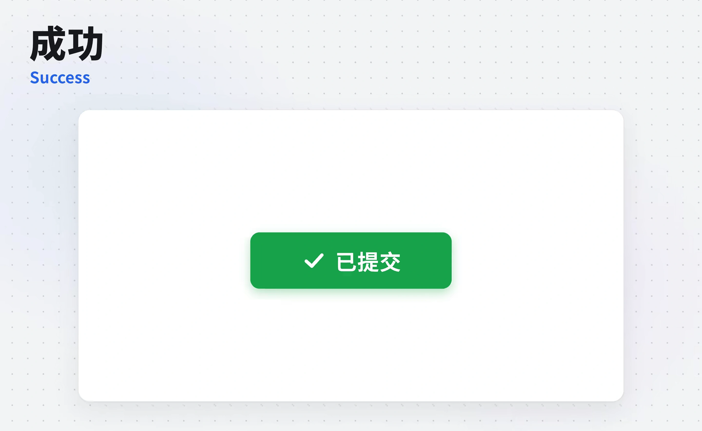
<!-- /ui-atlas:details -->

## 禁用 / Disabled

- 标识：`buttons-controls/disabled`；类型：组件／效果。
- 效果要点：不满足条件时按钮变灰且不可操作，例子为表单未填写完整。
- 指令例句：条件未满足时使用实际禁用状态，并让用户可理解尚缺什么。
- 媒体取舍：禁用外观及原因说明由图片和文字表达。

<!-- ui-atlas:details buttons-controls/disabled -->
- 原尺寸图片：[01 · 2880×1770](../assets/details/buttons-controls/disabled-hd-01.webp)。
- 清晰度边界：从 2160 像素高的原片按原像素裁切，WebP 质量 95，不放大、不锐化、不涂抹；静态帧不能证明完整运动。

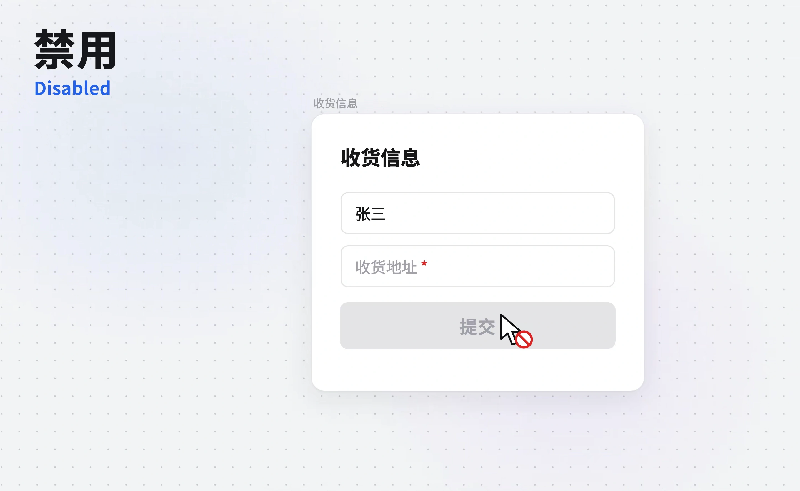
<!-- /ui-atlas:details -->

## 按钮反馈补全 / Button feedback correction

- 标识：`buttons-controls/state-correction`；类型：选型／纠错。
- 效果要点：缺少反馈会让操作结果不明确，应补充悬停、按下和提交加载防连点。
- 指令例句：为现有按钮补上悬停、按下及提交加载状态，防止重复点击。
- 媒体取舍：补全反馈的规则与前后对照由图片表达，按压和旋转分别路由至动态条目。

<!-- ui-atlas:details buttons-controls/state-correction -->
- 原尺寸图片：[01 · 2880×1770](../assets/details/buttons-controls/state-correction-hd-01.webp) · [02 · 2880×1770](../assets/details/buttons-controls/state-correction-hd-02.webp)。
- 多图用途：补全反馈的规则与前后对照由图片表达，按压和旋转分别路由至动态条目。
- 清晰度边界：从 2160 像素高的原片按原像素裁切，WebP 质量 95，不放大、不锐化、不涂抹；静态帧不能证明完整运动。

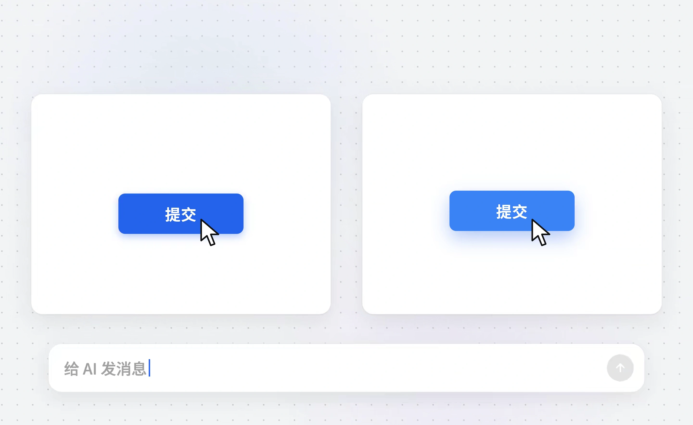
<!-- /ui-atlas:details -->

## 开关 / Switch / Toggle

- 标识：`buttons-controls/switch`；类型：组件／效果。
- 效果要点：二元开闭，一拨即生效；示例为深色模式。核心区别是即时应用。
- 指令例句：深色模式使用开关，切换立即生效。
- 媒体取舍：核心是即时应用的开闭语义，状态图足够；特殊涟漪另见 switch-group-ripple。

<!-- ui-atlas:details buttons-controls/switch -->
- 原尺寸图片：[01 · 2880×1770](../assets/details/buttons-controls/switch-hd-01.webp) · [02 · 2880×1770](../assets/details/buttons-controls/switch-hd-02.webp)。
- 多图用途：核心是即时应用的开闭语义，状态图足够；特殊涟漪另见 switch-group-ripple。
- 清晰度边界：从 2160 像素高的原片按原像素裁切，WebP 质量 95，不放大、不锐化、不涂抹；静态帧不能证明完整运动。

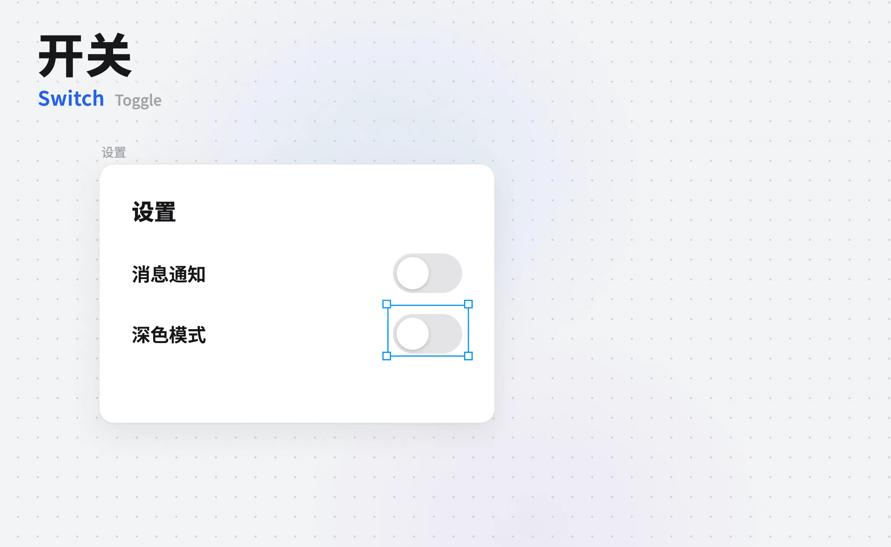
<!-- /ui-atlas:details -->

## 复选框 / Checkbox

- 标识：`buttons-controls/checkbox`；类型：组件／效果。
- 效果要点：方形勾选，可同时选择多项；示例为先编辑偏好再保存，与即时开关区分。
- 指令例句：多个通知偏好使用复选框，统一保存后生效。
- 媒体取舍：多选与统一保存的语义由状态图和文字表达。

<!-- ui-atlas:details buttons-controls/checkbox -->
- 原尺寸图片：[01 · 2880×1770](../assets/details/buttons-controls/checkbox-hd-01.webp)。
- 清晰度边界：从 2160 像素高的原片按原像素裁切，WebP 质量 95，不放大、不锐化、不涂抹；静态帧不能证明完整运动。

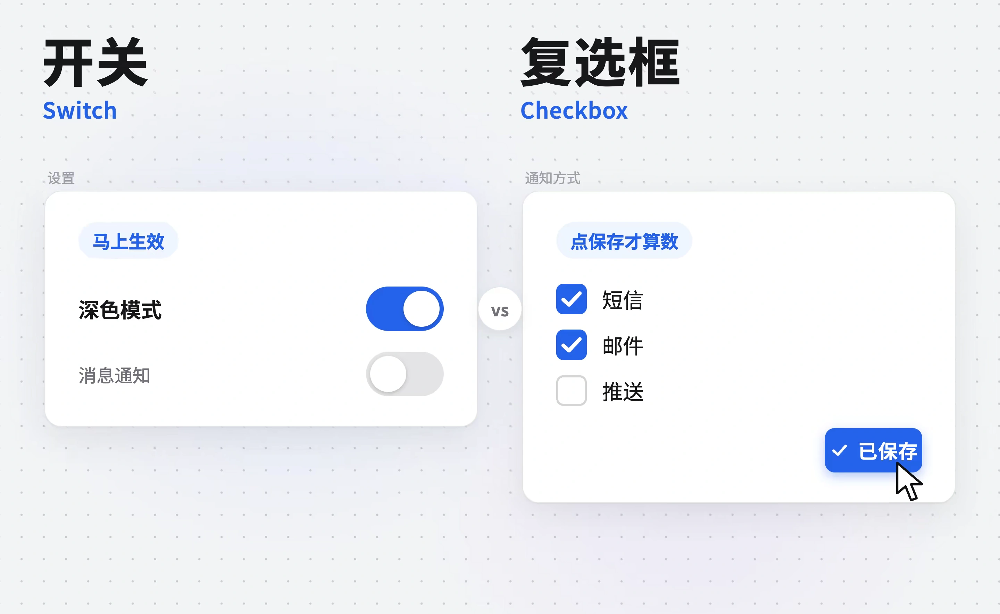
<!-- /ui-atlas:details -->

## 半选 / Indeterminate

- 标识：`buttons-controls/indeterminate`；类型：组件／效果。
- 效果要点：子选项只选择部分时，父级全选框显示横线，表示混合状态。
- 指令例句：全选框准确反映全选、全不选和部分选中的状态。
- 媒体取舍：完整显示父项半选标记与部分子项已选状态。

<!-- ui-atlas:details buttons-controls/indeterminate -->
- 原尺寸图片：[01 · 2880×1770](../assets/details/buttons-controls/indeterminate-hd-01.webp)。
- 清晰度边界：从 2160 像素高的原片按原像素裁切，WebP 质量 95，不放大、不锐化、不涂抹；静态帧不能证明完整运动。

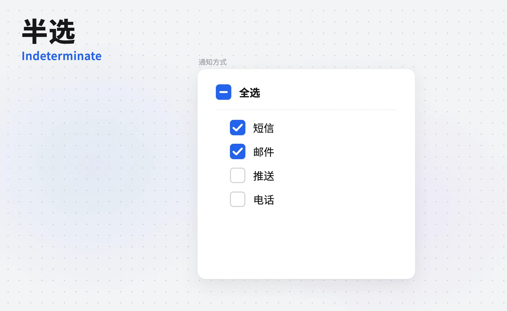
<!-- /ui-atlas:details -->

## 单选框 / Radio

- 标识：`buttons-controls/radio`；类型：组件／效果。
- 效果要点：同组只能选一项，选择新项时自动取消旧项。
- 指令例句：套餐选项使用同一组单选框，只允许选择一个。
- 媒体取舍：互斥选择关系可由状态图和文字表达。

<!-- ui-atlas:details buttons-controls/radio -->
- 原尺寸图片：[01 · 2880×1770](../assets/details/buttons-controls/radio-hd-01.webp)。
- 清晰度边界：从 2160 像素高的原片按原像素裁切，WebP 质量 95，不放大、不锐化、不涂抹；静态帧不能证明完整运动。

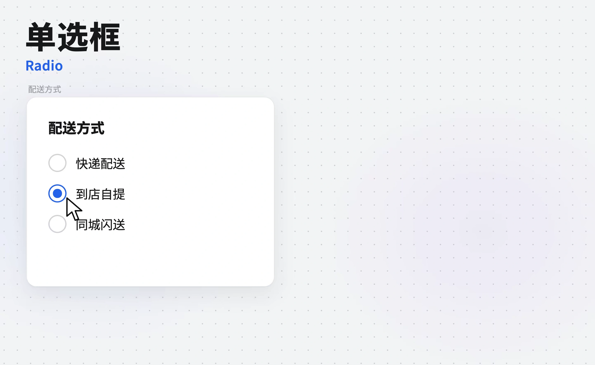
<!-- /ui-atlas:details -->

## 分段控制器 / Segmented Control / Toggle Group

- 标识：`buttons-controls/segmented-control`；类型：组件／效果。
- 效果要点：少量选项横向连成一条，选中底块滑向新选项；示例日、周、月，这里为单选模式。
- 指令例句：日周月切换使用单选分段控制器，选中底块平滑移动。
- 媒体取舍：保留静态效果图与实现说明；连续路径、触发顺序、节奏和短暂状态需在项目中实际验证。

<!-- ui-atlas:details buttons-controls/segmented-control -->
- 原尺寸图片：[01 · 2880×1770](../assets/details/buttons-controls/segmented-control-hd-01.webp)。
- 清晰度边界：从 2160 像素高的原片按原像素裁切，WebP 质量 95，不放大、不锐化、不涂抹；静态帧不能证明完整运动。

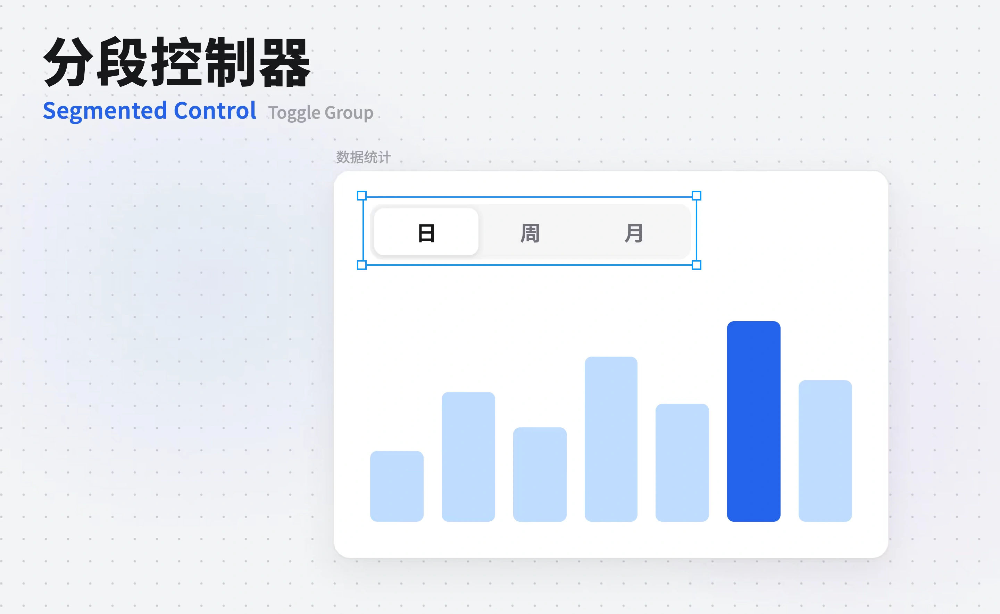
<!-- /ui-atlas:details -->

## 切换按钮 / Toggle Button

- 标识：`buttons-controls/toggle-button`；类型：组件／效果。
- 效果要点：点一次进入选中状态，再点取消；示例为点赞和收藏。
- 指令例句：收藏按钮支持选中与取消选中两种状态。
- 媒体取舍：选中和取消的外观对照足够，无特殊运动要求。

<!-- ui-atlas:details buttons-controls/toggle-button -->
- 原尺寸图片：[01 · 2880×1770](../assets/details/buttons-controls/toggle-button-hd-01.webp)。
- 清晰度边界：从 2160 像素高的原片按原像素裁切，WebP 质量 95，不放大、不锐化、不涂抹；静态帧不能证明完整运动。

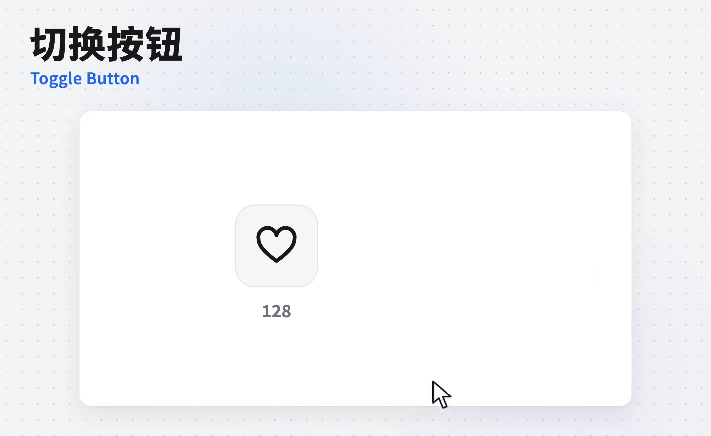
<!-- /ui-atlas:details -->

## 可选标签 / Chip

- 标识：`buttons-controls/chip`；类型：组件／效果。
- 效果要点：可点击选择的圆角标签，示例为满减、免配送费等筛选项。
- 指令例句：筛选条件采用可选 Chip，清楚区分选中和未选中。
- 媒体取舍：选中与未选中的筛选样式可由图片表达。

<!-- ui-atlas:details buttons-controls/chip -->
- 原尺寸图片：[01 · 2880×1770](../assets/details/buttons-controls/chip-hd-01.webp)。
- 清晰度边界：从 2160 像素高的原片按原像素裁切，WebP 质量 95，不放大、不锐化、不涂抹；静态帧不能证明完整运动。

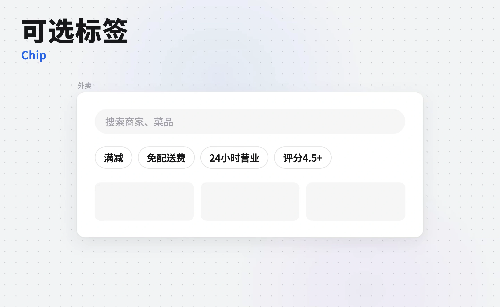
<!-- /ui-atlas:details -->

## 计数器 / Stepper / Number Input

- 标识：`buttons-controls/stepper`；类型：组件／效果。
- 效果要点：数字位于中间，左减右加，用于购物车数量；可采用带加减按钮的数字输入框。
- 指令例句：数量使用带加减按钮的数字输入框。
- 媒体取舍：加减入口、当前值和边界规则可由图片加文字表达。

<!-- ui-atlas:details buttons-controls/stepper -->
- 原尺寸图片：[01 · 2880×1770](../assets/details/buttons-controls/stepper-hd-01.webp)。
- 清晰度边界：从 2160 像素高的原片按原像素裁切，WebP 质量 95，不放大、不锐化、不涂抹；静态帧不能证明完整运动。

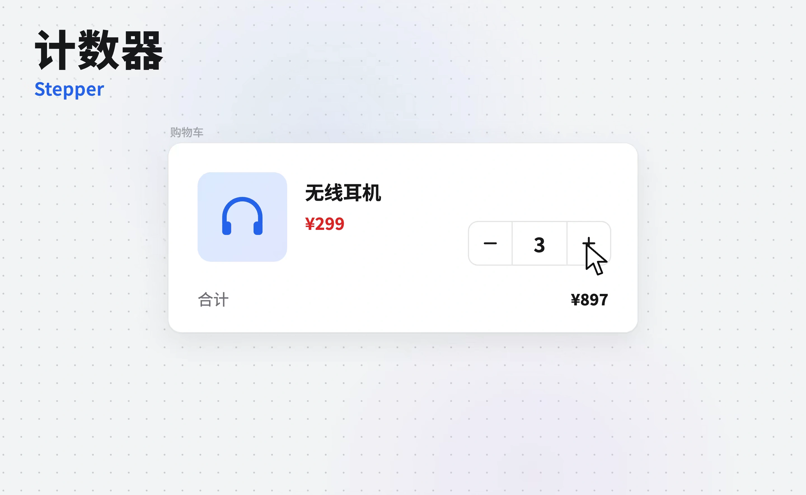
<!-- /ui-atlas:details -->

## 开关和选项选型 / Control selection

- 标识：`buttons-controls/control-selection`；类型：选型／纠错。
- 效果要点：一个二元设置且立即生效用开关；可选多个用复选框；多选一时按选项数量和空间选分段控制器或单选框。
- 指令例句：按即时生效、多选或单选的语义选择控件。
- 媒体取舍：属于开关、多选和单选的语义选型，图片和规则足够。

<!-- ui-atlas:details buttons-controls/control-selection -->
- 原尺寸图片：[01 · 2880×1770](../assets/details/buttons-controls/control-selection-hd-01.webp)。
- 清晰度边界：从 2160 像素高的原片按原像素裁切，WebP 质量 95，不放大、不锐化、不涂抹；静态帧不能证明完整运动。

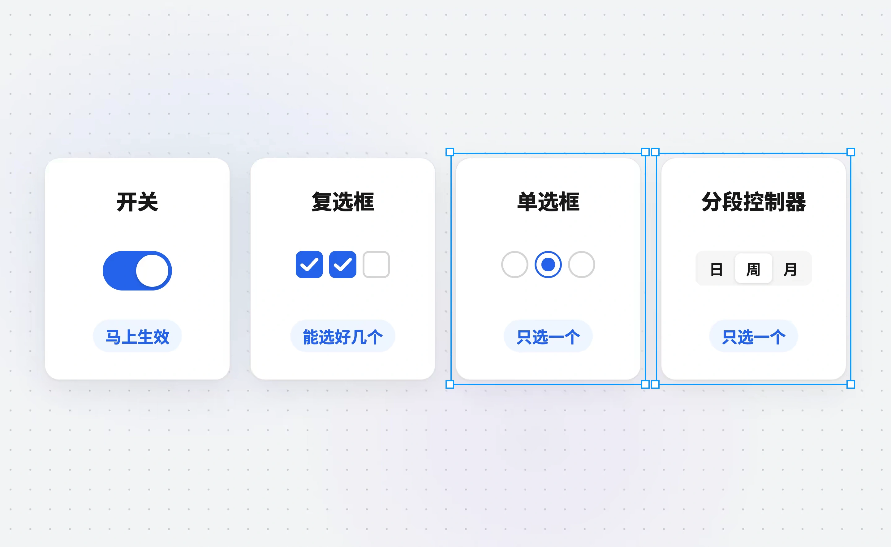
<!-- /ui-atlas:details -->

## 有点击手感的拟物按钮 / Tactile Skeuomorphic Button

- 标识：`buttons-controls/tactile-button`；类型：组件／效果。
- 效果要点：primary、secondary、tertiary、ghost、text 五种层级共享五层材质 token；按下时位移、渐变和阴影同步改变，尺寸随字号成比例缩放。
- 实现关注：五层依次为面色渐变、边框、顶部内高光、底部内暗边、接触与抬升双投影。14px 字号下高 40px、圆角 10px、横向内边距 18px；用 u = 字号 / 14 缩放全部长度。按下位移 1px、反转渐变、收拢投影；transform / shadow / color 起点为 120 / 140 / 160ms。静止与按下的内阴影层数一致，避免插值跳变。
- 验证重点：检查五种变体在 hover、pressed、focus-visible、disabled 下的层级和圆角对齐；14px 与 16px 尺寸的材质同步缩放。
- 指令例句：参考 buttons-controls/tactile-button，primary、secondary、tertiary、ghost、text 五种层级共享五层材质 token；按下时位移、渐变和阴影同步改变，尺寸随字号成比例缩放。
- [完整配方与效果参考](recipes/tactile-button.md) · [效果图](../assets/recipes/tactile-button.jpg)。
- 媒体取舍：高清图片用于观察五种按钮的层级、边缘和阴影；按压过程按配方在实际项目中核对。

## 粒子爆开按钮 / Particle Burst

- 标识：`buttons-controls/particle-burst`；类型：组件／效果。
- 适用场景：点赞、收藏、完成任务等已确认结果的短反馈。
- 画面要点：完成点击反馈时，少量碎片从按钮周围短暂散开并消失，按钮保持原位。
- 实现提示词：为目标按钮增加 Particle Burst；仅在实际成功后从按钮边缘发射少量粒子，短暂扩散并淡出，不遮挡标签、不改变点击范围。
- 核对要点：校验真实成功与失败分支；粒子层不拦截指针，减弱动态时使用静态成功反馈。

<!-- ui-atlas:details buttons-controls/particle-burst -->
- 原尺寸图片：[01 · 1440×1610](../assets/details/buttons-controls/particle-burst-hd-01.webp)。
- 清晰度边界：从 2160 像素高的原片按原像素裁切，WebP 质量 95，不放大、不锐化、不涂抹；静态帧不能证明完整运动。

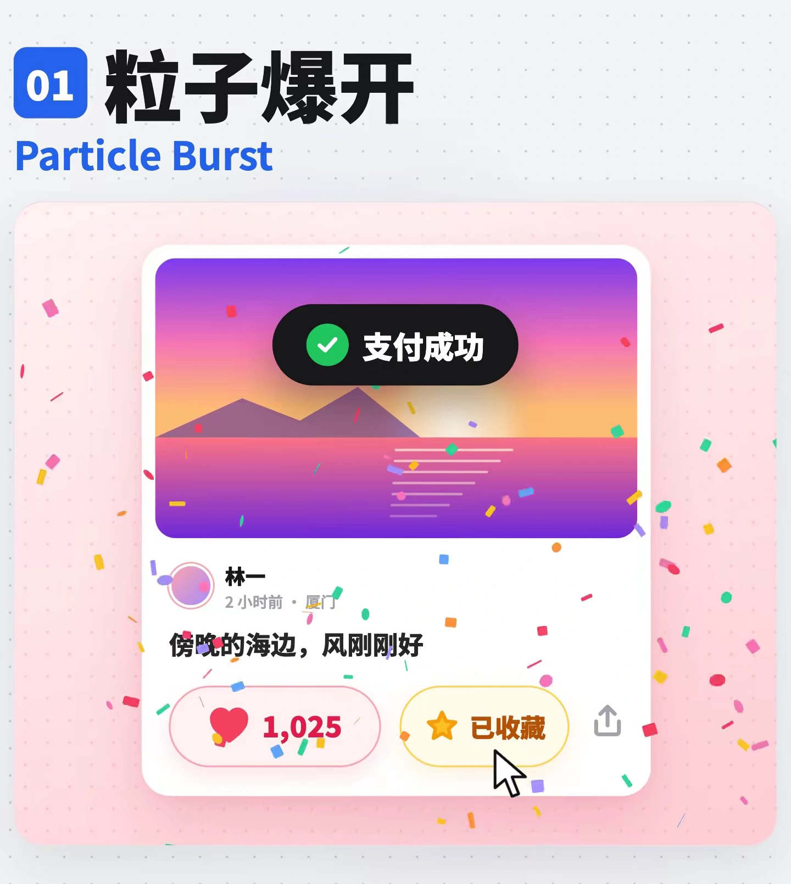
<!-- /ui-atlas:details -->

## 液态展开按钮 / Gooey Button

- 标识：`buttons-controls/gooey-button`；类型：组件／效果。
- 适用场景：低密度的圆形快捷操作菜单。
- 画面要点：圆形主入口展开为多个圆形子操作，连接处短暂呈现黏连的液态轮廓。
- 实现提示词：为圆形操作入口实现 Gooey Button：点击后沿既定方向展开子操作，连接区域短暂黏连；再次点击或关闭时收拢。
- 核对要点：保留每项可访问名称及展开状态；清楚区分液态连接与普通缩放，触摸和键盘均能开合。

<!-- ui-atlas:details buttons-controls/gooey-button -->
- 原尺寸图片：[01 · 1440×1610](../assets/details/buttons-controls/gooey-button-hd-01.webp) · [02 · 1440×1610](../assets/details/buttons-controls/gooey-button-hd-02.webp)。
- 多图用途：保留圆形入口黏连过渡与子操作展开状态。
- 清晰度边界：从 2160 像素高的原片按原像素裁切，WebP 质量 95，不放大、不锐化、不涂抹；静态帧不能证明完整运动。

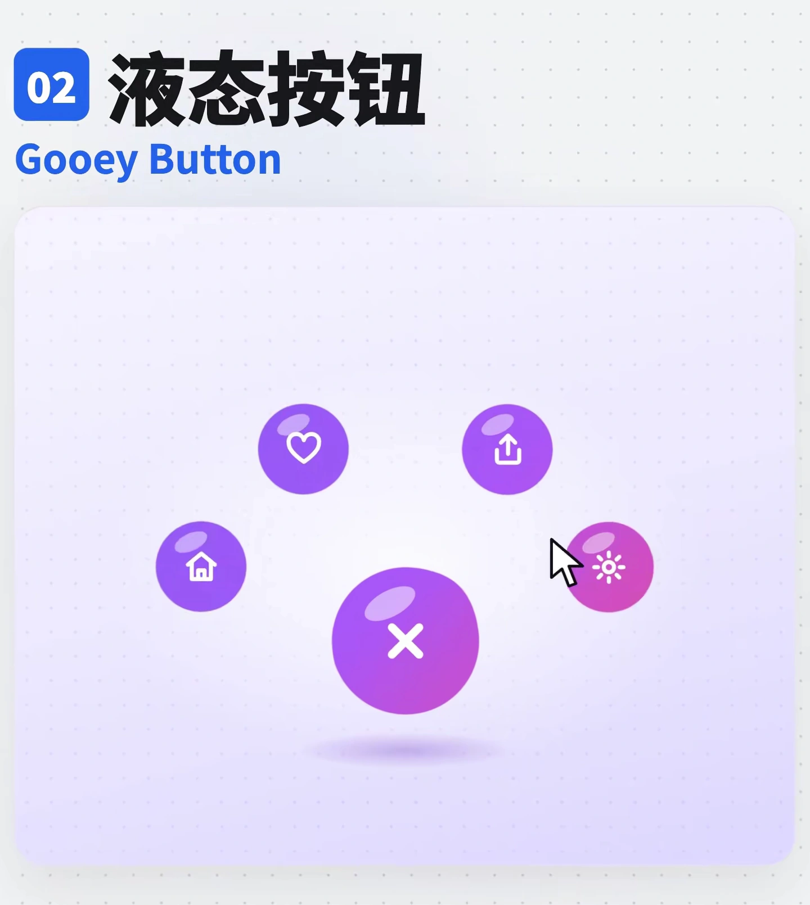
<!-- /ui-atlas:details -->

## 星光按钮 / Sparkle Button

- 标识：`buttons-controls/sparkle-button`；类型：组件／效果。
- 适用场景：AI 生成、创作与推荐操作的局部强调。
- 画面要点：少量星点围绕 CTA 或生成按钮闪动，强调可触发操作。
- 实现提示词：给主要生成按钮添加克制的 Sparkle：在按钮周围短暂显示星点，标签和焦点环保持清晰，不让整个页面持续闪烁。
- 核对要点：星点不覆盖文字与焦点；真正生成中采用独立的 loading 状态，降低动态时停用星点。

<!-- ui-atlas:details buttons-controls/sparkle-button -->
- 原尺寸图片：[01 · 1440×1610](../assets/details/buttons-controls/sparkle-button-hd-01.webp)。
- 清晰度边界：从 2160 像素高的原片按原像素裁切，WebP 质量 95，不放大、不锐化、不涂抹；静态帧不能证明完整运动。

<!-- /ui-atlas:details -->

## 霓虹发光按钮 / Glow Button

- 标识：`buttons-controls/glow-button`；类型：组件／效果。
- 适用场景：深色落地页或产品 CTA。
- 画面要点：深色背景上的按钮边缘带柔和霓虹光晕，悬停时亮度增强。
- 实现提示词：为深色页面 CTA 实现 Glow Button；用多层柔和外发光突出轮廓，hover 和 focus 时轻微增强，保留清晰实线边缘。
- 核对要点：核对普通、悬停、键盘焦点和禁用状态；光晕不能代替可辨认的文字对比。

<!-- ui-atlas:details buttons-controls/glow-button -->
- 原尺寸图片：[01 · 1440×1610](../assets/details/buttons-controls/glow-button-hd-01.webp)。
- 清晰度边界：从 2160 像素高的原片按原像素裁切，WebP 质量 95，不放大、不锐化、不涂抹；静态帧不能证明完整运动。

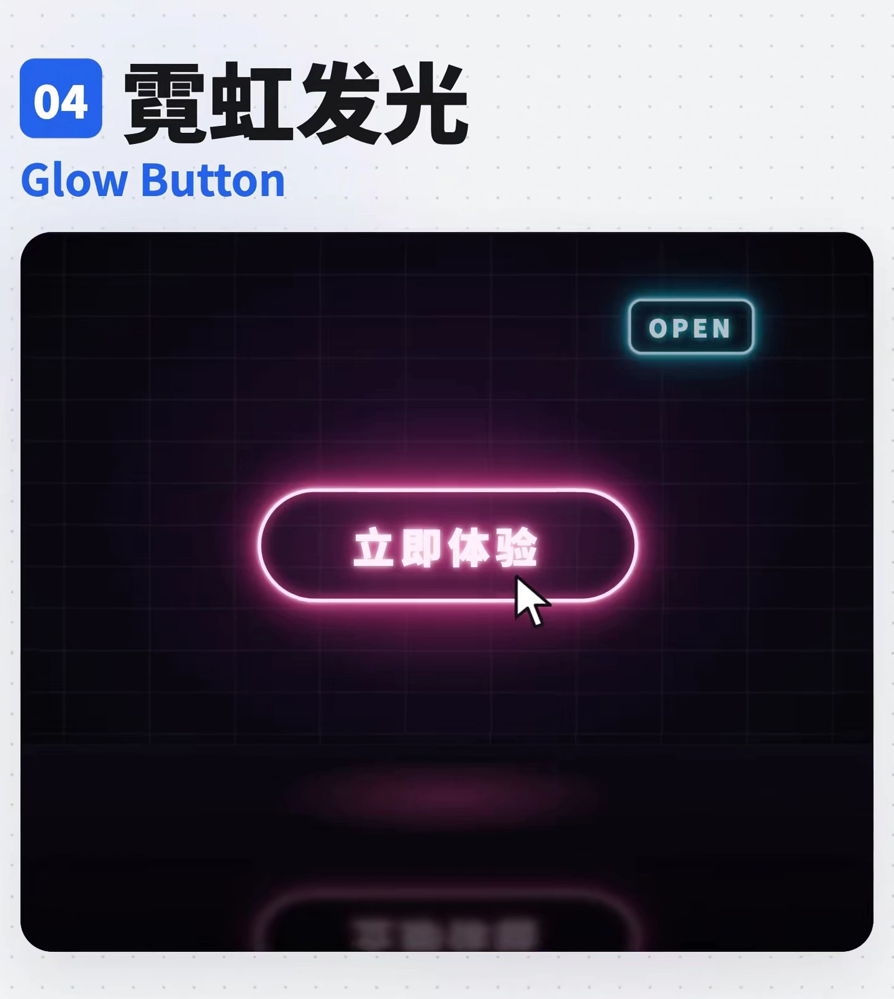
<!-- /ui-atlas:details -->

## 变形提交按钮 / Morphing Button

- 标识：`buttons-controls/morphing-button`；类型：组件／效果。
- 适用场景：订阅、提交与保存等有明确请求状态的操作。
- 画面要点：提交后，按钮从文字形态收成圆形进度，再变为完成标记。
- 实现提示词：让提交按钮按真实请求状态变形：文字按钮→紧凑加载形态→成功标记；保留原占位，失败时恢复标签并提供重试。
- 核对要点：不因动效重复提交或跳过错误分支；辅助技术能读到状态，按钮变形不挤动邻近布局。

<!-- ui-atlas:details buttons-controls/morphing-button -->
- 原尺寸图片：[01 · 1440×1610](../assets/details/buttons-controls/morphing-button-hd-01.webp) · [02 · 1440×1610](../assets/details/buttons-controls/morphing-button-hd-02.webp) · [03 · 1440×1610](../assets/details/buttons-controls/morphing-button-hd-03.webp)。
- 多图用途：保留提交、加载和完成三个不同形态。
- 清晰度边界：从 2160 像素高的原片按原像素裁切，WebP 质量 95，不放大、不锐化、不涂抹；静态帧不能证明完整运动。

<!-- /ui-atlas:details -->

## 长按确认 / Hold to Confirm

- 标识：`buttons-controls/hold-to-confirm`；类型：组件／效果。
- 适用场景：需要有意持续确认、且产品允许替代输入的动作。
- 画面要点：持续按住时进度填满；未达到阈值就松开则取消，完成后才执行操作。
- 实现提示词：为指定确认操作增加 Hold to Confirm：持续按住时填充进度，松开或移出取消，达到阈值后只执行一次；同时提供可访问的确认方式。
- 核对要点：不能在按下瞬间执行操作；验证取消、触摸中断、键盘替代和重复触发。持续时间由产品要求决定。

<!-- ui-atlas:details buttons-controls/hold-to-confirm -->
- 原尺寸图片：[01 · 1440×1610](../assets/details/buttons-controls/hold-to-confirm-hd-01.webp) · [02 · 1440×1610](../assets/details/buttons-controls/hold-to-confirm-hd-02.webp)。
- 多图用途：原片独立截图用于核对具体构图与可见状态；动作路径、时序和实际业务结果在项目中验证。
- 清晰度边界：从 2160 像素高的原片按原像素裁切，WebP 质量 95，不放大、不锐化、不涂抹；静态帧不能证明完整运动。

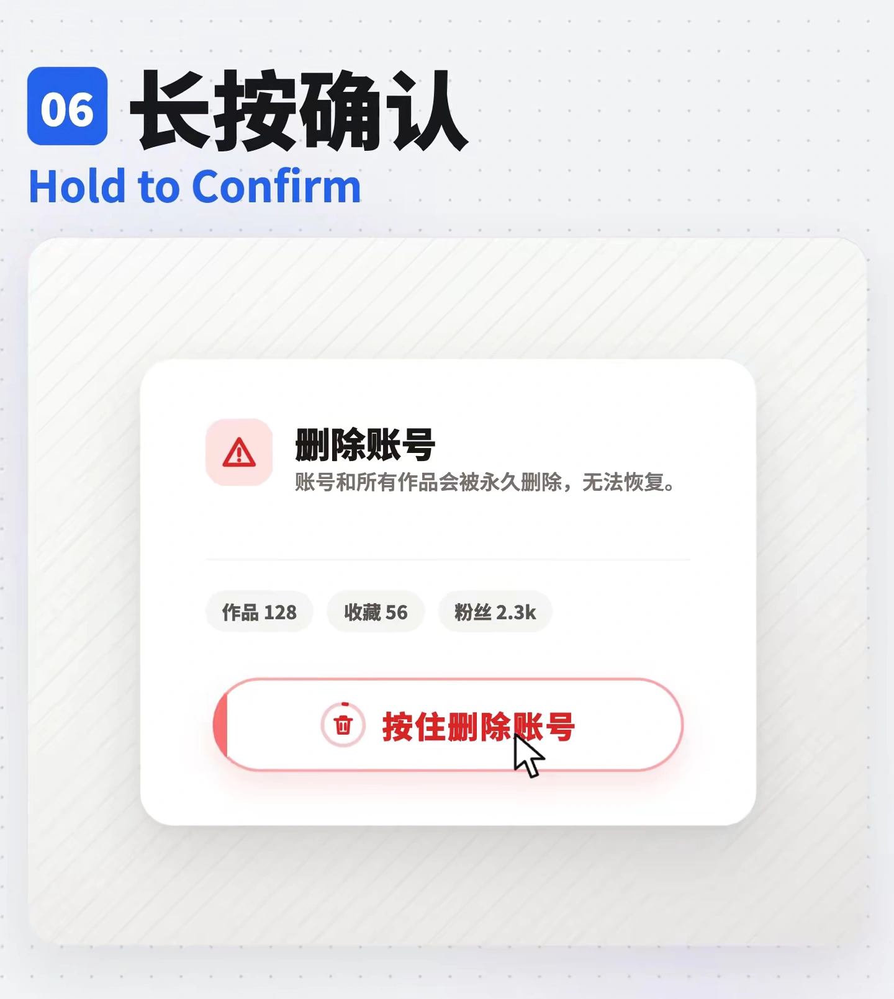
<!-- /ui-atlas:details -->

## 滑动确认 / Slide to Confirm

- 标识：`buttons-controls/slide-to-confirm`；类型：组件／效果。
- 适用场景：需要明确拖动确认、且有键盘替代方式的动作。
- 画面要点：沿轨道拖动滑块，到达末端后才确认；未完成时恢复起点。
- 实现提示词：实现 Slide to Confirm：拖动滑块沿轨道移动，到达确认阈值后提交一次，未达到或取消时返回起点；展示明确的动作名称。
- 核对要点：支持触摸、键盘或独立确认替代；成功状态以实际请求结果为准，轨道不能与普通进度条混淆。

<!-- ui-atlas:details buttons-controls/slide-to-confirm -->
- 原尺寸图片：[01 · 1440×1610](../assets/details/buttons-controls/slide-to-confirm-hd-01.webp)。
- 清晰度边界：从 2160 像素高的原片按原像素裁切，WebP 质量 95，不放大、不锐化、不涂抹；静态帧不能证明完整运动。

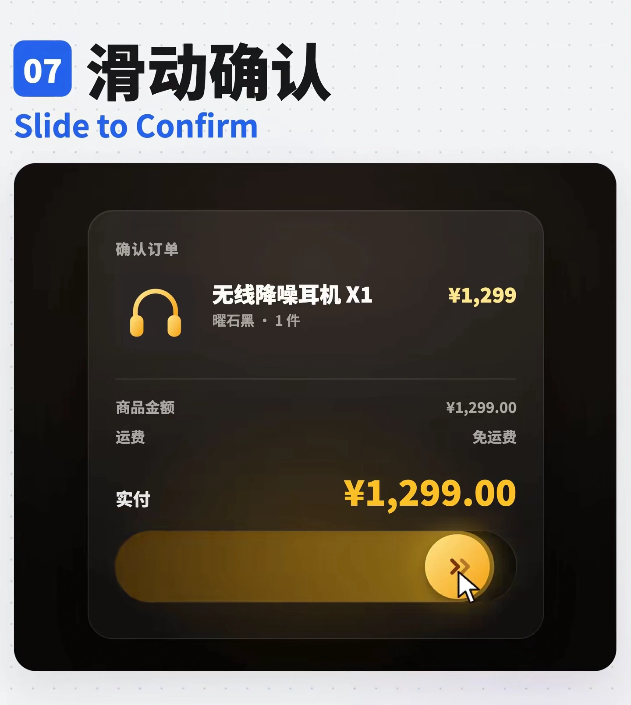
<!-- /ui-atlas:details -->

## 立体按压按钮 / 3D Push Button

- 标识：`buttons-controls/push-3d-button`；类型：组件／效果。
- 适用场景：游戏、活动与允许趣味材质的 CTA。
- 画面要点：厚底边与高光构成凸起按钮；按住时表面下沉，松开后弹回。
- 实现提示词：为游戏或趣味 CTA 添加 3D Push：保持按钮外部占位，按下时仅让表面向底座下沉并缩短投影，松开恢复。
- 核对要点：核对 pointer cancel、键盘按压与禁用状态；按压方向、底座厚度和阴影同步变化。
- 关联条目：`buttons-controls/tactile-button`。

<!-- ui-atlas:details buttons-controls/push-3d-button -->
- 原尺寸图片：[01 · 1440×1610](../assets/details/buttons-controls/push-3d-button-hd-01.webp)。
- 清晰度边界：从 2160 像素高的原片按原像素裁切，WebP 质量 95，不放大、不锐化、不涂抹；静态帧不能证明完整运动。

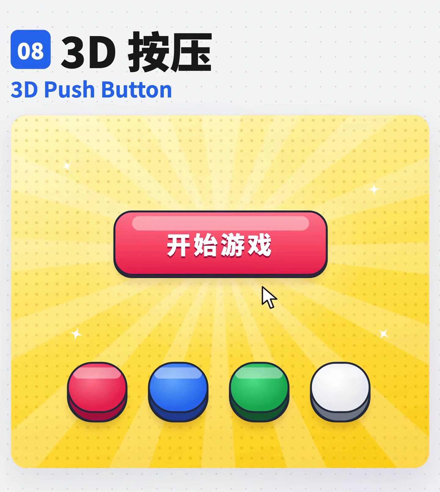
<!-- /ui-atlas:details -->

## 点击波纹按钮 / Ripple Button

- 标识：`buttons-controls/ripple-button`；类型：组件／效果。
- 适用场景：需要表现触点位置的按钮或可点击容器。
- 画面要点：圆形反馈从实际触点扩散，在按钮边界内淡出。
- 实现提示词：点击按钮时，从实际触点生成并扩散 Ripple，裁切到按钮轮廓内后淡出；键盘触发时从中心开始，不改变操作执行时机。
- 核对要点：连续点击不遗留无限节点；反馈层不拦截事件，圆角裁切正确。

<!-- ui-atlas:details buttons-controls/ripple-button -->
- 原尺寸图片：[01 · 1440×1610](../assets/details/buttons-controls/ripple-button-hd-01.webp)。
- 清晰度边界：从 2160 像素高的原片按原像素裁切，WebP 质量 95，不放大、不锐化、不涂抹；静态帧不能证明完整运动。

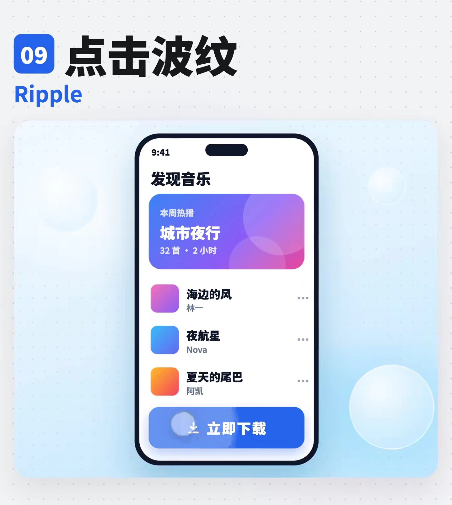
<!-- /ui-atlas:details -->

## 悬停填充按钮 / Hover Fill

- 标识：`buttons-controls/hover-fill`；类型：组件／效果。
- 适用场景：官网或作品集的主要行动入口。
- 画面要点：悬停后，色块从按钮一侧铺满表面，文字层始终位于前景。
- 实现提示词：为 CTA 实现从左到右的 Hover Fill：底层色块随 hover 或 focus 铺满，离开后退回；文字和图标独立保持对比。
- 核对要点：检查进入与离开方向、边缘裁切及触摸默认态；不要将填充当作请求进度。

<!-- ui-atlas:details buttons-controls/hover-fill -->
- 原尺寸图片：[01 · 1440×1610](../assets/details/buttons-controls/hover-fill-hd-01.webp)。
- 清晰度边界：从 2160 像素高的原片按原像素裁切，WebP 质量 95，不放大、不锐化、不涂抹；静态帧不能证明完整运动。

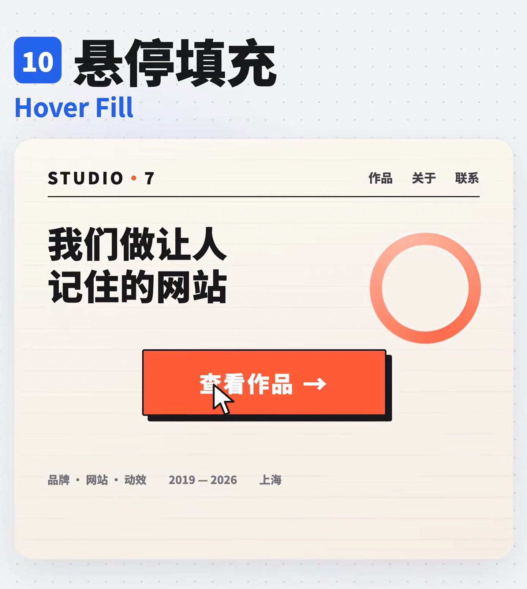
<!-- /ui-atlas:details -->

## 按钮文字翻滚 / Text Roll

- 标识：`buttons-controls/text-roll`；类型：组件／效果。
- 适用场景：短标签的 CTA 与导航操作。
- 画面要点：悬停时按钮标签向上滚出，另一份相同标签从下方进入。
- 实现提示词：让按钮标签在 hover 和 focus 时竖向滚动切换：两份标签在固定高度视窗内衔接，按钮宽度与可访问名称保持稳定。
- 核对要点：避免两份可见标签被重复朗读；快速移入移出后仍归位，不裁掉文字上缘或下缘。

<!-- ui-atlas:details buttons-controls/text-roll -->
- 原尺寸图片：[01 · 1440×1610](../assets/details/buttons-controls/text-roll-hd-01.webp)。
- 清晰度边界：从 2160 像素高的原片按原像素裁切，WebP 质量 95，不放大、不锐化、不涂抹；静态帧不能证明完整运动。

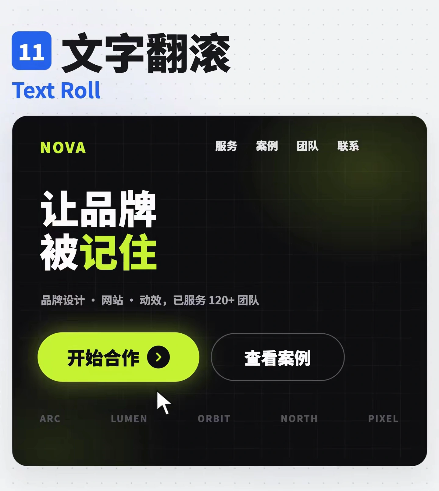
<!-- /ui-atlas:details -->

## 图标变形按钮 / Icon Morph

- 标识：`buttons-controls/icon-morph`；类型：组件／效果。
- 适用场景：菜单开合和播放状态切换。
- 画面要点：菜单与关闭、播放与暂停等成对图标在状态切换时转换。
- 实现提示词：为菜单／关闭或播放／暂停按钮实现 Icon Morph；由真实开合或播放状态驱动图标路径或线段过渡，同步更新名称和 aria 状态。
- 核对要点：每个图标都有明确含义；操作失败时不能只切换图标，触摸、键盘均可用。

<!-- ui-atlas:details buttons-controls/icon-morph -->
- 原尺寸图片：[01 · 1440×1610](../assets/details/buttons-controls/icon-morph-hd-01.webp) · [02 · 1440×1610](../assets/details/buttons-controls/icon-morph-hd-02.webp)。
- 多图用途：对照菜单／关闭与播放／暂停两组图标的状态变化。
- 清晰度边界：从 2160 像素高的原片按原像素裁切，WebP 质量 95，不放大、不锐化、不涂抹；静态帧不能证明完整运动。

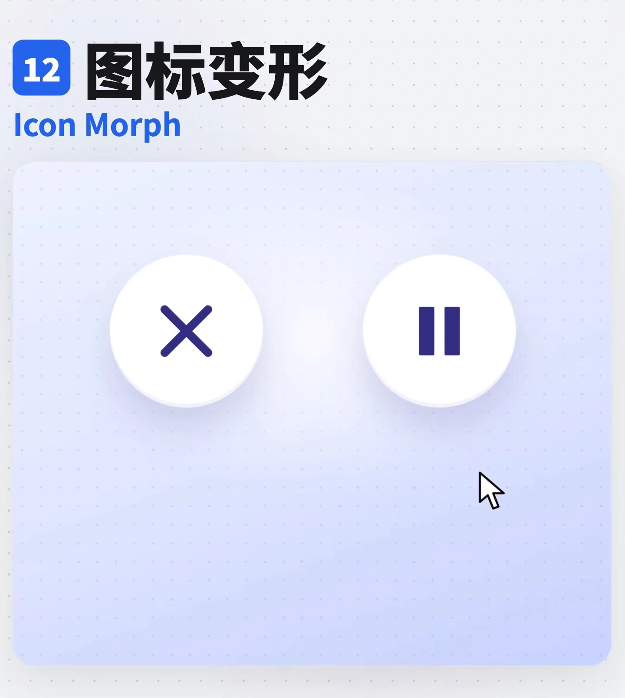
<!-- /ui-atlas:details -->

## 悬停变色按钮 / Hover Color

- 标识：`buttons-controls/hover-color`；类型：组件／效果。
- 适用场景：通用交互入口的基础状态反馈。
- 画面要点：悬停与焦点状态改变背景颜色，按钮形状和标签保持稳定。
- 实现提示词：为按钮定义清晰的默认、hover、focus、pressed 与 disabled 颜色；只对颜色做短过渡，保持现有层级和尺寸。
- 核对要点：核对文字对比与焦点，触摸端默认态也能识别为可点击。
- 关联条目：`buttons-controls/hover`。

<!-- ui-atlas:details buttons-controls/hover-color -->
- 原尺寸图片：[01 · 1440×1610](../assets/details/buttons-controls/hover-color-hd-01.webp)。
- 清晰度边界：从 2160 像素高的原片按原像素裁切，WebP 质量 95，不放大、不锐化、不涂抹；静态帧不能证明完整运动。

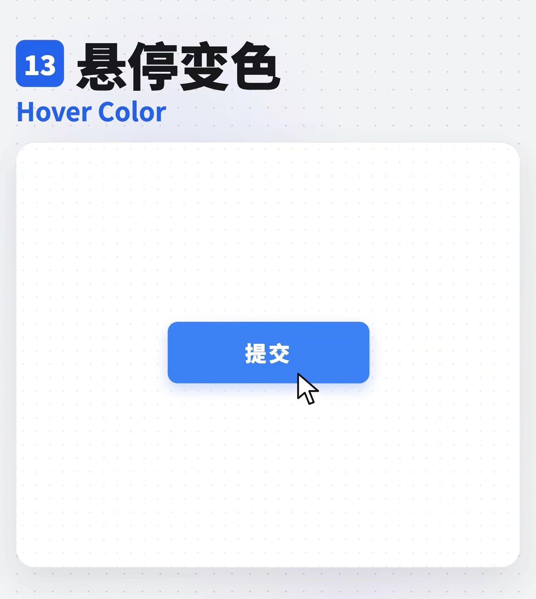
<!-- /ui-atlas:details -->
