# 卡片与表格

六帧图看主要状态，不能证明连续运动和短暂状态。按当前项目需求实现目标组件的交互与动效。

## 目录

- [轮播 / Carousel](#carousel)
- [瀑布流 / Masonry](#masonry)
- [翻转卡片 / Flip Card](#flip-card)
- [统计卡片 / Stat Card](#stat-card)
- [时间线 / Timeline](#timeline)
- [头像组 / Avatar Group](#avatar-group)
- [徽标 / Badge](#badge)
- [标签 / Tag](#tag)
- [折叠面板 / Accordion](#accordion)
- [固定表头 / Fixed Header](#fixed-header)
- [排序和筛选 / Sort & Filter](#sort-filter)
- [行内操作 / Row Actions](#row-actions)
- [斑马纹 / Zebra Stripes](#zebra-stripes)
- [卡片和列表 / Card & List](#card-list)
- [像书一样翻开的卡片 / Book Opening Card](#book-open-card)

## 轮播 / Carousel

- 标识：`cards-tables/carousel`；类型：组件／效果。
- 效果要点：多张图或卡片左右切换；自动切换不宜过快，悬停暂停，保留左右箭头和指示圆点供手动切换。
- 指令例句：轮播支持手动箭头和圆点，自动播放克制，悬停暂停。
- 媒体取舍：保留 GIF＋JPG。需看横向切换、过渡方向与连续轮播的衔接。
- 参考：[GIF 动图](https://raw.githubusercontent.com/dqzboy/ui-atlas/e6aa0d641c224a2cb4c8bd4262a4d18f5c7e1e22/assets/gifs/cards-tables/carousel.gif) · [六帧对照图](https://raw.githubusercontent.com/dqzboy/ui-atlas/e6aa0d641c224a2cb4c8bd4262a4d18f5c7e1e22/assets/filmstrips/cards-tables/carousel.jpg)。

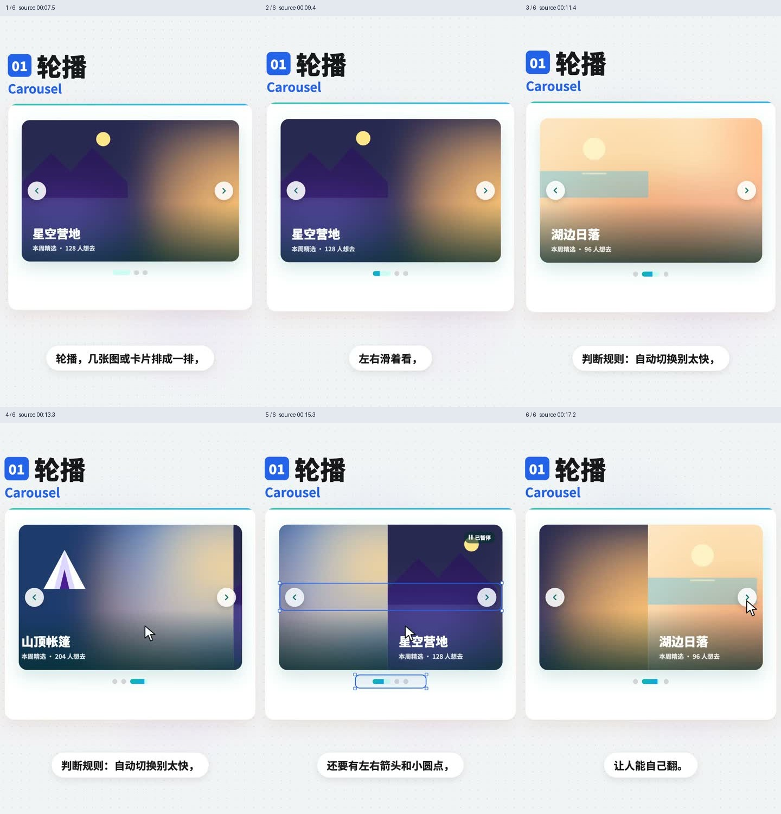

## 瀑布流 / Masonry

- 标识：`cards-tables/masonry`；类型：组件／效果。
- 效果要点：卡片等宽而高度不同，按列紧凑排列；适合尺寸不一的大量图片，减少空白。
- 指令例句：图片集合使用等宽、不等高的 Masonry 瀑布流。
- 媒体取舍：仅保留 JPG。重点是等宽不等高的紧凑排布，不把讲解中的逐张出现当作布局要求。
- 参考：[六帧对照图](https://raw.githubusercontent.com/dqzboy/ui-atlas/e6aa0d641c224a2cb4c8bd4262a4d18f5c7e1e22/assets/filmstrips/cards-tables/masonry.jpg)。

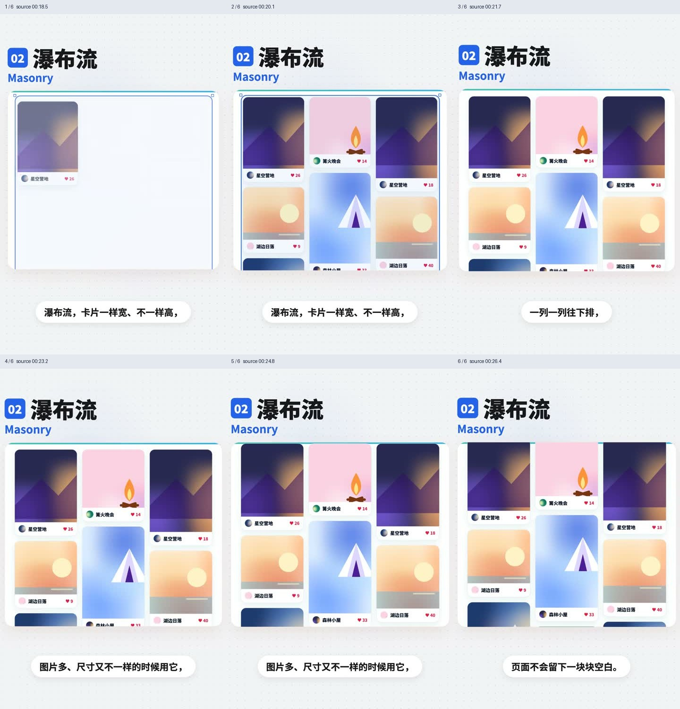

## 翻转卡片 / Flip Card

- 标识：`cards-tables/flip-card`；类型：组件／效果。
- 效果要点：鼠标进入时卡片像翻牌一样转到背面，展示更多说明；适合正面图片、背面权益说明。
- 指令例句：会员卡正面展示图片，交互后翻到背面展示权益说明。
- 媒体取舍：保留 GIF＋JPG。需看正面经过侧面转到背面的空间路径，不能只比对两面。
- 参考：[GIF 动图](https://raw.githubusercontent.com/dqzboy/ui-atlas/e6aa0d641c224a2cb4c8bd4262a4d18f5c7e1e22/assets/gifs/cards-tables/flip-card.gif) · [六帧对照图](https://raw.githubusercontent.com/dqzboy/ui-atlas/e6aa0d641c224a2cb4c8bd4262a4d18f5c7e1e22/assets/filmstrips/cards-tables/flip-card.jpg)。

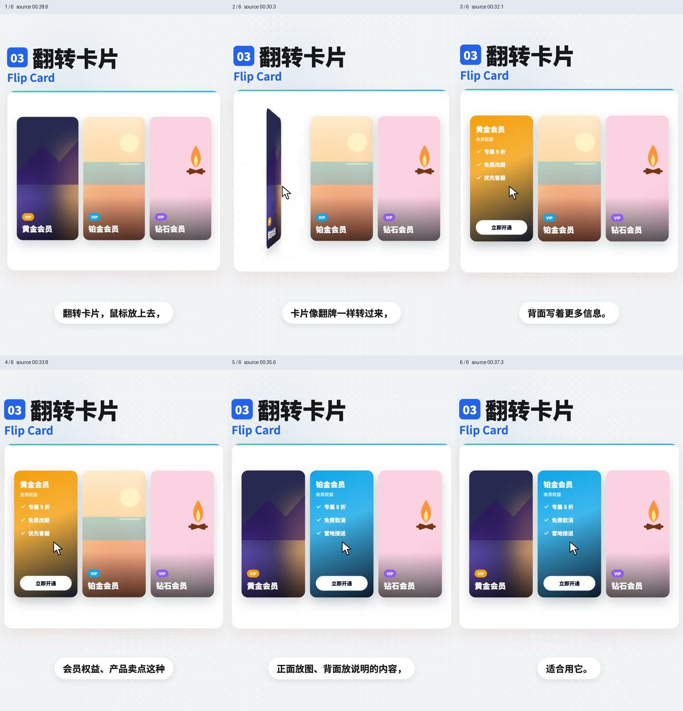

## 统计卡片 / Stat Card

- 标识：`cards-tables/stat-card`；类型：组件／效果。
- 效果要点：一张卡片突出一个大数字，并用趋势箭头表现涨跌；常用于后台首页订单和销售指标。
- 指令例句：每张统计卡突出一个核心数字，附清楚的趋势和比较口径。
- 媒体取舍：仅保留 JPG。数字、趋势和比较口径的层级可由图片表达，计数动效另见 count-up。
- 参考：[六帧对照图](https://raw.githubusercontent.com/dqzboy/ui-atlas/e6aa0d641c224a2cb4c8bd4262a4d18f5c7e1e22/assets/filmstrips/cards-tables/stat-card.jpg)。

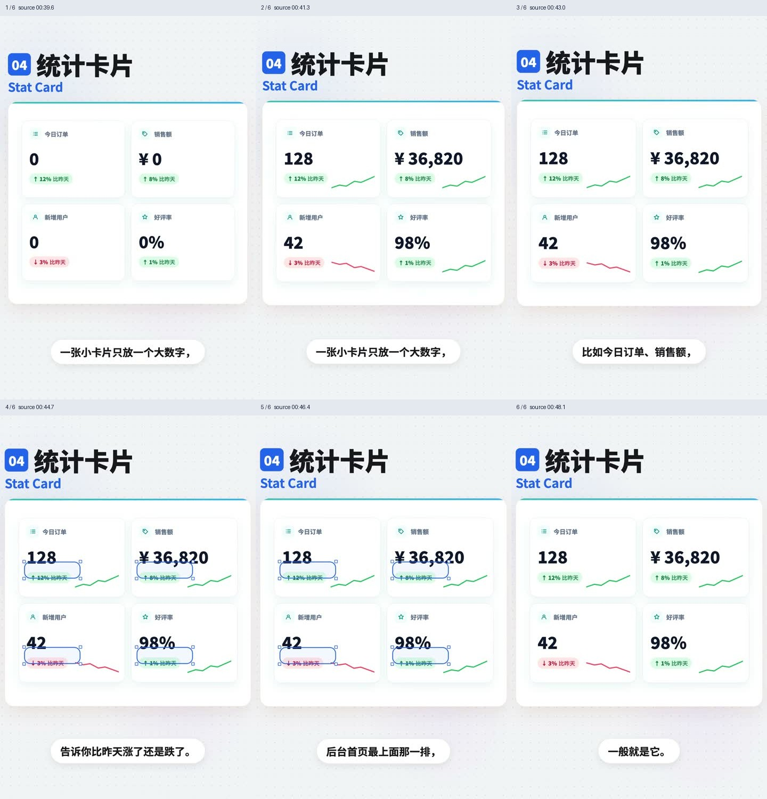

## 时间线 / Timeline

- 标识：`cards-tables/timeline`；类型：组件／效果。
- 效果要点：竖线与圆点按时间串联事件；用于物流、订单记录和公司历程。
- 指令例句：物流记录按时间线排列，圆点对应事件。
- 媒体取舍：仅保留 JPG。事件、竖线与节点的结构可由图片表达，不要求依次绘制。
- 参考：[六帧对照图](https://raw.githubusercontent.com/dqzboy/ui-atlas/e6aa0d641c224a2cb4c8bd4262a4d18f5c7e1e22/assets/filmstrips/cards-tables/timeline.jpg)。

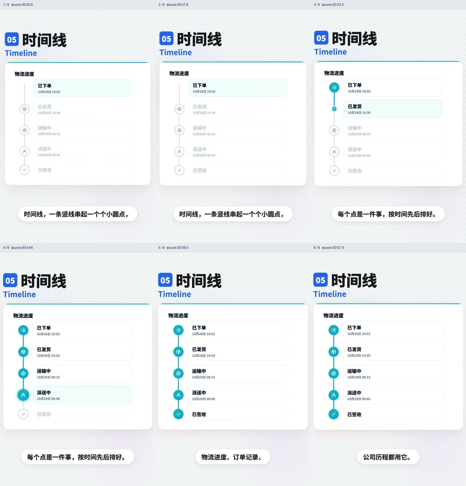

## 头像组 / Avatar Group

- 标识：`cards-tables/avatar-group`；类型：组件／效果。
- 效果要点：多个圆形头像重叠，末尾用 +N 表示未展示人数；用于参与者和协作者。
- 指令例句：参与者用重叠头像组显示，超出部分显示 +N。
- 媒体取舍：仅保留 JPG。重叠、间距与超出数量可由图片表达。
- 参考：[六帧对照图](https://raw.githubusercontent.com/dqzboy/ui-atlas/e6aa0d641c224a2cb4c8bd4262a4d18f5c7e1e22/assets/filmstrips/cards-tables/avatar-group.jpg)。

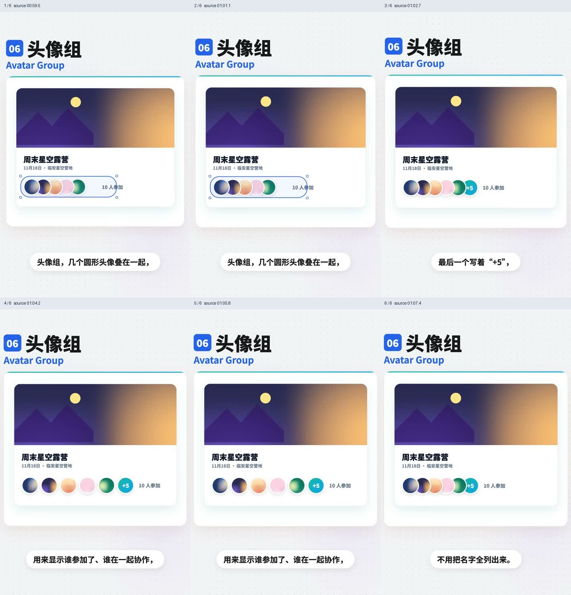

## 徽标 / Badge

- 标识：`cards-tables/badge`；类型：组件／效果。
- 效果要点：图标角落显示小红点或计数；较大数量显示 99+，避免数字撑大组件。
- 指令例句：未读消息使用小徽标，超过上限显示 99+。
- 媒体取舍：仅保留 JPG。红点、数量与上限样式可由状态图片表达。
- 参考：[六帧对照图](https://raw.githubusercontent.com/dqzboy/ui-atlas/e6aa0d641c224a2cb4c8bd4262a4d18f5c7e1e22/assets/filmstrips/cards-tables/badge.jpg)。

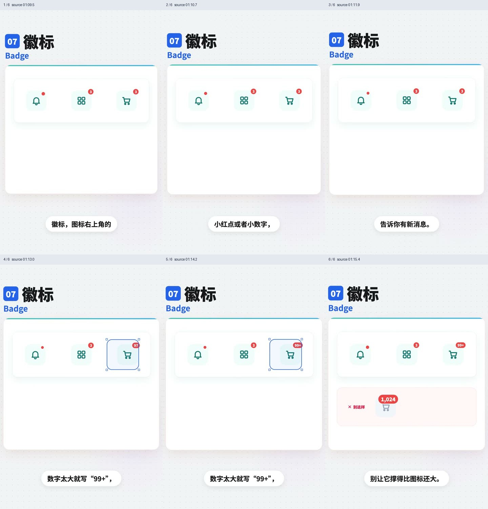

## 标签 / Tag

- 标识：`cards-tables/tag`；类型：组件／效果。
- 效果要点：小圆角色块表达已付款、待发货等状态；建议控制颜色种类，避免过于杂乱。
- 指令例句：订单状态用统一含义的标签表达，颜色克制且带文字。
- 媒体取舍：仅保留 JPG。状态文字、颜色与密度可由图片表达。
- 参考：[六帧对照图](https://raw.githubusercontent.com/dqzboy/ui-atlas/e6aa0d641c224a2cb4c8bd4262a4d18f5c7e1e22/assets/filmstrips/cards-tables/tag.jpg)。

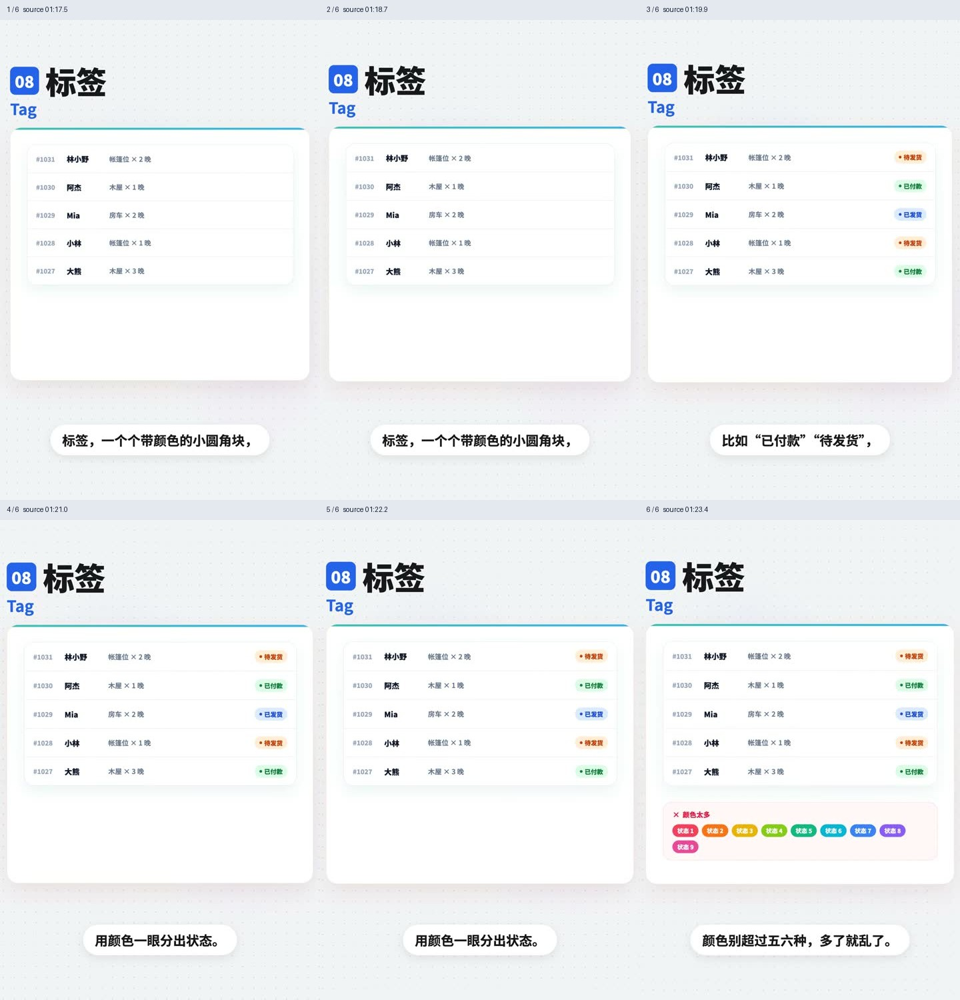

## 折叠面板 / Accordion

- 标识：`cards-tables/accordion`；类型：组件／效果。
- 效果要点：点击标题展开内容，再点收起；适合 FAQ、设置和手机上的较长内容。
- 指令例句：常见问题使用 Accordion，点击问题展开或收起答案。
- 媒体取舍：仅保留 JPG。普通折叠与展开的两种结构由状态图表达；连续高度动效另见 animated-text-expand。
- 参考：[六帧对照图](https://raw.githubusercontent.com/dqzboy/ui-atlas/e6aa0d641c224a2cb4c8bd4262a4d18f5c7e1e22/assets/filmstrips/cards-tables/accordion.jpg)。

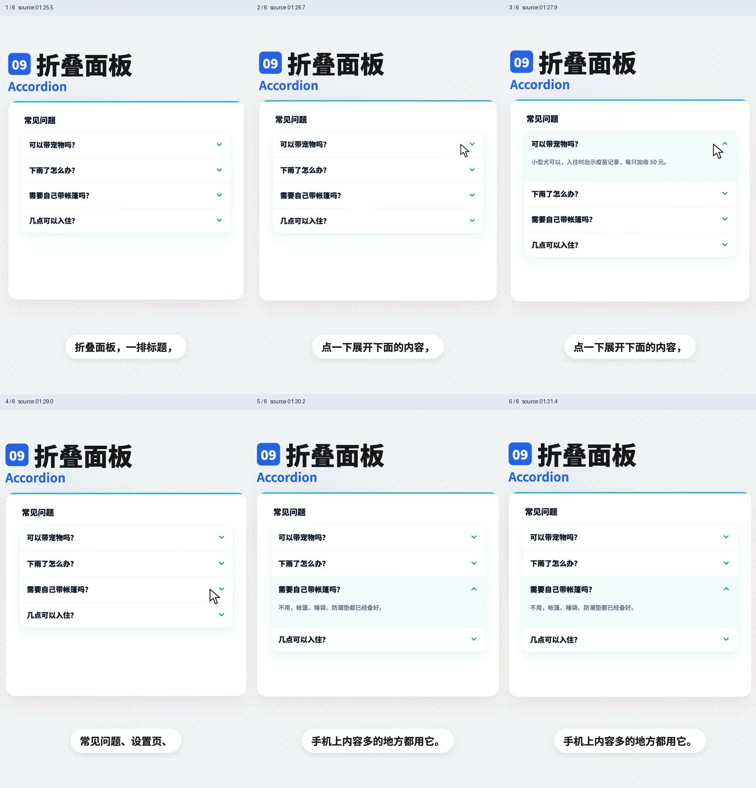

## 固定表头 / Fixed Header

- 标识：`cards-tables/fixed-header`；类型：组件／效果。
- 效果要点：滚动表格时表头保留；列较多时也可固定首列，以便持续辨认含义。
- 指令例句：表格滚动时固定表头，需要横向滚动时固定标识列。
- 媒体取舍：保留 GIF＋JPG。需对照正文滚动与表头、首列保持固定的相对运动。
- 参考：[GIF 动图](https://raw.githubusercontent.com/dqzboy/ui-atlas/e6aa0d641c224a2cb4c8bd4262a4d18f5c7e1e22/assets/gifs/cards-tables/fixed-header.gif) · [六帧对照图](https://raw.githubusercontent.com/dqzboy/ui-atlas/e6aa0d641c224a2cb4c8bd4262a4d18f5c7e1e22/assets/filmstrips/cards-tables/fixed-header.jpg)。

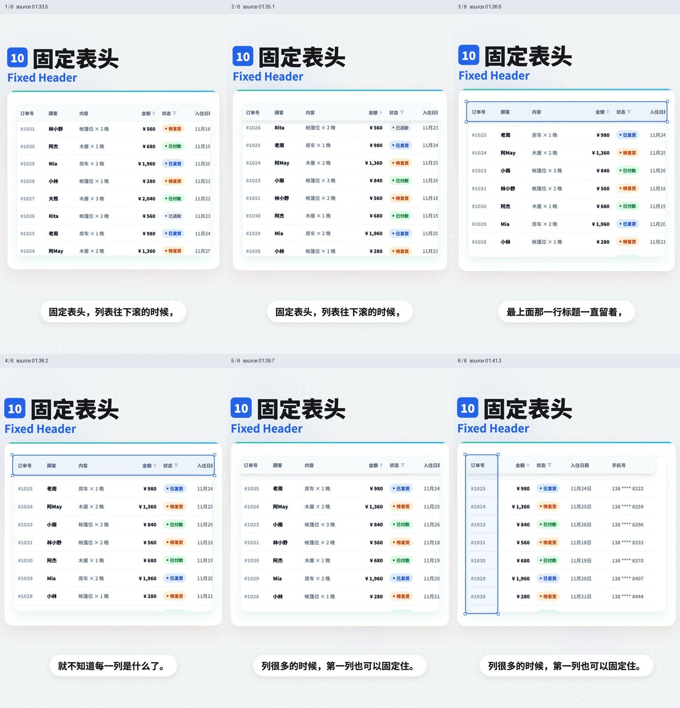

## 排序和筛选 / Sort & Filter

- 标识：`cards-tables/sort-filter`；类型：组件／效果。
- 效果要点：列标题箭头改变排序，小漏斗按条件过滤行；示例只看待发货订单。
- 指令例句：列标题支持排序，并允许按订单状态筛选。
- 媒体取舍：仅保留 JPG。排序箭头、条件与结果列表可由状态图表达，数据正确性仍需项目验证。
- 参考：[六帧对照图](https://raw.githubusercontent.com/dqzboy/ui-atlas/e6aa0d641c224a2cb4c8bd4262a4d18f5c7e1e22/assets/filmstrips/cards-tables/sort-filter.jpg)。

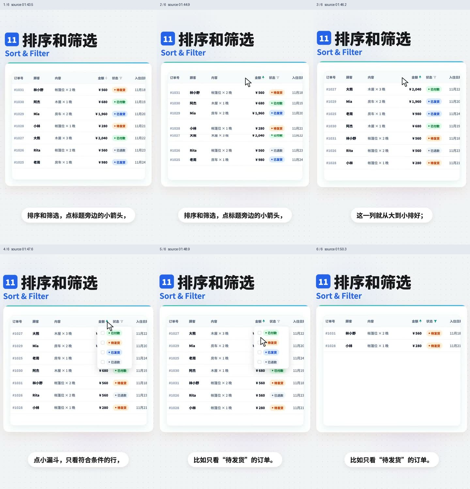

## 行内操作 / Row Actions

- 标识：`cards-tables/row-actions`；类型：组件／效果。
- 效果要点：悬停某一行时，在行尾出现编辑和删除操作，默认隐藏以减少视觉负担。
- 指令例句：行尾操作在悬停和键盘聚焦时显示，触摸端提供可见操作入口。
- 媒体取舍：仅保留 JPG。默认与显露操作的状态图足够，触摸和键盘入口依照文字规则实现。
- 参考：[六帧对照图](https://raw.githubusercontent.com/dqzboy/ui-atlas/e6aa0d641c224a2cb4c8bd4262a4d18f5c7e1e22/assets/filmstrips/cards-tables/row-actions.jpg)。

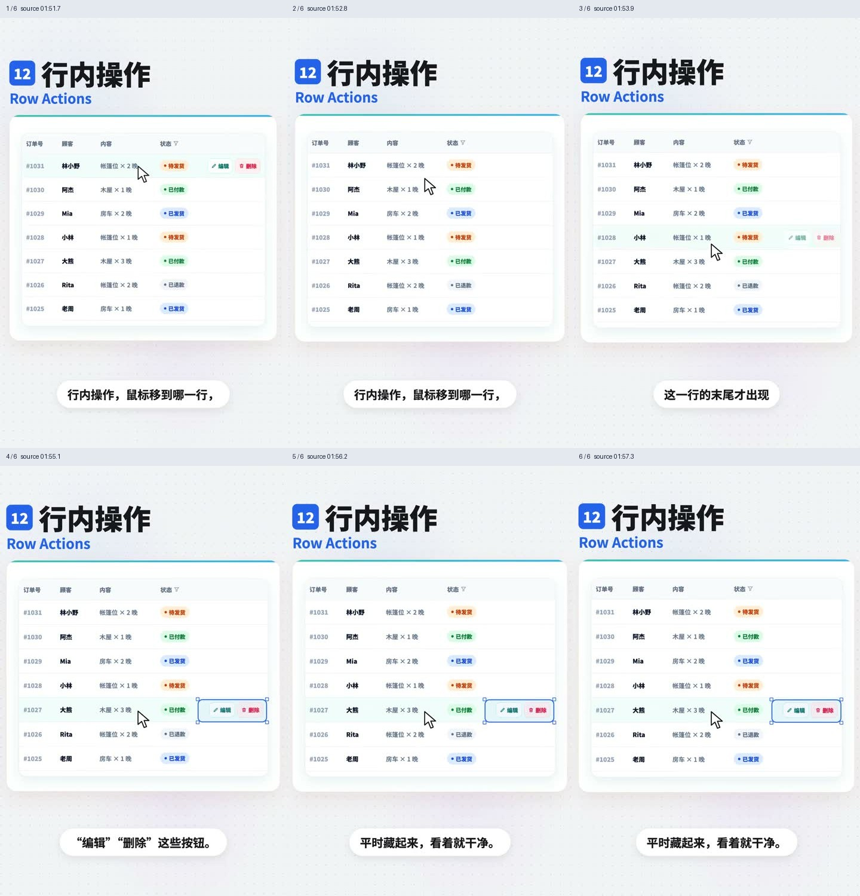

## 斑马纹 / Zebra Stripes

- 标识：`cards-tables/zebra-stripes`；类型：组件／效果。
- 效果要点：行背景深浅交替，帮助阅读长列表；同时应注意金额等数字右对齐便于比较。
- 指令例句：长表格使用轻微斑马纹，金额列右对齐。
- 媒体取舍：仅保留 JPG。交替行底色和数字对齐是静态阅读细节。
- 参考：[六帧对照图](https://raw.githubusercontent.com/dqzboy/ui-atlas/e6aa0d641c224a2cb4c8bd4262a4d18f5c7e1e22/assets/filmstrips/cards-tables/zebra-stripes.jpg)。

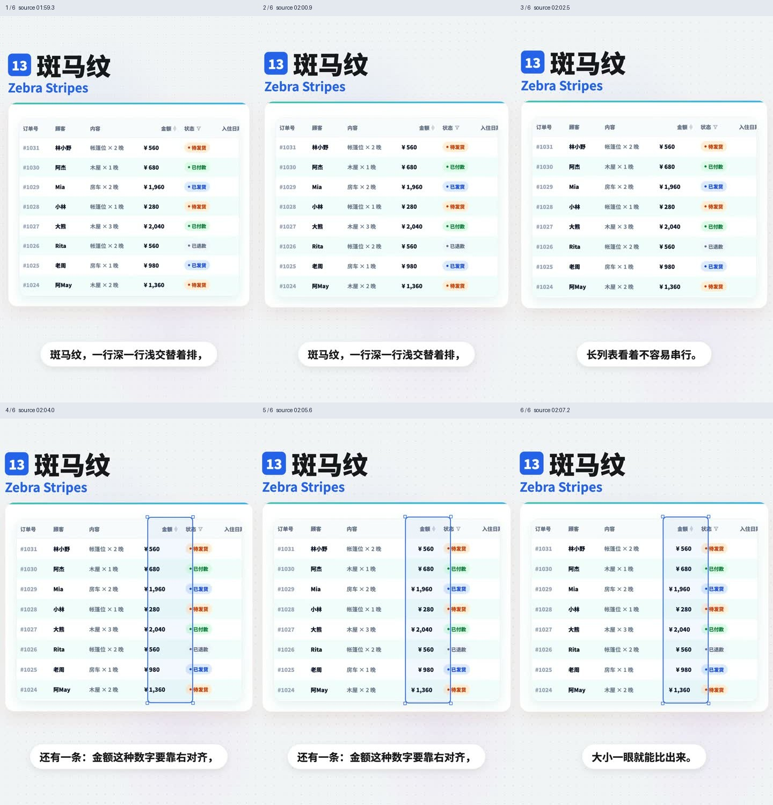

## 卡片和列表 / Card & List

- 标识：`cards-tables/card-list`；类型：组件／效果。
- 效果要点：基础卡片和列表作为对照；不要求额外的特殊动画。
- 指令例句：按内容结构使用基础卡片或列表，不附加未指定效果。
- 媒体取舍：仅保留 JPG。卡片与列表的结构对照即可，不要求附加动效。
- 参考：[六帧对照图](https://raw.githubusercontent.com/dqzboy/ui-atlas/e6aa0d641c224a2cb4c8bd4262a4d18f5c7e1e22/assets/filmstrips/cards-tables/card-list.jpg)。

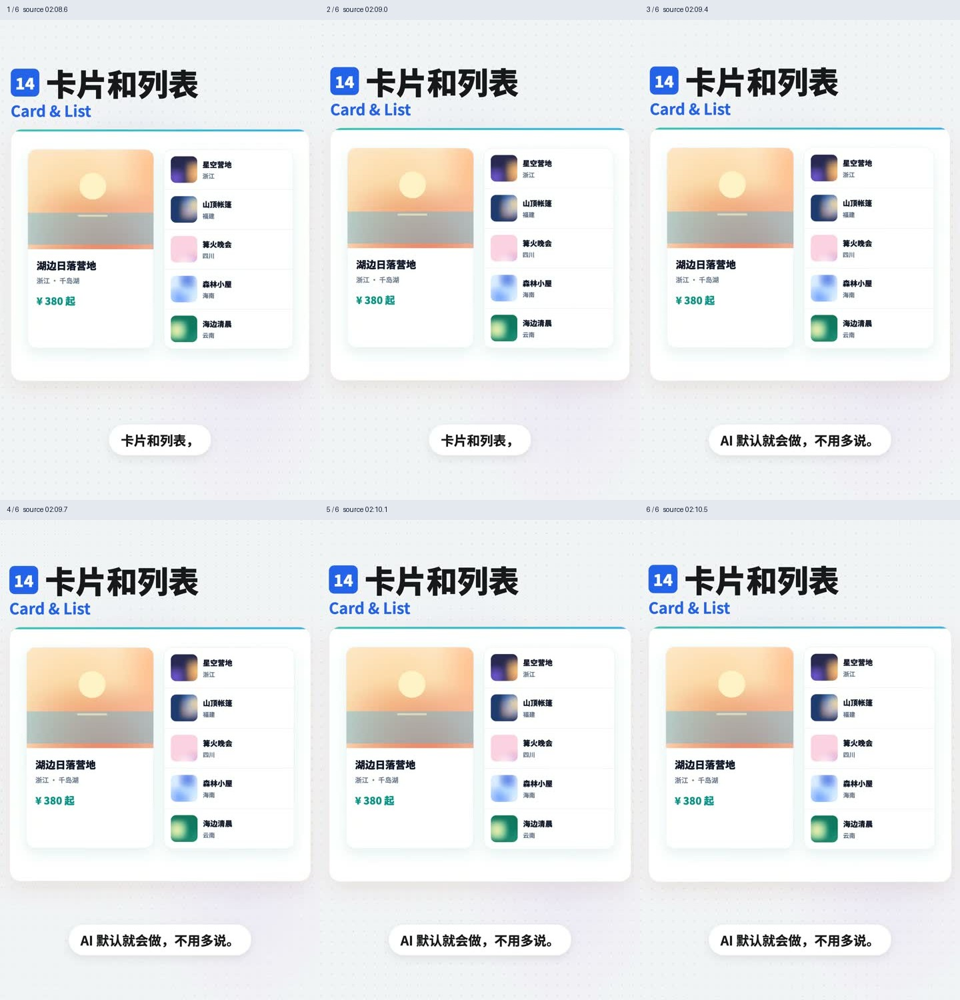

## 像书一样翻开的卡片 / Book Opening Card

- 标识：`cards-tables/book-open-card`；类型：组件／效果。
- 效果要点：静止时保持原卡片，hover 或 focus 时封面和内页沿书脊逐层翻开；角度 42° × 0.7ⁿ，延迟 28ms × n，离开倒序合拢。
- 实现关注：Default、Skeuomorphic、Minimal 三种风格；既有卡片优先匹配原 token。封面 + 默认 4 页 + 不动封底，透视约 1100px，绕左轴旋转；各页错开 Z 防止闪烁。所有活动层 pointer-events: none，热区固定在原占位；内页 aria-hidden，不增加焦点。用两对预模糊实心阴影的 opacity 交叉淡化，避免翻开后出现空心阴影边框。
- 验证重点：检查初始占位与原卡片一致、快速移入移出从当前角速度继续、边缘不反复触发、焦点可见、首次触摸仍可激活；减弱动态时只轻抬或完全静止。
- 指令例句：参考 cards-tables/book-open-card，静止时保持原卡片，hover 或 focus 时封面和内页沿书脊逐层翻开；角度 42° × 0.7ⁿ，延迟 28ms × n，离开倒序合拢。
- [完整实现配方与提示词](recipes/book-open-card.md)；证据类型：文字配方，未附动画。
