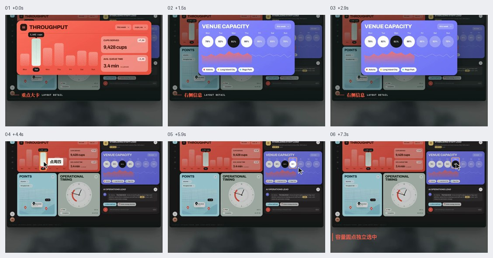
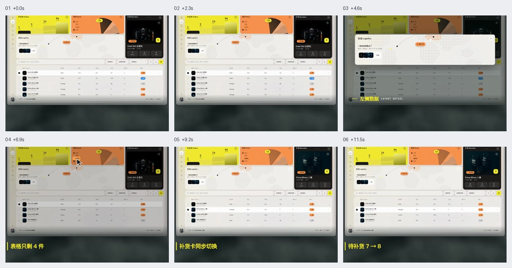
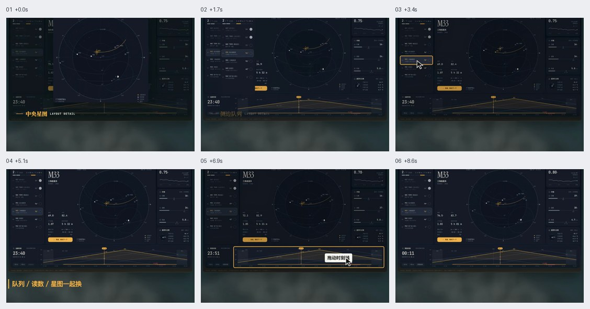
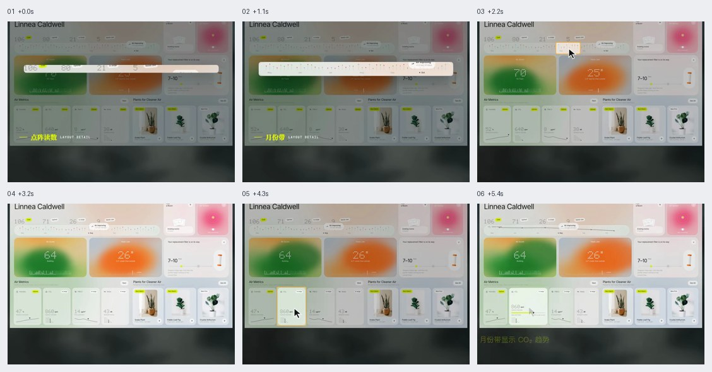
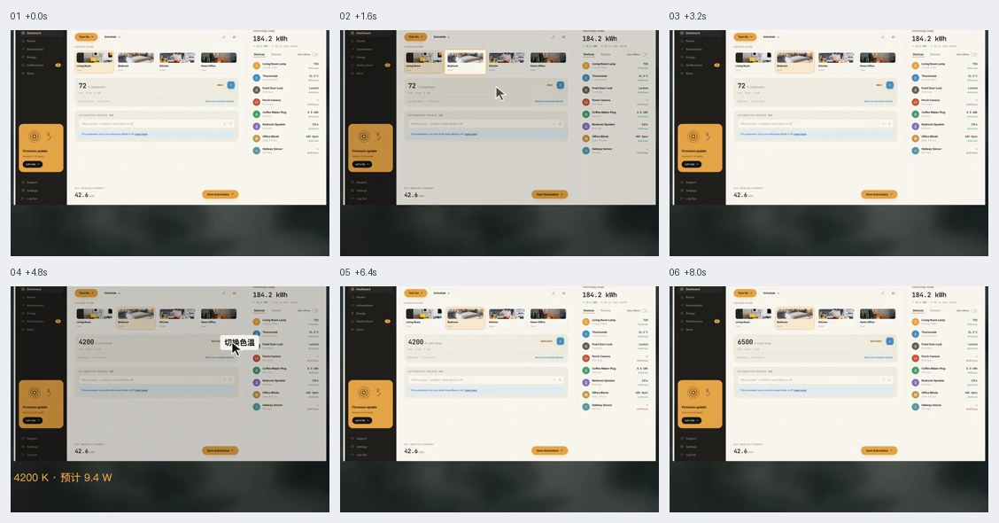
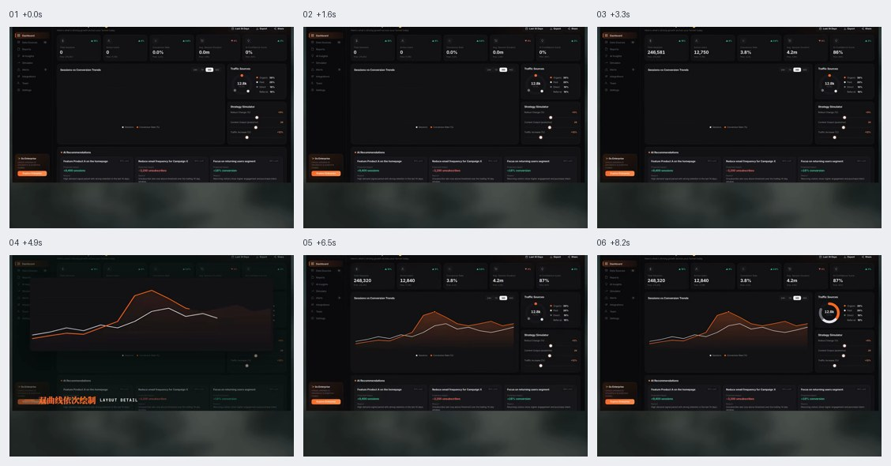

# Dashboard 布局与联动

按主任务分配主图、指标、表格和操作区。共享对象、时间或模式的区域使用同一上下文，布局与联动需一起验证。

GIF 看连续运动，六帧图按从左到右、从上到下查看。像素值、技术栈与缓动由当前项目决定。

## 目录

- [多彩错列主次网格 / Asymmetric Color Grid](#asymmetric-color-grid)
- [工业分区与固定操作区 / Inventory Action Workbench](#inventory-action-workbench)
- [中轴观测与时间轴联动 / Central Observation Timeline](#central-observation-timeline)
- [玻璃点阵与月份指标 / Glass Matrix Metrics](#glass-matrix-metrics)
- [暖色三栏控制台 / Warm Three Column Console](#warm-three-column-console)
- [暗色增长与图表递进入场 / Dark Growth Dashboard](#dark-growth-dashboard)

## 多彩错列主次网格 / Asymmetric Color Grid

- 标识：`dashboard-layouts/asymmetric-color-grid`；类型：组件／效果。
- 效果要点：深色底上由大主卡和多张不同色次卡组成非对称网格，选中日期时柱形、标签与容量读数联动。
- 指令例句：用非对称网格组织大主卡和次卡，选择日期时同步高亮柱图、标签与容量数据。
- 实现关注：网格比例按实际信息调整；颜色对应稳定语义，所有联动区共用日期状态，单独的容量选择保持清晰作用范围。
- 验证重点：逐日选择、容量切换与窗口变窄后，重点层级和数据对应不丢失。
- 参考：[GIF 动图](../assets/gifs/dashboard-layouts/asymmetric-color-grid.gif) · [六帧对照图](../assets/filmstrips/dashboard-layouts/asymmetric-color-grid.jpg)。

## 工业分区与固定操作区 / Inventory Action Workbench

- 标识：`dashboard-layouts/inventory-action-workbench`；类型：组件／效果。
- 效果要点：左侧状态与库存表承载筛选浏览，右侧固定操作卡跟随当前商品，形成选择到加入清单的连续流程。
- 指令例句：库存工作台按筛选、表格、操作区分栏；选中商品更新右卡，加入清单同步数量。
- 实现关注：以商品 ID 共享表格选择与操作卡；筛选隐藏当前行时明确保留或清空策略，加入动作有加载和失败恢复。
- 验证重点：过滤、切换商品、加入成功与失败后，商品名称、库存和清单数量一致。
- 参考：[GIF 动图](../assets/gifs/dashboard-layouts/inventory-action-workbench.gif) · [六帧对照图](../assets/filmstrips/dashboard-layouts/inventory-action-workbench.jpg)。

## 中轴观测与时间轴联动 / Central Observation Timeline

- 标识：`dashboard-layouts/central-observation-timeline`；类型：组件／效果。
- 效果要点：中央主视图占据重点，两侧收纳队列和读数，下方时间轴驱动全局时刻预览。
- 指令例句：中央放主观测图，两侧显示队列和读数；切换对象或拖动时间轴时全局联动。
- 实现关注：对象与时刻是共享状态，预览与提交按任务区分；主图、曲线、读数都标明同一上下文。
- 验证重点：换对象、拖动时间轴、停止和返回当前时刻后，各面板没有混用不同对象或时点的数据。
- 参考：[GIF 动图](../assets/gifs/dashboard-layouts/central-observation-timeline.gif) · [六帧对照图](../assets/filmstrips/dashboard-layouts/central-observation-timeline.jpg)。

## 玻璃点阵与月份指标 / Glass Matrix Metrics

- 标识：`dashboard-layouts/glass-matrix-metrics`；类型：组件／效果。
- 效果要点：浅色玻璃卡片承载点阵读数，月份带与指标选择共同决定当前值和趋势。
- 指令例句：浅色仪表盘用玻璃卡与点阵读数，切换月份更新指标，选择指标展示对应趋势。
- 实现关注：月份和指标共同作为数据查询键；点阵数字同时提供可读文本，趋势标出时间范围与单位。
- 验证重点：切换月份和指标、空月份及低对比背景下，数值、单位和趋势对应正确。
- 相关条目：[glass-materials/frosted-glass-layer](glass-materials.md#frosted-glass-layer)。
- 参考：[GIF 动图](../assets/gifs/dashboard-layouts/glass-matrix-metrics.gif) · [六帧对照图](../assets/filmstrips/dashboard-layouts/glass-matrix-metrics.jpg)。

## 暖色三栏控制台 / Warm Three Column Console

- 标识：`dashboard-layouts/warm-three-column-console`；类型：组件／效果。
- 效果要点：深色导航、浅色控制区和设备列表构成三栏，房间、模式、数值与单位同步切换。
- 指令例句：设备控制台用三栏分区，切换房间同步照片和设定值，模式切换时同步数值与单位。
- 实现关注：固定侧栏只在空间充足时使用，中栏自适应；区分温度与色温等模式的数据类型，设备请求绑定房间和模式。
- 验证重点：换房间、换模式和点击预设后，照片、读数、单位与设备对象一致，旧响应不覆盖当前选择。
- 参考：[GIF 动图](../assets/gifs/dashboard-layouts/warm-three-column-console.gif) · [六帧对照图](../assets/filmstrips/dashboard-layouts/warm-three-column-console.jpg)。

## 暗色增长与图表递进入场 / Dark Growth Dashboard

- 标识：`dashboard-layouts/dark-growth-dashboard`；类型：组件／效果。
- 效果要点：暗色层级中横排指标在前，主趋势图与来源占比分区，数字、曲线、面积和环图按顺序进入。
- 指令例句：增长看板先展示核心指标，再依次绘制趋势曲线、面积和来源环图。
- 实现关注：所有图表共用真实数据与时间范围；入场仅表现加载完成结果，不能用虚构数值填动画，缩窄后重排指标。
- 验证重点：数据加载失败、零值、切换范围和减弱动态时，都能读取完整且一致的指标与图表。
- 相关条目：[mobile-scroll/viewport-chart-growth](mobile-scroll.md#viewport-chart-growth) · [motion/stagger](motion.md#stagger)。
- 参考：[GIF 动图](../assets/gifs/dashboard-layouts/dark-growth-dashboard.gif) · [六帧对照图](../assets/filmstrips/dashboard-layouts/dark-growth-dashboard.jpg)。

