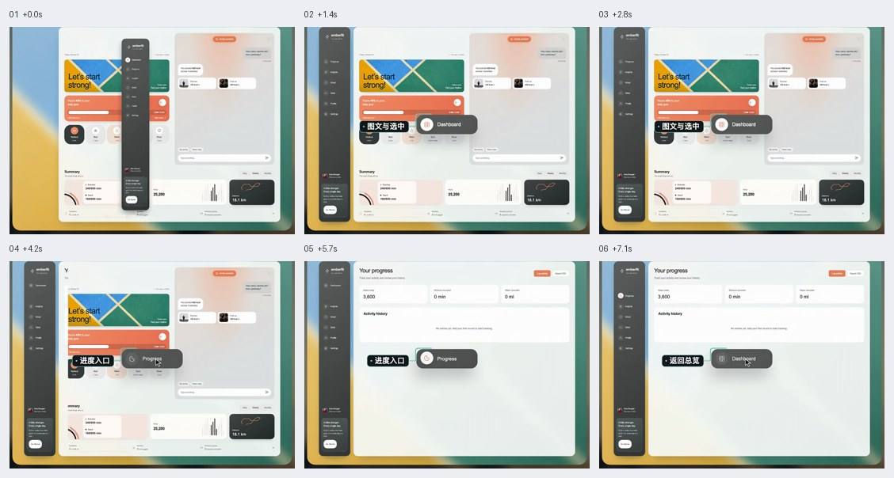
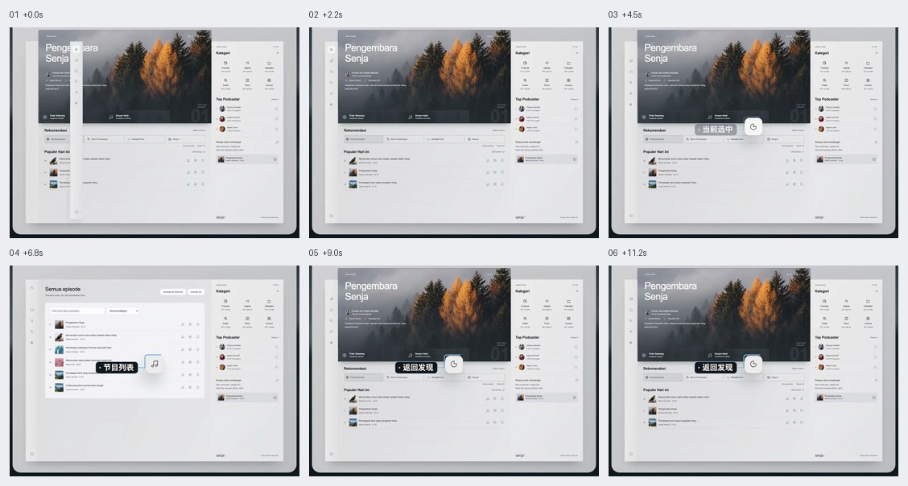
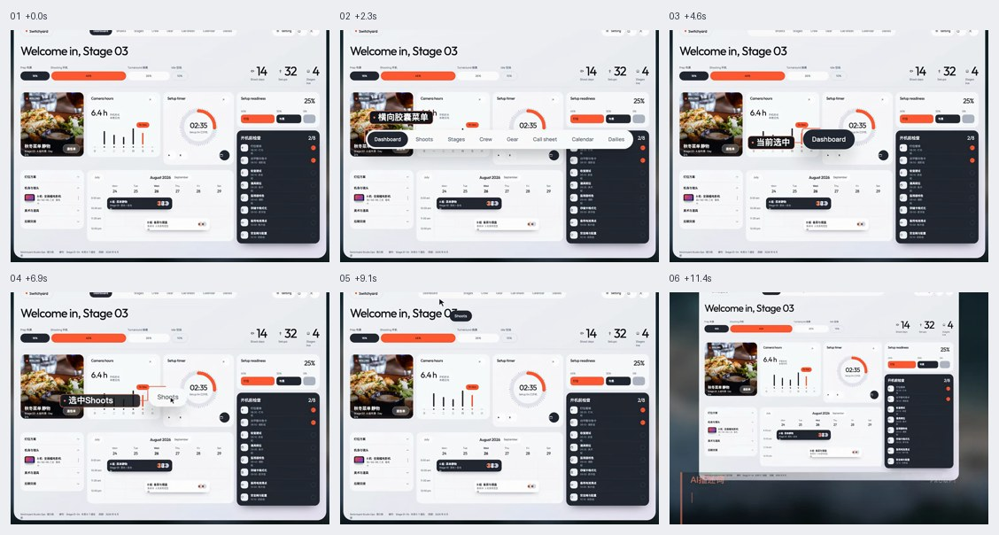
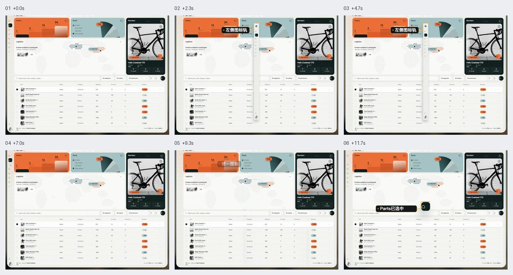
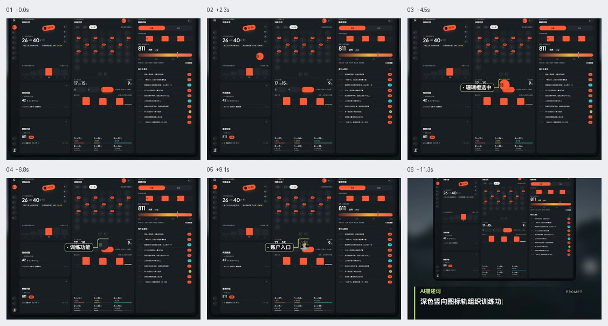
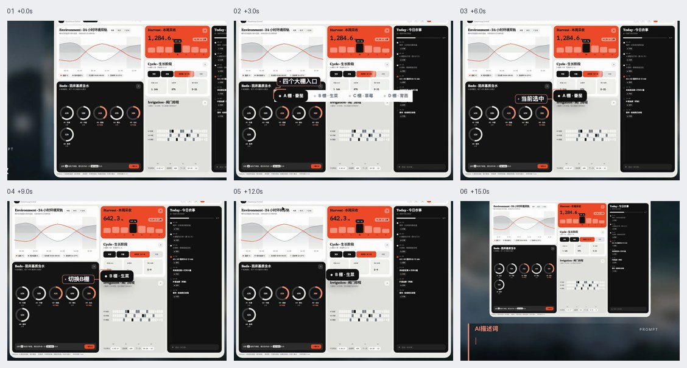

# Dashboard 与后台导航

先区分路由导航、内容分组和对象筛选。导航高亮反映当前页面；对象标签控制当前数据上下文；二者都需与正文保持一致。

六帧图按从左到右、从上到下查看，仅表示抽样状态，不能证明连续运动和短暂状态。像素值、技术栈与缓动由当前项目决定。

## 目录

- [图文侧栏与内容同步 / Icon Text Sidebar](#icon-text-sidebar)
- [内容分组导航 / Grouped Content Sidebar](#grouped-content-sidebar)
- [顶部胶囊菜单 / Top Pill Navigation](#top-pill-navigation)
- [极简图标侧栏 / Compact Icon Rail](#compact-icon-rail)
- [品牌色高亮侧栏 / Brand Accent Sidebar](#brand-accent-sidebar)
- [分组标签与数据联动 / Context Data Tabs](#context-data-tabs)

## 图文侧栏与内容同步 / Icon Text Sidebar

- 标识：`dashboard-navigation/icon-text-sidebar`；类型：组件／效果。
- 效果要点：左侧组合图标与文字，清楚标出当前入口；点击后右侧内容与菜单高亮同步切换。
- 指令例句：后台使用图文侧栏，当前路由高亮，并与右侧内容同步。
- 实现关注：路由是选中态的来源；图标与标签成组，工具入口与主要功能保持稳定位置。
- 验证重点：点击、刷新、深链接和浏览器前进后退后，菜单与正文一致。
- 媒体取舍：仅保留 JPG。图标、文字、分区与选中态由图片表达，普通路由切换无需 GIF。
- 参考：[六帧对照图](https://raw.githubusercontent.com/dqzboy/ui-atlas/e6aa0d641c224a2cb4c8bd4262a4d18f5c7e1e22/assets/filmstrips/dashboard-navigation/icon-text-sidebar.jpg)。

## 内容分组导航 / Grouped Content Sidebar

- 标识：`dashboard-navigation/grouped-content-sidebar`；类型：组件／效果。
- 效果要点：相关内容入口在侧栏分组，通过分组层级与选中底色帮助切换列表和发现页。
- 指令例句：把内容入口按任务分组，侧栏层级和选中底色清晰，切页时同步更新。
- 实现关注：分组标题、页面入口与子项有明确层级；保留当前分组展开状态，不只用颜色表达当前页。
- 验证重点：跨组切换、折叠、深层页面和窄屏展开后都能定位当前所在位置。
- 媒体取舍：仅保留 JPG。分组结构、侧栏层级与选中样式由状态图表达。
- 参考：[六帧对照图](https://raw.githubusercontent.com/dqzboy/ui-atlas/e6aa0d641c224a2cb4c8bd4262a4d18f5c7e1e22/assets/filmstrips/dashboard-navigation/grouped-content-sidebar.jpg)。

## 顶部胶囊菜单 / Top Pill Navigation

- 标识：`dashboard-navigation/top-pill-navigation`；类型：组件／效果。
- 效果要点：主要入口收进顶部圆角容器，用深浅底色区分当前项，让主体区域保持宽阔。
- 指令例句：后台用顶部胶囊导航组织少量主入口，选中态清晰且主体布局稳定。
- 实现关注：入口多时保留横向滚动或更多菜单；导航项宽度适应文字，不因高亮导致整个主体跳动。
- 验证重点：长标签、缩窄窗口、当前入口切换及键盘操作都完整可见。
- 媒体取舍：仅保留 JPG。顶部容器、入口密度与选中样式由图片表达。
- 参考：[六帧对照图](https://raw.githubusercontent.com/dqzboy/ui-atlas/e6aa0d641c224a2cb4c8bd4262a4d18f5c7e1e22/assets/filmstrips/dashboard-navigation/top-pill-navigation.jpg)。

## 极简图标侧栏 / Compact Icon Rail

- 标识：`dashboard-navigation/compact-icon-rail`；类型：组件／效果。
- 效果要点：窄图标轨把更多空间留给正文，主要业务入口在上方，通知与账户固定在底部。
- 指令例句：工作台使用窄图标侧栏，上方业务、下方通知账户，当前入口高对比显示。
- 实现关注：每项有可访问名称、聚焦说明及触摸可见名称入口；统一图标尺寸和命中区域。
- 验证重点：仅看图标不明确时能获得名称；底部入口在短窗口和滚动中仍可触达。
- 媒体取舍：仅保留 JPG。窄轨尺寸、图标分区及底部账户区属于静态布局。
- 参考：[六帧对照图](https://raw.githubusercontent.com/dqzboy/ui-atlas/e6aa0d641c224a2cb4c8bd4262a4d18f5c7e1e22/assets/filmstrips/dashboard-navigation/compact-icon-rail.jpg)。

## 品牌色高亮侧栏 / Brand Accent Sidebar

- 标识：`dashboard-navigation/brand-accent-sidebar`；类型：组件／效果。
- 效果要点：深色窄侧栏用品牌色集中突出当前入口，统一圆角与上下分区。
- 指令例句：深色后台用品牌色标记当前侧栏入口，主功能与底部工具分组。
- 实现关注：品牌色只强化当前项和少量关键反馈；同时用形状、位置或文字表达选中，保持明暗对比。
- 验证重点：换品牌色、禁用、聚焦和通知徽标共存时，当前入口依旧明确。
- 媒体取舍：仅保留 JPG。品牌色、当前入口和上下分区属于静态视觉层级。
- 参考：[六帧对照图](https://raw.githubusercontent.com/dqzboy/ui-atlas/e6aa0d641c224a2cb4c8bd4262a4d18f5c7e1e22/assets/filmstrips/dashboard-navigation/brand-accent-sidebar.jpg)。

## 分组标签与数据联动 / Context Data Tabs

- 标识：`dashboard-navigation/context-data-tabs`；类型：组件／效果。
- 效果要点：顶部分组标签选择当前业务对象，选中底色与标记同步，指标和列表更新为该对象数据。
- 指令例句：顶部对象标签切换时，同步更新该对象的指标、阶段和列表，并保留明确的选中态。
- 实现关注：区分对象筛选与页面导航；以对象 ID 绑定请求，快速切换时忽略旧请求结果，加载和失败仍显示当前对象。
- 验证重点：A 到 B 再返回 A，全部指标、标题和列表一致；慢请求不覆盖新选择。
- 媒体取舍：保留 GIF＋JPG。需看对象标签切换后多处指标、曲线和列表的联动顺序。
- 参考：[GIF 动图](https://raw.githubusercontent.com/dqzboy/ui-atlas/e6aa0d641c224a2cb4c8bd4262a4d18f5c7e1e22/assets/gifs/dashboard-navigation/context-data-tabs.gif) · [六帧对照图](https://raw.githubusercontent.com/dqzboy/ui-atlas/e6aa0d641c224a2cb4c8bd4262a4d18f5c7e1e22/assets/filmstrips/dashboard-navigation/context-data-tabs.jpg)。

