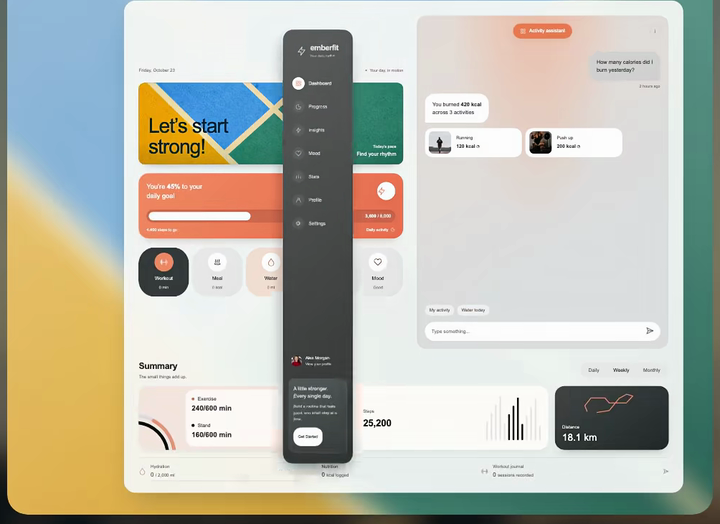
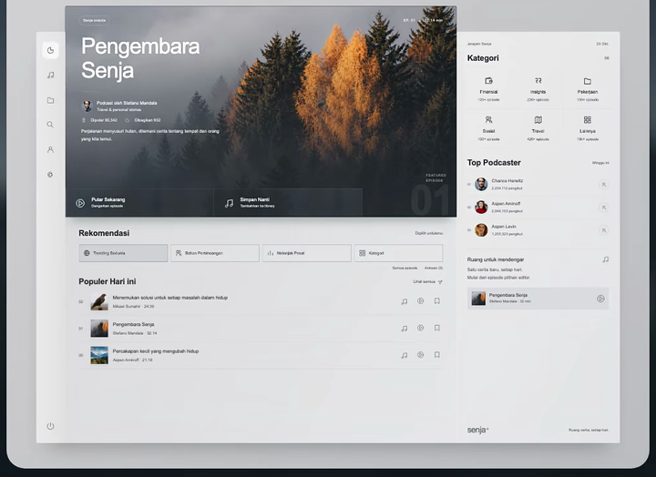
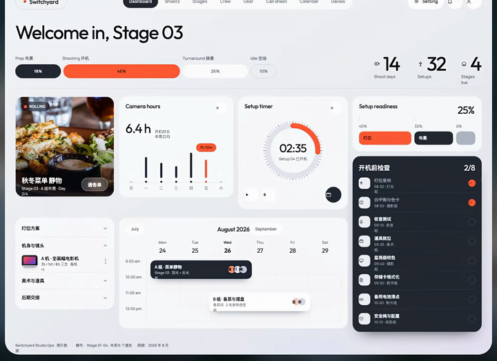
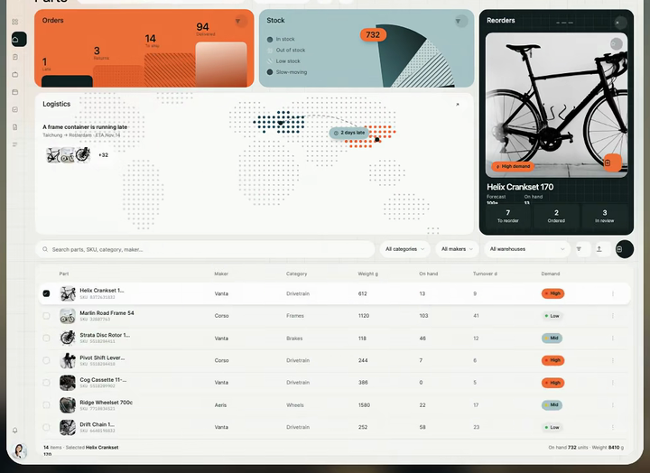

# Dashboard 与后台导航

先区分路由导航、内容分组和对象筛选。导航高亮反映当前页面；对象标签控制当前数据上下文；二者都需与正文保持一致。

参考图用于核对构图与可见状态；连续动作在实际项目中验证。像素值、技术栈与缓动由当前项目决定。

## 目录

- [图文侧栏与内容同步](#icon-text-sidebar)
- [内容分组导航](#grouped-content-sidebar)
- [顶部胶囊菜单](#top-pill-navigation)
- [极简图标侧栏](#compact-icon-rail)

## 图文侧栏与内容同步 / Icon Text Sidebar

- 标识：`dashboard-navigation/icon-text-sidebar`；类型：组件／效果。
- 效果要点：左侧组合图标与文字，清楚标出当前入口；点击后右侧内容与菜单高亮同步切换。
- 指令例句：后台使用图文侧栏，当前路由高亮，并与右侧内容同步。
- 实现关注：路由是选中态的来源；图标与标签成组，工具入口与主要功能保持稳定位置。
- 验证重点：点击、刷新、深链接和浏览器前进后退后，菜单与正文一致。
- 媒体取舍：图标、文字、分区与选中态由图片表达，普通路由切换无需连续演示。

<!-- ui-atlas:details dashboard-navigation/icon-text-sidebar -->
- 原尺寸图片：[01 · 720×524](https://raw.githubusercontent.com/dqzboy/ui-atlas/4d61e1224c50685c02acae3ae67ebe9c217fa3b9/assets/details/dashboard-navigation/icon-text-sidebar-01.png) · [02 · 720×524](https://raw.githubusercontent.com/dqzboy/ui-atlas/4d61e1224c50685c02acae3ae67ebe9c217fa3b9/assets/details/dashboard-navigation/icon-text-sidebar-02.png)。
- 多图用途：分别展示工作台首页与项目列表，保留导航和内容的对应关系。
- 清晰度边界：保留总览合成前的独立 PNG 帧；这些帧已在旧导出时缩到 300–720 像素宽，缺少更高分辨率原片。

<!-- /ui-atlas:details -->

## 内容分组导航 / Grouped Content Sidebar

- 标识：`dashboard-navigation/grouped-content-sidebar`；类型：组件／效果。
- 效果要点：相关内容入口在侧栏分组，通过分组层级与选中底色帮助切换列表和发现页。
- 指令例句：把内容入口按任务分组，侧栏层级和选中底色清晰，切页时同步更新。
- 实现关注：分组标题、页面入口与子项有明确层级；保留当前分组展开状态，不只用颜色表达当前页。
- 验证重点：跨组切换、折叠、深层页面和窄屏展开后都能定位当前所在位置。
- 媒体取舍：分组结构、侧栏层级与选中样式由状态图表达。

<!-- ui-atlas:details dashboard-navigation/grouped-content-sidebar -->
- 原尺寸图片：[01 · 720×524](https://raw.githubusercontent.com/dqzboy/ui-atlas/4d61e1224c50685c02acae3ae67ebe9c217fa3b9/assets/details/dashboard-navigation/grouped-content-sidebar-01.png) · [02 · 720×524](https://raw.githubusercontent.com/dqzboy/ui-atlas/4d61e1224c50685c02acae3ae67ebe9c217fa3b9/assets/details/dashboard-navigation/grouped-content-sidebar-02.png)。
- 多图用途：分别展示分组首页与资源列表两种内容布局。
- 清晰度边界：保留总览合成前的独立 PNG 帧；这些帧已在旧导出时缩到 300–720 像素宽，缺少更高分辨率原片。

<!-- /ui-atlas:details -->

## 顶部胶囊菜单 / Top Pill Navigation

- 标识：`dashboard-navigation/top-pill-navigation`；类型：组件／效果。
- 效果要点：主要入口收进顶部圆角容器，用深浅底色区分当前项，让主体区域保持宽阔。
- 指令例句：后台用顶部胶囊导航组织少量主入口，选中态清晰且主体布局稳定。
- 实现关注：入口多时保留横向滚动或更多菜单；导航项宽度适应文字，不因高亮导致整个主体跳动。
- 验证重点：长标签、缩窄窗口、当前入口切换及键盘操作都完整可见。
- 媒体取舍：顶部容器、入口密度与选中样式由图片表达。

<!-- ui-atlas:details dashboard-navigation/top-pill-navigation -->
- 原尺寸图片：[01 · 720×524](https://raw.githubusercontent.com/dqzboy/ui-atlas/4d61e1224c50685c02acae3ae67ebe9c217fa3b9/assets/details/dashboard-navigation/top-pill-navigation.png)。
- 清晰度边界：保留总览合成前的独立 PNG 帧；这些帧已在旧导出时缩到 300–720 像素宽，缺少更高分辨率原片。

<!-- /ui-atlas:details -->

## 极简图标侧栏 / Compact Icon Rail

- 标识：`dashboard-navigation/compact-icon-rail`；类型：组件／效果。
- 效果要点：窄图标轨把更多空间留给正文，主要业务入口在上方，通知与账户固定在底部。
- 指令例句：工作台使用窄图标侧栏，上方业务、下方通知账户，当前入口高对比显示。
- 实现关注：每项有可访问名称、聚焦说明及触摸可见名称入口；统一图标尺寸和命中区域。
- 验证重点：仅看图标不明确时能获得名称；底部入口在短窗口和滚动中仍可触达。
- 媒体取舍：窄轨尺寸、图标分区及底部账户区属于静态布局。

<!-- ui-atlas:details dashboard-navigation/compact-icon-rail -->
- 原尺寸图片：[01 · 720×524](https://raw.githubusercontent.com/dqzboy/ui-atlas/4d61e1224c50685c02acae3ae67ebe9c217fa3b9/assets/details/dashboard-navigation/compact-icon-rail.png)。
- 清晰度边界：保留总览合成前的独立 PNG 帧；这些帧已在旧导出时缩到 300–720 像素宽，缺少更高分辨率原片。

<!-- /ui-atlas:details -->
