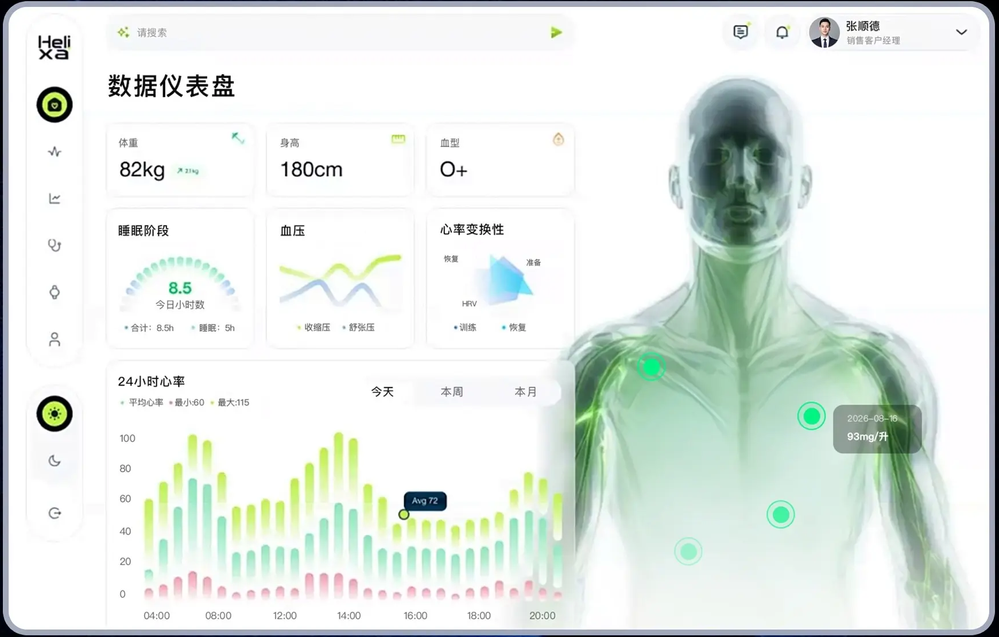
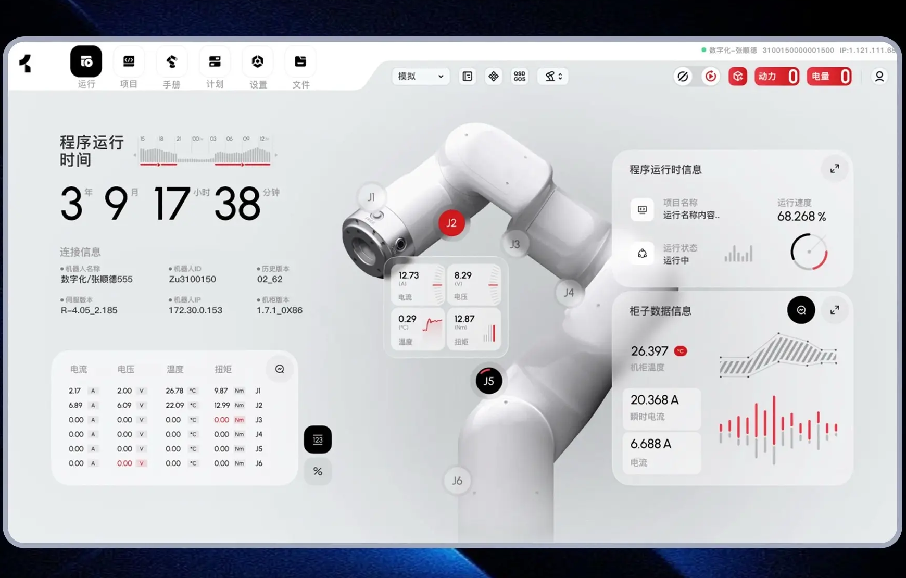
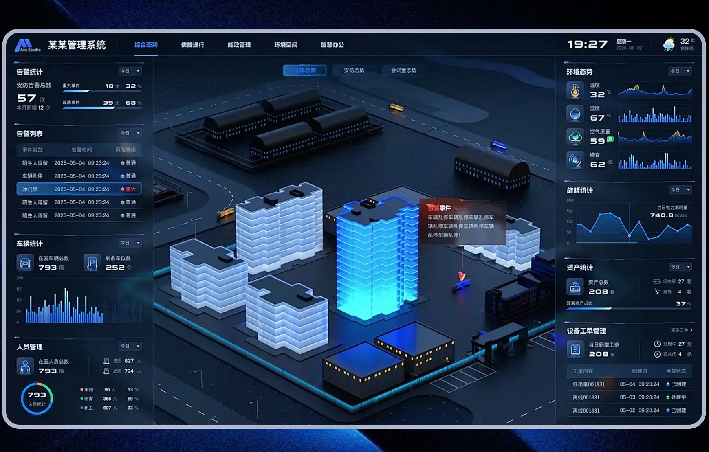
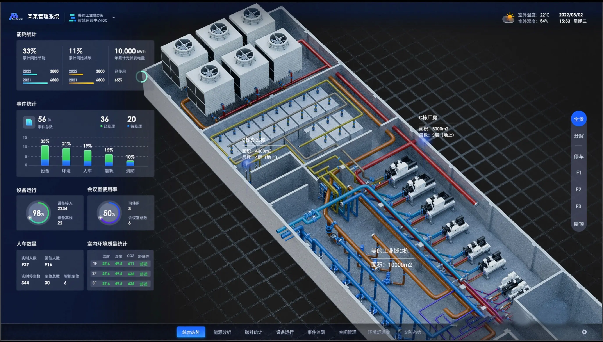
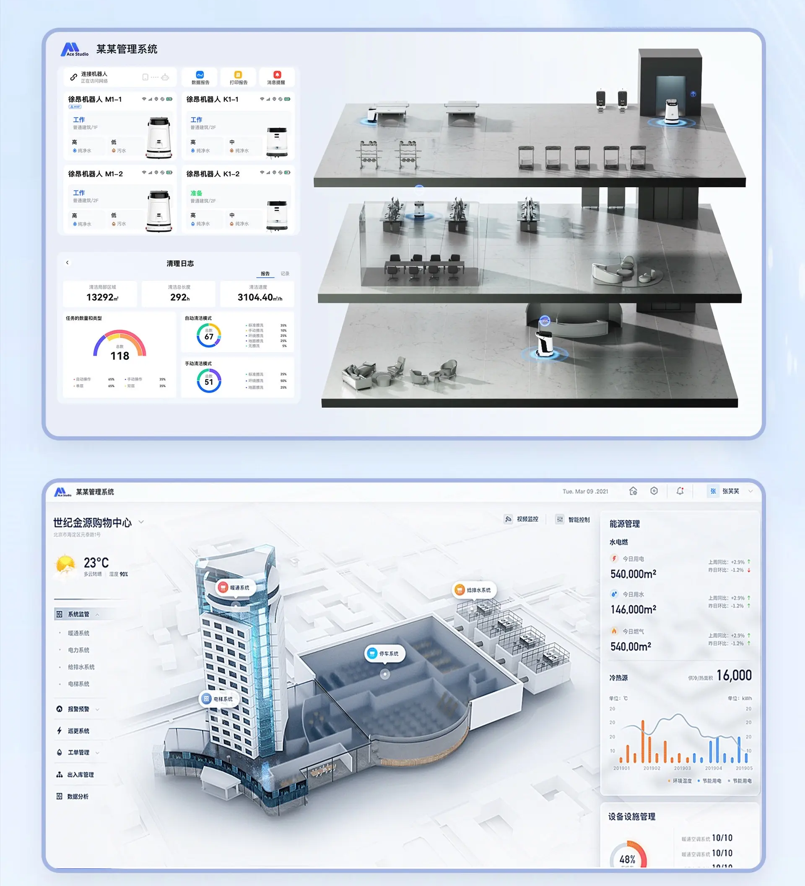
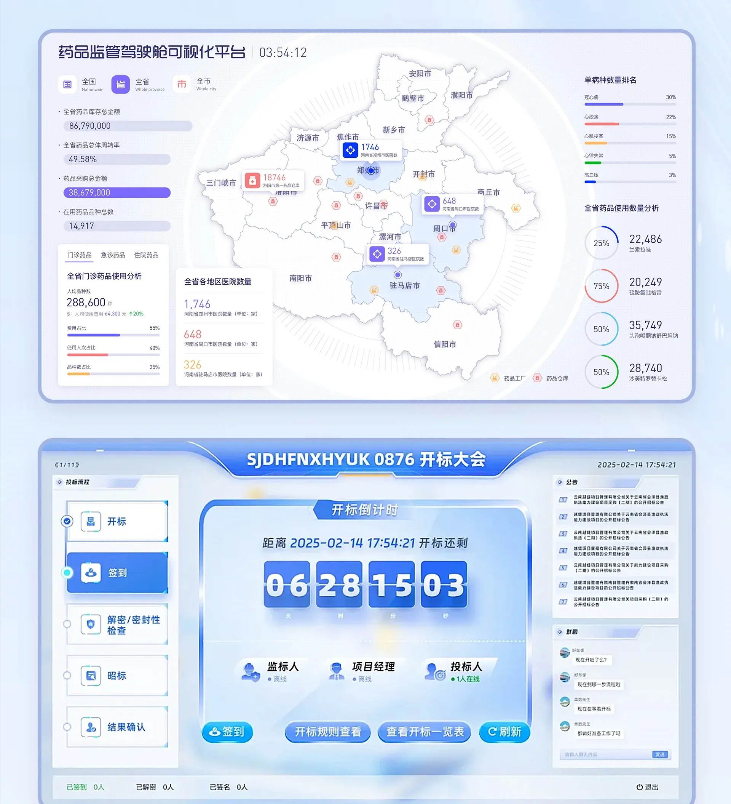

# 数据可视化与数字孪生

按监测对象、场景中心和周边数据的关系选择参考。图集覆盖工业设备、能源、建筑、地图、健康与安全态势。模型、材质和光照属于视觉证据，实时联动、设备控制和完整操作流程需要另行设计与验证。

## 证据与实现边界

- 静态总览按图片编号从左到右、从上到下阅读；编号代表独立图片，不代表时间或交互状态。单图链接保留裁切后的完整分辨率。
- “画面要点”描述已查看的素材；“实现补充”和“验证重点”是落地建议，不能当作原稿已具备的功能。
- 图中的品牌、示例数字、人物和业务文案只用于理解层级，不自动成为需求。按用户的产品对象、技术栈和设计系统改写。
- 只读本次相关图片；静态稿未呈现的联动、筛选、点击结果、权限和响应式行为需在实际项目中确认。

## 目录

- [人体模型与健康数据仪表盘](#health-body-metrics-dashboard)
- [机械臂监测与个人健康分析](#robotic-arm-pipeline-metrics)
- [园区建筑的深浅主题对照](#campus-light-dark-themes)
- [厂房剖面与楼层组态](#factory-section-floor-console)
- [楼宇分层与参数列表](#building-floor-parameter-view)
- [区域点位与数字信息看板](#regional-map-information-board)

## 人体模型与健康数据仪表盘 / Health Body Metrics Dashboard

- 标识：`data-visualization/health-body-metrics-dashboard`；类型：组件／效果。
- 画面要点：浅色健康仪表盘结合人体模型、体征卡和心率柱图；预约管理与档案页面呈现业务记录。
- 指令例句：参考 data-visualization/health-body-metrics-dashboard，体征数据注明时间与单位，示意模型仅辅助定位，异常判断需按产品实际业务定义。
- 实现补充：体征数据注明时间与单位，示意模型仅辅助定位，异常判断需按产品实际业务定义。
- 验证重点：核对文字与图表对比、单位、图例、数据时间和异常状态；若有模型选择或数据联动，按真实数据操作验证。

<!-- ui-atlas:details data-visualization/health-body-metrics-dashboard -->
- 原尺寸图片：[01 · 1740×1110](https://raw.githubusercontent.com/dqzboy/ui-atlas/4d61e1224c50685c02acae3ae67ebe9c217fa3b9/assets/details/data-visualization/health-body-metrics-dashboard-01.png) · [02 · 1740×1110](https://raw.githubusercontent.com/dqzboy/ui-atlas/4d61e1224c50685c02acae3ae67ebe9c217fa3b9/assets/details/data-visualization/health-body-metrics-dashboard-02.png)。
- 多图用途：保留不同页面的独立稿，移除重复包含这些页面的组合图。
- 清晰度边界：保留原尺寸与既有裁切，以无损 PNG 避免再次 JPEG 压缩；不能恢复源图已丢失的细节。

<!-- /ui-atlas:details -->

## 机械臂监测与个人健康分析 / Robotic Arm Pipeline Metrics

- 标识：`data-visualization/robotic-arm-pipeline-metrics`；类型：组件／效果。
- 画面要点：浅色机械臂页面呈现运行时间、连接和电流／电压／温度／扭矩；个人测试页面结合分子结构模型、健康指标与日程。
- 指令例句：参考 data-visualization/robotic-arm-pipeline-metrics，机械臂参数注明单位与设备状态；健康测试突出记录日期与指标含义，模型只辅助理解对象。
- 实现补充：机械臂参数注明单位与设备状态；健康测试突出记录日期与指标含义，模型只辅助理解对象。
- 验证重点：核对文字与图表对比、单位、图例、数据时间和异常状态；若有模型选择或数据联动，按真实数据操作验证。

<!-- ui-atlas:details data-visualization/robotic-arm-pipeline-metrics -->
- 原尺寸图片：[01 · 1740×1110](https://raw.githubusercontent.com/dqzboy/ui-atlas/4d61e1224c50685c02acae3ae67ebe9c217fa3b9/assets/details/data-visualization/robotic-arm-pipeline-metrics-01.png) · [02 · 1740×1110](https://raw.githubusercontent.com/dqzboy/ui-atlas/4d61e1224c50685c02acae3ae67ebe9c217fa3b9/assets/details/data-visualization/robotic-arm-pipeline-metrics-02.png)。
- 多图用途：保留不同页面的独立稿，移除重复包含这些页面的组合图。
- 清晰度边界：保留原尺寸与既有裁切，以无损 PNG 避免再次 JPEG 压缩；不能恢复源图已丢失的细节。

<!-- /ui-atlas:details -->

## 园区建筑的深浅主题对照 / Campus Light Dark Themes

- 标识：`data-visualization/campus-light-dark-themes`；类型：组件／效果。
- 画面要点：同类园区／建筑模型分别放在浅色与深色页面中，展示材质、光照和周边数据卡的主题差异。
- 指令例句：参考 data-visualization/campus-light-dark-themes，切换主题时保留指标层级与状态语义，对比文字、图表和模型在两套背景上的清晰度。
- 实现补充：切换主题时保留指标层级与状态语义，对比文字、图表和模型在两套背景上的清晰度。
- 验证重点：核对文字与图表对比、单位、图例、数据时间和异常状态；若有模型选择或数据联动，按真实数据操作验证。

<!-- ui-atlas:details data-visualization/campus-light-dark-themes -->
- 原尺寸图片：[01 · 1740×1110](https://raw.githubusercontent.com/dqzboy/ui-atlas/4d61e1224c50685c02acae3ae67ebe9c217fa3b9/assets/details/data-visualization/campus-light-dark-themes-01.png) · [02 · 1740×1110](https://raw.githubusercontent.com/dqzboy/ui-atlas/4d61e1224c50685c02acae3ae67ebe9c217fa3b9/assets/details/data-visualization/campus-light-dark-themes-02.png)。
- 多图用途：保留不同页面的独立稿，移除重复包含这些页面的组合图。
- 清晰度边界：保留原尺寸与既有裁切，以无损 PNG 避免再次 JPEG 压缩；不能恢复源图已丢失的细节。

<!-- /ui-atlas:details -->

## 厂房剖面与楼层组态 / Factory Section Floor Console

- 标识：`data-visualization/factory-section-floor-console`；类型：组件／效果。
- 画面要点：深色厂房剖面和楼宇俯视模型占据中央，监测指标沿边排列，形成可定位的空间组态画布。
- 指令例句：参考 data-visualization/factory-section-floor-console，楼层和区域需有可辨认标签，选中对象的信息就近呈现且不遮挡场景。
- 实现补充：楼层和区域需有可辨认标签，选中对象的信息就近呈现且不遮挡场景。
- 验证重点：核对文字与图表对比、单位、图例、数据时间和异常状态；若有模型选择或数据联动，按真实数据操作验证。

<!-- ui-atlas:details data-visualization/factory-section-floor-console -->
- 原尺寸图片：[01 · 2750×1560](https://raw.githubusercontent.com/dqzboy/ui-atlas/4d61e1224c50685c02acae3ae67ebe9c217fa3b9/assets/details/data-visualization/factory-section-floor-console-01.png) · [02 · 3328×1832](https://raw.githubusercontent.com/dqzboy/ui-atlas/4d61e1224c50685c02acae3ae67ebe9c217fa3b9/assets/details/data-visualization/factory-section-floor-console-02.png)。
- 多图用途：保留不同页面的独立稿，移除重复包含这些页面的组合图。
- 清晰度边界：保留原尺寸与既有裁切，以无损 PNG 避免再次 JPEG 压缩；不能恢复源图已丢失的细节。

<!-- /ui-atlas:details -->

## 楼宇分层与参数列表 / Building Floor Parameter View

- 标识：`data-visualization/building-floor-parameter-view`；类型：组件／效果。
- 画面要点：浅色楼宇分层／建筑模型结合参数列表，独立稿补充模型与数据区的布局细节。
- 指令例句：参考 data-visualization/building-floor-parameter-view，分层结构与参数区建立明确对应，当前楼层及单位不能只靠颜色表达。
- 实现补充：分层结构与参数区建立明确对应，当前楼层及单位不能只靠颜色表达。
- 验证重点：核对文字与图表对比、单位、图例、数据时间和异常状态；若有模型选择或数据联动，按真实数据操作验证。

<!-- ui-atlas:details data-visualization/building-floor-parameter-view -->
- 原尺寸图片：[01 · 1920×2110](https://raw.githubusercontent.com/dqzboy/ui-atlas/4d61e1224c50685c02acae3ae67ebe9c217fa3b9/assets/details/data-visualization/building-floor-parameter-view-01.png) · [02 · 1218×602](https://raw.githubusercontent.com/dqzboy/ui-atlas/4d61e1224c50685c02acae3ae67ebe9c217fa3b9/assets/details/data-visualization/building-floor-parameter-view-02.png)。
- 多图用途：不同页面或布局方案各自保留，不按连续抽帧处理。
- 清晰度边界：保留原尺寸与既有裁切，以无损 PNG 避免再次 JPEG 压缩；不能恢复源图已丢失的细节。

<!-- /ui-atlas:details -->

## 区域点位与数字信息看板 / Regional Map Information Board

- 标识：`data-visualization/regional-map-information-board`；类型：组件／效果。
- 画面要点：浅色区域地图和点位配合右侧指标，另有数字滚牌／信息看板式排版；图集含地图独立稿。
- 指令例句：参考 data-visualization/regional-map-information-board，地图点位保持可辨认密度，数字展示需标明指标名称、单位和数据时间。
- 实现补充：地图点位保持可辨认密度，数字展示需标明指标名称、单位和数据时间。
- 验证重点：核对文字与图表对比、单位、图例、数据时间和异常状态；若有模型选择或数据联动，按真实数据操作验证。

<!-- ui-atlas:details data-visualization/regional-map-information-board -->
- 原尺寸图片：[01 · 1920×2110](https://raw.githubusercontent.com/dqzboy/ui-atlas/4d61e1224c50685c02acae3ae67ebe9c217fa3b9/assets/details/data-visualization/regional-map-information-board-01.png) · [02 · 3840×2160](https://raw.githubusercontent.com/dqzboy/ui-atlas/4d61e1224c50685c02acae3ae67ebe9c217fa3b9/assets/details/data-visualization/regional-map-information-board-02.png)。
- 多图用途：不同页面或布局方案各自保留，不按连续抽帧处理。
- 清晰度边界：保留原尺寸与既有裁切，以无损 PNG 避免再次 JPEG 压缩；不能恢复源图已丢失的细节。

<!-- /ui-atlas:details -->
