# 数据可视化与数字孪生

按监测对象、场景中心和周边数据的关系选择参考。图集覆盖工业设备、能源、建筑、地图、健康与安全态势。模型、材质和光照属于视觉证据，实时联动、设备控制和完整操作流程需要另行设计与验证。

## 证据与实现边界

- 静态总览按图片编号从左到右、从上到下阅读；编号代表独立图片，不代表时间或交互状态。单图链接保留裁切后的完整分辨率。
- “画面要点”描述已查看的素材；“实现补充”和“验证重点”是落地建议，不能当作原稿已具备的功能。
- 图中的品牌、示例数字、人物和业务文案只用于理解层级，不自动成为需求。按用户的产品对象、技术栈和设计系统改写。
- 只读本次相关图片；静态稿未呈现的联动、筛选、点击结果、权限和响应式行为需在实际项目中确认。

## 目录

- [深色工业设备与仓库孪生](#dark-industrial-twin-collection)
- [浅色工业与能源组态](#light-industrial-energy-scenarios)
- [光伏建筑与能源运营概览](#solar-building-energy-overview)
- [橙色统计与设备流程控制台](#orange-process-data-console)
- [风电机组与侧栏统计](#wind-turbine-monitoring)
- [蓝光储能建筑与设备监测](#blue-lit-building-equipment)
- [客户仪表盘与意图规则工作台](#digital-assets-capacity-overview)
- [人体模型与健康数据仪表盘](#health-body-metrics-dashboard)
- [深色基础设施孪生大屏](#dark-infrastructure-twin-screens)
- [区域道路与校园空间总览](#regional-campus-map-overview)
- [AGV 车间与机器人状态台](#agv-factory-robot-console)
- [机械臂监测与个人健康分析](#robotic-arm-pipeline-metrics)
- [园区建筑的深浅主题对照](#campus-light-dark-themes)
- [换电控制台与牧场运营屏](#battery-swap-pasture-console)
- [厂房剖面与楼层组态](#factory-section-floor-console)
- [楼宇分层与参数列表](#building-floor-parameter-view)
- [区域点位与数字信息看板](#regional-map-information-board)
- [绿色园区物流孪生](#green-campus-logistics-twin)
- [工业炉体与楼层剖面大屏](#furnace-floor-section-screen)
- [建筑能耗与设备拓扑](#building-energy-equipment-topology)
- [光伏厂房与机加工产线](#solar-factory-production-twin)
- [盾牌安全态势与园区空间](#security-shield-campus-space)
- [SMT 产线与晶圆设备阵列](#smt-wafer-production-array)
- [健康安全与校园建筑监测](#health-security-campus-monitor)

## 深色工业设备与仓库孪生 / Dark Industrial Twin Collection

- 标识：`data-visualization/dark-industrial-twin-collection`；类型：组件／效果。
- 画面要点：绿色设备、蓝色机组和仓库／园区模型位于深色主画布，周围分布指标、趋势和业务数据区。
- 指令例句：参考 data-visualization/dark-industrial-twin-collection，让设备状态与关键告警具有稳定的可读层级，压低模型装饰光对正文和图表的干扰。
- 实现补充：让设备状态与关键告警具有稳定的可读层级，压低模型装饰光对正文和图表的干扰。
- 验证重点：核对文字与图表对比、单位、图例、数据时间和异常状态；若有模型选择或数据联动，按真实数据操作验证。
- 媒体：静态图集，2 张；[静态总览](https://raw.githubusercontent.com/dqzboy/ui-atlas/e6aa0d641c224a2cb4c8bd4262a4d18f5c7e1e22/assets/previews/data-visualization/dark-industrial-twin-collection.jpg) · [图片 01](https://raw.githubusercontent.com/dqzboy/ui-atlas/e6aa0d641c224a2cb4c8bd4262a4d18f5c7e1e22/assets/images/data-visualization/dark-industrial-twin-collection-01.jpg) · [图片 02](https://raw.githubusercontent.com/dqzboy/ui-atlas/e6aa0d641c224a2cb4c8bd4262a4d18f5c7e1e22/assets/images/data-visualization/dark-industrial-twin-collection-02.jpg)。

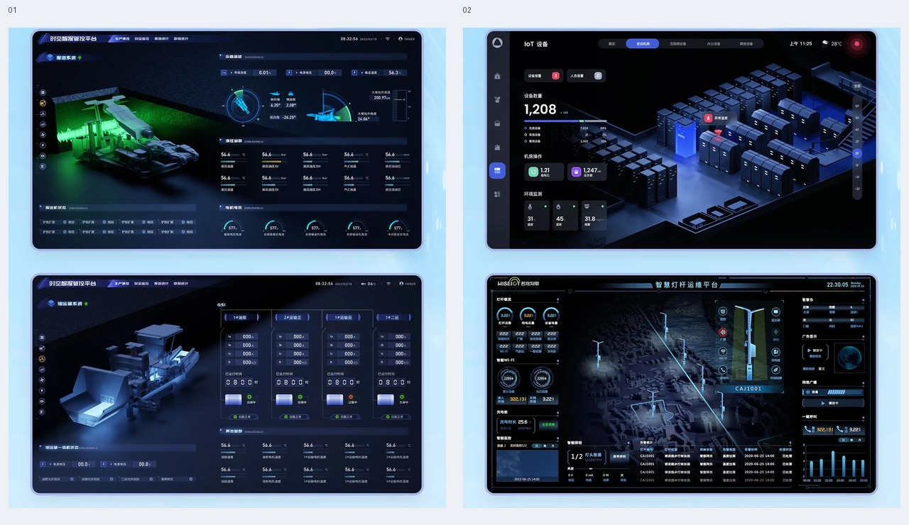

## 浅色工业与能源组态 / Light Industrial Energy Scenarios

- 标识：`data-visualization/light-industrial-energy-scenarios`；类型：组件／效果。
- 画面要点：机械臂、电站和太阳能组态配合浅色指标、任务与数据卡，立体对象作为业务状态的视觉中心。
- 指令例句：参考 data-visualization/light-industrial-energy-scenarios，模型保留可识别结构，数值和状态说明放在稳定面板，避免只靠模型颜色表达故障。
- 实现补充：模型保留可识别结构，数值和状态说明放在稳定面板，避免只靠模型颜色表达故障。
- 验证重点：核对文字与图表对比、单位、图例、数据时间和异常状态；若有模型选择或数据联动，按真实数据操作验证。
- 媒体：静态图集，2 张；[静态总览](https://raw.githubusercontent.com/dqzboy/ui-atlas/e6aa0d641c224a2cb4c8bd4262a4d18f5c7e1e22/assets/previews/data-visualization/light-industrial-energy-scenarios.jpg) · [图片 01](https://raw.githubusercontent.com/dqzboy/ui-atlas/e6aa0d641c224a2cb4c8bd4262a4d18f5c7e1e22/assets/images/data-visualization/light-industrial-energy-scenarios-01.jpg) · [图片 02](https://raw.githubusercontent.com/dqzboy/ui-atlas/e6aa0d641c224a2cb4c8bd4262a4d18f5c7e1e22/assets/images/data-visualization/light-industrial-energy-scenarios-02.jpg)。

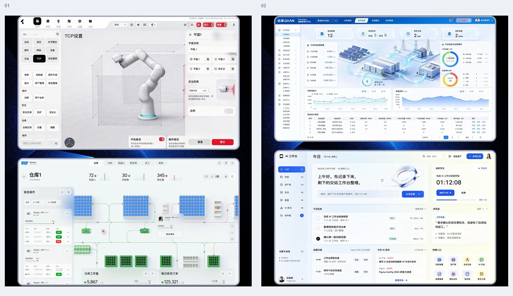

## 光伏建筑与能源运营概览 / Solar Building Energy Overview

- 标识：`data-visualization/solar-building-energy-overview`；类型：组件／效果。
- 画面要点：光伏房屋模型与能源统计卡并置；另一页以多彩指标卡和运营分区组织总览。
- 指令例句：参考 data-visualization/solar-building-energy-overview，把能耗、发电和运营指标分别命名，明确统计周期和单位，避免颜色替代指标含义。
- 实现补充：把能耗、发电和运营指标分别命名，明确统计周期和单位，避免颜色替代指标含义。
- 验证重点：核对文字与图表对比、单位、图例、数据时间和异常状态；若有模型选择或数据联动，按真实数据操作验证。
- 媒体：静态图集，2 张；[静态总览](https://raw.githubusercontent.com/dqzboy/ui-atlas/e6aa0d641c224a2cb4c8bd4262a4d18f5c7e1e22/assets/previews/data-visualization/solar-building-energy-overview.jpg) · [图片 01](https://raw.githubusercontent.com/dqzboy/ui-atlas/e6aa0d641c224a2cb4c8bd4262a4d18f5c7e1e22/assets/images/data-visualization/solar-building-energy-overview-01.jpg) · [图片 02](https://raw.githubusercontent.com/dqzboy/ui-atlas/e6aa0d641c224a2cb4c8bd4262a4d18f5c7e1e22/assets/images/data-visualization/solar-building-energy-overview-02.jpg)。

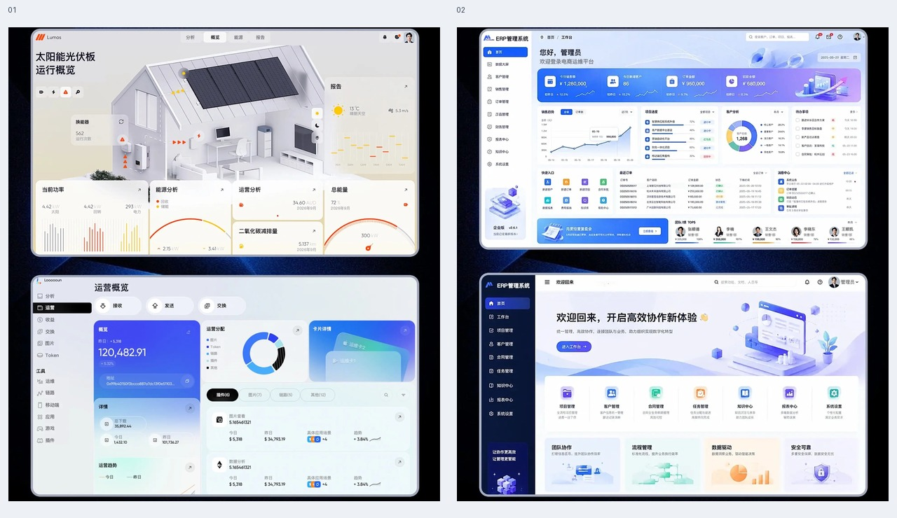

## 橙色统计与设备流程控制台 / Orange Process Data Console

- 标识：`data-visualization/orange-process-data-console`；类型：组件／效果。
- 画面要点：橙色柱图、趋势与设备流程连线构成主视觉，数据概览与流程状态区共同呈现运行情况。
- 指令例句：参考 data-visualization/orange-process-data-console，流程节点应说明当前阶段和异常位置，连线装饰不能遮挡设备名称与关键读数。
- 实现补充：流程节点应说明当前阶段和异常位置，连线装饰不能遮挡设备名称与关键读数。
- 验证重点：核对文字与图表对比、单位、图例、数据时间和异常状态；若有模型选择或数据联动，按真实数据操作验证。
- 媒体：静态图集，2 张；[静态总览](https://raw.githubusercontent.com/dqzboy/ui-atlas/e6aa0d641c224a2cb4c8bd4262a4d18f5c7e1e22/assets/previews/data-visualization/orange-process-data-console.jpg) · [图片 01](https://raw.githubusercontent.com/dqzboy/ui-atlas/e6aa0d641c224a2cb4c8bd4262a4d18f5c7e1e22/assets/images/data-visualization/orange-process-data-console-01.jpg) · [图片 02](https://raw.githubusercontent.com/dqzboy/ui-atlas/e6aa0d641c224a2cb4c8bd4262a4d18f5c7e1e22/assets/images/data-visualization/orange-process-data-console-02.jpg)。

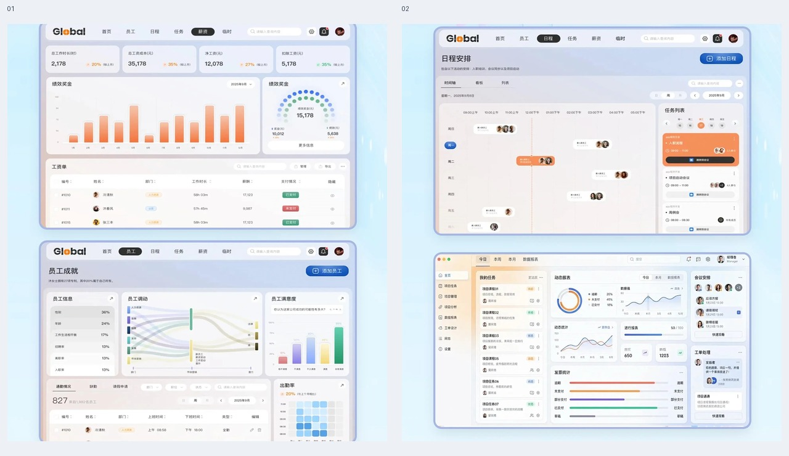

## 风电机组与侧栏统计 / Wind Turbine Monitoring

- 标识：`data-visualization/wind-turbine-monitoring`；类型：组件／效果。
- 画面要点：风电模型作为主要场景，关键机组指标靠近主对象；另一页以蓝色侧栏连接统计工作台。
- 指令例句：参考 data-visualization/wind-turbine-monitoring，把单机指标与全场统计分开，设备名称、状态和数据更新时间始终可定位。
- 实现补充：把单机指标与全场统计分开，设备名称、状态和数据更新时间始终可定位。
- 验证重点：核对文字与图表对比、单位、图例、数据时间和异常状态；若有模型选择或数据联动，按真实数据操作验证。
- 媒体：静态图集，2 张；[静态总览](https://raw.githubusercontent.com/dqzboy/ui-atlas/e6aa0d641c224a2cb4c8bd4262a4d18f5c7e1e22/assets/previews/data-visualization/wind-turbine-monitoring.jpg) · [图片 01](https://raw.githubusercontent.com/dqzboy/ui-atlas/e6aa0d641c224a2cb4c8bd4262a4d18f5c7e1e22/assets/images/data-visualization/wind-turbine-monitoring-01.jpg) · [图片 02](https://raw.githubusercontent.com/dqzboy/ui-atlas/e6aa0d641c224a2cb4c8bd4262a4d18f5c7e1e22/assets/images/data-visualization/wind-turbine-monitoring-02.jpg)。

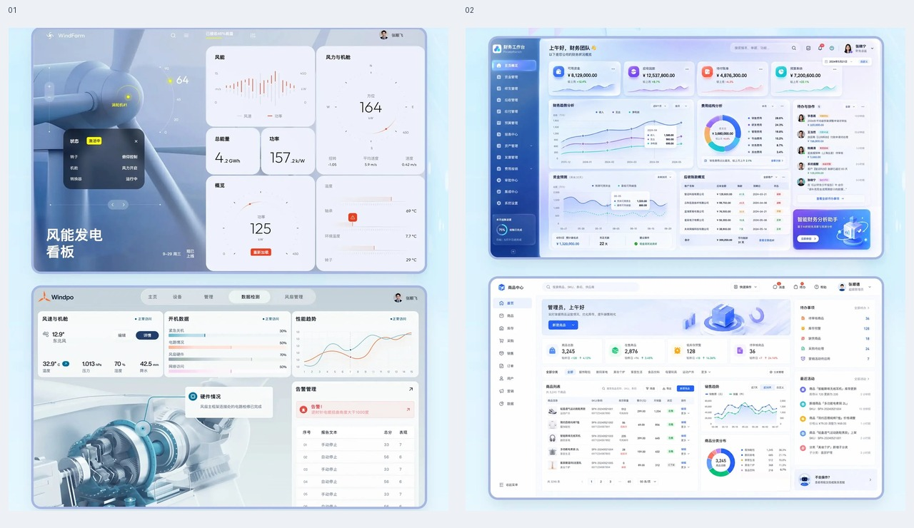

## 蓝光储能建筑与设备监测 / Blue Lit Building Equipment

- 标识：`data-visualization/blue-lit-building-equipment`；类型：组件／效果。
- 画面要点：深色蓝光储能建筑、机组和设备模型配合电量、运行参数、趋势、环形统计及监测表，强调中央场景与周边读数层级。
- 指令例句：参考 data-visualization/blue-lit-building-equipment，告警颜色与普通蓝色装饰分开，确保趋势线、刻度和小字在暗背景上可辨认。
- 实现补充：告警颜色与普通蓝色装饰分开，确保趋势线、刻度和小字在暗背景上可辨认。
- 验证重点：核对文字与图表对比、单位、图例、数据时间和异常状态；若有模型选择或数据联动，按真实数据操作验证。
- 媒体：静态图集，2 张；[静态总览](https://raw.githubusercontent.com/dqzboy/ui-atlas/e6aa0d641c224a2cb4c8bd4262a4d18f5c7e1e22/assets/previews/data-visualization/blue-lit-building-equipment.jpg) · [图片 01](https://raw.githubusercontent.com/dqzboy/ui-atlas/e6aa0d641c224a2cb4c8bd4262a4d18f5c7e1e22/assets/images/data-visualization/blue-lit-building-equipment-01.jpg) · [图片 02](https://raw.githubusercontent.com/dqzboy/ui-atlas/e6aa0d641c224a2cb4c8bd4262a4d18f5c7e1e22/assets/images/data-visualization/blue-lit-building-equipment-02.jpg)。

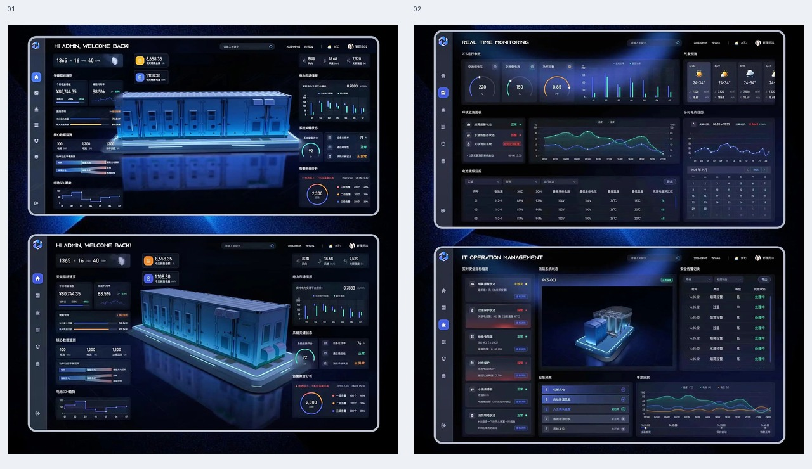

## 客户仪表盘与意图规则工作台 / Digital Assets Capacity Overview

- 标识：`data-visualization/digital-assets-capacity-overview`；类型：组件／效果。
- 画面要点：浅色客户仪表盘与运营概览用立体对象和图表突出指标；另一页呈现意图规则分类、规则表与智能服务入口，并补充工业能耗概览。
- 指令例句：参考 data-visualization/digital-assets-capacity-overview，按客户分析、规则管理和能耗监测分别组织工作区；规则表突出分类、启用状态与命中数据。
- 实现补充：按客户分析、规则管理和能耗监测分别组织工作区；规则表突出分类、启用状态与命中数据。
- 验证重点：核对文字与图表对比、单位、图例、数据时间和异常状态；若有模型选择或数据联动，按真实数据操作验证。
- 媒体：静态图集，2 张；[静态总览](https://raw.githubusercontent.com/dqzboy/ui-atlas/e6aa0d641c224a2cb4c8bd4262a4d18f5c7e1e22/assets/previews/data-visualization/digital-assets-capacity-overview.jpg) · [图片 01](https://raw.githubusercontent.com/dqzboy/ui-atlas/e6aa0d641c224a2cb4c8bd4262a4d18f5c7e1e22/assets/images/data-visualization/digital-assets-capacity-overview-01.jpg) · [图片 02](https://raw.githubusercontent.com/dqzboy/ui-atlas/e6aa0d641c224a2cb4c8bd4262a4d18f5c7e1e22/assets/images/data-visualization/digital-assets-capacity-overview-02.jpg)。

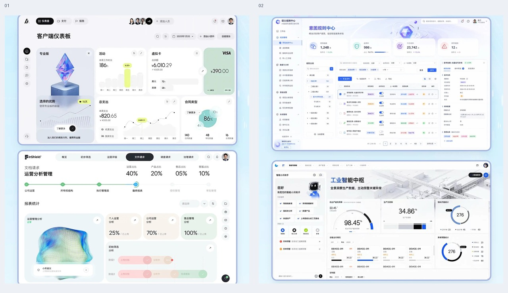

## 人体模型与健康数据仪表盘 / Health Body Metrics Dashboard

- 标识：`data-visualization/health-body-metrics-dashboard`；类型：组件／效果。
- 画面要点：浅色健康仪表盘结合人体模型、体征卡和心率柱图；预约管理与档案页面呈现业务记录。
- 指令例句：参考 data-visualization/health-body-metrics-dashboard，体征数据注明时间与单位，示意模型仅辅助定位，异常判断需按产品实际业务定义。
- 实现补充：体征数据注明时间与单位，示意模型仅辅助定位，异常判断需按产品实际业务定义。
- 验证重点：核对文字与图表对比、单位、图例、数据时间和异常状态；若有模型选择或数据联动，按真实数据操作验证。
- 媒体：静态图集，3 张；[静态总览](https://raw.githubusercontent.com/dqzboy/ui-atlas/e6aa0d641c224a2cb4c8bd4262a4d18f5c7e1e22/assets/previews/data-visualization/health-body-metrics-dashboard.jpg) · [图片 01](https://raw.githubusercontent.com/dqzboy/ui-atlas/e6aa0d641c224a2cb4c8bd4262a4d18f5c7e1e22/assets/images/data-visualization/health-body-metrics-dashboard-01.jpg) · [图片 02](https://raw.githubusercontent.com/dqzboy/ui-atlas/e6aa0d641c224a2cb4c8bd4262a4d18f5c7e1e22/assets/images/data-visualization/health-body-metrics-dashboard-02.jpg) · [图片 03](https://raw.githubusercontent.com/dqzboy/ui-atlas/e6aa0d641c224a2cb4c8bd4262a4d18f5c7e1e22/assets/images/data-visualization/health-body-metrics-dashboard-03.jpg)。

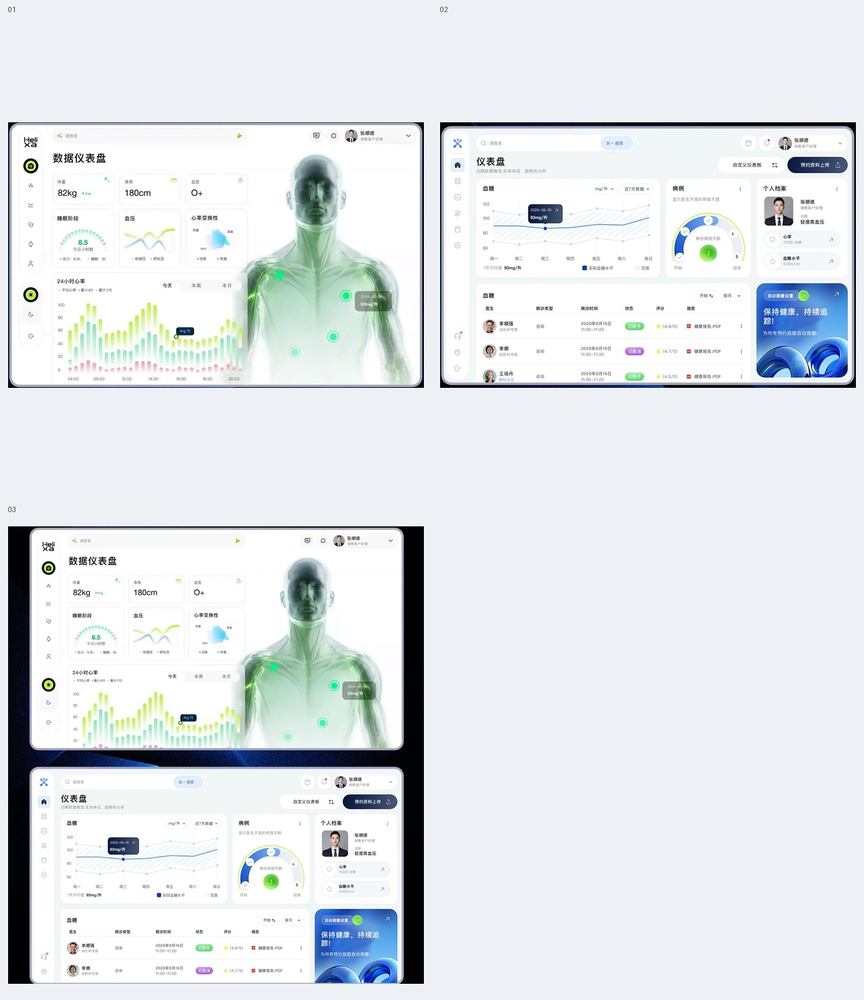

## 深色基础设施孪生大屏 / Dark Infrastructure Twin Screens

- 标识：`data-visualization/dark-infrastructure-twin-screens`；类型：组件／效果。
- 画面要点：水处理、发动机、地形和仓库模型位于深色监测画布，指标卡和业务表围绕主场景组织。
- 指令例句：参考 data-visualization/dark-infrastructure-twin-screens，每种场景先建立监测对象与数据关系，屏幕尺寸改变时保持关键指标可读。
- 实现补充：每种场景先建立监测对象与数据关系，屏幕尺寸改变时保持关键指标可读。
- 验证重点：核对文字与图表对比、单位、图例、数据时间和异常状态；若有模型选择或数据联动，按真实数据操作验证。
- 媒体：静态图集，2 张；[静态总览](https://raw.githubusercontent.com/dqzboy/ui-atlas/e6aa0d641c224a2cb4c8bd4262a4d18f5c7e1e22/assets/previews/data-visualization/dark-infrastructure-twin-screens.jpg) · [图片 01](https://raw.githubusercontent.com/dqzboy/ui-atlas/e6aa0d641c224a2cb4c8bd4262a4d18f5c7e1e22/assets/images/data-visualization/dark-infrastructure-twin-screens-01.jpg) · [图片 02](https://raw.githubusercontent.com/dqzboy/ui-atlas/e6aa0d641c224a2cb4c8bd4262a4d18f5c7e1e22/assets/images/data-visualization/dark-infrastructure-twin-screens-02.jpg)。

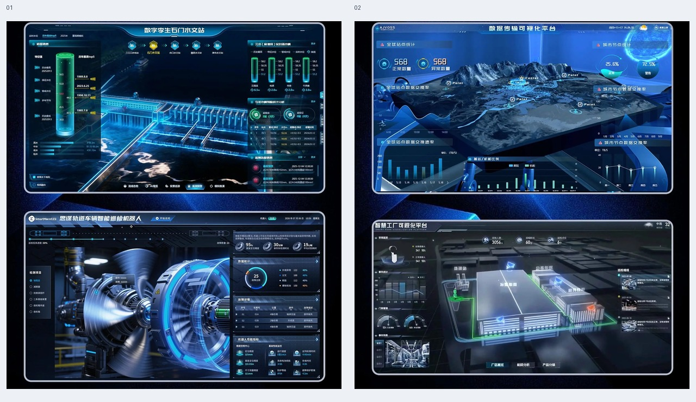

## 区域道路与校园空间总览 / Regional Campus Map Overview

- 标识：`data-visualization/regional-campus-map-overview`；类型：组件／效果。
- 画面要点：浅色区域地图和道路网络配合校园／体育场模型，统计卡浮于空间场景周围。
- 指令例句：参考 data-visualization/regional-campus-map-overview，地图与模型承担空间定位，浮卡保持稳定的阅读顺序，避免覆盖重要点位。
- 实现补充：地图与模型承担空间定位，浮卡保持稳定的阅读顺序，避免覆盖重要点位。
- 验证重点：核对文字与图表对比、单位、图例、数据时间和异常状态；若有模型选择或数据联动，按真实数据操作验证。
- 媒体：静态图集，2 张；[静态总览](https://raw.githubusercontent.com/dqzboy/ui-atlas/e6aa0d641c224a2cb4c8bd4262a4d18f5c7e1e22/assets/previews/data-visualization/regional-campus-map-overview.jpg) · [图片 01](https://raw.githubusercontent.com/dqzboy/ui-atlas/e6aa0d641c224a2cb4c8bd4262a4d18f5c7e1e22/assets/images/data-visualization/regional-campus-map-overview-01.jpg) · [图片 02](https://raw.githubusercontent.com/dqzboy/ui-atlas/e6aa0d641c224a2cb4c8bd4262a4d18f5c7e1e22/assets/images/data-visualization/regional-campus-map-overview-02.jpg)。

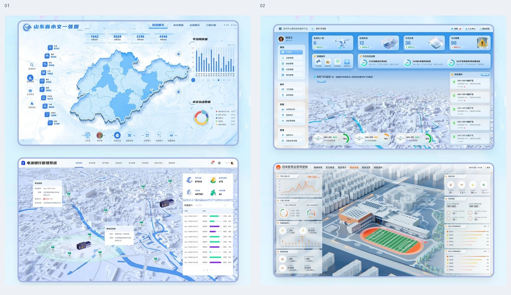

## AGV 车间与机器人状态台 / Agv Factory Robot Console

- 标识：`data-visualization/agv-factory-robot-console`；类型：组件／效果。
- 画面要点：深色车间模型配合任务状态、机器人电量和告警列表，图集包含独立设计稿与组合视图。
- 指令例句：参考 data-visualization/agv-factory-robot-console，电量、离线和故障应使用不同语义，告警表保留设备定位与时间信息。
- 实现补充：电量、离线和故障应使用不同语义，告警表保留设备定位与时间信息。
- 验证重点：核对文字与图表对比、单位、图例、数据时间和异常状态；若有模型选择或数据联动，按真实数据操作验证。
- 媒体：静态图集，3 张；[静态总览](https://raw.githubusercontent.com/dqzboy/ui-atlas/e6aa0d641c224a2cb4c8bd4262a4d18f5c7e1e22/assets/previews/data-visualization/agv-factory-robot-console.jpg) · [图片 01](https://raw.githubusercontent.com/dqzboy/ui-atlas/e6aa0d641c224a2cb4c8bd4262a4d18f5c7e1e22/assets/images/data-visualization/agv-factory-robot-console-01.jpg) · [图片 02](https://raw.githubusercontent.com/dqzboy/ui-atlas/e6aa0d641c224a2cb4c8bd4262a4d18f5c7e1e22/assets/images/data-visualization/agv-factory-robot-console-02.jpg) · [图片 03](https://raw.githubusercontent.com/dqzboy/ui-atlas/e6aa0d641c224a2cb4c8bd4262a4d18f5c7e1e22/assets/images/data-visualization/agv-factory-robot-console-03.jpg)。

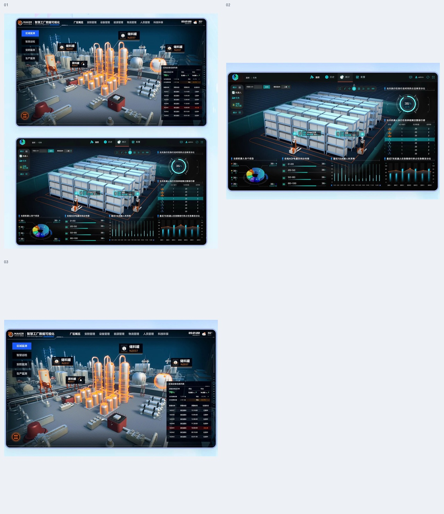

## 机械臂监测与个人健康分析 / Robotic Arm Pipeline Metrics

- 标识：`data-visualization/robotic-arm-pipeline-metrics`；类型：组件／效果。
- 画面要点：浅色机械臂页面呈现运行时间、连接和电流／电压／温度／扭矩；个人测试页面结合分子结构模型、健康指标与日程。
- 指令例句：参考 data-visualization/robotic-arm-pipeline-metrics，机械臂参数注明单位与设备状态；健康测试突出记录日期与指标含义，模型只辅助理解对象。
- 实现补充：机械臂参数注明单位与设备状态；健康测试突出记录日期与指标含义，模型只辅助理解对象。
- 验证重点：核对文字与图表对比、单位、图例、数据时间和异常状态；若有模型选择或数据联动，按真实数据操作验证。
- 媒体：静态图集，3 张；[静态总览](https://raw.githubusercontent.com/dqzboy/ui-atlas/e6aa0d641c224a2cb4c8bd4262a4d18f5c7e1e22/assets/previews/data-visualization/robotic-arm-pipeline-metrics.jpg) · [图片 01](https://raw.githubusercontent.com/dqzboy/ui-atlas/e6aa0d641c224a2cb4c8bd4262a4d18f5c7e1e22/assets/images/data-visualization/robotic-arm-pipeline-metrics-01.jpg) · [图片 02](https://raw.githubusercontent.com/dqzboy/ui-atlas/e6aa0d641c224a2cb4c8bd4262a4d18f5c7e1e22/assets/images/data-visualization/robotic-arm-pipeline-metrics-02.jpg) · [图片 03](https://raw.githubusercontent.com/dqzboy/ui-atlas/e6aa0d641c224a2cb4c8bd4262a4d18f5c7e1e22/assets/images/data-visualization/robotic-arm-pipeline-metrics-03.jpg)。

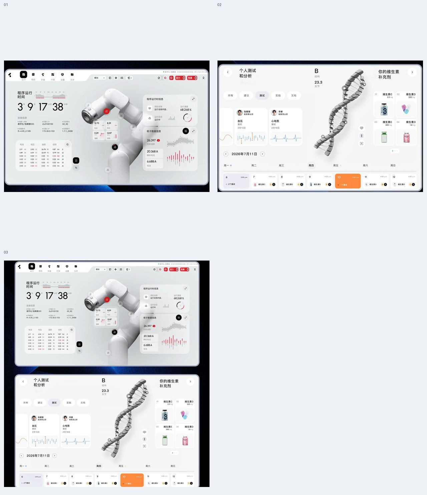

## 园区建筑的深浅主题对照 / Campus Light Dark Themes

- 标识：`data-visualization/campus-light-dark-themes`；类型：组件／效果。
- 画面要点：同类园区／建筑模型分别放在浅色与深色页面中，展示材质、光照和周边数据卡的主题差异。
- 指令例句：参考 data-visualization/campus-light-dark-themes，切换主题时保留指标层级与状态语义，对比文字、图表和模型在两套背景上的清晰度。
- 实现补充：切换主题时保留指标层级与状态语义，对比文字、图表和模型在两套背景上的清晰度。
- 验证重点：核对文字与图表对比、单位、图例、数据时间和异常状态；若有模型选择或数据联动，按真实数据操作验证。
- 媒体：静态图集，3 张；[静态总览](https://raw.githubusercontent.com/dqzboy/ui-atlas/e6aa0d641c224a2cb4c8bd4262a4d18f5c7e1e22/assets/previews/data-visualization/campus-light-dark-themes.jpg) · [图片 01](https://raw.githubusercontent.com/dqzboy/ui-atlas/e6aa0d641c224a2cb4c8bd4262a4d18f5c7e1e22/assets/images/data-visualization/campus-light-dark-themes-01.jpg) · [图片 02](https://raw.githubusercontent.com/dqzboy/ui-atlas/e6aa0d641c224a2cb4c8bd4262a4d18f5c7e1e22/assets/images/data-visualization/campus-light-dark-themes-02.jpg) · [图片 03](https://raw.githubusercontent.com/dqzboy/ui-atlas/e6aa0d641c224a2cb4c8bd4262a4d18f5c7e1e22/assets/images/data-visualization/campus-light-dark-themes-03.jpg)。

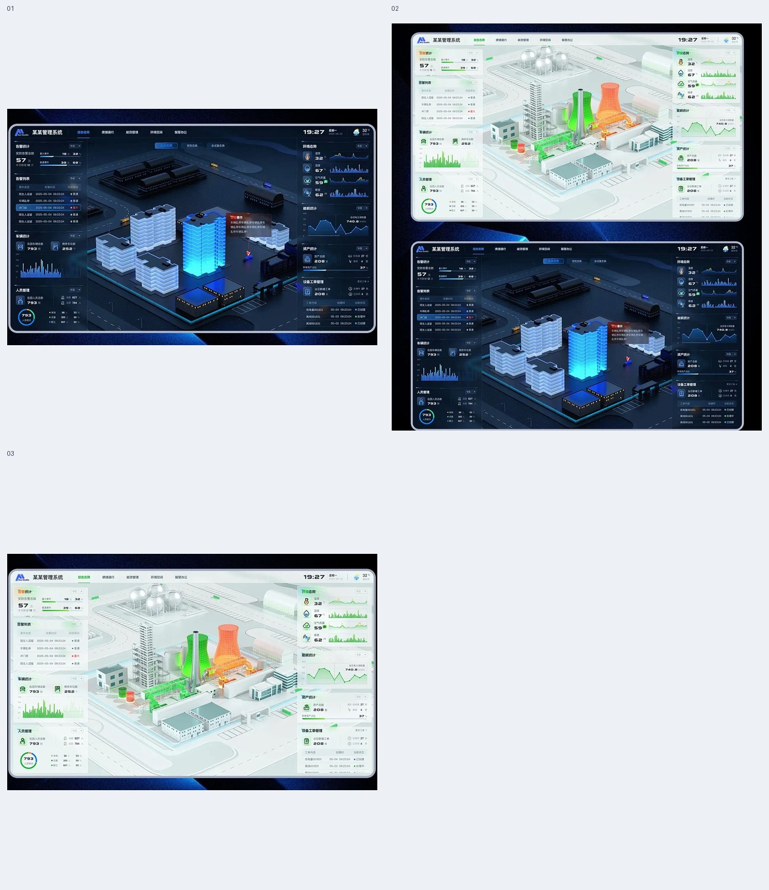

## 换电控制台与牧场运营屏 / Battery Swap Pasture Console

- 标识：`data-visualization/battery-swap-pasture-console`；类型：组件／效果。
- 画面要点：深青色控制台呈现仓位、电池和操作日志；绿色牧场页面以自然场景及运营指标建立另一种监测风格。
- 指令例句：参考 data-visualization/battery-swap-pasture-console，控制设备时先标清仓位与可用状态；牧场数据则按实际对象与统计周期组织。
- 实现补充：控制设备时先标清仓位与可用状态；牧场数据则按实际对象与统计周期组织。
- 验证重点：核对文字与图表对比、单位、图例、数据时间和异常状态；若有模型选择或数据联动，按真实数据操作验证。
- 媒体：静态图集，3 张；[静态总览](https://raw.githubusercontent.com/dqzboy/ui-atlas/e6aa0d641c224a2cb4c8bd4262a4d18f5c7e1e22/assets/previews/data-visualization/battery-swap-pasture-console.jpg) · [图片 01](https://raw.githubusercontent.com/dqzboy/ui-atlas/e6aa0d641c224a2cb4c8bd4262a4d18f5c7e1e22/assets/images/data-visualization/battery-swap-pasture-console-01.jpg) · [图片 02](https://raw.githubusercontent.com/dqzboy/ui-atlas/e6aa0d641c224a2cb4c8bd4262a4d18f5c7e1e22/assets/images/data-visualization/battery-swap-pasture-console-02.jpg) · [图片 03](https://raw.githubusercontent.com/dqzboy/ui-atlas/e6aa0d641c224a2cb4c8bd4262a4d18f5c7e1e22/assets/images/data-visualization/battery-swap-pasture-console-03.jpg)。

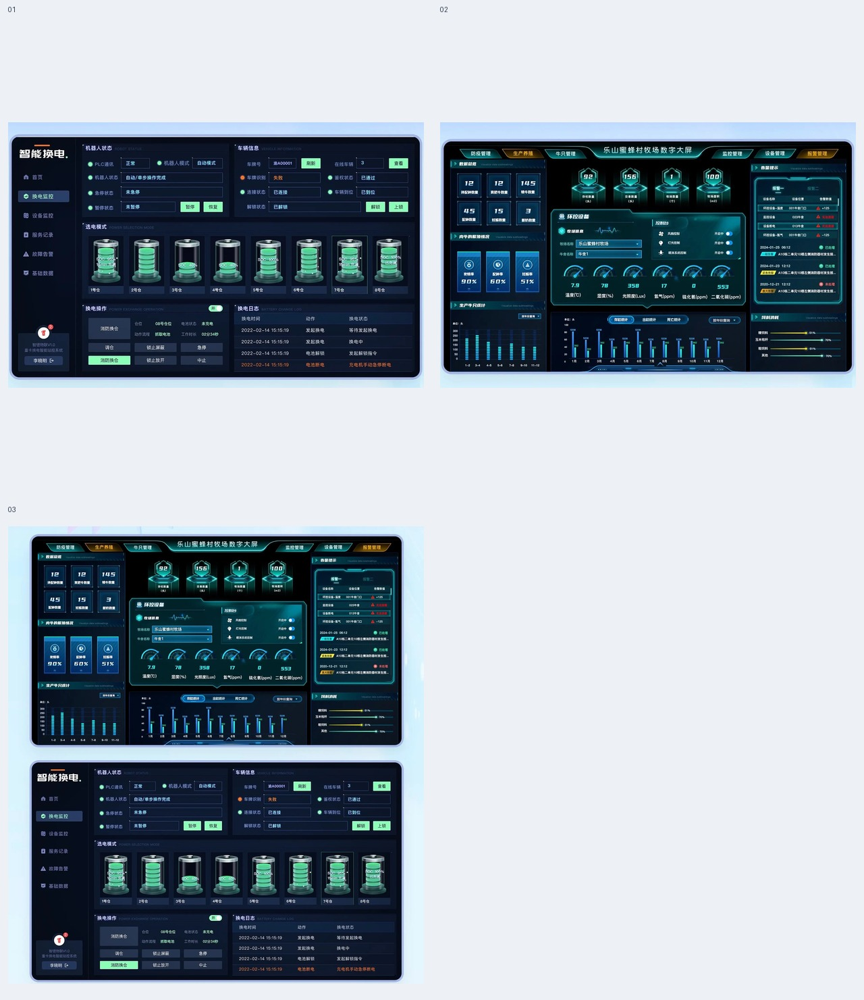

## 厂房剖面与楼层组态 / Factory Section Floor Console

- 标识：`data-visualization/factory-section-floor-console`；类型：组件／效果。
- 画面要点：深色厂房剖面和楼宇俯视模型占据中央，监测指标沿边排列，形成可定位的空间组态画布。
- 指令例句：参考 data-visualization/factory-section-floor-console，楼层和区域需有可辨认标签，选中对象的信息就近呈现且不遮挡场景。
- 实现补充：楼层和区域需有可辨认标签，选中对象的信息就近呈现且不遮挡场景。
- 验证重点：核对文字与图表对比、单位、图例、数据时间和异常状态；若有模型选择或数据联动，按真实数据操作验证。
- 媒体：静态图集，3 张；[静态总览](https://raw.githubusercontent.com/dqzboy/ui-atlas/e6aa0d641c224a2cb4c8bd4262a4d18f5c7e1e22/assets/previews/data-visualization/factory-section-floor-console.jpg) · [图片 01](https://raw.githubusercontent.com/dqzboy/ui-atlas/e6aa0d641c224a2cb4c8bd4262a4d18f5c7e1e22/assets/images/data-visualization/factory-section-floor-console-01.jpg) · [图片 02](https://raw.githubusercontent.com/dqzboy/ui-atlas/e6aa0d641c224a2cb4c8bd4262a4d18f5c7e1e22/assets/images/data-visualization/factory-section-floor-console-02.jpg) · [图片 03](https://raw.githubusercontent.com/dqzboy/ui-atlas/e6aa0d641c224a2cb4c8bd4262a4d18f5c7e1e22/assets/images/data-visualization/factory-section-floor-console-03.jpg)。

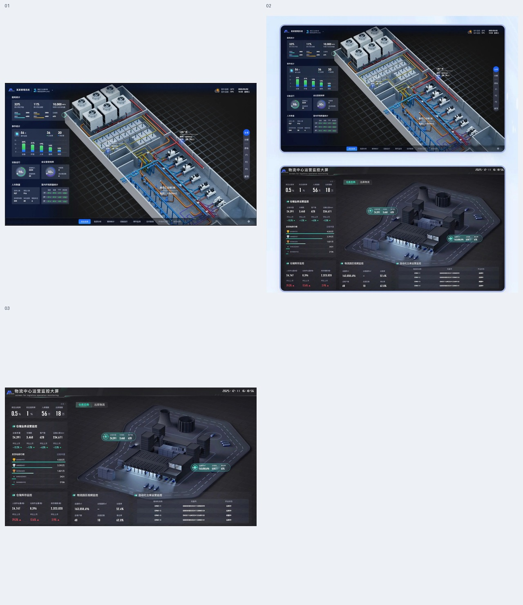

## 楼宇分层与参数列表 / Building Floor Parameter View

- 标识：`data-visualization/building-floor-parameter-view`；类型：组件／效果。
- 画面要点：浅色楼宇分层／建筑模型结合参数列表，独立稿补充模型与数据区的布局细节。
- 指令例句：参考 data-visualization/building-floor-parameter-view，分层结构与参数区建立明确对应，当前楼层及单位不能只靠颜色表达。
- 实现补充：分层结构与参数区建立明确对应，当前楼层及单位不能只靠颜色表达。
- 验证重点：核对文字与图表对比、单位、图例、数据时间和异常状态；若有模型选择或数据联动，按真实数据操作验证。
- 媒体：静态图集，2 张；[静态总览](https://raw.githubusercontent.com/dqzboy/ui-atlas/e6aa0d641c224a2cb4c8bd4262a4d18f5c7e1e22/assets/previews/data-visualization/building-floor-parameter-view.jpg) · [图片 01](https://raw.githubusercontent.com/dqzboy/ui-atlas/e6aa0d641c224a2cb4c8bd4262a4d18f5c7e1e22/assets/images/data-visualization/building-floor-parameter-view-01.jpg) · [图片 02](https://raw.githubusercontent.com/dqzboy/ui-atlas/e6aa0d641c224a2cb4c8bd4262a4d18f5c7e1e22/assets/images/data-visualization/building-floor-parameter-view-02.jpg)。

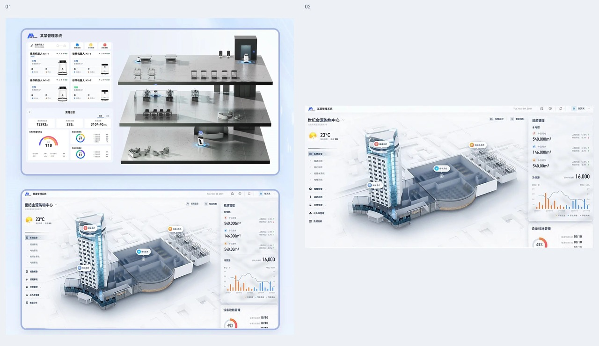

## 区域点位与数字信息看板 / Regional Map Information Board

- 标识：`data-visualization/regional-map-information-board`；类型：组件／效果。
- 画面要点：浅色区域地图和点位配合右侧指标，另有数字滚牌／信息看板式排版；图集含地图独立稿。
- 指令例句：参考 data-visualization/regional-map-information-board，地图点位保持可辨认密度，数字展示需标明指标名称、单位和数据时间。
- 实现补充：地图点位保持可辨认密度，数字展示需标明指标名称、单位和数据时间。
- 验证重点：核对文字与图表对比、单位、图例、数据时间和异常状态；若有模型选择或数据联动，按真实数据操作验证。
- 媒体：静态图集，2 张；[静态总览](https://raw.githubusercontent.com/dqzboy/ui-atlas/e6aa0d641c224a2cb4c8bd4262a4d18f5c7e1e22/assets/previews/data-visualization/regional-map-information-board.jpg) · [图片 01](https://raw.githubusercontent.com/dqzboy/ui-atlas/e6aa0d641c224a2cb4c8bd4262a4d18f5c7e1e22/assets/images/data-visualization/regional-map-information-board-01.jpg) · [图片 02](https://raw.githubusercontent.com/dqzboy/ui-atlas/e6aa0d641c224a2cb4c8bd4262a4d18f5c7e1e22/assets/images/data-visualization/regional-map-information-board-02.jpg)。

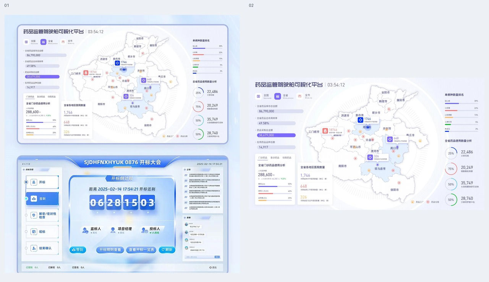

## 绿色园区物流孪生 / Green Campus Logistics Twin

- 标识：`data-visualization/green-campus-logistics-twin`；类型：组件／效果。
- 画面要点：自然绿色园区中，中央建筑模型与两侧告警、能耗及视频监控区域共同构成空间监测大屏。
- 指令例句：参考 data-visualization/green-campus-logistics-twin，控制中央场景与边栏的对比，视频和告警需要可辨认标题及清楚的更新状态。
- 实现补充：控制中央场景与边栏的对比，视频和告警需要可辨认标题及清楚的更新状态。
- 验证重点：核对文字与图表对比、单位、图例、数据时间和异常状态；若有模型选择或数据联动，按真实数据操作验证。
- 媒体：静态图集，1 张；[静态总览](https://raw.githubusercontent.com/dqzboy/ui-atlas/e6aa0d641c224a2cb4c8bd4262a4d18f5c7e1e22/assets/previews/data-visualization/green-campus-logistics-twin.jpg) · [图片 01](https://raw.githubusercontent.com/dqzboy/ui-atlas/e6aa0d641c224a2cb4c8bd4262a4d18f5c7e1e22/assets/images/data-visualization/green-campus-logistics-twin-01.jpg)。

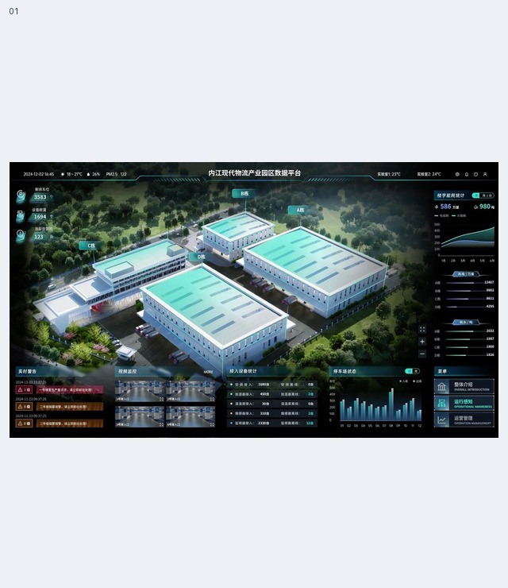

## 工业炉体与楼层剖面大屏 / Furnace Floor Section Screen

- 标识：`data-visualization/furnace-floor-section-screen`；类型：组件／效果。
- 画面要点：深色工业炉体、管线与楼层剖面作为中央模型，周边分布图表和设备读数。
- 指令例句：参考 data-visualization/furnace-floor-section-screen，设备层级与管线方向需能辨认，重点状态和读数避免被模型光效遮盖。
- 实现补充：设备层级与管线方向需能辨认，重点状态和读数避免被模型光效遮盖。
- 验证重点：核对文字与图表对比、单位、图例、数据时间和异常状态；若有模型选择或数据联动，按真实数据操作验证。
- 媒体：静态图集，1 张；[静态总览](https://raw.githubusercontent.com/dqzboy/ui-atlas/e6aa0d641c224a2cb4c8bd4262a4d18f5c7e1e22/assets/previews/data-visualization/furnace-floor-section-screen.jpg) · [图片 01](https://raw.githubusercontent.com/dqzboy/ui-atlas/e6aa0d641c224a2cb4c8bd4262a4d18f5c7e1e22/assets/images/data-visualization/furnace-floor-section-screen-01.jpg)。

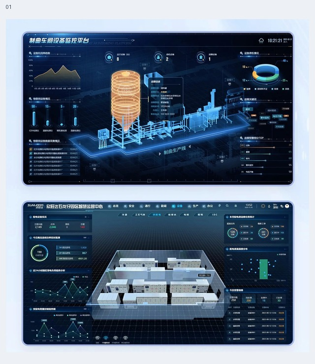

## 建筑能耗与设备拓扑 / Building Energy Equipment Topology

- 标识：`data-visualization/building-energy-equipment-topology`；类型：组件／效果。
- 画面要点：深色蓝光建筑能耗页面和工业设备拓扑配合曲线统计，突出空间对象与监测指标。
- 指令例句：参考 data-visualization/building-energy-equipment-topology，能耗与设备状态分别标明统计范围，拓扑连线保持可追踪，曲线注明单位。
- 实现补充：能耗与设备状态分别标明统计范围，拓扑连线保持可追踪，曲线注明单位。
- 验证重点：核对文字与图表对比、单位、图例、数据时间和异常状态；若有模型选择或数据联动，按真实数据操作验证。
- 媒体：静态图集，1 张；[静态总览](https://raw.githubusercontent.com/dqzboy/ui-atlas/e6aa0d641c224a2cb4c8bd4262a4d18f5c7e1e22/assets/previews/data-visualization/building-energy-equipment-topology.jpg) · [图片 01](https://raw.githubusercontent.com/dqzboy/ui-atlas/e6aa0d641c224a2cb4c8bd4262a4d18f5c7e1e22/assets/images/data-visualization/building-energy-equipment-topology-01.jpg)。

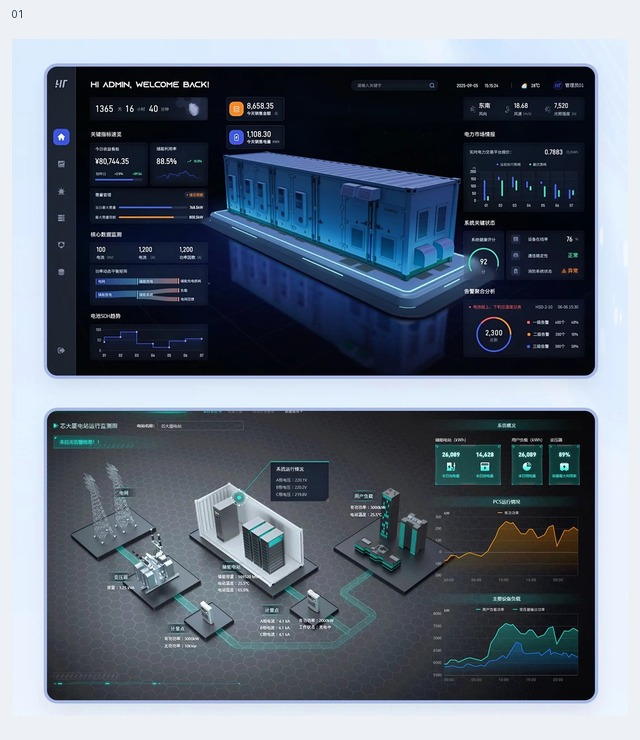

## 光伏厂房与机加工产线 / Solar Factory Production Twin

- 标识：`data-visualization/solar-factory-production-twin`；类型：组件／效果。
- 画面要点：厂房光伏和机加工产线数字孪生位于主场景，趋势与指标分布在周边监测区。
- 指令例句：参考 data-visualization/solar-factory-production-twin，按发电、设备和生产目标区分面板，避免把不同周期的数据放在同一比较尺度。
- 实现补充：按发电、设备和生产目标区分面板，避免把不同周期的数据放在同一比较尺度。
- 验证重点：核对文字与图表对比、单位、图例、数据时间和异常状态；若有模型选择或数据联动，按真实数据操作验证。
- 媒体：静态图集，1 张；[静态总览](https://raw.githubusercontent.com/dqzboy/ui-atlas/e6aa0d641c224a2cb4c8bd4262a4d18f5c7e1e22/assets/previews/data-visualization/solar-factory-production-twin.jpg) · [图片 01](https://raw.githubusercontent.com/dqzboy/ui-atlas/e6aa0d641c224a2cb4c8bd4262a4d18f5c7e1e22/assets/images/data-visualization/solar-factory-production-twin-01.jpg)。

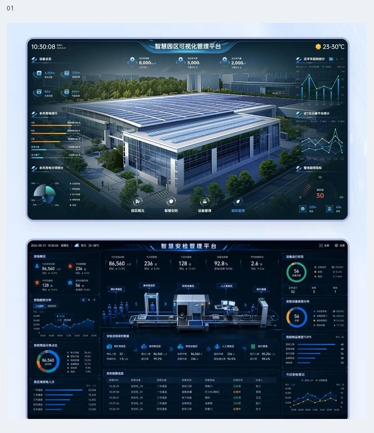

## 盾牌安全态势与园区空间 / Security Shield Campus Space

- 标识：`data-visualization/security-shield-campus-space`；类型：组件／效果。
- 画面要点：浅色盾牌安全态势以环形空间组织数据；深色园区用方体模型与周边监测卡形成对照。
- 指令例句：参考 data-visualization/security-shield-campus-space，安全态势的严重级别需明确，环形装饰与真实比例统计应从标题和标注上区分。
- 实现补充：安全态势的严重级别需明确，环形装饰与真实比例统计应从标题和标注上区分。
- 验证重点：核对文字与图表对比、单位、图例、数据时间和异常状态；若有模型选择或数据联动，按真实数据操作验证。
- 媒体：静态图集，1 张；[静态总览](https://raw.githubusercontent.com/dqzboy/ui-atlas/e6aa0d641c224a2cb4c8bd4262a4d18f5c7e1e22/assets/previews/data-visualization/security-shield-campus-space.jpg) · [图片 01](https://raw.githubusercontent.com/dqzboy/ui-atlas/e6aa0d641c224a2cb4c8bd4262a4d18f5c7e1e22/assets/images/data-visualization/security-shield-campus-space-01.jpg)。

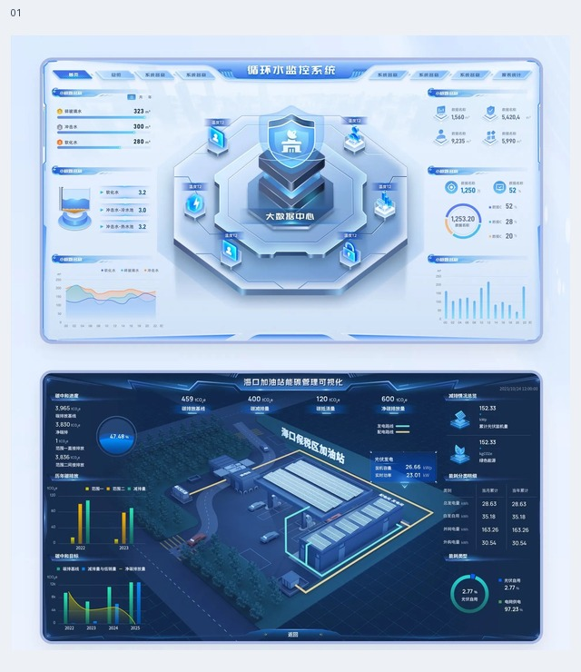

## SMT 产线与晶圆设备阵列 / SMT Wafer Production Array

- 标识：`data-visualization/smt-wafer-production-array`；类型：组件／效果。
- 画面要点：电子 SMT 生产线／晶圆车间以等距设备阵列形成主视觉，深色边栏呈现生产指标。
- 指令例句：参考 data-visualization/smt-wafer-production-array，用产线与设备编号建立可定位关系，阵列数量增加时保留分组和异常识别能力。
- 实现补充：用产线与设备编号建立可定位关系，阵列数量增加时保留分组和异常识别能力。
- 验证重点：核对文字与图表对比、单位、图例、数据时间和异常状态；若有模型选择或数据联动，按真实数据操作验证。
- 媒体：静态图集，1 张；[静态总览](https://raw.githubusercontent.com/dqzboy/ui-atlas/e6aa0d641c224a2cb4c8bd4262a4d18f5c7e1e22/assets/previews/data-visualization/smt-wafer-production-array.jpg) · [图片 01](https://raw.githubusercontent.com/dqzboy/ui-atlas/e6aa0d641c224a2cb4c8bd4262a4d18f5c7e1e22/assets/images/data-visualization/smt-wafer-production-array-01.jpg)。

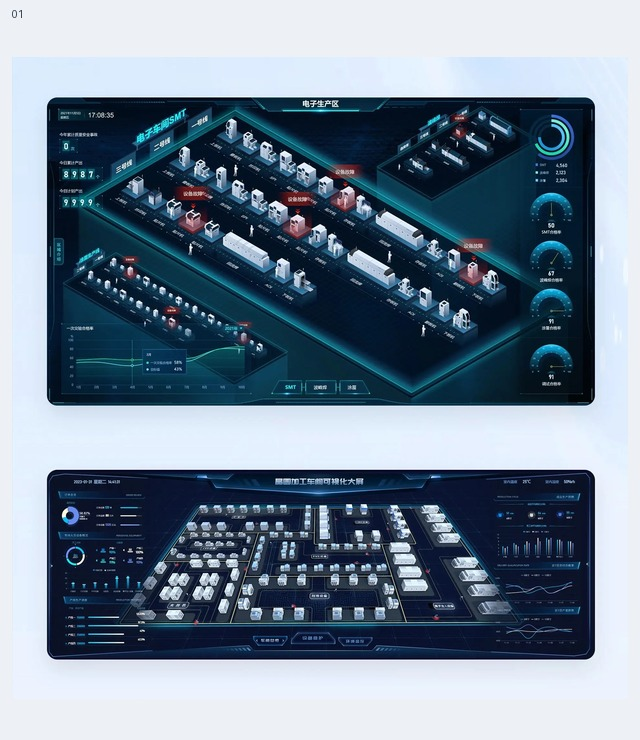

## 健康安全与校园建筑监测 / Health Security Campus Monitor

- 标识：`data-visualization/health-security-campus-monitor`；类型：组件／效果。
- 画面要点：深色医疗／健康盾牌安全大屏与绿色校园建筑孪生并列，使用中心场景和周边监测信息。
- 指令例句：参考 data-visualization/health-security-campus-monitor，健康、安全和校园数据分别定义对象与状态，装饰性模型不能替代关键读数和异常说明。
- 实现补充：健康、安全和校园数据分别定义对象与状态，装饰性模型不能替代关键读数和异常说明。
- 验证重点：核对文字与图表对比、单位、图例、数据时间和异常状态；若有模型选择或数据联动，按真实数据操作验证。
- 媒体：静态图集，1 张；[静态总览](https://raw.githubusercontent.com/dqzboy/ui-atlas/e6aa0d641c224a2cb4c8bd4262a4d18f5c7e1e22/assets/previews/data-visualization/health-security-campus-monitor.jpg) · [图片 01](https://raw.githubusercontent.com/dqzboy/ui-atlas/e6aa0d641c224a2cb4c8bd4262a4d18f5c7e1e22/assets/images/data-visualization/health-security-campus-monitor-01.jpg)。

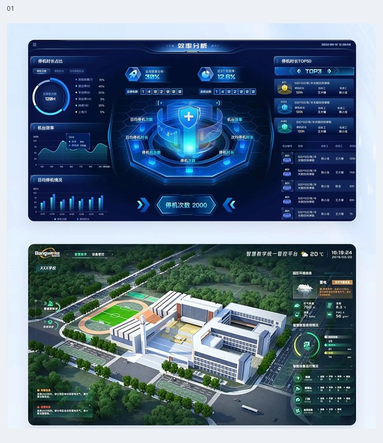
