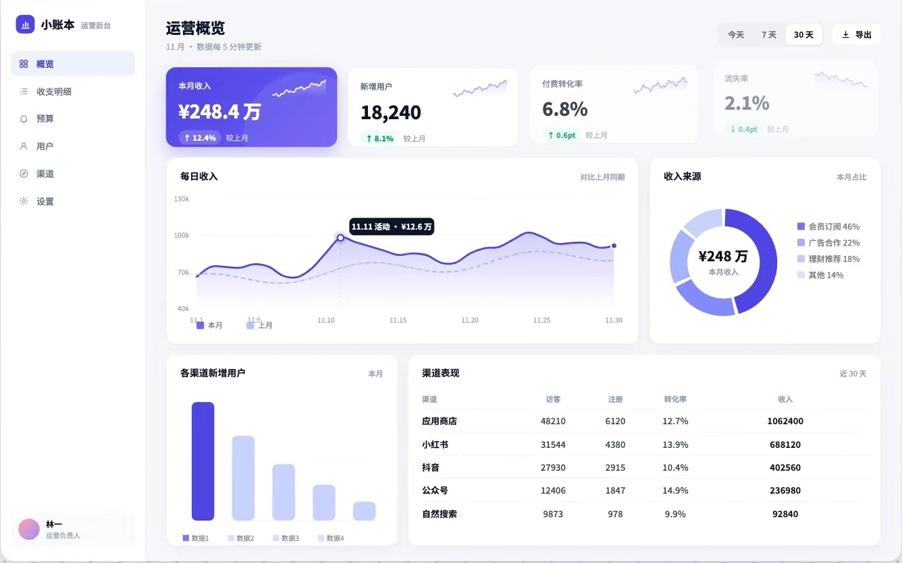
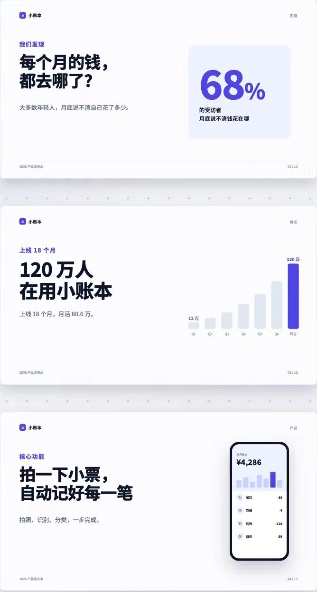
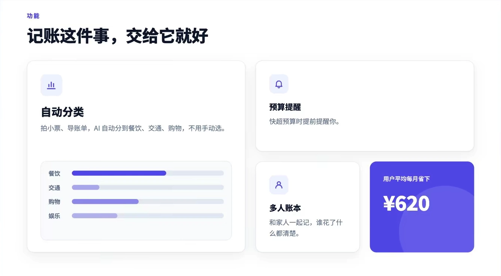

# 页面与演示设计

按用户的目标、既有设计系统和实际触发方式选择。示例中的品牌与业务文案只用于说明；参数作为实现起点，连续行为需在项目中验证。

仅保留实现后的效果画面；设计规则和提示词在下面各条目中读取。

## 目录

- [数据看板的重点与对齐](#dashboard-focus)
- [PPT 单页观点与统一模板](#slide-story)
- [官网首页的层级与留白](#landing-hierarchy)
- [把设计规则写成项目规范](#design-spec)

## 数据看板的重点与对齐 / Dashboard Focus

- 标识：`design-composition/dashboard-focus`；类型：选型／实现规则。
- 适用场景：指标看板、业务报表与数值表格。
- 画面要点：用指标卡突出关键数字，图表直接标注，数字列右对齐，让重点从同色图表中分离出来。
- 实现提示词：梳理当前看板的主要决策问题：最重要的数字独立为指标卡，弱化次要数据；能直接标注系列名称和数值时精简图例；同类数值右对齐并使用等宽数字，保留单位和周期。
- 核对要点：不能无条件删除全部图例；比较数据保持统一口径，强调色仅用于重点，排序和表格仍可操作。
- 关联条目：`cards-tables/stat-card`、`interface-details/cjk-latin-typesetting`。

<!-- ui-atlas:details design-composition/dashboard-focus -->
- 原尺寸图片：[01 · 1336×836](../assets/details/design-composition/dashboard-focus-effect.webp)。
- 清晰度边界：从已有原片参考图裁出 1336×836 的完整 UI 区域，未缩放、未锐化、未涂抹，重新编码为 WebP 质量 98；沿用原素材已有细节，不能恢复其本身没有的信息。静态图只核对可见界面。

<!-- /ui-atlas:details -->

## PPT 单页观点与统一模板 / Slide Story and Template

- 标识：`design-composition/slide-story`；类型：选型／实现规则。
- 适用场景：汇报、产品介绍与数据演示页面。
- 画面要点：长段内容拆为每页一个观点，放大关键数字和图像，用网格统一标题、页码和版式。
- 实现提示词：将演示内容按每页一个明确观点拆分，用短标题表达结论，减少正文并放大关键数字／图表；统一对齐网格、标题位置、页码、字体和颜色，保留必要说明。
- 核对要点：一页内容不能因精简而丢失结论依据；在实际播放尺寸核对小字、图例、页边距和跨页一致性。

<!-- ui-atlas:details design-composition/slide-story -->
- 原尺寸图片：[01 · 668×1245](../assets/details/design-composition/slide-story-effect.webp)。
- 清晰度边界：从 1440×2160 原片按原像素裁出已实现的界面，WebP 质量 98；未缩放、未锐化、未涂抹。仅展示完成后的版式与层级，交互在项目中验证。

<!-- /ui-atlas:details -->

## 官网首页的层级与留白 / Landing Page Hierarchy

- 标识：`design-composition/landing-hierarchy`；类型：选型／实现规则。
- 适用场景：官网首屏、功能介绍与行动引导页面。
- 画面要点：约束品牌色，拉开主标题、正文和主次按钮的层级，以留白、统一材质和便当盒分区组织功能。
- 实现提示词：优化官网首屏：明确一个主要行动，控制品牌强调色，拉开标题与正文层级；增加区块留白，统一圆角和轻阴影；用内容决定大小不同的 Bento 分区，只为关键入口添加克制微交互。
- 核对要点：示例中的约 16 px 圆角、80–120 px 区块间距是起点；优先服从既有设计系统，在手机端重排网格并核对主操作。
- 关联条目：`interface-details/continuous-corners`、`buttons-controls/button-hierarchy`。

<!-- ui-atlas:details design-composition/landing-hierarchy -->
- 原尺寸图片：[01 · 1334×735](../assets/details/design-composition/landing-hierarchy-effect.webp)。
- 清晰度边界：从 1440×2160 原片按原像素裁出已实现的界面，WebP 质量 98；未缩放、未锐化、未涂抹。仅展示完成后的版式与层级，交互在项目中验证。

<!-- /ui-atlas:details -->

## 把设计规则写成项目规范 / Project Design Specification

- 标识：`design-composition/design-spec`；类型：选型／实现规则。
- 适用场景：同一项目中需要持续保持一致的页面与组件。
- 画面要点：将品牌色、排版、间距、圆角、阴影与状态规则记录为项目中的设计清单，后续页面保持一致。
- 实现提示词：整理当前项目已确认的设计规则到一份设计规范：颜色 token、字号层级、间距、圆角、阴影、组件状态和允许的动效；后续界面引用这份规范，按实际需求更新。
- 核对要点：只记录项目真实采用的规则，不把示例数值设为全局命令；规范与实际组件保持一致，新增样式需解释差异。
- 参考用途：复用官网完成界面，观察统一颜色、排版、间距与圆角的落地结果；该图不证明规范文件已生成。

<!-- ui-atlas:details design-composition/design-spec -->
- 原尺寸图片：[01 · 1334×735](../assets/details/design-composition/landing-hierarchy-effect.webp)。
- 清晰度边界：从 1440×2160 原片按原像素裁出已实现的界面，WebP 质量 98；未缩放、未锐化、未涂抹。仅展示完成后的版式与层级，交互在项目中验证。

<!-- /ui-atlas:details -->
