# 企业工作台与业务后台

按实际业务对象选择结构：物流配载、企业门户、AI 工具、招聘、生产任务和统计列表的任务目标各不相同。先看条目摘要和静态总览，再查看相关单图细节；不要只因都采用蓝色就互换工作流。

## 证据与实现边界

- 静态总览按图片编号从左到右、从上到下阅读；编号代表独立图片，不代表时间或交互状态。单图链接保留裁切后的完整分辨率。
- “画面要点”描述已查看的素材；“实现补充”和“验证重点”是落地建议，不能当作原稿已具备的功能。
- 图中的品牌、示例数字、人物和业务文案只用于理解层级，不自动成为需求。按用户的产品对象、技术栈和设计系统改写。
- 只读本次相关图片；静态稿未呈现的联动、筛选、点击结果、权限和响应式行为需在实际项目中确认。

## 目录

- [物流配载与车辆工作台](#logistics-loading-workbench)
- [玻璃欢迎区与企业服务门户](#glass-welcome-service-portal)
- [AI 助手与效率工具工作台](#ai-assistant-productivity-hub)
- [深浅运营卡与人员任务概览](#contrast-operations-task-overview)
- [热力统计与流程管理工作台](#heatmap-process-management)
- [货运模型与企业应用门户](#freight-model-service-workbench)
- [客户日程与对象风险分析](#organization-talent-analytics)
- [货运状态与任务仪表盘](#cargo-status-task-dashboard)
- [飞行设备参数与业务服务台](#aircraft-device-service-console)
- [蓝色欢迎门户与运营概览](#blue-welcome-operations-portal)
- [浅绿能源运营与服务门户](#green-energy-service-overview)
- [工厂与 OA 任务门户](#factory-oa-task-portal)
- [资产流程与管理报表](#asset-process-report-workbench)
- [业务指标与渐变柱状统计](#gradient-column-business-metrics)
- [暖橙欢迎区与管理首页](#warm-orange-management-home)
- [工厂指标与空间流程节点](#factory-space-process-workbench)
- [蓝色指标总览与列表管理](#blue-metrics-list-management)
- [招聘指标与候选人工作台](#recruitment-candidate-workbench)
- [简约统计报表与排行](#compact-analytics-report-grid)
- [多彩指标与统计列表](#colorful-metrics-statistics-list)
- [企业订阅与报告门户](#enterprise-subscription-report-portal)
- [MES 生产状态与任务列表](#mes-production-task-management)
- [门诊业务与仪表统计](#outpatient-business-metrics)
- [企业漏斗统计与 MES 列表](#enterprise-funnel-mes-lists)
- [触屏目录与设备任务管理](#touchscreen-catalog-device-tasks)
- [企业进度待办与表格管理](#enterprise-progress-todo-management)
- [项目流程与告警任务工作台](#project-process-alert-workbench)

## 物流配载与车辆工作台 / Logistics Loading Workbench

- 标识：`enterprise-workbenches/logistics-loading-workbench`；类型：组件／效果。
- 画面要点：车厢货位模型占据主区，司机、容量和活动日志列于侧边；另一页以车辆选择、装载状态和货物表组织配送任务。
- 指令例句：参考 enterprise-workbenches/logistics-loading-workbench，把货位、负载和清单保持在同一业务上下文；空货位、已装载和不可用应有可区分状态。
- 实现补充：把货位、负载和清单保持在同一业务上下文；空货位、已装载和不可用应有可区分状态。
- 验证重点：摘要与列表的业务口径一致；筛选、排序、分页和空／错／加载状态在项目中实际验证。
- 媒体：静态图集，2 张；[静态总览](https://raw.githubusercontent.com/dqzboy/ui-atlas/e6aa0d641c224a2cb4c8bd4262a4d18f5c7e1e22/assets/previews/enterprise-workbenches/logistics-loading-workbench.jpg) · [图片 01](https://raw.githubusercontent.com/dqzboy/ui-atlas/e6aa0d641c224a2cb4c8bd4262a4d18f5c7e1e22/assets/images/enterprise-workbenches/logistics-loading-workbench-01.jpg) · [图片 02](https://raw.githubusercontent.com/dqzboy/ui-atlas/e6aa0d641c224a2cb4c8bd4262a4d18f5c7e1e22/assets/images/enterprise-workbenches/logistics-loading-workbench-02.jpg)。

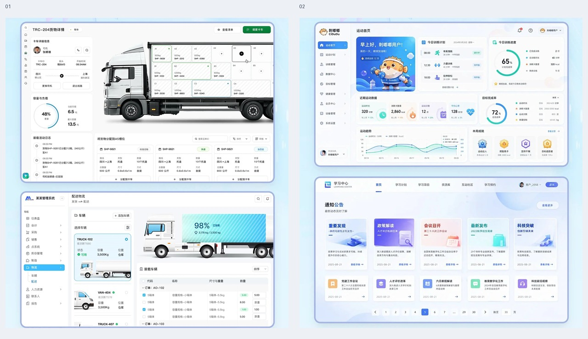

## 玻璃欢迎区与企业服务门户 / Glass Welcome Service Portal

- 标识：`enterprise-workbenches/glass-welcome-service-portal`；类型：组件／效果。
- 画面要点：大渐变欢迎区域结合半透明卡片、指标、日历和工具入口；另一页用企业蓝组织服务门户。
- 指令例句：参考 enterprise-workbenches/glass-welcome-service-portal，欢迎区保持简短，把高频入口、待办与日历安排在可快速扫描的位置。
- 实现补充：欢迎区保持简短，把高频入口、待办与日历安排在可快速扫描的位置。
- 验证重点：摘要与列表的业务口径一致；筛选、排序、分页和空／错／加载状态在项目中实际验证。
- 媒体：静态图集，2 张；[静态总览](https://raw.githubusercontent.com/dqzboy/ui-atlas/e6aa0d641c224a2cb4c8bd4262a4d18f5c7e1e22/assets/previews/enterprise-workbenches/glass-welcome-service-portal.jpg) · [图片 01](https://raw.githubusercontent.com/dqzboy/ui-atlas/e6aa0d641c224a2cb4c8bd4262a4d18f5c7e1e22/assets/images/enterprise-workbenches/glass-welcome-service-portal-01.jpg) · [图片 02](https://raw.githubusercontent.com/dqzboy/ui-atlas/e6aa0d641c224a2cb4c8bd4262a4d18f5c7e1e22/assets/images/enterprise-workbenches/glass-welcome-service-portal-02.jpg)。

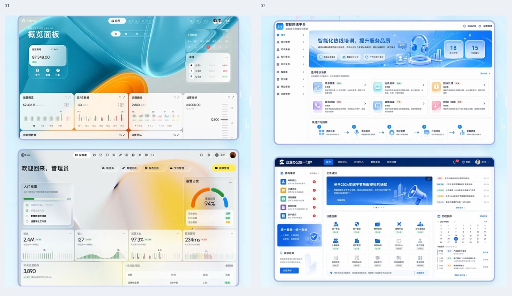

## AI 助手与效率工具工作台 / AI Assistant Productivity Hub

- 标识：`enterprise-workbenches/ai-assistant-productivity-hub`；类型：组件／效果。
- 画面要点：工具卡、文档快捷创建和对话入口构成效率工作台；图集同时提供整页组合与独立设计稿。
- 指令例句：参考 enterprise-workbenches/ai-assistant-productivity-hub，区分新建文档、调用工具和开始对话，输入区的示例问题应能帮助用户发起具体任务。
- 实现补充：区分新建文档、调用工具和开始对话，输入区的示例问题应能帮助用户发起具体任务。
- 验证重点：摘要与列表的业务口径一致；筛选、排序、分页和空／错／加载状态在项目中实际验证。
- 媒体：静态图集，4 张；[静态总览](https://raw.githubusercontent.com/dqzboy/ui-atlas/e6aa0d641c224a2cb4c8bd4262a4d18f5c7e1e22/assets/previews/enterprise-workbenches/ai-assistant-productivity-hub.jpg) · [图片 01](https://raw.githubusercontent.com/dqzboy/ui-atlas/e6aa0d641c224a2cb4c8bd4262a4d18f5c7e1e22/assets/images/enterprise-workbenches/ai-assistant-productivity-hub-01.jpg) · [图片 02](https://raw.githubusercontent.com/dqzboy/ui-atlas/e6aa0d641c224a2cb4c8bd4262a4d18f5c7e1e22/assets/images/enterprise-workbenches/ai-assistant-productivity-hub-02.jpg) · [图片 03](https://raw.githubusercontent.com/dqzboy/ui-atlas/e6aa0d641c224a2cb4c8bd4262a4d18f5c7e1e22/assets/images/enterprise-workbenches/ai-assistant-productivity-hub-03.jpg) · [图片 04](https://raw.githubusercontent.com/dqzboy/ui-atlas/e6aa0d641c224a2cb4c8bd4262a4d18f5c7e1e22/assets/images/enterprise-workbenches/ai-assistant-productivity-hub-04.jpg)。

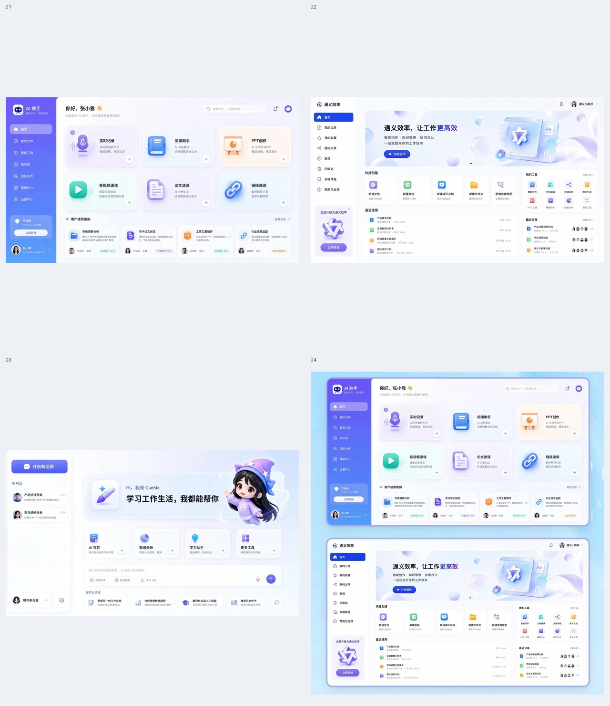

## 深浅运营卡与人员任务概览 / Contrast Operations Task Overview

- 标识：`enterprise-workbenches/contrast-operations-task-overview`；类型：组件／效果。
- 画面要点：深浅对照的运营卡、任务和人员列表，与浅蓝模型总览形成不同密度的工作台结构。
- 指令例句：参考 enterprise-workbenches/contrast-operations-task-overview，先决定主要任务是看指标还是处理列表，再分配模型和数据卡的面积。
- 实现补充：先决定主要任务是看指标还是处理列表，再分配模型和数据卡的面积。
- 验证重点：摘要与列表的业务口径一致；筛选、排序、分页和空／错／加载状态在项目中实际验证。
- 媒体：静态图集，2 张；[静态总览](https://raw.githubusercontent.com/dqzboy/ui-atlas/e6aa0d641c224a2cb4c8bd4262a4d18f5c7e1e22/assets/previews/enterprise-workbenches/contrast-operations-task-overview.jpg) · [图片 01](https://raw.githubusercontent.com/dqzboy/ui-atlas/e6aa0d641c224a2cb4c8bd4262a4d18f5c7e1e22/assets/images/enterprise-workbenches/contrast-operations-task-overview-01.jpg) · [图片 02](https://raw.githubusercontent.com/dqzboy/ui-atlas/e6aa0d641c224a2cb4c8bd4262a4d18f5c7e1e22/assets/images/enterprise-workbenches/contrast-operations-task-overview-02.jpg)。

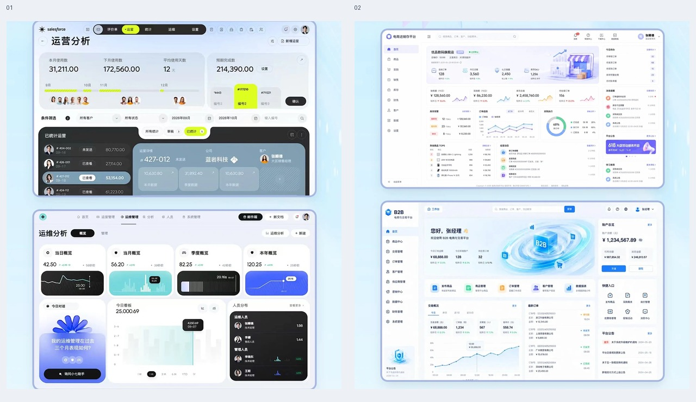

## 热力统计与流程管理工作台 / Heatmap Process Management

- 标识：`enterprise-workbenches/heatmap-process-management`；类型：组件／效果。
- 画面要点：指标和热力表、绿色折线组成数据概览；流程步骤及管理表补充具体业务进展。
- 指令例句：参考 enterprise-workbenches/heatmap-process-management，热力色阶保留图例，流程步骤区分已完成、当前和待处理，并给出下一步入口。
- 实现补充：热力色阶保留图例，流程步骤区分已完成、当前和待处理，并给出下一步入口。
- 验证重点：摘要与列表的业务口径一致；筛选、排序、分页和空／错／加载状态在项目中实际验证。
- 媒体：静态图集，2 张；[静态总览](https://raw.githubusercontent.com/dqzboy/ui-atlas/e6aa0d641c224a2cb4c8bd4262a4d18f5c7e1e22/assets/previews/enterprise-workbenches/heatmap-process-management.jpg) · [图片 01](https://raw.githubusercontent.com/dqzboy/ui-atlas/e6aa0d641c224a2cb4c8bd4262a4d18f5c7e1e22/assets/images/enterprise-workbenches/heatmap-process-management-01.jpg) · [图片 02](https://raw.githubusercontent.com/dqzboy/ui-atlas/e6aa0d641c224a2cb4c8bd4262a4d18f5c7e1e22/assets/images/enterprise-workbenches/heatmap-process-management-02.jpg)。

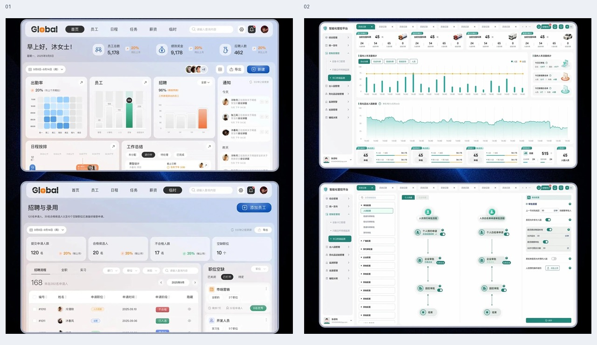

## 货运模型与企业应用门户 / Freight Model Service Workbench

- 标识：`enterprise-workbenches/freight-model-service-workbench`；类型：组件／效果。
- 画面要点：货运车辆与集装箱模型和业务参数、列表同屏；另一页提供蓝色企业应用入口。
- 指令例句：参考 enterprise-workbenches/freight-model-service-workbench，配载任务与通用应用入口分别分组，当前车辆的参数和清单保持就近呈现。
- 实现补充：配载任务与通用应用入口分别分组，当前车辆的参数和清单保持就近呈现。
- 验证重点：摘要与列表的业务口径一致；筛选、排序、分页和空／错／加载状态在项目中实际验证。
- 媒体：静态图集，2 张；[静态总览](https://raw.githubusercontent.com/dqzboy/ui-atlas/e6aa0d641c224a2cb4c8bd4262a4d18f5c7e1e22/assets/previews/enterprise-workbenches/freight-model-service-workbench.jpg) · [图片 01](https://raw.githubusercontent.com/dqzboy/ui-atlas/e6aa0d641c224a2cb4c8bd4262a4d18f5c7e1e22/assets/images/enterprise-workbenches/freight-model-service-workbench-01.jpg) · [图片 02](https://raw.githubusercontent.com/dqzboy/ui-atlas/e6aa0d641c224a2cb4c8bd4262a4d18f5c7e1e22/assets/images/enterprise-workbenches/freight-model-service-workbench-02.jpg)。

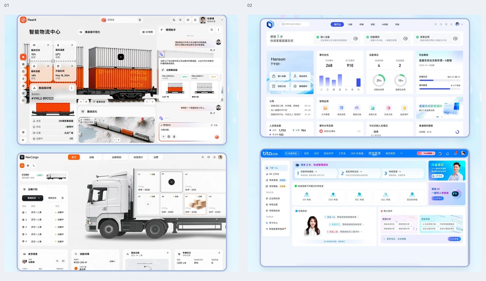

## 客户日程与对象风险分析 / Organization Talent Analytics

- 标识：`enterprise-workbenches/organization-talent-analytics`；类型：组件／效果。
- 画面要点：浅蓝客户指标与日程工作台组织账户和会议；对象管理页面结合档案、风险分析、地图及统计形成另一类业务概览。
- 指令例句：参考 enterprise-workbenches/organization-talent-analytics，客户日程与对象风险分析采用各自的业务维度，地图、档案及统计范围应清楚标注。
- 实现补充：客户日程与对象风险分析采用各自的业务维度，地图、档案及统计范围应清楚标注。
- 验证重点：摘要与列表的业务口径一致；筛选、排序、分页和空／错／加载状态在项目中实际验证。
- 媒体：静态图集，2 张；[静态总览](https://raw.githubusercontent.com/dqzboy/ui-atlas/e6aa0d641c224a2cb4c8bd4262a4d18f5c7e1e22/assets/previews/enterprise-workbenches/organization-talent-analytics.jpg) · [图片 01](https://raw.githubusercontent.com/dqzboy/ui-atlas/e6aa0d641c224a2cb4c8bd4262a4d18f5c7e1e22/assets/images/enterprise-workbenches/organization-talent-analytics-01.jpg) · [图片 02](https://raw.githubusercontent.com/dqzboy/ui-atlas/e6aa0d641c224a2cb4c8bd4262a4d18f5c7e1e22/assets/images/enterprise-workbenches/organization-talent-analytics-02.jpg)。

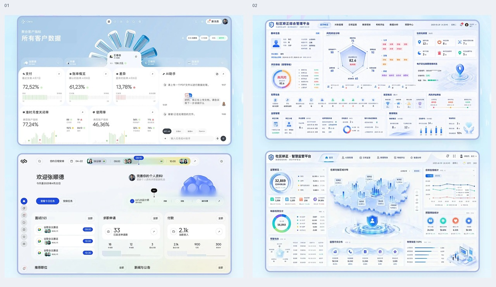

## 货运状态与任务仪表盘 / Cargo Status Task Dashboard

- 标识：`enterprise-workbenches/cargo-status-task-dashboard`；类型：组件／效果。
- 画面要点：车厢载货可视化、状态节点和任务进展并置，环形仪表与表格承接具体业务明细。
- 指令例句：参考 enterprise-workbenches/cargo-status-task-dashboard，状态节点对应可解释的任务阶段，进度读数应有分母或完成标准。
- 实现补充：状态节点对应可解释的任务阶段，进度读数应有分母或完成标准。
- 验证重点：摘要与列表的业务口径一致；筛选、排序、分页和空／错／加载状态在项目中实际验证。
- 媒体：静态图集，2 张；[静态总览](https://raw.githubusercontent.com/dqzboy/ui-atlas/e6aa0d641c224a2cb4c8bd4262a4d18f5c7e1e22/assets/previews/enterprise-workbenches/cargo-status-task-dashboard.jpg) · [图片 01](https://raw.githubusercontent.com/dqzboy/ui-atlas/e6aa0d641c224a2cb4c8bd4262a4d18f5c7e1e22/assets/images/enterprise-workbenches/cargo-status-task-dashboard-01.jpg) · [图片 02](https://raw.githubusercontent.com/dqzboy/ui-atlas/e6aa0d641c224a2cb4c8bd4262a4d18f5c7e1e22/assets/images/enterprise-workbenches/cargo-status-task-dashboard-02.jpg)。

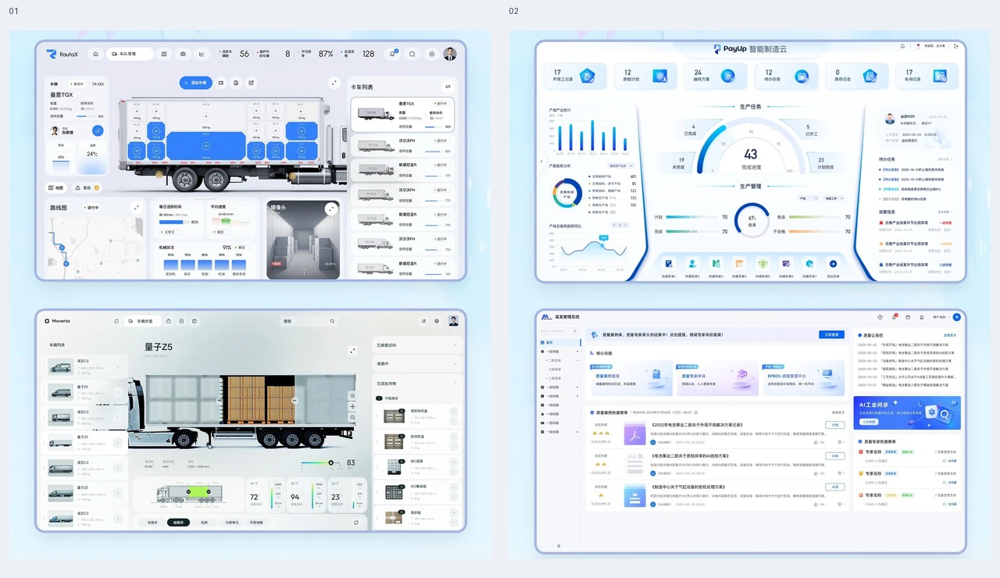

## 飞行设备参数与业务服务台 / Aircraft Device Service Console

- 标识：`enterprise-workbenches/aircraft-device-service-console`；类型：组件／效果。
- 画面要点：飞机、无人机或设备模型与参数信息形成设备详情区；服务入口和业务表格提供任务支撑。
- 指令例句：参考 enterprise-workbenches/aircraft-device-service-console，设备识别、状态和任务操作需先于装饰展示，参数注明单位并能追溯当前设备。
- 实现补充：设备识别、状态和任务操作需先于装饰展示，参数注明单位并能追溯当前设备。
- 验证重点：摘要与列表的业务口径一致；筛选、排序、分页和空／错／加载状态在项目中实际验证。
- 媒体：静态图集，2 张；[静态总览](https://raw.githubusercontent.com/dqzboy/ui-atlas/e6aa0d641c224a2cb4c8bd4262a4d18f5c7e1e22/assets/previews/enterprise-workbenches/aircraft-device-service-console.jpg) · [图片 01](https://raw.githubusercontent.com/dqzboy/ui-atlas/e6aa0d641c224a2cb4c8bd4262a4d18f5c7e1e22/assets/images/enterprise-workbenches/aircraft-device-service-console-01.jpg) · [图片 02](https://raw.githubusercontent.com/dqzboy/ui-atlas/e6aa0d641c224a2cb4c8bd4262a4d18f5c7e1e22/assets/images/enterprise-workbenches/aircraft-device-service-console-02.jpg)。

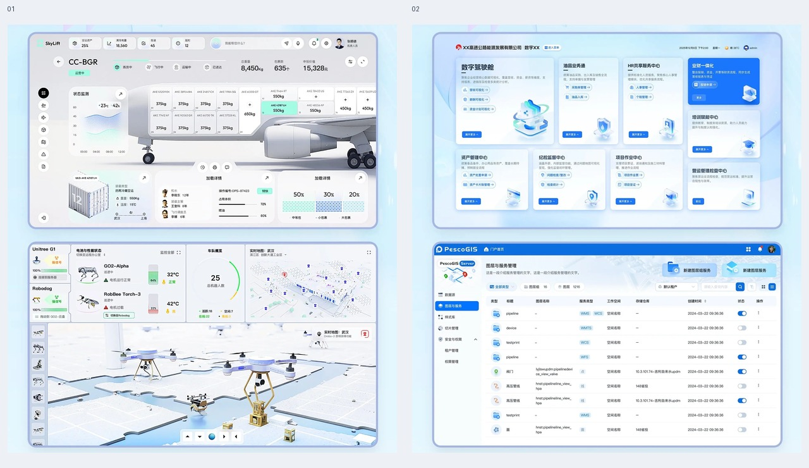

## 蓝色欢迎门户与运营概览 / Blue Welcome Operations Portal

- 标识：`enterprise-workbenches/blue-welcome-operations-portal`；类型：组件／效果。
- 画面要点：企业蓝欢迎横幅、日历和快捷入口组成首页，另一页集中展示运营指标与趋势。
- 指令例句：参考 enterprise-workbenches/blue-welcome-operations-portal，欢迎区域让出高频任务空间，工具入口和统计分析使用清晰的分区标题。
- 实现补充：欢迎区域让出高频任务空间，工具入口和统计分析使用清晰的分区标题。
- 验证重点：摘要与列表的业务口径一致；筛选、排序、分页和空／错／加载状态在项目中实际验证。
- 媒体：静态图集，2 张；[静态总览](https://raw.githubusercontent.com/dqzboy/ui-atlas/e6aa0d641c224a2cb4c8bd4262a4d18f5c7e1e22/assets/previews/enterprise-workbenches/blue-welcome-operations-portal.jpg) · [图片 01](https://raw.githubusercontent.com/dqzboy/ui-atlas/e6aa0d641c224a2cb4c8bd4262a4d18f5c7e1e22/assets/images/enterprise-workbenches/blue-welcome-operations-portal-01.jpg) · [图片 02](https://raw.githubusercontent.com/dqzboy/ui-atlas/e6aa0d641c224a2cb4c8bd4262a4d18f5c7e1e22/assets/images/enterprise-workbenches/blue-welcome-operations-portal-02.jpg)。

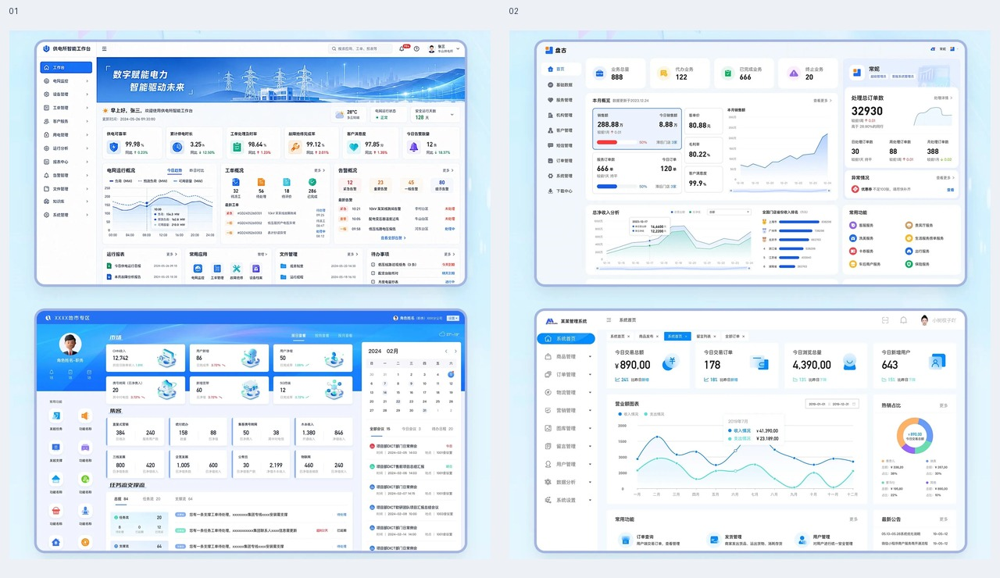

## 浅绿能源运营与服务门户 / Green Energy Service Overview

- 标识：`enterprise-workbenches/green-energy-service-overview`；类型：组件／效果。
- 画面要点：浅绿色运营概览、太阳能组态和趋势表格并列，服务门户提供常用工具和业务入口。
- 指令例句：参考 enterprise-workbenches/green-energy-service-overview，把能源监测和业务服务分组，突出用户当前最需要处理的异常或待办。
- 实现补充：把能源监测和业务服务分组，突出用户当前最需要处理的异常或待办。
- 验证重点：摘要与列表的业务口径一致；筛选、排序、分页和空／错／加载状态在项目中实际验证。
- 媒体：静态图集，2 张；[静态总览](https://raw.githubusercontent.com/dqzboy/ui-atlas/e6aa0d641c224a2cb4c8bd4262a4d18f5c7e1e22/assets/previews/enterprise-workbenches/green-energy-service-overview.jpg) · [图片 01](https://raw.githubusercontent.com/dqzboy/ui-atlas/e6aa0d641c224a2cb4c8bd4262a4d18f5c7e1e22/assets/images/enterprise-workbenches/green-energy-service-overview-01.jpg) · [图片 02](https://raw.githubusercontent.com/dqzboy/ui-atlas/e6aa0d641c224a2cb4c8bd4262a4d18f5c7e1e22/assets/images/enterprise-workbenches/green-energy-service-overview-02.jpg)。

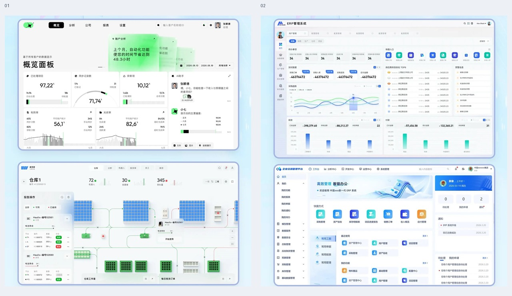

## 工厂与 OA 任务门户 / Factory OA Task Portal

- 标识：`enterprise-workbenches/factory-oa-task-portal`；类型：组件／效果。
- 画面要点：蓝色任务首页、图标快捷入口、工厂 MOM／OA 指标和待办构成企业业务门户。
- 指令例句：参考 enterprise-workbenches/factory-oa-task-portal，把待办处理入口与仅供查看的指标区分，工作流状态用明确文字说明。
- 实现补充：把待办处理入口与仅供查看的指标区分，工作流状态用明确文字说明。
- 验证重点：摘要与列表的业务口径一致；筛选、排序、分页和空／错／加载状态在项目中实际验证。
- 媒体：静态图集，2 张；[静态总览](https://raw.githubusercontent.com/dqzboy/ui-atlas/e6aa0d641c224a2cb4c8bd4262a4d18f5c7e1e22/assets/previews/enterprise-workbenches/factory-oa-task-portal.jpg) · [图片 01](https://raw.githubusercontent.com/dqzboy/ui-atlas/e6aa0d641c224a2cb4c8bd4262a4d18f5c7e1e22/assets/images/enterprise-workbenches/factory-oa-task-portal-01.jpg) · [图片 02](https://raw.githubusercontent.com/dqzboy/ui-atlas/e6aa0d641c224a2cb4c8bd4262a4d18f5c7e1e22/assets/images/enterprise-workbenches/factory-oa-task-portal-02.jpg)。

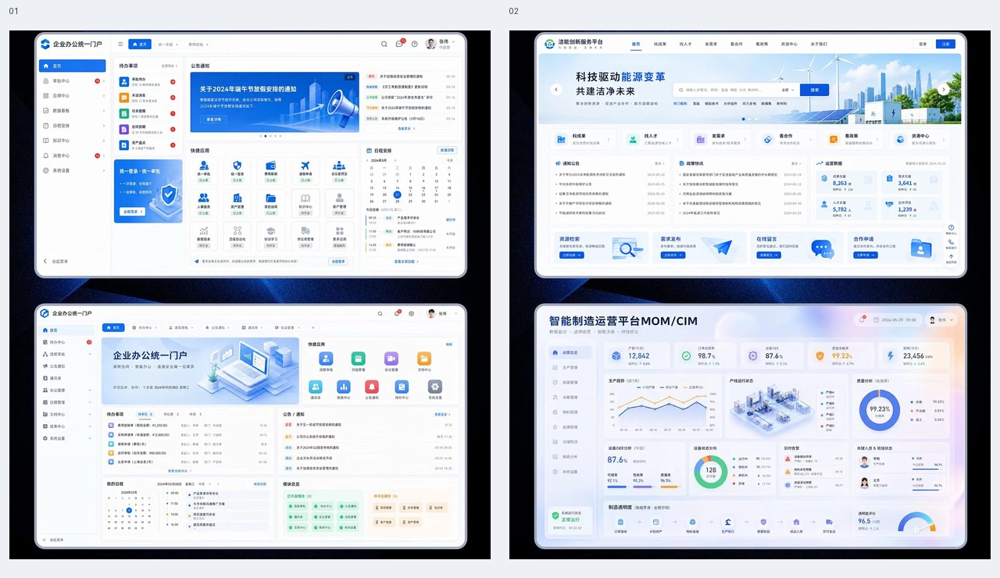

## 资产流程与管理报表 / Asset Process Report Workbench

- 标识：`enterprise-workbenches/asset-process-report-workbench`；类型：组件／效果。
- 画面要点：企业蓝工作台提供资产／流程阶段入口、柱状统计和管理表，独立稿便于观察整页排版。
- 指令例句：参考 enterprise-workbenches/asset-process-report-workbench，阶段入口对应明确业务范围，统计与列表维持一致的筛选条件。
- 实现补充：阶段入口对应明确业务范围，统计与列表维持一致的筛选条件。
- 验证重点：摘要与列表的业务口径一致；筛选、排序、分页和空／错／加载状态在项目中实际验证。
- 媒体：静态图集，3 张；[静态总览](https://raw.githubusercontent.com/dqzboy/ui-atlas/e6aa0d641c224a2cb4c8bd4262a4d18f5c7e1e22/assets/previews/enterprise-workbenches/asset-process-report-workbench.jpg) · [图片 01](https://raw.githubusercontent.com/dqzboy/ui-atlas/e6aa0d641c224a2cb4c8bd4262a4d18f5c7e1e22/assets/images/enterprise-workbenches/asset-process-report-workbench-01.jpg) · [图片 02](https://raw.githubusercontent.com/dqzboy/ui-atlas/e6aa0d641c224a2cb4c8bd4262a4d18f5c7e1e22/assets/images/enterprise-workbenches/asset-process-report-workbench-02.jpg) · [图片 03](https://raw.githubusercontent.com/dqzboy/ui-atlas/e6aa0d641c224a2cb4c8bd4262a4d18f5c7e1e22/assets/images/enterprise-workbenches/asset-process-report-workbench-03.jpg)。

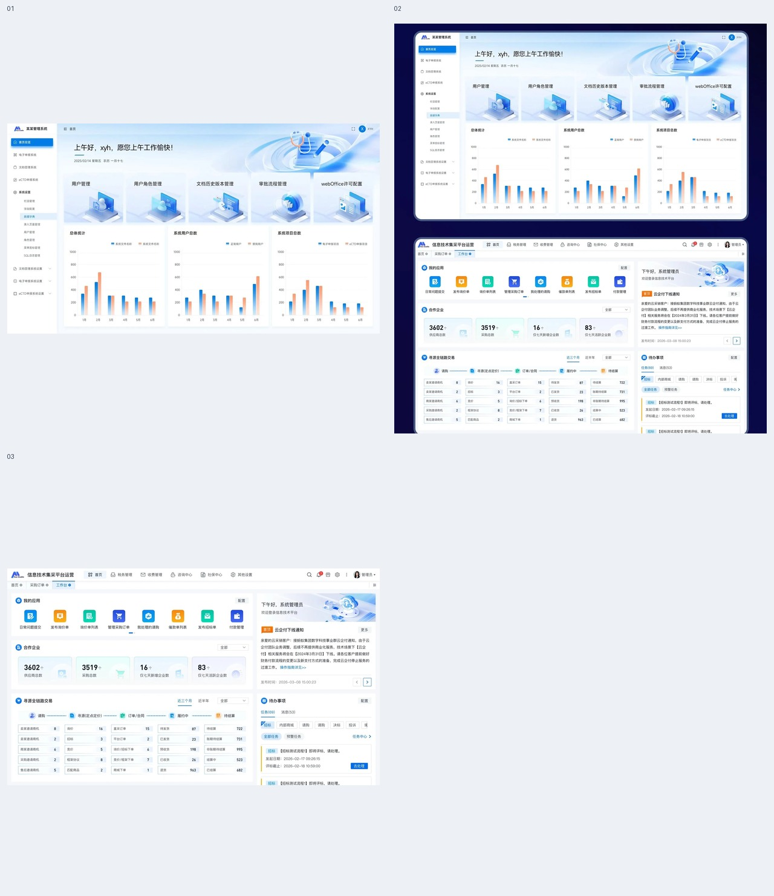

## 业务指标与渐变柱状统计 / Gradient Column Business Metrics

- 标识：`enterprise-workbenches/gradient-column-business-metrics`；类型：组件／效果。
- 画面要点：浅色业务概览组合指标卡、分布与趋势，竖向渐变柱状统计形成另一种聚焦数据的版式。
- 指令例句：参考 enterprise-workbenches/gradient-column-business-metrics，用标题、单位和图例解释渐变柱的数值含义，控制装饰色对比较效率的影响。
- 实现补充：用标题、单位和图例解释渐变柱的数值含义，控制装饰色对比较效率的影响。
- 验证重点：摘要与列表的业务口径一致；筛选、排序、分页和空／错／加载状态在项目中实际验证。
- 媒体：静态图集，2 张；[静态总览](https://raw.githubusercontent.com/dqzboy/ui-atlas/e6aa0d641c224a2cb4c8bd4262a4d18f5c7e1e22/assets/previews/enterprise-workbenches/gradient-column-business-metrics.jpg) · [图片 01](https://raw.githubusercontent.com/dqzboy/ui-atlas/e6aa0d641c224a2cb4c8bd4262a4d18f5c7e1e22/assets/images/enterprise-workbenches/gradient-column-business-metrics-01.jpg) · [图片 02](https://raw.githubusercontent.com/dqzboy/ui-atlas/e6aa0d641c224a2cb4c8bd4262a4d18f5c7e1e22/assets/images/enterprise-workbenches/gradient-column-business-metrics-02.jpg)。

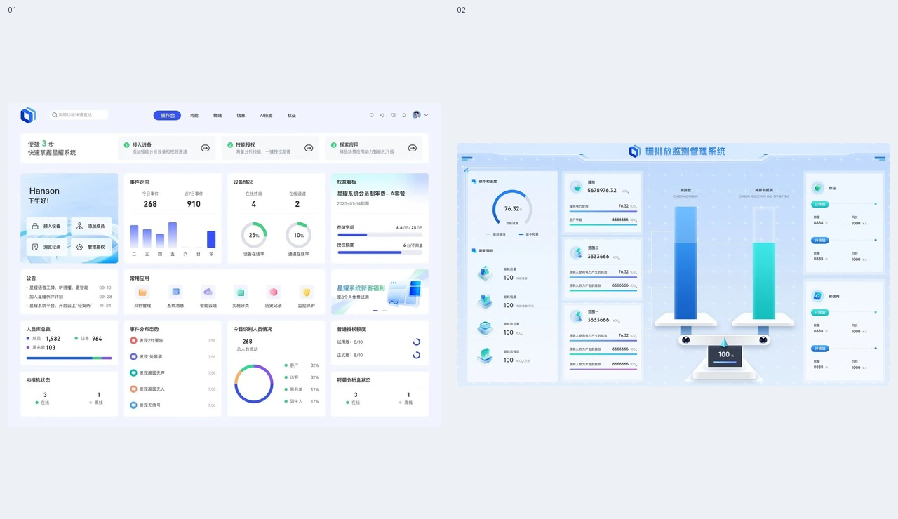

## 暖橙欢迎区与管理首页 / Warm Orange Management Home

- 标识：`enterprise-workbenches/warm-orange-management-home`；类型：组件／效果。
- 画面要点：暖橙欢迎区搭配摘要指标、管理表和任务区域，图集包含整页和独立高清视图。
- 指令例句：参考 enterprise-workbenches/warm-orange-management-home，暖色集中在欢迎与重点数据，表格保持稳定对比和可扫描的行列节奏。
- 实现补充：暖色集中在欢迎与重点数据，表格保持稳定对比和可扫描的行列节奏。
- 验证重点：摘要与列表的业务口径一致；筛选、排序、分页和空／错／加载状态在项目中实际验证。
- 媒体：静态图集，3 张；[静态总览](https://raw.githubusercontent.com/dqzboy/ui-atlas/e6aa0d641c224a2cb4c8bd4262a4d18f5c7e1e22/assets/previews/enterprise-workbenches/warm-orange-management-home.jpg) · [图片 01](https://raw.githubusercontent.com/dqzboy/ui-atlas/e6aa0d641c224a2cb4c8bd4262a4d18f5c7e1e22/assets/images/enterprise-workbenches/warm-orange-management-home-01.jpg) · [图片 02](https://raw.githubusercontent.com/dqzboy/ui-atlas/e6aa0d641c224a2cb4c8bd4262a4d18f5c7e1e22/assets/images/enterprise-workbenches/warm-orange-management-home-02.jpg) · [图片 03](https://raw.githubusercontent.com/dqzboy/ui-atlas/e6aa0d641c224a2cb4c8bd4262a4d18f5c7e1e22/assets/images/enterprise-workbenches/warm-orange-management-home-03.jpg)。

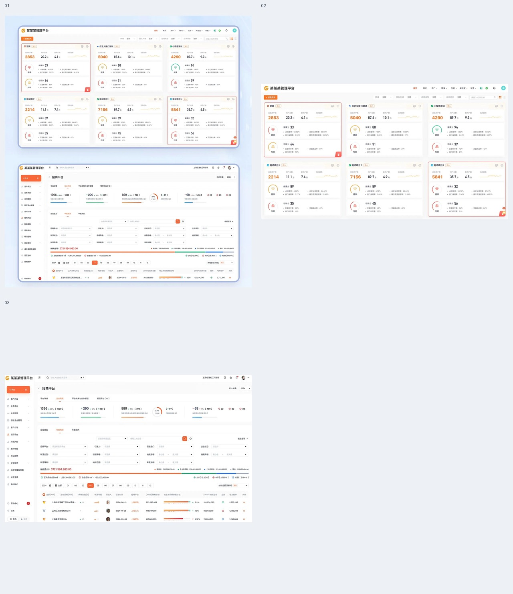

## 工厂指标与空间流程节点 / Factory Space Process Workbench

- 标识：`enterprise-workbenches/factory-space-process-workbench`；类型：组件／效果。
- 画面要点：浅蓝工厂管理指标和立体空间流程节点结合，首页总览与业务步骤形成连续的信息层级。
- 指令例句：参考 enterprise-workbenches/factory-space-process-workbench，节点名称和处理顺序应优先于立体造型，关键指标需能追溯对应业务阶段。
- 实现补充：节点名称和处理顺序应优先于立体造型，关键指标需能追溯对应业务阶段。
- 验证重点：摘要与列表的业务口径一致；筛选、排序、分页和空／错／加载状态在项目中实际验证。
- 媒体：静态图集，3 张；[静态总览](https://raw.githubusercontent.com/dqzboy/ui-atlas/e6aa0d641c224a2cb4c8bd4262a4d18f5c7e1e22/assets/previews/enterprise-workbenches/factory-space-process-workbench.jpg) · [图片 01](https://raw.githubusercontent.com/dqzboy/ui-atlas/e6aa0d641c224a2cb4c8bd4262a4d18f5c7e1e22/assets/images/enterprise-workbenches/factory-space-process-workbench-01.jpg) · [图片 02](https://raw.githubusercontent.com/dqzboy/ui-atlas/e6aa0d641c224a2cb4c8bd4262a4d18f5c7e1e22/assets/images/enterprise-workbenches/factory-space-process-workbench-02.jpg) · [图片 03](https://raw.githubusercontent.com/dqzboy/ui-atlas/e6aa0d641c224a2cb4c8bd4262a4d18f5c7e1e22/assets/images/enterprise-workbenches/factory-space-process-workbench-03.jpg)。

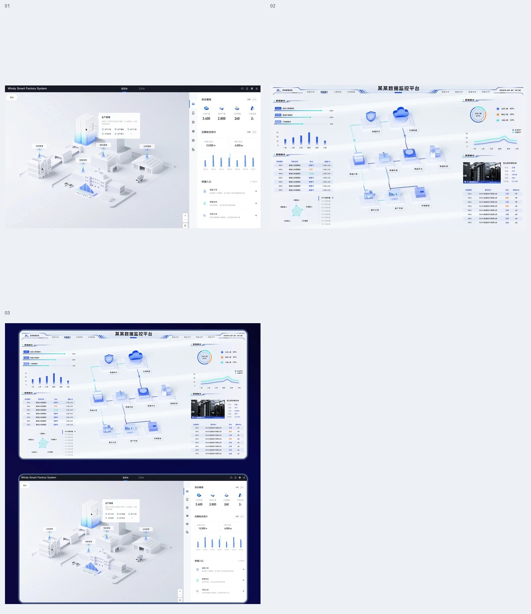

## 蓝色指标总览与列表管理 / Blue Metrics List Management

- 标识：`enterprise-workbenches/blue-metrics-list-management`；类型：组件／效果。
- 画面要点：蓝色指标、曲线和环形图构成工作台；列表页以筛选和业务表承接具体记录。
- 指令例句：参考 enterprise-workbenches/blue-metrics-list-management，总览负责发现问题，列表负责查找和处理记录，两个层级保持一致命名。
- 实现补充：总览负责发现问题，列表负责查找和处理记录，两个层级保持一致命名。
- 验证重点：摘要与列表的业务口径一致；筛选、排序、分页和空／错／加载状态在项目中实际验证。
- 媒体：静态图集，2 张；[静态总览](https://raw.githubusercontent.com/dqzboy/ui-atlas/e6aa0d641c224a2cb4c8bd4262a4d18f5c7e1e22/assets/previews/enterprise-workbenches/blue-metrics-list-management.jpg) · [图片 01](https://raw.githubusercontent.com/dqzboy/ui-atlas/e6aa0d641c224a2cb4c8bd4262a4d18f5c7e1e22/assets/images/enterprise-workbenches/blue-metrics-list-management-01.jpg) · [图片 02](https://raw.githubusercontent.com/dqzboy/ui-atlas/e6aa0d641c224a2cb4c8bd4262a4d18f5c7e1e22/assets/images/enterprise-workbenches/blue-metrics-list-management-02.jpg)。

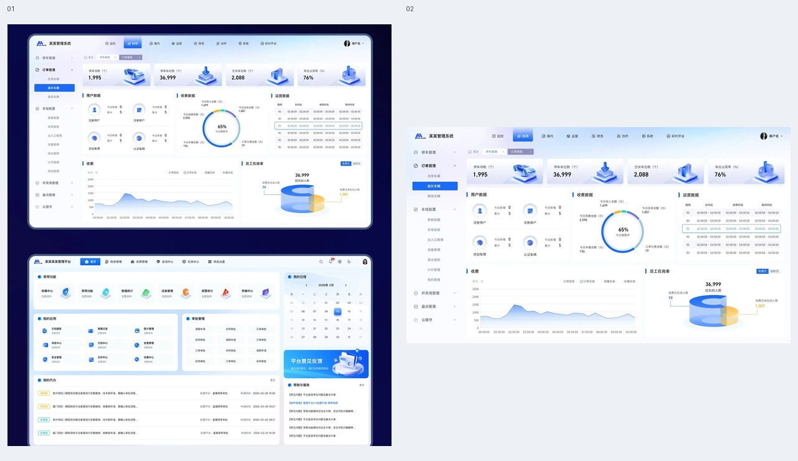

## 招聘指标与候选人工作台 / Recruitment Candidate Workbench

- 标识：`enterprise-workbenches/recruitment-candidate-workbench`；类型：组件／效果。
- 画面要点：候选人列表、招聘指标和工具分区构成招聘工作台，筛选列表承接人员信息浏览。
- 指令例句：参考 enterprise-workbenches/recruitment-candidate-workbench，指标与候选人状态使用一致定义，筛选条件和当前结果数应清楚可见。
- 实现补充：指标与候选人状态使用一致定义，筛选条件和当前结果数应清楚可见。
- 验证重点：摘要与列表的业务口径一致；筛选、排序、分页和空／错／加载状态在项目中实际验证。
- 媒体：静态图集，2 张；[静态总览](https://raw.githubusercontent.com/dqzboy/ui-atlas/e6aa0d641c224a2cb4c8bd4262a4d18f5c7e1e22/assets/previews/enterprise-workbenches/recruitment-candidate-workbench.jpg) · [图片 01](https://raw.githubusercontent.com/dqzboy/ui-atlas/e6aa0d641c224a2cb4c8bd4262a4d18f5c7e1e22/assets/images/enterprise-workbenches/recruitment-candidate-workbench-01.jpg) · [图片 02](https://raw.githubusercontent.com/dqzboy/ui-atlas/e6aa0d641c224a2cb4c8bd4262a4d18f5c7e1e22/assets/images/enterprise-workbenches/recruitment-candidate-workbench-02.jpg)。

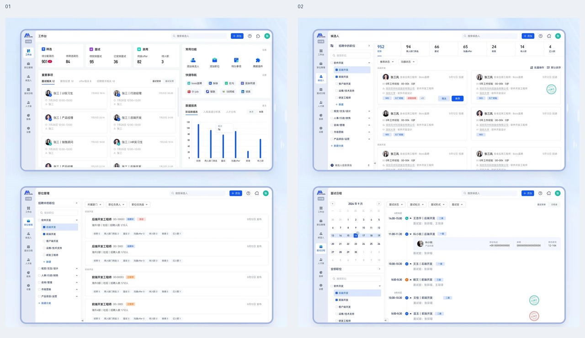

## 简约统计报表与排行 / Compact Analytics Report Grid

- 标识：`enterprise-workbenches/compact-analytics-report-grid`；类型：组件／效果。
- 画面要点：浅蓝简约报表组合环图、柱图、折线、雷达和排行，强调规则网格中的数据分区。
- 指令例句：参考 enterprise-workbenches/compact-analytics-report-grid，每张图表对应一个清楚的问题，统一数值格式，避免在同一区域堆叠过多图种。
- 实现补充：每张图表对应一个清楚的问题，统一数值格式，避免在同一区域堆叠过多图种。
- 验证重点：摘要与列表的业务口径一致；筛选、排序、分页和空／错／加载状态在项目中实际验证。
- 媒体：静态图集，3 张；[静态总览](https://raw.githubusercontent.com/dqzboy/ui-atlas/e6aa0d641c224a2cb4c8bd4262a4d18f5c7e1e22/assets/previews/enterprise-workbenches/compact-analytics-report-grid.jpg) · [图片 01](https://raw.githubusercontent.com/dqzboy/ui-atlas/e6aa0d641c224a2cb4c8bd4262a4d18f5c7e1e22/assets/images/enterprise-workbenches/compact-analytics-report-grid-01.jpg) · [图片 02](https://raw.githubusercontent.com/dqzboy/ui-atlas/e6aa0d641c224a2cb4c8bd4262a4d18f5c7e1e22/assets/images/enterprise-workbenches/compact-analytics-report-grid-02.jpg) · [图片 03](https://raw.githubusercontent.com/dqzboy/ui-atlas/e6aa0d641c224a2cb4c8bd4262a4d18f5c7e1e22/assets/images/enterprise-workbenches/compact-analytics-report-grid-03.jpg)。

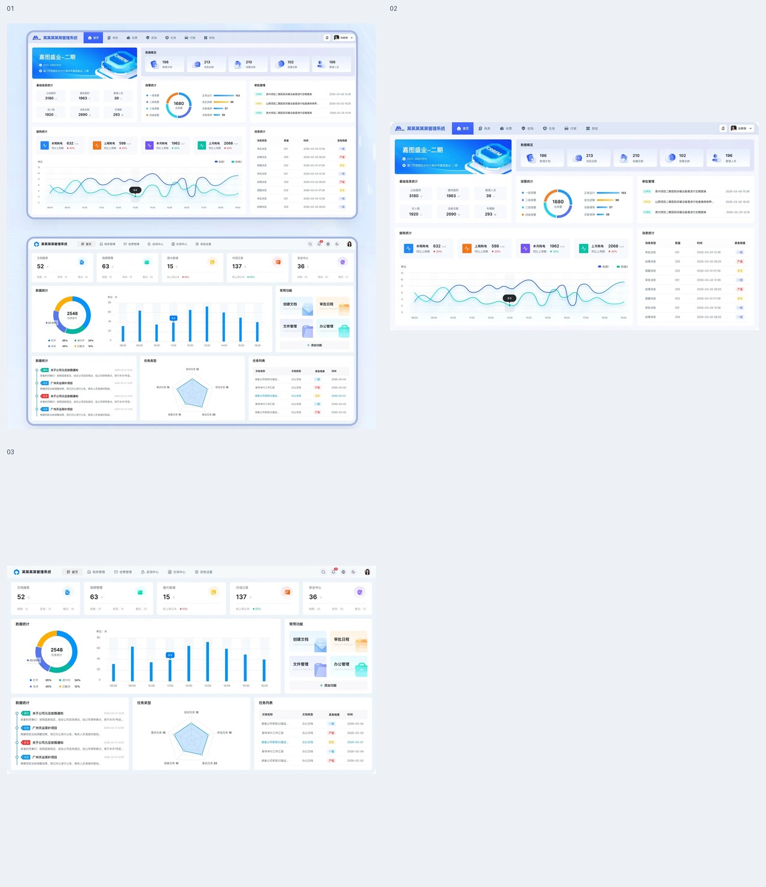

## 多彩指标与统计列表 / Colorful Metrics Statistics List

- 标识：`enterprise-workbenches/colorful-metrics-statistics-list`；类型：组件／效果。
- 画面要点：浅色多彩摘要卡、圆环、折线与统计列表组成数据工作台，图集含独立设计稿。
- 指令例句：参考 enterprise-workbenches/colorful-metrics-statistics-list，颜色用于稳定区分类别或状态，列表数值与摘要指标保持同一统计口径。
- 实现补充：颜色用于稳定区分类别或状态，列表数值与摘要指标保持同一统计口径。
- 验证重点：摘要与列表的业务口径一致；筛选、排序、分页和空／错／加载状态在项目中实际验证。
- 媒体：静态图集，3 张；[静态总览](https://raw.githubusercontent.com/dqzboy/ui-atlas/e6aa0d641c224a2cb4c8bd4262a4d18f5c7e1e22/assets/previews/enterprise-workbenches/colorful-metrics-statistics-list.jpg) · [图片 01](https://raw.githubusercontent.com/dqzboy/ui-atlas/e6aa0d641c224a2cb4c8bd4262a4d18f5c7e1e22/assets/images/enterprise-workbenches/colorful-metrics-statistics-list-01.jpg) · [图片 02](https://raw.githubusercontent.com/dqzboy/ui-atlas/e6aa0d641c224a2cb4c8bd4262a4d18f5c7e1e22/assets/images/enterprise-workbenches/colorful-metrics-statistics-list-02.jpg) · [图片 03](https://raw.githubusercontent.com/dqzboy/ui-atlas/e6aa0d641c224a2cb4c8bd4262a4d18f5c7e1e22/assets/images/enterprise-workbenches/colorful-metrics-statistics-list-03.jpg)。

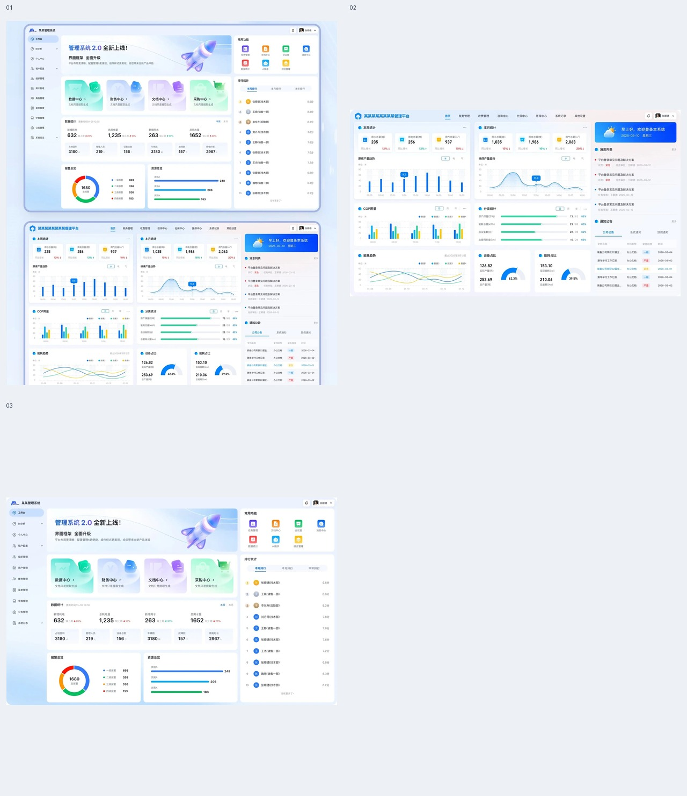

## 企业订阅与报告门户 / Enterprise Subscription Report Portal

- 标识：`enterprise-workbenches/enterprise-subscription-report-portal`；类型：组件／效果。
- 画面要点：蓝色大欢迎横幅、同排指标、功能订阅、报告排行和列表形成企业门户首页。
- 指令例句：参考 enterprise-workbenches/enterprise-subscription-report-portal，订阅功能与常用入口分组，报告排行说明维度，首屏优先呈现高频业务信息。
- 实现补充：订阅功能与常用入口分组，报告排行说明维度，首屏优先呈现高频业务信息。
- 验证重点：摘要与列表的业务口径一致；筛选、排序、分页和空／错／加载状态在项目中实际验证。
- 媒体：静态图集，1 张；[静态总览](https://raw.githubusercontent.com/dqzboy/ui-atlas/e6aa0d641c224a2cb4c8bd4262a4d18f5c7e1e22/assets/previews/enterprise-workbenches/enterprise-subscription-report-portal.jpg) · [图片 01](https://raw.githubusercontent.com/dqzboy/ui-atlas/e6aa0d641c224a2cb4c8bd4262a4d18f5c7e1e22/assets/images/enterprise-workbenches/enterprise-subscription-report-portal-01.jpg)。

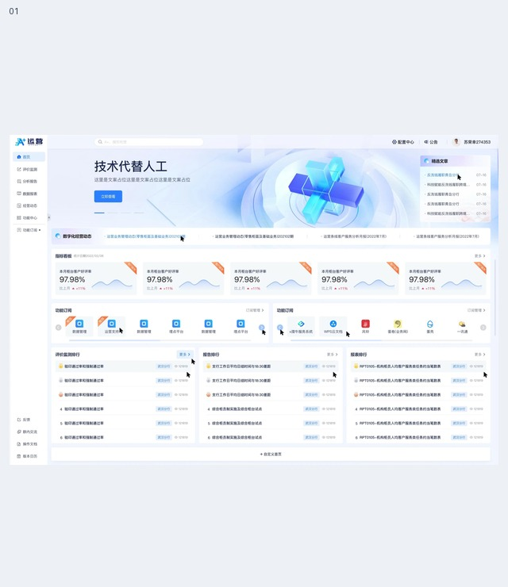

## MES 生产状态与任务列表 / Mes Production Task Management

- 标识：`enterprise-workbenches/mes-production-task-management`；类型：组件／效果。
- 画面要点：浅色生产后台以状态摘要、进度条、业务表和通知组合生产管理视图。
- 指令例句：参考 enterprise-workbenches/mes-production-task-management，生产任务进度要有清楚完成标准，异常和通知区分优先级，并能定位具体记录。
- 实现补充：生产任务进度要有清楚完成标准，异常和通知区分优先级，并能定位具体记录。
- 验证重点：摘要与列表的业务口径一致；筛选、排序、分页和空／错／加载状态在项目中实际验证。
- 媒体：静态图集，1 张；[静态总览](https://raw.githubusercontent.com/dqzboy/ui-atlas/e6aa0d641c224a2cb4c8bd4262a4d18f5c7e1e22/assets/previews/enterprise-workbenches/mes-production-task-management.jpg) · [图片 01](https://raw.githubusercontent.com/dqzboy/ui-atlas/e6aa0d641c224a2cb4c8bd4262a4d18f5c7e1e22/assets/images/enterprise-workbenches/mes-production-task-management-01.jpg)。

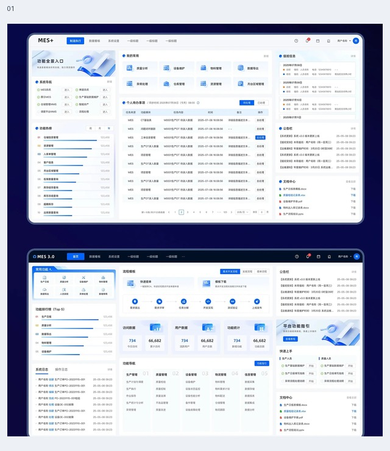

## 门诊业务与仪表统计 / Outpatient Business Metrics

- 标识：`enterprise-workbenches/outpatient-business-metrics`；类型：组件／效果。
- 画面要点：浅色门诊／业务指标、仪表和环图构成两种数据概览，强调卡片分区及主次指标。
- 指令例句：参考 enterprise-workbenches/outpatient-business-metrics，业务指标注明统计周期和适用对象，仪表刻度与目标值保持可解释。
- 实现补充：业务指标注明统计周期和适用对象，仪表刻度与目标值保持可解释。
- 验证重点：摘要与列表的业务口径一致；筛选、排序、分页和空／错／加载状态在项目中实际验证。
- 媒体：静态图集，1 张；[静态总览](https://raw.githubusercontent.com/dqzboy/ui-atlas/e6aa0d641c224a2cb4c8bd4262a4d18f5c7e1e22/assets/previews/enterprise-workbenches/outpatient-business-metrics.jpg) · [图片 01](https://raw.githubusercontent.com/dqzboy/ui-atlas/e6aa0d641c224a2cb4c8bd4262a4d18f5c7e1e22/assets/images/enterprise-workbenches/outpatient-business-metrics-01.jpg)。

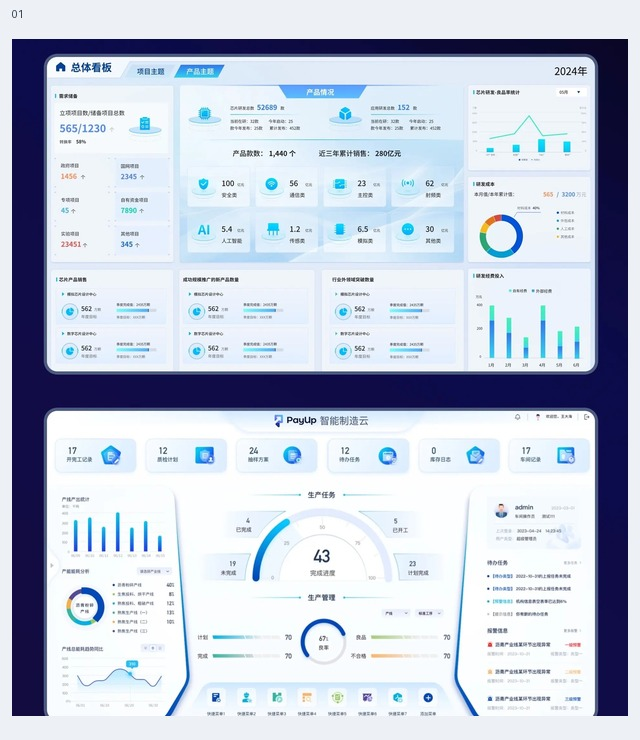

## 企业漏斗统计与 MES 列表 / Enterprise Funnel MES Lists

- 标识：`enterprise-workbenches/enterprise-funnel-mes-lists`；类型：组件／效果。
- 画面要点：浅色企业统计组合漏斗、环图和趋势曲线，另一稿以 MES 管理列表组织生产记录。
- 指令例句：参考 enterprise-workbenches/enterprise-funnel-mes-lists，漏斗阶段和流失口径应一致，统计卡到列表的对应关系作为实现要求另行确认。
- 实现补充：漏斗阶段和流失口径应一致，统计卡到列表的对应关系作为实现要求另行确认。
- 验证重点：摘要与列表的业务口径一致；筛选、排序、分页和空／错／加载状态在项目中实际验证。
- 媒体：静态图集，1 张；[静态总览](https://raw.githubusercontent.com/dqzboy/ui-atlas/e6aa0d641c224a2cb4c8bd4262a4d18f5c7e1e22/assets/previews/enterprise-workbenches/enterprise-funnel-mes-lists.jpg) · [图片 01](https://raw.githubusercontent.com/dqzboy/ui-atlas/e6aa0d641c224a2cb4c8bd4262a4d18f5c7e1e22/assets/images/enterprise-workbenches/enterprise-funnel-mes-lists-01.jpg)。

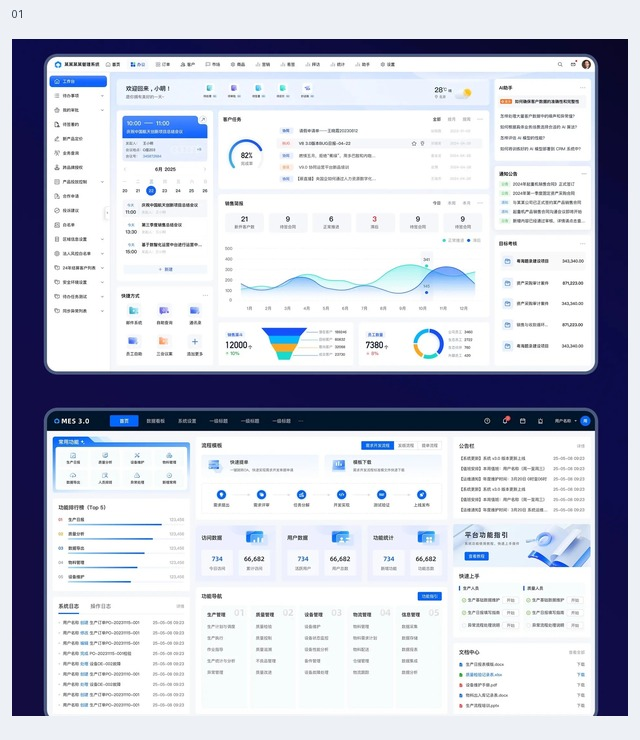

## 触屏目录与设备任务管理 / Touchscreen Catalog Device Tasks

- 标识：`enterprise-workbenches/touchscreen-catalog-device-tasks`；类型：组件／效果。
- 画面要点：触摸屏／客户端用商品或课程卡片分类，设备管理页以任务列表和状态区呈现工作。
- 指令例句：参考 enterprise-workbenches/touchscreen-catalog-device-tasks，卡片分类适合浏览选择，设备任务适合快速处理；触屏入口要有足够可点面积。
- 实现补充：卡片分类适合浏览选择，设备任务适合快速处理；触屏入口要有足够可点面积。
- 验证重点：摘要与列表的业务口径一致；筛选、排序、分页和空／错／加载状态在项目中实际验证。
- 媒体：静态图集，1 张；[静态总览](https://raw.githubusercontent.com/dqzboy/ui-atlas/e6aa0d641c224a2cb4c8bd4262a4d18f5c7e1e22/assets/previews/enterprise-workbenches/touchscreen-catalog-device-tasks.jpg) · [图片 01](https://raw.githubusercontent.com/dqzboy/ui-atlas/e6aa0d641c224a2cb4c8bd4262a4d18f5c7e1e22/assets/images/enterprise-workbenches/touchscreen-catalog-device-tasks-01.jpg)。

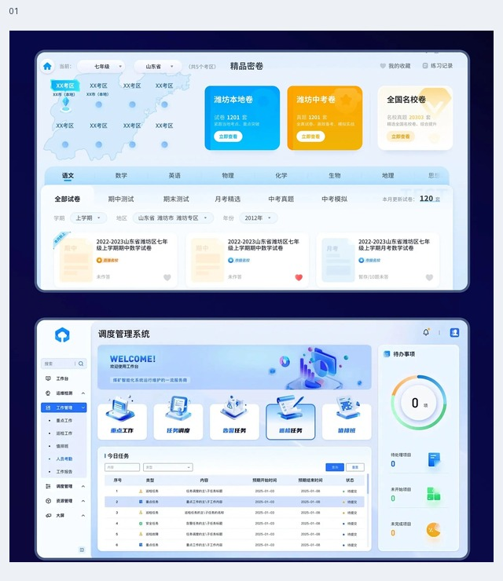

## 企业进度待办与表格管理 / Enterprise Progress Todo Management

- 标识：`enterprise-workbenches/enterprise-progress-todo-management`；类型：组件／效果。
- 画面要点：浅色企业统计将环图、进度、待办与业务表格组合，展示摘要和执行区的分工。
- 指令例句：参考 enterprise-workbenches/enterprise-progress-todo-management，进度、待办数量和列表筛选使用同一业务范围，任务操作要有明确完成反馈。
- 实现补充：进度、待办数量和列表筛选使用同一业务范围，任务操作要有明确完成反馈。
- 验证重点：摘要与列表的业务口径一致；筛选、排序、分页和空／错／加载状态在项目中实际验证。
- 媒体：静态图集，2 张；[静态总览](https://raw.githubusercontent.com/dqzboy/ui-atlas/e6aa0d641c224a2cb4c8bd4262a4d18f5c7e1e22/assets/previews/enterprise-workbenches/enterprise-progress-todo-management.jpg) · [图片 01](https://raw.githubusercontent.com/dqzboy/ui-atlas/e6aa0d641c224a2cb4c8bd4262a4d18f5c7e1e22/assets/images/enterprise-workbenches/enterprise-progress-todo-management-01.jpg) · [图片 02](https://raw.githubusercontent.com/dqzboy/ui-atlas/e6aa0d641c224a2cb4c8bd4262a4d18f5c7e1e22/assets/images/enterprise-workbenches/enterprise-progress-todo-management-02.jpg)。

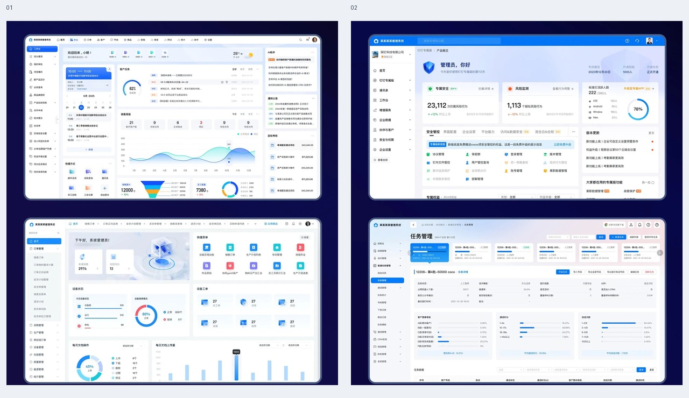

## 项目流程与告警任务工作台 / Project Process Alert Workbench

- 标识：`enterprise-workbenches/project-process-alert-workbench`；类型：组件／效果。
- 画面要点：企业蓝立体流程入口与项目任务表结合，暗侧栏和浅内容区组织告警、列表及业务分区。
- 指令例句：参考 enterprise-workbenches/project-process-alert-workbench，当前导航、项目上下文和任务状态分开表达，立体入口仍需清楚文字名称。
- 实现补充：当前导航、项目上下文和任务状态分开表达，立体入口仍需清楚文字名称。
- 验证重点：摘要与列表的业务口径一致；筛选、排序、分页和空／错／加载状态在项目中实际验证。
- 媒体：静态图集，2 张；[静态总览](https://raw.githubusercontent.com/dqzboy/ui-atlas/e6aa0d641c224a2cb4c8bd4262a4d18f5c7e1e22/assets/previews/enterprise-workbenches/project-process-alert-workbench.jpg) · [图片 01](https://raw.githubusercontent.com/dqzboy/ui-atlas/e6aa0d641c224a2cb4c8bd4262a4d18f5c7e1e22/assets/images/enterprise-workbenches/project-process-alert-workbench-01.jpg) · [图片 02](https://raw.githubusercontent.com/dqzboy/ui-atlas/e6aa0d641c224a2cb4c8bd4262a4d18f5c7e1e22/assets/images/enterprise-workbenches/project-process-alert-workbench-02.jpg)。

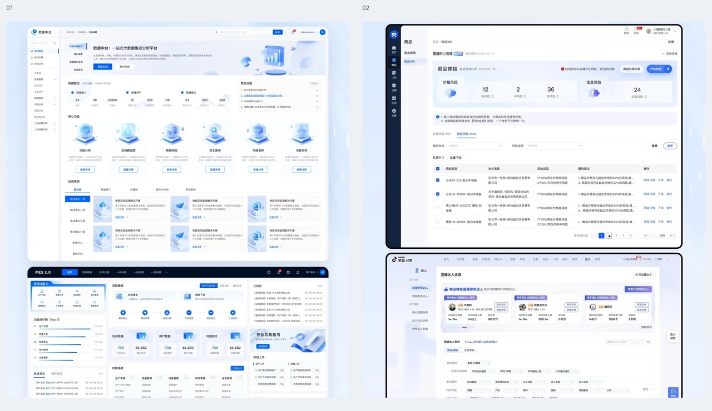
