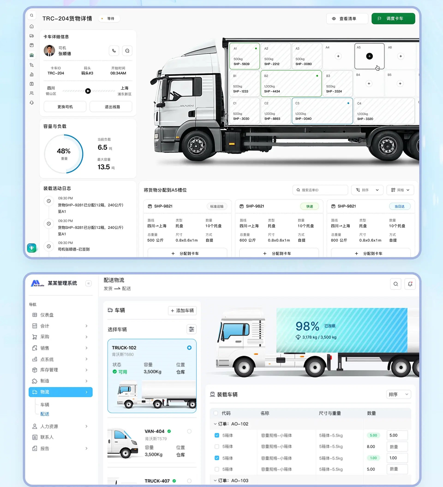
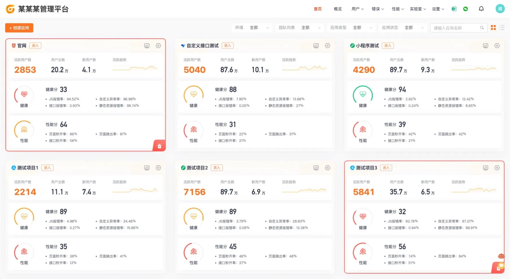
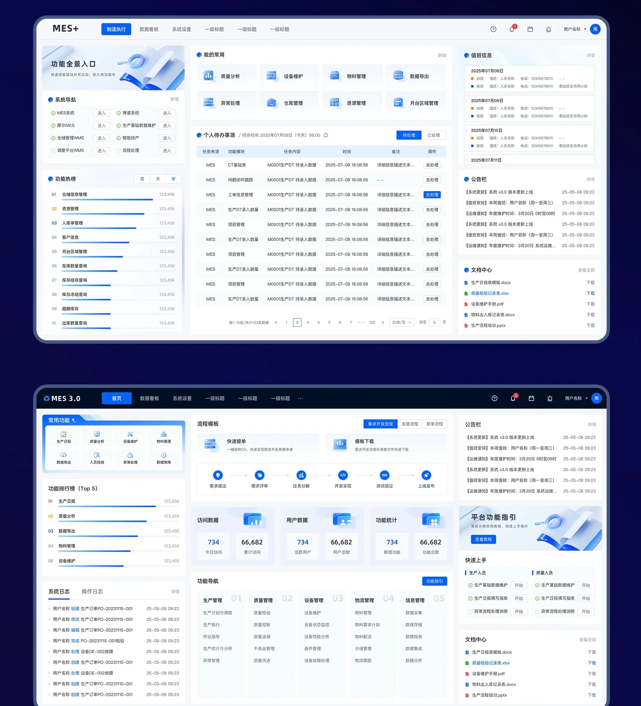

# 企业工作台与业务后台

按实际业务对象选择结构：物流配载、企业门户、AI 工具、招聘、生产任务和统计列表的任务目标各不相同。先看条目摘要和静态总览，再查看相关单图细节；不要只因都采用蓝色就互换工作流。

## 证据与实现边界

- 静态总览按图片编号从左到右、从上到下阅读；编号代表独立图片，不代表时间或交互状态。单图链接保留裁切后的完整分辨率。
- “画面要点”描述已查看的素材；“实现补充”和“验证重点”是落地建议，不能当作原稿已具备的功能。
- 图中的品牌、示例数字、人物和业务文案只用于理解层级，不自动成为需求。按用户的产品对象、技术栈和设计系统改写。
- 只读本次相关图片；静态稿未呈现的联动、筛选、点击结果、权限和响应式行为需在实际项目中确认。

## 目录

- [物流配载与车辆工作台](#logistics-loading-workbench)
- [AI 助手与效率工具工作台](#ai-assistant-productivity-hub)
- [暖橙欢迎区与管理首页](#warm-orange-management-home)
- [MES 生产状态与任务列表](#mes-production-task-management)

## 物流配载与车辆工作台 / Logistics Loading Workbench

- 标识：`enterprise-workbenches/logistics-loading-workbench`；类型：组件／效果。
- 画面要点：车厢货位模型占据主区，司机、容量和活动日志列于侧边；另一页以车辆选择、装载状态和货物表组织配送任务。
- 指令例句：参考 enterprise-workbenches/logistics-loading-workbench，把货位、负载和清单保持在同一业务上下文；空货位、已装载和不可用应有可区分状态。
- 实现补充：把货位、负载和清单保持在同一业务上下文；空货位、已装载和不可用应有可区分状态。
- 验证重点：摘要与列表的业务口径一致；筛选、排序、分页和空／错／加载状态在项目中实际验证。

<!-- ui-atlas:details enterprise-workbenches/logistics-loading-workbench -->
- 原尺寸图片：[01 · 1920×2110](https://raw.githubusercontent.com/dqzboy/ui-atlas/4d61e1224c50685c02acae3ae67ebe9c217fa3b9/assets/details/enterprise-workbenches/logistics-loading-workbench-01.png) · [02 · 1920×2110](https://raw.githubusercontent.com/dqzboy/ui-atlas/4d61e1224c50685c02acae3ae67ebe9c217fa3b9/assets/details/enterprise-workbenches/logistics-loading-workbench-02.png)。
- 多图用途：不同页面或布局方案各自保留，不按连续抽帧处理。
- 清晰度边界：保留原尺寸与既有裁切，以无损 PNG 避免再次 JPEG 压缩；不能恢复源图已丢失的细节。

<!-- /ui-atlas:details -->

## AI 助手与效率工具工作台 / AI Assistant Productivity Hub

- 标识：`enterprise-workbenches/ai-assistant-productivity-hub`；类型：组件／效果。
- 画面要点：工具卡、文档快捷创建和对话入口构成效率工作台；图集同时提供整页组合与独立设计稿。
- 指令例句：参考 enterprise-workbenches/ai-assistant-productivity-hub，区分新建文档、调用工具和开始对话，输入区的示例问题应能帮助用户发起具体任务。
- 实现补充：区分新建文档、调用工具和开始对话，输入区的示例问题应能帮助用户发起具体任务。
- 验证重点：摘要与列表的业务口径一致；筛选、排序、分页和空／错／加载状态在项目中实际验证。

<!-- ui-atlas:details enterprise-workbenches/ai-assistant-productivity-hub -->
- 原尺寸图片：[01 · 1672×942](https://raw.githubusercontent.com/dqzboy/ui-atlas/4d61e1224c50685c02acae3ae67ebe9c217fa3b9/assets/details/enterprise-workbenches/ai-assistant-productivity-hub-01.png) · [02 · 1920×1080](https://raw.githubusercontent.com/dqzboy/ui-atlas/4d61e1224c50685c02acae3ae67ebe9c217fa3b9/assets/details/enterprise-workbenches/ai-assistant-productivity-hub-02.png) · [03 · 1920×1080](https://raw.githubusercontent.com/dqzboy/ui-atlas/4d61e1224c50685c02acae3ae67ebe9c217fa3b9/assets/details/enterprise-workbenches/ai-assistant-productivity-hub-03.png)。
- 多图用途：保留不同页面的独立稿，移除重复包含这些页面的组合图。
- 清晰度边界：保留原尺寸与既有裁切，以无损 PNG 避免再次 JPEG 压缩；不能恢复源图已丢失的细节。

<!-- /ui-atlas:details -->

## 暖橙欢迎区与管理首页 / Warm Orange Management Home

- 标识：`enterprise-workbenches/warm-orange-management-home`；类型：组件／效果。
- 画面要点：暖橙欢迎区搭配摘要指标、管理表和任务区域，图集包含整页和独立高清视图。
- 指令例句：参考 enterprise-workbenches/warm-orange-management-home，暖色集中在欢迎与重点数据，表格保持稳定对比和可扫描的行列节奏。
- 实现补充：暖色集中在欢迎与重点数据，表格保持稳定对比和可扫描的行列节奏。
- 验证重点：摘要与列表的业务口径一致；筛选、排序、分页和空／错／加载状态在项目中实际验证。

<!-- ui-atlas:details enterprise-workbenches/warm-orange-management-home -->
- 原尺寸图片：[01 · 1780×974](https://raw.githubusercontent.com/dqzboy/ui-atlas/4d61e1224c50685c02acae3ae67ebe9c217fa3b9/assets/details/enterprise-workbenches/warm-orange-management-home-01.png) · [02 · 1984×1182](https://raw.githubusercontent.com/dqzboy/ui-atlas/4d61e1224c50685c02acae3ae67ebe9c217fa3b9/assets/details/enterprise-workbenches/warm-orange-management-home-02.png)。
- 多图用途：保留不同页面的独立稿，移除重复包含这些页面的组合图。
- 清晰度边界：保留原尺寸与既有裁切，以无损 PNG 避免再次 JPEG 压缩；不能恢复源图已丢失的细节。

<!-- /ui-atlas:details -->

## MES 生产状态与任务列表 / Mes Production Task Management

- 标识：`enterprise-workbenches/mes-production-task-management`；类型：组件／效果。
- 画面要点：浅色生产后台以状态摘要、进度条、业务表和通知组合生产管理视图。
- 指令例句：参考 enterprise-workbenches/mes-production-task-management，生产任务进度要有清楚完成标准，异常和通知区分优先级，并能定位具体记录。
- 实现补充：生产任务进度要有清楚完成标准，异常和通知区分优先级，并能定位具体记录。
- 验证重点：摘要与列表的业务口径一致；筛选、排序、分页和空／错／加载状态在项目中实际验证。

<!-- ui-atlas:details enterprise-workbenches/mes-production-task-management -->
- 原尺寸图片：[01 · 1920×2110](https://raw.githubusercontent.com/dqzboy/ui-atlas/4d61e1224c50685c02acae3ae67ebe9c217fa3b9/assets/details/enterprise-workbenches/mes-production-task-management.png)。
- 清晰度边界：保留原尺寸与既有裁切，以无损 PNG 避免再次 JPEG 压缩；不能恢复源图已丢失的细节。

<!-- /ui-atlas:details -->
