# 表单

六帧图看主要状态，不能证明连续运动和短暂状态。按当前项目需求实现目标组件的交互与动效。

## 目录

- [浮动标签 / Floating Label](#floating-label)
- [验证码输入框 / OTP Input](#otp-input)
- [拖拽上传 / Dropzone](#dropzone)
- [日期选择器 / Date Picker / Date Range](#date-picker)
- [滑块 / Slider / Range Slider](#slider)
- [自动补全 / Autocomplete](#autocomplete)
- [级联选择 / Cascader](#cascader)
- [标签输入 / Tag Input](#tag-input)
- [密码强度 / Password Strength](#password-strength)
- [下拉选择 / Select](#select)
- [校验报错 / Validation](#validation)
- [帮助文字 / Helper Text](#helper-text)
- [必填星号 / Required](#required)
- [输入框和提交按钮 / Input & Submit](#input-submit)

## 浮动标签 / Floating Label

- 标识：`forms/floating-label`；类型：组件／效果。
- 效果要点：聚焦后标签缩小并移到输入框上方，输入后仍保留；对比会消失的 Placeholder，强调字段名称应持续可辨。
- 指令例句：输入框使用浮动标签，填写后仍能看到字段名称。
- 媒体取舍：保留 GIF＋JPG。需看聚焦后标签缩小上移并持续保留的过渡。
- 参考：[GIF 动图](https://raw.githubusercontent.com/dqzboy/ui-atlas/e6aa0d641c224a2cb4c8bd4262a4d18f5c7e1e22/assets/gifs/forms/floating-label.gif) · [六帧对照图](https://raw.githubusercontent.com/dqzboy/ui-atlas/e6aa0d641c224a2cb4c8bd4262a4d18f5c7e1e22/assets/filmstrips/forms/floating-label.jpg)。

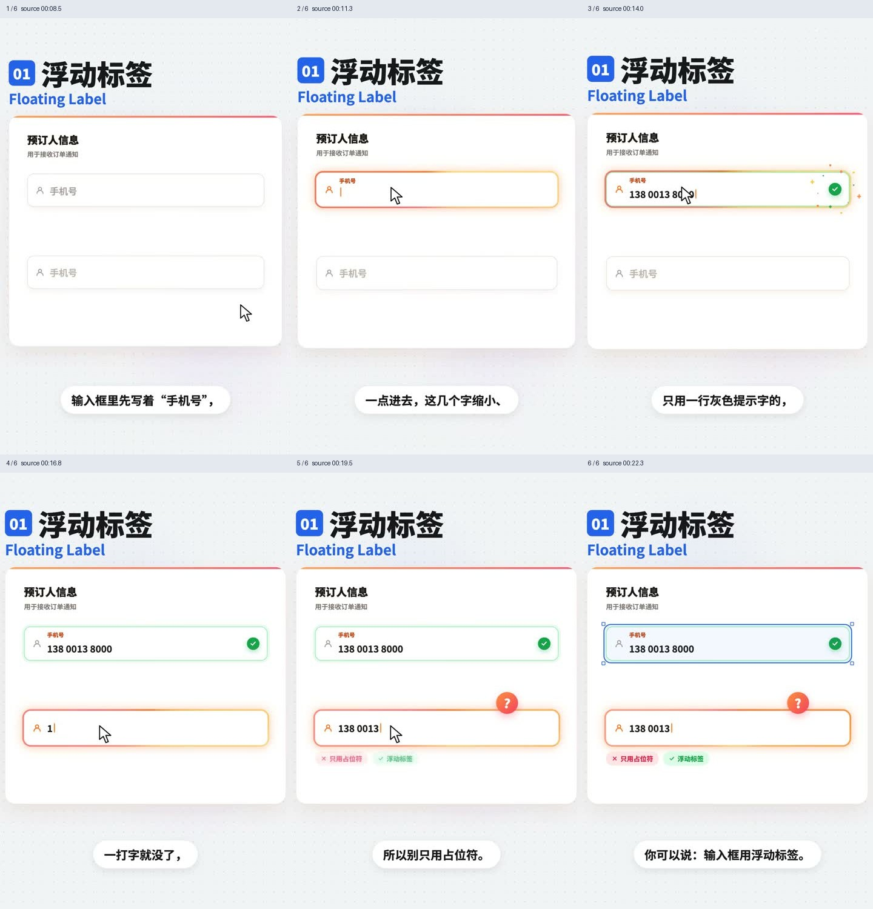

## 验证码输入框 / OTP Input

- 标识：`forms/otp-input`；类型：组件／效果。
- 效果要点：示例六个格子；输入后自动前进，删除可回退，支持整串粘贴和设备可用的短信自动填充。
- 指令例句：验证码支持自动跳格、退格、整串粘贴和短信自动填充。
- 媒体取舍：保留 GIF＋JPG。需看输入自动前进、删除退格和整串填入的焦点顺序。
- 参考：[GIF 动图](https://raw.githubusercontent.com/dqzboy/ui-atlas/e6aa0d641c224a2cb4c8bd4262a4d18f5c7e1e22/assets/gifs/forms/otp-input.gif) · [六帧对照图](https://raw.githubusercontent.com/dqzboy/ui-atlas/e6aa0d641c224a2cb4c8bd4262a4d18f5c7e1e22/assets/filmstrips/forms/otp-input.jpg)。

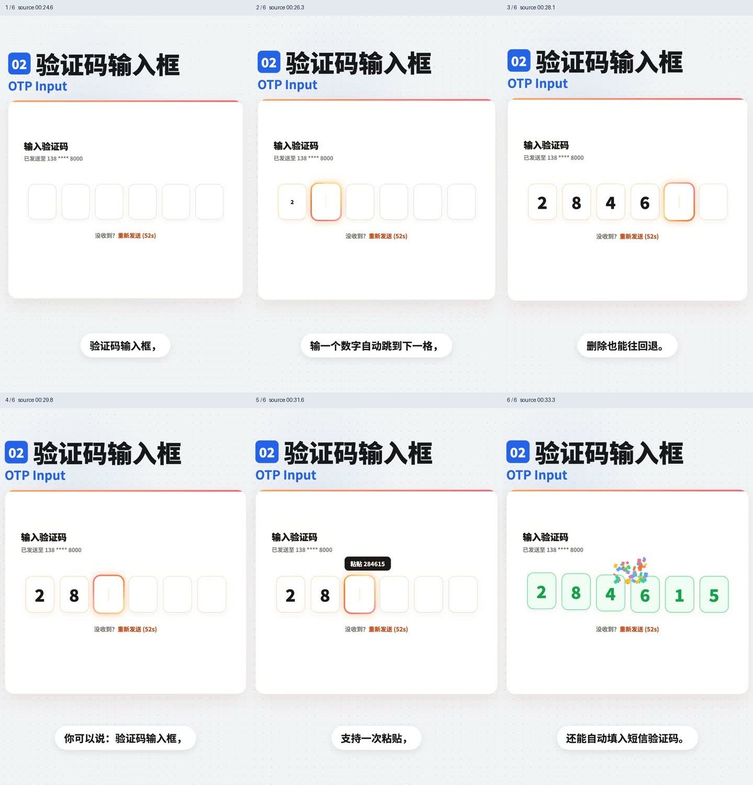

## 拖拽上传 / Dropzone

- 标识：`forms/dropzone`；类型：组件／效果。
- 效果要点：虚线区域接收拖入文件；每个文件显示上传进度并可删除；上传前清楚写明类型和大小限制。
- 指令例句：拖拽上传区提前显示允许格式与大小，每个文件显示进度并可移除。
- 媒体取舍：仅保留 JPG。区域、限制、进度、成功与失败状态均可由图片配合文字表达。
- 参考：[六帧对照图](https://raw.githubusercontent.com/dqzboy/ui-atlas/e6aa0d641c224a2cb4c8bd4262a4d18f5c7e1e22/assets/filmstrips/forms/dropzone.jpg)。

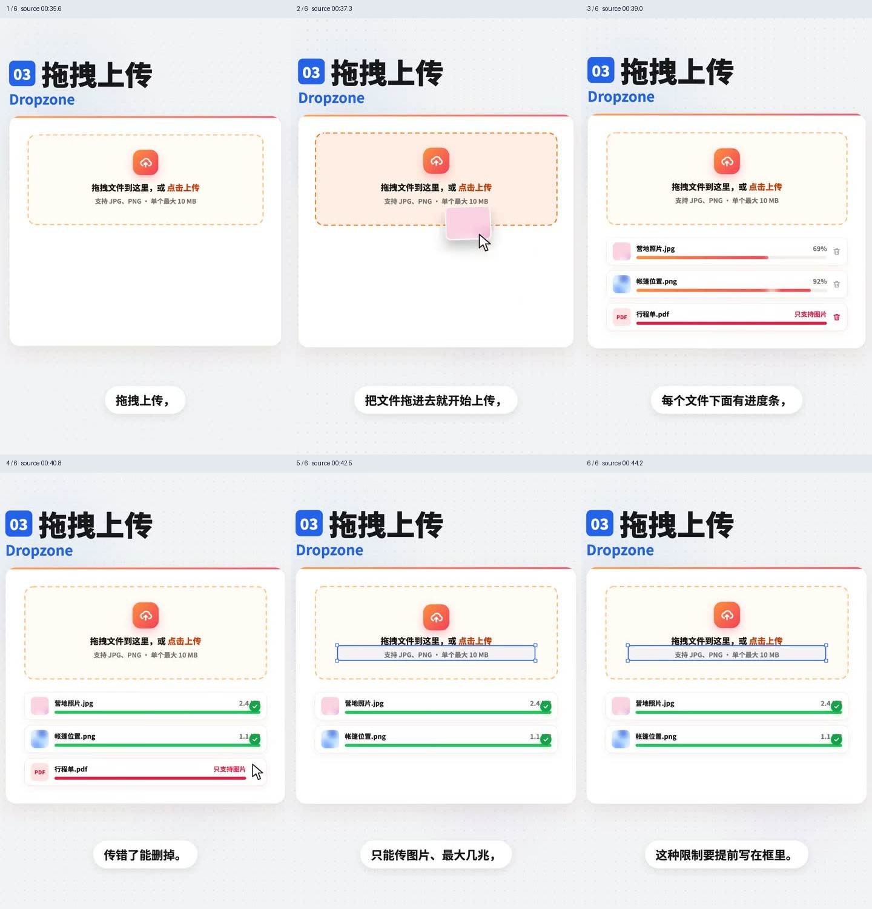

## 日期选择器 / Date Picker / Date Range

- 标识：`forms/date-picker`；类型：组件／效果。
- 效果要点：日历适合近期预约；日期范围选中起止日并连接中间日期；生日等远期年份宜直接输入年月日。
- 指令例句：预订用范围日历选入住离店，生日提供便捷年月日输入。
- 媒体取舍：仅保留 JPG。单日、范围与直接输入的结构和状态由图片表达。
- 参考：[六帧对照图](https://raw.githubusercontent.com/dqzboy/ui-atlas/e6aa0d641c224a2cb4c8bd4262a4d18f5c7e1e22/assets/filmstrips/forms/date-picker.jpg)。

## 滑块 / Slider / Range Slider

- 标识：`forms/slider`；类型：组件／效果。
- 效果要点：单点选数，双端选择范围；适合价格等大概范围，精确值应有输入框或直接输入。
- 指令例句：价格区间用双端范围滑块，并允许直接输入精确数值。
- 媒体取舍：仅保留 JPG。单点、双端和精确输入的状态图足够；惯性、吸附另有动态条目。
- 参考：[六帧对照图](https://raw.githubusercontent.com/dqzboy/ui-atlas/e6aa0d641c224a2cb4c8bd4262a4d18f5c7e1e22/assets/filmstrips/forms/slider.jpg)。

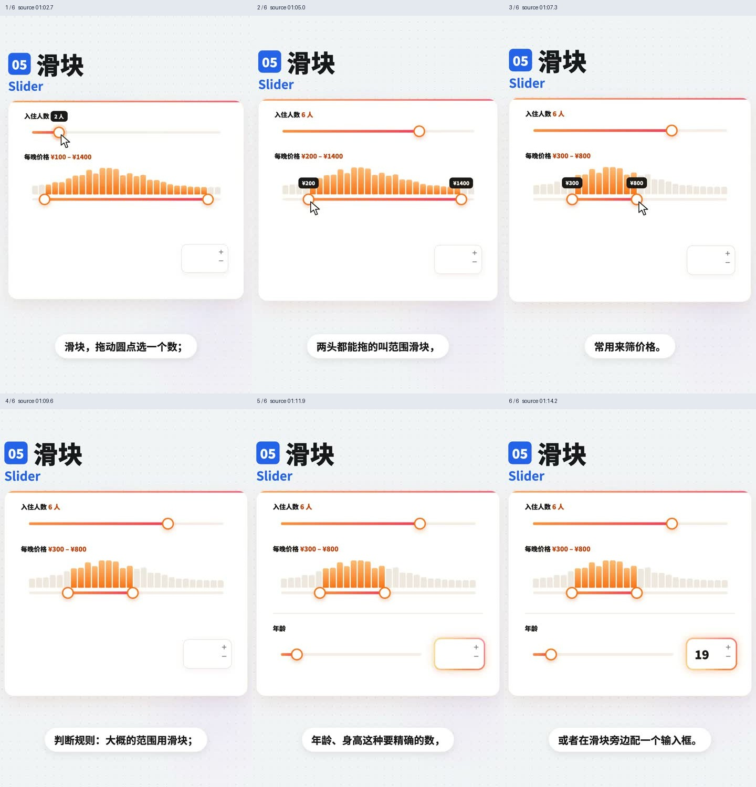

## 自动补全 / Autocomplete

- 标识：`forms/autocomplete`；类型：组件／效果。
- 效果要点：输入少量文字后显示匹配选项；适合城市和学校等数量大、需要搜索的集合。
- 指令例句：城市选择支持输入检索和匹配建议。
- 媒体取舍：仅保留 JPG。输入、候选和选中状态图足够，不把普通输入过程单独作为动效参考。
- 参考：[六帧对照图](https://raw.githubusercontent.com/dqzboy/ui-atlas/e6aa0d641c224a2cb4c8bd4262a4d18f5c7e1e22/assets/filmstrips/forms/autocomplete.jpg)。

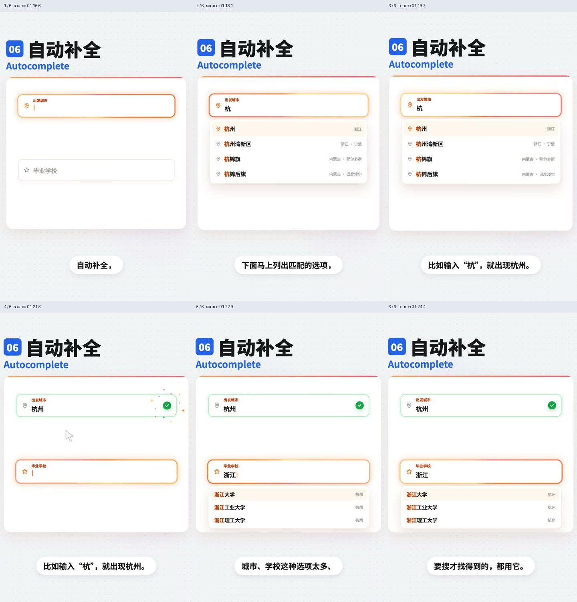

## 级联选择 / Cascader

- 标识：`forms/cascader`；类型：组件／效果。
- 效果要点：选择上一层后展开下一层；示例为省、市、区等层级数据。
- 指令例句：地区用省市区级联选择，上一层变化时同步更新下一层。
- 媒体取舍：仅保留 JPG。层级结构与逐级选择规则由状态图和文字表达。
- 参考：[六帧对照图](https://raw.githubusercontent.com/dqzboy/ui-atlas/e6aa0d641c224a2cb4c8bd4262a4d18f5c7e1e22/assets/filmstrips/forms/cascader.jpg)。

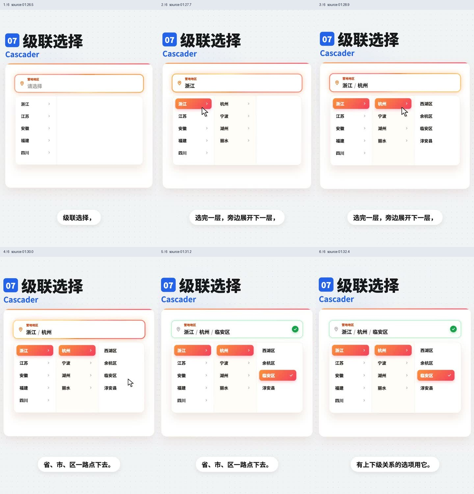

## 标签输入 / Tag Input

- 标识：`forms/tag-input`；类型：组件／效果。
- 效果要点：输入词并按回车后形成标签，可以添加多个并逐项删除；用于兴趣、技能、关键词。
- 指令例句：关键词输入回车生成标签，可添加多个并逐个移除。
- 媒体取舍：仅保留 JPG。输入、成标签与移除的状态图足够，无独立运动要求。
- 参考：[六帧对照图](https://raw.githubusercontent.com/dqzboy/ui-atlas/e6aa0d641c224a2cb4c8bd4262a4d18f5c7e1e22/assets/filmstrips/forms/tag-input.jpg)。

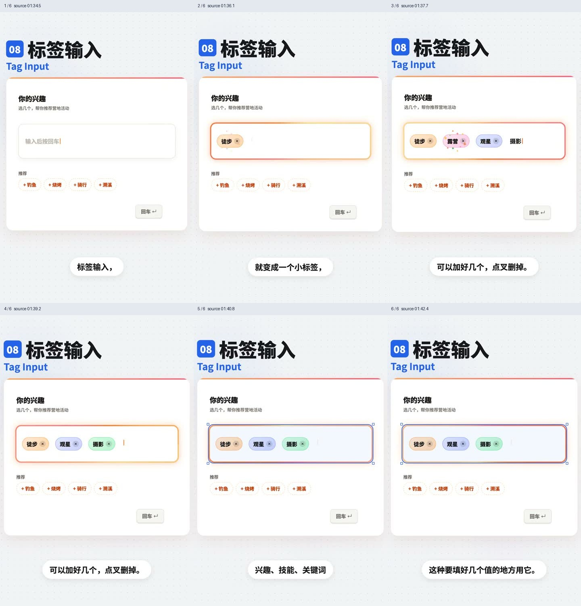

## 密码强度 / Password Strength

- 标识：`forms/password-strength`；类型：组件／效果。
- 效果要点：密码框下的强度条随输入由红到绿变化，眼睛按钮切换明文以便核对。
- 指令例句：密码输入显示强度提示，并提供显示或隐藏密码按钮。
- 媒体取舍：仅保留 JPG。强度分级、说明和明文开关由状态图片表达。
- 参考：[六帧对照图](https://raw.githubusercontent.com/dqzboy/ui-atlas/e6aa0d641c224a2cb4c8bd4262a4d18f5c7e1e22/assets/filmstrips/forms/password-strength.jpg)。

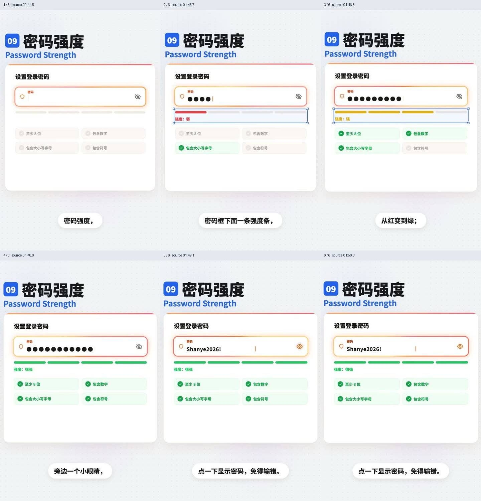

## 下拉选择 / Select

- 标识：`forms/select`；类型：组件／效果。
- 效果要点：列表中选一项；通常可按以下原则选择：少量选项直接用单选展示，较多用下拉，多到要搜索则用自动补全。
- 指令例句：按选项数量和比较需求选择 Radio、Select 或 Autocomplete。
- 媒体取舍：仅保留 JPG。选项展开和选中结果由图片表达，重点是控件选型。
- 参考：[六帧对照图](https://raw.githubusercontent.com/dqzboy/ui-atlas/e6aa0d641c224a2cb4c8bd4262a4d18f5c7e1e22/assets/filmstrips/forms/select.jpg)。

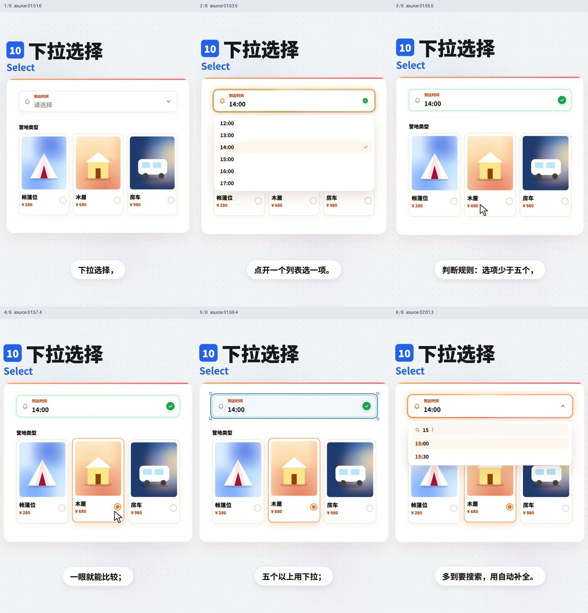

## 校验报错 / Validation

- 标识：`forms/validation`；类型：组件／效果。
- 效果要点：用户填完字段后再检查，避免初次输入中持续打断；错误放字段下方，明确说明怎么修改。
- 指令例句：字段失焦后校验，错误说明写在下方，例如手机号需要 11 位。
- 媒体取舍：仅保留 JPG。正常与报错状态由图片表达，失焦时机和校验结果仍需项目验证。
- 参考：[六帧对照图](https://raw.githubusercontent.com/dqzboy/ui-atlas/e6aa0d641c224a2cb4c8bd4262a4d18f5c7e1e22/assets/filmstrips/forms/validation.jpg)。

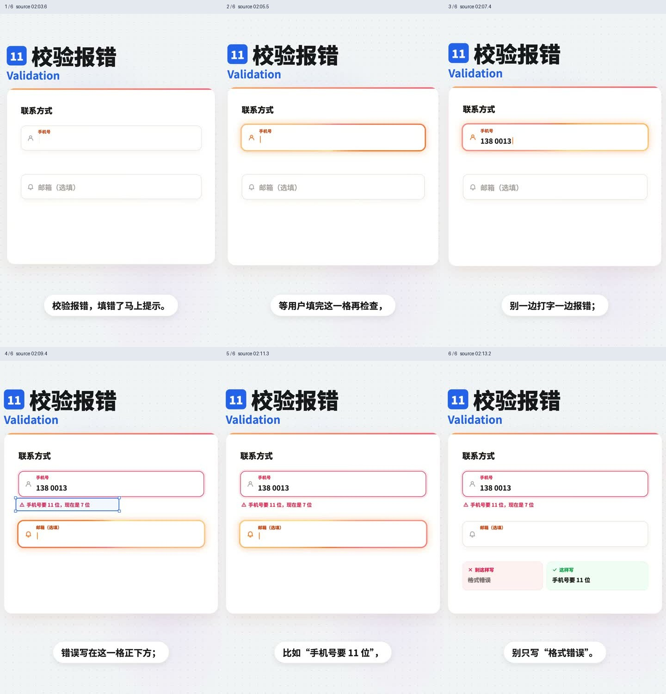

## 帮助文字 / Helper Text

- 标识：`forms/helper-text`；类型：组件／效果。
- 效果要点：字段下方持续可见的说明，提前解释填写要求；不同于输入后消失的占位符。
- 指令例句：把填写规则放在字段下方作为持续可见的帮助文字。
- 媒体取舍：仅保留 JPG。持续可见的帮助文字是静态排版参考。
- 参考：[六帧对照图](https://raw.githubusercontent.com/dqzboy/ui-atlas/e6aa0d641c224a2cb4c8bd4262a4d18f5c7e1e22/assets/filmstrips/forms/helper-text.jpg)。

## 必填星号 / Required

- 标识：`forms/required`；类型：组件／效果。
- 效果要点：用星号标识必填；如果多数都必填，可改为只标选填，减少重复标记。
- 指令例句：统一说明必填规则，多数必填时明确标出选填字段。
- 媒体取舍：仅保留 JPG。必填与选填标记是静态信息表达。
- 参考：[六帧对照图](https://raw.githubusercontent.com/dqzboy/ui-atlas/e6aa0d641c224a2cb4c8bd4262a4d18f5c7e1e22/assets/filmstrips/forms/required.jpg)。

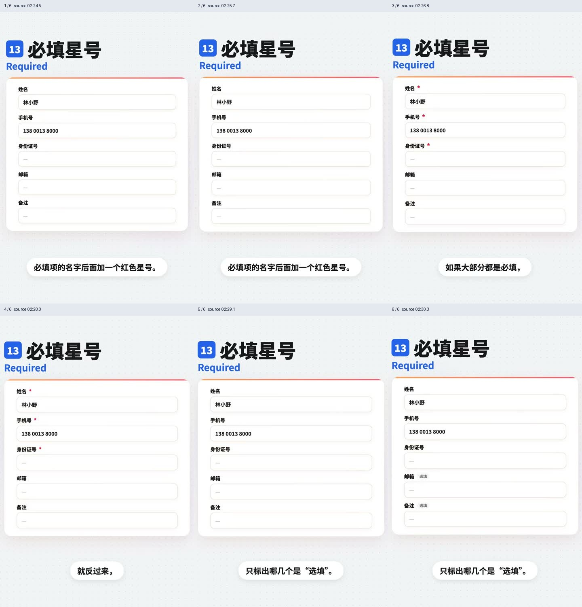

## 输入框和提交按钮 / Input & Submit

- 标识：`forms/input-submit`；类型：组件／效果。
- 效果要点：基础输入与提交作为对照；不要求额外的特殊效果。
- 指令例句：使用语义明确的基础输入框和提交按钮。
- 媒体取舍：仅保留 JPG。基础输入框和提交按钮的结构即可，不要求额外效果。
- 参考：[六帧对照图](https://raw.githubusercontent.com/dqzboy/ui-atlas/e6aa0d641c224a2cb4c8bd4262a4d18f5c7e1e22/assets/filmstrips/forms/input-submit.jpg)。

