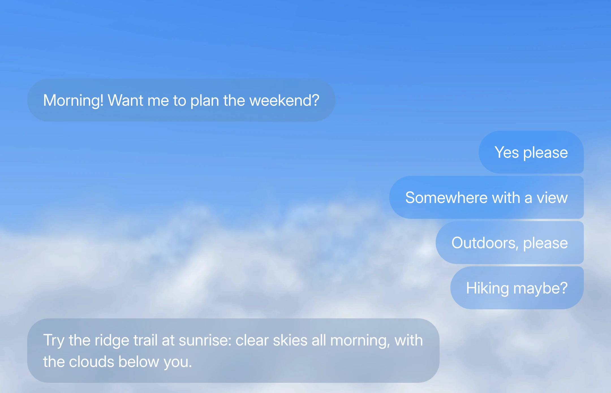

# 玻璃材质与背景

按背景、主题与前景可读性选择液态玻璃或聊天气泡材质；折射和动态行为需在目标项目中实测。

## 目录

- [自适应液态玻璃材质](#liquid-glass)
- [消息气泡的材质与动效（探索版）](#message-bubble-materials)

## 自适应液态玻璃材质 / Adaptive Liquid Glass

- 标识：`glass-materials/liquid-glass`；类型：组件／效果。
- 效果要点：将投影、背景模糊与提亮、边缘折射和色散、着色、边缘光与前景着色组合成共享 token，并按背景亮度与深浅主题适配；在项目内直接实现，按目标能力选择 CSS 基础层与折射增强。
- 实现关注：浅色起点：白色着色 6–22%、blur 2px、saturate 180%、brightness 1.06；深色：rgb(20 20 24) 16–38%、2px、160%、0.8。边缘宽度 min(44px,短边/3.5)，偏移 1.1 × rim × (1-d/rim)^2.6，色散 ±15%；中间保持平整。5×3 采样丢弃最亮暗各两点，平均亮度 0.5 阈值与 ±0.05 滞回切换前景。同排面板共享决策；采样不可读时跟随主题并提高着色密度。
- 实现路径：默认实心可读，支持时启用 CSS 模糊；SVG 背景折射仅在实际绘制通过的环境启用。需要跨引擎折射且掌握可读图片／视频源时，可用项目内 Canvas／WebGL 装饰层采样同一背景；普通 DOM 或不可读背景继续 CSS／实心回退。两条折射路径都不滤镜化正文与控件。
- 验证重点：检查忙碌／明暗背景、前景对比、圆角映射、主题切换，实测目标 iPhone Safari 与微信内置浏览器的可见性、折射和失败回退。视频共享资源与帧调度，按新帧更新、节流采样，离屏／后台暂停。语法支持或原有演示图不等于已通过兼容与性能验证。
- 指令例句：参考 glass-materials/liquid-glass，在项目内实现自适应玻璃 token、按能力启用的边缘折射和视频调度，保留布局与操作，实际核对移动端可见性、回退与性能。
- [完整配方与效果参考](recipes/liquid-glass.md) · [效果图](../assets/recipes/liquid-glass.jpg)。
- 媒体取舍：沿用原有图片与播放器片段，观察背景变化与主题切换时的材质外观；不作为此次兼容与性能方案已通过目标设备验证的证据。

- 连续动效：[GIF 片段](../assets/recipes/liquid-glass.gif)。

## 消息气泡的材质与动效（探索版） / Message Bubble Materials and Motion

- 标识：`glass-materials/message-bubble-materials`；类型：组件／效果。
- 效果要点：Cirrus 薄磨砂、像素网格、Aqua 果冻、全线程共享渐变、拟物和纯色六种气泡材质，配发送、长回复与中间删除的材质专属运动。
- 实现边界：区分独立演示与现有界面改造；改造默认只调整气泡，保留消息数据、组件接口、加载与流式协议及全部图标。输入区、菜单、背景和思考点阵按用户已授权范围处理。
- 验证重点：预排版文字不随展开重新换行，消息不重叠；删除后按组补位，连续操作可中断；底部跟随不抢用户上翻位置；减弱动态时保留必要淡入淡出。
- 指令例句：按已选材质改造聊天气泡，配发送、回复展开与删除动效，保留业务和消息加载机制。
- [012 完整配方与六种材质参考](recipes/message-bubble-materials.md)。
- 媒体取舍：六张图片各代表一种材质，不附重复帧、大 GIF 或原视频；连续行为需要实际项目验证。

<!-- ui-atlas:details glass-materials/message-bubble-materials -->
- 原尺寸图片：[01 · 2160×1390](../assets/details/glass-materials/message-bubble-cirrus.webp) · [02 · 2160×1390](../assets/details/glass-materials/message-bubble-pixel.webp) · [03 · 2160×1390](../assets/details/glass-materials/message-bubble-aqua.webp) · [04 · 2160×1390](../assets/details/glass-materials/message-bubble-gradient.webp) · [05 · 2160×1390](../assets/details/glass-materials/message-bubble-skeuomorphic.webp) · [06 · 2160×1390](../assets/details/glass-materials/message-bubble-solid.webp)。
- 多图用途：六张原尺寸截图分别展示六种不同材质，不重复存相近状态；完整运动、弹簧、回复与删除行为按配方在项目中验证。
- 清晰度边界：从 2160×2880 视频按原像素裁出 2160×1390 消息区域，WebP 质量 95；不放大、不锐化、不涂抹。静态图仅证明材质与可见布局，不能证明连续运动。

<!-- /ui-atlas:details -->
