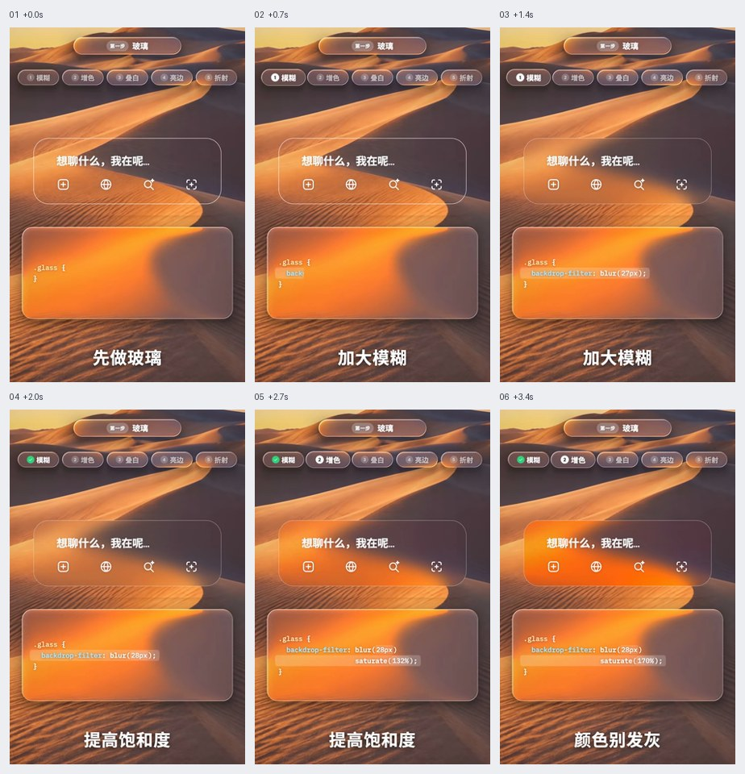
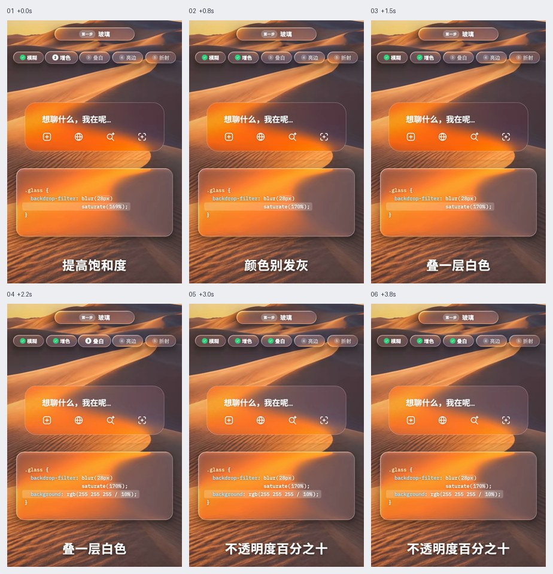
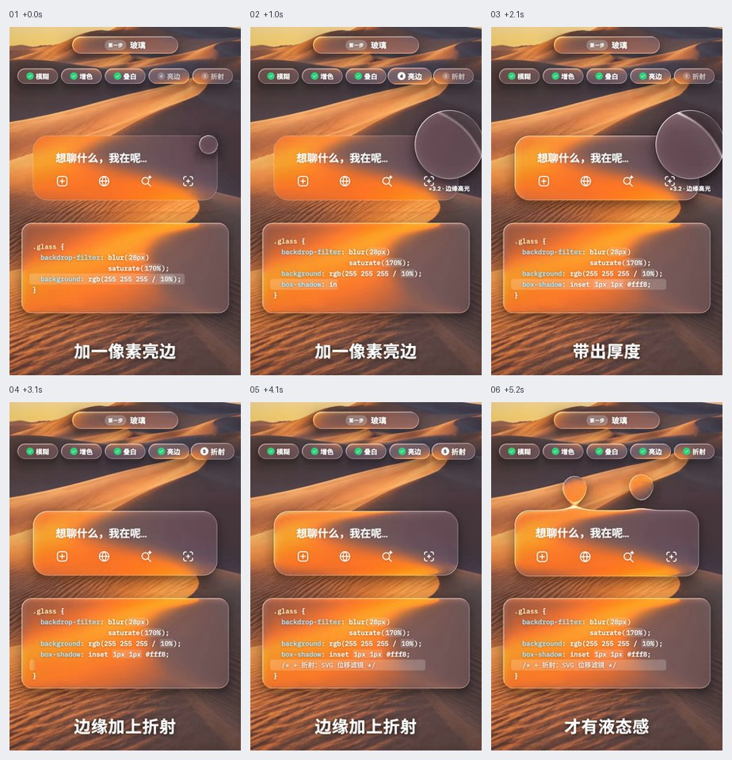
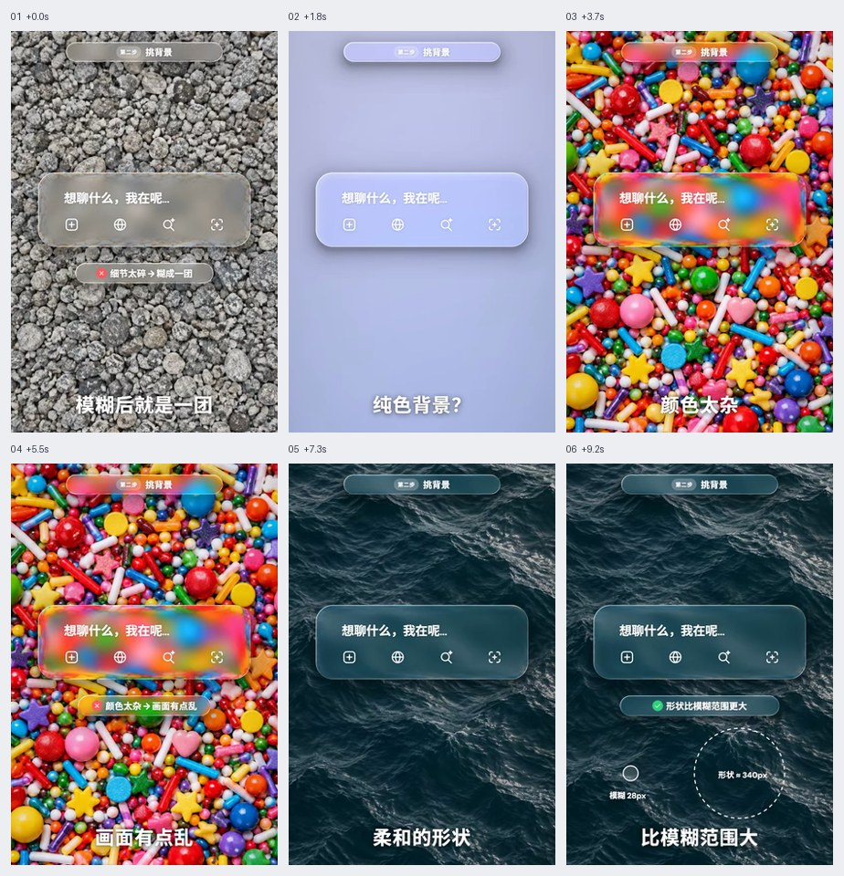
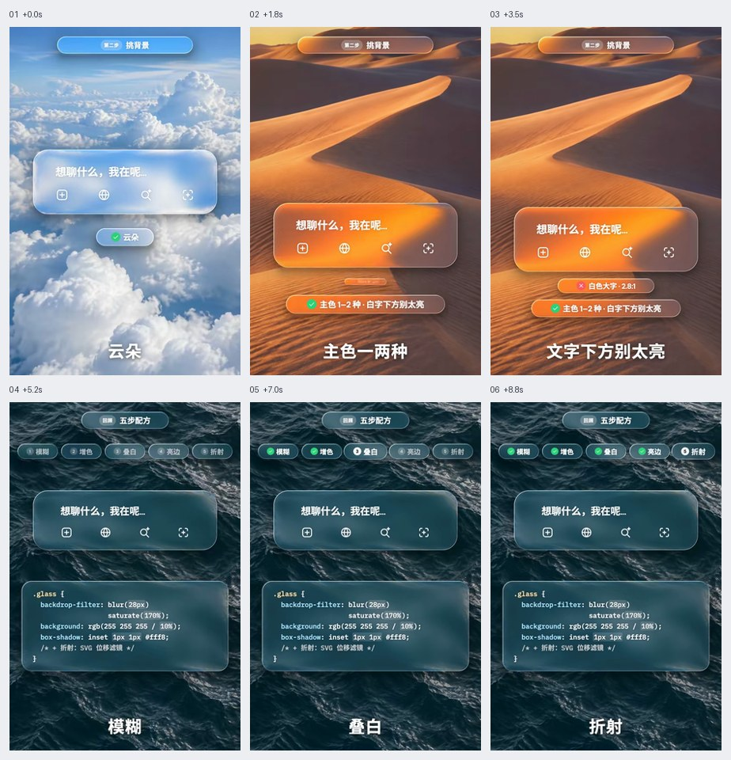

# 玻璃材质与背景

先处理前景可读性，再协调玻璃与背后形状的尺度。材质依赖背景；模糊、饱和度、叠色、亮边与折射分开调整。下方代码数值是可调实现起点，不是强制参数。

GIF 看连续运动，六帧图按从左到右、从上到下查看。像素值、技术栈与缓动由当前项目决定。

## 目录

- [磨砂玻璃的基本层次 / Frosted Glass Layers](#frosted-glass-layer)
- [增色与透明叠白 / Saturation and Tint](#saturation-tint)
- [亮边与边缘折射 / Edge Highlight and Refraction](#edge-highlight-refraction)
- [大块柔和背景选型 / Large Soft Background Shapes](#large-soft-background)
- [玻璃前景的明暗控制 / Glass Foreground Contrast](#glass-text-contrast)

## 可调实现起点

```css
.glass-panel {
  background: rgb(255 255 255 / 10%);
  backdrop-filter: blur(28px) saturate(170%);
  box-shadow: inset 0 1px 0 rgb(255 255 255 / 50%);
}
@supports not (backdrop-filter: blur(1px)) {
  .glass-panel { background: rgb(245 247 250 / 94%); }
}
```

这些值只便于开始调试；需要结合背景亮度、字体和主题提高表层不透明度。折射为可选增强，不是这段基本材质的组成要求。


<a id="frosted-glass-layer"></a>
## 磨砂玻璃的基本层次 / Frosted Glass Layers

- 标识：`glass-materials/frosted-glass-layer`；类型：组件／效果。
- 效果要点：背景模糊透过低透明度表层呈现；面板仍应透出背景层次，而非实心灰块。
- 指令例句：玻璃面板组合背景模糊、低透明度表层和稳定前景内容，先保证文字清晰。
- 实现关注：模糊作用于面板背后，前景文字不跟着模糊；没有模糊支持时用足够不透明的表层兜底。
- 验证重点：纯色与照片背景、滚动经过高对比区域及不支持模糊时，内容均可读。
- 参考：[GIF 动图](../assets/gifs/glass-materials/frosted-glass-layer.gif) · [六帧对照图](../assets/filmstrips/glass-materials/frosted-glass-layer.jpg)。



<a id="saturation-tint"></a>
## 增色与透明叠白 / Saturation and Tint

- 标识：`glass-materials/saturation-tint`；类型：选型／纠错。
- 效果要点：适当提高背景饱和度并叠低透明度白层，避免模糊后颜色发灰。
- 指令例句：调整玻璃背后的饱和度与叠白强度，保留背景色相，避免灰雾感。
- 实现关注：模糊、饱和度和表层透明度共同调节；参考示例参数只作为起点，深浅模式分别检查。
- 验证重点：强色和弱色背景都不刺眼、不泛灰，前景对比稳定。
- 参考：[GIF 动图](../assets/gifs/glass-materials/saturation-tint.gif) · [六帧对照图](../assets/filmstrips/glass-materials/saturation-tint.jpg)。



<a id="edge-highlight-refraction"></a>
## 亮边与边缘折射 / Edge Highlight and Refraction

- 标识：`glass-materials/edge-highlight-refraction`；类型：选型／纠错。
- 效果要点：细亮边表达厚度，局部边缘形变加强液态感，作用限于玻璃轮廓。
- 指令例句：为重点玻璃面板加细亮边，必要时只在边缘加入轻微折射。
- 实现关注：亮边与内高光先建立轮廓；折射是可选增强，不让文字和图标变形，也不强制所有面板使用复杂滤镜。
- 验证重点：小尺寸、圆角和不同背景下边缘连续，无黑边、裁切或文字扭曲。
- 参考：[GIF 动图](../assets/gifs/glass-materials/edge-highlight-refraction.gif) · [六帧对照图](../assets/filmstrips/glass-materials/edge-highlight-refraction.jpg)。



<a id="large-soft-background"></a>
## 大块柔和背景选型 / Large Soft Background Shapes

- 标识：`glass-materials/large-soft-background`；类型：选型／纠错。
- 效果要点：细碎纹理被模糊成纯色，杂乱强色容易抢主体；大块柔和形状更容易显出玻璃层次。
- 指令例句：玻璃后使用大于模糊范围的柔和色块，主色控制在少量相近色。
- 实现关注：比较形状尺度与模糊半径；优先保留大范围明暗和色彩变化，避免只靠加大模糊解决所有背景。
- 验证重点：纯色、细碎、杂色与大色块对比后，选择能显出层次且不干扰内容的背景。
- 参考：[GIF 动图](../assets/gifs/glass-materials/large-soft-background.gif) · [六帧对照图](../assets/filmstrips/glass-materials/large-soft-background.jpg)。



<a id="glass-text-contrast"></a>
## 玻璃前景的明暗控制 / Glass Foreground Contrast

- 标识：`glass-materials/glass-text-contrast`；类型：选型／纠错。
- 效果要点：背景主色少而有层次，文字后方避免过亮或明暗骤变，材质服务于内容。
- 指令例句：控制玻璃下方亮部位置，并给前景内容足够的明暗对比。
- 实现关注：必要时调整局部叠色或提高面板不透明度；不能把发光和折射叠到正文上，静态清晰度优先。
- 验证重点：滚动、更换背景和切换主题后，标题、辅助文字、图标与焦点均可辨认。
- 参考：[GIF 动图](../assets/gifs/glass-materials/glass-text-contrast.gif) · [六帧对照图](../assets/filmstrips/glass-materials/glass-text-contrast.jpg)。


