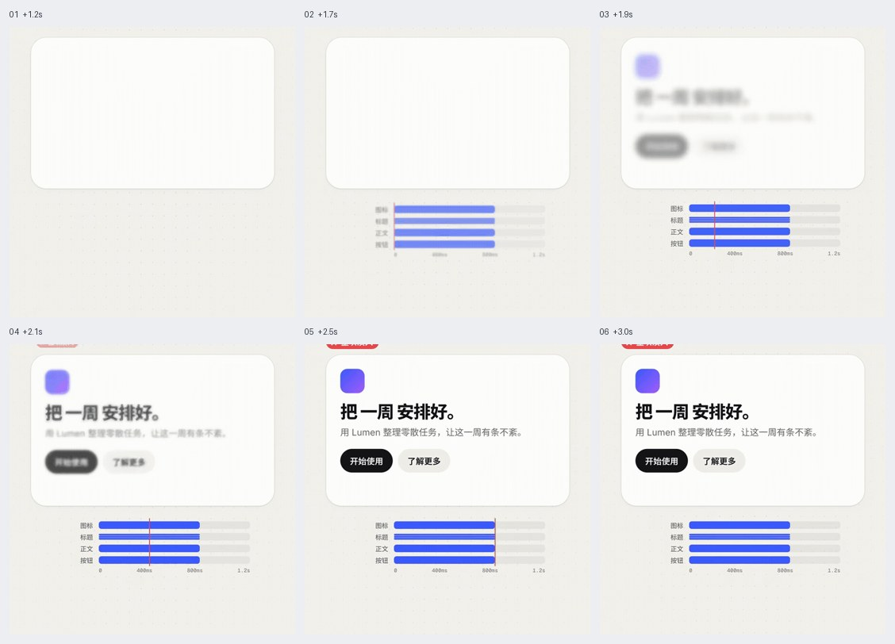
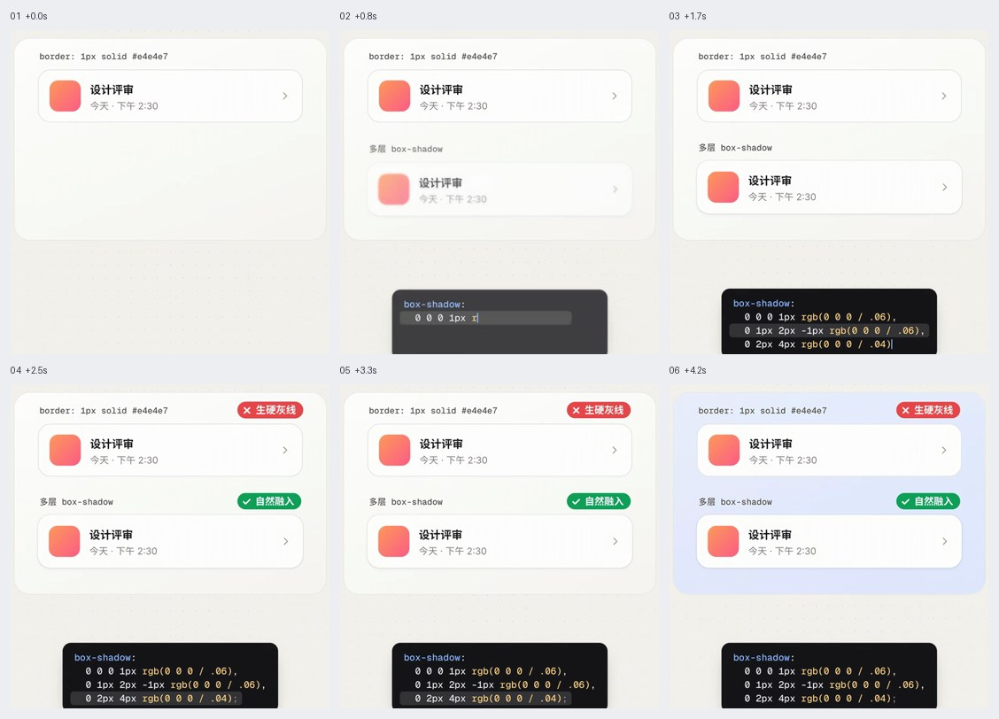

# 界面排版与细节

用于精修已有界面的数字、圆角、标题、入场和阴影。保留任务所需的输入边界、焦点与真实状态，避免把局部技巧推广为整站硬规则。

六帧图按从左到右、从上到下查看，仅表示抽样状态，不能证明连续运动和短暂状态。像素值、技术栈与缓动由当前项目决定。

## 目录

- [内容分组错峰入场 / Section Stagger](#section-stagger)
- [柔和多层阴影 / Layered Soft Shadow](#layered-soft-shadow)
- [递进圆角与连续曲率 / Nested Radii and Continuous Corners](#continuous-corners)
- [中英文排版与稳定数字 / CJK Latin Typesetting](#cjk-latin-typesetting)

## 内容分组错峰入场 / Section Stagger

- 标识：`interface-details/section-stagger`；类型：选型／纠错。
- 效果要点：标题、主图、统计和操作分组依次入场，避免整屏内容同时淡入而缺少节奏。
- 指令例句：把首屏按阅读顺序分组，轻微错峰入场，主操作无需等待动画才可用。
- 实现关注：延迟随组数受控，不逐字或无限延后；最终布局预先占位，减弱动态时直接显示。
- 验证重点：首屏可立即理解与操作，快速离开再返回不会隐藏内容或无限重播。
- 相关条目：[motion/stagger](motion.md#stagger)。
- 媒体取舍：保留 GIF＋JPG。标题、主图、数字与操作分组入场的先后是主体。
- 参考：[GIF 动图](https://raw.githubusercontent.com/dqzboy/ui-atlas/e6aa0d641c224a2cb4c8bd4262a4d18f5c7e1e22/assets/gifs/interface-details/section-stagger.gif) · [六帧对照图](https://raw.githubusercontent.com/dqzboy/ui-atlas/e6aa0d641c224a2cb4c8bd4262a4d18f5c7e1e22/assets/filmstrips/interface-details/section-stagger.jpg)。

## 柔和多层阴影 / Layered Soft Shadow

- 标识：`interface-details/layered-soft-shadow`；类型：选型／纠错。
- 效果要点：在适合的卡片上用近处细阴影和远处柔阴影表达层次，减少僵硬外框感。
- 指令例句：用低强度多层阴影柔化普通内容卡，同时保持边界可辨认。
- 实现关注：近层定义边缘、远层表达抬升；按背景调整透明度，输入框、焦点和必须清楚的分区保留所需边界。
- 验证重点：白底、灰底、深色主题和卡片密集排列时，不糊成脏边，不把焦点提示一起移除。
- 媒体取舍：仅保留 JPG。近细远柔的投影层次及前后对照由图片表达。
- 参考：[六帧对照图](https://raw.githubusercontent.com/dqzboy/ui-atlas/e6aa0d641c224a2cb4c8bd4262a4d18f5c7e1e22/assets/filmstrips/interface-details/layered-soft-shadow.jpg)。

## 递进圆角与连续曲率 / Nested Radii and Continuous Corners

- 标识：`interface-details/continuous-corners`；类型：选型／纠错。
- 效果要点：等距嵌套采用内圆角 = 外圆角 − 内缩距离，再以 corner-shape: superellipse(1.25) 渐进增强，胶囊与圆保持全圆。
- 实现关注：从弹窗或卡片向内协调面板、输入、按钮与标签；示例外圆角 32、内缩 16，则内层 16。优先改现有 radius token；4px 网格与最小 4px 是本配方的风格起点，产品已有尺度优先。只在目标容器内应用 @supports 增强，普通 border-radius 始终保留。连续曲率和非等距内缩需检查视觉边距，不假定减法产生严格几何等距线。
- 验证重点：检查各层四角、边框与 clip-path 对齐；胶囊和圆不变形；目标浏览器不支持时仍有正常圆角。
- 指令例句：参考 interface-details/continuous-corners，等距嵌套采用内圆角 = 外圆角 − 内缩距离，再以 corner-shape: superellipse(1.25) 渐进增强，胶囊与圆保持全圆。
- [完整实现配方与提示词](recipes/continuous-corners.md)；证据类型：文字配方，未附动画。

## 中英文排版与稳定数字 / CJK Latin Typesetting

- 标识：`interface-details/cjk-latin-typesetting`；类型：选型／纠错。
- 效果要点：标题 balance、正文 pretty、动态数字 tabular-nums、flex 文本 min-width:0；中文按 lang 处理自动间距、标点避头尾及分词断行。
- 实现关注：短标题平衡行长，正文减少末行孤词；数字与单位等不可分割组合用不换行空格。按钮不换行；flex 项 min-width:0 后再做 ellipsis，并为真实截断提供完整文本入口。中文正文两端对齐限于足够宽的文字列，窄列不强制；text-autospace 与 text-spacing-trim 渐进增强。中文标题采用分词断点后才用 keep-all；避免 line-break:anywhere 破坏标点禁则。
- 验证重点：检查长短标题、窄屏、长英文、混合数字单位、字体加载前后、价格计时器位数变化、截断文本的键盘与触摸入口；不支持的新 CSS 自然回退。
- 指令例句：参考 interface-details/cjk-latin-typesetting，标题 balance、正文 pretty、动态数字 tabular-nums、flex 文本 min-width:0；中文按 lang 处理自动间距、标点避头尾及分词断行。
- [完整实现配方与提示词](recipes/cjk-latin-typesetting.md)；证据类型：文字配方，未附动画。
