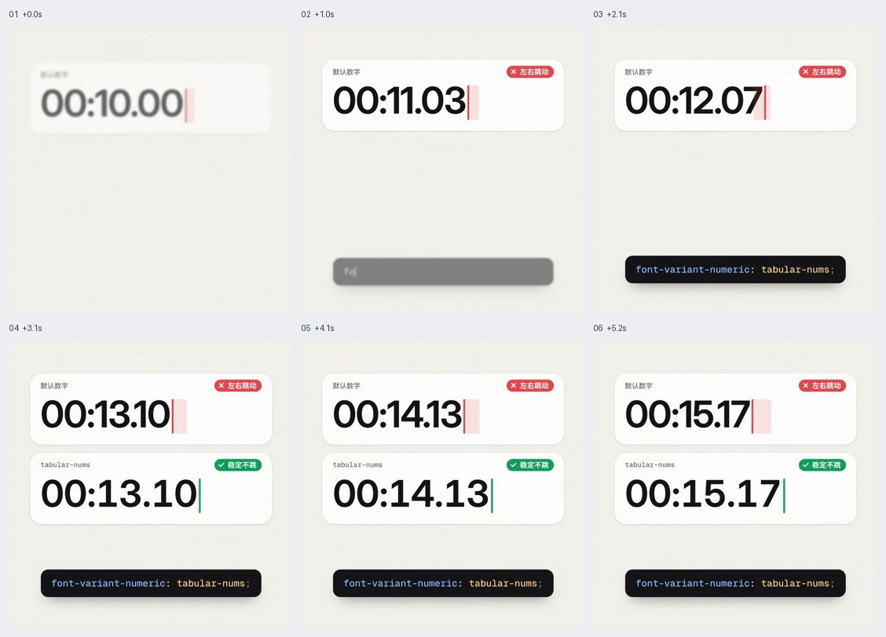
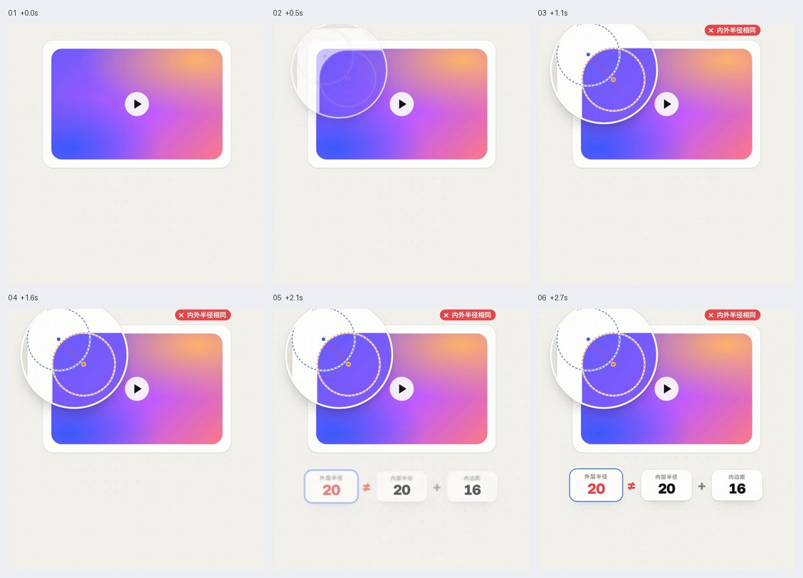

# 界面排版与细节

用于精修已有界面的数字、圆角、标题、入场和阴影。保留任务所需的输入边界、焦点与真实状态，避免把局部技巧推广为整站硬规则。

GIF 看连续运动，六帧图按从左到右、从上到下查看。像素值、技术栈与缓动由当前项目决定。

## 目录

- [等宽数字防跳动 / Tabular Numerals](#tabular-numerals)
- [嵌套容器同心圆角 / Concentric Corners](#concentric-corners)
- [内容分组错峰入场 / Section Stagger](#section-stagger)
- [平衡标题换行 / Balanced Headings](#balanced-headings)
- [柔和多层阴影 / Layered Soft Shadow](#layered-soft-shadow)

## 可调实现起点

```css
.live-number { font-variant-numeric: tabular-nums; }
.short-heading { text-wrap: balance; }
.nested-card { border-radius: 24px; padding: 8px; }
.nested-card > .media { border-radius: 16px; }
.soft-card {
  box-shadow: 0 0 0 1px rgb(0 0 0 / 6%),
              0 1px 2px rgb(0 0 0 / 6%),
              0 2px 4px rgb(0 0 0 / 4%);
}
```

圆角、间距与阴影为实现起点，需结合实际尺寸调整。等宽数字还需字体支持；位数变化时另外预留宽度。`text-wrap: balance` 不支持时保留自然换行，不强制插入适用于某一宽度的换行符。


<a id="tabular-numerals"></a>
## 等宽数字防跳动 / Tabular Numerals

- 标识：`interface-details/tabular-numerals`；类型：选型／纠错。
- 效果要点：变化中的时间和数值使用等宽数字，让各位数字占宽稳定，减少左右跳动。
- 指令例句：为计时器和动态统计数字启用 tabular-nums，保留适当数值容器宽度。
- 实现关注：字体需实际支持等宽数字；位数变化还需预留宽度，比例数字和整段等宽字体不是同一概念。
- 验证重点：连续经过 1、8、9，及个位跨十位、负数和小数后，数字容器不推挤相邻内容。
- 参考：[GIF 动图](../assets/gifs/interface-details/tabular-numerals.gif) · [六帧对照图](../assets/filmstrips/interface-details/tabular-numerals.jpg)。



<a id="concentric-corners"></a>
## 嵌套容器同心圆角 / Concentric Corners

- 标识：`interface-details/concentric-corners`；类型：选型／纠错。
- 效果要点：内外容器转角保持接近同一圆心，避免外层与内层机械地使用同一圆角值。
- 指令例句：按内边距协调外卡与内图的圆角，让嵌套边缘保持均匀。
- 实现关注：等距嵌套时可从外圆角约等于内圆角加间距开始；非等距、粗边框和特殊形状需按实际轮廓光学校正。
- 验证重点：四角边距和曲率看起来一致，小尺寸、不同内边距下没有一角过厚。
- 参考：[GIF 动图](../assets/gifs/interface-details/concentric-corners.gif) · [六帧对照图](../assets/filmstrips/interface-details/concentric-corners.jpg)。



<a id="section-stagger"></a>
## 内容分组错峰入场 / Section Stagger

- 标识：`interface-details/section-stagger`；类型：选型／纠错。
- 效果要点：标题、主图、统计和操作分组依次入场，避免整屏内容同时淡入而缺少节奏。
- 指令例句：把首屏按阅读顺序分组，轻微错峰入场，主操作无需等待动画才可用。
- 实现关注：延迟随组数受控，不逐字或无限延后；最终布局预先占位，减弱动态时直接显示。
- 验证重点：首屏可立即理解与操作，快速离开再返回不会隐藏内容或无限重播。
- 相关条目：[motion/stagger](motion.md#stagger)。
- 参考：[GIF 动图](../assets/gifs/interface-details/section-stagger.gif) · [六帧对照图](../assets/filmstrips/interface-details/section-stagger.jpg)。


<a id="balanced-headings"></a>
## 平衡标题换行 / Balanced Headings

- 标识：`interface-details/balanced-headings`；类型：选型／纠错。
- 效果要点：标题多行长度更均衡，避免末行孤立一个短词，同时尊重容器宽度。
- 指令例句：为短标题采用平衡换行并设置合适的最大行宽，避免末行过短。
- 实现关注：可用 text-wrap: balance 做增强；不靠固定 br 适配所有屏宽，中文、数字和长英文分别检查。
- 验证重点：窄宽断点、长短标题及字体加载后，没有孤词、截断和异常行高。
- 参考：[GIF 动图](../assets/gifs/interface-details/balanced-headings.gif) · [六帧对照图](../assets/filmstrips/interface-details/balanced-headings.jpg)。


<a id="layered-soft-shadow"></a>
## 柔和多层阴影 / Layered Soft Shadow

- 标识：`interface-details/layered-soft-shadow`；类型：选型／纠错。
- 效果要点：在适合的卡片上用近处细阴影和远处柔阴影表达层次，减少僵硬外框感。
- 指令例句：用低强度多层阴影柔化普通内容卡，同时保持边界可辨认。
- 实现关注：近层定义边缘、远层表达抬升；按背景调整透明度，输入框、焦点和必须清楚的分区保留所需边界。
- 验证重点：白底、灰底、深色主题和卡片密集排列时，不糊成脏边，不把焦点提示一起移除。
- 参考：[GIF 动图](../assets/gifs/interface-details/layered-soft-shadow.gif) · [六帧对照图](../assets/filmstrips/interface-details/layered-soft-shadow.jpg)。


