# 加载与错误页

六帧图看主要状态，不能证明连续运动和短暂状态。按当前项目需求实现目标组件的交互与动效。

## 目录

- [骨架屏 / Skeleton](#skeleton)
- [模糊渐显 / Blur-up](#blur-up)
- [乐观更新 / Optimistic UI](#optimistic-ui)
- [下拉刷新 / Pull to Refresh](#pull-to-refresh)
- [进度条 / Progress Bar](#progress-bar)
- [按钮加载状态 / Loading Button](#loading-button)
- [空状态 / Empty State](#empty-state)
- [404 页面 / Not Found](#not-found)
- [错误页 / Error Page](#error-page)
- [断网提示 / Offline](#offline)
- [没有权限 / No Permission](#no-permission)
- [结果页 / Result](#result)
- [加载动画 / Spinner](#spinner)

## 骨架屏 / Skeleton

- 标识：`loading-errors/skeleton`；类型：组件／效果。
- 效果要点：内容未返回时，用与真实内容同形的灰色块预占位置，并可加扫光；数据到达后在原位置替换，减少布局跳动。
- 指令例句：列表加载时用与真实内容形状一致的骨架屏，内容到达后原位替换。
- 媒体取舍：保留 GIF＋静态图片。需看扫光循环和骨架被真实内容原位替换的过程。
- 参考：[GIF 动图](../assets/gifs/loading-errors/skeleton.gif) · [六帧对照图](../assets/filmstrips/loading-errors/skeleton.jpg)。

<!-- ui-atlas:details loading-errors/skeleton -->
- 原尺寸图片：[01 · 600×900](../assets/details/loading-errors/skeleton.png)。
- 连续效果：[GIF · 600×900](../assets/gifs/loading-errors/skeleton.gif)。
- 清晰度边界：从现存 GIF 解出原尺寸独立帧，避免总览缩图和二次 JPEG 压缩；GIF 的分辨率、色彩与源压缩限制仍在。

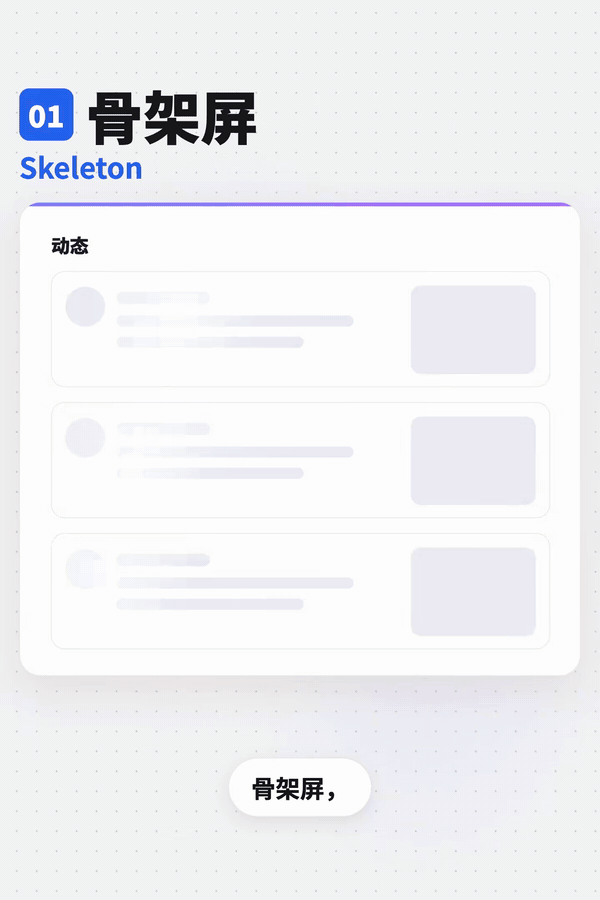
<!-- /ui-atlas:details -->

## 模糊渐显 / Blur-up

- 标识：`loading-errors/blur-up`；类型：组件／效果。
- 效果要点：先显示低清模糊小图，高清图下载完成后逐渐变清楚；适合相册和商品图片列表。
- 指令例句：图片先展示低清占位图，高清加载完成后使用 Blur-up 渐显。
- 媒体取舍：保留 GIF＋静态图片。模糊到清晰的连续变化是目标，静态前后对比会丢失过渡观感。
- 参考：[GIF 动图](../assets/gifs/loading-errors/blur-up.gif) · [六帧对照图](../assets/filmstrips/loading-errors/blur-up.jpg)。

<!-- ui-atlas:details loading-errors/blur-up -->
- 原尺寸图片：[01 · 600×900](../assets/details/loading-errors/blur-up.png)。
- 连续效果：[GIF · 600×900](../assets/gifs/loading-errors/blur-up.gif)。
- 清晰度边界：从现存 GIF 解出原尺寸独立帧，避免总览缩图和二次 JPEG 压缩；GIF 的分辨率、色彩与源压缩限制仍在。

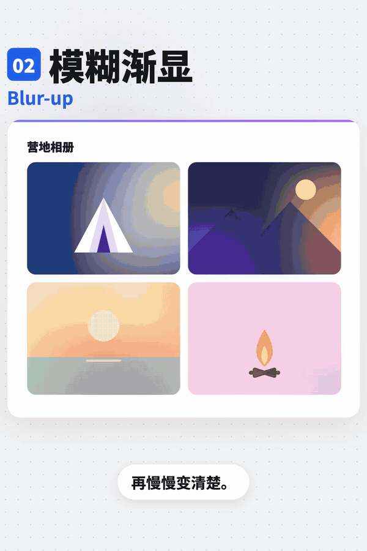
<!-- /ui-atlas:details -->

## 乐观更新 / Optimistic UI

- 标识：`loading-errors/optimistic-ui`；类型：组件／效果。
- 效果要点：点赞、收藏等低风险操作先立即改变界面，再等待服务器；失败时恢复原状态并提示。
- 指令例句：点赞立即变红，请求失败时回滚并提示失败。
- 媒体取舍：保留 GIF＋静态图片。需看立即反馈、请求结果与失败回滚的先后；现有六帧未完整覆盖短暂失败提示。
- 参考：[GIF 动图](../assets/gifs/loading-errors/optimistic-ui.gif) · [六帧对照图](../assets/filmstrips/loading-errors/optimistic-ui.jpg)。

<!-- ui-atlas:details loading-errors/optimistic-ui -->
- 原尺寸图片：[01 · 600×900](../assets/details/loading-errors/optimistic-ui.png)。
- 连续效果：[GIF · 600×900](../assets/gifs/loading-errors/optimistic-ui.gif)。
- 清晰度边界：从现存 GIF 解出原尺寸独立帧，避免总览缩图和二次 JPEG 压缩；GIF 的分辨率、色彩与源压缩限制仍在。

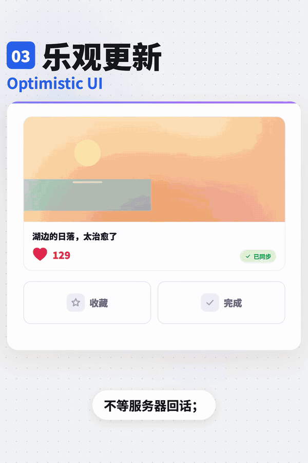
<!-- /ui-atlas:details -->

## 下拉刷新 / Pull to Refresh

- 标识：`loading-errors/pull-to-refresh`；类型：组件／效果。
- 效果要点：手机列表向下拉时顶部出现刷新指示，松手触发刷新；适合消息、动态等会更新的列表。
- 指令例句：为移动端动态列表加入下拉并松手刷新的交互。
- 媒体取舍：保留 GIF＋静态图片。需看下拉、松手、刷新指示和复位的连续关系。
- 参考：[GIF 动图](../assets/gifs/loading-errors/pull-to-refresh.gif) · [六帧对照图](../assets/filmstrips/loading-errors/pull-to-refresh.jpg)。

<!-- ui-atlas:details loading-errors/pull-to-refresh -->
- 原尺寸图片：[01 · 600×900](../assets/details/loading-errors/pull-to-refresh.png)。
- 连续效果：[GIF · 600×900](../assets/gifs/loading-errors/pull-to-refresh.gif)。
- 清晰度边界：从现存 GIF 解出原尺寸独立帧，避免总览缩图和二次 JPEG 压缩；GIF 的分辨率、色彩与源压缩限制仍在。

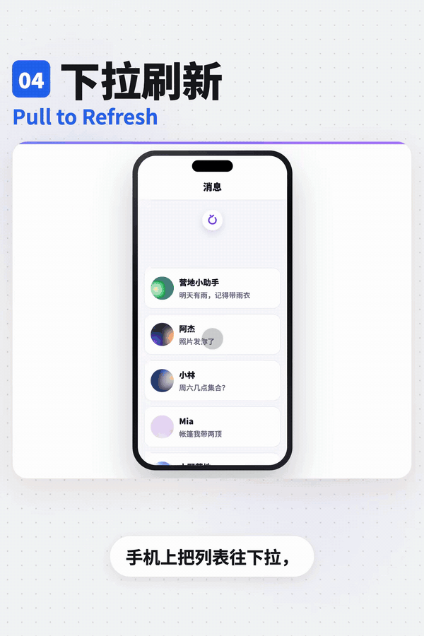
<!-- /ui-atlas:details -->

## 进度条 / Progress Bar

- 标识：`loading-errors/progress-bar`；类型：组件／效果。
- 效果要点：显示已完成比例；通常可按以下原则选择：短于约 1 秒不必额外放加载指示，几秒可用转圈，长任务用进度条并尽可能显示剩余时间。
- 指令例句：上传大文件显示真实进度、已完成量，并在可估算时显示剩余时间。
- 媒体取舍：仅保留静态图片（JPG／PNG）。重点是比例、已完成量和时间信息的呈现，多个进度状态加文字足够。
- 参考：[六帧对照图](../assets/filmstrips/loading-errors/progress-bar.jpg)。

<!-- ui-atlas:details loading-errors/progress-bar -->
- 原尺寸图片：[01 · 600×900](../assets/details/loading-errors/progress-bar.png)。
- 清晰度边界：从现存 GIF 解出原尺寸独立帧，避免总览缩图和二次 JPEG 压缩；GIF 的分辨率、色彩与源压缩限制仍在。

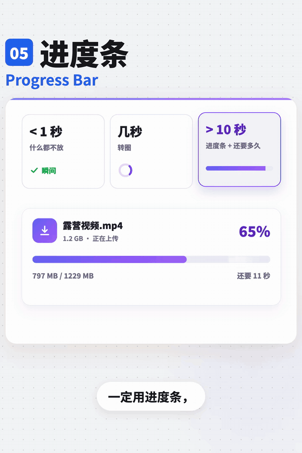
<!-- /ui-atlas:details -->

## 按钮加载状态 / Loading Button

- 标识：`loading-errors/loading-button`；类型：组件／效果。
- 效果要点：提交后按钮内部出现加载指示，同时阻止重复点击，避免连点导致重复提交。
- 指令例句：提交按钮显示加载中，直到请求结束前不能重复提交。
- 媒体取舍：保留 GIF＋静态图片。需看提交后转圈到完成的反馈顺序；防重复提交仍须操作实际项目验证。
- 参考：[GIF 动图](../assets/gifs/loading-errors/loading-button.gif) · [六帧对照图](../assets/filmstrips/loading-errors/loading-button.jpg)。

<!-- ui-atlas:details loading-errors/loading-button -->
- 原尺寸图片：[01 · 600×900](../assets/details/loading-errors/loading-button.png)。
- 连续效果：[GIF · 600×900](../assets/gifs/loading-errors/loading-button.gif)。
- 清晰度边界：从现存 GIF 解出原尺寸独立帧，避免总览缩图和二次 JPEG 压缩；GIF 的分辨率、色彩与源压缩限制仍在。

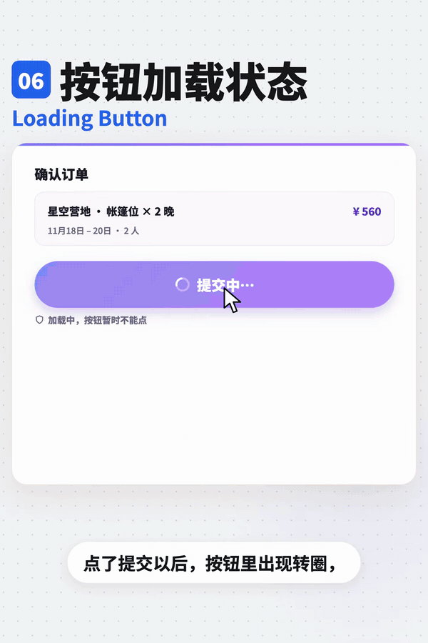
<!-- /ui-atlas:details -->

## 空状态 / Empty State

- 标识：`loading-errors/empty-state`；类型：组件／效果。
- 效果要点：列表没有内容时，给出插图、为空的原因和下一步按钮；例子为还没有订单、去逛逛。
- 指令例句：订单为空时显示原因说明和去逛逛入口。
- 媒体取舍：仅保留静态图片（JPG／PNG）。插图、原因与下一步入口属于静态结构。
- 参考：[六帧对照图](../assets/filmstrips/loading-errors/empty-state.jpg)。

<!-- ui-atlas:details loading-errors/empty-state -->
- 原尺寸图片：[01 · 600×900](../assets/details/loading-errors/empty-state.png)。
- 清晰度边界：从现存 GIF 解出原尺寸独立帧，避免总览缩图和二次 JPEG 压缩；GIF 的分辨率、色彩与源压缩限制仍在。

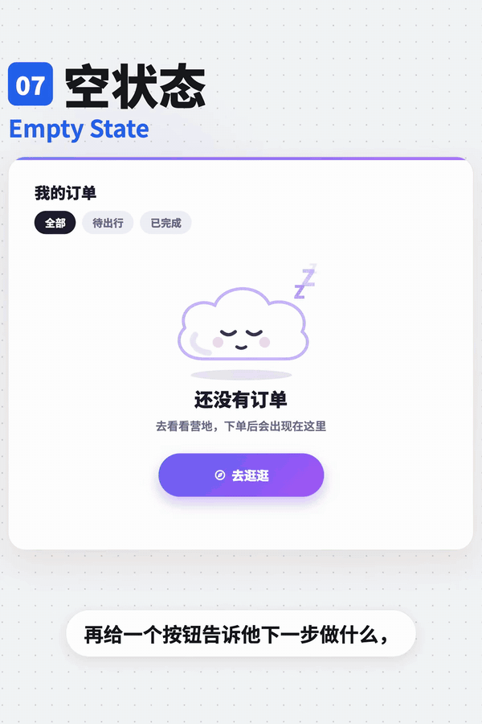
<!-- /ui-atlas:details -->

## 404 页面 / Not Found

- 标识：`loading-errors/not-found`；类型：组件／效果。
- 效果要点：地址不存在；不要只放错误码，示例提供返回首页和搜索入口。
- 指令例句：404 页面说明地址不存在，提供回首页和搜索入口。
- 媒体取舍：仅保留静态图片（JPG／PNG）。错误说明、回首页和搜索入口属于页面布局参考。
- 参考：[六帧对照图](../assets/filmstrips/loading-errors/not-found.jpg)。

<!-- ui-atlas:details loading-errors/not-found -->
- 原尺寸图片：[01 · 600×900](../assets/details/loading-errors/not-found.png)。
- 清晰度边界：从现存 GIF 解出原尺寸独立帧，避免总览缩图和二次 JPEG 压缩；GIF 的分辨率、色彩与源压缩限制仍在。

<!-- /ui-atlas:details -->

## 错误页 / Error Page

- 标识：`loading-errors/error-page`；类型：组件／效果。
- 效果要点：服务器故障如 500；解释发生了什么，避免责怪用户，提供重试。
- 指令例句：服务暂时出错时显示清楚的说明和重新试试按钮。
- 媒体取舍：仅保留静态图片（JPG／PNG）。原因文案与重试入口属于静态内容结构。
- 参考：[六帧对照图](../assets/filmstrips/loading-errors/error-page.jpg)。

<!-- ui-atlas:details loading-errors/error-page -->
- 原尺寸图片：[01 · 600×900](../assets/details/loading-errors/error-page.png)。
- 清晰度边界：从现存 GIF 解出原尺寸独立帧，避免总览缩图和二次 JPEG 压缩；GIF 的分辨率、色彩与源压缩限制仍在。

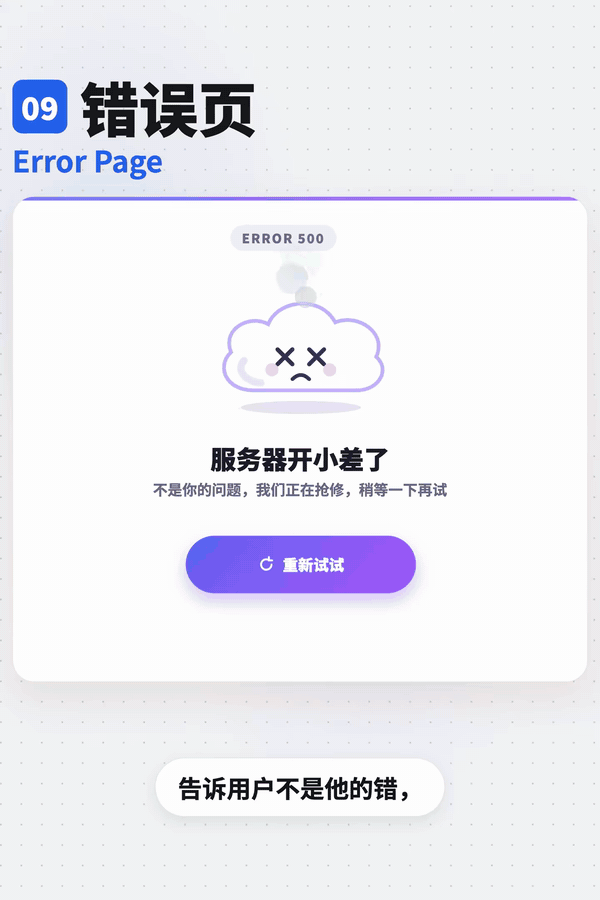
<!-- /ui-atlas:details -->

## 断网提示 / Offline

- 标识：`loading-errors/offline`；类型：组件／效果。
- 效果要点：断网时顶部滑出网络已断开提示；恢复后变成已重新连接，然后收起。
- 指令例句：监听网络状态，断网显示横幅，恢复连接后更新提示再收起。
- 媒体取舍：保留 GIF＋静态图片。需看断网横幅进入、恢复连接换色和最终收起的过程。
- 参考：[GIF 动图](../assets/gifs/loading-errors/offline.gif) · [六帧对照图](../assets/filmstrips/loading-errors/offline.jpg)。

<!-- ui-atlas:details loading-errors/offline -->
- 原尺寸图片：[01 · 600×900](../assets/details/loading-errors/offline.png)。
- 连续效果：[GIF · 600×900](../assets/gifs/loading-errors/offline.gif)。
- 清晰度边界：从现存 GIF 解出原尺寸独立帧，避免总览缩图和二次 JPEG 压缩；GIF 的分辨率、色彩与源压缩限制仍在。

<!-- /ui-atlas:details -->

## 没有权限 / No Permission

- 标识：`loading-errors/no-permission`；类型：组件／效果。
- 效果要点：资源存在但无权访问，示例为 403；告知联系谁，并提供申请权限入口。
- 指令例句：无权限时说明资源需要授权，提供联系管理员或申请权限入口。
- 媒体取舍：仅保留静态图片（JPG／PNG）。无权限说明与申请入口属于静态内容结构。
- 参考：[六帧对照图](../assets/filmstrips/loading-errors/no-permission.jpg)。

<!-- ui-atlas:details loading-errors/no-permission -->
- 原尺寸图片：[01 · 600×900](../assets/details/loading-errors/no-permission.png)。
- 清晰度边界：从现存 GIF 解出原尺寸独立帧，避免总览缩图和二次 JPEG 压缩；GIF 的分辨率、色彩与源压缩限制仍在。

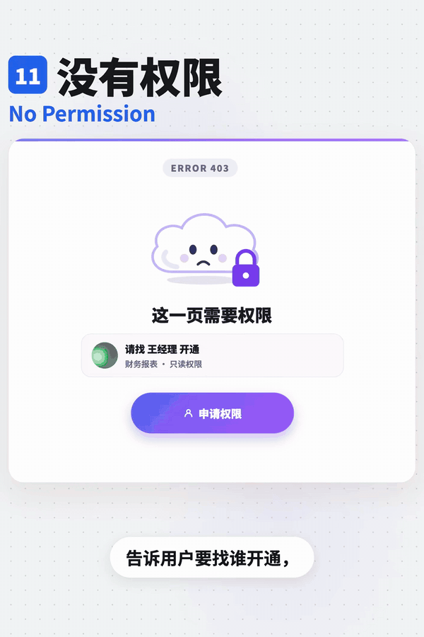
<!-- /ui-atlas:details -->

## 结果页 / Result

- 标识：`loading-errors/result`；类型：组件／效果。
- 效果要点：任务提交后明确成功或失败；成功展示对勾和下一步，失败写原因并提供返回修改。
- 指令例句：提交结果页分别覆盖成功下一步和失败返回修改。
- 媒体取舍：仅保留静态图片（JPG／PNG）。成功、失败与下一步的对照图足够，不保留装饰性庆祝过程。
- 参考：[六帧对照图](../assets/filmstrips/loading-errors/result.jpg)。

<!-- ui-atlas:details loading-errors/result -->
- 原尺寸图片：[01 · 600×900](../assets/details/loading-errors/result.png)。
- 清晰度边界：从现存 GIF 解出原尺寸独立帧，避免总览缩图和二次 JPEG 压缩；GIF 的分辨率、色彩与源压缩限制仍在。

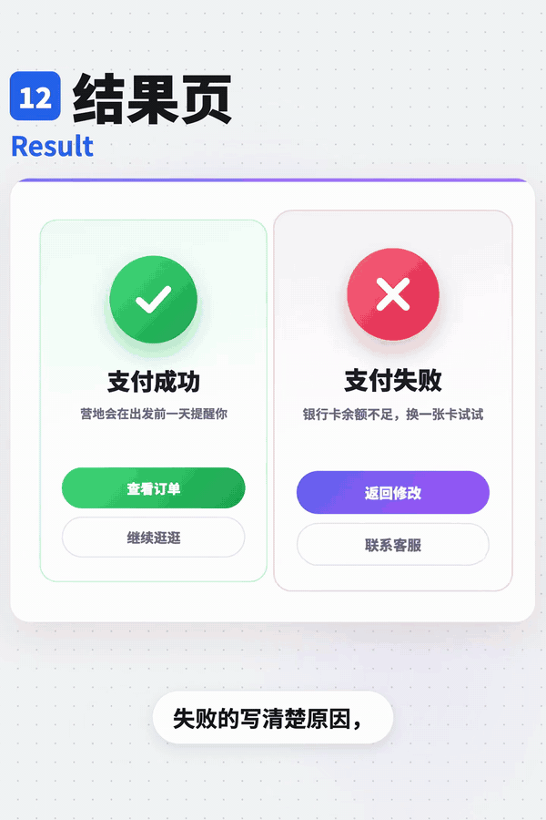
<!-- /ui-atlas:details -->

## 加载动画 / Spinner

- 标识：`loading-errors/spinner`；类型：组件／效果。
- 效果要点：圆形指示持续旋转，表达正在处理；适合无法提供精确进度的加载状态。
- 指令例句：无法获知进度的短等待显示 Spinner。
- 媒体取舍：保留 GIF＋静态图片。旋转、跳点与条形起伏依赖循环和节奏，单图不能表达。
- 参考：[GIF 动图](../assets/gifs/loading-errors/spinner.gif) · [六帧对照图](../assets/filmstrips/loading-errors/spinner.jpg)。

<!-- ui-atlas:details loading-errors/spinner -->
- 原尺寸图片：[01 · 600×900](../assets/details/loading-errors/spinner.png)。
- 连续效果：[GIF · 600×900](../assets/gifs/loading-errors/spinner.gif)。
- 清晰度边界：从现存 GIF 解出原尺寸独立帧，避免总览缩图和二次 JPEG 压缩；GIF 的分辨率、色彩与源压缩限制仍在。

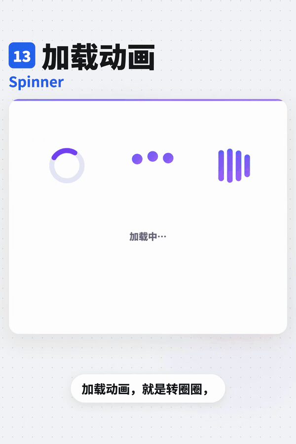
<!-- /ui-atlas:details -->
