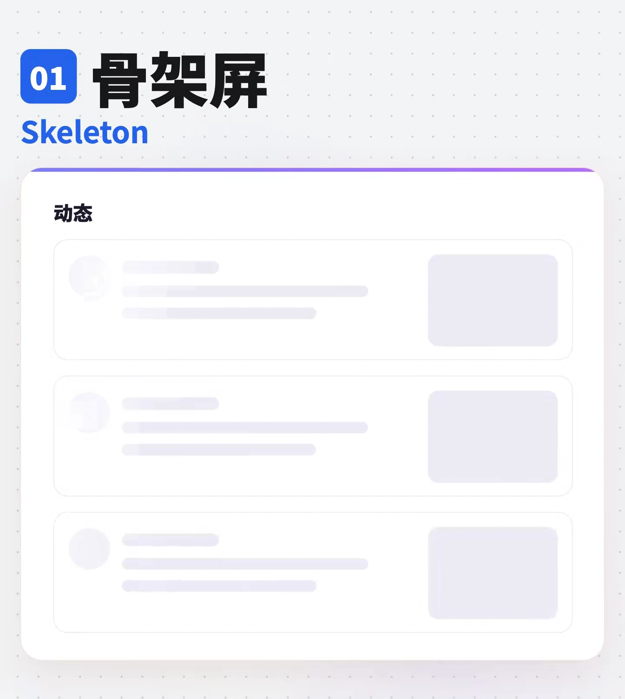
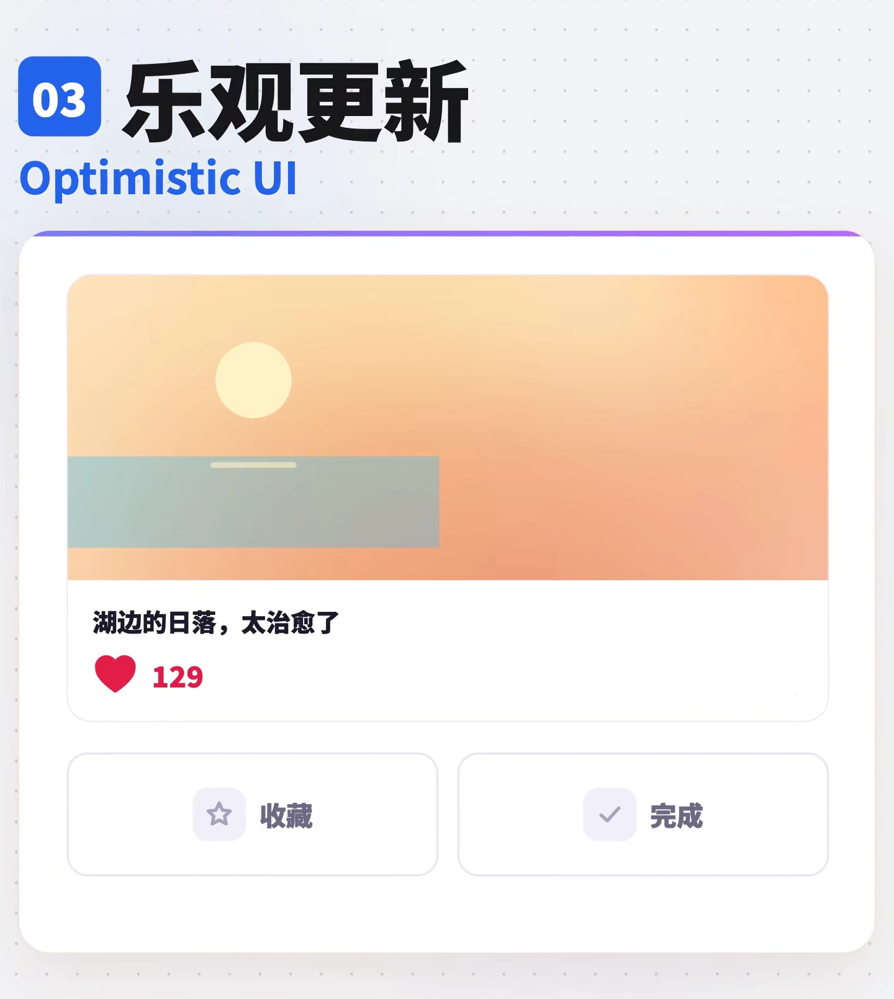
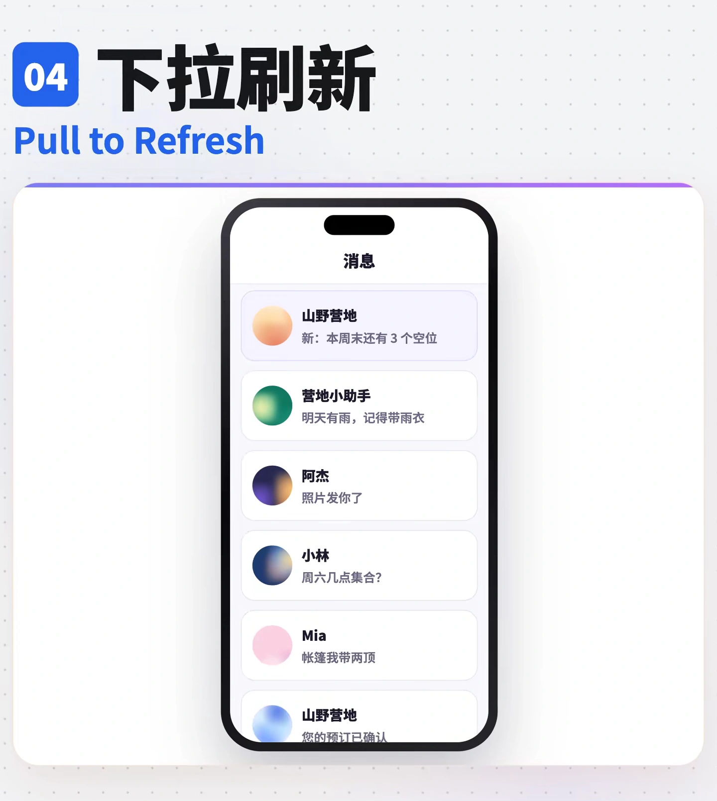
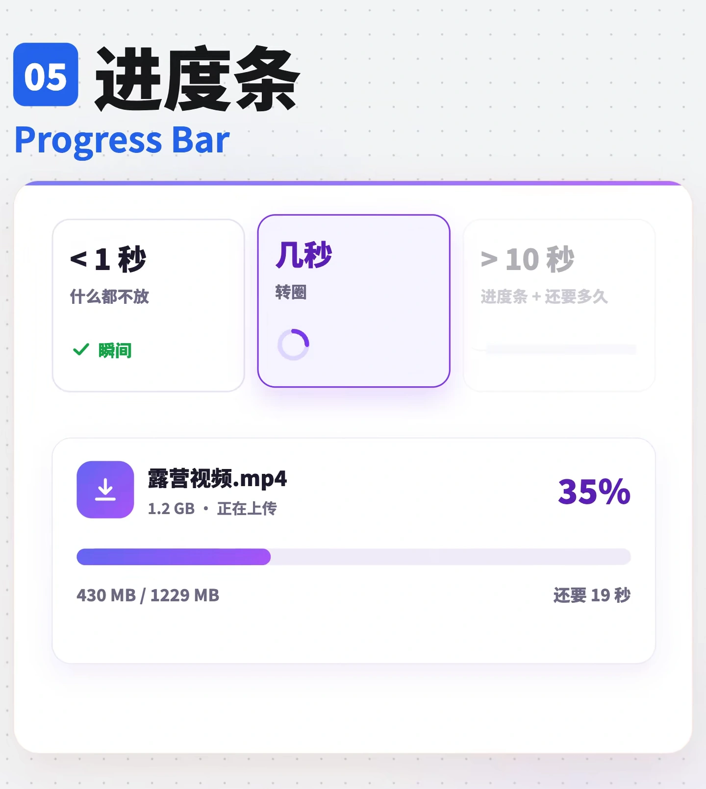
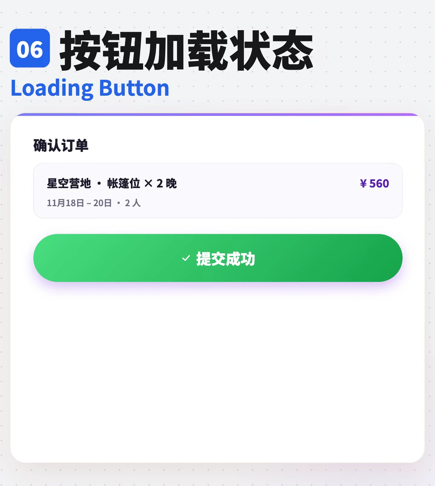
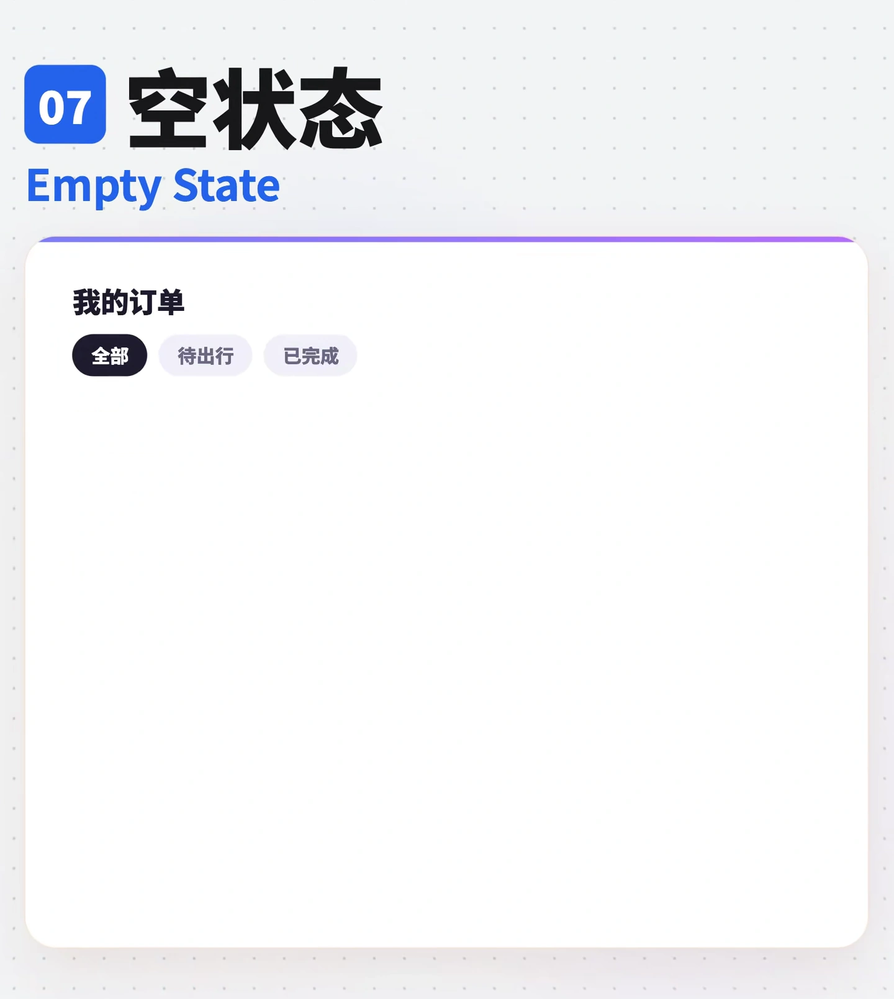
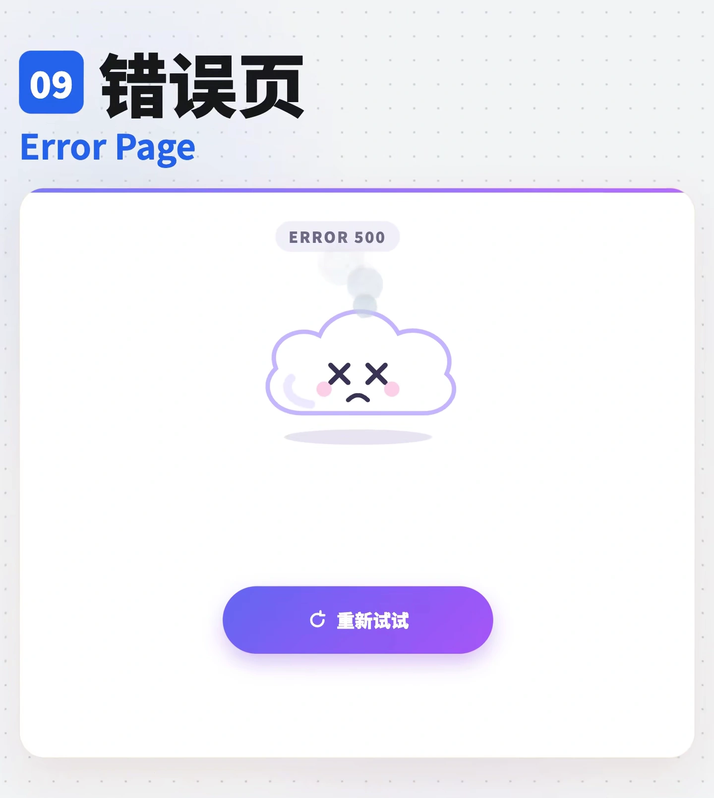
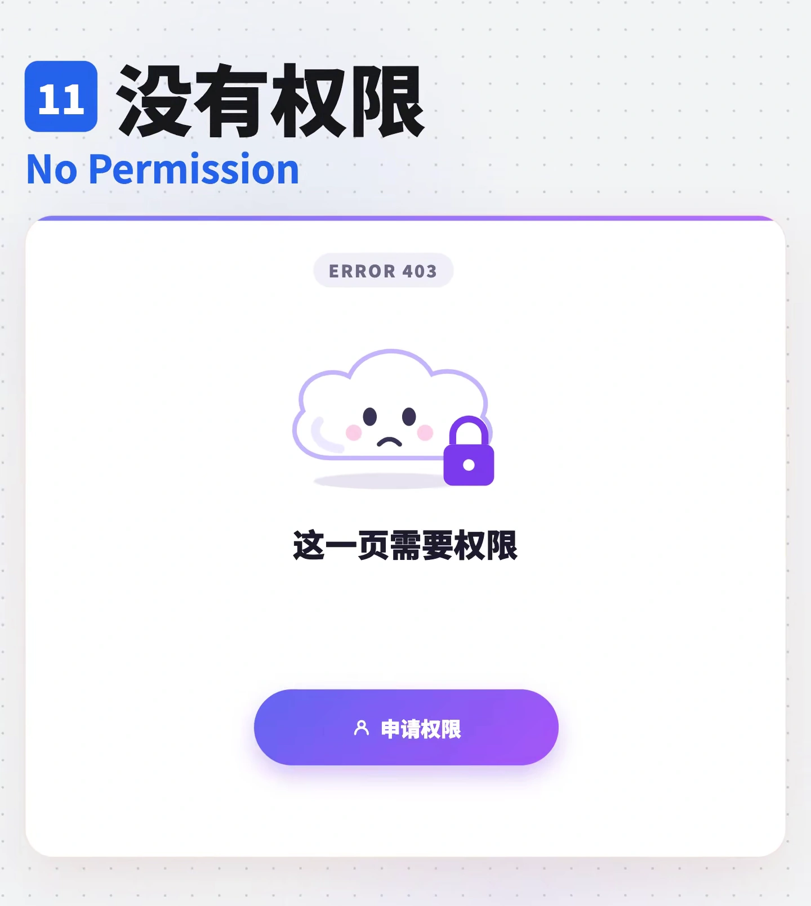
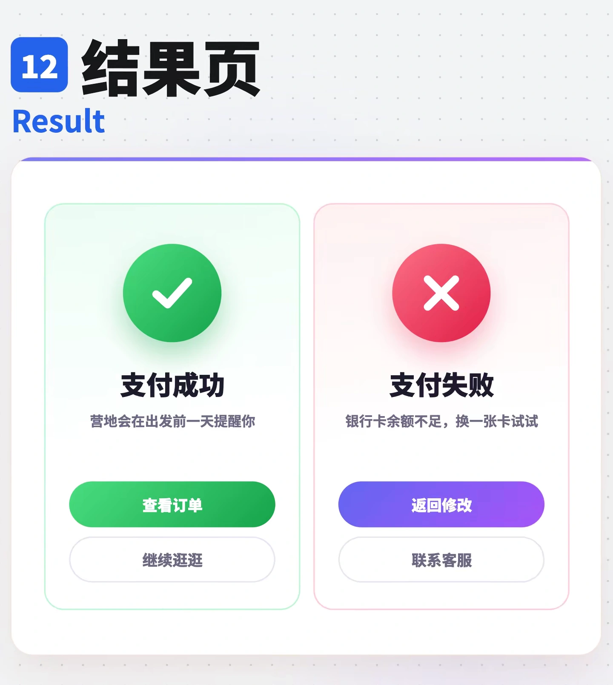

# 加载与错误页

静态图用于查看构图与可见状态，连续运动和短暂状态需在实际项目验证。按当前项目需求实现目标组件的交互与动效。

## 目录

- [骨架屏](#skeleton)
- [模糊渐显](#blur-up)
- [乐观更新](#optimistic-ui)
- [下拉刷新](#pull-to-refresh)
- [进度条](#progress-bar)
- [按钮加载状态](#loading-button)
- [空状态](#empty-state)
- [404 页面](#not-found)
- [错误页](#error-page)
- [断网提示](#offline)
- [没有权限](#no-permission)
- [结果页](#result)
- [加载动画](#spinner)

## 骨架屏 / Skeleton

- 标识：`loading-errors/skeleton`；类型：组件／效果。
- 效果要点：内容未返回时，用与真实内容同形的灰色块预占位置，并可加扫光；数据到达后在原位置替换，减少布局跳动。
- 指令例句：列表加载时用与真实内容形状一致的骨架屏，内容到达后原位替换。
- 媒体取舍：保留内容加载前的骨架占位，不误用已加载内容帧。

<!-- ui-atlas:details loading-errors/skeleton -->
- 原尺寸图片：[01 · 1440×1610](../assets/details/loading-errors/skeleton-hd-01.webp)。
- 清晰度边界：从 2160 像素高的原片按原像素裁切，WebP 质量 95，不放大、不锐化、不涂抹；静态帧不能证明完整运动。

<!-- /ui-atlas:details -->

## 模糊渐显 / Blur-up

- 标识：`loading-errors/blur-up`；类型：组件／效果。
- 效果要点：先显示低清模糊小图，高清图下载完成后逐渐变清楚；适合相册和商品图片列表。
- 指令例句：图片先展示低清占位图，高清加载完成后使用 Blur-up 渐显。
- 媒体取舍：对照有意模糊的占位图和清晰完成态，标题文字始终清晰。

<!-- ui-atlas:details loading-errors/blur-up -->
- 原尺寸图片：[01 · 1440×1610](../assets/details/loading-errors/blur-up-hd-01.webp) · [02 · 1440×1610](../assets/details/loading-errors/blur-up-hd-02.webp)。
- 多图用途：对照有意模糊的占位图和清晰完成态，标题文字始终清晰。
- 清晰度边界：从 2160 像素高的原片按原像素裁切，WebP 质量 95，不放大、不锐化、不涂抹；静态帧不能证明完整运动。

<!-- /ui-atlas:details -->

## 乐观更新 / Optimistic UI

- 标识：`loading-errors/optimistic-ui`；类型：组件／效果。
- 效果要点：点赞、收藏等低风险操作先立即改变界面，再等待服务器；失败时恢复原状态并提示。
- 指令例句：点赞立即变红，请求失败时回滚并提示失败。
- 媒体取舍：保留静态效果图与实现说明；连续路径、触发顺序、节奏和短暂状态需在项目中实际验证。

<!-- ui-atlas:details loading-errors/optimistic-ui -->
- 原尺寸图片：[01 · 1440×1610](../assets/details/loading-errors/optimistic-ui-hd-01.webp)。
- 清晰度边界：从 2160 像素高的原片按原像素裁切，WebP 质量 95，不放大、不锐化、不涂抹；静态帧不能证明完整运动。

<!-- /ui-atlas:details -->

## 下拉刷新 / Pull to Refresh

- 标识：`loading-errors/pull-to-refresh`；类型：组件／效果。
- 效果要点：手机列表向下拉时顶部出现刷新指示，松手触发刷新；适合消息、动态等会更新的列表。
- 指令例句：为移动端动态列表加入下拉并松手刷新的交互。
- 媒体取舍：保留静态效果图与实现说明；连续路径、触发顺序、节奏和短暂状态需在项目中实际验证。

<!-- ui-atlas:details loading-errors/pull-to-refresh -->
- 原尺寸图片：[01 · 1440×1610](../assets/details/loading-errors/pull-to-refresh-hd-01.webp)。
- 清晰度边界：从 2160 像素高的原片按原像素裁切，WebP 质量 95，不放大、不锐化、不涂抹；静态帧不能证明完整运动。

<!-- /ui-atlas:details -->

## 进度条 / Progress Bar

- 标识：`loading-errors/progress-bar`；类型：组件／效果。
- 效果要点：显示已完成比例；通常可按以下原则选择：短于约 1 秒不必额外放加载指示，几秒可用转圈，长任务用进度条并尽可能显示剩余时间。
- 指令例句：上传大文件显示真实进度、已完成量，并在可估算时显示剩余时间。
- 媒体取舍：重点是比例、已完成量和时间信息的呈现，多个进度状态加文字足够。

<!-- ui-atlas:details loading-errors/progress-bar -->
- 原尺寸图片：[01 · 1440×1610](../assets/details/loading-errors/progress-bar-hd-01.webp)。
- 清晰度边界：从 2160 像素高的原片按原像素裁切，WebP 质量 95，不放大、不锐化、不涂抹；静态帧不能证明完整运动。

<!-- /ui-atlas:details -->

## 按钮加载状态 / Loading Button

- 标识：`loading-errors/loading-button`；类型：组件／效果。
- 效果要点：提交后按钮内部出现加载指示，同时阻止重复点击，避免连点导致重复提交。
- 指令例句：提交按钮显示加载中，直到请求结束前不能重复提交。
- 媒体取舍：依次为待提交、提交中、成功，避免用相近的重复帧代替状态对照。

<!-- ui-atlas:details loading-errors/loading-button -->
- 原尺寸图片：[01 · 1440×1610](../assets/details/loading-errors/loading-button-hd-01.webp) · [02 · 1440×1610](../assets/details/loading-errors/loading-button-hd-02.webp) · [03 · 1440×1610](../assets/details/loading-errors/loading-button-hd-03.webp)。
- 多图用途：依次为待提交、提交中、成功，避免用相近的重复帧代替状态对照。
- 清晰度边界：从 2160 像素高的原片按原像素裁切，WebP 质量 95，不放大、不锐化、不涂抹；静态帧不能证明完整运动。

<!-- /ui-atlas:details -->

## 空状态 / Empty State

- 标识：`loading-errors/empty-state`；类型：组件／效果。
- 效果要点：列表没有内容时，给出插图、为空的原因和下一步按钮；例子为还没有订单、去逛逛。
- 指令例句：订单为空时显示原因说明和去逛逛入口。
- 媒体取舍：插图、原因与下一步入口属于静态结构。

<!-- ui-atlas:details loading-errors/empty-state -->
- 原尺寸图片：[01 · 1440×1610](../assets/details/loading-errors/empty-state-hd-01.webp) · [02 · 1440×1610](../assets/details/loading-errors/empty-state-hd-02.webp)。
- 多图用途：插图、原因与下一步入口属于静态结构。
- 清晰度边界：从 2160 像素高的原片按原像素裁切，WebP 质量 95，不放大、不锐化、不涂抹；静态帧不能证明完整运动。

<!-- /ui-atlas:details -->

## 404 页面 / Not Found

- 标识：`loading-errors/not-found`；类型：组件／效果。
- 效果要点：地址不存在；不要只放错误码，示例提供返回首页和搜索入口。
- 指令例句：404 页面说明地址不存在，提供回首页和搜索入口。
- 媒体取舍：错误说明、回首页和搜索入口属于页面布局参考。

<!-- ui-atlas:details loading-errors/not-found -->
- 原尺寸图片：[01 · 1440×1610](../assets/details/loading-errors/not-found-hd-01.webp)。
- 清晰度边界：从 2160 像素高的原片按原像素裁切，WebP 质量 95，不放大、不锐化、不涂抹；静态帧不能证明完整运动。

<!-- /ui-atlas:details -->

## 错误页 / Error Page

- 标识：`loading-errors/error-page`；类型：组件／效果。
- 效果要点：服务器故障如 500；解释发生了什么，避免责怪用户，提供重试。
- 指令例句：服务暂时出错时显示清楚的说明和重新试试按钮。
- 媒体取舍：原因文案与重试入口属于静态内容结构。

<!-- ui-atlas:details loading-errors/error-page -->
- 原尺寸图片：[01 · 1440×1610](../assets/details/loading-errors/error-page-hd-01.webp)。
- 清晰度边界：从 2160 像素高的原片按原像素裁切，WebP 质量 95，不放大、不锐化、不涂抹；静态帧不能证明完整运动。

<!-- /ui-atlas:details -->

## 断网提示 / Offline

- 标识：`loading-errors/offline`；类型：组件／效果。
- 效果要点：断网时顶部滑出网络已断开提示；恢复后变成已重新连接，然后收起。
- 指令例句：监听网络状态，断网显示横幅，恢复连接后更新提示再收起。
- 媒体取舍：保留静态效果图与实现说明；连续路径、触发顺序、节奏和短暂状态需在项目中实际验证。

<!-- ui-atlas:details loading-errors/offline -->
- 原尺寸图片：[01 · 1440×1610](../assets/details/loading-errors/offline-hd-01.webp)。
- 清晰度边界：从 2160 像素高的原片按原像素裁切，WebP 质量 95，不放大、不锐化、不涂抹；静态帧不能证明完整运动。

<!-- /ui-atlas:details -->

## 没有权限 / No Permission

- 标识：`loading-errors/no-permission`；类型：组件／效果。
- 效果要点：资源存在但无权访问，示例为 403；告知联系谁，并提供申请权限入口。
- 指令例句：无权限时说明资源需要授权，提供联系管理员或申请权限入口。
- 媒体取舍：无权限说明与申请入口属于静态内容结构。

<!-- ui-atlas:details loading-errors/no-permission -->
- 原尺寸图片：[01 · 1440×1610](../assets/details/loading-errors/no-permission-hd-01.webp)。
- 清晰度边界：从 2160 像素高的原片按原像素裁切，WebP 质量 95，不放大、不锐化、不涂抹；静态帧不能证明完整运动。

<!-- /ui-atlas:details -->

## 结果页 / Result

- 标识：`loading-errors/result`；类型：组件／效果。
- 效果要点：任务提交后明确成功或失败；成功展示对勾和下一步，失败写原因并提供返回修改。
- 指令例句：提交结果页分别覆盖成功下一步和失败返回修改。
- 媒体取舍：成功、失败与下一步的对照图足够，不保留装饰性庆祝过程。

<!-- ui-atlas:details loading-errors/result -->
- 原尺寸图片：[01 · 1440×1610](../assets/details/loading-errors/result-hd-01.webp)。
- 清晰度边界：从 2160 像素高的原片按原像素裁切，WebP 质量 95，不放大、不锐化、不涂抹；静态帧不能证明完整运动。

<!-- /ui-atlas:details -->

## 加载动画 / Spinner

- 标识：`loading-errors/spinner`；类型：组件／效果。
- 效果要点：圆形指示持续旋转，表达正在处理；适合无法提供精确进度的加载状态。
- 指令例句：无法获知进度的短等待显示 Spinner。
- 媒体取舍：保留静态效果图与实现说明；连续路径、触发顺序、节奏和短暂状态需在项目中实际验证。

<!-- ui-atlas:details loading-errors/spinner -->
- 原尺寸图片：[01 · 600×900](https://raw.githubusercontent.com/dqzboy/ui-atlas/4d61e1224c50685c02acae3ae67ebe9c217fa3b9/assets/details/loading-errors/spinner.png)。
- 清晰度边界：从历史素材提取原尺寸独立帧，避免总览缩图和再次 JPEG 压缩；源素材的分辨率与色彩限制仍在，图片不能证明连续运动。

<!-- /ui-atlas:details -->
