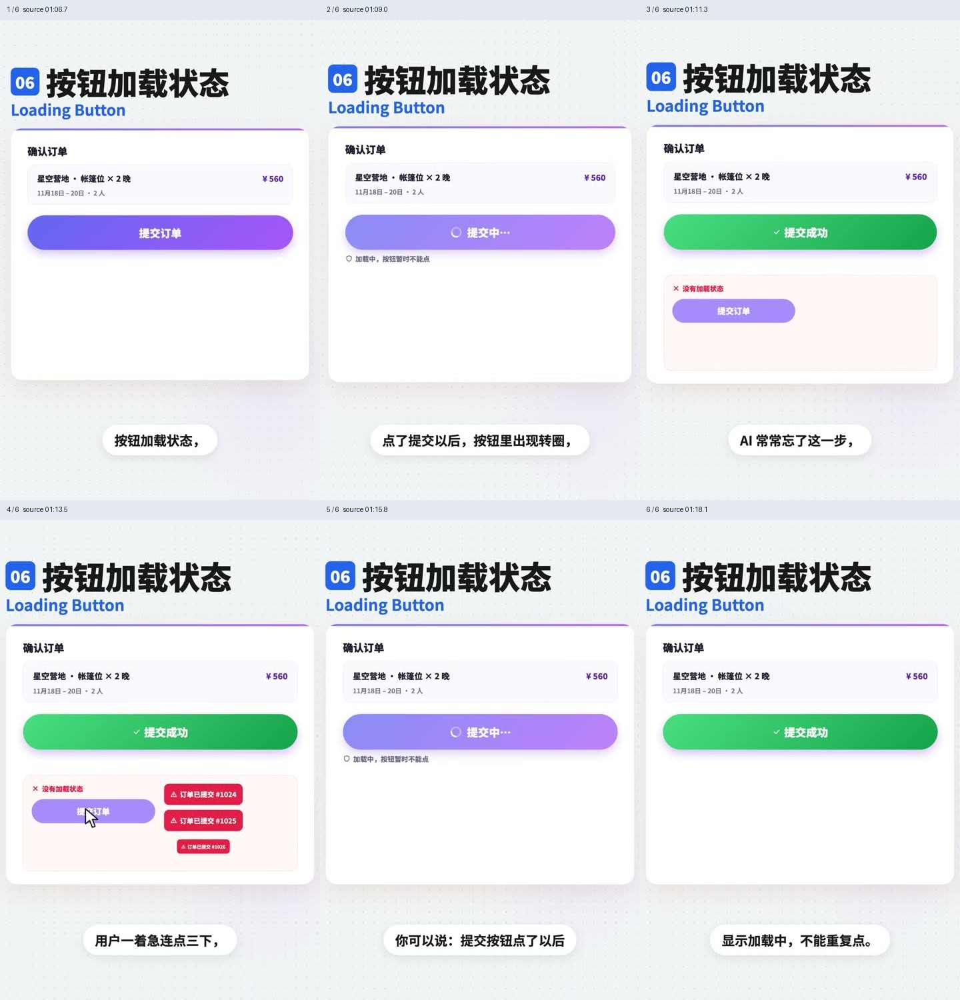
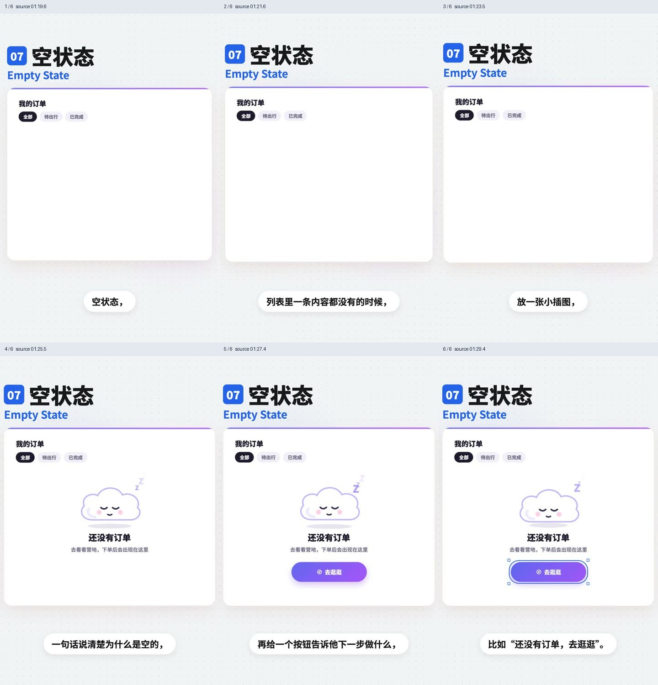
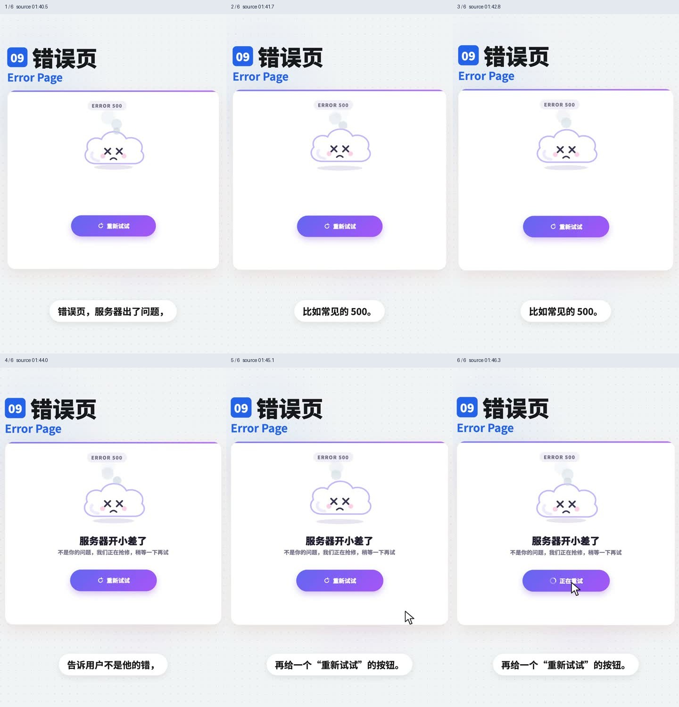
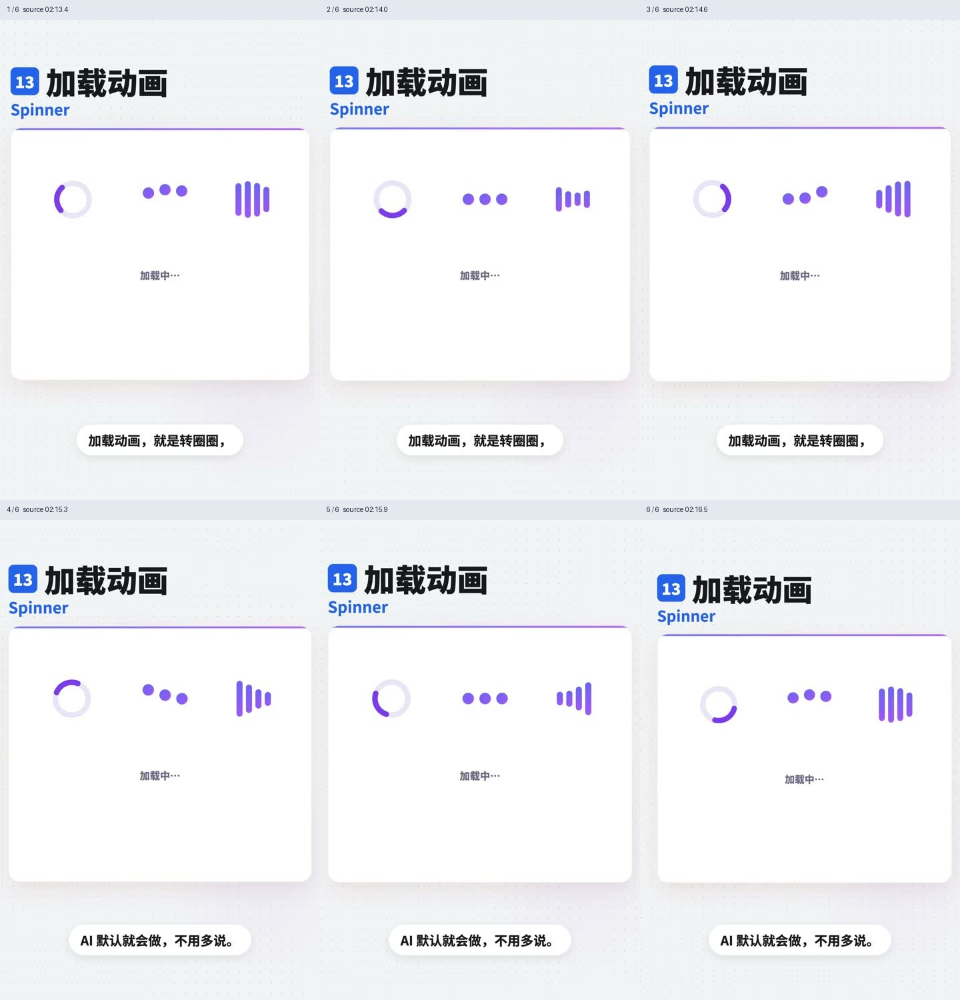

# 加载与错误页

来源：`13种加载和错误页解读.mp4`。时间为原片绝对时间，片段按原速播放。

GIF 看连续运动，六帧图看状态变化。参考视频包含讲解者的鼠标、选框和字幕；这些演示标注不属于待实现产品。

## 目录

- [骨架屏 / Skeleton](#skeleton)
- [模糊渐显 / Blur-up](#blur-up)
- [乐观更新 / Optimistic UI](#optimistic-ui)
- [下拉刷新 / Pull to Refresh](#pull-to-refresh)
- [进度条 / Progress Bar](#progress-bar)
- [按钮加载状态 / Loading Button](#loading-button)
- [空状态 / Empty State](#empty-state)
- [404 页面 / Not Found](#not-found)
- [错误页 / Error Page](#error-page)
- [断网提示 / Offline](#offline)
- [没有权限 / No Permission](#no-permission)
- [结果页 / Result](#result)
- [加载动画 / Spinner](#spinner)

## 骨架屏 / Skeleton

- 标识：`loading-errors/skeleton`；类型：组件／效果。
- 原视频：`13种加载和错误页解读.mp4`，00:08.1–00:21.8。
- 视频要点：内容未返回时，用与真实内容同形的灰色块预占位置，并可加扫光；数据到达后在原位置替换，减少布局跳动。
- 指令例句：列表加载时用与真实内容形状一致的骨架屏，内容到达后原位替换。
- 参考：[GIF 动图](../assets/gifs/loading-errors/skeleton.gif) · [六帧对照图](../assets/filmstrips/loading-errors/skeleton.jpg)。

## 模糊渐显 / Blur-up

- 标识：`loading-errors/blur-up`；类型：组件／效果。
- 原视频：`13种加载和错误页解读.mp4`，00:23.3–00:33.5。
- 视频要点：先显示低清模糊小图，高清图下载完成后逐渐变清楚；适合相册和商品图片列表。
- 指令例句：图片先展示低清占位图，高清加载完成后使用 Blur-up 渐显。
- 参考：[GIF 动图](../assets/gifs/loading-errors/blur-up.gif) · [六帧对照图](../assets/filmstrips/loading-errors/blur-up.jpg)。

## 乐观更新 / Optimistic UI

- 标识：`loading-errors/optimistic-ui`；类型：组件／效果。
- 原视频：`13种加载和错误页解读.mp4`，00:35.1–00:44.8。
- 视频要点：点赞、收藏等低风险操作先立即改变界面，再等待服务器；失败时恢复原状态并提示。
- 指令例句：点赞立即变红，请求失败时回滚并提示失败。
- 参考：[GIF 动图](../assets/gifs/loading-errors/optimistic-ui.gif) · [六帧对照图](../assets/filmstrips/loading-errors/optimistic-ui.jpg)。

## 下拉刷新 / Pull to Refresh

- 标识：`loading-errors/pull-to-refresh`；类型：组件／效果。
- 原视频：`13种加载和错误页解读.mp4`，00:46.3–00:53.5。
- 视频要点：手机列表向下拉时顶部出现刷新指示，松手触发刷新；适合消息、动态等会更新的列表。
- 指令例句：为移动端动态列表加入下拉并松手刷新的交互。
- 参考：[GIF 动图](../assets/gifs/loading-errors/pull-to-refresh.gif) · [六帧对照图](../assets/filmstrips/loading-errors/pull-to-refresh.jpg)。

## 进度条 / Progress Bar

- 标识：`loading-errors/progress-bar`；类型：组件／效果。
- 原视频：`13种加载和错误页解读.mp4`，00:54.3–01:05.4。
- 视频要点：显示已完成比例；教学经验是短于约 1 秒不必额外放加载指示，几秒可用转圈，长任务用进度条并尽可能显示剩余时间。
- 指令例句：上传大文件显示真实进度、已完成量，并在可估算时显示剩余时间。
- 参考：[GIF 动图](../assets/gifs/loading-errors/progress-bar.gif) · [六帧对照图](../assets/filmstrips/loading-errors/progress-bar.jpg)。

## 按钮加载状态 / Loading Button

- 标识：`loading-errors/loading-button`；类型：组件／效果。
- 原视频：`13种加载和错误页解读.mp4`，01:06.3–01:18.5。
- 视频要点：提交后按钮内部出现加载指示，同时阻止重复点击，避免连点导致重复提交。
- 指令例句：提交按钮显示加载中，直到请求结束前不能重复提交。
- 参考：[GIF 动图](../assets/gifs/loading-errors/loading-button.gif) · [六帧对照图](../assets/filmstrips/loading-errors/loading-button.jpg)。

## 空状态 / Empty State

- 标识：`loading-errors/empty-state`；类型：组件／效果。
- 原视频：`13种加载和错误页解读.mp4`，01:19.3–01:29.7。
- 视频要点：列表没有内容时，给出插图、为空的原因和下一步按钮；例子为还没有订单、去逛逛。
- 指令例句：订单为空时显示原因说明和去逛逛入口。
- 参考：[GIF 动图](../assets/gifs/loading-errors/empty-state.gif) · [六帧对照图](../assets/filmstrips/loading-errors/empty-state.jpg)。

## 404 页面 / Not Found

- 标识：`loading-errors/not-found`；类型：组件／效果。
- 原视频：`13种加载和错误页解读.mp4`，01:31.3–01:38.6。
- 视频要点：地址不存在；不要只放错误码，示例提供返回首页和搜索入口。
- 指令例句：404 页面说明地址不存在，提供回首页和搜索入口。
- 参考：[GIF 动图](../assets/gifs/loading-errors/not-found.gif) · [六帧对照图](../assets/filmstrips/loading-errors/not-found.jpg)。

## 错误页 / Error Page

- 标识：`loading-errors/error-page`；类型：组件／效果。
- 原视频：`13种加载和错误页解读.mp4`，01:40.3–01:46.5。
- 视频要点：服务器故障如 500；解释发生了什么，避免责怪用户，提供重试。
- 指令例句：服务暂时出错时显示清楚的说明和重新试试按钮。
- 参考：[GIF 动图](../assets/gifs/loading-errors/error-page.gif) · [六帧对照图](../assets/filmstrips/loading-errors/error-page.jpg)。

## 断网提示 / Offline

- 标识：`loading-errors/offline`；类型：组件／效果。
- 原视频：`13种加载和错误页解读.mp4`，01:47.3–01:53.7。
- 视频要点：断网时顶部滑出网络已断开提示；恢复后变成已重新连接，然后收起。
- 指令例句：监听网络状态，断网显示横幅，恢复连接后更新提示再收起。
- 参考：[GIF 动图](../assets/gifs/loading-errors/offline.gif) · [六帧对照图](../assets/filmstrips/loading-errors/offline.jpg)。

## 没有权限 / No Permission

- 标识：`loading-errors/no-permission`；类型：组件／效果。
- 原视频：`13种加载和错误页解读.mp4`，01:55.3–02:02.5。
- 视频要点：资源存在但无权访问，示例为 403；告知联系谁，并提供申请权限入口。
- 指令例句：无权限时说明资源需要授权，提供联系管理员或申请权限入口。
- 参考：[GIF 动图](../assets/gifs/loading-errors/no-permission.gif) · [六帧对照图](../assets/filmstrips/loading-errors/no-permission.jpg)。

## 结果页 / Result

- 标识：`loading-errors/result`；类型：组件／效果。
- 原视频：`13种加载和错误页解读.mp4`，02:04.3–02:12.4。
- 视频要点：任务提交后明确成功或失败；成功展示对勾和下一步，失败写原因并提供返回修改。
- 指令例句：提交结果页分别覆盖成功下一步和失败返回修改。
- 参考：[GIF 动图](../assets/gifs/loading-errors/result.gif) · [六帧对照图](../assets/filmstrips/loading-errors/result.jpg)。

## 加载动画 / Spinner

- 标识：`loading-errors/spinner`；类型：组件／效果。
- 原视频：`13种加载和错误页解读.mp4`，02:13.3–02:16.6。
- 视频要点：圆形指示持续旋转，表达正在处理；视频将其作为基础加载样式，未提供精确进度。
- 指令例句：无法获知进度的短等待显示 Spinner。
- 参考：[GIF 动图](../assets/gifs/loading-errors/spinner.gif) · [六帧对照图](../assets/filmstrips/loading-errors/spinner.jpg)。

