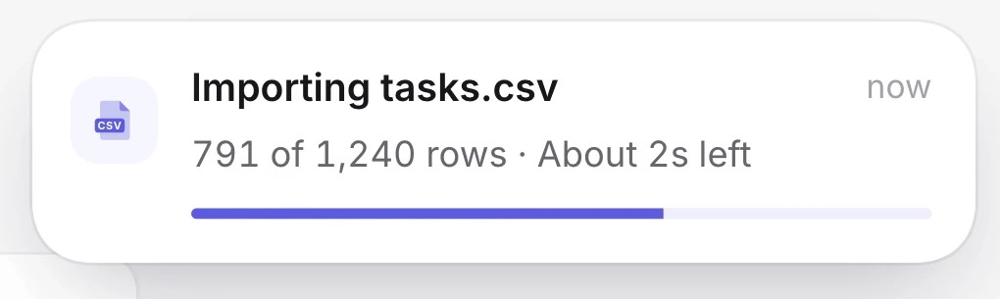
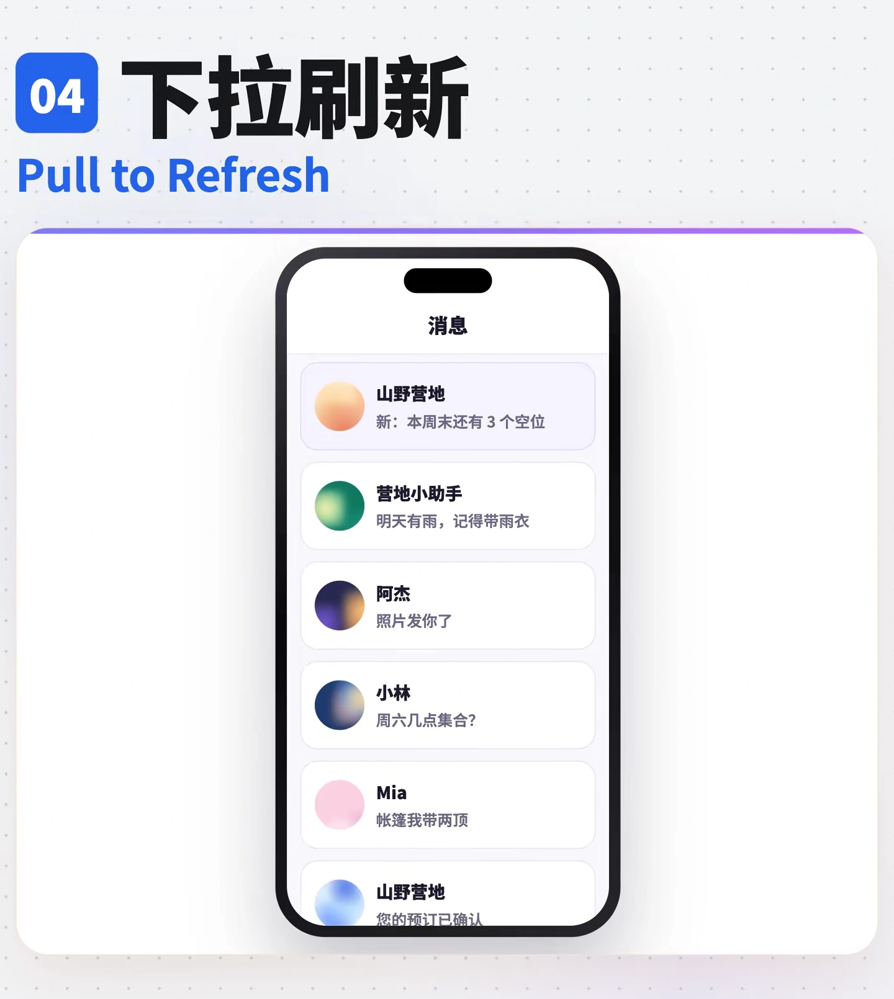
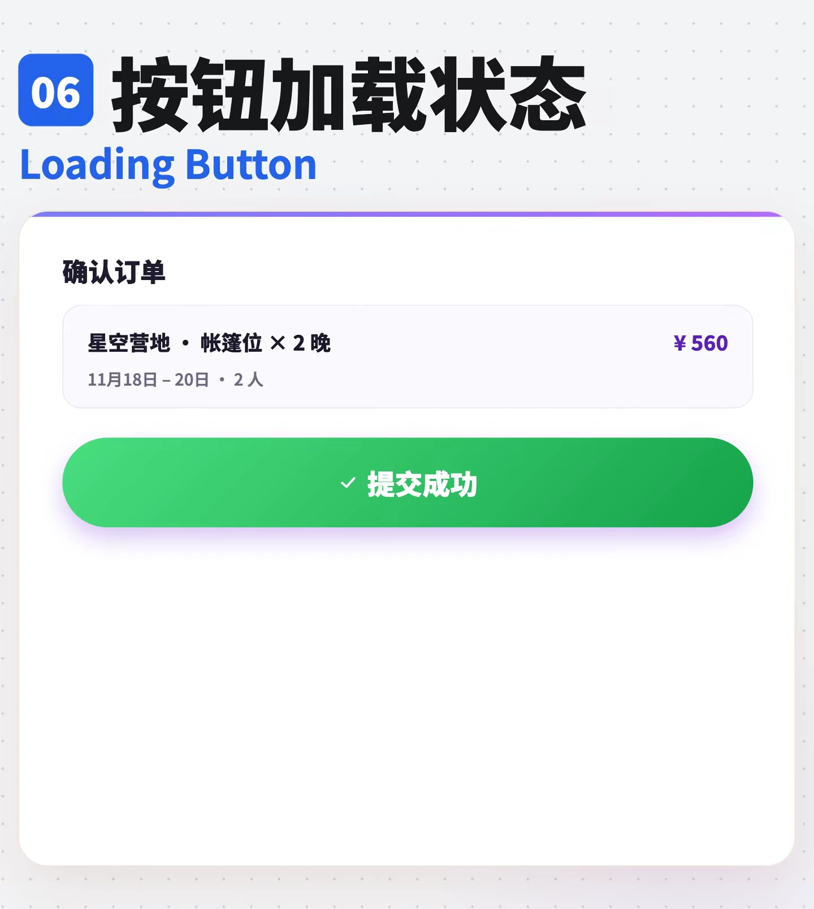
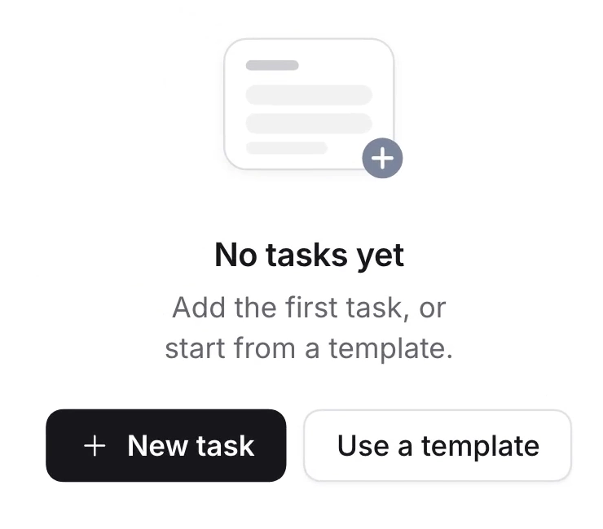
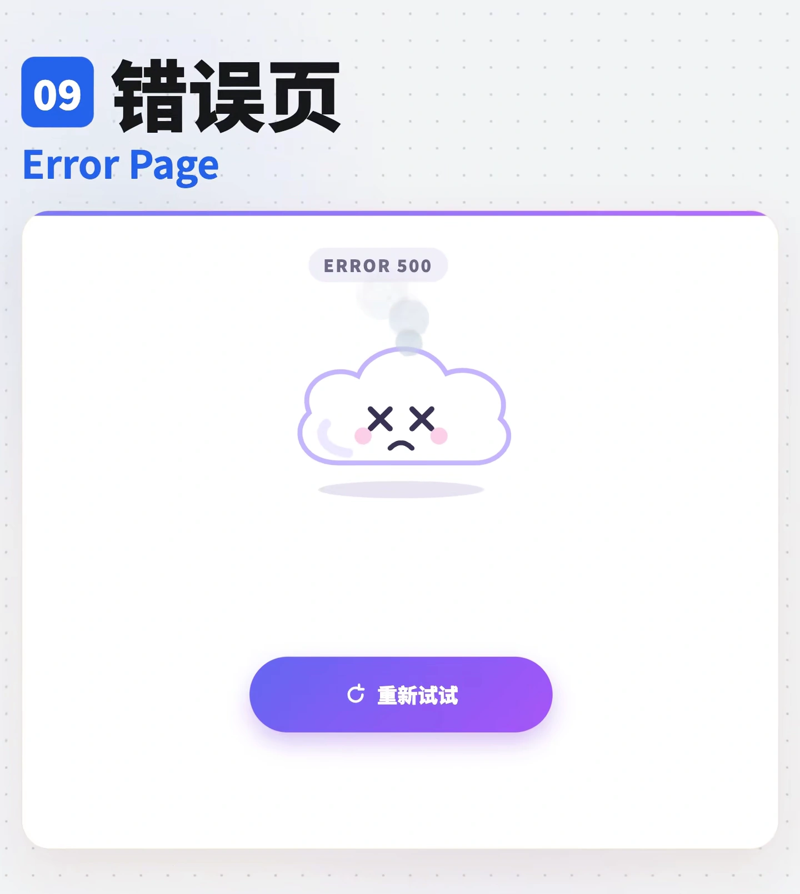
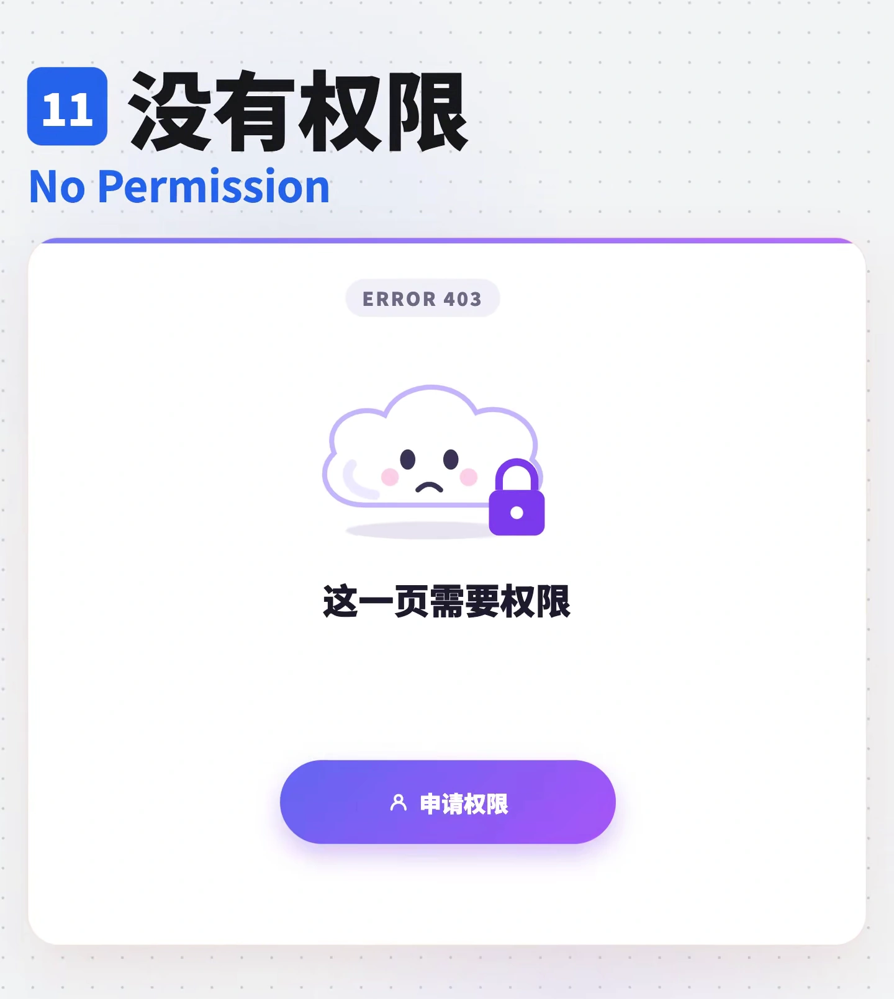
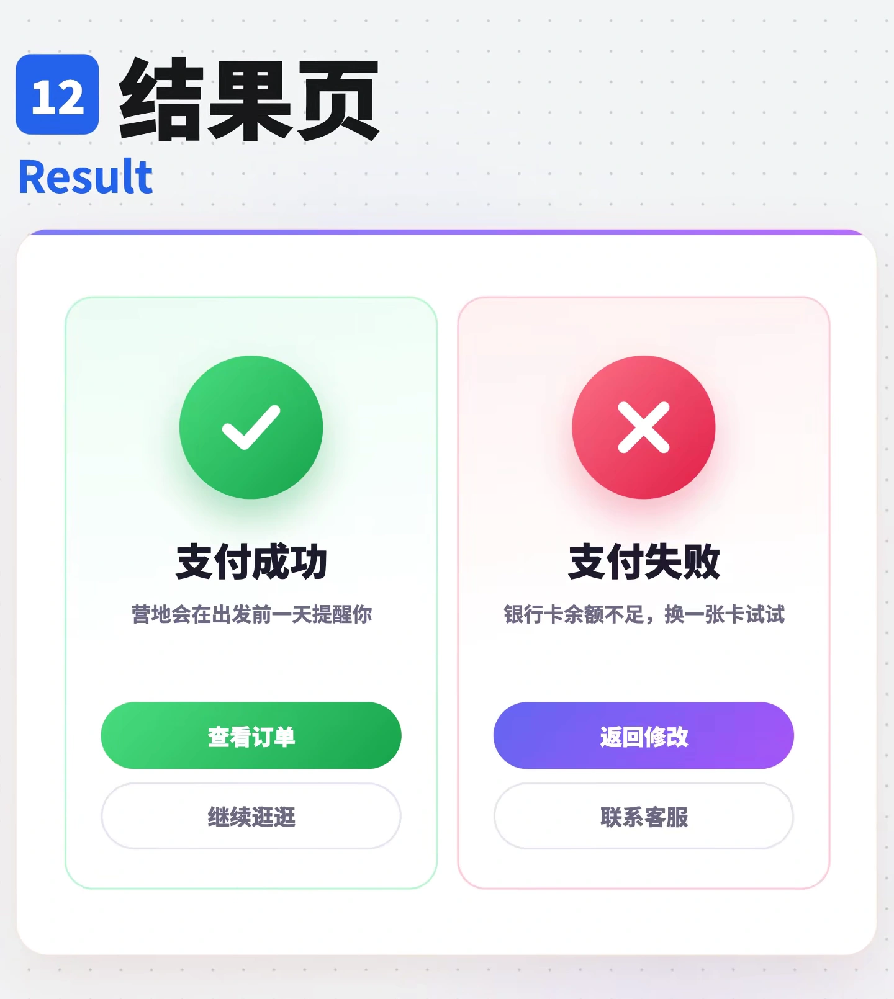

# 加载与错误页

静态图用于查看构图与可见状态，连续运动和短暂状态需在实际项目验证。按当前项目需求实现目标组件的交互与动效。

## 目录

- [等待状态选型（017）](#loading-states)
- [骨架屏](#skeleton)
- [模糊渐显](#blur-up)
- [乐观更新](#optimistic-ui)
- [下拉刷新](#pull-to-refresh)
- [进度条](#progress-bar)
- [按钮加载状态](#loading-button)
- [空状态的三种画法](#empty-state)
- [404 页面](#not-found)
- [错误页](#error-page)
- [断网提示](#offline)
- [没有权限](#no-permission)
- [结果页](#result)
- [加载动画](#spinner)

## 巧用等待状态，让产品响应更丝滑 / Loading States

- 标识：`loading-errors/loading-states`；类型：选型／纠错。
- 效果要点：017：先诊断每项等待，再选择无提示、Spinner、Skeleton、Progress、乐观更新、AI 流式结果或后台状态；保留真实进度、取消、回滚与恢复入口。
- 实现关注：延迟约 300ms、出现后约 500ms 是视觉起点，不推迟请求结果；初次加载与刷新分开，真实进度与估时不伪造，取消与隐藏任务分开，乐观回滚仅撤回该次改动，流式阶段来自真实工作。
- 指令例句：先盘点并按类型输出等待诊断表，再实施所选加载策略；延迟指示不延迟结果，进度和阶段真实，失败可恢复，乐观回滚不覆盖后续改动。
- 媒体取舍：四图分别呈现动作图标、骨架占位、真实进度信息和失败重试行，复用具体条目图片；时序与业务行为按 017 配方验证。
- [017 完整配方与实现提示词](recipes/loading-states.md)。

<!-- ui-atlas:details loading-errors/loading-states -->
- 原尺寸图片：[01 · 280×118](../assets/details/loading-errors/waiting-sync-button.webp) · [02 · 1820×570](../assets/details/loading-errors/waiting-skeleton.webp) · [03 · 1020×305](../assets/details/loading-errors/waiting-progress.webp) · [04 · 2045×100](../assets/details/loading-errors/waiting-rollback.webp)。
- 多图用途：四图分别呈现动作图标、骨架占位、真实进度信息和失败重试行，复用具体条目图片；时序与业务行为按 017 配方验证。
- 清晰度边界：从 2160×2880 视频直接解码，按原像素裁切，WebP 质量 98；不放大、不锐化、不涂抹、不跨帧修补。静态图不证明真实等待时长、旋转、进度、回滚或取消。

<!-- /ui-atlas:details -->

## 骨架屏 / Skeleton

- 标识：`loading-errors/skeleton`；类型：组件／效果。
- 效果要点：已知内容结构的首次加载：静态标题、Tab 和表头立即显示，数据区域延迟约 300ms 用真实尺寸骨架占位，原位替换；刷新保留旧数据。
- 指令例句：内容结构已知时使用真实行高与比例的 Skeleton，保留已知内容，延迟指示减少闪烁并核对到达后布局稳定。
- 媒体取舍：保留三行无讲解标注的骨架局部；扫光、行高匹配和原位替换需实际验证。
- [等待状态选型与完整提示词（017）](recipes/loading-states.md)。

<!-- ui-atlas:details loading-errors/skeleton -->
- 原尺寸图片：[01 · 1820×570](../assets/details/loading-errors/waiting-skeleton.webp)。
- 清晰度边界：从 2160×2880 视频直接解码，按原像素裁切，WebP 质量 98；不放大、不锐化、不涂抹、不跨帧修补。静态图不证明真实等待时长、旋转、进度、回滚或取消。

<!-- /ui-atlas:details -->

## 模糊渐显 / Blur-up

- 标识：`loading-errors/blur-up`；类型：组件／效果。
- 效果要点：先显示低清模糊小图，高清图下载完成后逐渐变清楚；适合相册和商品图片列表。
- 指令例句：图片先展示低清占位图，高清加载完成后使用 Blur-up 渐显。
- 媒体取舍：对照有意模糊的占位图和清晰完成态，标题文字始终清晰。

<!-- ui-atlas:details loading-errors/blur-up -->
- 原尺寸图片：[01 · 1440×1610](../assets/details/loading-errors/blur-up-hd-01.webp) · [02 · 1440×1610](../assets/details/loading-errors/blur-up-hd-02.webp)。
- 多图用途：对照有意模糊的占位图和清晰完成态，标题文字始终清晰。
- 清晰度边界：从 2160 像素高的原片按原像素裁切，WebP 质量 95，不放大、不锐化、不涂抹；静态帧不能证明完整运动。

<!-- /ui-atlas:details -->

## 乐观更新 / Optimistic UI

- 标识：`loading-errors/optimistic-ui`；类型：组件／效果。
- 效果要点：业务允许且容易撤回的操作先更新界面与相关计数，再后台保存；失败仅撤回该次改动、保留输入，并在条目上持续说明与 Retry。
- 指令例句：低风险可逆操作使用乐观更新，真实失败原位回滚并提供 Retry；并发回滚不覆盖后续编辑，不把对外发送提前当作成功。
- 媒体取舍：保留失败后恢复勾选、说明原因和 Retry 的独立行；完整乐观过程、并发回滚与重试需实际验证。
- [等待状态选型与完整提示词（017）](recipes/loading-states.md)。

<!-- ui-atlas:details loading-errors/optimistic-ui -->
- 原尺寸图片：[01 · 2045×100](../assets/details/loading-errors/waiting-rollback.webp)。
- 清晰度边界：从 2160×2880 视频直接解码，按原像素裁切，WebP 质量 98；不放大、不锐化、不涂抹、不跨帧修补。静态图不证明真实等待时长、旋转、进度、回滚或取消。

<!-- /ui-atlas:details -->

## 下拉刷新 / Pull to Refresh

- 标识：`loading-errors/pull-to-refresh`；类型：组件／效果。
- 效果要点：手机列表向下拉时顶部出现刷新指示，松手触发刷新；适合消息、动态等会更新的列表。
- 指令例句：为移动端动态列表加入下拉并松手刷新的交互。
- 媒体取舍：保留静态效果图与实现说明；连续路径、触发顺序、节奏和短暂状态需在项目中实际验证。

<!-- ui-atlas:details loading-errors/pull-to-refresh -->
- 原尺寸图片：[01 · 1440×1610](../assets/details/loading-errors/pull-to-refresh-hd-01.webp)。
- 清晰度边界：从 2160 像素高的原片按原像素裁切，WebP 质量 95，不放大、不锐化、不涂抹；静态帧不能证明完整运动。

<!-- /ui-atlas:details -->

## 进度条 / Progress Bar

- 标识：`loading-errors/progress-bar`；类型：组件／效果。
- 效果要点：可计量的较长任务展示真实数量、比例与可估算的剩余时间；未知总量改用实际阶段，条目内或跨页任务卡呈现结果。
- 指令例句：显示真实进度与稳定样本估算的剩余时间，区分上传和服务端处理；取消、清屏和完成结果按实际任务语义处理。
- 媒体取舍：保留一张有任务名、数量、估时与进度条的卡片；数字、完成和取消由真实任务验证。
- [等待状态选型与完整提示词（017）](recipes/loading-states.md)。

<!-- ui-atlas:details loading-errors/progress-bar -->
- 原尺寸图片：[01 · 1020×305](../assets/details/loading-errors/waiting-progress.webp)。
- 清晰度边界：从 2160×2880 视频直接解码，按原像素裁切，WebP 质量 98；不放大、不锐化、不涂抹、不跨帧修补。静态图不证明真实等待时长、旋转、进度、回滚或取消。

<!-- /ui-atlas:details -->

## 按钮加载状态 / Loading Button

- 标识：`loading-errors/loading-button`；类型：组件／效果。
- 效果要点：请求中立即阻止重复提交；独立 Spinner 可延迟约 300ms，保留按钮文案与宽度。视觉最短显示不延迟真实结果或输入恢复。
- 指令例句：按钮按真实 pending 防重提交并保持文案和宽度；减少加载闪烁，完成或失败立即更新真实状态。
- [等待状态与按钮时序（017）](recipes/loading-states.md)。
- 媒体取舍：依次为待提交、提交中、成功，避免用相近的重复帧代替状态对照。

<!-- ui-atlas:details loading-errors/loading-button -->
- 原尺寸图片：[01 · 1440×1610](../assets/details/loading-errors/loading-button-hd-01.webp) · [02 · 1440×1610](../assets/details/loading-errors/loading-button-hd-02.webp) · [03 · 1440×1610](../assets/details/loading-errors/loading-button-hd-03.webp)。
- 多图用途：依次为待提交、提交中、成功，避免用相近的重复帧代替状态对照。
- 清晰度边界：从 2160 像素高的原片按原像素裁切，WebP 质量 95，不放大、不锐化、不涂抹；静态帧不能证明完整运动。

<!-- /ui-atlas:details -->

## 空状态的三种画法 / Empty States

- 标识：`loading-errors/empty-state`；类型：组件／选型。
- 效果要点：022：先区分首次使用、无结果、全部处理完、失败／离线、无权限或无需空态；再按空间选择线框、图标、迷你横排或纯文字。
- 实现提示词：读取 [022 完整空状态配方与提示词](recipes/empty-state.md)，报告类型、尺寸、图示与具体文案，只实施所选位置；保留搜索、筛选、真实状态和恢复入口。
- 核对要点：Page／Card／Row／Menu 独立于类型；未知保障不承诺，零值和未加载不误判为空，重试与申请权限依赖真实能力。
- 媒体取舍：三种不同结构各一张清晰局部，替换旧同类两图；连续替换、数据与可访问性按实际产品验证。

<!-- ui-atlas:details loading-errors/empty-state -->
- 原尺寸图片：[01 · 740×650](../assets/details/loading-errors/empty-wireframe.webp) · [02 · 640×615](../assets/details/loading-errors/empty-icon.webp) · [03 · 820×155](../assets/details/loading-errors/empty-mini.webp)。
- 多图用途：线框、双色图标与迷你横排各一张清晰 UI 局部，替换旧同类两图，不保存近似帧；状态判断、布局替换、真实操作和可访问性按 022 完整配方验证。
- 清晰度边界：从 2160×2880 视频直接解码，原像素裁切、WebP 质量 98；线框 740×650、图标 640×615、迷你 820×155，无放大、锐化、涂抹或跨帧修补；不含讲解面板、教学标注、指针和署名。三图只展示不同结构局部，实际状态、创建、重试与权限请求需在产品验证。

<!-- /ui-atlas:details -->

## 404 页面 / Not Found

- 标识：`loading-errors/not-found`；类型：组件／效果。
- 效果要点：地址不存在；不要只放错误码，示例提供返回首页和搜索入口。
- 指令例句：404 页面说明地址不存在，提供回首页和搜索入口。
- 媒体取舍：错误说明、回首页和搜索入口属于页面布局参考。

<!-- ui-atlas:details loading-errors/not-found -->
- 原尺寸图片：[01 · 1440×1610](../assets/details/loading-errors/not-found-hd-01.webp)。
- 清晰度边界：从 2160 像素高的原片按原像素裁切，WebP 质量 95，不放大、不锐化、不涂抹；静态帧不能证明完整运动。

<!-- /ui-atlas:details -->

## 错误页 / Error Page

- 标识：`loading-errors/error-page`；类型：组件／效果。
- 效果要点：服务器故障如 500；解释发生了什么，避免责怪用户，提供重试。
- 指令例句：服务暂时出错时显示清楚的说明和重新试试按钮。局部状态、尺寸与文案先读 [022 配方](recipes/empty-state.md)。
- 媒体取舍：原因文案与重试入口属于静态内容结构。

<!-- ui-atlas:details loading-errors/error-page -->
- 原尺寸图片：[01 · 1440×1610](../assets/details/loading-errors/error-page-hd-01.webp)。
- 清晰度边界：从 2160 像素高的原片按原像素裁切，WebP 质量 95，不放大、不锐化、不涂抹；静态帧不能证明完整运动。

<!-- /ui-atlas:details -->

## 断网提示 / Offline

- 标识：`loading-errors/offline`；类型：组件／效果。
- 效果要点：断网时顶部滑出网络已断开提示；恢复后变成已重新连接，然后收起。
- 指令例句：监听网络状态，断网显示横幅，恢复连接后更新提示再收起。内容区域因断网无法加载时，按 [022 配方](recipes/empty-state.md) 保留缓存与局部恢复；不自动承诺离线同步。
- 媒体取舍：保留静态效果图与实现说明；连续路径、触发顺序、节奏和短暂状态需在项目中实际验证。

<!-- ui-atlas:details loading-errors/offline -->
- 原尺寸图片：[01 · 1440×1610](../assets/details/loading-errors/offline-hd-01.webp)。
- 清晰度边界：从 2160 像素高的原片按原像素裁切，WebP 质量 95，不放大、不锐化、不涂抹；静态帧不能证明完整运动。

<!-- /ui-atlas:details -->

## 没有权限 / No Permission

- 标识：`loading-errors/no-permission`；类型：组件／效果。
- 效果要点：资源存在但无权访问，示例为 403；告知联系谁，并提供申请权限入口。
- 指令例句：无权限时说明资源需要授权，提供联系管理员或申请权限入口。局部状态、尺寸与文案先读 [022 配方](recipes/empty-state.md)。
- 媒体取舍：无权限说明与申请入口属于静态内容结构。

<!-- ui-atlas:details loading-errors/no-permission -->
- 原尺寸图片：[01 · 1440×1610](../assets/details/loading-errors/no-permission-hd-01.webp)。
- 清晰度边界：从 2160 像素高的原片按原像素裁切，WebP 质量 95，不放大、不锐化、不涂抹；静态帧不能证明完整运动。

<!-- /ui-atlas:details -->

## 结果页 / Result

- 标识：`loading-errors/result`；类型：组件／效果。
- 效果要点：任务提交后明确成功或失败；成功展示对勾和下一步，失败写原因并提供返回修改。
- 指令例句：提交结果页分别覆盖成功下一步和失败返回修改。
- 媒体取舍：成功、失败与下一步的对照图足够，不保留装饰性庆祝过程。

<!-- ui-atlas:details loading-errors/result -->
- 原尺寸图片：[01 · 1440×1610](../assets/details/loading-errors/result-hd-01.webp)。
- 清晰度边界：从 2160 像素高的原片按原像素裁切，WebP 质量 95，不放大、不锐化、不涂抹；静态帧不能证明完整运动。

<!-- /ui-atlas:details -->

## 加载动画 / Spinner

- 标识：`loading-errors/spinner`；类型：组件／效果。
- 效果要点：短操作且无法计量时就地显示 Spinner；普通指示延迟约 300ms，原本表示同步／刷新的图标可即时旋转，保持按钮宽度与文案。
- 指令例句：短等待按真实 pending 阻止重复提交，保持页面可用；旋转只控制视觉，不能延迟请求结果或输入恢复。
- 媒体取舍：保留旋转中的同步按钮局部；静态帧不证明旋转路径、整圈停止或防重提交。
- [等待状态选型与完整提示词（017）](recipes/loading-states.md)。

<!-- ui-atlas:details loading-errors/spinner -->
- 原尺寸图片：[01 · 280×118](../assets/details/loading-errors/waiting-sync-button.webp)。
- 清晰度边界：从 2160×2880 视频直接解码，按原像素裁切，WebP 质量 98；不放大、不锐化、不涂抹、不跨帧修补。静态图不证明真实等待时长、旋转、进度、回滚或取消。

<!-- /ui-atlas:details -->
