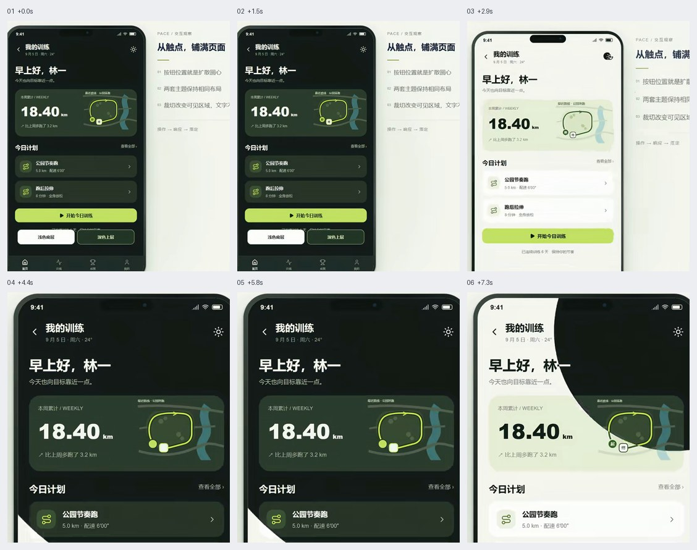
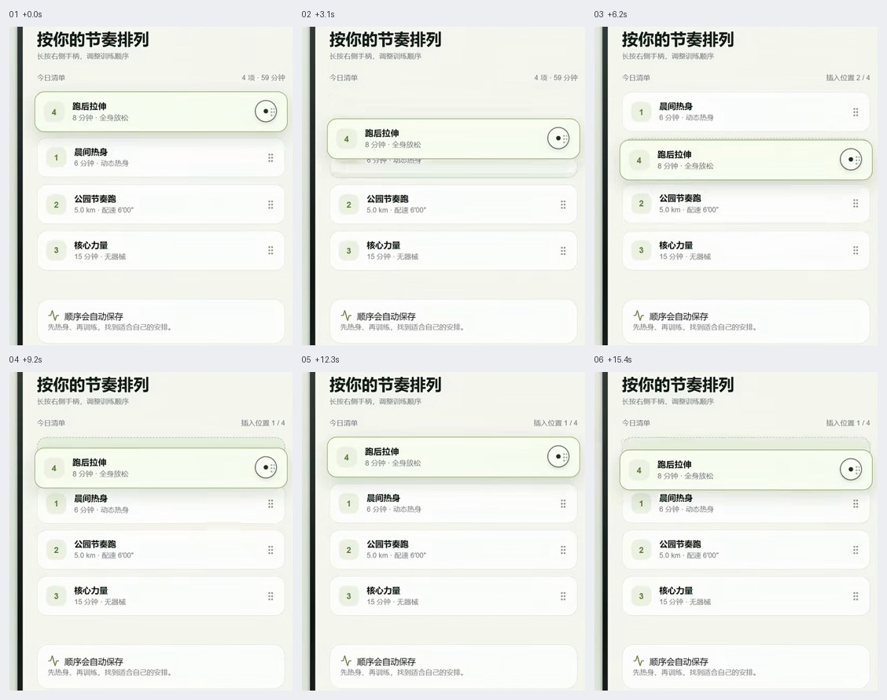
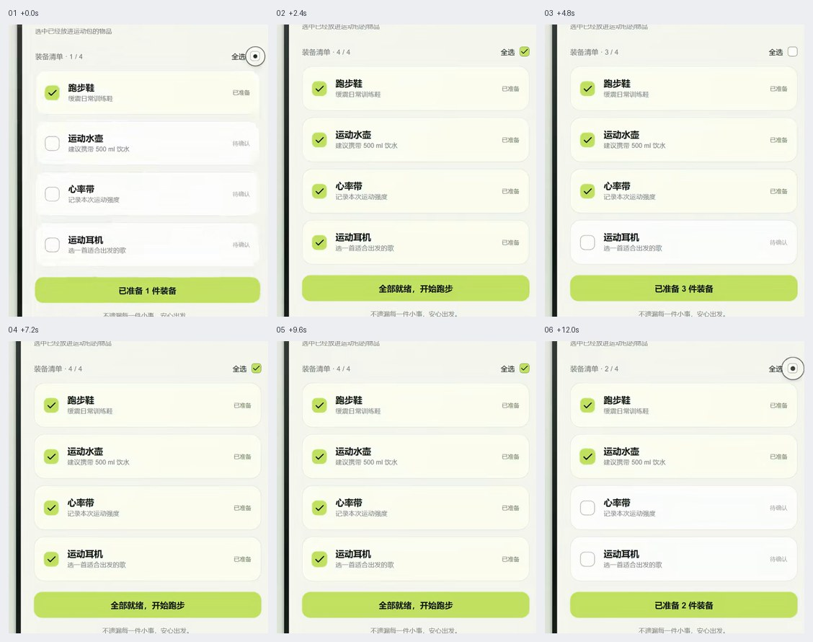
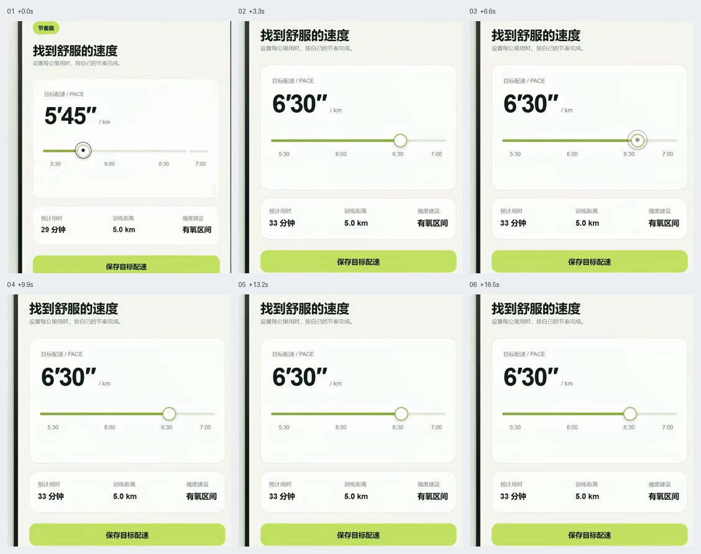
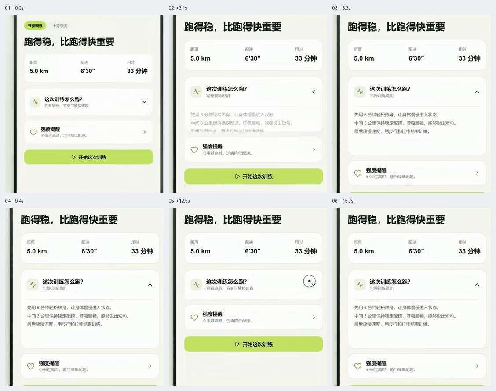
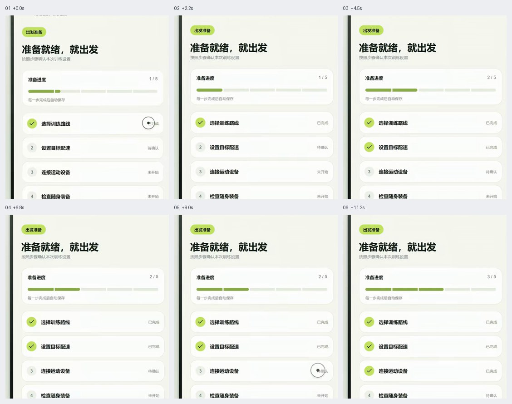
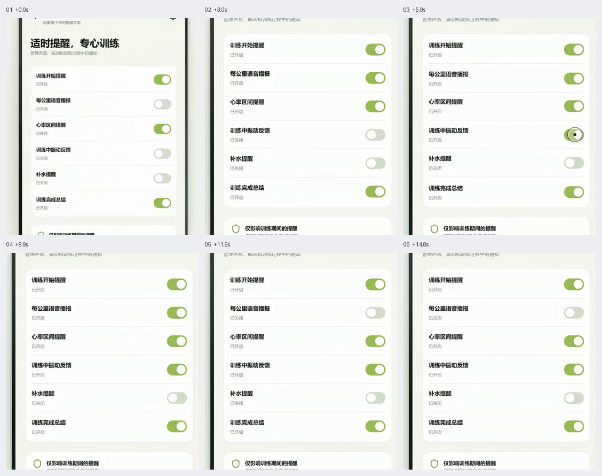
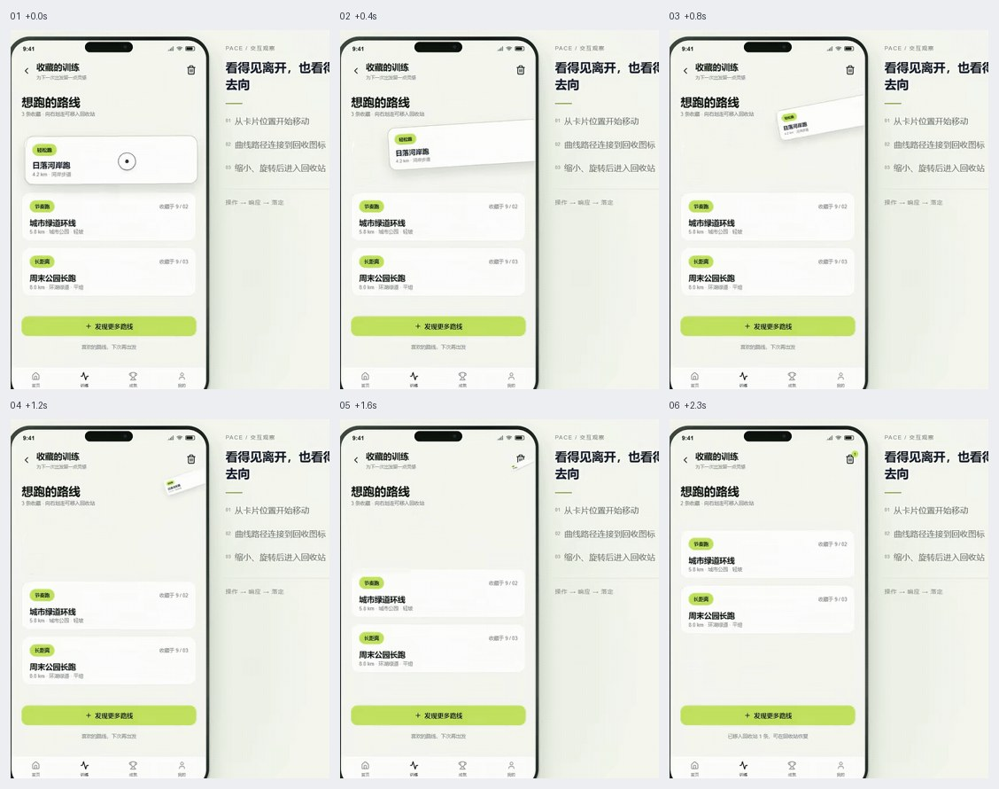
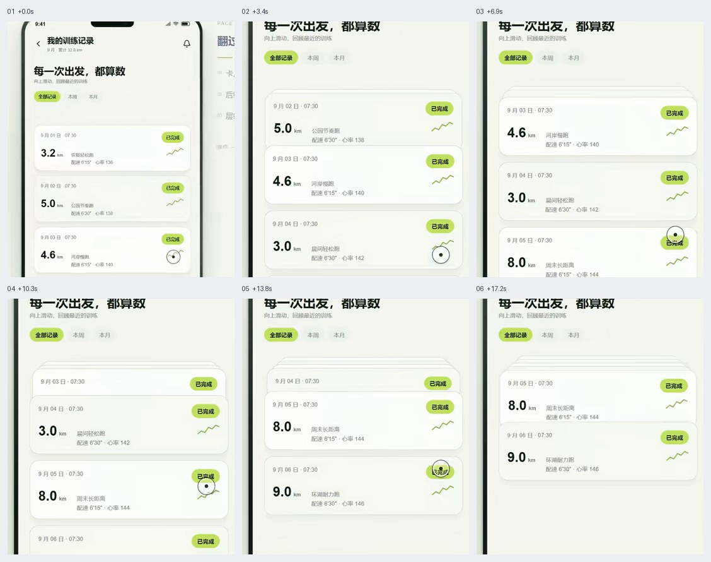
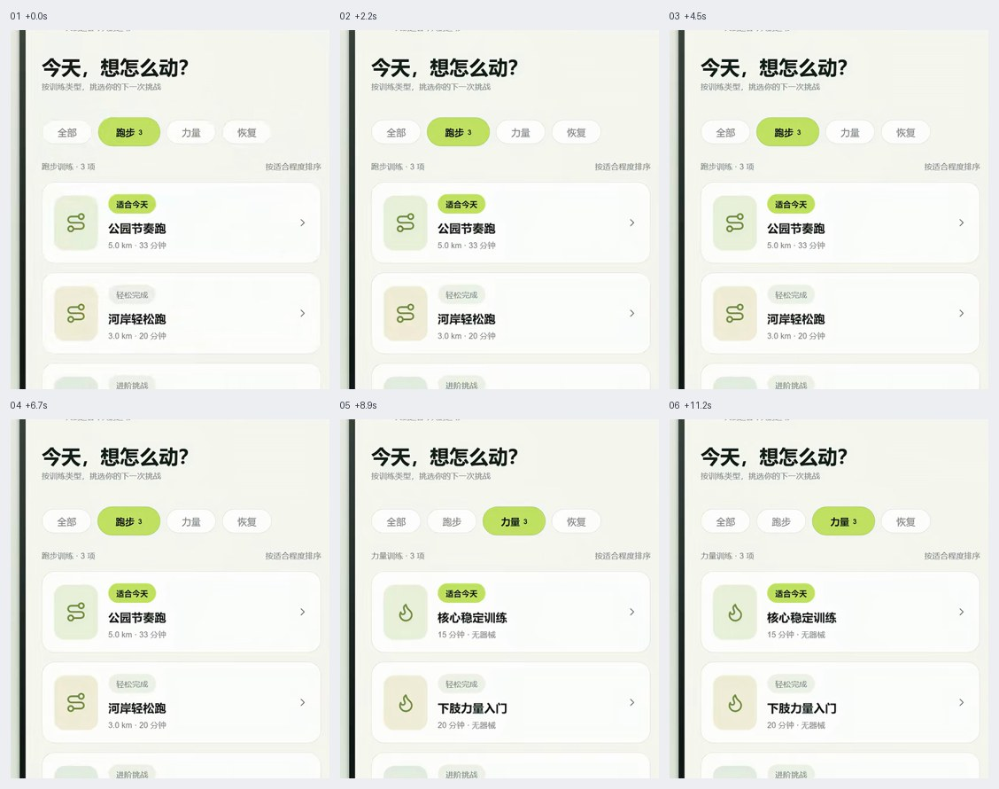

# 移动端交互

触控手势与真实状态分开验证。回弹、轨迹和错峰是视觉反馈，不能意外修改相邻设置、延迟真实选中或触发额外请求。

GIF 看连续运动，六帧图按从左到右、从上到下查看。像素值、技术栈与缓动由当前项目决定。

## 目录

- [触点扩散主题切换 / Touch Origin Theme](#touch-origin-theme)
- [拖拽排序与弹性让位 / Spring Reorder](#spring-reorder)
- [批量勾选的顺序反馈 / Staggered Batch Check](#staggered-batch-check)
- [滑杆惯性与回吸 / Inertial Slider Snap](#inertial-slider-snap)
- [文本展开与箭头同步 / Animated Text Expand](#animated-text-expand)
- [步骤进度的轻微回弹 / Step Progress Settle](#step-progress-settle)
- [开关组涟漪反馈 / Switch Group Ripple](#switch-group-ripple)
- [卡片沿轨迹离场 / Card Delete Trajectory](#card-delete-trajectory)
- [滚动吸顶压缩卡片栈 / Sticky Compressing Stack](#sticky-compressing-stack)
- [选中标签放大并让位 / Reflowing Choice Tabs](#reflowing-choice-tabs)

## 触点扩散主题切换 / Touch Origin Theme

- 标识：`mobile-interactions/touch-origin-theme`；类型：组件／效果。
- 效果要点：从实际点击点向四周扩散另一主题，两层页面只裁剪，不拉伸文字、图标或布局。
- 指令例句：移动端从主题按钮触点扩散换肤，两套主题布局保持一致。
- 实现关注：覆盖半径取触点到最远角落的距离；用静态快照或等价过渡保持底层页面稳定，动画完成清理覆盖层。
- 验证重点：不同屏幕和触点位置不漏角，快速重复触发后只有最终主题生效。
- 相关条目：[web-interactions/circular-theme-reveal](web-interactions.md#circular-theme-reveal)。
- 参考：[GIF 动图](../assets/gifs/mobile-interactions/touch-origin-theme.gif) · [六帧对照图](../assets/filmstrips/mobile-interactions/touch-origin-theme.jpg)。

## 拖拽排序与弹性让位 / Spring Reorder

- 标识：`mobile-interactions/spring-reorder`；类型：组件／效果。
- 效果要点：被拖行浮起，其他行按当前插入位置连续让位，释放后落入新位置。
- 指令例句：列表长按拖拽排序，周围行弹性让位，落下后保存真实顺序。
- 实现关注：保持稳定条目 ID，按当前手指位置计算插入位；区分拖动预览与已提交顺序，靠边可滚动，提供上移下移替代操作。
- 验证重点：跨多行、拖回原位、取消拖拽和保存失败后，数据顺序与视觉一致。
- 参考：[GIF 动图](../assets/gifs/mobile-interactions/spring-reorder.gif) · [六帧对照图](../assets/filmstrips/mobile-interactions/spring-reorder.jpg)。

## 批量勾选的顺序反馈 / Staggered Batch Check

- 标识：`mobile-interactions/staggered-batch-check`；类型：组件／效果。
- 效果要点：全选后各行依次呈现勾选反馈，勾号轻微弹性放大。
- 指令例句：全选时立即更新真实选中集合，视觉勾号按列表顺序轻微错峰出现。
- 实现关注：逻辑选择一次完成，动画仅呈现结果；不逐项发送重复请求，处理中再次点击应得到明确最终状态。
- 验证重点：全选、取消、部分选中与减弱动态下，计数、按钮状态和真实选中项始终一致。
- 相关条目：[buttons-controls/checkbox](buttons-controls.md#checkbox) · [motion/stagger](motion.md#stagger)。
- 参考：[GIF 动图](../assets/gifs/mobile-interactions/staggered-batch-check.gif) · [六帧对照图](../assets/filmstrips/mobile-interactions/staggered-batch-check.jpg)。

## 滑杆惯性与回吸 / Inertial Slider Snap

- 标识：`mobile-interactions/inertial-slider-snap`；类型：组件／效果。
- 效果要点：释放滑块后短暂沿手势方向滑行，再吸回最近有效刻度，表现轻微重量感。
- 指令例句：配速滑杆松手后轻微惯性滑行，再回吸到最近有效刻度。
- 实现关注：速度只影响装饰过渡，最终业务值限制在合法刻度；限制超调与边界，键盘操作直接逐档。
- 验证重点：快慢拖动、两端释放、打断动画与减弱动态下，最终值准确且只按规则提交。
- 相关条目：[web-interactions/snapping-level-slider](web-interactions.md#snapping-level-slider)。
- 参考：[GIF 动图](../assets/gifs/mobile-interactions/inertial-slider-snap.gif) · [六帧对照图](../assets/filmstrips/mobile-interactions/inertial-slider-snap.jpg)。

## 文本展开与箭头同步 / Animated Text Expand

- 标识：`mobile-interactions/animated-text-expand`；类型：组件／效果。
- 效果要点：展开时容器高度连续增大，内容在原位打开，箭头同步旋转指示状态。
- 指令例句：说明卡片点击展开时平滑改变高度，箭头同步转动，收起恢复。
- 实现关注：测量动态内容高度；触发器暴露展开状态并关联内容，折叠区内部控件不可继续聚焦。
- 验证重点：长短文本、图片晚加载、快速连续点击和收起后焦点都正确。
- 相关条目：[cards-tables/accordion](cards-tables.md#accordion)。
- 参考：[GIF 动图](../assets/gifs/mobile-interactions/animated-text-expand.gif) · [六帧对照图](../assets/filmstrips/mobile-interactions/animated-text-expand.jpg)。

## 步骤进度的轻微回弹 / Step Progress Settle

- 标识：`mobile-interactions/step-progress-settle`；类型：组件／效果。
- 效果要点：完成一步后进度线推进到新节点，可轻微越过再归位，已完成步骤同步高亮。
- 指令例句：完成步骤后进度推进到真实节点，用轻微回弹强调完成。
- 实现关注：完成状态来自实际结果；超调只在装饰层，不能跨亮下一节点或向辅助技术报出虚假进度。
- 验证重点：成功、失败、返回修改和连续完成时，节点、百分比和步骤内容保持一致。
- 参考：[GIF 动图](../assets/gifs/mobile-interactions/step-progress-settle.gif) · [六帧对照图](../assets/filmstrips/mobile-interactions/step-progress-settle.jpg)。

## 开关组涟漪反馈 / Switch Group Ripple

- 标识：`mobile-interactions/switch-group-ripple`；类型：组件／效果。
- 效果要点：切换当前开关时，同组附近开关依次轻微动一下，其值保持不变。
- 指令例句：当前开关切换时向同组扩散轻微视觉反馈，只修改被操作的设置。
- 实现关注：逻辑状态只更新目标项；相邻项用视觉层位移，不能切换 checked、触发保存或模拟点击。
- 验证重点：逐项切换前后，其他项的值和网络请求都不改变；关闭动画后行为相同。
- 相关条目：[buttons-controls/switch](buttons-controls.md#switch)。
- 参考：[GIF 动图](../assets/gifs/mobile-interactions/switch-group-ripple.gif) · [六帧对照图](../assets/filmstrips/mobile-interactions/switch-group-ripple.jpg)。

## 卡片沿轨迹离场 / Card Delete Trajectory

- 标识：`mobile-interactions/card-delete-trajectory`；类型：组件／效果。
- 效果要点：确认删除后的卡片沿曲线朝删除入口移动，同时缩小、旋转并淡出。
- 指令例句：删除确认完成后让卡片沿曲线缩小离场，再平滑收拢列表。
- 实现关注：仅将轨迹作为结果反馈；按产品规则先确认或提供撤销，失败恢复卡片和数据；列表以稳定 ID 关联。
- 验证重点：取消删除无数据变化；失败、撤销、最后一项和连续删除后布局与数据正确。
- 参考：[GIF 动图](../assets/gifs/mobile-interactions/card-delete-trajectory.gif) · [六帧对照图](../assets/filmstrips/mobile-interactions/card-delete-trajectory.jpg)。

## 滚动吸顶压缩卡片栈 / Sticky Compressing Stack

- 标识：`mobile-interactions/sticky-compressing-stack`；类型：组件／效果。
- 效果要点：已读卡片在顶部停留，并在后续卡片上来时缩小后退，形成层叠浏览记录。
- 指令例句：卡片列表滚动时让前序卡片吸顶并逐级压缩，向回滚动恢复。
- 实现关注：每层有明确吸顶偏移、缩放中心和堆叠顺序；留足滚动高度，避免不可见层拦截触摸。
- 验证重点：首尾卡、反向滚动、长内容与动态插入后，文字和操作仍可访问。
- 参考：[GIF 动图](../assets/gifs/mobile-interactions/sticky-compressing-stack.gif) · [六帧对照图](../assets/filmstrips/mobile-interactions/sticky-compressing-stack.jpg)。

## 选中标签放大并让位 / Reflowing Choice Tabs

- 标识：`mobile-interactions/reflowing-choice-tabs`；类型：组件／效果。
- 效果要点：选中标签略微放大，其他标签平滑移开腾出空间，整行一起调整布局。
- 指令例句：分类标签选中时轻微放大，相邻标签让位，内容同步切换。
- 实现关注：明确单选语义，布局变化必须为视觉放大留空间；不能只用 transform 覆盖相邻命中区。
- 验证重点：长标签、第一和最后一项、快速切换及键盘操作不重叠、不裁字。
- 相关条目：[buttons-controls/segmented-control](buttons-controls.md#segmented-control)。
- 参考：[GIF 动图](../assets/gifs/mobile-interactions/reflowing-choice-tabs.gif) · [六帧对照图](../assets/filmstrips/mobile-interactions/reflowing-choice-tabs.jpg)。

