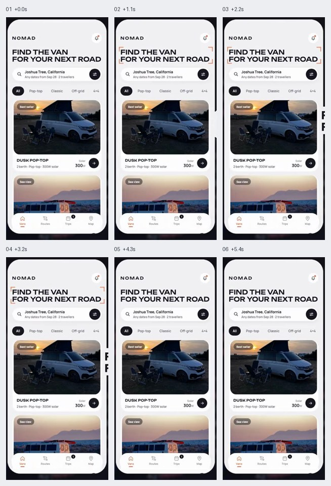
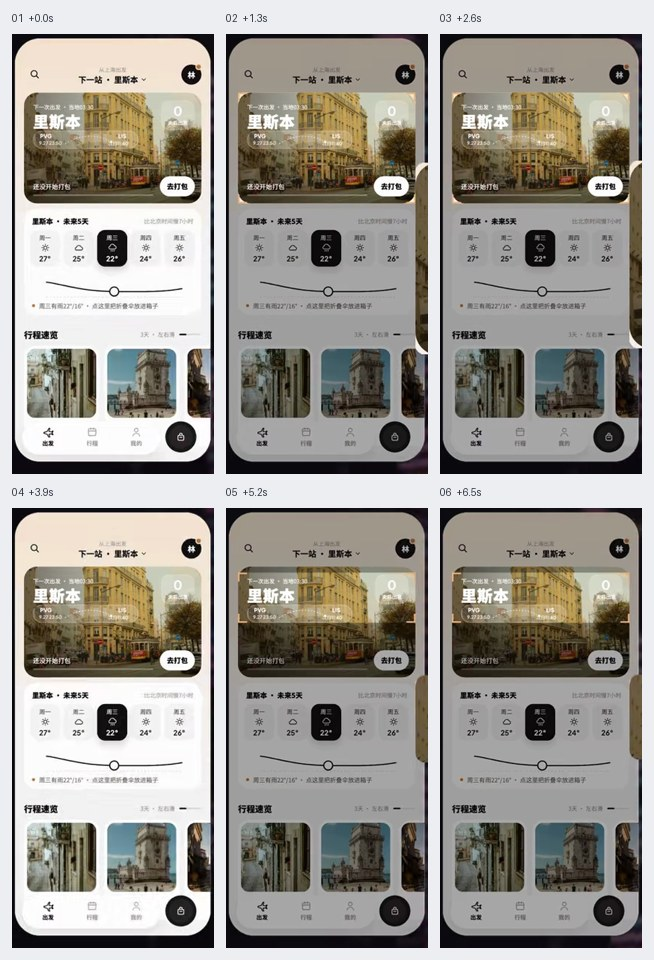
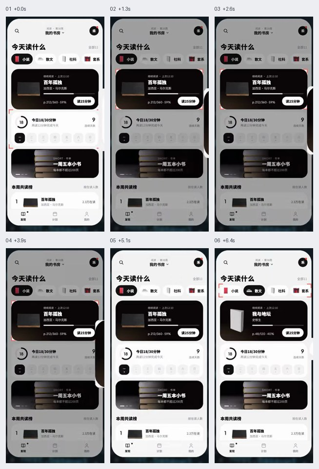
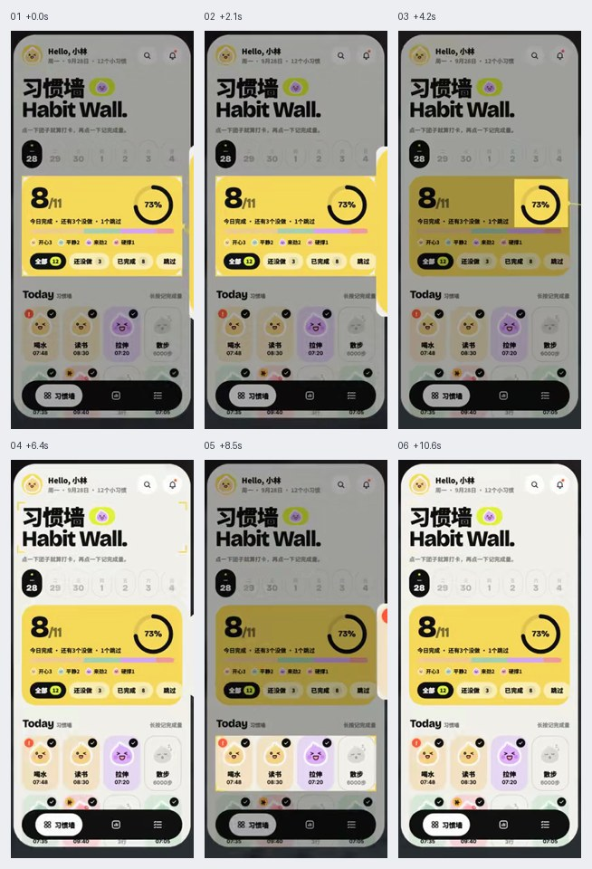
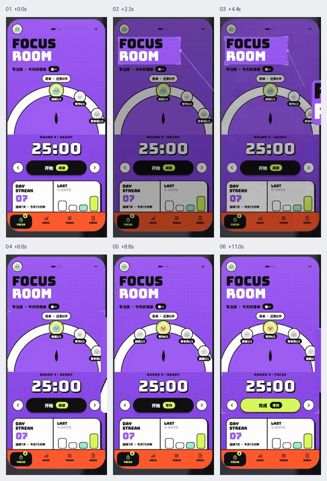
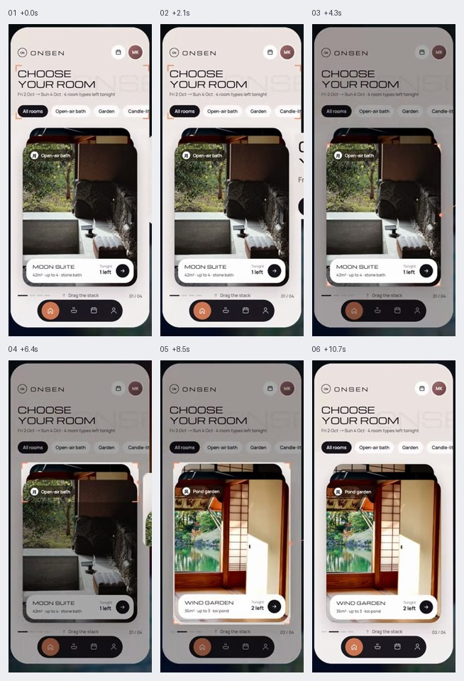

# 移动端页面布局

根据内容主次与任务选择整页布局。演示中的图片、品牌、文案和颜色不自动成为产品要求；网格、字号和比例按目标屏幕调整。

六帧图按从左到右、从上到下查看，仅表示抽样状态，不能证明连续运动和短暂状态。像素值、技术栈与缓动由当前项目决定。

## 目录

- [宽体标题与大图列表 / Wide Title Image List](#wide-title-image-list)
- [大图头块叠信息 / Hero Information Overlay](#hero-information-overlay)
- [黑白分层主次布局 / Monochrome Priority](#monochrome-priority)
- [大色块与小格网格 / Color Block Bento](#color-block-bento)
- [海报大字与半圆转盘 / Poster Semicircle Dial](#poster-semicircle-dial)
- [叠放卡片翻阅布局 / Swipe Deck Layout](#swipe-deck-layout)

## 宽体标题与大图列表 / Wide Title Image List

- 标识：`mobile-layouts/wide-title-image-list`；类型：组件／效果。
- 效果要点：大号两行标题建立主题，搜索与筛选紧随其后，下方是宽幅图片和单行参数信息。
- 指令例句：列表页用宽体大标题、搜索筛选、分类标签和宽幅大图卡，名称参数排在图下。
- 实现关注：标题换行按实际内容控制；图片保留一致比例，筛选可触达；名称过长时优先保留识别信息。
- 验证重点：窄屏、长标题、无图片和筛选后空结果仍能浏览与操作。
- 媒体取舍：仅保留 JPG。重点是标题、筛选、宽图和参数的静态布局，讲解遮罩无需保留。
- 参考：[六帧对照图](https://raw.githubusercontent.com/dqzboy/ui-atlas/e6aa0d641c224a2cb4c8bd4262a4d18f5c7e1e22/assets/filmstrips/mobile-layouts/wide-title-image-list.jpg)。

## 大图头块叠信息 / Hero Information Overlay

- 标识：`mobile-layouts/hero-information-overlay`；类型：组件／效果。
- 效果要点：头部大图承载目的地和主要操作，下方白底信息区展示日期、天气和趋势。
- 指令例句：详情页上部用大图叠标题与操作，下方展示日期选择和简洁趋势曲线。
- 实现关注：图上信息需有局部遮罩保证对比；重要操作不依赖背景明暗，下方信息块遵守同一对齐线。
- 验证重点：不同照片、标题长度、日期选中和数据为空时信息不丢失。
- 媒体取舍：仅保留 JPG。重点是大图上的信息叠放与下方信息区布局。
- 参考：[六帧对照图](https://raw.githubusercontent.com/dqzboy/ui-atlas/e6aa0d641c224a2cb4c8bd4262a4d18f5c7e1e22/assets/filmstrips/mobile-layouts/hero-information-overlay.jpg)。

## 黑白分层主次布局 / Monochrome Priority

- 标识：`mobile-layouts/monochrome-priority`；类型：组件／效果。
- 效果要点：浅灰页面上以黑底白字突出主要卡片，其余用白色卡片承载次要内容。
- 指令例句：用灰底、黑色主卡和白色次卡组织页面，分类选中态与主卡呼应。
- 实现关注：用面积、字重和留白共同建立层级；深色块保留给当前重点，不让所有卡片争抢注意。
- 验证重点：只看灰阶也能辨认主次，长内容和禁用状态仍有区别。
- 媒体取舍：仅保留 JPG。重点是黑白卡片的主次权重，图片足够。
- 参考：[六帧对照图](https://raw.githubusercontent.com/dqzboy/ui-atlas/e6aa0d641c224a2cb4c8bd4262a4d18f5c7e1e22/assets/filmstrips/mobile-layouts/monochrome-priority.jpg)。

## 大色块与小格网格 / Color Block Bento

- 标识：`mobile-layouts/color-block-bento`；类型：组件／效果。
- 效果要点：大色块汇总最重要数字与完成度，周围浅色小格分别承载次级任务或打卡项。
- 指令例句：首页用一张强调色大卡汇总核心指标，下方浅色小格分别执行单项任务。
- 实现关注：大卡与小卡使用一致网格；颜色只强化重点，完成度用真实数据，点击整格有明确反馈。
- 验证重点：不同屏宽、数据变化和长标签下网格不溢出，打卡后状态准确。
- 媒体取舍：仅保留 JPG。重点是大小色块和数据层级，讲解中的强调不是产品动效。
- 参考：[六帧对照图](https://raw.githubusercontent.com/dqzboy/ui-atlas/e6aa0d641c224a2cb4c8bd4262a4d18f5c7e1e22/assets/filmstrips/mobile-layouts/color-block-bento.jpg)。

## 海报大字与半圆转盘 / Poster Semicircle Dial

- 标识：`mobile-layouts/poster-semicircle-dial`；类型：组件／效果。
- 效果要点：大字与强色块形成海报层级，中段半圆转盘围绕固定指针选择，底部大读数和主操作。
- 指令例句：专注页使用海报标题、半圆选项转盘、大号时长和单个主操作。
- 实现关注：转盘当前项对准固定指针；同时提供点击或按钮选择，保持标签可读，时长与实际任务一致。
- 验证重点：转盘边界、长名称、减少动态和非拖动操作都能完成选择。
- 媒体取舍：保留 GIF＋JPG。布局示例中包含真实转盘选择，需看转动与固定指针的关系。
- 参考：[GIF 动图](https://raw.githubusercontent.com/dqzboy/ui-atlas/e6aa0d641c224a2cb4c8bd4262a4d18f5c7e1e22/assets/gifs/mobile-layouts/poster-semicircle-dial.gif) · [六帧对照图](https://raw.githubusercontent.com/dqzboy/ui-atlas/e6aa0d641c224a2cb4c8bd4262a4d18f5c7e1e22/assets/filmstrips/mobile-layouts/poster-semicircle-dial.jpg)。

## 叠放卡片翻阅布局 / Swipe Deck Layout

- 标识：`mobile-layouts/swipe-deck-layout`；类型：组件／效果。
- 效果要点：中央大图卡作为主内容，后续卡露边表示数量；向上拖走前卡，后卡补位，页码同步。
- 指令例句：展示页用可上滑翻阅的大图卡组，后卡露边，当前页码跟随切换。
- 实现关注：卡片宽度与留边响应视口；明确拖动阈值、取消复位和末页行为，并提供按钮翻页。
- 验证重点：轻拖取消、成功翻页、反向返回、末页和键盘替代入口均符合预期。
- 媒体取舍：保留 GIF＋JPG。布局示例中包含前卡拖离、后卡补位与页码切换的连续行为。
- 参考：[GIF 动图](https://raw.githubusercontent.com/dqzboy/ui-atlas/e6aa0d641c224a2cb4c8bd4262a4d18f5c7e1e22/assets/gifs/mobile-layouts/swipe-deck-layout.gif) · [六帧对照图](https://raw.githubusercontent.com/dqzboy/ui-atlas/e6aa0d641c224a2cb4c8bd4262a4d18f5c7e1e22/assets/filmstrips/mobile-layouts/swipe-deck-layout.jpg)。

