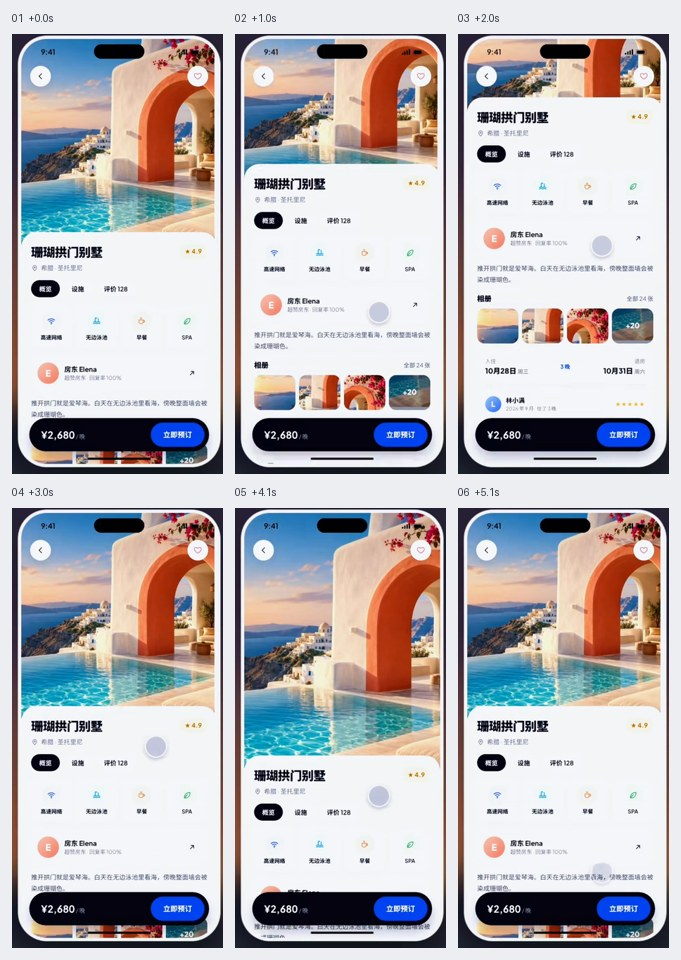
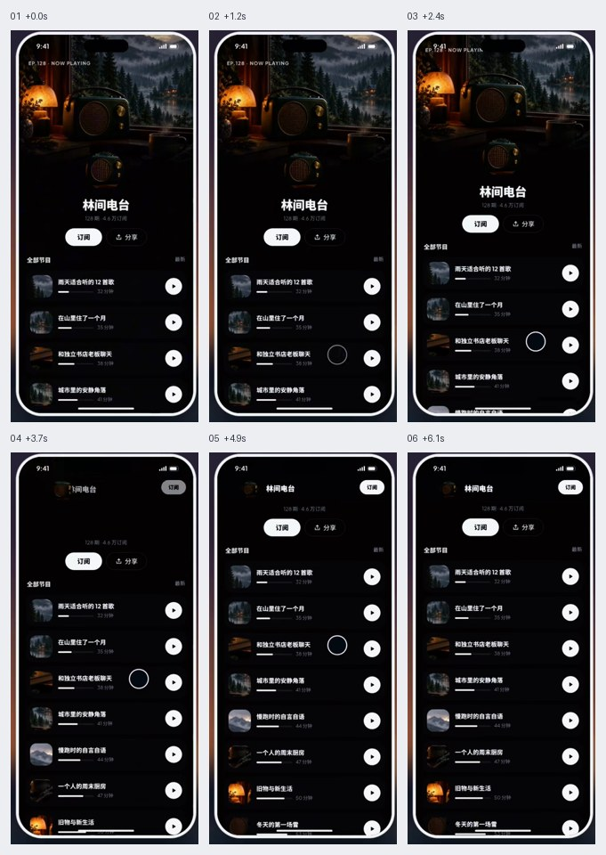
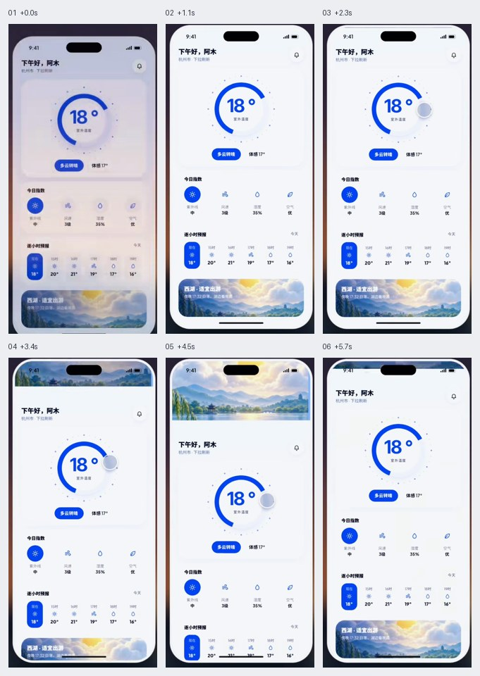
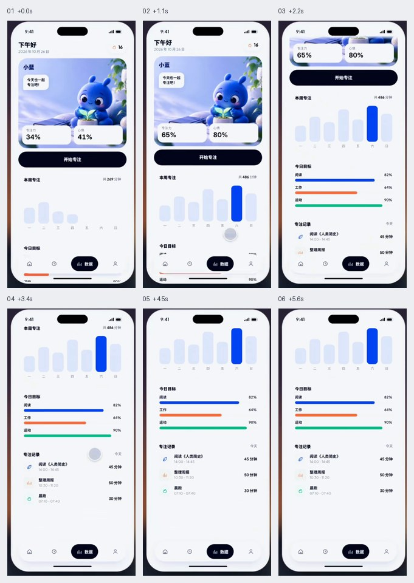

# 移动端滚动

按滚动位置、过量下拉和刷新请求分别建模。参考展示的是产品动作，不把设备边框或演示停顿当成实现要求。

GIF 看连续运动，六帧图按从左到右、从上到下查看。像素值、技术栈与缓动由当前项目决定。

## 目录

- [视差头图与下拉拉伸 / Elastic Parallax Hero](#elastic-parallax-hero)
- [吸顶分类与滚动联动 / Sticky Category Tabs](#sticky-category-tabs)
- [封面收进导航栏 / Collapsing Cover Navbar](#collapsing-cover-navbar)
- [图文分层滚动渐显 / Editorial Scroll Reveal](#editorial-scroll-reveal)
- [下拉刷新场景反馈 / Pull to Refresh Scene](#pull-to-refresh-scene)
- [进入视口的数据生长 / Viewport Chart Growth](#viewport-chart-growth)

## 视差头图与下拉拉伸 / Elastic Parallax Hero

- 标识：`mobile-scroll/elastic-parallax-hero`；类型：组件／效果。
- 效果要点：上滑时头图比正文移动慢；顶部下拉时头图放大，松手回到原尺寸。
- 指令例句：为详情页头图添加慢速视差和顶部下拉拉伸，松手平滑复位。
- 实现关注：区分正常滚动和顶部过量下拉；放大以覆盖图框为前提，限制幅度，正文保持原尺寸。
- 验证重点：上滑、拉伸、松手及快速反向拖动均不露空白；底部操作区稳定。
- 相关条目：[motion/parallax](motion.md#parallax)。
- 参考：[GIF 动图](../assets/gifs/mobile-scroll/elastic-parallax-hero.gif) · [六帧对照图](../assets/filmstrips/mobile-scroll/elastic-parallax-hero.jpg)。

## 吸顶分类与滚动联动 / Sticky Category Tabs

- 标识：`mobile-scroll/sticky-category-tabs`；类型：组件／效果。
- 效果要点：分类栏滚到顶部后固定，正文当前分类与标签选中态双向同步。
- 指令例句：分类栏吸顶，滚动时更新当前标签，点击标签定位到对应分区。
- 实现关注：以实际滚动容器计算阈值；定位偏移需包含固定导航和分类栏高度，避免程序定位与观察器相互抢选中态。
- 验证重点：逐段滚动、点击远处分类、返回上一分类和窗口变化后，目标标题可见且高亮正确。
- 参考：[GIF 动图](../assets/gifs/mobile-scroll/sticky-category-tabs.gif) · [六帧对照图](../assets/filmstrips/mobile-scroll/sticky-category-tabs.jpg)。

## 封面收进导航栏 / Collapsing Cover Navbar

- 标识：`mobile-scroll/collapsing-cover-navbar`；类型：组件／效果。
- 效果要点：大封面随上滑收起，头像缩小移向导航区，标题显现，导航背景转为模糊玻璃。
- 指令例句：让个人主页封面逐步收进导航栏，头像、标题和背景随同一滚动进度变化。
- 实现关注：用同一归一化进度协调位置、缩放、透明度和背景；折叠后的标题仍有稳定布局位置。
- 验证重点：缓慢往返、快速滚动和停在半途时无跳帧，返回顶部后状态复原。
- 参考：[GIF 动图](../assets/gifs/mobile-scroll/collapsing-cover-navbar.gif) · [六帧对照图](../assets/filmstrips/mobile-scroll/collapsing-cover-navbar.jpg)。

## 图文分层滚动渐显 / Editorial Scroll Reveal

- 标识：`mobile-scroll/editorial-scroll-reveal`；类型：组件／效果。
- 效果要点：图文分块进入视口，文字轻移入场，图片从模糊过渡到清晰，形成阅读节奏。
- 指令例句：文章按区块滚动渐显，文字轻移、图片逐步清晰，保持阅读位置稳定。
- 实现关注：以区块可见性触发，预留真实内容尺寸；模糊仅用于装饰过渡，文字保持可读，减弱动态时直接展示。
- 验证重点：首屏、快速跳到中段、向回滚动及关闭动画后，内容都可访问且不改排版。
- 相关条目：[motion/scroll-reveal](motion.md#scroll-reveal) · [loading-errors/blur-up](loading-errors.md#blur-up)。
- 参考：[GIF 动图](../assets/gifs/mobile-scroll/editorial-scroll-reveal.gif) · [六帧对照图](../assets/filmstrips/mobile-scroll/editorial-scroll-reveal.jpg)。

## 下拉刷新场景反馈 / Pull to Refresh Scene

- 标识：`mobile-scroll/pull-to-refresh-scene`；类型：组件／效果。
- 效果要点：下拉距离驱动场景变化，例如太阳从地平线升起；达到阈值松手才开始刷新。
- 指令例句：下拉刷新时用场景进度反馈拖动幅度，达到阈值并松手后请求新数据。
- 实现关注：分开空闲、拉动、可释放、刷新中和完成状态；拉动进度与网络进度不能混用。
- 验证重点：未到阈值松手不请求；达到阈值只请求一次，成功和失败均恢复并显示真实结果。
- 参考：[GIF 动图](../assets/gifs/mobile-scroll/pull-to-refresh-scene.gif) · [六帧对照图](../assets/filmstrips/mobile-scroll/pull-to-refresh-scene.jpg)。

## 进入视口的数据生长 / Viewport Chart Growth

- 标识：`mobile-scroll/viewport-chart-growth`；类型：组件／效果。
- 效果要点：图表进入屏幕后柱高从零到真实值，配套数值同步变化。
- 指令例句：统计区进入视口后柱图与数字同步增长到真实数据，结束后稳定显示。
- 实现关注：终值来自同一份数据；动画不改变坐标刻度，是否重播按业务选择，减弱动态时直接显示终值。
- 验证重点：终值、零值与大数正确；图表标签可读，离开再进入时不会无故重复。
- 相关条目：[motion/count-up](motion.md#count-up)。
- 参考：[GIF 动图](../assets/gifs/mobile-scroll/viewport-chart-growth.gif) · [六帧对照图](../assets/filmstrips/mobile-scroll/viewport-chart-growth.jpg)。

