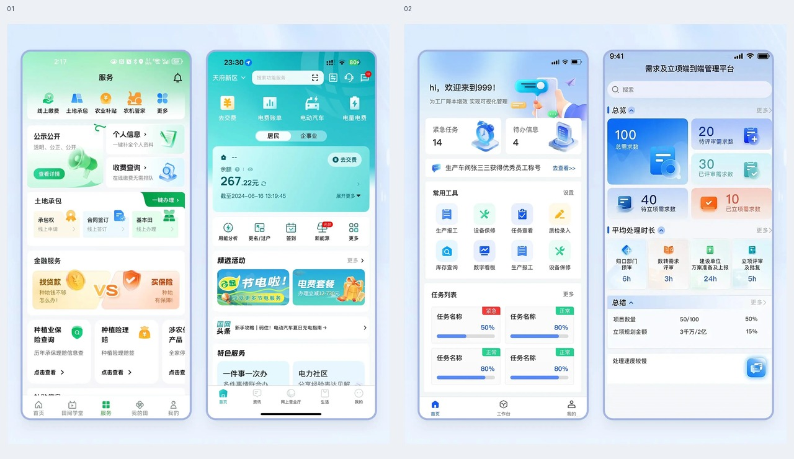
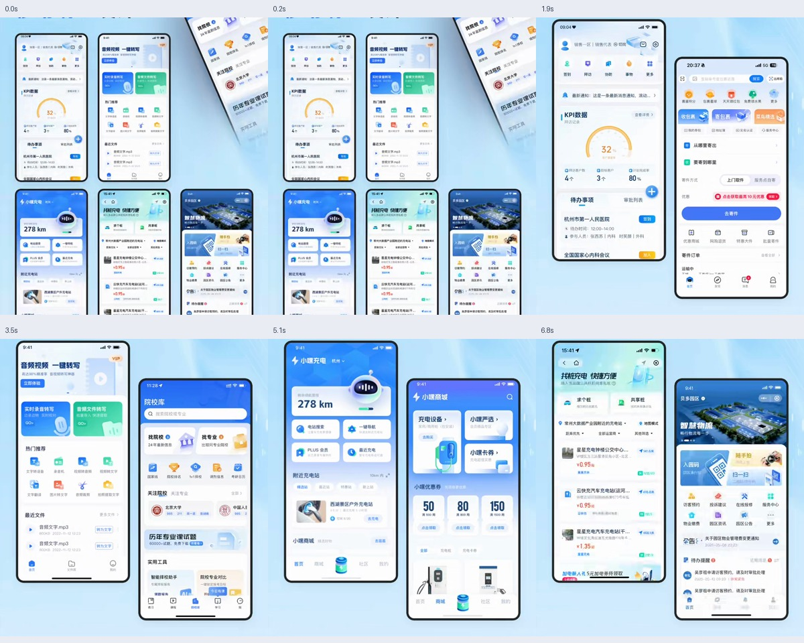
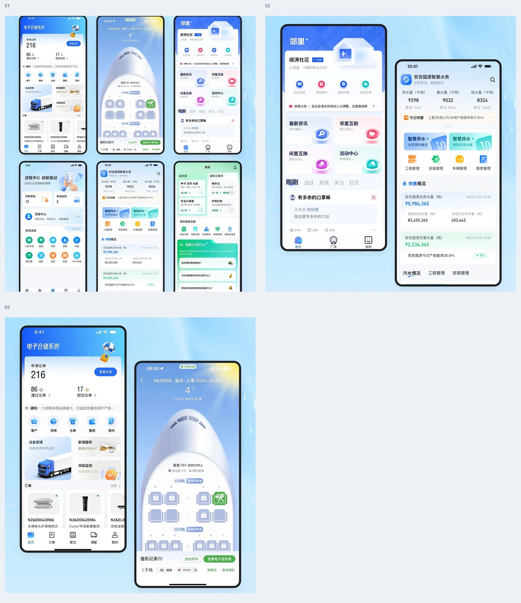
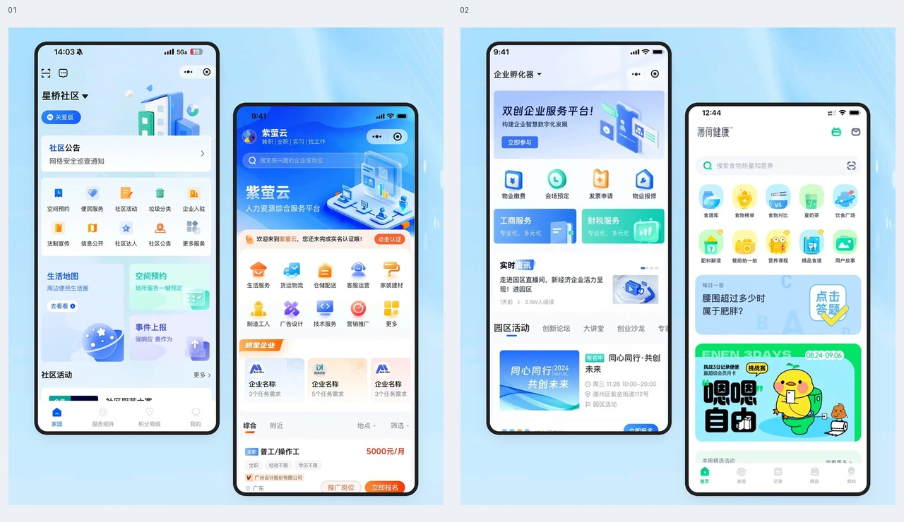
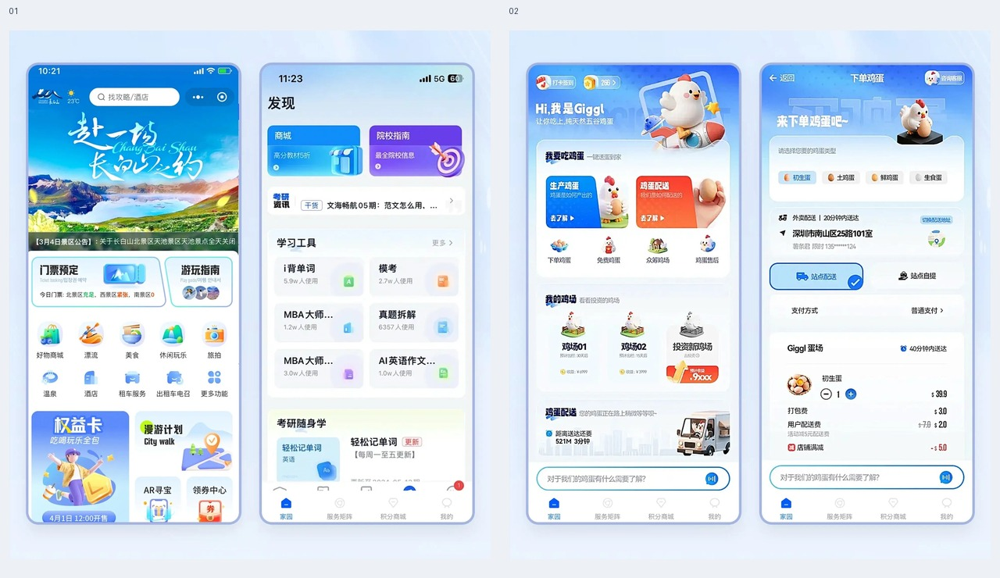
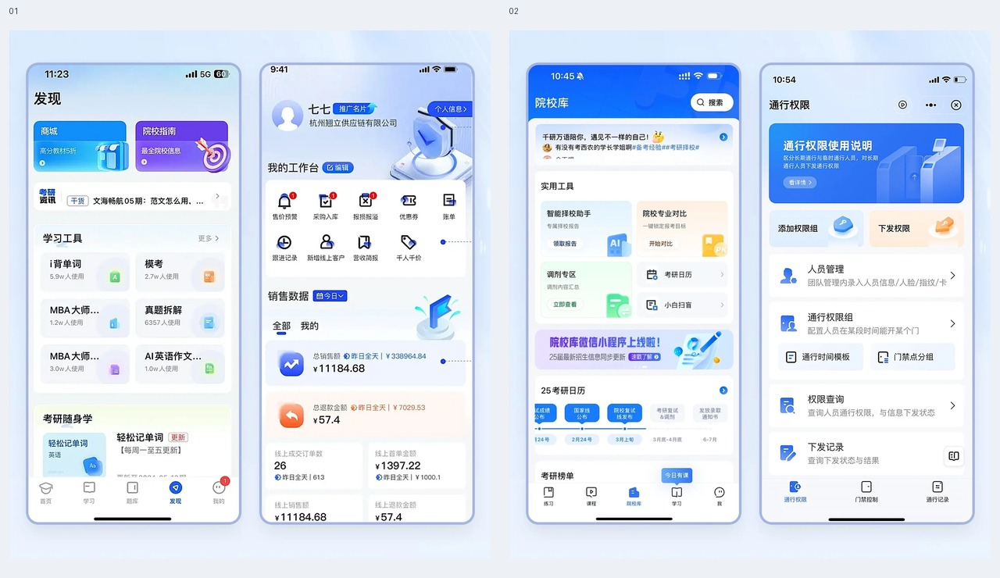
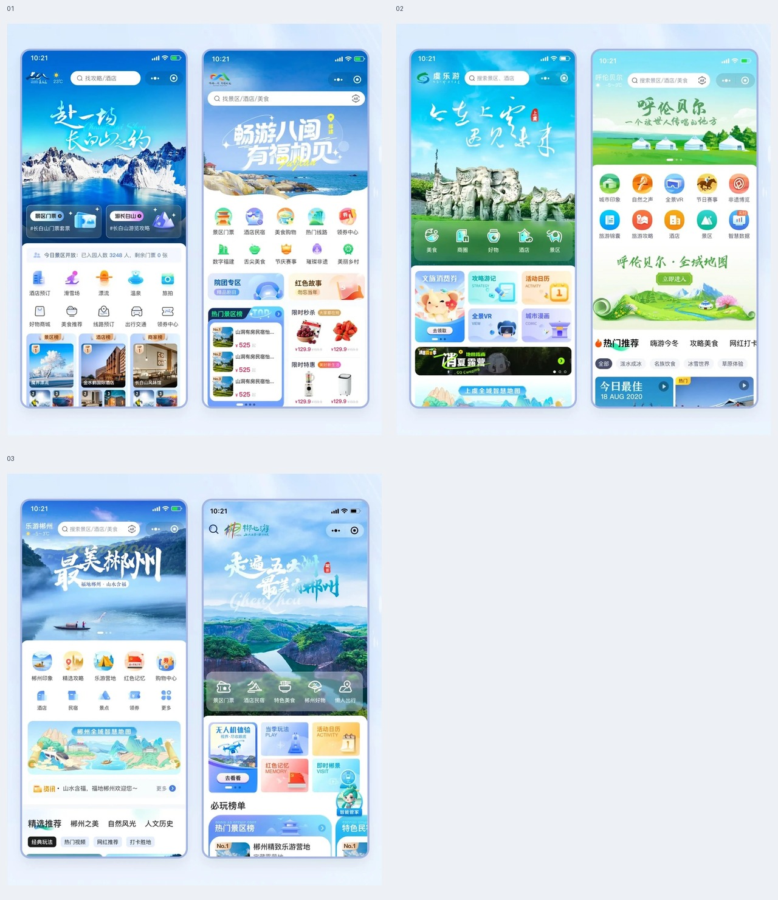
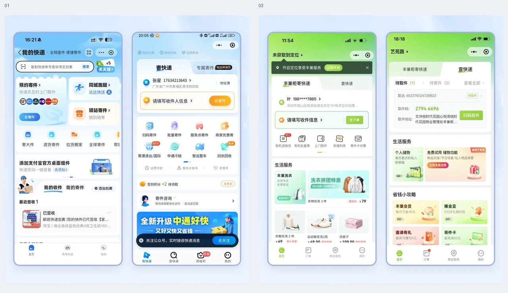

# 移动端工作台与服务门户

先区分销售、寄件、企业服务、校园、文旅和学习的主任务，再选择头部、工具格、内容推荐和列表的比例。除了带 GIF 的销售／寄件演示，其余条目都是静态设计稿，不能据此推断点击结果或页面切换动画。

## 证据与实现边界

- 静态总览按图片编号从左到右、从上到下阅读；编号代表独立图片，不代表时间或交互状态。单图链接保留裁切后的完整分辨率。
- “画面要点”描述已查看的素材；“实现补充”和“验证重点”是落地建议，不能当作原稿已具备的功能。
- 图中的品牌、示例数字、人物和业务文案只用于理解层级，不自动成为需求。按用户的产品对象、技术栈和设计系统改写。
- 只读本次相关图片；静态稿未呈现的联动、筛选、点击结果、权限和响应式行为需在实际项目中确认。

## 目录

- [政务缴费与工厂任务首页](#public-service-task-homes)
- [CRM、寄件与生活服务首页](#sales-crm-parcel-homes)
- [移动设备与数字工具工作台](#device-service-tool-grid)
- [移动企业服务与工具首页](#enterprise-service-mobile-hub)
- [文旅山景与学习工具首页](#travel-learning-service-homes)
- [学习工作台与校园通行权限](#campus-timetable-access-hub)
- [山景插画与文旅服务首页](#illustrated-travel-service-home)
- [快递订单与校园生活服务](#parcel-orders-quick-services)

## 政务缴费与工厂任务首页 / Public Service Task Homes

- 标识：`mobile-workbenches/public-service-task-homes`；类型：组件／效果。
- 画面要点：四个手机页面分别呈现农业政务服务、电费余额与缴费、工厂任务，以及需求立项指标；共同使用品牌色头部和分组入口。
- 指令例句：参考 mobile-workbenches/public-service-task-homes，先区分查询、缴费、执行任务和立项四种主目标，再决定首页主操作与工具入口层级。
- 实现补充：先区分查询、缴费、执行任务和立项四种主目标，再决定首页主操作与工具入口层级。
- 验证重点：在目标手机尺寸及大字号下检查入口名称、内容顺序和触达区域；实际执行主任务，并检查权限、空结果及失败恢复。
- 媒体：静态图集，2 张；[静态总览](../assets/previews/mobile-workbenches/public-service-task-homes.jpg) · [图片 01](../assets/images/mobile-workbenches/public-service-task-homes-01.jpg) · [图片 02](../assets/images/mobile-workbenches/public-service-task-homes-02.jpg)。

## CRM、寄件与生活服务首页 / Sales CRM Parcel Homes

- 标识：`mobile-workbenches/sales-crm-parcel-homes`；类型：组件／效果。
- 画面要点：短视频展示销售拜访 CRM 的 KPI／进度、寄件、音频转写、校园工具、充电商城及借阅服务首页，可观察页面组合与镜头转场。
- 指令例句：参考 mobile-workbenches/sales-crm-parcel-homes，分别识别销售目标、寄件、转写、校园服务、充电和借阅的主要入口；参考原片布局，不把镜头切换当作产品导航。
- 实现补充：分别识别销售目标、寄件、转写、校园服务、充电和借阅的主要入口；参考原片布局，不把镜头切换当作产品导航。
- 验证重点：在目标手机尺寸及大字号下检查入口名称、内容顺序和触达区域；实际执行主任务，并检查权限、空结果及失败恢复。
- 证据范围：GIF 保留原片页面呈现和镜头变化；未见明确点击完成的业务流程，不能由演示画面推断已实现的导航或数据联动。
- 参考：[GIF 动图](../assets/gifs/mobile-workbenches/sales-crm-parcel-homes.gif) · [六帧对照图](../assets/filmstrips/mobile-workbenches/sales-crm-parcel-homes.jpg)。

## 移动设备与数字工具工作台 / Device Service Tool Grid

- 标识：`mobile-workbenches/device-service-tool-grid`；类型：组件／效果。
- 画面要点：品牌色头部、仪表读数、设备／服务卡和数字工具网格形成多种移动端工作台。
- 指令例句：参考 mobile-workbenches/device-service-tool-grid，头部仅放当前关键读数，工具格按任务分组，长名称和大字号下仍能完整识别入口。
- 实现补充：头部仅放当前关键读数，工具格按任务分组，长名称和大字号下仍能完整识别入口。
- 验证重点：在目标手机尺寸及大字号下检查入口名称、内容顺序和触达区域；实际执行主任务，并检查权限、空结果及失败恢复。
- 媒体：静态图集，3 张；[静态总览](../assets/previews/mobile-workbenches/device-service-tool-grid.jpg) · [图片 01](../assets/images/mobile-workbenches/device-service-tool-grid-01.jpg) · [图片 02](../assets/images/mobile-workbenches/device-service-tool-grid-02.jpg) · [图片 03](../assets/images/mobile-workbenches/device-service-tool-grid-03.jpg)。

## 移动企业服务与工具首页 / Enterprise Service Mobile Hub

- 标识：`mobile-workbenches/enterprise-service-mobile-hub`；类型：组件／效果。
- 画面要点：移动企业服务门户结合清新色头部、服务工具格和活动横幅，展示同类入口的不同分组方式。
- 指令例句：参考 mobile-workbenches/enterprise-service-mobile-hub，高频服务保持固定位置，活动内容的视觉权重不得压过主要业务入口。
- 实现补充：高频服务保持固定位置，活动内容的视觉权重不得压过主要业务入口。
- 验证重点：在目标手机尺寸及大字号下检查入口名称、内容顺序和触达区域；实际执行主任务，并检查权限、空结果及失败恢复。
- 媒体：静态图集，2 张；[静态总览](../assets/previews/mobile-workbenches/enterprise-service-mobile-hub.jpg) · [图片 01](../assets/images/mobile-workbenches/enterprise-service-mobile-hub-01.jpg) · [图片 02](../assets/images/mobile-workbenches/enterprise-service-mobile-hub-02.jpg)。

## 文旅山景与学习工具首页 / Travel Learning Service Homes

- 标识：`mobile-workbenches/travel-learning-service-homes`；类型：组件／效果。
- 画面要点：文旅手机首页使用山景大图和推荐内容；学习工具页面以分组入口和阅读内容组织信息。
- 指令例句：参考 mobile-workbenches/travel-learning-service-homes，文旅页突出地点与服务，学习页突出当前任务和阅读进度，各自控制大图与工具的比例。
- 实现补充：文旅页突出地点与服务，学习页突出当前任务和阅读进度，各自控制大图与工具的比例。
- 验证重点：在目标手机尺寸及大字号下检查入口名称、内容顺序和触达区域；实际执行主任务，并检查权限、空结果及失败恢复。
- 媒体：静态图集，2 张；[静态总览](../assets/previews/mobile-workbenches/travel-learning-service-homes.jpg) · [图片 01](../assets/images/mobile-workbenches/travel-learning-service-homes-01.jpg) · [图片 02](../assets/images/mobile-workbenches/travel-learning-service-homes-02.jpg)。

## 学习工作台与校园通行权限 / Campus Timetable Access Hub

- 标识：`mobile-workbenches/campus-timetable-access-hub`；类型：组件／效果。
- 画面要点：蓝色学习／工作台首页提供分组工具和业务卡；校园页展示院校工具、通行权限、授权对象和使用说明。
- 指令例句：参考 mobile-workbenches/campus-timetable-access-hub，学习与业务工具按任务分组；通行权限明确授权对象、有效范围和当前状态，并在实际操作中核对结果。
- 实现补充：学习与业务工具按任务分组；通行权限明确授权对象、有效范围和当前状态，并在实际操作中核对结果。
- 验证重点：在目标手机尺寸及大字号下检查入口名称、内容顺序和触达区域；实际执行主任务，并检查权限、空结果及失败恢复。
- 媒体：静态图集，2 张；[静态总览](../assets/previews/mobile-workbenches/campus-timetable-access-hub.jpg) · [图片 01](../assets/images/mobile-workbenches/campus-timetable-access-hub-01.jpg) · [图片 02](../assets/images/mobile-workbenches/campus-timetable-access-hub-02.jpg)。

## 山景插画与文旅服务首页 / Illustrated Travel Service Home

- 标识：`mobile-workbenches/illustrated-travel-service-home`；类型：组件／效果。
- 画面要点：山景、插画主题、圆形图标工具格、景点推荐和活动横幅构成文旅手机首页的多种方向。
- 指令例句：参考 mobile-workbenches/illustrated-travel-service-home，保持地点信息和预订／服务入口清晰，大图与插画为内容建立情境而非挤压主要任务。
- 实现补充：保持地点信息和预订／服务入口清晰，大图与插画为内容建立情境而非挤压主要任务。
- 验证重点：在目标手机尺寸及大字号下检查入口名称、内容顺序和触达区域；实际执行主任务，并检查权限、空结果及失败恢复。
- 媒体：静态图集，3 张；[静态总览](../assets/previews/mobile-workbenches/illustrated-travel-service-home.jpg) · [图片 01](../assets/images/mobile-workbenches/illustrated-travel-service-home-01.jpg) · [图片 02](../assets/images/mobile-workbenches/illustrated-travel-service-home-02.jpg) · [图片 03](../assets/images/mobile-workbenches/illustrated-travel-service-home-03.jpg)。

## 快递订单与校园生活服务 / Parcel Orders Quick Services

- 标识：`mobile-workbenches/parcel-orders-quick-services`；类型：组件／效果。
- 画面要点：快递首页用待办／订单入口连接寄件、扫码和服务工具；绿色校园生活页面呈现缴费、充值和生活服务卡。
- 指令例句：参考 mobile-workbenches/parcel-orders-quick-services，快递端突出寄件和订单状态，校园端突出缴费与充值信息，各自保留易辨认的主操作和结果反馈。
- 实现补充：快递端突出寄件和订单状态，校园端突出缴费与充值信息，各自保留易辨认的主操作和结果反馈。
- 验证重点：在目标手机尺寸及大字号下检查入口名称、内容顺序和触达区域；实际执行主任务，并检查权限、空结果及失败恢复。
- 媒体：静态图集，2 张；[静态总览](../assets/previews/mobile-workbenches/parcel-orders-quick-services.jpg) · [图片 01](../assets/images/mobile-workbenches/parcel-orders-quick-services-01.jpg) · [图片 02](../assets/images/mobile-workbenches/parcel-orders-quick-services-02.jpg)。

