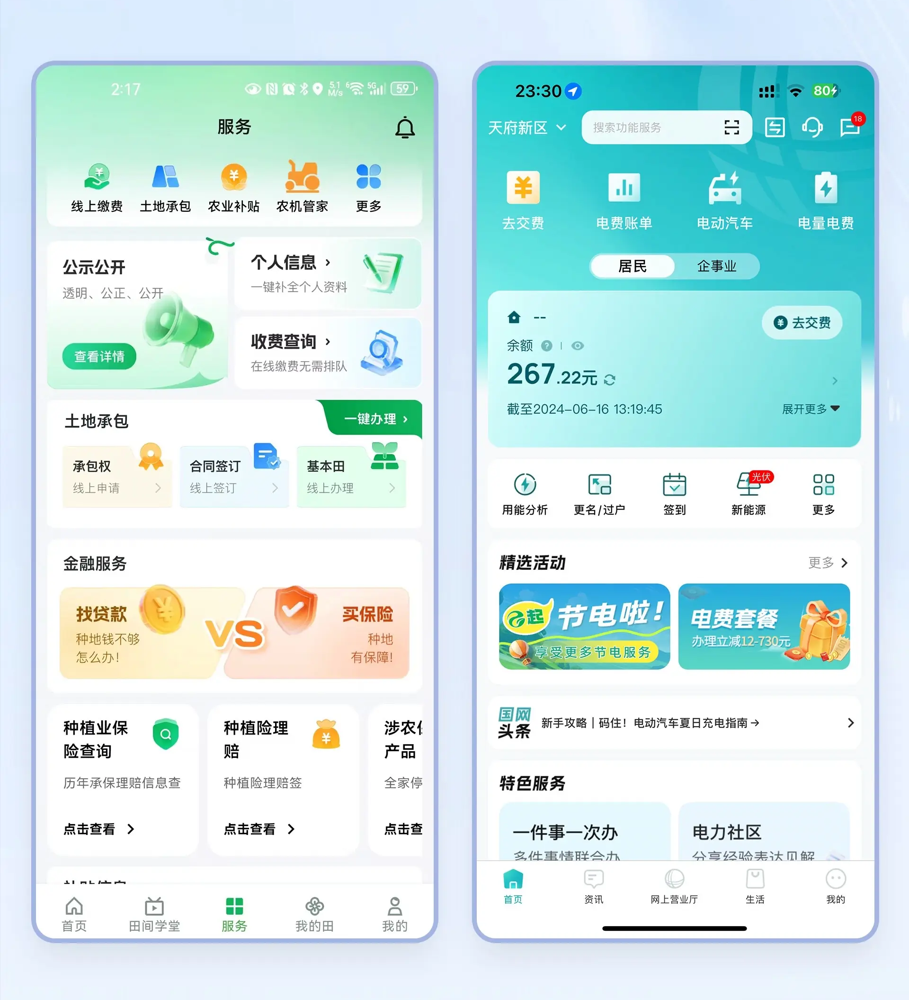
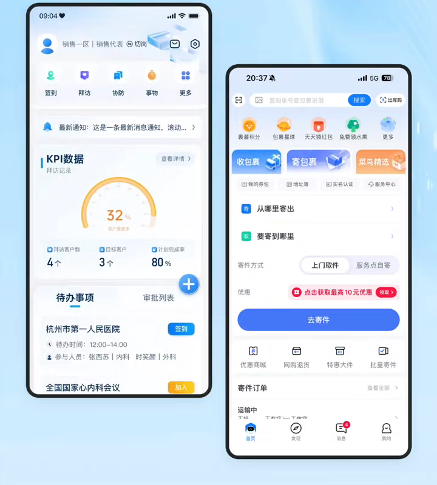
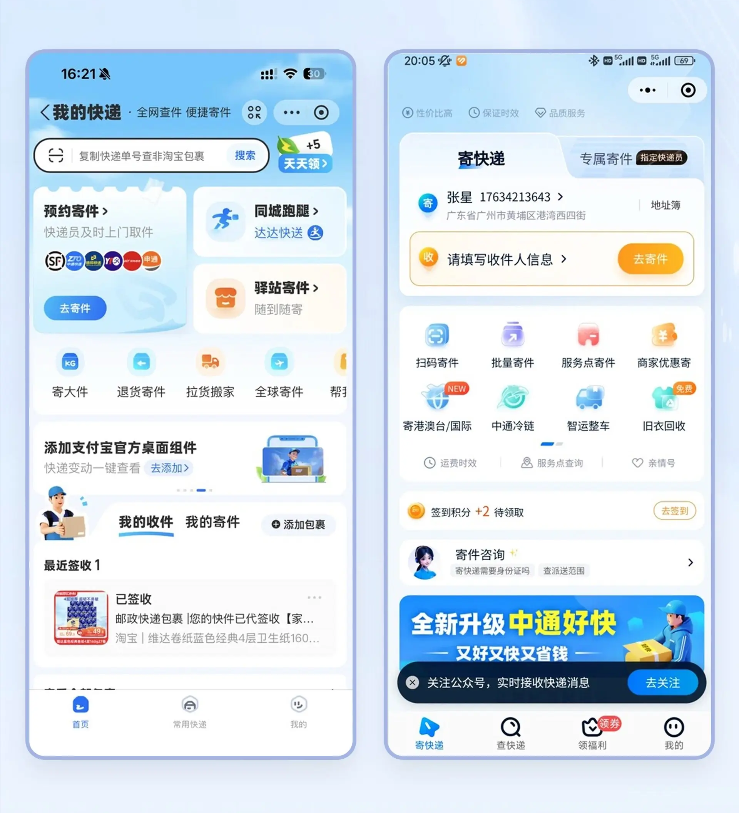

# 移动端工作台与服务门户

先区分销售、寄件、企业服务、校园、文旅和学习的主任务，再选择头部、工具格、内容推荐和列表的比例。本分类仅保留图片，不能据此推断点击结果或页面切换动画。

## 证据与实现边界

- 静态总览按图片编号从左到右、从上到下阅读；编号代表独立图片，不代表时间或交互状态。单图链接保留裁切后的完整分辨率。
- “画面要点”描述已查看的素材；“实现补充”和“验证重点”是落地建议，不能当作原稿已具备的功能。
- 图中的品牌、示例数字、人物和业务文案只用于理解层级，不自动成为需求。按用户的产品对象、技术栈和设计系统改写。
- 只读本次相关图片；静态稿未呈现的联动、筛选、点击结果、权限和响应式行为需在实际项目中确认。

## 目录

- [政务缴费与工厂任务首页](#public-service-task-homes)
- [CRM、寄件与生活服务首页](#sales-crm-parcel-homes)
- [快递订单与校园生活服务](#parcel-orders-quick-services)

## 政务缴费与工厂任务首页 / Public Service Task Homes

- 标识：`mobile-workbenches/public-service-task-homes`；类型：组件／效果。
- 画面要点：四个手机页面分别呈现农业政务服务、电费余额与缴费、工厂任务，以及需求立项指标；共同使用品牌色头部和分组入口。
- 指令例句：参考 mobile-workbenches/public-service-task-homes，先区分查询、缴费、执行任务和立项四种主目标，再决定首页主操作与工具入口层级。
- 实现补充：先区分查询、缴费、执行任务和立项四种主目标，再决定首页主操作与工具入口层级。
- 验证重点：在目标手机尺寸及大字号下检查入口名称、内容顺序和触达区域；实际执行主任务，并检查权限、空结果及失败恢复。

<!-- ui-atlas:details mobile-workbenches/public-service-task-homes -->
- 原尺寸图片：[01 · 1920×2110](https://raw.githubusercontent.com/dqzboy/ui-atlas/4d61e1224c50685c02acae3ae67ebe9c217fa3b9/assets/details/mobile-workbenches/public-service-task-homes-01.png) · [02 · 1920×2110](https://raw.githubusercontent.com/dqzboy/ui-atlas/4d61e1224c50685c02acae3ae67ebe9c217fa3b9/assets/details/mobile-workbenches/public-service-task-homes-02.png)。
- 多图用途：不同页面或布局方案各自保留，不按连续抽帧处理。
- 清晰度边界：保留原尺寸与既有裁切，以无损 PNG 避免再次 JPEG 压缩；不能恢复源图已丢失的细节。

<!-- /ui-atlas:details -->

## CRM、寄件与生活服务首页 / Sales CRM Parcel Homes

- 标识：`mobile-workbenches/sales-crm-parcel-homes`；类型：组件／效果。
- 画面要点：销售拜访 CRM 的 KPI／进度、寄件、音频转写、校园工具、充电商城及借阅服务首页的页面组合；仅作静态布局参考。
- 指令例句：参考 mobile-workbenches/sales-crm-parcel-homes，分别识别销售目标、寄件、转写、校园服务、充电和借阅的主要入口；参考原片布局，不把镜头切换当作产品导航。
- 实现补充：分别识别销售目标、寄件、转写、校园服务、充电和借阅的主要入口；参考原片布局，不把镜头切换当作产品导航。
- 验证重点：在目标手机尺寸及大字号下检查入口名称、内容顺序和触达区域；实际执行主任务，并检查权限、空结果及失败恢复。
- 证据范围：图片保留页面组合，未见明确点击完成的业务流程，不能推断已实现的导航或数据联动。
- 媒体取舍：不同服务页面分别保留静态参考，不将镜头转场作为交互证据。

<!-- ui-atlas:details mobile-workbenches/sales-crm-parcel-homes -->
- 原尺寸图片：[01 · 720×800](https://raw.githubusercontent.com/dqzboy/ui-atlas/4d61e1224c50685c02acae3ae67ebe9c217fa3b9/assets/details/mobile-workbenches/sales-crm-parcel-homes-01.png) · [02 · 720×800](https://raw.githubusercontent.com/dqzboy/ui-atlas/4d61e1224c50685c02acae3ae67ebe9c217fa3b9/assets/details/mobile-workbenches/sales-crm-parcel-homes-02.png) · [03 · 720×800](https://raw.githubusercontent.com/dqzboy/ui-atlas/4d61e1224c50685c02acae3ae67ebe9c217fa3b9/assets/details/mobile-workbenches/sales-crm-parcel-homes-03.png) · [04 · 720×800](https://raw.githubusercontent.com/dqzboy/ui-atlas/4d61e1224c50685c02acae3ae67ebe9c217fa3b9/assets/details/mobile-workbenches/sales-crm-parcel-homes-04.png)。
- 多图用途：四张图片展示不同服务页面；移除重复的页面总览和镜头转场帧。
- 清晰度边界：从保留原视频按既有时间与裁切重新抽帧，720 像素宽；原片镜头运动和页面透视仍保留。

<!-- /ui-atlas:details -->

## 快递订单与校园生活服务 / Parcel Orders Quick Services

- 标识：`mobile-workbenches/parcel-orders-quick-services`；类型：组件／效果。
- 画面要点：快递首页用待办／订单入口连接寄件、扫码和服务工具；绿色校园生活页面呈现缴费、充值和生活服务卡。
- 指令例句：参考 mobile-workbenches/parcel-orders-quick-services，快递端突出寄件和订单状态，校园端突出缴费与充值信息，各自保留易辨认的主操作和结果反馈。
- 实现补充：快递端突出寄件和订单状态，校园端突出缴费与充值信息，各自保留易辨认的主操作和结果反馈。
- 验证重点：在目标手机尺寸及大字号下检查入口名称、内容顺序和触达区域；实际执行主任务，并检查权限、空结果及失败恢复。

<!-- ui-atlas:details mobile-workbenches/parcel-orders-quick-services -->
- 原尺寸图片：[01 · 1920×2110](https://raw.githubusercontent.com/dqzboy/ui-atlas/4d61e1224c50685c02acae3ae67ebe9c217fa3b9/assets/details/mobile-workbenches/parcel-orders-quick-services-01.png) · [02 · 1920×2110](https://raw.githubusercontent.com/dqzboy/ui-atlas/4d61e1224c50685c02acae3ae67ebe9c217fa3b9/assets/details/mobile-workbenches/parcel-orders-quick-services-02.png)。
- 多图用途：不同页面或布局方案各自保留，不按连续抽帧处理。
- 清晰度边界：保留原尺寸与既有裁切，以无损 PNG 避免再次 JPEG 压缩；不能恢复源图已丢失的细节。

<!-- /ui-atlas:details -->
