# 常见动效

静态图用于查看构图与可见状态，连续运动和短暂状态需在实际项目验证。按当前项目需求实现目标组件的交互与动效。

按滚动、指针、路由或状态变化选择效果，参见 [20 种动效选型与提示词](motion-selection.md)。卡片材质与装饰层另见 [卡片质感指南](card-craft.md)。

## 目录

- [边缘流光](#border-beam)
- [聚光](#spotlight)
- [3D 倾斜](#tilt)
- [滚动叙事](#scroll-storytelling)
- [乱码解码](#scramble-text)
- [视差滚动](#parallax)
- [磁吸](#magnetic)
- [打字机](#typewriter)
- [跑马灯](#marquee)
- [流光](#shimmer)
- [数字滚动](#count-up)
- [滚动出现](#scroll-reveal)
- [弹性](#spring)
- [错峰](#stagger)
- [悬停上浮](#hover-lift)
- [缓动](#easing)
- [动效时长、性能与减弱动态](#motion-rules)
- [静态渐变描边](#gradient-border)
- [环绕流光边框](#flowing-border)
- [卡片外部光晕](#card-glow)
- [滚动进度绑定](#scroll-linked)
- [粒子聚合变形](#particle-morph)
- [遮罩揭开](#mask-reveal)
- [滚动卡片堆叠](#stacking-cards)
- [横向滚动展陈](#horizontal-scroll)
- [排序筛选布局动画](#layout-animation)

## 边缘流光 / Border Beam

- 标识：`motion/border-beam`；类型：组件／效果。
- 效果要点：光沿卡片边框循环移动，用于突出推荐套餐或新功能；运动路径在边缘，不是扫过整个表面。
- 指令例句：只给推荐卡片加一小段沿边框运行的光带，保持其余边框安静，减弱动态时改为静态高亮。
- 媒体取舍：保留静态效果图与实现说明；连续路径、触发顺序、节奏和短暂状态需在项目中实际验证。

- 实现补充：别名：跑马灯描边。只让一小段亮光沿卡片边缘循环，其他边缘保持较暗；用于单个重点入口。

<!-- ui-atlas:details motion/border-beam -->
- 原尺寸图片：[01 · 1440×1610](../assets/details/motion/border-beam-hd-01.webp)。
- 清晰度边界：从 2160 像素高的原片按原像素裁切，WebP 质量 95，不放大、不锐化、不涂抹；静态帧不能证明完整运动。

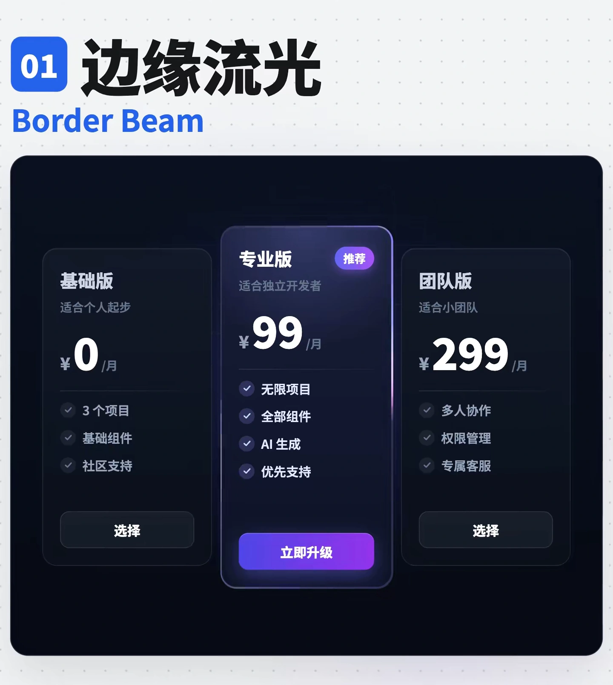
<!-- /ui-atlas:details -->

## 聚光 / Spotlight

- 标识：`motion/spotlight`；类型：组件／效果。
- 效果要点：卡片上有跟随鼠标的局部光斑，同时照亮表面和边框。
- 指令例句：卡片内部添加跟随鼠标位置的 Spotlight。
- 媒体取舍：保留静态效果图与实现说明；连续路径、触发顺序、节奏和短暂状态需在项目中实际验证。

<!-- ui-atlas:details motion/spotlight -->
- 原尺寸图片：[01 · 1440×1610](../assets/details/motion/spotlight-hd-01.webp)。
- 清晰度边界：从 2160 像素高的原片按原像素裁切，WebP 质量 95，不放大、不锐化、不涂抹；静态帧不能证明完整运动。

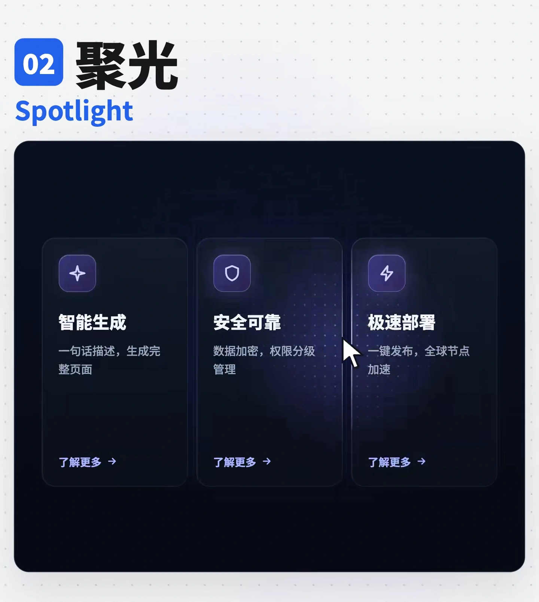
<!-- /ui-atlas:details -->

## 3D 倾斜 / Tilt

- 标识：`motion/tilt`；类型：组件／效果。
- 效果要点：卡片随鼠标位置向不同方向轻微倾斜，体现拿在手里的空间感；用于产品卡或会员卡。
- 指令例句：会员卡随鼠标微微 3D 倾斜，移开后恢复。
- 媒体取舍：保留静态效果图与实现说明；连续路径、触发顺序、节奏和短暂状态需在项目中实际验证。

<!-- ui-atlas:details motion/tilt -->
- 原尺寸图片：[01 · 1440×1610](../assets/details/motion/tilt-hd-01.webp)。
- 清晰度边界：从 2160 像素高的原片按原像素裁切，WebP 质量 95，不放大、不锐化、不涂抹；静态帧不能证明完整运动。

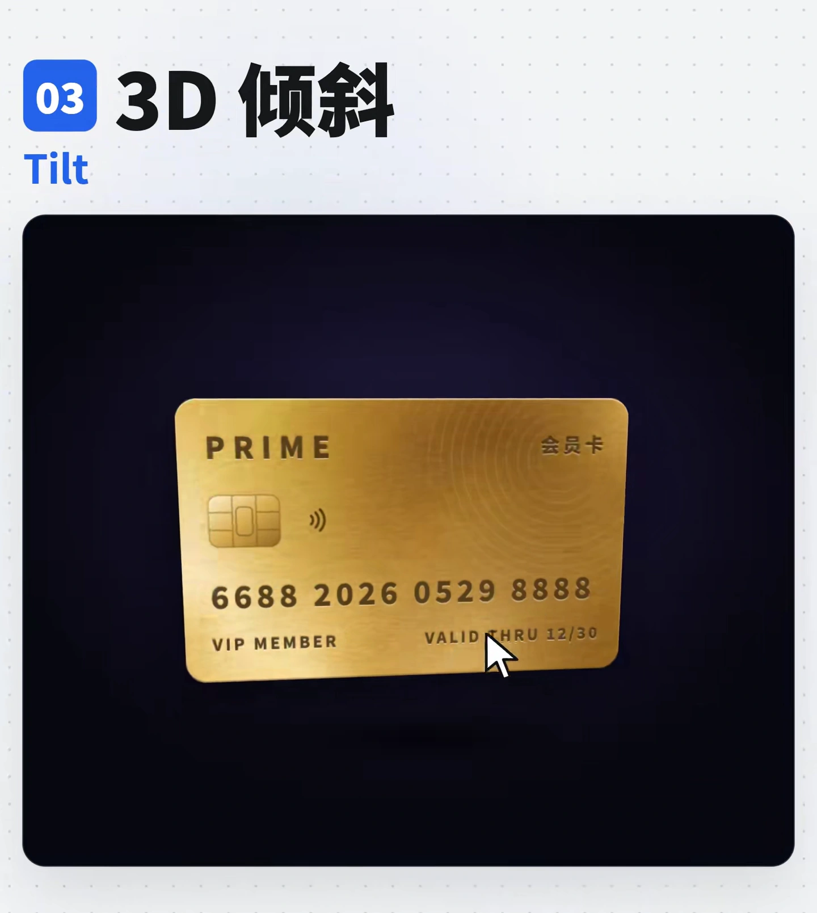
<!-- /ui-atlas:details -->

## 滚动叙事 / Scroll Storytelling

- 标识：`motion/scroll-storytelling`；类型：组件／效果。
- 效果要点：滚动时叙事区域保持固定，内部内容按进度逐步改变；示例指令是左侧文字切换、右侧图片同步变化。
- 指令例句：这一段固定展示，随滚动切换左侧文字与右侧图片。
- 媒体取舍：保留静态效果图与实现说明；连续路径、触发顺序、节奏和短暂状态需在项目中实际验证。

<!-- ui-atlas:details motion/scroll-storytelling -->
- 原尺寸图片：[01 · 1440×1610](../assets/details/motion/scroll-storytelling-hd-01.webp)。
- 清晰度边界：从 2160 像素高的原片按原像素裁切，WebP 质量 95，不放大、不锐化、不涂抹；静态帧不能证明完整运动。

<!-- /ui-atlas:details -->

## 乱码解码 / Scramble Text

- 标识：`motion/scramble-text`；类型：组件／效果。
- 效果要点：文字先以随机字符跳动，再逐字符稳定成目标文本；适合科技感标题和数字。
- 指令例句：标题先短暂乱码扰动，再逐字符恢复为正确文字。
- 媒体取舍：保留静态效果图与实现说明；连续路径、触发顺序、节奏和短暂状态需在项目中实际验证。

<!-- ui-atlas:details motion/scramble-text -->
- 原尺寸图片：[01 · 1440×1610](../assets/details/motion/scramble-text-hd-01.webp)。
- 清晰度边界：从 2160 像素高的原片按原像素裁切，WebP 质量 95，不放大、不锐化、不涂抹；静态帧不能证明完整运动。

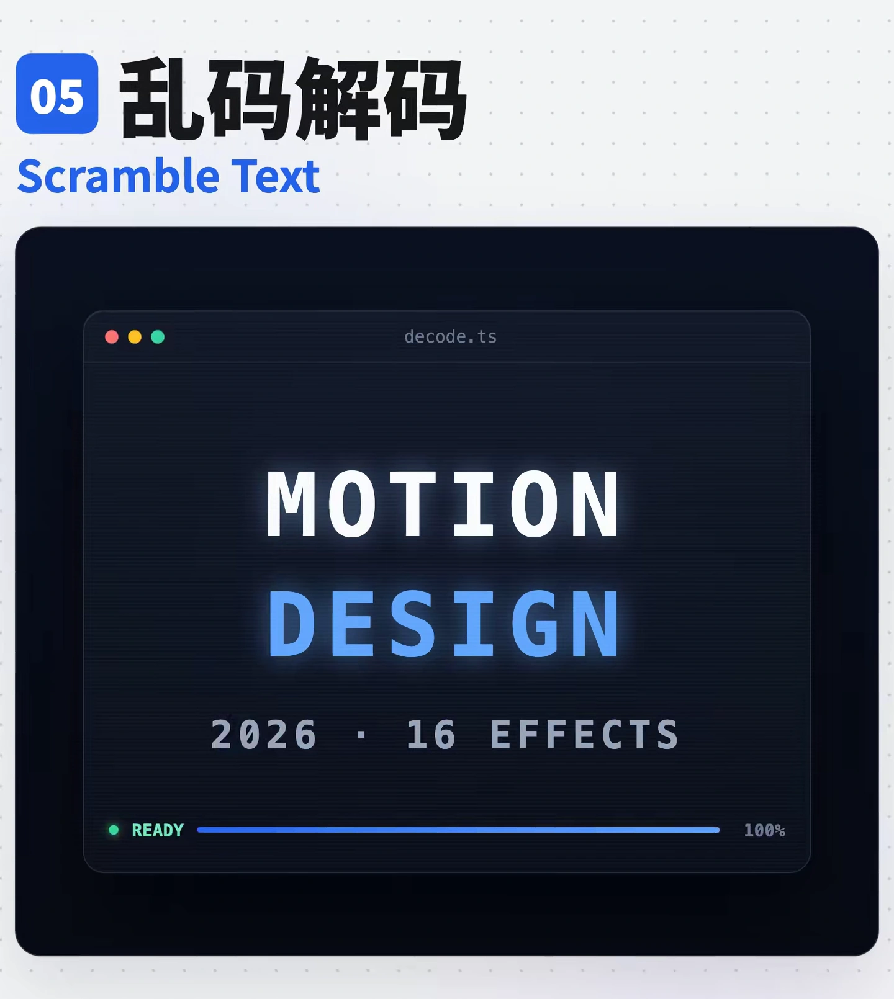
<!-- /ui-atlas:details -->

## 视差滚动 / Parallax

- 标识：`motion/parallax`；类型：组件／效果。
- 效果要点：滚动时背景比前景移动更慢，产生纵深；区别于固定区域内切换内容的滚动叙事。
- 指令例句：让背景以比前景更慢的速度移动，产生轻微视差。
- 媒体取舍：保留静态效果图与实现说明；连续路径、触发顺序、节奏和短暂状态需在项目中实际验证。

<!-- ui-atlas:details motion/parallax -->
- 原尺寸图片：[01 · 1440×1610](../assets/details/motion/parallax-hd-01.webp)。
- 清晰度边界：从 2160 像素高的原片按原像素裁切，WebP 质量 95，不放大、不锐化、不涂抹；静态帧不能证明完整运动。

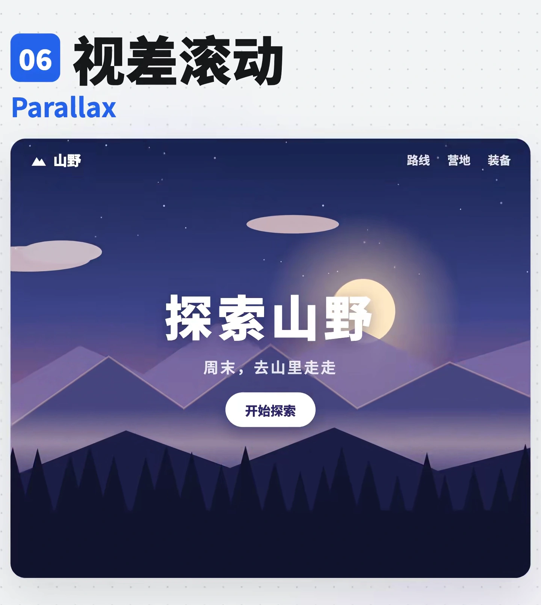
<!-- /ui-atlas:details -->

## 磁吸 / Magnetic

- 标识：`motion/magnetic`；类型：组件／效果。
- 效果要点：指针靠近按钮时，按钮向指针方向偏移一点；适用于重点 CTA。
- 指令例句：主 CTA 在指针靠近时小幅偏移产生磁吸，离开恢复。
- 媒体取舍：保留静态效果图与实现说明；连续路径、触发顺序、节奏和短暂状态需在项目中实际验证。

<!-- ui-atlas:details motion/magnetic -->
- 原尺寸图片：[01 · 1440×1610](../assets/details/motion/magnetic-hd-01.webp)。
- 清晰度边界：从 2160 像素高的原片按原像素裁切，WebP 质量 95，不放大、不锐化、不涂抹；静态帧不能证明完整运动。

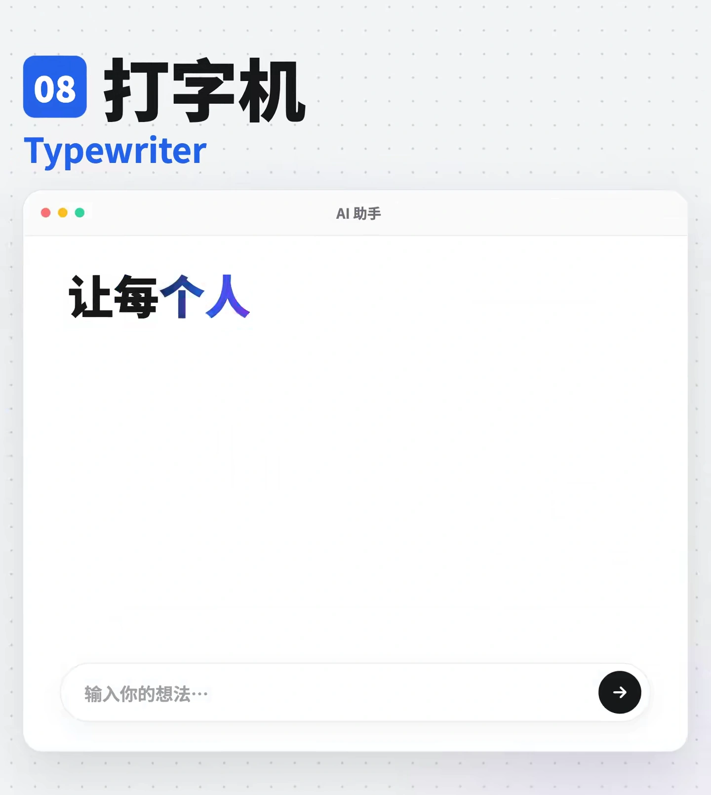
<!-- /ui-atlas:details -->

## 打字机 / Typewriter

- 标识：`motion/typewriter`；类型：组件／效果。
- 效果要点：文字逐字出现，后面有闪烁光标；用于首页标题和 AI 回复表现。
- 指令例句：标题逐字出现并跟随光标，完成后可稳定阅读。
- 媒体取舍：保留静态效果图与实现说明；连续路径、触发顺序、节奏和短暂状态需在项目中实际验证。

<!-- ui-atlas:details motion/typewriter -->
- 原尺寸图片：[01 · 1440×1610](../assets/details/motion/typewriter-hd-01.webp)。
- 清晰度边界：从 2160 像素高的原片按原像素裁切，WebP 质量 95，不放大、不锐化、不涂抹；静态帧不能证明完整运动。

<!-- /ui-atlas:details -->

## 跑马灯 / Marquee

- 标识：`motion/marquee`；类型：组件／效果。
- 效果要点：内容从右向左无限循环，常用于 Logo 或评价；这类运动应匀速，悬停最好暂停。
- 指令例句：合作伙伴 Logo 用匀速无缝跑马灯，悬停时暂停。
- 媒体取舍：保留静态效果图与实现说明；连续路径、触发顺序、节奏和短暂状态需在项目中实际验证。

<!-- ui-atlas:details motion/marquee -->
- 原尺寸图片：[01 · 1440×1610](../assets/details/motion/marquee-hd-01.webp)。
- 清晰度边界：从 2160 像素高的原片按原像素裁切，WebP 质量 95，不放大、不锐化、不涂抹；静态帧不能证明完整运动。

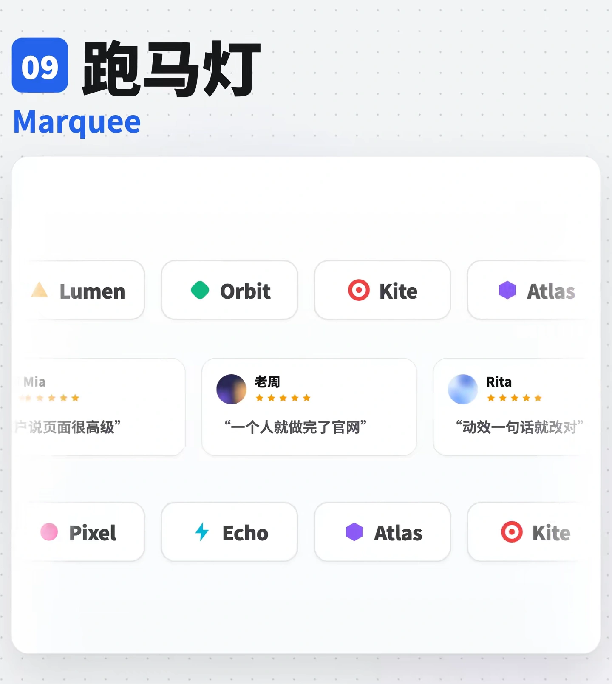
<!-- /ui-atlas:details -->

## 流光 / Shimmer

- 标识：`motion/shimmer`；类型：组件／效果。
- 效果要点：一道光扫过物体表面；用于骨架屏加载提示或按钮强调，区别于沿边框绕行的 Border Beam。
- 指令例句：给加载骨架屏加入表面扫光 Shimmer。
- 媒体取舍：保留静态效果图与实现说明；连续路径、触发顺序、节奏和短暂状态需在项目中实际验证。

<!-- ui-atlas:details motion/shimmer -->
- 原尺寸图片：[01 · 1440×1610](../assets/details/motion/shimmer-hd-01.webp)。
- 清晰度边界：从 2160 像素高的原片按原像素裁切，WebP 质量 95，不放大、不锐化、不涂抹；静态帧不能证明完整运动。

<!-- /ui-atlas:details -->

## 数字滚动 / Count Up

- 标识：`motion/count-up`；类型：组件／效果。
- 效果要点：数字从零快速递增到目标值，突出统计数字。
- 指令例句：统计数字进入视口后从零递增到真实目标值。
- 媒体取舍：保留静态效果图与实现说明；连续路径、触发顺序、节奏和短暂状态需在项目中实际验证。

<!-- ui-atlas:details motion/count-up -->
- 原尺寸图片：[01 · 1440×1610](../assets/details/motion/count-up-hd-01.webp)。
- 清晰度边界：从 2160 像素高的原片按原像素裁切，WebP 质量 95，不放大、不锐化、不涂抹；静态帧不能证明完整运动。

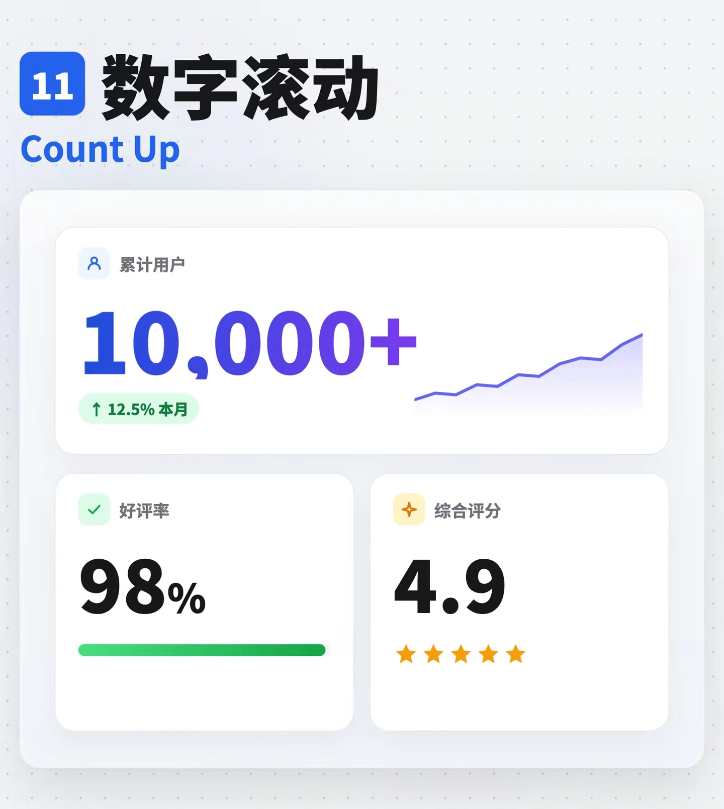
<!-- /ui-atlas:details -->

## 滚动出现 / Scroll Reveal

- 标识：`motion/scroll-reveal`；类型：组件／效果。
- 效果要点：内容进入视口时淡入或滑入；适合长页面阅读节奏，非整页打开时同时播放。
- 指令例句：内容进入视口时轻微淡入上移。
- 媒体取舍：保留静态效果图与实现说明；连续路径、触发顺序、节奏和短暂状态需在项目中实际验证。

<!-- ui-atlas:details motion/scroll-reveal -->
- 原尺寸图片：[01 · 1440×1610](../assets/details/motion/scroll-reveal-hd-01.webp)。
- 清晰度边界：从 2160 像素高的原片按原像素裁切，WebP 质量 95，不放大、不锐化、不涂抹；静态帧不能证明完整运动。

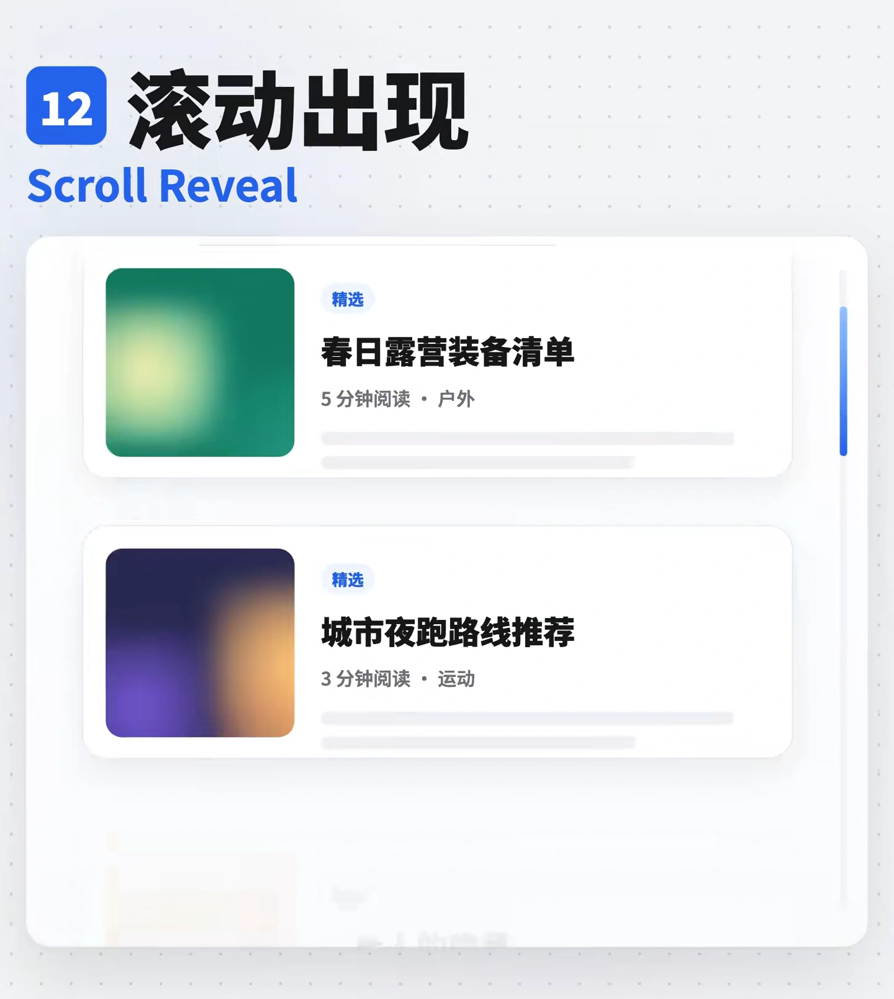
<!-- /ui-atlas:details -->

## 弹性 / Spring

- 标识：`motion/spring`；类型：组件／效果。
- 效果要点：到终点后略微越过再回弹；用于少量趣味交互；建议弹窗从约 95% 到原尺寸，不从零缩放。
- 指令例句：弹窗从 0.95 倍到 1 倍轻微回弹，避免大幅晃动。
- 实现补充：统一节奏时参考 [011 动画节奏配方](recipes/easing.md)。趣味过冲限制在小型、低频反馈；大弹窗与抽屉的普通入场使用 ease-out，手势释放归位另按原生弹簧处理，不能把两者混为同一角色。
- 媒体取舍：保留静态效果图与实现说明；连续路径、触发顺序、节奏和短暂状态需在项目中实际验证。

<!-- ui-atlas:details motion/spring -->
- 原尺寸图片：[01 · 1440×1610](../assets/details/motion/spring-hd-01.webp)。
- 清晰度边界：从 2160 像素高的原片按原像素裁切，WebP 质量 95，不放大、不锐化、不涂抹；静态帧不能证明完整运动。

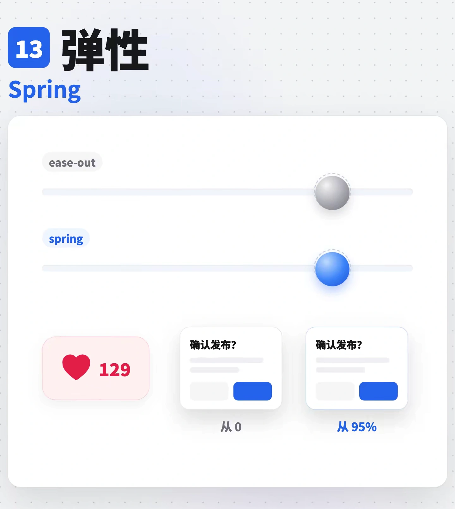
<!-- /ui-atlas:details -->

## 错峰 / Stagger

- 标识：`motion/stagger`；类型：组件／效果。
- 效果要点：一组元素按顺序依次出现，示例为每项间隔 0.05 秒。
- 指令例句：列表项依次出现，相邻开始时间间隔 0.05 秒。
- 媒体取舍：保留静态效果图与实现说明；连续路径、触发顺序、节奏和短暂状态需在项目中实际验证。

<!-- ui-atlas:details motion/stagger -->
- 原尺寸图片：[01 · 1440×1610](../assets/details/motion/stagger-hd-01.webp)。
- 清晰度边界：从 2160 像素高的原片按原像素裁切，WebP 质量 95，不放大、不锐化、不涂抹；静态帧不能证明完整运动。

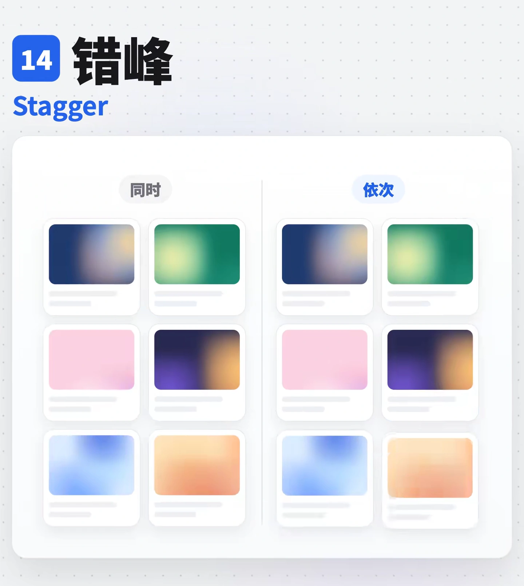
<!-- /ui-atlas:details -->

## 悬停上浮 / Hover Lift

- 标识：`motion/hover-lift`；类型：组件／效果。
- 效果要点：指针进入卡片时略微上浮并增强阴影，传达可点击性。
- 指令例句：可点击卡片悬停时轻微上浮并加深阴影。
- 媒体取舍：保留静态效果图与实现说明；连续路径、触发顺序、节奏和短暂状态需在项目中实际验证。

<!-- ui-atlas:details motion/hover-lift -->
- 原尺寸图片：[01 · 1440×1610](../assets/details/motion/hover-lift-hd-01.webp)。
- 清晰度边界：从 2160 像素高的原片按原像素裁切，WebP 质量 95，不放大、不锐化、不涂抹；静态帧不能证明完整运动。

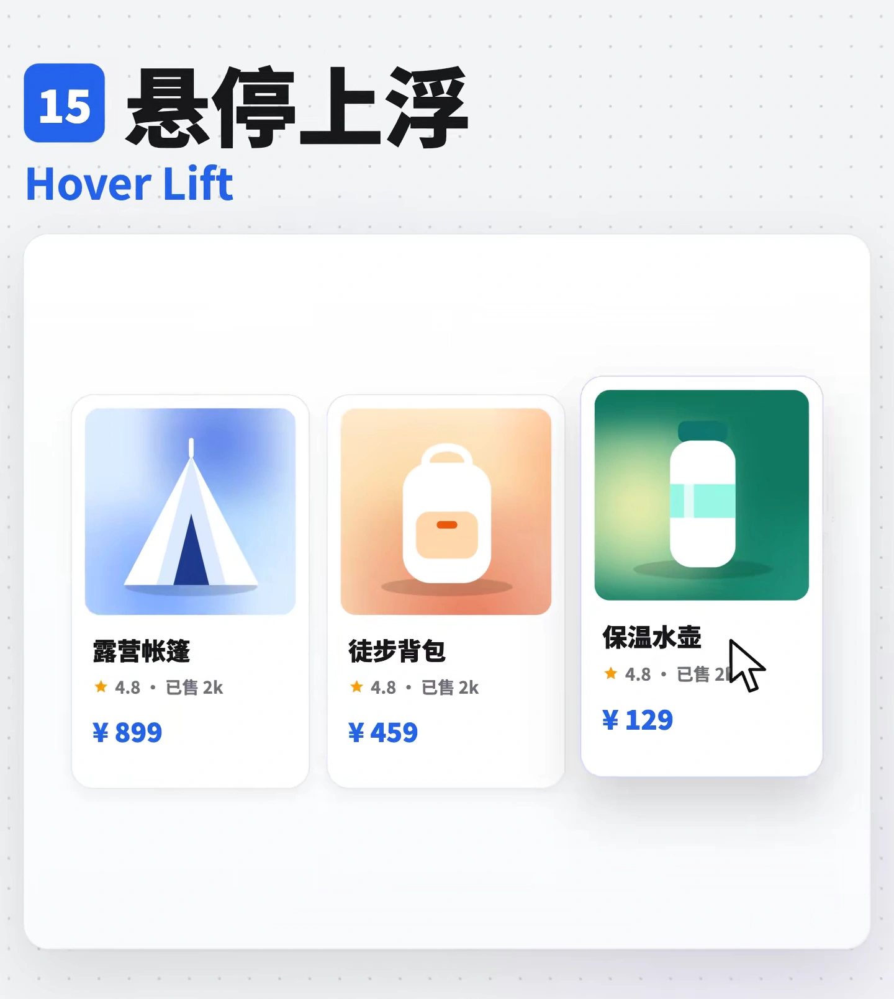
<!-- /ui-atlas:details -->

## 缓动 / Easing

- 标识：`motion/easing`；类型：组件／效果。
- 效果要点：速度变化决定运动观感；建议进场使用先快后慢的 ease-out，离场比进场更快更轻，协同元素节奏一致；跑马灯另用匀速。
- 指令例句：进场采用 ease-out，离场更快更轻，相关元素保持一致节奏。
- 完整配方：[011 · 如何选择更合适的动画节奏？](recipes/easing.md)，包含两段连续使用的提示词、曲线 token、时长范围、手势释放与减弱动态要求。
- 实现边界：只调整缓动与必要时长，保留原动画对象、触发与位移；入场 ease-out、离场 ease-in、屏内移动 ease-in-out。悬停按压、细小反馈与手势释放按配方分别处理。
- 媒体取舍：保留静态效果图与实现说明；连续路径、触发顺序、节奏和短暂状态需在项目中实际验证。

<!-- ui-atlas:details motion/easing -->
- 原尺寸图片：[01 · 1440×1610](../assets/details/motion/easing-hd-01.webp)。
- 清晰度边界：从 2160 像素高的原片按原像素裁切，WebP 质量 95，不放大、不锐化、不涂抹；静态帧不能证明完整运动。

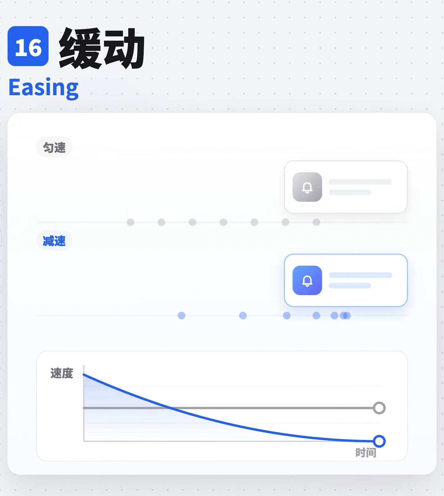
<!-- /ui-atlas:details -->

## 动效时长、性能与减弱动态 / Motion rules

- 标识：`motion/motion-rules`；类型：选型／纠错。
- 效果要点：常见节奏起点：小动作约 0.1–0.2 秒，弹窗与抽屉约 0.2–0.3 秒；尽量动画化位置、大小和透明度；尊重减弱动态效果设置。
- 指令例句：按交互尺度设置时长，优先 transform 和 opacity，开启减弱动态时关闭非必要动画。 具体效果先读取 references/motion-selection.md 中的 20 种选型与提示词。
- 统一节奏时使用 [011 动画节奏配方](recipes/easing.md) 的细分起点：小型入场 150–250 ms、离场 120–200 ms，中型 250–350 ms，大型 350–500 ms；手势弹簧保留释放速度，性能优化不改变真实布局行为。
- 媒体取舍：这是时长、性能与减弱动态的文字规则，拼图讲解静态图足够。

- 选型补充：动效具体选型与 20 种效果的实现提示词见 motion-selection.md。液态扭曲、共享元素转场、无限画廊、物理掉落与页面转场以文字说明为准；不借用其他效果的图片作为视觉证据。

<!-- ui-atlas:details motion/motion-rules -->
- 原尺寸图片：[01 · 600×756](https://raw.githubusercontent.com/dqzboy/ui-atlas/4d61e1224c50685c02acae3ae67ebe9c217fa3b9/assets/details/motion/motion-rules.png)。
- 清晰度边界：从历史素材提取原尺寸独立帧，避免总览缩图和再次 JPEG 压缩；源素材的分辨率与色彩限制仍在，图片不能证明连续运动。

<!-- /ui-atlas:details -->

## 静态渐变描边 / Gradient Border

- 标识：`motion/gradient-border`；类型：组件／效果。
- 效果要点：以静态渐变细边强调重要卡片，其他同级卡片保持普通边框。
- 实现提示词：只给推荐卡片添加静态品牌渐变描边，圆角连续、内外边框同心，保留内容尺寸与主次按钮。
- 核对要点：使用独立边框层并隔离内容；不自动添加旋转、闪烁或持续流光。
- 媒体取舍：仅保留一张无讲解文字的效果参考；触发、时序、运动路径与减弱动态需在项目中验证。

<!-- ui-atlas:details motion/gradient-border -->
- 原尺寸图片：[01 · 1195×745](../assets/details/motion/gradient-border-effect.webp)。
- 清晰度边界：1440×2560 视频在播放器接近原尺寸呈现后，仅裁出 UI 效果区域；WebP 质量 98，未放大、未锐化、未涂抹。原画中的材质模糊和光晕属于效果；静态图只核对可见状态，连续运动在项目中验证。

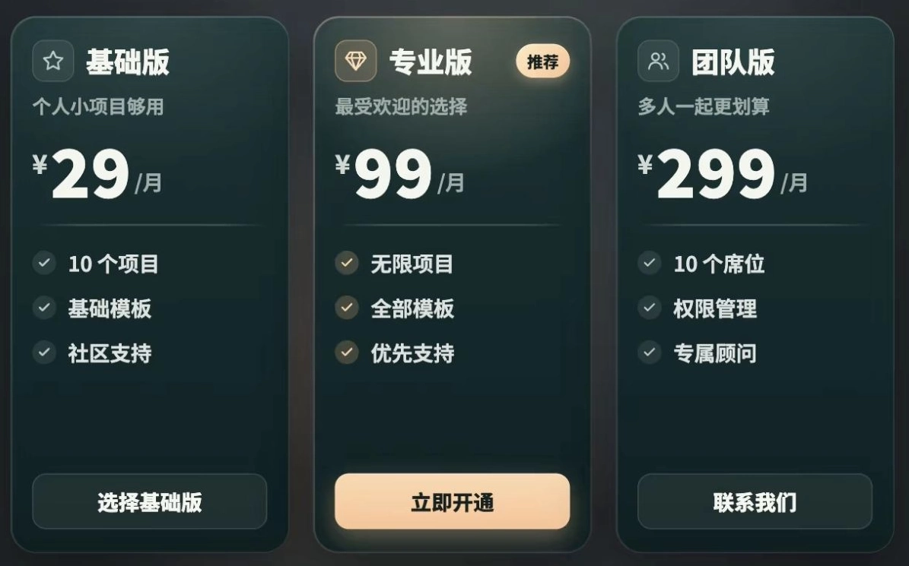
<!-- /ui-atlas:details -->

## 环绕流光边框 / Flowing Gradient Border

- 标识：`motion/flowing-border`；类型：组件／效果。
- 效果要点：较长的渐变亮带沿卡片周边流动，与短光段的 Border Beam 区分。
- 实现提示词：为唯一推荐卡片设置沿周边缓慢环绕的渐变边框；只动画装饰层，卡片正文与布局保持稳定。
- 核对要点：圆角处无断裂、内部不漏光；离屏暂停，减弱动态时保留静态细边。静态帧不能判断绕行速度。
- 媒体取舍：仅保留一张无讲解文字的效果参考；触发、时序、运动路径与减弱动态需在项目中验证。

<!-- ui-atlas:details motion/flowing-border -->
- 原尺寸图片：[01 · 1220×730](../assets/details/motion/flowing-border-effect.webp)。
- 清晰度边界：1440×2560 视频在播放器接近原尺寸呈现后，仅裁出 UI 效果区域；WebP 质量 98，未放大、未锐化、未涂抹。原画中的材质模糊和光晕属于效果；静态图只核对可见状态，连续运动在项目中验证。

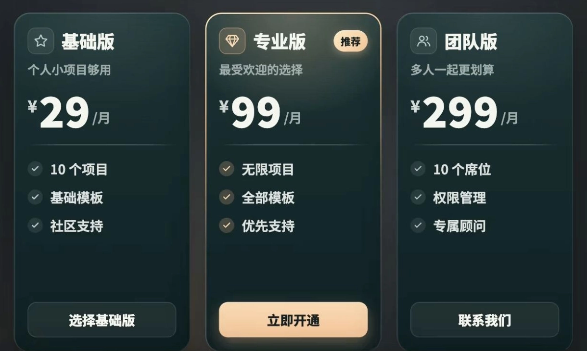
<!-- /ui-atlas:details -->

## 卡片外部光晕 / Card Glow

- 标识：`motion/card-glow`；类型：组件／效果。
- 效果要点：卡片外围柔和扩散的光晕分离前后层次，适合深色界面的单个重点指标。
- 实现提示词：在重点卡片外部增加低强度品牌光晕，保持卡片内部文字和图表清晰；其他卡片只用普通边框与阴影。
- 核对要点：光晕独立于文字层且不截断；控制叠加数量和绘制成本，不改变数据含义。
- 媒体取舍：仅保留一张无讲解文字的效果参考；触发、时序、运动路径与减弱动态需在项目中验证。

<!-- ui-atlas:details motion/card-glow -->
- 原尺寸图片：[01 · 1160×720](../assets/details/motion/card-glow-effect.webp)。
- 清晰度边界：1440×2560 视频在播放器接近原尺寸呈现后，仅裁出 UI 效果区域；WebP 质量 98，未放大、未锐化、未涂抹。原画中的材质模糊和光晕属于效果；静态图只核对可见状态，连续运动在项目中验证。

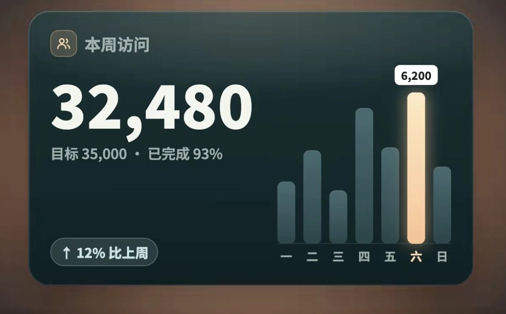
<!-- /ui-atlas:details -->

## 滚动进度绑定 / Scroll-linked Animation

- 标识：`motion/scroll-linked`；类型：组件／效果。
- 效果要点：把滚动进度映射到产品拆解等画面状态，回滚时沿同一进度恢复。
- 实现提示词：把当前展示区的滚动进度映射到产品拆解的位置与透明度，允许前后滚动，保留正常页面滚动和内容顺序。
- 核对要点：明确起止区间；布局变化时重新测量；不要改成进入视口后独立播放一次。
- 媒体取舍：仅保留一张无讲解文字的效果参考；触发、时序、运动路径与减弱动态需在项目中验证。

<!-- ui-atlas:details motion/scroll-linked -->
- 原尺寸图片：[01 · 1375×1340](../assets/details/motion/scroll-linked-effect.webp)。
- 清晰度边界：1440×2560 视频在播放器接近原尺寸呈现后，仅裁出 UI 效果区域；WebP 质量 98，未放大、未锐化、未涂抹。原画中的材质模糊和光晕属于效果；静态图只核对可见状态，连续运动在项目中验证。

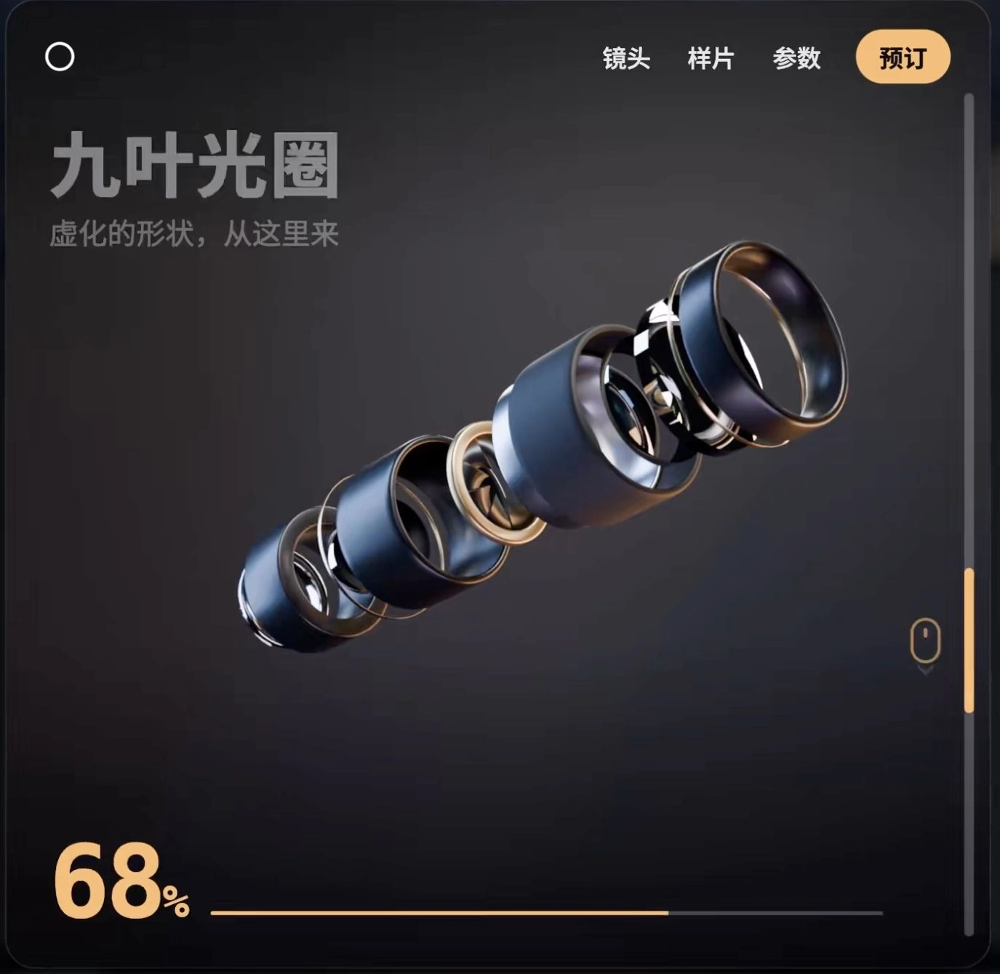
<!-- /ui-atlas:details -->

## 粒子聚合变形 / Particle Morph

- 标识：`motion/particle-morph`；类型：组件／效果。
- 效果要点：粒子分散并聚合成可辨认的形状，形态变化承载首屏视觉叙事。
- 实现提示词：为指定首屏实现粒子从分散到目标形状的聚合与形态切换；保留前景可读文字和主操作，按设备能力控制粒子数量。
- 核对要点：实现时可在点集之间插值并保持稳定对应关系；图片只显示聚合外观，不证明粒子数量或连续形变算法。
- 媒体取舍：仅保留一张无讲解文字的效果参考；触发、时序、运动路径与减弱动态需在项目中验证。

<!-- ui-atlas:details motion/particle-morph -->
- 原尺寸图片：[01 · 1375×1340](../assets/details/motion/particle-morph-effect.webp)。
- 清晰度边界：1440×2560 视频在播放器接近原尺寸呈现后，仅裁出 UI 效果区域；WebP 质量 98，未放大、未锐化、未涂抹。原画中的材质模糊和光晕属于效果；静态图只核对可见状态，连续运动在项目中验证。

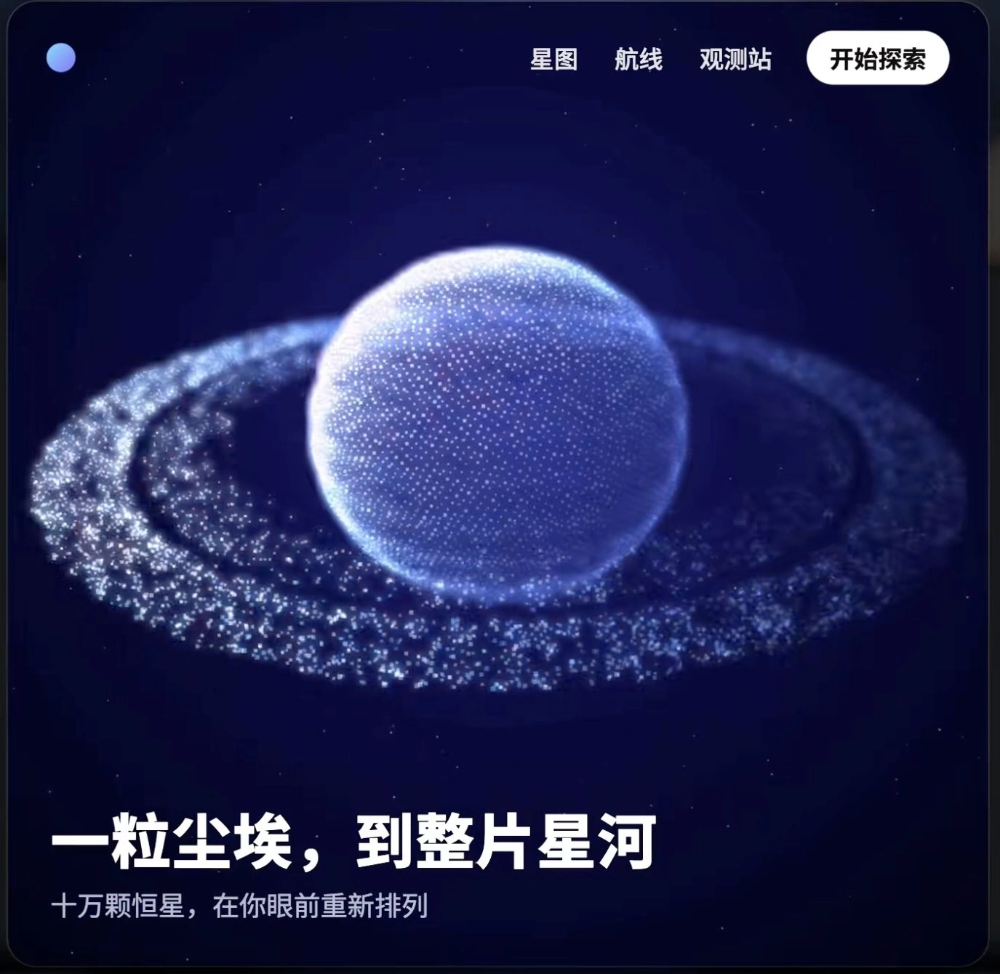
<!-- /ui-atlas:details -->

## 遮罩揭开 / Mask Reveal

- 标识：`motion/mask-reveal`；类型：组件／效果。
- 效果要点：用逐步扩大的遮罩窗口显露完整图像，完成态回到无裁切的内容。
- 实现提示词：为指定图片设计从局部窗口逐步揭开的 Mask Reveal；明确点击或滚动触发，文字保持真实 DOM，完成后图片全幅可见。
- 核对要点：图为揭开完成后的画面；遮罩形状与中间路径需实现验证。减弱动态时直接显示，避免长期裁切必要内容。
- 媒体取舍：仅保留一张无讲解文字的效果参考；触发、时序、运动路径与减弱动态需在项目中验证。

<!-- ui-atlas:details motion/mask-reveal -->
- 原尺寸图片：[01 · 1375×1340](../assets/details/motion/mask-reveal-effect.webp)。
- 清晰度边界：1440×2560 视频在播放器接近原尺寸呈现后，仅裁出 UI 效果区域；WebP 质量 98，未放大、未锐化、未涂抹。原画中的材质模糊和光晕属于效果；静态图只核对可见状态，连续运动在项目中验证。

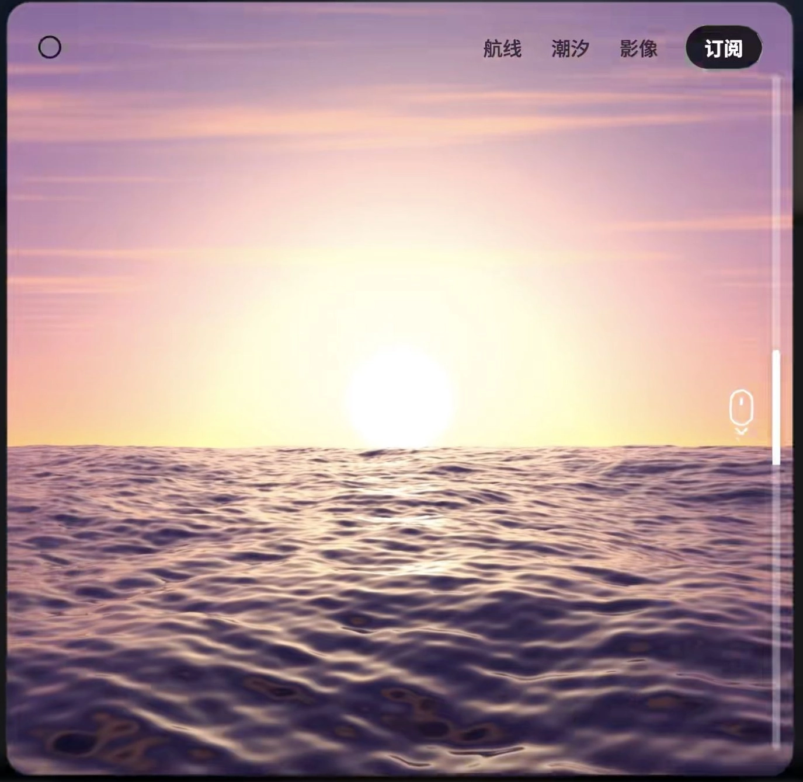
<!-- /ui-atlas:details -->

## 滚动卡片堆叠 / Stacking Cards

- 标识：`motion/stacking-cards`；类型：组件／效果。
- 效果要点：卡片随滚动逐层覆盖，保留后方露出的卡片边缘与阅读顺序。
- 实现提示词：让步骤卡片随滚动逐张覆盖前一张，保留顶部层次、清晰文字与退出堆叠区后的正常滚动。
- 核对要点：根据卡片高度设置粘性区间；窄屏内容不得被固定高度截断；键盘与阅读顺序保持一致。
- 媒体取舍：仅保留一张无讲解文字的效果参考；触发、时序、运动路径与减弱动态需在项目中验证。

<!-- ui-atlas:details motion/stacking-cards -->
- 原尺寸图片：[01 · 1375×1340](../assets/details/motion/stacking-cards-effect.webp)。
- 清晰度边界：1440×2560 视频在播放器接近原尺寸呈现后，仅裁出 UI 效果区域；WebP 质量 98，未放大、未锐化、未涂抹。原画中的材质模糊和光晕属于效果；静态图只核对可见状态，连续运动在项目中验证。

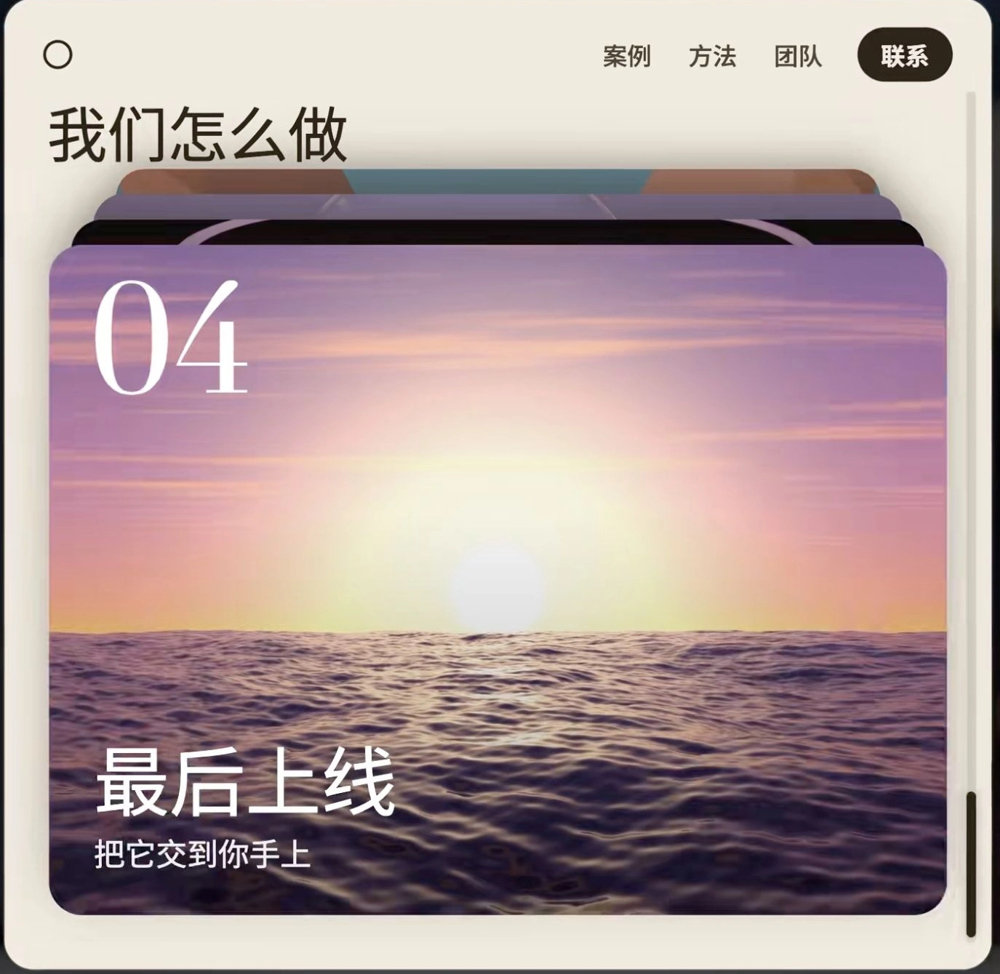
<!-- /ui-atlas:details -->

## 横向滚动展陈 / Horizontal Scroll

- 标识：`motion/horizontal-scroll`；类型：组件／效果。
- 效果要点：在有界展示区中随滚动横向浏览展品，并保留进度与上下文。
- 实现提示词：将选定展陈区实现为横向浏览：明确滚动进度到横向位移的映射、起止位置和离开区间；触摸与键盘仍能到达全部展品。
- 核对要点：不全站劫持滚轮；响应式重新测量；提供正常列表回退，避免只实现匀速跑马灯。
- 媒体取舍：仅保留一张无讲解文字的效果参考；触发、时序、运动路径与减弱动态需在项目中验证。

<!-- ui-atlas:details motion/horizontal-scroll -->
- 原尺寸图片：[01 · 1375×1340](../assets/details/motion/horizontal-scroll-effect.webp)。
- 清晰度边界：1440×2560 视频在播放器接近原尺寸呈现后，仅裁出 UI 效果区域；WebP 质量 98，未放大、未锐化、未涂抹。原画中的材质模糊和光晕属于效果；静态图只核对可见状态，连续运动在项目中验证。

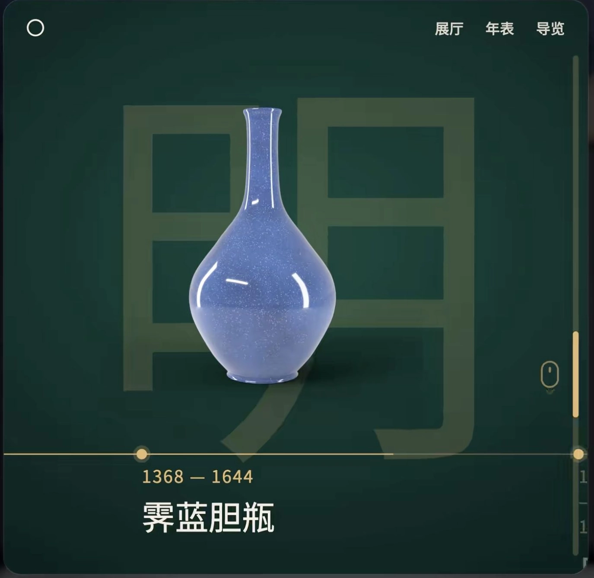
<!-- /ui-atlas:details -->

## 排序筛选布局动画 / Layout Animation

- 标识：`motion/layout-animation`；类型：组件／效果。
- 效果要点：同一组元素排序或筛选后，保留身份并平滑移动到新位置。
- 实现提示词：给已有排序与筛选结果添加布局动画，稳定元素 key，复用当前动画库的布局测量或 FLIP；业务状态立即生效，连续操作从当前视觉位置继续。
- 核对要点：图仅保留完成后的网格局部；初态、重排与移除过程需实际验证。控制 DOM 测量批次，不为每一帧动画 width 或 top。
- 媒体取舍：仅保留一张无讲解文字的效果参考；该图展示局部细节。触发、时序、运动路径与减弱动态需在项目中验证。

<!-- ui-atlas:details motion/layout-animation -->
- 原尺寸图片：[01 · 1095×1060](../assets/details/motion/layout-animation-effect.webp)。
- 清晰度边界：1440×2560 视频在播放器接近原尺寸呈现后，仅裁出 UI 效果区域；WebP 质量 98，未放大、未锐化、未涂抹。原画中的材质模糊和光晕属于效果；静态图只核对可见状态，连续运动在项目中验证。

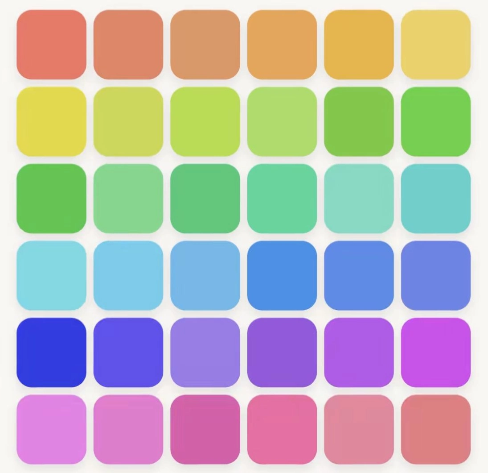
<!-- /ui-atlas:details -->
