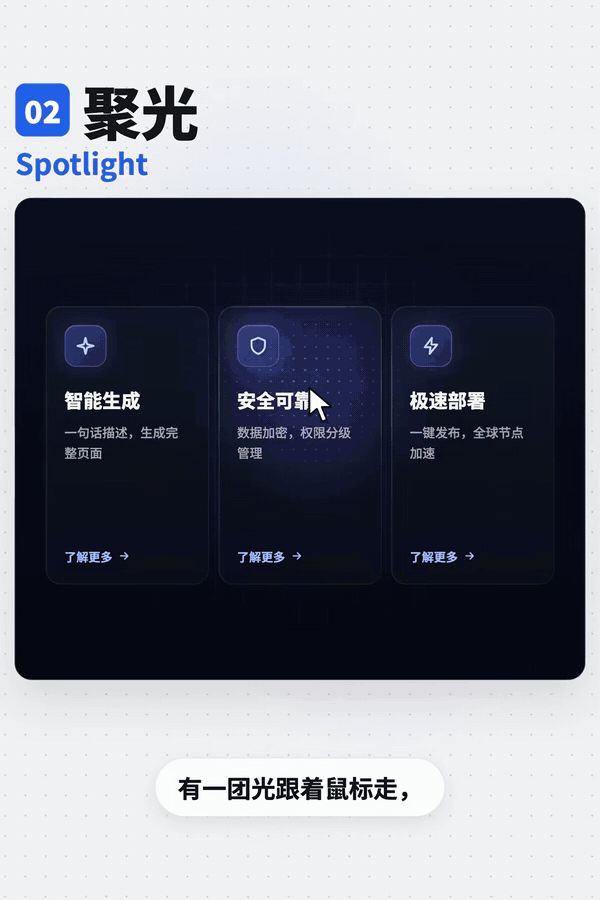
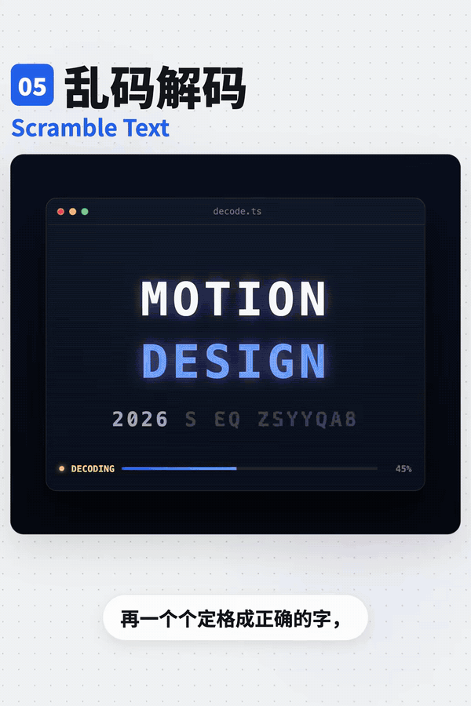
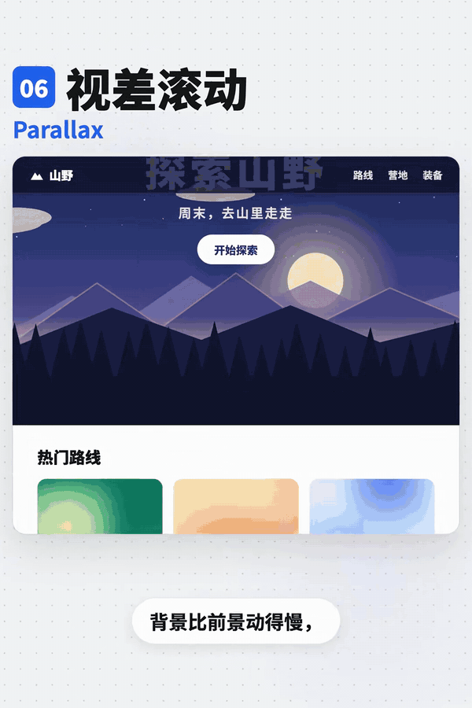
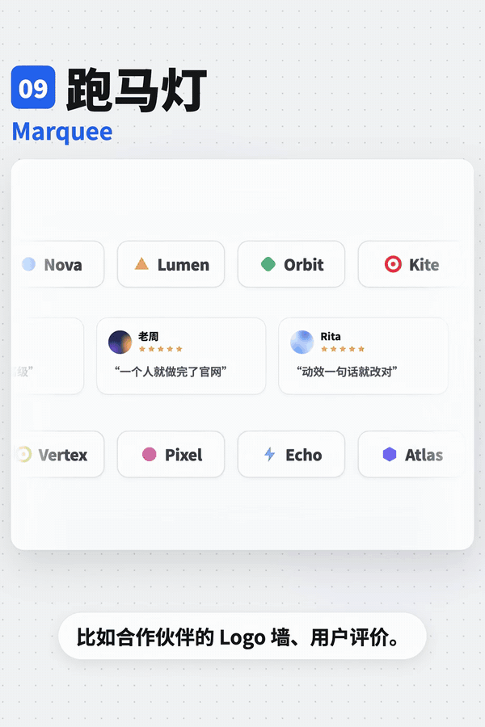
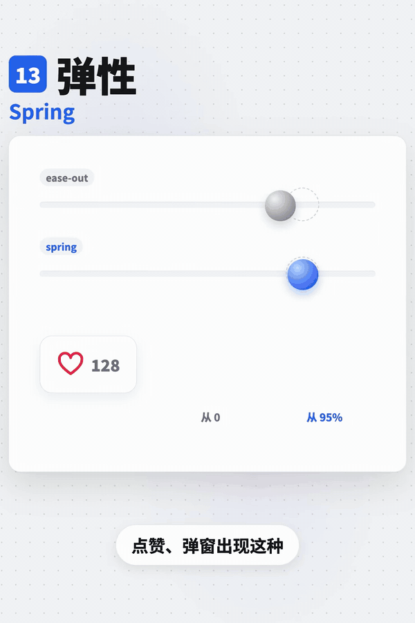
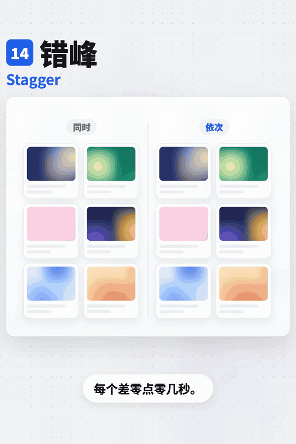
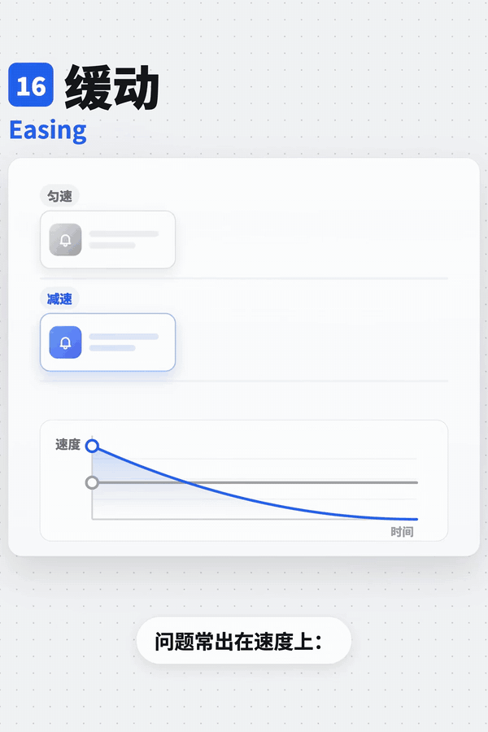

# 常见动效

六帧图看主要状态，不能证明连续运动和短暂状态。按当前项目需求实现目标组件的交互与动效。

## 目录

- [边缘流光 / Border Beam](#border-beam)
- [聚光 / Spotlight](#spotlight)
- [3D 倾斜 / Tilt](#tilt)
- [滚动叙事 / Scroll Storytelling](#scroll-storytelling)
- [乱码解码 / Scramble Text](#scramble-text)
- [视差滚动 / Parallax](#parallax)
- [磁吸 / Magnetic](#magnetic)
- [打字机 / Typewriter](#typewriter)
- [跑马灯 / Marquee](#marquee)
- [流光 / Shimmer](#shimmer)
- [数字滚动 / Count Up](#count-up)
- [滚动出现 / Scroll Reveal](#scroll-reveal)
- [弹性 / Spring](#spring)
- [错峰 / Stagger](#stagger)
- [悬停上浮 / Hover Lift](#hover-lift)
- [缓动 / Easing](#easing)
- [动效时长、性能与减弱动态 / Motion rules](#motion-rules)

## 边缘流光 / Border Beam

- 标识：`motion/border-beam`；类型：组件／效果。
- 效果要点：光沿卡片边框循环移动，用于突出推荐套餐或新功能；运动路径在边缘，不是扫过整个表面。
- 指令例句：只给推荐套餐卡片加沿边框环绕的 Border Beam。
- 媒体取舍：保留 GIF＋静态图片。需确认光沿边框绕行而非扫过表面，路径与循环是主体。
- 参考：[GIF 动图](../assets/gifs/motion/border-beam.gif) · [六帧对照图](../assets/filmstrips/motion/border-beam.jpg)。

<!-- ui-atlas:details motion/border-beam -->
- 原尺寸图片：[01 · 600×900](../assets/details/motion/border-beam.png)。
- 连续效果：[GIF · 600×900](../assets/gifs/motion/border-beam.gif)。
- 清晰度边界：从现存 GIF 解出原尺寸独立帧，避免总览缩图和二次 JPEG 压缩；GIF 的分辨率、色彩与源压缩限制仍在。

<!-- /ui-atlas:details -->

## 聚光 / Spotlight

- 标识：`motion/spotlight`；类型：组件／效果。
- 效果要点：卡片上有跟随鼠标的局部光斑，同时照亮表面和边框。
- 指令例句：卡片内部添加跟随鼠标位置的 Spotlight。
- 媒体取舍：保留 GIF＋静态图片。需看局部光斑如何跟随指针以及表面、边框的同步变化。
- 参考：[GIF 动图](../assets/gifs/motion/spotlight.gif) · [六帧对照图](../assets/filmstrips/motion/spotlight.jpg)。

<!-- ui-atlas:details motion/spotlight -->
- 原尺寸图片：[01 · 600×900](../assets/details/motion/spotlight.png)。
- 连续效果：[GIF · 600×900](../assets/gifs/motion/spotlight.gif)。
- 清晰度边界：从现存 GIF 解出原尺寸独立帧，避免总览缩图和二次 JPEG 压缩；GIF 的分辨率、色彩与源压缩限制仍在。

<!-- /ui-atlas:details -->

## 3D 倾斜 / Tilt

- 标识：`motion/tilt`；类型：组件／效果。
- 效果要点：卡片随鼠标位置向不同方向轻微倾斜，体现拿在手里的空间感；用于产品卡或会员卡。
- 指令例句：会员卡随鼠标微微 3D 倾斜，移开后恢复。
- 媒体取舍：保留 GIF＋静态图片。需看倾斜方向随指针改变以及离开后的复位。
- 参考：[GIF 动图](../assets/gifs/motion/tilt.gif) · [六帧对照图](../assets/filmstrips/motion/tilt.jpg)。

<!-- ui-atlas:details motion/tilt -->
- 原尺寸图片：[01 · 600×900](../assets/details/motion/tilt.png)。
- 连续效果：[GIF · 600×900](../assets/gifs/motion/tilt.gif)。
- 清晰度边界：从现存 GIF 解出原尺寸独立帧，避免总览缩图和二次 JPEG 压缩；GIF 的分辨率、色彩与源压缩限制仍在。

<!-- /ui-atlas:details -->

## 滚动叙事 / Scroll Storytelling

- 标识：`motion/scroll-storytelling`；类型：组件／效果。
- 效果要点：滚动时叙事区域保持固定，内部内容按进度逐步改变；示例指令是左侧文字切换、右侧图片同步变化。
- 指令例句：这一段固定展示，随滚动切换左侧文字与右侧图片。
- 媒体取舍：保留 GIF＋静态图片。需看固定叙事区内文字与图片随滚动进度切换的关系。
- 参考：[GIF 动图](../assets/gifs/motion/scroll-storytelling.gif) · [六帧对照图](../assets/filmstrips/motion/scroll-storytelling.jpg)。

<!-- ui-atlas:details motion/scroll-storytelling -->
- 原尺寸图片：[01 · 600×900](../assets/details/motion/scroll-storytelling.png)。
- 连续效果：[GIF · 600×900](../assets/gifs/motion/scroll-storytelling.gif)。
- 清晰度边界：从现存 GIF 解出原尺寸独立帧，避免总览缩图和二次 JPEG 压缩；GIF 的分辨率、色彩与源压缩限制仍在。

<!-- /ui-atlas:details -->

## 乱码解码 / Scramble Text

- 标识：`motion/scramble-text`；类型：组件／效果。
- 效果要点：文字先以随机字符跳动，再逐字符稳定成目标文本；适合科技感标题和数字。
- 指令例句：标题先短暂乱码扰动，再逐字符恢复为正确文字。
- 媒体取舍：保留 GIF＋静态图片。随机字符逐步稳定的先后与节奏是主体。
- 参考：[GIF 动图](../assets/gifs/motion/scramble-text.gif) · [六帧对照图](../assets/filmstrips/motion/scramble-text.jpg)。

<!-- ui-atlas:details motion/scramble-text -->
- 原尺寸图片：[01 · 600×900](../assets/details/motion/scramble-text.png)。
- 连续效果：[GIF · 600×900](../assets/gifs/motion/scramble-text.gif)。
- 清晰度边界：从现存 GIF 解出原尺寸独立帧，避免总览缩图和二次 JPEG 压缩；GIF 的分辨率、色彩与源压缩限制仍在。

<!-- /ui-atlas:details -->

## 视差滚动 / Parallax

- 标识：`motion/parallax`；类型：组件／效果。
- 效果要点：滚动时背景比前景移动更慢，产生纵深；区别于固定区域内切换内容的滚动叙事。
- 指令例句：让背景以比前景更慢的速度移动，产生轻微视差。
- 媒体取舍：保留 GIF＋静态图片。需看前后层在同一滚动中的速度差。
- 参考：[GIF 动图](../assets/gifs/motion/parallax.gif) · [六帧对照图](../assets/filmstrips/motion/parallax.jpg)。

<!-- ui-atlas:details motion/parallax -->
- 原尺寸图片：[01 · 600×900](../assets/details/motion/parallax.png)。
- 连续效果：[GIF · 600×900](../assets/gifs/motion/parallax.gif)。
- 清晰度边界：从现存 GIF 解出原尺寸独立帧，避免总览缩图和二次 JPEG 压缩；GIF 的分辨率、色彩与源压缩限制仍在。

<!-- /ui-atlas:details -->

## 磁吸 / Magnetic

- 标识：`motion/magnetic`；类型：组件／效果。
- 效果要点：指针靠近按钮时，按钮向指针方向偏移一点；适用于重点 CTA。
- 指令例句：主 CTA 在指针靠近时小幅偏移产生磁吸，离开恢复。
- 媒体取舍：保留 GIF＋静态图片。需看靠近时偏移和离开后复位的连续响应。
- 参考：[GIF 动图](../assets/gifs/motion/magnetic.gif) · [六帧对照图](../assets/filmstrips/motion/magnetic.jpg)。

<!-- ui-atlas:details motion/magnetic -->
- 原尺寸图片：[01 · 600×900](../assets/details/motion/magnetic.png)。
- 连续效果：[GIF · 600×900](../assets/gifs/motion/magnetic.gif)。
- 清晰度边界：从现存 GIF 解出原尺寸独立帧，避免总览缩图和二次 JPEG 压缩；GIF 的分辨率、色彩与源压缩限制仍在。

<!-- /ui-atlas:details -->

## 打字机 / Typewriter

- 标识：`motion/typewriter`；类型：组件／效果。
- 效果要点：文字逐字出现，后面有闪烁光标；用于首页标题和 AI 回复表现。
- 指令例句：标题逐字出现并跟随光标，完成后可稳定阅读。
- 媒体取舍：保留 GIF＋静态图片。需看文字逐字出现和光标跟随的先后。
- 参考：[GIF 动图](../assets/gifs/motion/typewriter.gif) · [六帧对照图](../assets/filmstrips/motion/typewriter.jpg)。

<!-- ui-atlas:details motion/typewriter -->
- 原尺寸图片：[01 · 600×900](../assets/details/motion/typewriter.png)。
- 连续效果：[GIF · 600×900](../assets/gifs/motion/typewriter.gif)。
- 清晰度边界：从现存 GIF 解出原尺寸独立帧，避免总览缩图和二次 JPEG 压缩；GIF 的分辨率、色彩与源压缩限制仍在。

<!-- /ui-atlas:details -->

## 跑马灯 / Marquee

- 标识：`motion/marquee`；类型：组件／效果。
- 效果要点：内容从右向左无限循环，常用于 Logo 或评价；这类运动应匀速，悬停最好暂停。
- 指令例句：合作伙伴 Logo 用匀速无缝跑马灯，悬停时暂停。
- 媒体取舍：保留 GIF＋静态图片。需看匀速移动、首尾衔接和暂停；单图无法判断无缝循环。
- 参考：[GIF 动图](../assets/gifs/motion/marquee.gif) · [六帧对照图](../assets/filmstrips/motion/marquee.jpg)。

<!-- ui-atlas:details motion/marquee -->
- 原尺寸图片：[01 · 600×900](../assets/details/motion/marquee.png)。
- 连续效果：[GIF · 600×900](../assets/gifs/motion/marquee.gif)。
- 清晰度边界：从现存 GIF 解出原尺寸独立帧，避免总览缩图和二次 JPEG 压缩；GIF 的分辨率、色彩与源压缩限制仍在。

<!-- /ui-atlas:details -->

## 流光 / Shimmer

- 标识：`motion/shimmer`；类型：组件／效果。
- 效果要点：一道光扫过物体表面；用于骨架屏加载提示或按钮强调，区别于沿边框绕行的 Border Beam。
- 指令例句：给加载骨架屏加入表面扫光 Shimmer。
- 媒体取舍：保留 GIF＋静态图片。需看亮带扫过表面的方向与循环，区别于边框绕行。
- 参考：[GIF 动图](../assets/gifs/motion/shimmer.gif) · [六帧对照图](../assets/filmstrips/motion/shimmer.jpg)。

<!-- ui-atlas:details motion/shimmer -->
- 原尺寸图片：[01 · 600×900](../assets/details/motion/shimmer.png)。
- 连续效果：[GIF · 600×900](../assets/gifs/motion/shimmer.gif)。
- 清晰度边界：从现存 GIF 解出原尺寸独立帧，避免总览缩图和二次 JPEG 压缩；GIF 的分辨率、色彩与源压缩限制仍在。

<!-- /ui-atlas:details -->

## 数字滚动 / Count Up

- 标识：`motion/count-up`；类型：组件／效果。
- 效果要点：数字从零快速递增到目标值，突出统计数字。
- 指令例句：统计数字进入视口后从零递增到真实目标值。
- 媒体取舍：保留 GIF＋静态图片。需看数字递增到目标值的过程与稳定终态。
- 参考：[GIF 动图](../assets/gifs/motion/count-up.gif) · [六帧对照图](../assets/filmstrips/motion/count-up.jpg)。

<!-- ui-atlas:details motion/count-up -->
- 原尺寸图片：[01 · 600×900](../assets/details/motion/count-up.png)。
- 连续效果：[GIF · 600×900](../assets/gifs/motion/count-up.gif)。
- 清晰度边界：从现存 GIF 解出原尺寸独立帧，避免总览缩图和二次 JPEG 压缩；GIF 的分辨率、色彩与源压缩限制仍在。

<!-- /ui-atlas:details -->

## 滚动出现 / Scroll Reveal

- 标识：`motion/scroll-reveal`；类型：组件／效果。
- 效果要点：内容进入视口时淡入或滑入；适合长页面阅读节奏，非整页打开时同时播放。
- 指令例句：内容进入视口时轻微淡入上移。
- 媒体取舍：保留 GIF＋静态图片。需看内容与视口边界的关系及入屏时的淡入位移。
- 参考：[GIF 动图](../assets/gifs/motion/scroll-reveal.gif) · [六帧对照图](../assets/filmstrips/motion/scroll-reveal.jpg)。

<!-- ui-atlas:details motion/scroll-reveal -->
- 原尺寸图片：[01 · 600×900](../assets/details/motion/scroll-reveal.png)。
- 连续效果：[GIF · 600×900](../assets/gifs/motion/scroll-reveal.gif)。
- 清晰度边界：从现存 GIF 解出原尺寸独立帧，避免总览缩图和二次 JPEG 压缩；GIF 的分辨率、色彩与源压缩限制仍在。

<!-- /ui-atlas:details -->

## 弹性 / Spring

- 标识：`motion/spring`；类型：组件／效果。
- 效果要点：到终点后略微越过再回弹；用于少量趣味交互；建议弹窗从约 95% 到原尺寸，不从零缩放。
- 指令例句：弹窗从 0.95 倍到 1 倍轻微回弹，避免大幅晃动。
- 媒体取舍：保留 GIF＋静态图片。越过终点再回弹的过程是主体，终态截图无法表达。
- 参考：[GIF 动图](../assets/gifs/motion/spring.gif) · [六帧对照图](../assets/filmstrips/motion/spring.jpg)。

<!-- ui-atlas:details motion/spring -->
- 原尺寸图片：[01 · 600×900](../assets/details/motion/spring.png)。
- 连续效果：[GIF · 600×900](../assets/gifs/motion/spring.gif)。
- 清晰度边界：从现存 GIF 解出原尺寸独立帧，避免总览缩图和二次 JPEG 压缩；GIF 的分辨率、色彩与源压缩限制仍在。

<!-- /ui-atlas:details -->

## 错峰 / Stagger

- 标识：`motion/stagger`；类型：组件／效果。
- 效果要点：一组元素按顺序依次出现，示例为每项间隔 0.05 秒。
- 指令例句：列表项依次出现，相邻开始时间间隔 0.05 秒。
- 媒体取舍：保留 GIF＋静态图片。需看多个元素先后入场的相对节奏。
- 参考：[GIF 动图](../assets/gifs/motion/stagger.gif) · [六帧对照图](../assets/filmstrips/motion/stagger.jpg)。

<!-- ui-atlas:details motion/stagger -->
- 原尺寸图片：[01 · 600×900](../assets/details/motion/stagger.png)。
- 连续效果：[GIF · 600×900](../assets/gifs/motion/stagger.gif)。
- 清晰度边界：从现存 GIF 解出原尺寸独立帧，避免总览缩图和二次 JPEG 压缩；GIF 的分辨率、色彩与源压缩限制仍在。

<!-- /ui-atlas:details -->

## 悬停上浮 / Hover Lift

- 标识：`motion/hover-lift`；类型：组件／效果。
- 效果要点：指针进入卡片时略微上浮并增强阴影，传达可点击性。
- 指令例句：可点击卡片悬停时轻微上浮并加深阴影。
- 媒体取舍：保留 GIF＋静态图片。需看上浮、阴影变化和离开复位的配合。
- 参考：[GIF 动图](../assets/gifs/motion/hover-lift.gif) · [六帧对照图](../assets/filmstrips/motion/hover-lift.jpg)。

<!-- ui-atlas:details motion/hover-lift -->
- 原尺寸图片：[01 · 600×900](../assets/details/motion/hover-lift.png)。
- 连续效果：[GIF · 600×900](../assets/gifs/motion/hover-lift.gif)。
- 清晰度边界：从现存 GIF 解出原尺寸独立帧，避免总览缩图和二次 JPEG 压缩；GIF 的分辨率、色彩与源压缩限制仍在。

<!-- /ui-atlas:details -->

## 缓动 / Easing

- 标识：`motion/easing`；类型：组件／效果。
- 效果要点：速度变化决定运动观感；建议进场使用先快后慢的 ease-out，离场比进场更快更轻，协同元素节奏一致；跑马灯另用匀速。
- 指令例句：进场采用 ease-out，离场更快更轻，相关元素保持一致节奏。
- 媒体取舍：保留 GIF＋静态图片。需比较同一路径的速度变化；GIF 仅作观感参考，不能反推出精确曲线。
- 参考：[GIF 动图](../assets/gifs/motion/easing.gif) · [六帧对照图](../assets/filmstrips/motion/easing.jpg)。

<!-- ui-atlas:details motion/easing -->
- 原尺寸图片：[01 · 600×900](../assets/details/motion/easing.png)。
- 连续效果：[GIF · 600×900](../assets/gifs/motion/easing.gif)。
- 清晰度边界：从现存 GIF 解出原尺寸独立帧，避免总览缩图和二次 JPEG 压缩；GIF 的分辨率、色彩与源压缩限制仍在。

<!-- /ui-atlas:details -->

## 动效时长、性能与减弱动态 / Motion rules

- 标识：`motion/motion-rules`；类型：选型／纠错。
- 效果要点：常见节奏起点：小动作约 0.1–0.2 秒，弹窗与抽屉约 0.2–0.3 秒；尽量动画化位置、大小和透明度；尊重减弱动态效果设置。
- 指令例句：按交互尺度设置时长，优先 transform 和 opacity，开启减弱动态时关闭非必要动画。
- 媒体取舍：仅保留静态图片（JPG／PNG）。这是时长、性能与减弱动态的文字规则，拼图讲解无须保留 GIF。
- 参考：[六帧对照图](../assets/filmstrips/motion/motion-rules.jpg)。

<!-- ui-atlas:details motion/motion-rules -->
- 原尺寸图片：[01 · 600×756](../assets/details/motion/motion-rules.png)。
- 清晰度边界：从现存 GIF 解出原尺寸独立帧，避免总览缩图和二次 JPEG 压缩；GIF 的分辨率、色彩与源压缩限制仍在。

<!-- /ui-atlas:details -->
