# 弹窗与浮层

来源：`10种弹窗全面解析.mp4`。时间为原片绝对时间，片段按原速播放。

GIF 看连续运动，六帧图看状态变化。参考视频包含讲解者的鼠标、选框和字幕；这些演示标注不属于待实现产品。

## 目录

- [弹窗 / Modal](#modal)
- [确认弹窗 / Alert Dialog](#alert-dialog)
- [抽屉 / Drawer](#drawer)
- [底部弹层 / Bottom Sheet](#bottom-sheet)
- [弹窗、抽屉与底部弹层选型 / Overlay selection](#overlay-selection)
- [轻提示 / Toast / Snackbar](#toast)
- [通知 / Notification](#notification)
- [轻提示与通知选型 / Toast vs Notification](#toast-vs-notification)
- [保存成功提示纠正 / Success feedback correction](#success-toast-correction)
- [气泡提示 / Tooltip](#tooltip)
- [气泡卡片 / Popover](#popover)
- [气泡确认框 / Popconfirm](#popconfirm)
- [下拉菜单 / Dropdown Menu](#dropdown-menu)
- [锚点浮层选型 / Anchored overlay selection](#anchored-selection)
- [浮层选型速查 / Overlay recap](#overlay-recap)

## 弹窗 / Modal

- 标识：`overlays/modal`；类型：组件／效果。
- 原视频：`10种弹窗全面解析.mp4`，00:06.2–00:17.7。
- 视频要点：屏幕中央弹出内容；背后有半透明遮罩 Overlay；示例支持右上角关闭和 Esc 关闭。用于当前需要集中处理的任务。
- 指令例句：为这个任务使用 Modal，保留遮罩、关闭按钮和 Esc 关闭。
- 参考：[GIF 动图](../assets/gifs/overlays/modal.gif) · [六帧对照图](../assets/filmstrips/overlays/modal.jpg)。

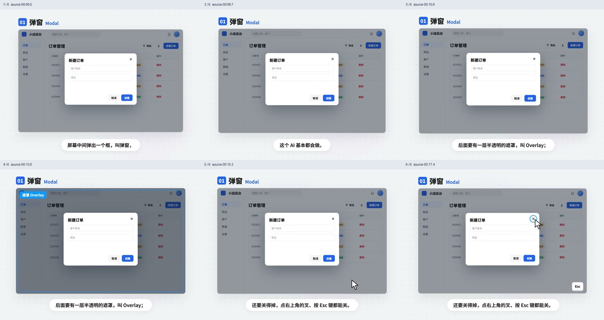

## 确认弹窗 / Alert Dialog

- 标识：`overlays/alert-dialog`；类型：组件／效果。
- 原视频：`10种弹窗全面解析.mp4`，00:18.3–00:27.2。
- 视频要点：删除等操作前询问是否确定；与普通弹窗区别是必须明确作出选择，点击空白遮罩不直接关闭。
- 指令例句：删除前显示确认弹窗，明确提供取消和删除，点击遮罩不确认也不关闭。
- 参考：[GIF 动图](../assets/gifs/overlays/alert-dialog.gif) · [六帧对照图](../assets/filmstrips/overlays/alert-dialog.jpg)。

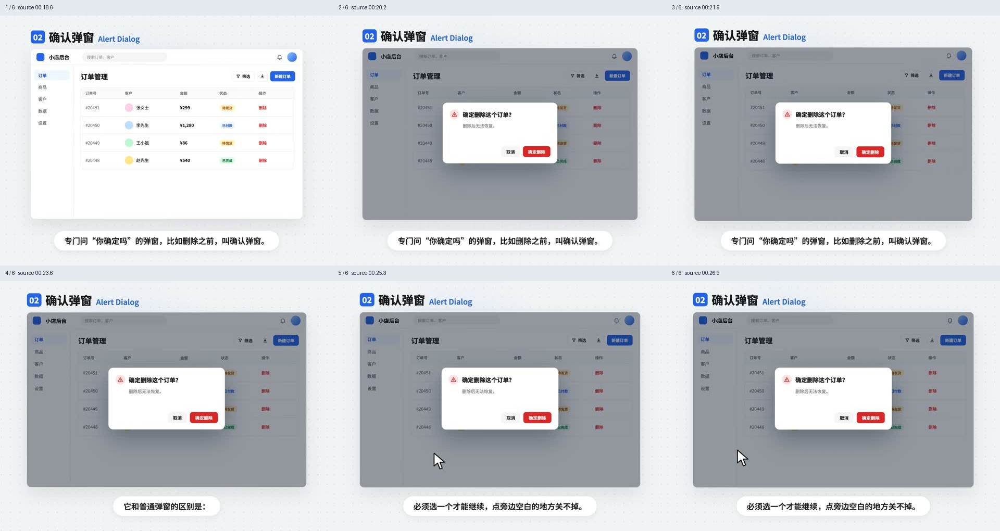

## 抽屉 / Drawer

- 标识：`overlays/drawer`；类型：组件／效果。
- 原视频：`10种弹窗全面解析.mp4`，00:28.3–00:36.2。
- 视频要点：从屏幕侧边滑出整块面板；适合内容较多、仍需对照原页面的筛选和详情。
- 指令例句：把筛选条件放入侧边抽屉，保留对主页面的上下文。
- 参考：[GIF 动图](../assets/gifs/overlays/drawer.gif) · [六帧对照图](../assets/filmstrips/overlays/drawer.jpg)。

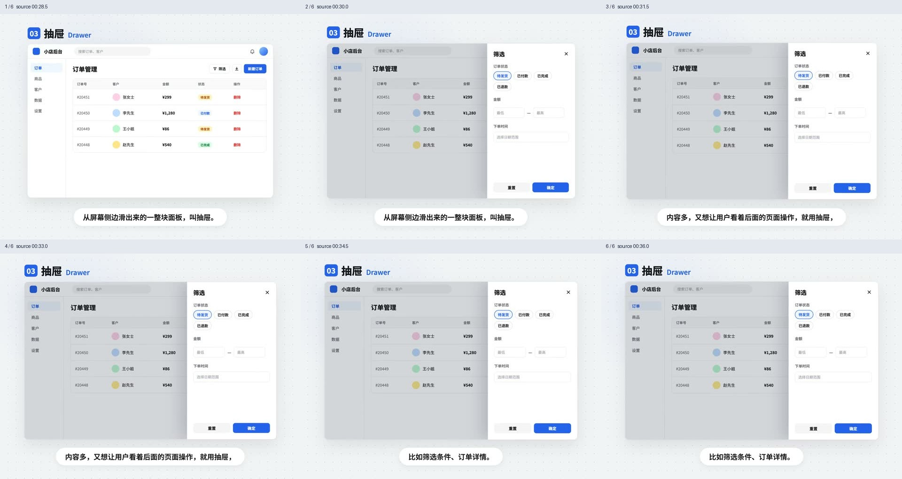

## 底部弹层 / Bottom Sheet

- 标识：`overlays/bottom-sheet`；类型：组件／效果。
- 原视频：`10种弹窗全面解析.mp4`，00:37.5–00:45.8。
- 视频要点：从屏幕底部向上滑出，便于手机拇指操作；移动端承载弹出内容时可考虑使用。
- 指令例句：移动端使用从底部滑出的 Bottom Sheet 呈现这些选项。
- 参考：[GIF 动图](../assets/gifs/overlays/bottom-sheet.gif) · [六帧对照图](../assets/filmstrips/overlays/bottom-sheet.jpg)。

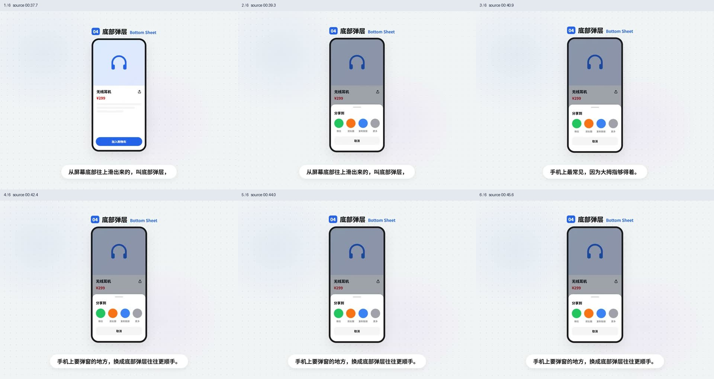

## 弹窗、抽屉与底部弹层选型 / Overlay selection

- 标识：`overlays/overlay-selection`；类型：选型／纠错讲解。
- 原视频：`10种弹窗全面解析.mp4`，00:47.1–00:53.5。
- 视频要点：需立即处理用弹窗；内容多、需看上下文用抽屉；手机上优先考虑底部弹层。
- 指令例句：按任务紧迫性、内容量和终端选择对应浮层。
- 参考：[GIF 动图](../assets/gifs/overlays/overlay-selection.gif) · [六帧对照图](../assets/filmstrips/overlays/overlay-selection.jpg)。

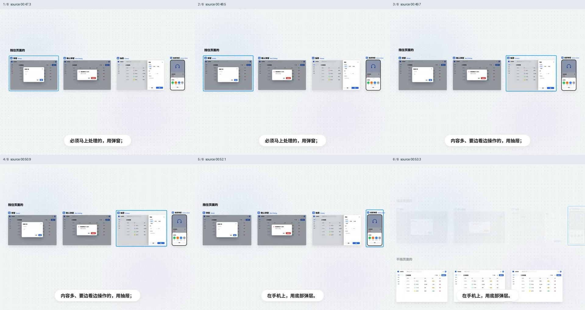

## 轻提示 / Toast / Snackbar

- 标识：`overlays/toast`；类型：组件／效果。
- 原视频：`10种弹窗全面解析.mp4`，00:54.3–01:02.5。
- 视频要点：保存成功等简短反馈在上方或下方出现，几秒后自动消失；视频提到部分组件库称 Snackbar，可带撤销。
- 指令例句：保存成功后使用 Toast，3 秒后自动消失，无需用户再点确定。
- 参考：[GIF 动图](../assets/gifs/overlays/toast.gif) · [六帧对照图](../assets/filmstrips/overlays/toast.jpg)。

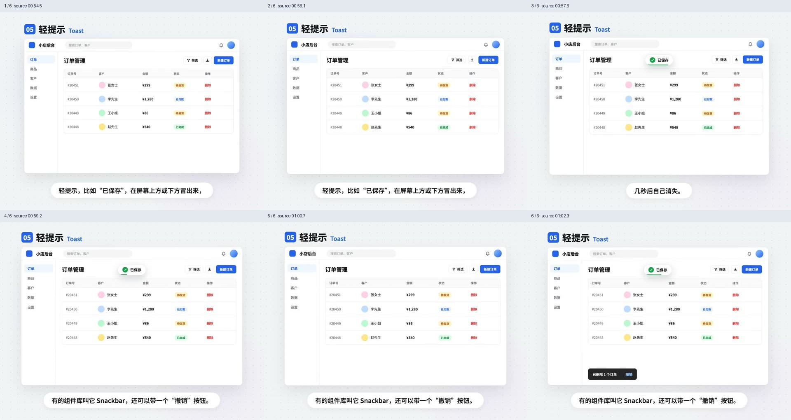

## 通知 / Notification

- 标识：`overlays/notification`；类型：组件／效果。
- 原视频：`10种弹窗全面解析.mp4`，01:03.3–01:11.6。
- 视频要点：通常出现在右上角，比 Toast 大，有标题和正文；停留更久，通常带关闭按钮，如新订单提醒。
- 指令例句：用有标题、正文和关闭按钮的通知显示新订单，停留时间长于普通轻提示。
- 参考：[GIF 动图](../assets/gifs/overlays/notification.gif) · [六帧对照图](../assets/filmstrips/overlays/notification.jpg)。

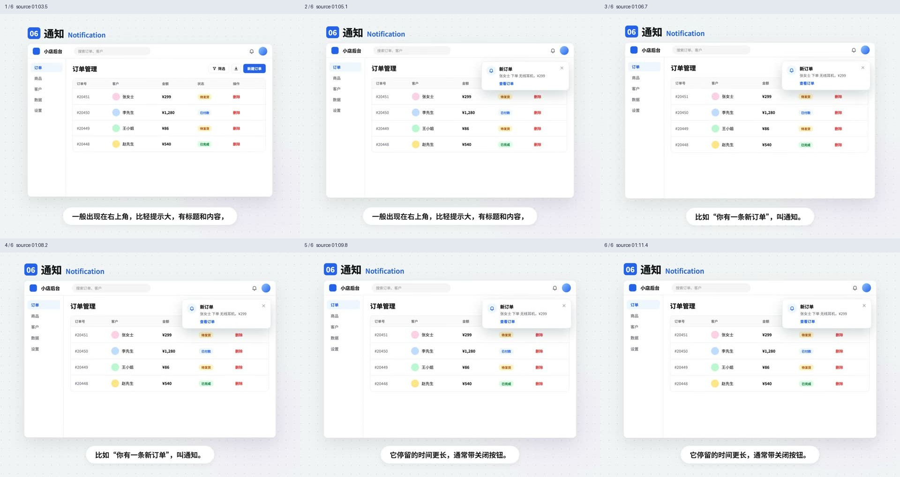

## 轻提示与通知选型 / Toast vs Notification

- 标识：`overlays/toast-vs-notification`；类型：选型／纠错讲解。
- 原视频：`10种弹窗全面解析.mp4`，01:13.1–01:16.6。
- 视频要点：只需看一眼的反馈用轻提示；希望用户注意并可持续查看的消息用通知。
- 指令例句：将简短成功反馈与可持续查看的通知分开处理。
- 参考：[GIF 动图](../assets/gifs/overlays/toast-vs-notification.gif) · [六帧对照图](../assets/filmstrips/overlays/toast-vs-notification.jpg)。

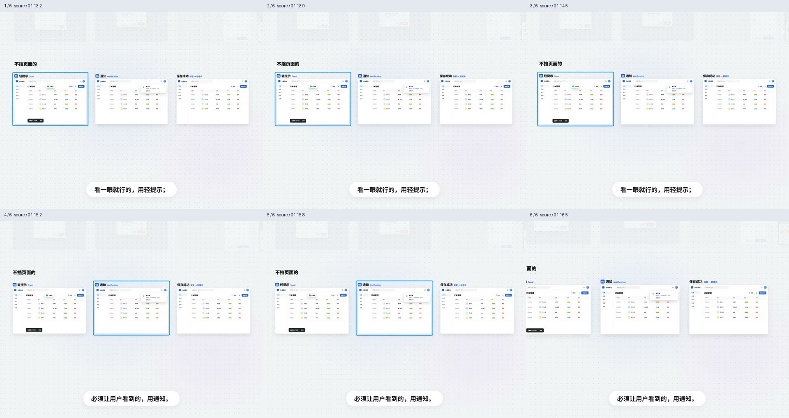

## 保存成功提示纠正 / Success feedback correction

- 标识：`overlays/success-toast-correction`；类型：选型／纠错讲解。
- 原视频：`10种弹窗全面解析.mp4`，01:17.3–01:23.6。
- 视频要点：视频演示将强制点确定的保存成功弹窗改为轻提示；建议 3 秒后自动消失。
- 指令例句：把保存成功弹窗改成 Toast，3 秒后自动消失。
- 参考：[GIF 动图](../assets/gifs/overlays/success-toast-correction.gif) · [六帧对照图](../assets/filmstrips/overlays/success-toast-correction.jpg)。

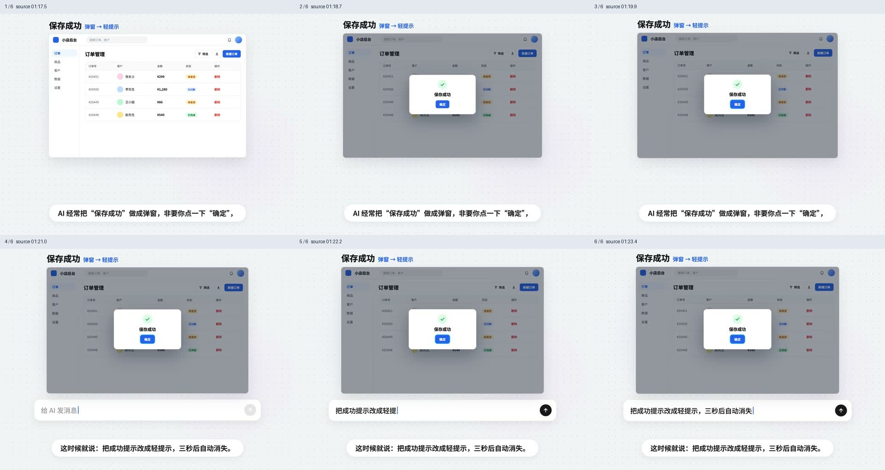

## 气泡提示 / Tooltip

- 标识：`overlays/tooltip`；类型：组件／效果。
- 原视频：`10种弹窗全面解析.mp4`，01:25.4–01:34.6。
- 视频要点：悬停时出现一句解释，移开消失，如导出图标说明；手机没有鼠标悬停，重要信息不能仅藏在这里。
- 指令例句：给导出图标添加 Tooltip；关键说明同时保留可见或触摸可访问入口。
- 参考：[GIF 动图](../assets/gifs/overlays/tooltip.gif) · [六帧对照图](../assets/filmstrips/overlays/tooltip.jpg)。

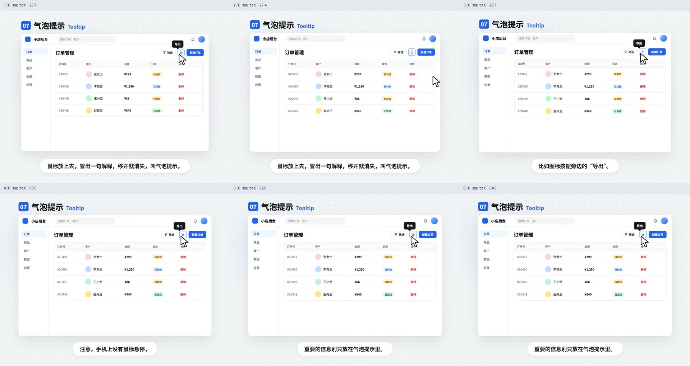

## 气泡卡片 / Popover

- 标识：`overlays/popover`；类型：组件／效果。
- 原视频：`10种弹窗全面解析.mp4`，01:35.3–01:42.5。
- 视频要点：点击触发，在锚点附近展示较丰富的内容甚至操作按钮；例子为点击头像展示客户信息。
- 指令例句：点击客户头像打开带详情和操作的 Popover。
- 参考：[GIF 动图](../assets/gifs/overlays/popover.gif) · [六帧对照图](../assets/filmstrips/overlays/popover.jpg)。

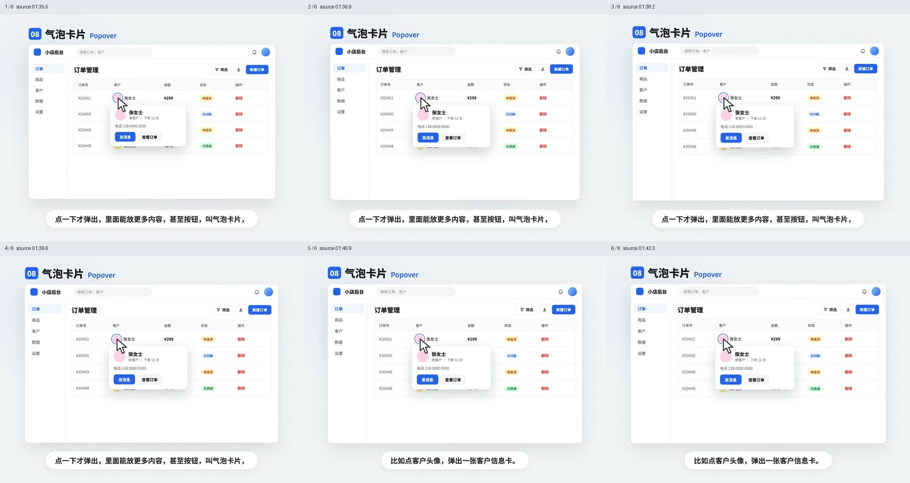

## 气泡确认框 / Popconfirm

- 标识：`overlays/popconfirm`；类型：组件／效果。
- 原视频：`10种弹窗全面解析.mp4`，01:43.4–01:50.2。
- 视频要点：在删除按钮旁用小气泡询问是否确定，视觉负担低于整页确认弹窗。
- 指令例句：在这一行删除按钮旁显示 Popconfirm，提供取消和确认删除。
- 参考：[GIF 动图](../assets/gifs/overlays/popconfirm.gif) · [六帧对照图](../assets/filmstrips/overlays/popconfirm.jpg)。

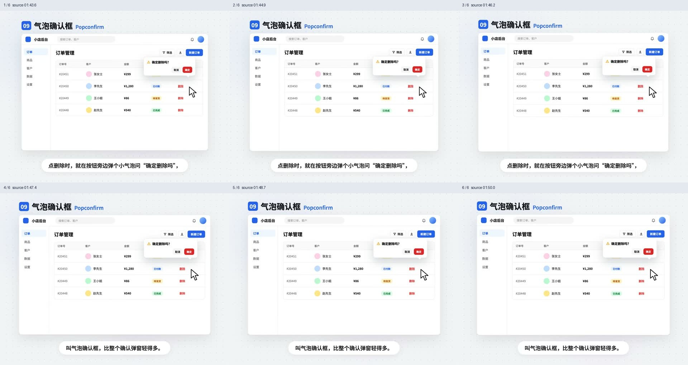

## 下拉菜单 / Dropdown Menu

- 标识：`overlays/dropdown-menu`；类型：组件／效果。
- 原视频：`10种弹窗全面解析.mp4`，01:51.4–01:56.5。
- 视频要点：点击后向下展开一串操作选项，如头像菜单中的设置、退出登录。
- 指令例句：点击头像展开 Dropdown Menu，包含设置和退出登录。
- 参考：[GIF 动图](../assets/gifs/overlays/dropdown-menu.gif) · [六帧对照图](../assets/filmstrips/overlays/dropdown-menu.jpg)。

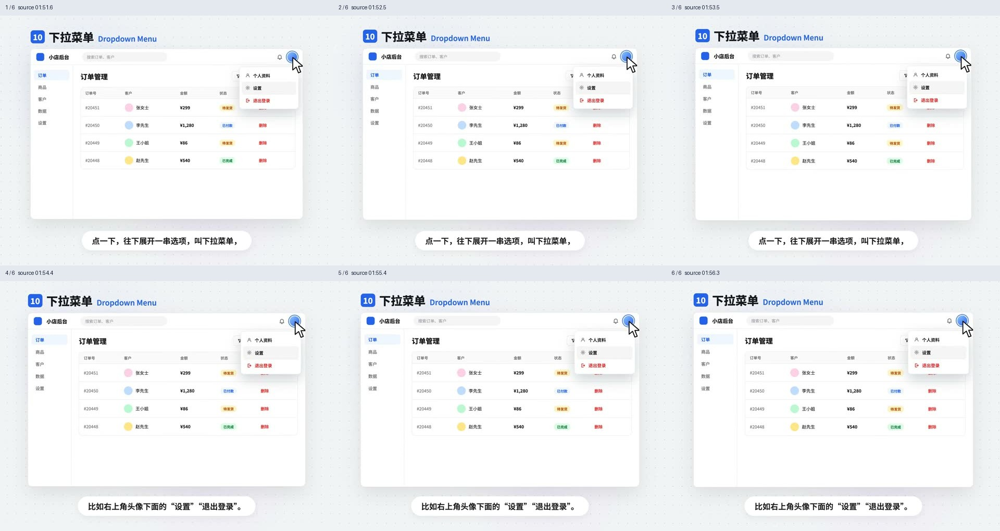

## 锚点浮层选型 / Anchored overlay selection

- 标识：`overlays/anchored-selection`；类型：选型／纠错讲解。
- 原视频：`10种弹窗全面解析.mp4`，01:58.1–02:05.5。
- 视频要点：解释一句用 Tooltip；点开有内容和操作用 Popover；一串选项用 Dropdown Menu。
- 指令例句：先判断解释、详情还是菜单，再选择锚点浮层。
- 参考：[GIF 动图](../assets/gifs/overlays/anchored-selection.gif) · [六帧对照图](../assets/filmstrips/overlays/anchored-selection.jpg)。

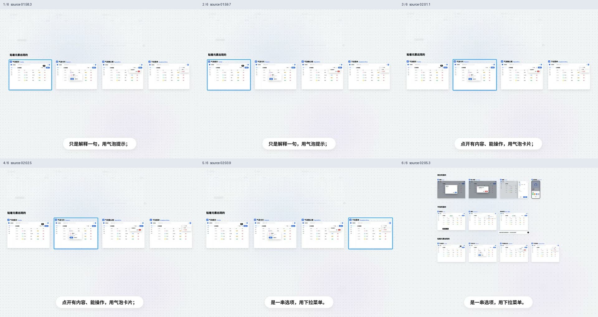

## 浮层选型速查 / Overlay recap

- 标识：`overlays/overlay-recap`；类型：选型／纠错讲解。
- 画面处理：已裁去顶部系列标识区，保留 UI 示例与规则字幕。
- 原视频：`10种弹窗全面解析.mp4`，02:06.4–02:14.5。
- 视频要点：立即处理用弹窗；边看边操作用抽屉；看一眼就走用轻提示；一句解释用气泡提示。
- 指令例句：按这四种意图选组件，不把所有反馈都做成弹窗。
- 参考：[GIF 动图](../assets/gifs/overlays/overlay-recap.gif) · [六帧对照图](../assets/filmstrips/overlays/overlay-recap.jpg)。

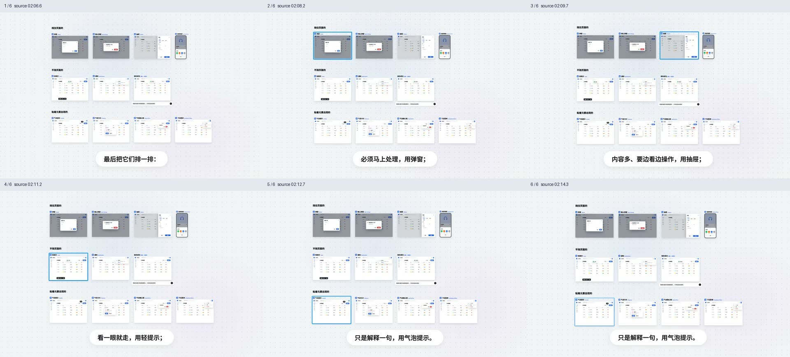
