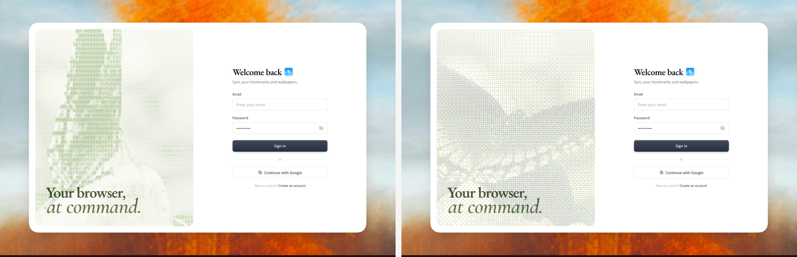

# 可调 ASCII 与有序抖色 / Parametric ASCII and Ordered Dither

实现配方附高清演示截图；参数是可调起点，仍需在目标项目与浏览器中验证。

## 效果参考



左侧为 ASCII、右侧为 Dither。两张画面取自不同时间点，背景姿态也会变化，不是严格的单变量实验。

媒体取舍：重点是 ASCII 与 Dither 的纹理结果，高清状态对照即可；背景视频运动不作为该技巧的必需动效。

## 适用与边界

对指定图片或视频做 ASCII 字符取样或 4×4 Bayer 有序抖色，支持遮罩、调色板、取样方向、强度、大小和间距。

ASCII 按亮度映射字符密度；Dither 用 Bayer 阈值量化每个通道。各滤镜分别保存设置；推荐 ASCII 为 mask 90、暗部取样、strength 100、size 37、spacing 0；Dither 为 88 / 100 / 15 / 0。这些是 0–100 控件值，不是像素。实际 ASCII 字号映射 7–24px，Dither 块大小映射 2–9px。采样画布长边约 480px，输出限制 DPR 和像素预算；静图按变更重绘，视频只在播放且可见时绘制。

## 核对

检查原图覆盖关系、圆角、亮暗主题、切换设置的记忆与重置、跨域或视频无法读像素时的原素材回退；减弱动态时暂停装饰视频。

## 实现提示词

将下方配方应用于用户指定的组件或页面；其中 product、global、every 等范围以用户本次授权为界，不自动扩大到整站。已有设计系统和提交语义优先，新增设置面板、全局扫描和演示风格仅在任务需要时采用。

```text
Add an ASCII / ordered-dither effect to one specific image or video in this project, with a live control panel next to it. Use the asset and the place I name (an image element, a video element, or a file path, and the page or section it sits in); ask me if I have not named them. Apply the effect to that asset only, in place: keep its size, position, rounded corners and anything layered on top of it. If the project already has an image or canvas effect pipeline, or slider, segmented-control and panel components, build on them; otherwise create a reusable EffectLayer and EffectPanel.

Settings, one object shared by the layer and the panel: { filter: 'ascii' | 'dither', mask, palette, inkTone, strength, size, spacing } Keep separate values per filter, so switching filters brings back that filter's own settings.
What each control does in each filter, its range, and the recommended value (ASCII / Dither):

Mask effect, 0-100 (90 / 88): a vertical veil over the picture so the effect reads as texture rather than noise. Same in both filters.

Color, Original or one of five palettes (Original): gradient-maps the asset's luminance into one color family before filtering.
Sample tones, Shadows | Highlights (Shadows; ASCII only, hidden for Dither): which end of the tonal range becomes dense characters.
Sampling strength, 0-100 (100 / 100). ASCII: contrast of the tone curve and how bright and opaque the characters are. Dither: how few levels each color channel keeps (8 at 0, 2 at 100) and how fully the quantized color replaces the original.
Size, 0-100 (37 / 15). ASCII: font size, 7-24px. Dither: pixel block, 2-9px.
Spacing, 0-100 (0 / 0). ASCII: grid step, 8-24px across and 9-26px down, never tighter than the glyphs. Dither: scale of the Bayer pattern, 1-4 blocks per matrix cell.
Helpers used throughout:
range(v, a, b) = a + (b - a) * v / 100
luminance L = (0.299 R + 0.587 G + 0.114 B) / 255

s = strength / 100
"The box" is the asset's rendered size on the page.
Sampling:
Cover-fit the asset into the box and draw it into a small sampling canvas (about 480px on the long side), then read it with getImageData. A sample is the pixel under a point in the box, composited over white.
With a palette, recolor that canvas first: map each pixel's L through a 256-entry lookup built from the palette's four stops.

Per image or video frame, take about 12,000 evenly spaced samples: low = 8th percentile of L, high = 92nd percentile.
Shadows means dark ink, Highlights light ink.
ASCII:
Characters, from empty to full: " .,:;-=+xX08S#&@" (starts with a space).
Font: round(range(size, 7, 24))px monospace (22 instead of 24 when the box is under 720px wide), centered in each cell.

Grid: x step = max(range(spacing, 8, 24), widest glyph * 1.08); line height = max(range(spacing, 9, 26), height of "@" * 1.12, font * 1.04). The first cell sits half a step in from the edge.
Tone of a cell: raw = dark ink ? 1 - L : L; normalized = dark ink ? (high - L) / (high - low) : (L - low) / (high - low), clamped 0-1 (use raw alone when high - low < 0.025); mix = 0.72 + 0.14 s; t = raw (1 - mix) + normalized mix. Then a tone curve: black = 0.22 s, white = 1 - 0.08 s, lev = clamp((t - black) / (white - black), 0, 1), tone = lev (1 - s) + smoothstep(lev) s.
Skip cells with tone <= 0.02. Character = chars[round(tone * (chars.length - 1))]; skip spaces.
Ink: the sampled color lifted in HSV: value += (1 - value) * (0.24 + 0.18 s + 0.24 tone); saturation *= 1 + 0.16 + 0.2 s (clamped). Alpha = clamp((0.12 + 0.7 tone) (0.72 + 0.28 s), 0.06, 0.94).
Dither (ordered, Bayer 4x4):
pixel size = max(2, round(range(size, 2, 9))) (7 instead of 9 under 720px); pattern scale = max(1, round(range(spacing, 1, 4))); levels = max(2, round(range(strength, 8, 2))) per channel; blend = range(strength, 0.32, 1).
Matrix [[0,8,2,10],[12,4,14,6],[3,11,1,9],[15,7,13,5]]; threshold = (m + 0.5) / 16, indexed by floor(x / pattern scale), floor(y / pattern scale).

For each block sample its center, push saturation away from luma by 1 + 0.06 + 0.18 s, then per channel: scaled = c / 255 * (levels - 1); q = floor(scaled) + (fraction > threshold ? 1 : 0); out = c + (q / (levels - 1) * 255 - c) * blend.
Write the blocks into a canvas of box / pixel size and draw it scaled up with image smoothing off.
Mask and layering:
The mask is a vertical gradient with stops at the top, 42% and the bottom. Base opacities: on a light page white 54/20/38%, on a dark page black 44/20/50%. For a mask value v: stop = v <= 50 ? base * (v / 50)^1.08 : base + (100 - base) * ((v - 50) / 50)^1.08.
ASCII: draw the (recolored) picture, the mask, then the characters. Dither: draw the dithered picture, then the mask on top.

Changing filter or palette cross-fades from the last frame over 150ms.
Palettes (four stops at 0, 0.4, 0.74, 1):
meadow: #2B361F, #677D45, #AEBA78, #E5E1BD
blue: #192A4D, #326AC5, #A2C2F1, #EDF3FC
amber: #3C200F, #A74C15, #EF9A46, #F7E7CA
lavender: #292144, #6552AB, #B3A5E4, #F0ECFB

mono: #151515, #575757, #A6A6A6, #ECECEC
Rendering:
Draw into a canvas laid over the asset with the same size and corner radius, at devicePixelRatio capped at 1.6x and about 2048 x 2048.
Image: redraw when a setting changes (debounced 72ms).
Video: redraw on every new frame (requestVideoFrameCallback, falling back to requestAnimationFrame) while it plays and is on screen; keep the video element underneath as the source.
Control panel:

Place it next to the asset, below it when there is room, otherwise beside it, never covering it. About 420px wide, centered on the asset.
Rows, in order: Mask effect, Filter (two tabs: ASCII | Dither), Color (round swatches), Sample tones (ASCII only), Sampling strength, Size, Spacing (shown with %).
Each row 46px tall: a 136px label column, then the control. Slider: a 22px track with 8px radius and a filled part, a 9x30 rounded-rectangle thumb (3px radius), a number box with the value centered, and a snap mark at 50. Swatches: 22px circles, each filled with its palette's two middle stops at 135deg (Original: a tiny crop of the asset); the selected one gets a ring with a small gap.
Every change applies live while dragging. Add a "Reset to recommended" action that restores the values above for the current filter.

Follow the page's light or dark theme and the project's tokens.
```
