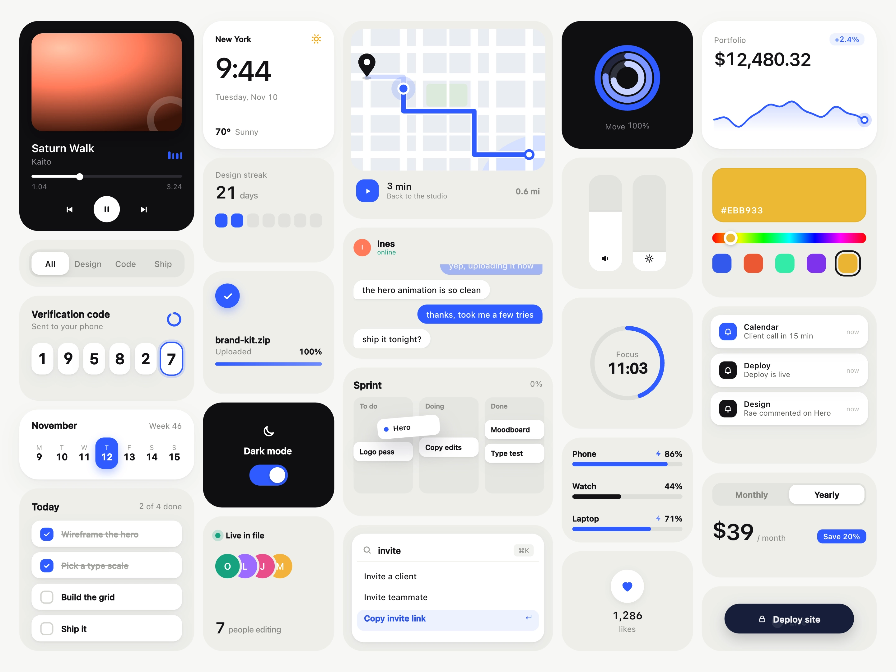

# Bento 组件网格与独立动效 / Bento UI Motion Grid

固定镜头中，用大小不同的卡片组织一组精致组件，让数字、指示器、列表、图表与控件分别按自己的节奏变化。适合设计系统展示、组件作品集和产品概念短片；在真实产品中选用局部视觉方法，交互仍由实际状态驱动。

## 清晰效果参考



2880×2160 WebP，直接在 1024×768 CSS 舞台上以 2.8125 倍设备像素密度渲染文字和 SVG，保留渲染像素，质量 98。只有一张完整网格图，没有重复局部图、GIF 或随包视频；这是代码直接绘制，不是把低清预览放大。文字、图标、轨道和边缘可用于查看细节，滚动数字、弹簧、循环交接与输入行为仍需运行验证。

## 布局与视觉起点

| 部分 | 模板起点 | 使用方式 |
|---|---|---|
| 舞台 | 1024×768 CSS px；1440×1080 输出为 4:3 | 用于固定画幅展示；竖屏或真实响应式页面重新排版 |
| 网格 | 五列宽度 200／150／240／150／200，横向起点 22／232／392／642／802，间隙 10 | 每列从 y=24 到 y=744，卡片和间隔合计占高 720；由内容决定大小 |
| 层次 | 外托盘圆角 22，内部卡片 14，浅色双层软阴影，少量深卡 | 圆角、内距和图标尺寸与实际设计系统统一 |
| 颜色 | 背景 `#F7F7F5`、托盘 `#EEEEEA`、白卡、深卡 `#0F0F12`、正文 `#141416` | 蓝色 `#2F5BFF` 为主强调色；功能色与示例色盘不扩大为整页多色主题 |
| 字体 | 系统无衬线，已安装 Inter 时优先；`tnum`、`cv11`、`ss01` | 模板不远程加载字体；要复现指定字体需自行合法提供，不能假称已嵌入 |
| 文字 | 展示标签约 9–11 CSS px，数字约 16–36 px | 这些是高密度展示参数；真实产品重新核对字号、对比度和触控目标 |
| 镜头 | 固定、无切镜、静音；示例时长 24 秒 | 不把固定画幅、静音或时长强加给其他产品任务 |

## 24 个组件与动效组织

| 组别 | 模板组件 | 可复用的视觉方法 |
|---|---|---|
| 媒体与时间 | `music`、`clock`、`timer`、`week` | 封面和曲目信息柔和交接、音量均衡条、等宽滚动数字、日期滑动底色 |
| 状态与反馈 | `otp`、`tasks`、`streak`、`upload`、`deploy` | 分位数字、逐笔勾选、进度填充、图标变形、完成态交接 |
| 协作与内容 | `crew`、`chat`、`kanban`、`notif`、`cmd` | 头像让位、气泡入栈、卡片跨列、通知堆叠、输入和选中高亮 |
| 控件与主题 | `seg`、`mode`、`sliders`、`color`、`like`、`price` | 共享指示器、主题淡化、跟随滑块、色盘指示器、轻量确认与价格数字过渡 |
| 数据与空间 | `map`、`rings`、`battery`、`stock` | 路线描绘、沿路径移动、圆环与数值、填充轨道、折线和末端强调 |

这些组件是一份组合模板，不再拆成 24 条重复参考。单个按钮、缓动、数字和布局动作已有条目时复用已有规则；本配方补充多组件同时展示的构图和可确定时间轴。

## 时间与连续性

- **确定时间**：`draw(t)` 和 `W.<name>(t)` 根据秒数返回同一画面；录制帧 `i` 使用 `t=i/fps`。不用系统时间、非固定随机数、隐式 CSS 动画或网络数据决定录制状态。
- **错峰入场**：按卡片位置设置延迟，scale 从约 0.86 归到 1，内容上移约 6px 后落位，约前 1.6 秒完成。后续每卡保持独立周期与相位，避免全屏一起重置。
- **运动曲线**：`spring` 从静止起步，带有限超调并归一化终点；`soft` 用于大面积主题、封面和堆栈交接；`expo` 适合小范围透明度揭示；`io` 用于较长路径。这里的录制曲线是局部示例，不替换 [011 动画节奏](easing.md) 的产品角色规则。
- **数字**：等宽数字按列裁切、纵向移动，变化位错峰约 35–60ms，符号按需淡化。显示数值与对应圆环、进度或图表应从同一状态派生，边界处核对取整、位数、周期索引与正负号。
- **循环边界**：逐一查看 offset 前后、周期末尾／起点和视频首尾。24 秒中各卡周期不同，不能直接认定成片可无缝循环；需要循环交付时另外安排统一交接。
- **层与排版**：主题和封面采用双层柔和交接，避免大色块闪变；堆叠列表保留身份、裁切和前后层次。模板中的绝对定位、尺寸变化与 `innerHTML` 重绘服务于离线画面，不能直接用于正在输入的真实组件。

## 可编辑模板

模板入口：[index.html](../templates/bento-motion-grid/index.html)。纯 HTML／CSS／JS，图标和插图由代码绘制，无框架、远程字体或在线素材依赖。复制整个 `references/templates/bento-motion-grid` 目录到输出项目后再改，避免把帧、视频和环境写进 skill。

```bash
# 在 skill 根目录，将模板复制到你选择的输出目录；目标目录应尚不存在。
bento_project="$HOME/Documents/my-bento-grid"
cp -R references/templates/bento-motion-grid "$bento_project"
cd "$bento_project"
python3 -m venv .venv
source .venv/bin/activate
python3 -m pip install playwright pillow numpy
python3 -m playwright install chromium

# 先看入场与几个中间状态；可传 --chrome 指定已有 Chromium 浏览器。
python3 scripts/snap.py 0.6 3 7.5 12

# 快速试片，检查生成帧和编码；输出目录必须为空。
python3 scripts/render.py --fps 30 --seconds 3 --workers 2 --out frames-check
python3 scripts/smoothness.py frames-check --fps 30
bash scripts/encode.sh frames-check out-check 30

# 需要 120 fps 母版时再运行完整录制；同时导出等时长的 60 fps 文件。
python3 scripts/render.py --fps 120 --seconds 24 --workers 6 --out frames-master
python3 scripts/smoothness.py frames-master --fps 120
bash scripts/encode.sh frames-master out-master 120
```

脚本分工：`snap.py` 检查选定秒数，`--native --webp` 导出 2880×2160 WebP；`render.py` 逐帧捕获并降采样为 1440×1080 PNG，检查子进程失败和帧数；`smoothness.py` 标出每卡帧差尖峰；`encode.sh` 接收真实输入帧率并保持时长，输入超过 60 fps 时附加 60 fps 版本。编码默认拒绝覆盖已有文件。

帧差只是定位工具：入场、打字、位数变化和刻意弹出都可能产生尖峰；“零尖峰”也不能证明速度自然、循环无跳变或业务语义正确。先用短片检查环境，再按需要生成完整片；不自动安装环境、发布视频或启动长时间渲染。

## 接入真实产品

- 静态 Bento 布局保留产品真实信息架构；按可用宽度重排，不将固定画幅整体缩小成手机页面。
- 选择少量与目标有关的组件和动作，复用已有组件、token 与动画库；不要让实际工作台 24 个区域持续自转。
- 上传、验证码、计时、价格、点赞、通知与部署全部由真实数据和用户操作驱动。演示代码中的循环、样例消息和完成状态只用于展示，不能伪造请求进度或成功。
- 输入、滑块、Tab 和菜单保留实际 DOM、焦点、键盘、语义及触摸入口，不每帧替换根节点；非必要动画离屏或后台暂停，卸载后清理。
- 交互版提供暂停与减弱动态方案；`prefers-reduced-motion` 时使用稳定状态或必要的短淡化，不自动播放全部循环。模板本身是按需渲染的录制画布，尚不是可访问的交互组件库。

## 实现提示词

```text
Create a polished Bento UI motion showcase using the bundled bento-motion-grid template as a starting point. Read my existing visual system and output requirements first. Keep one dominant accent, a consistent hierarchy of trays and inner cards, tabular numerals, aligned icons and restrained shadows. Select widget types that fit the concept instead of copying all sample content.

For a recorded showcase, use a fixed camera and a deterministic draw(t). Give the cards independent periods and offsets; use a from-rest spring for travel, a soft curve for large color changes and stack handoffs, and small staggered reveals. Inspect pre-start states, cycle boundaries, shared value labels, clipping, digit-width changes and transitions between layers. If I ask for a seamless loop, explicitly design and verify the end-to-start handoff.

Copy the bundled template to the output project before editing. Change the layout table, tokens and widget functions there. Review sharp stills first, render a short sequence, inspect any frame-difference spikes, and then produce the requested duration and frame rate. Match the encoder input fps to the renderer, and verify dimensions, duration, frame count and absence or presence of audio as requested. Do not publish the result unless requested.

For a real product interface, retain the existing stack, components, data and actions. Use the reference only for selected layout and motion details. Replace demo cycles with real state, preserve DOM identity, focus and keyboard behavior, respect reduced motion, and pause unnecessary work outside the visible view. Do not use the template's whole-root innerHTML redraw loop for live forms or fabricate successful requests.

Deliver the changed files, the selected visual and motion rules, reviewed stills or video when requested, and the checks actually completed. State any unverified timing, loop or platform behavior.
```

关联：[官网层级与留白](../design-composition.md#landing-hierarchy)、[015 状态连续转场](continuous-transitions.md)、[011 动画节奏](easing.md)、[等宽数字排版](cjk-latin-typesetting.md)。
