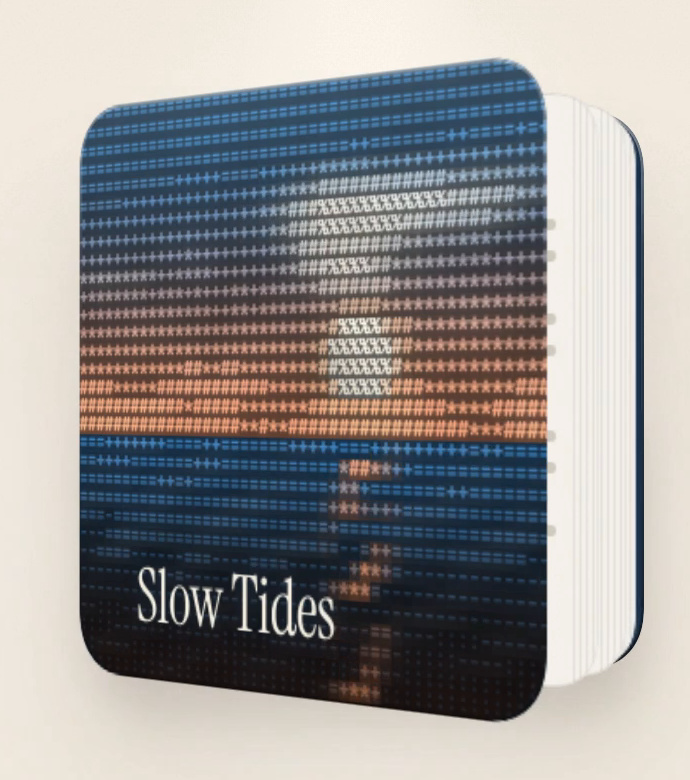

# 像书一样翻开的卡片 / Book Opening Card

实现配方附高清演示截图与精选动图片段；参数是可调起点，仍需在目标项目与浏览器中验证。

## 效果参考



图片展示收拢前的书页层次；动图仅展示指针离开后的合拢过程，不涵盖触发和完整展开。


精简动图帧率见索引，大尺寸版为 15 fps；循环接缝不代表产品行为，也不能据此测定精确时长或缓动。

媒体取舍：保留指针离开后的清晰合拢片段，以观察书页轮廓与收拢过程；不将该片段当作完整展开演示。

[精简动图](../../assets/recipes/book-open-card.gif)用于轻量安装；完整媒体版优先查看上方大尺寸动图。

## 适用与边界

静止时保持原卡片，hover 或 focus 时封面和内页沿书脊逐层翻开；角度 42° × 0.7ⁿ，延迟 28ms × n，离开倒序合拢。

Default、Skeuomorphic、Minimal 三种风格；既有卡片优先匹配原 token。封面 + 默认 4 页 + 不动封底，透视约 1100px，绕左轴旋转；各页错开 Z 防止闪烁。所有活动层 pointer-events: none，热区固定在原占位；内页 aria-hidden，不增加焦点。用两对预模糊实心阴影的 opacity 交叉淡化，避免翻开后出现空心阴影边框。

## 核对

检查初始占位与原卡片一致、快速移入移出从当前角速度继续、边缘不反复触发、焦点可见、首次触摸仍可激活；减弱动态时只轻抬或完全静止。

## 实现提示词

将下方配方应用于用户指定的组件或页面；其中 product、global、every 等范围以用户本次授权为界，不自动扩大到整站。已有设计系统和提交语义优先，新增设置面板、全局扫描和演示风格仅在任务需要时采用。

```text
Make the cards in my product open a little, like a book, when hovered.
At rest a card must look exactly as it does today; only hover or focus
reveals that it is a small book with pages inside.

## 0. Start from what exists
- Find the card component I name (or the one used in the grid or list I
  point to) and retrofit it in place. Reuse its markup, design tokens,
  radius, shadow and motion or spring utilities.
- Keep the card's footprint, padding, content and layout unchanged.
  Nothing around the card may move.
- If I ask for new cards instead, build a fresh square card (about
  280 x 280) in the style I choose below.
- Any option I leave unset uses the default marked *.

## 1. Choose a style
Default*: ordinary product cards, identical to normal ones until hovered.
- Surface: plain white (or my card surface token), no texture.
- Edge: a 1px hairline in my border colour.
- Shadow: light, neutral cool grey, half strength.
- Type: the product sans. Title 24/600, description 15 muted,
  meta 14 muted.
- Cover: the existing card UI: a 48px icon tile, a ↗ arrow top right,
  title, description, and a meta footer below a hairline.
- Wall: my normal page background.
- Pages: white, a faint shade toward the spine, a small heading and
  4-6 grey text lines.

Skeuomorphic: hardcover books on a gallery wall.
- Surface: fine bookcloth grain over a deep cover colour.
- Edge: a lit bevel: bright top edge, darker foot.
- Shadow: warm, near-neutral grey (never orange), full strength.
- Type: one serif title, bottom left. Nothing else on the cover.
- Cover: a full-bleed image or animated ASCII scene, with a soft gloss
  at the top and shade at the foot.
- Wall: warm plaster with a fine grain and a spotlight over each book.
- Pages: cream paper with grain, an italic chapter heading, justified
  lines, and thin page edges along the fore-edge.

Minimal: documentation volumes.
- Surface: flat off-white, light grey or graphite, one tone per card.
- Edge: a faint bevel or hairline.
- Shadow: cool neutral grey.
- Type: a mono section number and version on top, over a hairline rule;
  a two-line sans title and a small grey label at the foot.
- Cover: one small grey line diagram with a single element in the ink
  colour.
- Wall: cool grey with a faint 24px dot grid and soft light from above.
- Pages: cool white, a sans heading and grey lines.

Match my product: take surface, edge, shadow, type and wall from my
tokens, and keep the cover exactly as the card is today.

## 2. Options (defaults marked *)
- Intensity: subtle (A = 24deg) | book* (A = 42deg) | dramatic
  (A = 60deg).
- Pages: 2 | 3 | 4* | 6.
- Hinge: left* | right | top.
- Trigger: hover* | press (open while pressed) | scroll into view (open
  once when 60% visible, close after ~1.2s). Keyboard focus always
  opens it too.
- Pages show: blank paper | lines of text* | real preview content from
  the card (its next fields, a short list, a chart thumbnail).
- Cover: existing card UI* | image | animated ASCII scene | solid colour.
- Shadow direction: from above* | from top-left.
- Shadow strength: none | light | normal* | deep.
- Corners: match my tokens* | continuous (superellipse).
- Motion feel: snappy (k 320, damping 0.9) | default* (k 240,
  damping 0.86) | soft (k 160, damping 0.8). All barely overshoot.
- Reduced motion: tiny lift* | nothing.
- Touch: press* | scroll into view | off.

## 3. Layer stack
- Inside the card's link, put the cover on a body element with
  transform-style: preserve-3d. Behind it stack N pages and a back
  board, all absolutely positioned on the same square.
- Order, front to back: cover (n = 0), pages (n = 1..N), back board
  (n = N + 1, never moves).
- The cover keeps all of the card's existing content. Pages and the
  back board are decorative: aria-hidden, no links, no tab stops.
- Perspective on the static outer element: about 1100px, origin toward
  the hinge (30% 50% for left, 70% 50% for right, 50% 30% for top).
- transform-origin on the hinge edge of every layer: left 0 50%,
  right 100% 50%, top 50% 0. backface-visibility: hidden.
- Lift layer n by translateZ((N + 1 - n) x 0.6px) so layers never
  fight in depth.
- Pages sit 8px inside the cover (4px at the spine), like a book block,
  with radius = cover radius - 8.
- Back board: on flat cards (Default, Minimal) inset it ~6px from the
  cover with radius = cover radius - 6, so it never peeks out past the
  cover's foreshortened corners. On Skeuomorphic it is flush, the cover
  colour darkened ~28%.

## 4. Motion
- Layer n turns toward the viewer by
    angle(n) = A x 0.7^n
  and starts
    delay(n) = 28ms x n
  later. The cover leads; pages fan out behind it.
- Direction: rotateY(-angle) for a left hinge, rotateY(+angle) for
  right, rotateX(+angle) for top.
- Each layer runs on its own spring (see Motion feel), settling in
  about 0.3s.
- Close in reverse: the innermost page first, delay = 28ms x (N - n),
  back to 0deg.
- If the pointer leaves mid-way, retarget from the current angle and
  velocity. Never jump.
- No spring helper in the project? CSS transitions are fine: transition
  transform over ~420ms with a slight overshoot, e.g.
  cubic-bezier(0.3, 1.2, 0.5, 1), and set transition-delay to 28ms x n
  in the open state and 28ms x (N - n) at rest (the target state's delay
  applies, so closing runs in reverse).

## 5. Light and shading
- Light comes from above, so the shadow falls down the wall.
- The shadow is two solid shapes behind the card, each blurred once.
  At rest it hugs the card like any flat card's:
  - contact: small and darker, at the foot. Lower half of the card,
    ~4px in from each side, blur ~4px, ~2px down, ~22% opacity.
  - ambient: faint. Blur ~14px, ~6px down, ~12% opacity.
- Never a box-shadow: it is a hollow ring and shows as an outline once
  the cover swings off it.
- Tint: near-neutral grey nudged toward the wall (warm grey on a warm
  wall, cool grey on a cool one). Never pure black, never saturated.
- Strength scales both opacities: light 0.5 (Default style), normal 1,
  deep 1.4.
- Opening: crossfade to a second pre-blurred pair that is longer and
  softer (contact blur ~12px, 12px down; ambient blur ~38px, 26px down),
  and move it ~14px further down and ~4% wider with transform. Drive it
  with one progress value o (0..1) on its own spring (k 200, damping
  0.9): rest pair opacity 1 - o, open pair opacity o.
- Leaf shading: every page has an overlay gradient from the spine
  (32% dark -> 8% at 55% -> 0 at 85%). Its opacity is
    clamp(gap / 6, 0, 1) x max(0, 1 - gap / 30)
  where gap = the angle of the leaf in front minus this leaf's angle.
  A page is shaded while the leaf in front is just lifting off it, then
  lit once they part.
- Covers (Skeuomorphic, Minimal): a soft gloss at the top edge and a
  little shade at the foot.

## 6. Corners and edges
- Clip every layer (cover, pages, back board) to one shape path, and
  draw its edge (hairline or bevel) along that exact path, e.g. an SVG
  path stroked over the layer. Do not mix a CSS border or inset
  box-shadow with the clip: they disagree at the corners and show a
  second rim when the layers part.
- Match my tokens: use the token radius; nested radius = outer - inset.
- Continuous: superellipse corners |x|^n + |y|^n = 1 with n = 2^1.25
  (the same curve as CSS corner-shape: superellipse(1.25)). Generate a
  clip-path: path(...) per layer size, reuse it for the edge, and
  regenerate on resize.

## 7. Interaction and accessibility
- Hit-test on the resting footprint: listen for hover on the static
  outer element and give every moving layer pointer-events: none, so a
  swinging cover never moves the target and the card never flickers
  open and closed at its edges.
- Cursor: a pointing hand over the whole card.
- The whole card stays one <a> or <button> with its current accessible
  name. Pages add nothing to the accessibility tree.
- :focus-visible opens it exactly like hover. Keep the focus ring on the
  outer element, along the resting shape.
- Reduced motion: no fan and no rotation. The cover lifts ~2px and the
  shadow crossfades to the open pair.
- Touch: no hover. Use the Touch option; a tap must still activate the
  card on the first try.

## 8. Performance
- Animate transform and opacity only. Never animate blur, box-shadow,
  clip-path, width, height or top/left.
- Never animate a blur radius: blur each shadow once and crossfade the
  two pre-blurred versions.
- One requestAnimationFrame loop for all cards. Skip cards whose springs
  are at rest, and stop the loop when nothing moves.
- Write a style only when its value changes (cache the last string per
  element).
- No layout reads per frame: measure once, and again on resize
  (ResizeObserver).
- Animated canvas: draw at ~30fps at most, and pause when off
  screen (IntersectionObserver) or when the tab is hidden.

## 9. Animated ASCII cover (only if chosen)
- Paint a small scene as one colour per character cell (~6 x 9px).
- Pick each character by brightness from " .:-=+*#%@".
- Draw a dimmed copy of the colours (~40%) underneath and the coloured
  characters on top, so the gaps read like a halftone.
- Stamp characters from a pre-rendered glyph atlas instead of laying out
  text every frame. Keep the motion slow and seamlessly looping.

## 10. When done
- List every file you changed or added.
- List the style and every option you used, marking which were
  defaults.
- Note anything that no longer looks identical at rest.
```
