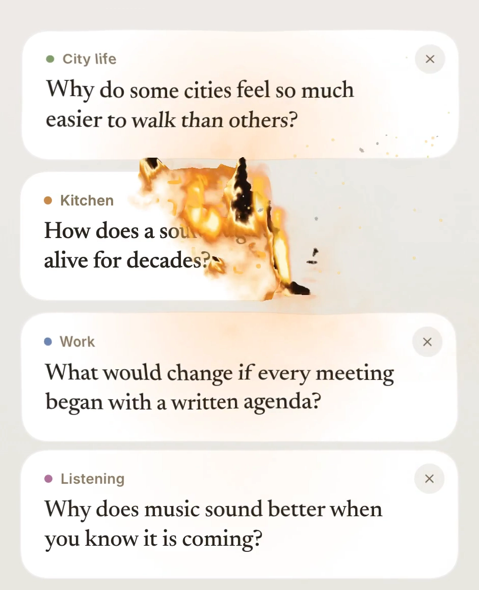
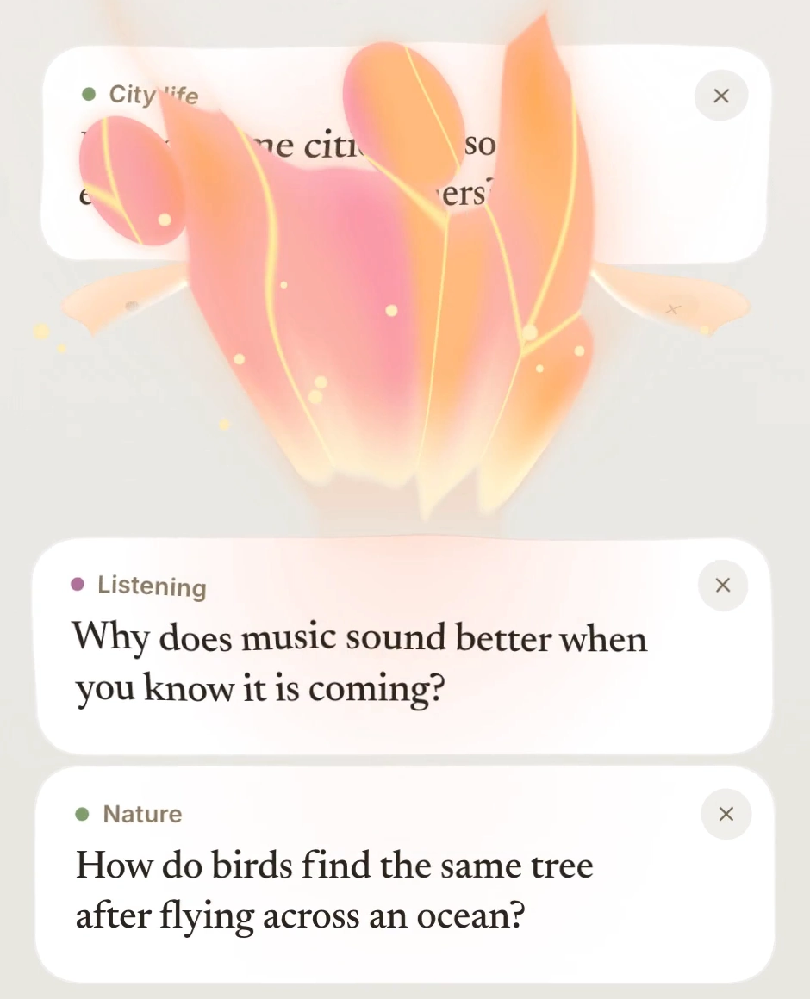
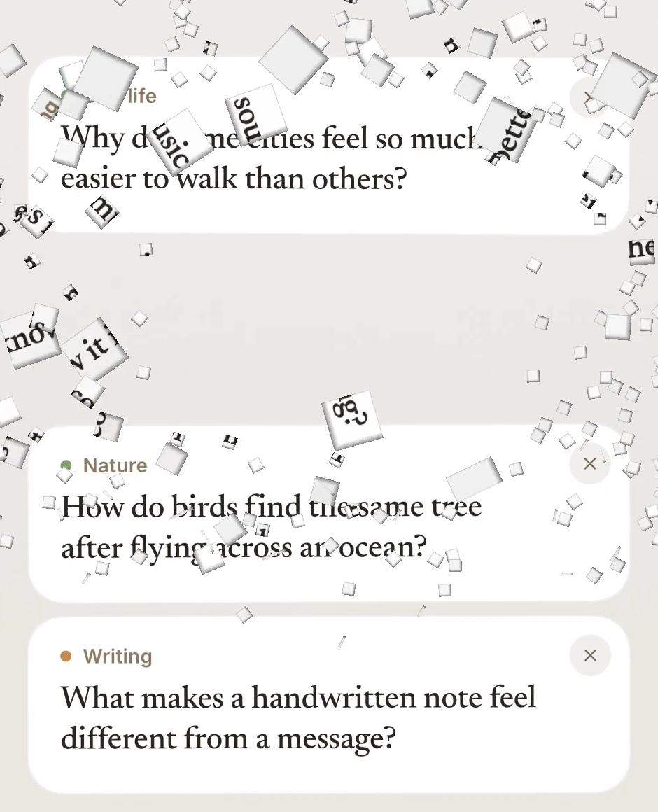
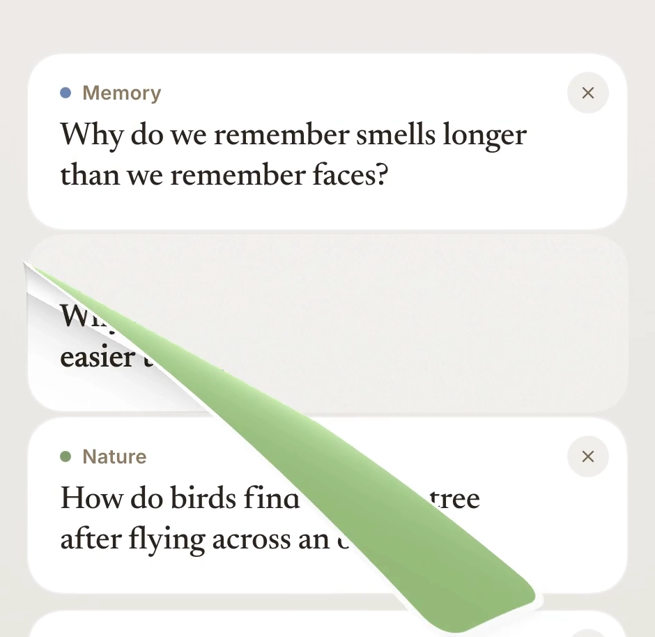

# 014 · 四种卡片删除效果 / Card Delete Effects

在现有卡片或列表项的真实删除动作上，选择燃烧 Burn、柔焰 Plume、碎块 Blocks 或撕贴纸 Peel，让退出画面、邻项反馈和空位补齐连成一次动作。默认一个产品选择一种，保持列表静止外观、真实数据和删除语义。

## 选型与关键节奏

| 效果 | 视觉特征与适用方向 | 总时长起点 | 补位开始 |
|---|---|---:|---:|
| Burn · 燃烧 | 从删除入口蔓延，纸面预热、焦边、灰线、火舌与火星；适合明确而有戏剧性的离场 | 2000ms；燃烧前沿约 1150ms | 900ms |
| Plume · 柔焰 | 从底部升起一簇粉橙柔焰，窄根、展开的尖瓣与浅色脉络，将卡片向内卷入 | 1400ms | 720ms |
| Blocks · 碎块 | 先受击，再将真实卡片纹理分成三档实体碎块，抛散、落地并反弹一次 | 1500ms；受击 70ms | 240ms |
| Peel · 撕贴纸 | 从靠近删除入口的角揭起，弯折显示彩色背面与白色模切边，脱离后保留速度离场 | 1200ms；揭离约 620ms | 640ms |

Plume 可用于柔和离场的视觉表达，不能据此把产品中的删除改成完成或归档。所有时长均为实现起点，不能让用户等待动画后才提交删除，也不自动启用四种风格切换。

## 清晰效果参考

四张独立 WebP 直接从 2160×2880 视频解码，按原像素裁切，质量 98；不放大、不锐化、不涂抹、不跨帧修补。每种只保留一张，没有相近帧图集或新增 GIF。只保留列表内的 UI 局部，去掉手机外框、外部背景、署名光标和下方讲解面板。

### Burn · 燃烧



940×1160；核对焦黑带、细灰线、火舌、残余纸面和邻项暖光。被烧掉的文字与热浪造成的局部弯曲是过程状态。

### Plume · 柔焰



940×1160；核对粉橙色瓣、明亮脉络、窄根与被吸入的纸面。柔光和局部透明属于材质，不能把所有正文都做成模糊。

### Blocks · 碎块



940×1160；核对不同尺寸块体、真实文字切片和暗侧边。这里只展示抛散阶段局部，部分块体已飞出裁切区，落地反弹和补位需实际播放验证。

### Peel · 撕贴纸



940×914；核对折起的纸面、绿色背面、白色模切边与附着区域投影。图片是揭起过程局部，不能证明释放速度、脱离轨迹或补位时机。

这组图片只覆盖浅色示例。深色适配、连续运动、热浪场、撤销、数据失败与平台兼容性应按下文在项目内验证，不能凭静态截图宣称已经通过。

## 在现有产品中应用

下面保留用户提供的完整 Prompt。执行时优先遵循本节的集成边界，再按已选效果读取详细参数。

- **范围与确认**：沿用用户已明确的删除入口、效果、邻项反应、热浪、主题和撤销能力；只有缺失选择会改变交互或技术方案时才补问。原文逐项询问与 go-ahead 不覆盖已有授权。新增依赖、渲染器或重写列表需有明确需求，优先复用项目现有能力。
- **真实删除与快照分开**：在项目原有删除动作获准执行时，先同步读取矩形与可立即取得的画面，再沿用既有乐观更新／服务端确认规则。不要新增 `await snapshot()` 拖延请求或提交，不为了特效改造产品的确认、权限、失败回滚和撤销语义。异步捕获可在按下时预备或使用已验证的缓存；点击时无可靠画面就用普通退场。触摸预备不等于提前删除。
- **首次画面一致**：只接受与真实项目尺寸、字体、圆角、图片、背景和当前状态匹配的快照；透明／玻璃卡片需要按真实背景合成。读取 DOM 字体和 Range 矩形并不能保证任意复杂组件都能精确重画，先核对首帧，误差不可接受就降级。跨域、未加载字体、视频与嵌套滚动不能假定可截图。
- **独立退出层**：效果挂在虚拟列表外、滚动容器坐标系中的视觉层，`pointer-events: none`，并从可访问树隐藏；原卡片移除后不会连带卸载它。标题和导航保持在特效上方；热浪若启用，可单独作用于范围内标题，不把火舌覆盖到导航上。滚动、容器变换、窗口缩放和裁切同步更新。
- **补位只动视觉**：数据和最终布局按原产品更新。需要在 900／720／240／640ms 才开始视觉补位时，先记录旧／新矩形，使用 FLIP 或已有布局动画的 transform 维持旧视觉位置，再在指定时刻归位；不把被删除数据留到动画结束，不逐帧改 height／margin。邻项反应与补位变换分层合成，避免两个动画同时覆盖 transform。虚拟化无法稳定保留这些矩形时沿用原补位或淡出回退。
- **不制造新卡片**：只有列表真实业务规则本来会补充数据，才动画展示新增项；不添加示例数据、重复文本或复活已删除内容。Blocks 的“从上方落入”仅用于产品确有这种流入方向的列表，其他列表使用通用补位弹簧。
- **并发与撤销**：退出实例绑定稳定 item ID 与本次动作 ID，不绑易变化的数组下标；最多同时 3 个完整效果，超出用轻量退场。多次删除时按当前布局重算邻项与补位，限制叠加反应幅度。撤销或失败回滚立即取消对应特效，沿用现有恢复动画与数据恢复；取消过时捕获任务，不能让旧异步结果重新生成已撤销的效果。
- **尺寸与时间单位**：原数字以约 432×130 逻辑像素卡片为基准；`k = clamp(sqrt(w*h/(432*130)), .6, 1.4)` 调整位移与火焰高度，噪声场相应使用一致的局部尺度；5／6px 网格按原规则保留。DPR 用于纹理分辨率，不能重复放大逻辑位移。烧毁场、点击位置、圆角与网格共享坐标系。原文火焰、粒子和重力公式中的 `t`／`age` 为秒；520ms 补位、620ms 揭离等进度曲线使用各自 `[0,1]` 的归一化时间。Peel 脱离后的 `t` 从释放重新计时，不能直接使用整段动画时间。
- **避免公式误用**：原文倒序 `smoothstep(a,b,x)` 表达反向包络，GLSL／WGSL 实现应改写为 `1-smoothstep(b,a,x)`，不依赖倒序边界的未定义行为。噪声和 Voronoi 输出先明确范围；Plume 的 `v.x`／`v.y` 是最近和次近特征点距离。弹簧结束显式落到目标并清理变换，不能留下指数函数的小误差。
- **四种结构不可互换**：Burn 是从实际删除入口扩散的燃烧场；Blocks 记录同一删除入口，但详细抛射方向按其专节从卡片中心计算。Peel 按最邻近入口的角与屏内空间选择方向，需要能绘制前后两层的真实网格，不能用一张单面位移纹理冒充折叠。原生平台候选同样需验证多层合成和透视。
- **邻项热浪**：仅在启用时对真实邻项和指定标题做小幅像素位移；简单 transform 倾斜不是热浪。优先复用受控纹理或经目标浏览器实测的 SVG／原生滤镜，无可靠支持时省略热浪，保留可用的受光与轻微退让。1／距离衰减排除被删项的零距离；最近两项优先采用专节明确的受光强度起点，不能又乘一遍距离因子导致重复衰减。上方受热范围可大于下方，正文与轮廓一起平滑弯曲，避免按字母撕裂。
- **减弱动态与可访问性**：完整参数中回退为 220ms 淡出加 4% 缩小，不运行粒子、热浪、邻项反应与弹性补位；若项目现有减弱动态规则禁用缩放，则仅淡出。焦点按原列表导航语义移到下一项、上一项或稳定入口，状态公告沿用现有机制并避免重复播报；装饰截图和残余文字不可点击、聚焦或被读屏再次读取。
- **平台是候选方案**：完整 Prompt 的 API 与库名用于选择方向，实施前核对项目实际版本与渲染能力。HTML-in-Canvas 不能假设跨浏览器存在；需要 feature detection 和首帧实测。原生 List 的删除动画、虚拟化回收与异步捕获需分别接入。静止时不运行循环，结束／卸载／上下文丢失时释放纹理、网格、缓冲区和临时滤镜。

## 完整实现提示词

```text
Add a delete effect to the cards or list items in my existing product: when one is deleted it leaves in one of four ways (Burn, Plume, Blocks, Peel), the items around it answer, and the gap closes.

This is a change to my product, not a demo. Build it inside my code, on my stack, with my components, tokens and list. Do not change what deleting does or how the list looks at rest. Do not copy any demo scene: no phone frame, backdrop, sample cards or fonts. Do not rewrite the list or add a dependency or renderer without asking. Every value below is a default to start from, not a requirement. The numbers assume an item about 432 x 130 px; section 1 says how to fit them to mine.

First look at my app (section 0) and tell me in a few lines what you found. Then ask me these one at a time, offering the default each time, and wait for each answer:
1. Where: which delete actions get the effect (the default: the item's own delete button), what happens for swipe-to-delete and bulk delete (the default: the current behavior, or the fade in section 8), and whether undo exists. Delete the data at once as today; the effect is only the picture of it leaving, and must never block input or wait to commit.
2. Which effect: one per product is usually right. Burn suits a final, dramatic delete; Plume a gentle or positive one (done, archived); Blocks a playful one; Peel anything sticker-like. Say which one fits my item's shape and size best.
3. Neighbors: should the items around it react (section 7)? The default is yes. Should heat bend them? Say what that costs on my platform.
4. Colors and modes: the sticker back from the item's own category color or my brand; Plume's flame colors as given or from my palette; which modes my app has (section 1).
Then propose how you will build it on my platform: which files change, how it hooks into my list, how the item is captured, what draws the effect, the cost and the fallback (section 9 is a starting point, not a prescription). Wait for my go-ahead.

0. Start from what exists
- Find the list, the item component, where items are removed, how the list reflows now, and any existing exit animation or list-animation library. Reuse that for the gap if it can do the spring in section 2.
- Read the item's real styles: size, corner radius and corner curve, background, border, shadow, and whether it has images, video or nested scrolling.
- Find the scroll container, anything that clips or transforms the list, what sits above it (headers, tab bars, floating buttons), and whether the list is virtualized or recycled.
- Note what the items draw with, what graphics the product already ships (WebGL, three.js, Pixi, Skia, Metal, Vulkan, wgpu), and the platform's version range. This decides the snapshot and the renderer (section 9).
- Note my motion tokens, color tokens, dark mode, reduced-motion handling and how tests or screenshots run, and keep them working.

1. Fit it to my UI
- Size: k = clamp(sqrt(w * h / (432 * 130)), 0.6, 1.4). Multiply pixel distances and flame heights by k. Burn's field is already relative to the item. Mesh cells stay 5 or 6px.
- Items much smaller than about 200 x 60 px: use Blocks with 9 and 18px chunks, or the fade. Full-width table rows: Burn, Blocks or Peel; Plume needs height to read, so give it a shorter flame and let it cross the row above.
- Shape: use my radius and corner curve everywhere an edge is computed (the snapshot, the die-cut edge, the flame clip). For continuous corners use |x|^n + |y|^n = 1, the same curve as my CSS or platform API. Square rows use radius 0.
- Paper color: the effects read the item's own picture, so a tinted item keeps its tint until it scorches. If my item has a translucent or blurred background, flatten it onto its real backdrop in the snapshot.
- Dark mode (starting points, to check by eye): Burn's char disappears on a dark surface, so lift it to rgb(58 50 46) and keep the ash line. Firelight on neighbors is at about half strength and normal blending, since multiply does nothing on dark. Plume's halo at 20%. Peel's shadow at 50% and black, the adhesive at 12%.
- Origin: Burn and Blocks start at the actual delete control, wherever it is. Peel starts from the corner nearest it and travels toward the item's far side, choosing the direction so the flap stays on screen. Mirror the direction if the control is on the left.
- Where it lives: mount the surface at the level of the scroll container, outside the list, so removing the item cannot unmount it and it is clipped like the list. If the list scrolls during an effect, move the surface with it.

2. What every effect shares
- In the delete handler, before the state changes: read the item's rectangle, take its picture (section 9), then hide the real item. With a virtualized or recycled list the item is gone on the next update, so this must happen first.
- Draw the effect on one surface over the list that ignores input. Keep headings and navigation above that surface, so a flame passes behind them; it may cover neighboring items for a moment and is clipped only by the scroll area or screen.
- The first frame must match the real item exactly, including its corner curve; if it does not, the snapshot is wrong. Upload it at 2x or device scale with premultiplied alpha, and un-premultiply before recoloring it.
- Close the gap with a spring on transforms only, progress = 1 - exp(-7t) * cos(6t) over 520ms, never by animating height or margin. It starts while the effect is still running: 900ms into Burn, 720ms into Plume, 240ms into Blocks, 640ms into Peel. A new item, if the list brings one, comes from 60px lower and fades in over the first 40%. Never bring back the text just deleted.
- Draw only while an effect runs; free its buffers and textures when it ends. Each delete owns its own effect; allow up to 3 at once and use the fade beyond that. On undo, stop that effect at once and let the item return the way my product brings items back.
- The field used below: f(p) = length((p - click) * (1, 1.15)) / maxD + (fbm(p * 0.018) - 0.5) * 0.42 + (fbm(p * 0.085) - 0.5) * 0.05 - pocket, with click the delete button's center, maxD its distance to the farthest corner, fbm five octaves of smooth value noise (each 2.03 times the frequency plus an offset of 17.1, half the weight), and pocket = smoothstep(0.6, 0.78, fbm(p * 0.03 + 40)) * 0.12. The coarse field is the same without the last two terms.

3. Burn (2s in all; the front takes 1.15s)
- level = t / 1.15 * 1.4 - 0.1, and d = f(p) - level: positive is not yet reached. Draw in order: the light behind, the paper, the flames, the particles.
- The light behind: on the page around the front, rgb(255 158 56) at exp(-abs(d) / 0.07) * near * 30%, where near is 1 on the item and exp(-distance / 26) off it, fading as level goes from 1.1 to 1.3.
- The paper, in order: mix toward rgb(247 194 102) by 55% over d = 0.17 to 0.05; toward rgb(107 51 18) over d = 0.06 to 0.008; toward rgb(13 9 8) over d = 0.012 to -0.006. Keep the char clean, since this is where it turns dirty: one band 5% of the field wide (about 20px), warm black to rgb(43 31 26), with an edge that wanders only on slow noise, charD = d + (noise(p * 0.05) - 0.5) * 0.014, finished by a fine line of pale ash in rgb(189 179 168) at 85% where abs(charD + 0.05) is under 0.0035. Past that line the paper is gone, with a crisp edge. No gray mottling, no smoky soft edge.
- Heat sits on the unburnt side so the char stays dark. Each band is exp(-(d / w)^2), with w ahead and behind of the line: orange rgb(255 112 13) w 0.05 and 0.012 at 92%; gold rgb(255 204 66) w 0.024 and 0.006 at 95%; the line rgb(255 250 214) w 0.008. Multiply them all by 0.72 + 0.28 * noise(p * 0.02, moving at 1.5/s).
- Stray points catch ahead of the front: smoothstep(0.78, 0.84, noise(p * 0.17)), only where d is about 0.02 to 0.15, in rgb(255 184 64), flickering 0.6 + 0.4 * sin(18t + noise(p * 0.05) * 30).
- Flames rise from the front. n1 = noise(x * 0.045 + 0.6t, y * 0.02 + 6t), n2 = noise(x * 0.11 + 5, y * 0.05 + 9t), tall = 16 + 72 * smoothstep(0.32, 0.8, n1). At each point take 5 samples s from 0 to tall going down the page, and add exp(-(coarse front / 0.042)^2) * (1 - smoothstep(0, tall, s)) * 0.5, counting only samples that land on the item (smoothstep(2, -6, distance to its edge)). Cap at 1, then multiply by smoothstep(0.2, 0.62, n1 * 0.7 + n2 * 0.3) so they stand in separate tongues. Ramp rgb(255 107 18), rgb(255 194 51) over 0.2 to 0.55, rgb(255 250 214) over 0.55 to 0.9. Alpha smoothstep(0.03, 0.62, flame) * 95%.
- The paper is a mesh (6px cells). lift = clamp(1 - (f - level) / 0.1, 0, 1)^2: it pulls back 9px * lift away from the click and rises 12px * lift^2, shading to rgb(209 194 173).
- 64 particles, each leaving as the front reaches it, living 0.5 to 1.2s. 80% are sparks of 2.5 to 4.5px, rgb(255 158 41) to a pale core. The rest are pale gray flakes of 3 to 8px at 60%, with irregular outlines. They rise 60 to 240px (sparks 1.2 times, flakes 0.8), drifting sideways by sin(6 age) * 12 * age and up to 20px, fading from 45% of their life.

4. Plume (1.4s): one soft flame takes the item from the bottom up
- The paper goes from the bottom up: the line reaches the top at 0.84s, ease-in-out from 0.04s, with a wandering edge of about 17px, the middle leading the sides by up to 80px at mid-flight. Within 90px of the line the paper warms to rgb(255 212 173), shifts up as much as 20px, is drawn in toward the middle by 20% and wobbles, so it looks pulled into the root of the flame. Fade it over the last 10px.
- One plume, in one shader over the item, starting at the middle of its bottom edge: a narrow root, half-width 36 to 62px, plus 0.75 * up above the base, so the flame opens as it climbs. Never make it widest at the bottom, or it reads as a block. Height from 90 to 300px, growing in over 0.16s and pulsing about 10%. It sways more the higher it goes: sin(3.6t + up * 0.012) * up * 0.08 + sin(6.1t + up * 0.03) * up * 0.03. fan = (x - middle - sway) / (half-width + up * 0.75).
- The shape: m = 1 - length(fan, rel) - (v.x - 0.35) * 0.3, drawn where m > 0. The crown has pointed tongues that run along it: rel = (up / height) / (0.86 + 0.5 * c1^2 + 0.18 * c2^2), with c1 = 1 - abs(sin(fan * 3.4 + 2.6t + sin(1.7t))) and c2 = 1 - abs(sin(fan * 7.1 - 4t + 1.3)).
- The lobes: Voronoi at q = (fan * 2.4, (up + 20)^0.8 * 0.02 - 2.6t), warped by up to 0.58 of noise, its points circling at 3.2 rad/s; v.x is the distance to the nearest point and v.y to the second. Fanning this way makes the borders long curves rising from the base. The bottom edge is scalloped: smoothstep(0, 1, (rise + 14 - v.x * 46) / 12).
- Color: pink rgb(250 153 168) and orange rgb(255 168 87) in soft noise patches, lighter inside each lobe toward rgb(255 204 163); veins where v.y - v.x is under 0.04 to 0.075, in rgb(255 240 158); a near-white rgb(255 247 214) heart over the lower half; a soft halo rgb(255 184 143) around it at 30%.
- Six pieces break off from 0.25s, one every 0.13s, each an oval 26 down to 6px, floating up 120 to 240px over 0.55 to 0.85s. 44 pale dots rgb(255 237 189) of 4 to 12px rise from it between 0.15 and 0.85s.
- From 0.72s it burns out quickly rather than flying away as a block: with gone = smoothstep(0.72, 1.16, t), height times 1 + 1.3 * gone^2, half-width times 1 - 0.6 * gone, the spread above going from 0.75 to 0.32, sway up to 2.2 times, and it breaks up from the root (subtract gone * (1.25 - 0.55 * rel) * (0.55 + 0.45 * noise) from m), so the tips go last. The root rises only 150px * gone^2.

5. Blocks (1.5s)
- A 70ms hit first: the item swells 4% and flashes up to 55% white, sin(pi * t / 0.07).
- Then chunks in three sizes on a 36px grid: 35% stay whole, 45% split to 18px, 20% to 9px. Each shows its own slice of the item, with a 1px outline at 20%, a bottom and right edge up to 36% darker over 5px, and its own shade of 92 to 100%, so it looks solid.
- All burst at once from the middle, with up to 30ms of stagger. Direction: normalize((from - center - (0, 14)) * (1, 2.2) + up to 20px of random). Speed (200 + rand * 400 + 220 * nearness) * (1.25 - size / 72), plus 430 upward; gravity 2300 px/s^2; spin up to 6 rad/s.
- They land on the bottom of the visible list, within 26px of it, bounce once at 42% speed with 60% of their sideways speed and 40% of their spin, and shrink to 20% and fade after 0.95 to 1.25s.
- The gap: if my list can bring an item in from above, the item above falls in with a bounce and a new one drops in on top 90ms later, over 700ms: a fall (t / 0.5)^2 landing halfway, then bounces of 10% (t 0.5 to 0.76) and 3% (t 0.76 to 1). Otherwise use the spring in section 2.

6. Peel (1.2s; the pull takes 0.62s)
- The item is a mesh (5px cells) bent over a cylinder of radius 20 whose line moves across it from the corner, in the direction (-0.55, 1) normalized for a control at the top right, reaching the far corner at 0.62s. Position of the line: reach * p^2 * (1.6 - 0.6p). It starts slowly and speeds up as the last of the adhesive gives way, so the sheet never stops before it comes free.
- For a point past the bend by e along that direction: up to the bend angle (1.3 growing to 1.8 rad) follow the cylinder: along = line - r * sin(e / r), z = r * (1 - cos(e / r)). Beyond it follow a wide arc of radius 420, continuing from the cylinder's end with the same tangent. Both keep arc length, so nothing stretches and the pulled corner moves at (1 - cos(bend)) times the speed of the line. Perspective with a focal length of 1400, centered on the screen, not on the item.
- Draw in order: the adhesive left behind (white at 34%, speckled on a 2px grid, gone 0.3s after release), the part still stuck, the shadow, then the flap. Paint the flap's cells from the stuck end to the free end, so the higher layer of the fold is on top without a depth buffer.
- The shadow lies on the screen: offset (0.14, 0.22) * z with no perspective, edge softness 8 + 0.24 * z, opacity 34% / (1 + z / 170), rising from nothing over the first 14px of height. It falls on the part still stuck too. Darken that part another 16% in the crease, fading over 16px from the bend.
- One light from (-0.35, -0.55, 0.76), with the normal (dir * sin(bend), cos(bend)) flipped on the back. Diffuse 0.74 + 0.26 * max(dot(n, L), 0) / L.z. Add a Blinn-Phong highlight (exponent 24, 14%, fading in over the first 0.5 rad) and a rim at the ridge, where the sheet is seen edge-on: (1 - abs(n.z))^5 * 50%.
- The back is printed in the item's color made livelier (saturation times 1.5, 12% toward white, brightness times 1.06), inside a white die-cut edge 6px wide that follows the item's own corner curve. This is what makes it read.
- With a click or tap the corner lifts by itself. Only if delete is a drag or swipe in my product, tie the line to the finger and keep the corner under it.
- At 0.62s the sticker comes free. Measure the velocity of its center of mass, in the plane and in height, over the last few milliseconds and keep it: it moves by v * g where g = (1 - exp(-5t)) / 5 for air drag, falls by (1500 / 5) * (t - g), turns 2.4 * g rad about its center of mass, and fades over 0.3 to 0.55s.

7. The neighbors
Each item knows its distance d in the list; the effect falls off as 1 / |d|. Apply these to my real items with transforms and paint only. They must not change layout or block input.
- Burn and Plume: light on the edge facing the fire, a radial gradient 230px wide, transparent at 72%, painted as part of the item's own fill (a separate layer with the same rounded shape leaves a pale rim at the corners). 42% for the nearest and 10% for the next, flickering 0.8 + 0.2 * sin(31t) * sin(13t). For Burn it follows the front; for Plume it stays at the middle. Burn uses rgb(255 176 96), Plume rgb(255 178 150). They also lean away 3px (Plume 7px) and shrink 0.6%. All of it ramps in over 150ms and out over the last 350ms of 1.4s (Plume 1.25s).
- Burn and Plume also send up heat: noise that drifts upward at 170px/s moves the pixels of the neighbors and the heading, up to 4px for Burn and 5px for Plume sideways and about a third of that vertically, outlines included. Items below get 60%, the heading 50% for Burn and 70% for Plume. Keep its vertical noise period around 80px and one octave: whole lines should bend smoothly; shorter periods tear individual letters apart. Heat is only on while there is fire. It should be noticeable and never hurt reading.
- Blocks: the impact pushes them away and they ring back: 18px * exp(-6.5t) * sin(24t), with a tilt of 1.1 degrees * exp(-6.5t) * sin(20t) and a squeeze of 1.8% * exp(-9t), from 70ms.
- Peel: they are tugged 6px toward the sticker over the pull, then ring on release: exp(-7t) * cos(26t).

8. Check
- In my real list, with real data: long text, short text, images, first item, last item, one item only, and the list scrolled.
- The first frame matches the real item; nothing jumps when it is swapped for the picture.
- Text around the effect stays readable; the list works during it, and rapid deletes do not leak or stack up. Undo works in the middle of an effect.
- Reduced motion: no effect and no reactions, a 220ms fade and 4% shrink, then the gap closes. The same when the renderer is unavailable or its context is lost, and for anything past 3 at once.
- Focus moves to the next item, and a screen reader hears that it was deleted. At rest my list is pixel-identical to before, and nothing runs when nothing is being deleted. Light and dark both checked. Existing tests still pass.

9. How to build it, by platform
These are suggestions; check them against my stack and its versions, and prefer what the product already uses. Every route is the same four parts: a picture of the item, a per-pixel shader (Burn, Plume), a real mesh (Peel, because a fold shows two layers at one point and a per-pixel distortion cannot do that), and many small quads (Blocks and particles).
- Web: WebGL2 on one canvas over the list, instanced quads for Blocks and particles; if the product already has three.js, Pixi or a similar layer, draw there. Hook the list where it removes items: React and Vue read the rectangle and draw the picture in the click handler before the state update, then close the gap with Motion layout, a FLIP in useLayoutEffect, or TransitionGroup; Svelte with animate:flip; Virtuoso, TanStack Virtual and similar need the surface outside the virtual list.
  - Heat, best first: where HTML-in-Canvas exists, draw the list through WebGL and warp it per pixel in one field around the fire: strongest within the fire's box, falling off as a Gaussian of 170px, reaching about twice as far above as below (progressive enhancement: feature-detect it, keep the DOM layout; the WebGL upload call has changed between Chrome versions, so drawing with drawElementImage to a 2D canvas and uploading that is the steadier path). Otherwise an SVG filter on each neighbor: feTurbulence with baseFrequency 0.008 0.013 and one octave, the red channel's contrast doubled so the movement is even, an feOffset that moves it up, feDisplacementMap with a scale of about 2.5 times the wanted pixels. It does not smooth what it moves, so rebuild the outline: dilate the result by 1px under itself and cut it to its own alpha blurred by 0.8px with the slope doubled. Apply it only during the effect, and test it in Safari. If neither works, leave heat out.
  - The snapshot: when the item is simple, redraw it to a 2D canvas (synchronous and exact, including text positions read from Range rects, reading font, color and letter-spacing from computed style). HTML-in-Canvas gives the live page in recent Chromium behind a flag, with no Firefox or Safari yet. html-to-image or modern-screenshot work once at delete but cost tens to hundreds of ms and need same-origin fonts and images. html2canvas is a last resort.
  - Without WebGL2: Blocks can run in Canvas 2D with drawImage slices up to a few hundred chunks; the rest fall back to the fade.
  - Cost: Burn's flames are the heaviest shader; on low-end devices sample the front 3 times instead of 5, or draw that layer at half resolution.
- iOS: snapshot with ImageRenderer or drawHierarchy. In UIKit run it from the data source's delete with the cell's rect; in SwiftUI from the delete action, with an overlay above the List. Burn and Plume fit a SwiftUI .layerEffect (iOS 17+), and heat a .distortionEffect on each neighbor. Peel needs a mesh: Metal, or a SceneKit plane. Blocks fit SwiftUI Canvas in a TimelineView. Below iOS 17: Blocks and the fade.
- Android: snapshot with View.drawToBitmap or Compose GraphicsLayer.toImageBitmap(). Hook a RecyclerView ItemAnimator, or use Modifier.animateItem() in Compose, with the effect in an overlay. Burn, Plume and heat fit RenderEffect with an AGSL RuntimeShader (API 33+). Peel: Canvas.drawBitmapMesh for each layer in order, or OpenGL ES for true perspective. Blocks: Canvas.drawVertices or drawBitmap with rects.
- Flutter: snapshot with RenderRepaintBoundary.toImage (async, so capture on tap down or keep one ready). AnimatedList.removeItem for the gap, the effect in an Overlay. Burn and Plume: a FragmentProgram on Impeller. Blocks: Canvas.drawAtlas, cheap for many quads. Peel: Canvas.drawVertices with a textured mesh.
- Rust: render the item to a texture, then wgpu: instanced quads, and one mesh pipeline for Peel, with the shaders ported to WGSL. In Bevy use Mesh2d with a custom Material2d. In egui or iced, draw through the renderer's wgpu callback; widgets cannot do this themselves. In GPUI, render into a custom element or fall back to the fade.
- Electron and Tauri: the web route. Electron can ship the Chromium features it needs; Tauri uses the system WebView, so on macOS and Linux test WebGL2 and the heat filter in WebKit.
- Anything else (Qt, a game engine, a custom renderer): the same four parts in its own shader and mesh tools.
```

## 项目核对

- 真实删除入口、滑动删除和批量删除仍遵循原业务规则，确认、请求时机、权限、失败与撤销不因效果改变。
- 首帧与卡片的真实像素、圆角和背景匹配；长短正文、图片、首项、末项、单项、滚动与虚拟化回收都没有跳帧或旧截图残留。
- 逐个核对已选效果的开始、进行、释放与消失：Burn 的焦带与灰线，Plume 的窄根和消散，Blocks 的纹理块与一次碰撞，Peel 的双面折叠与速度延续。只实现一种时不要求补齐其他效果。
- 邻项受光没有圆角浅边，热浪不撕裂正文；补位开始时刻正确，真实顺序、滚动锚点和可点击区域一致，叠加 transform 不互相覆盖。
- 快速连续删除、动画中撤销、请求失败、滚动、主题切换、上下文丢失和组件卸载都能清理，超过 3 个效果时轻量退场有效。
- 深浅主题和减弱动态分别实测，焦点有稳定去向，读屏只收到一次真实状态更新；动画运行时仍能操作列表，静止时无持续循环。

关联配方：[011 动画节奏](easing.md)、[消息气泡离场与补位](message-bubble-materials.md)、[冲击波的受控纹理与扭曲](shockwave-halo.md)；补位选型见 [排序筛选布局动画](../motion.md#layout-animation)。
