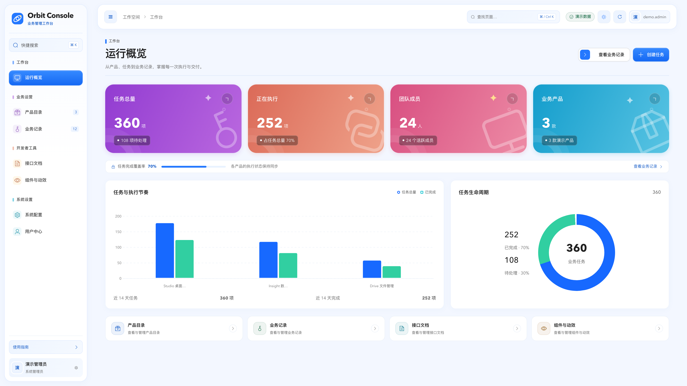

# 清爽蓝白后台、登录与组件动效

用一套统一的后台视觉语言创建新项目或改造已有后台：浅蓝工作区、悬浮式白色侧栏与顶栏、蓝色渐变主按钮、四色摘要卡、紧凑表格、分区表单、文档阅读区，以及同一套组件状态和动画。风格名称用于选择参考，品牌、账号、文案、统计与业务对象由目标项目提供。

当用户仅要求新建后台管理系统、未指定其他视觉风格或设计系统时，本配方是默认风格，直接采用，不要求用户先说出风格名称。用户明确的风格与已有项目设计系统优先；局部维护不自动整体换肤。

## 必读规范与按页加载

新建完整后台时，读取下表前四份规范及相关页面章节；只改按钮时读基础设计、组件对应小节与动效即可。先读取文档并打开相关原尺寸图，再开始写界面，不根据配方标题猜样式。

| 资料 | 必须解决的问题 |
|---|---|
| [基础设计与视觉核对](../admin-design.md) | 固定token、CSS尺寸口径、壳层、排版、不可随意变化的视觉特征，以及截图比较流程 |
| [逐页实现提示词](../admin-pages.md) | 公共壳层、登录、概览、目录、列表、文档、资料、设置，以及详情／编辑／任务等组合扩展 |
| [逐组件与按钮状态](../admin-components.md) | 尺寸档位、主次按钮、字段、选择、卡片、表格、浮层与等待反馈的全部适用状态 |
| [动效与打断规则](../admin-motion.md) | 35类动效的触发、时长、曲线、复原、焦点、快速反向与减弱动态 |
| [完整顶部栏与准确图标](../admin-topbar.md) | 创建后台壳层时必读：桌面／窄屏导航控制归属、面包屑、搜索快捷键、状态、主题、刷新、头像账户及完整HTML/CSS |
| [工作台图表与完整概览](../admin-workbench.md) | 包含工作台时必读：趋势、生命周期、三个比例环、对象对比、图标快捷卡及最近活动；其他页面不额外加载 |
| [页内彩色菜单与分段筛选](../admin-navigation.md) | 包含配置目录／子导航／范围或状态筛选时必读：逐项颜色、轨道与共享滑块、键盘、计数和真实筛选 |
| 本页下方高清图 | 同类页面的布局、密度与细节；按钮另有默认／展开两态 |

这是一套设计与实现配方。代码写入用户目标项目，skill仓库仅保存文档和参考素材。运行预览、截图中间文件与验证包在项目外临时目录处理，完成后清理。使用技能不依赖原项目路径、外部模板或在线图库。

## 实现约束与完成顺序

1. 确认本次授权的页面与功能，将每个页面映射到逐页规范的一种结构。实际业务需求缺失时只询问影响业务的关键问题；风格已经默认选定，不再请求风格批准。
2. 打开当前目标对应的高清图，记下壳层、区块、主次按钮与最明显的视觉特征；按基础规范建立唯一token与共享组件。先完成公共壳层及一页代表页面，在目标项目运行并修正几何后复用到其他页。
3. 按逐页规范确定区块顺序、列宽、标题／操作、间距、换行与空错状态；按组件规范落实每一个可见控件。业务字段与品牌可替换，层级和几何不能随意重设计。
4. 给实际使用的组件接入全部适用状态与对应动效。维护真实路由、请求、权限与保存语义；不要求所有页面都放四指标、登录验证或未授权功能。
5. 在同CSS视口下查看实际页面截图与参考图，先修壳层与布局、再修控件与排版、最后查装饰和运动。看到明显偏离时直接迭代，不能将“都是蓝白色”当完成标准。
6. 按基础规范的视觉验收表逐项检查，并说明已运行页面、检查状态与剩余差异。不能运行时明确视觉尚未验证，不宣称已完全复刻。

## 可直接执行的完整提示词

```text
在我的目标项目中使用ui-atlas的“清爽蓝白后台”创建或完善本次需要的后台。
默认风格已经选定，直接实施；保留我明确指定的业务、技术栈与设计约束。

一、先读取规范和看图
读取references/admin-design.md、references/admin-components.md、
references/admin-motion.md，再读references/admin-pages.md里本次页面的章节。
创建后台壳层同时读取references/admin-topbar.md，不能只读控件名称摘要。
实现工作台或运营概览时再读references/admin-workbench.md，完整模块不能只凭
首屏图推断，缺数据说明业务映射，不无声省略已有统计与活动；图表必须实现
同一日期／分类下所有可见系列的数值提示框，边缘避让、主题同步，并提供键盘、
触摸和数据摘要的等价查看方式。分布环与细进度环提示箭头尖端到实际外缘
默认6px（正常4–8px），不按容器顶边或圆心定位，不重复叠加offset；空间不足
翻转并同步箭头，不能靠拉大间距避让。柱图/折线必须按当前分类或高亮点的
实际x、y动态定位；正值分组柱贴近当前组可见柱顶，高低值切换时框与箭头
一起移动，不使用固定top、全图最大值或首个分类的高度。箭头与正文同色连成
一体，根部覆盖正文边框，内部无横线/竖线穿过、白缝或独立三角底边；外轮廓
细边可以保留；内填充等宽跨过整个根部并绘制在正文边框和阴影之上，再向尖端收窄，
不能只遮中心、两肩仍残留短线。浅深主题与四向翻转放大核对整个连接处。
顶部搜索必须读取admin-topbar的搜索命令面板专节：点击搜索按钮、侧栏搜索或
⌘/Ctrl+K都打开同一居中模态弹窗，使用标题栏／输入区／结果列表／空态／快捷键
提示的紧凑层级；不做成下拉菜单、重复标题与placeholder、无边界的大白框或可滚动
背景。弹窗主题、焦点、Esc、关闭后返回入口和窄屏布局逐项验证。
页内有设置菜单、资料子导航或分段筛选时读取admin-navigation.md，不能只给
主侧栏配色；记录范围和状态分段使用本套完整外观与行为，不沿用库默认Tab。
打开本配方中对应页面的原尺寸参考图，按钮需要时看默认与展开两态。
不要只读目录摘要或凭“蓝白风格”自行构思。3840×2160图对应1920×1080
CSS视口，DPR2不意味着CSS尺寸翻倍。参考中的品牌、数据和文案按我的产品
替换，偶然出现的Toast、hover或光标不是页面固定装饰。

二、固定设计基线
统一使用admin-design的浅蓝背景、白色面板、文本与边框token、字体回退和
精确四色渐变；组件库与body下浮层也映射这些token。间距、字级、圆角按
其职责使用，不另造整套配色、厚阴影、玻璃或营销大横幅。
正文14、业务标签13、说明12，页面26且概览30、KPI38，使用等宽数字。
16是业务面板圆角，18是资源卡、20是侧栏／普通摘要、24是大KPI；不能全改
成一种超大圆角。主按钮是指定蓝色渐变、白字、细高光与轻外阴影。

三、先壳层后页面
按256px壳层列、232px实际侧栏、12px外留白、68px顶栏、1620px正文上限
实现一次公共壳层。启用border-box，工作区放第二列；不要另加重复左外边距。
侧栏有品牌/快捷搜索/分组/图标座/蓝色当前项/计数/底部帮助和账户；参考组前有
蓝/紫/珊瑚/青的4×10短竖线，未选菜单为对应组色的17px线框图标与24px浅色
底座，选中才白字白图标、白18%底座。按admin-components侧栏合同执行，不能
变成全灰图标、统一蓝色或丢掉分组竖线。中部独立滚动。按admin-design滚动条
规范统一侧栏/表格/代码/弹层实际viewport：细中性灰滑块，浅色#d8d8d8、深色
#777777，R=G=B不带蓝色，透明轨道；高对比按系统适配；
滚动条在容器与圆角内、不压文字及末列，不画粗浅蓝长轨道、不制造重复竖滚。
Logo与标题横排垂直居中，品牌整组水平居中；桌面折叠按钮放侧栏内底部控制行。
收起后每个菜单按钮左右留白相等，24px图标座在按钮内居中，整列与侧栏中心轴对齐；
隐藏文字/计数/箭头后清掉grid列/gap/缩进/空占位，hover与选中不偏移；
按admin-components折叠合同实测有无滚动条，不能用逐项位移或不对称padding凑齐。
折叠后导航滚动viewport距侧栏右内缘2–4px，不叠展开态padding或空轨道；
原生thin，已有自定义滑块2–3px（悬停/拖动最多4px），轨道透明、中性浅灰，
不新增滚动库、不隐藏滚动能力，不能为靠边破坏菜单居中或裁掉焦点。
桌面侧栏状态按admin-components持久化合同保存：手动收起后刷新/强刷/换后台路由
仍收起，手动展开后才改变；首轮渲染应用，禁止先展开再缩回。移动导航抽屉
单独管理，跨断点不覆盖桌面偏好，刷新后默认不自动弹出抽屉。
顶栏按admin-topbar的完整结构：桌面左侧紧凑面包屑，窄屏才显示36px导航入口，
右36高搜索及快捷键胶囊、状态徽标、36px浅蓝主题/刷新、26px头像和用户名。
保持顺序、底座与实际动作，不用裸黑图标、接入文档或盾牌账号替代整组。
主题切换按admin-topbar紧凑菜单合同：按最长选项max-content收宽（当前中文约102px），清除库min-width，
4px外壳内边距、32px行高、
16px图标列、8px间距与对称8px行内边距；无对勾及预留对勾列，不做大弹窗。
三行图标和文字逐列对齐；实际图标前和最长文字后的留白各约13px、差值≤2px，
不能只设相同padding却留下大块右空白。账户菜单也复用相同紧凑几何，按最长
选项收宽；不能继承头像用户名入口宽度或库默认min-width，退出图标/文字统一red。
顶栏主题/刷新/账号按钮共用垂直中心线。
页面头固定分组标记、标题、说明、右侧主次操作和底分隔线；所有页复用。

四、按页面逐区块落实
登录：左品牌与双行大标题、说明、三功能小卡；右最大440登录卡，字段42、
提交44，保留密码显隐、错误与忙碌。仅真实业务需要时加入验证。
概览：大KPI→细进度条→1.55:1趋势/生命周期→1.3:1三进度环/对象对比→
图标快捷卡→最近活动，按admin-workbench映射真实数据；大KPI192高、24圆角，
每卡保留对应业务的半透明线框大图标、左下双层环、星芒、小空心点、右上
圆入口与深色小hint，不能只画统一大圆环。四色直接引用summary-violet/coral/
rose/cyan的115deg渐变，不另选深色，不叠整卡黑蒙层。每个导航型大KPI的
32px圆入口常显，内部用admin-components基准SVG的15px无箭杆细chevron，
不能换成完整↗、ArrowUpRight或加粗箭头；默认-40deg，hover/focus-visible时200ms旋回0deg并
亮面，点击直接去对应真实业务页。读取admin-components的大KPI合同与片段，
不以普通摘要替代这组卡，装饰位于前景下且不接收点击。
目录：普通142摘要→目录标题/筛选→类别折叠→三列资源卡；内部依次为短色条、
图标状态更多、ID复制、名称说明、浅蓝能力面、淡紫数量面与页脚。
列表：白色16圆角面板内的标题、筛选、表格、分页，44表头/56普通行/64双行，
编号复制、数值右对齐、状态、选择与行操作齐全；多选栏不遮挡末行。
文档：操作面板→说明→特征条→左目录/右正文；阅读排版只用于正文，
复制下载同源，代码和表格局部滚动。
用户中心：左身份卡与右表单/事实栏，紫hero210、左栏228、事实250，
保留健康块、子导航、分区蓝竖线、头像联动与底部动作。
设置：命令栏→三状态摘要→分组设置/说明侧栏；dirty、数量单位、Switch、
只读策略、保存状态清楚。具体尺寸和响应式按逐页规范执行。
详情、编辑、文件、任务等新业务按相应组合扩展，不因此改造全局风格，
也不因规范列出页面而额外创建未要求的业务功能。

五、每个组件、每个按钮落实状态
按admin-components的variant和size复用实现：普通按钮34、页头保存38、
顶栏图标36、普通输入38、登录输入42、徽标最低24；不要沿用库默认大号。
Primary/Secondary/危险/文字/图标/箭头展开按钮有不同外观和职责。
每个可操作组件都检查default、hover、active、focus-visible、disabled；
异步再加loading/success/error。图标16与文字居中，padding和边框不变粗，
状态变化不改变控件宽度；标签、帮助、校验、长值、清空与单位逐项处理。
同一行的输入/选项框/数字步进器/Select/日期/单位框及操作按钮统一一个高度档，
共享高度token、border-box，真实边框同高且顶底对齐；内部min-height/padding与
step按钮不得撑高单个框，标签/help单独排布。按admin-components同行合同实测。
搜索/输入/单选下拉框内的占位提示小字、填写值与图标/清除/箭头共用垂直中心线，
文字仍左对齐；placeholder继承输入字体、字号、400字重和行高，只改提示色。
外壳与内部高度联动、上下padding对称；输入和清空不上下跳。按admin-components
单行字段对齐合同核对中文/英文/数字、不同尺寸和缩放，不用单独偏移提示字凑齐。
多行Textarea保留顶部起排，多选chips按行居中，框外label/help/错误说明不移入框中。
搜索与普通输入使用一体式输入面，外壳统一背景/边框/圆角/单层焦点强调；前后缀与内部
input透明，不能两端灰底、中间白底或双圆角，浅深主题及禁用整框同步核对。
填写、粘贴或自动填充后不得出现灰蓝文字底；按admin-components回填规则
处理UA填色与文字/caret，不能禁用autocomplete。搜索空值、有值、聚焦和失焦
逐一核对prefix/文字/suffix/clear的连续底色，不能两端残留灰蓝色端盖。
已有值再次点击、账号密码来回切换、候选回填/取消时从首帧起都不能闪蓝底；
字段只过渡边框，背景/内部填色阴影不补间、不用transition:all，不能focus时清掉遮盖。
录屏逐帧检查点击至稳定的过程；输入字重保持400，不因filled/autofill/focus加粗；保留正常选区高亮、caret、粘贴与密码管理器。
聚焦只改变原有1px字段边框颜色，不向内加粗，不加ring/光晕，不给内部input再画圆角框；
明确禁止搜索/输入/下拉/数字框点击后出现“外框＋内部文字区圆角框”两层线；
检查内部input、库wrapper、伪元素和active/focus-visible样式，按组件规范清除重复描边。
数字步进器的数值区也不能另有蓝框。保持可辨认的唯一键盘焦点，尺寸和位置不变。
独立面板默认gap20，同组信息面板gap16，手机分别14/12；内部padding不能代替
区块外间距，文档信息面与API基地址条不能贴边，不用负margin或位移抵消间距。
落实admin-design的信息层级/分组/表面规则，细边与阴影沿用已有token，不叠多层主卡。
按admin-components的信息排版合同统一键值列、数字单位基线、文件首尾识别、
长内容完整查看与同排卡片底部操作；不能靠空格、固定正文高度或截断关键后缀凑齐。
高级筛选/低频设置按admin-pages渐进展示，收起保留条件并显示启用摘要，错误所在区
自动展开且焦点可达。敏感字段/行内编辑/撤销/差异/AI能力仅在真实业务需要时接入。
Switch、Checkbox、Radio、Select、Menu、Segmented按真实选值或动作语义使用。
日期/截断值/侧栏与图标说明必须使用admin-components的共享自定义Tooltip，
禁止title/:title或组件透传产生浏览器默认灰色气泡；迁移时保留可访问名称与完整值。
气泡随主题、12px正文、8px圆角、6/10内边距、细边轻影、无接缝箭头，按内容收宽。
指针停留180ms显示，移入正文保持，离联合区域100ms关闭；聚焦/触屏有等价入口，
Esc原地关闭且不立即重开。实际静止悬停后继续等候，确认没有浏览器title叠层。

六、动效必须接入实际交互
箭头按钮28px蓝块在300ms铺满、三点和文字180ms切换、press缩放.975；
采用动效文档片段，不能仅hover改色。实现本页涉及的分段共享滑块、页签标记、
数字滚动、徽标、卡片hover、KPI圆形箭头的旋转与跳转、可反向展开、刷新、
进度、弹窗抽屉和保存反馈；KPI圆入口与蓝底铺满箭头按钮不能混用。
每项使用文档参数；动画不延迟业务结果，旧timer不覆盖新状态，退出与卸载清理。
菜单/Popover运动起点跟随最终placement与触发位置，翻转同步起点与箭头，
沿用库的可靠过渡；加载按钮保持占位，隐藏次操作提供键盘/触摸等价入口。
减弱动态保留结果，去掉位移、缩放、循环与错峰；键盘与触摸同样可完成任务。

七、实际比较再交付
先运行一页代表页面，在1920×1080 CSS视口、100%缩放下截图比较；先修
壳层宽度与内容起点，再区块比例、行高/圆角/字级、颜色/阴影、装饰与动画。
随后检查1280/768/390宽度、长名称、多位数字、空/错/等待和浅深主题；不要
用overflow-x:hidden、缩小整页或固定假内容掩盖布局错误。
按admin-design的验收表记录“匹配/有意调整/待修正/未验证”及实际证据，修掉
可处理的偏差后再完成。代码只写目标项目；skill内不新增前端工程或依赖。
```

## 高清效果参考

以下均由虚构的 Orbit Console 演示数据重新渲染，页面图在 1920×1080 CSS 视口、2 倍设备像素密度下截为 **3840×2160**；局部按原生设备像素直接裁切。WebP 使用无损编码，无截图放大、锐化、打码或跨帧拼补。图中正文是演示产品界面本身，不是教学注释；红框、箭头标注和原始截图未收录。

页面几何、主题及自定义控件来自同套样式；品牌、账号、数据和部分业务内容已换为虚构内容。图表使用演示数据，不能据此要求新产品采用原业务流程。默认与悬停两张按钮图说明终态，不代替时间验证。

| 参考 | 用途 |
|---|---|
| [登录页](../../assets/details/enterprise-workbenches/clean-admin-login.webp) | 双栏、品牌区、登录卡、输入与主操作 |
| [登录验证](../../assets/details/enterprise-workbenches/clean-admin-login-puzzle.webp) | 验证面板、拼图和胶囊轨道；仅演示视觉 |
| [运行概览](../../assets/details/enterprise-workbenches/clean-admin-overview.webp) | 壳层、四色 KPI、进度条、图表与快捷操作 |
| [深色概览](../../assets/details/enterprise-workbenches/clean-admin-overview-dark.webp) | 深色 token、面板和文字对比 |
| [产品目录](../../assets/details/enterprise-workbenches/clean-admin-products.webp) | 摘要卡、搜索、分段筛选、分组与卡片 |
| [文档中心](../../assets/details/enterprise-workbenches/clean-admin-docs.webp) | 文档动作、章节导航、元信息与正文 |
| [用户中心](../../assets/details/enterprise-workbenches/clean-admin-account.webp) | 身份侧卡、分区表单与事实栏 |
| [系统配置](../../assets/details/enterprise-workbenches/clean-admin-settings.webp) | 命令栏、摘要、成组设置与说明侧栏 |
| [组件状态](../../assets/details/enterprise-workbenches/clean-admin-components.webp) | 按钮层级、分段控件、徽标、数字、进度环和页签 |
| [箭头按钮默认](../../assets/details/enterprise-workbenches/clean-admin-arrow-default.webp) | 白色按钮与左侧蓝色箭头块 |
| [箭头按钮展开](../../assets/details/enterprise-workbenches/clean-admin-arrow-expanded.webp) | 蓝底铺满、三点出现、文字变白的终态 |



## 适用范围与核对

- 完整复制的是视觉结构、组件状态与动画规则；真实用户、业务统计、认证、权限、备份和交付行为接入目标项目，不从参考中推断。
- 两个不同职责不要因外形相似而合并：分段选择设置值，页面页签负责导航；开关是否即时保存服从目标产品真实语义；装饰星芒和线框大图标不承担状态含义。
- 新增页面沿用既有壳层、标题、按钮、间距和表面，不再自行发明第三套圆角与强调色。严密对照 [设计规范](../admin-design.md) 与 [动效清单](../admin-motion.md)，不能只套背景色。
- 原有 Tooltip 约 180ms 显示／100ms 隐藏是此风格的参考参数；需要完整意图判断时另读 [025 悬停配方](hover-intent.md)，不要重复叠加 timer。
- 正常页面等待保持静态骨架；真实请求开始和结束驱动忙碌状态。复制的视觉不要变成伪造数据、假进度或前端假认证。
