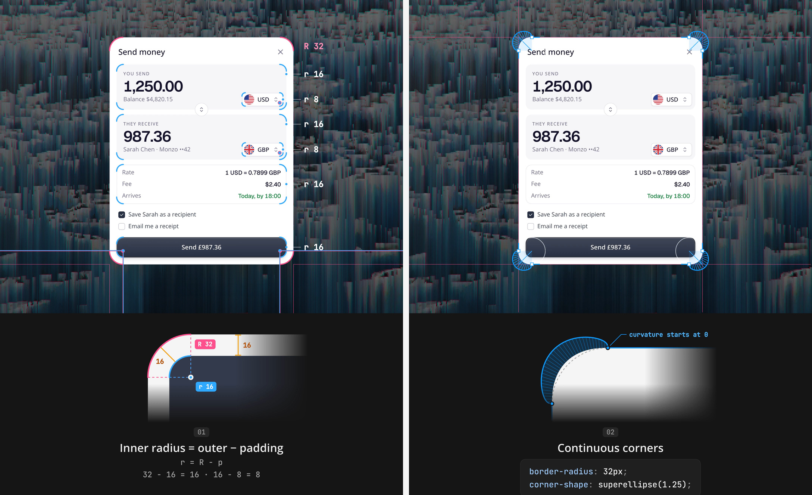

# 递进圆角与连续曲率 / Nested Radii and Continuous Corners

实现配方附高清演示截图；参数是可调起点，仍需在目标项目与浏览器中验证。

## 效果参考



对照等距内缩与连续曲率的局部示意，打开原图观察圆角连接。

媒体取舍：重点是嵌套间距、曲率和圆角连接，高清示意图及状态对照足够；讲解镜头不需保留 GIF。

## 适用与边界

等距嵌套采用内圆角 = 外圆角 − 内缩距离，再以 corner-shape: superellipse(1.25) 渐进增强，胶囊与圆保持全圆。

从弹窗或卡片向内协调面板、输入、按钮与标签；示例外圆角 32、内缩 16，则内层 16。优先改现有 radius token；4px 网格与最小 4px 是本配方的风格起点，产品已有尺度优先。只在目标容器内应用 @supports 增强，普通 border-radius 始终保留。连续曲率和非等距内缩需检查视觉边距，不假定减法产生严格几何等距线。

## 核对

检查各层四角、边框与 clip-path 对齐；胶囊和圆不变形；目标浏览器不支持时仍有正常圆角。

## 实现提示词

将下方配方应用于用户指定的组件或页面；其中 product、global、every 等范围以用户本次授权为界，不自动扩大到整站。已有设计系统和提交语义优先，新增设置面板、全局扫描和演示风格仅在任务需要时采用。

```text
Make the corner radii in this UI consistent, then switch them to continuous corners. Work on the screen or components I name; ask me if I have not named them. If the project has radius tokens, change those instead of hard-coding values.

Inner radius = outer radius - padding (r = R - p)
Go from the outside in: dialog or card -> panels, inputs, buttons -> chips and tags. A box p inside a container with radius R gets R - p, so both corners share one center. Example: dialog 32, padding 16 -> panels and buttons 16; a chip 8 inside a 16 panel -> 8.
Boxes on the same level share one radius. Never go below 4.

Pills and circles stay fully round.
Keep every padding, gap and radius on a 4px grid.
Continuous corners
Keep border-radius and add the curve as progressive enhancement: @supports (corner-shape: superellipse(1.25)) { .target-surface { corner-shape: superellipse(1.25); } } Set corner-shape: round on pills and circles.

Test the target browsers; unsupported engines keep the plain border-radius.
When done, list every radius you changed as "element: old -> new".
```
