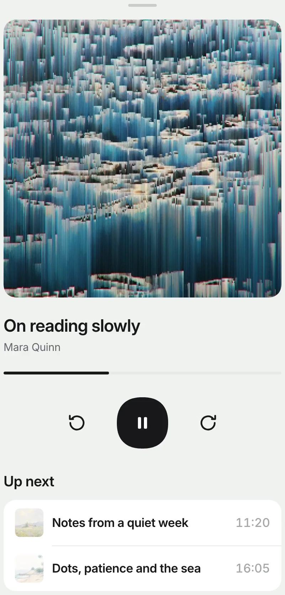
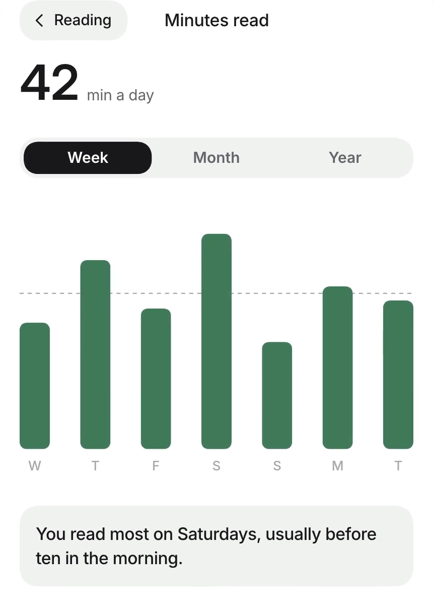
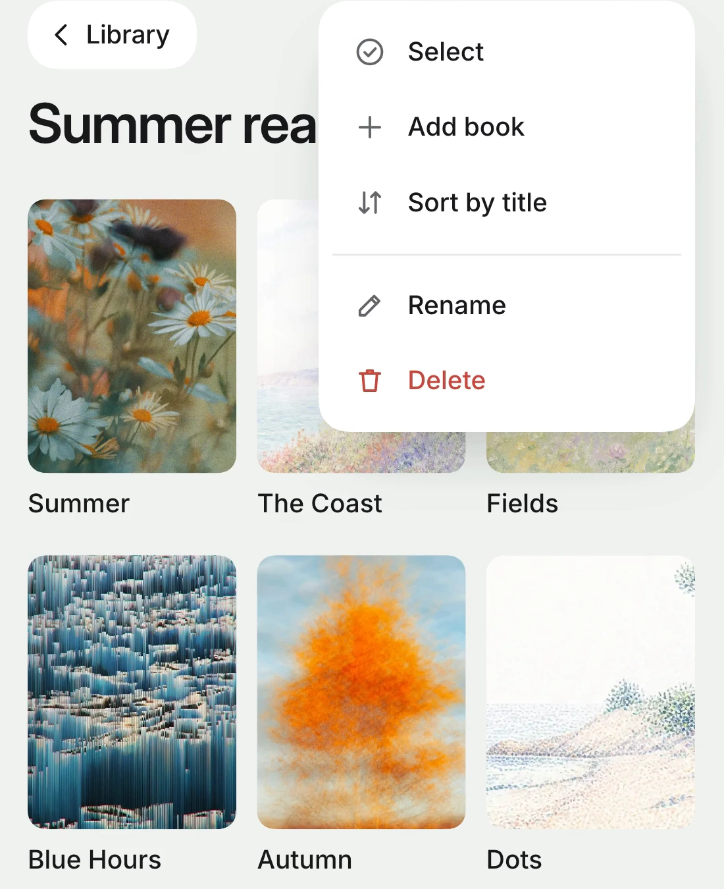

# 015 · 用好连续性，让产品更丝滑 / Continuous Transitions

让用户刚操作的元素延续到下一状态：行标题成为详情标题，卡片成为内容面板，迷你播放条成为播放器，小图形成为详细图表。先找出产品中值得修正的跳变，再实施用户选中的项目；保留原有操作、内容、路由和静止布局。

## 八类连续模式

| 模式 | 延续的元素与目标 | 关键核对 |
|---|---|---|
| a · 行到详情 | 行标题／缩略图延续成页面标题／头图，前页标题收为返回标签 | 返回恢复正确来源；大标题随滚动收入顶栏 |
| b · 卡片展开 | 卡片边框、圆角、图片和标题延续成完整视图 | 关闭与拖拽取消沿同一关系返回；正文稍后出现 |
| c · 紧凑条到面板 | 播放条、会话气泡或任务胶囊本身展开，封面、标题和主按钮各归其位 | 面板保持不透明；仅在符合现有呈现方式时弱化背景 |
| d · 搜索与筛选 | 输入框移到操作行，真实匹配项从原位置进入结果布局 | 保持输入焦点、输入法组合、结果顺序和键盘选择 |
| e · 摘要到详情 | 指标、缩略图、折线或柱条延续成详细内容 | 同一数据身份和真实数值；坐标域变化有明确映射 |
| f · 控件到菜单 | 菜单、表单、选项或日期面板从真实触发控件展开 | 保留各自焦点与选择语义；新增项插入真实位置 |
| g · 导航指示器 | 一个选中指示器在 Tab、分段控件或导航间移动 | 领先边先走、尾随边跟上；方向符合导航顺序与书写方向 |
| h · 布局变化 | 稳定 ID 的元素在网格、列表、排序、插删和折叠间移动 | 真实顺序立即生效；滚动锚点和虚拟化身份不乱 |

跨行先离开行尾、再从下一行行首进入是 h 类的可选视觉路径；按实际布局选用，不强迫所有重排绕行。

## 节奏起点

- 优先复用产品现有 motion token。需要新起点时，展开／收回可用 `cubic-bezier(.32,.72,0,1)` 或现有弹簧，屏内移动用 ease-in-out；不因此统一替换无关动画的曲线。
- 手机完整视图约 450–700ms，菜单／sheet 约 350–500ms，导航指示器约 400–450ms；桌面可从约 2/3 起调，键盘触发更短。它们是本类复杂连续动作的起点，按频率、距离和现有节奏缩短，不覆盖用户指定值。
- 仅终态存在的内容约在进度 45–55% 后淡入；仅初态存在的内容在前 25–35% 淡出；错峰约 20–50ms。指示器最多约 15% 高度挤压、背景约 0.94 缩放／30% 压暗、拖拽卡片约 0.82 缩放均为可选起点。
- 拖动中 1:1 跟手，无缓动；释放承接实际速度，沿用产品原有完成阈值和取消规则。减弱动态时保留真实状态变化，约 150ms 淡化，移除位移、缩放与弹性。

## 清晰效果参考

三张独立 WebP 从 2160×2880 视频直接解码，按原像素裁切，质量 98；不放大、不锐化、不涂抹、不跨帧修补。每种只留一个清晰状态，画面只含 UI 局部，说明放在文档中。

### 播放条展开后的面板



800×1670；用于核对展开终态的封面、标题、控制层级和不透明表面。封面内的柱状纹理属于示例插图。迷你条到面板的运动与反向收回需实际操作验证。

### 指标卡展开后的图表



860×1200；用于核对指标、标题和详细柱条的终态层级。截图不能证明摘要中的小柱与详细柱的身份映射，也不代表示例数字是项目需求。

### 控件展开后的菜单



1100×1350；用于核对菜单表面、操作分组、图标与内容层级。触发点到菜单的变形、跟随高亮、添加后的真实插入和 Tab 指示器需在项目中验证。

这三张图覆盖不同的浅色完成状态，不重复添加相近帧。其他模式、深色适配、手势、路径和时序按下文验证，不能用静态图认定连续行为已经通过。

## 在现有产品中应用

下面保留用户提供的完整 Prompt。执行时先遵循本节的集成边界，再使用详细提示词。

- **范围与选择**：未指定改动对象时，先检查并给出最多 10 项排序建议，用户选中后实施。已经明确选择和授权的项目直接推进，不把原文两次 go-ahead 当作重复批准要求。新增依赖或改变路由方案需在现有授权范围内；优先复用现有能力。
- **保持产品结构**：手机／桌面沿用已有页面、面板与模态呈现方式。原文桌面 side panel／dialog 是已有布局中的候选，不为动效把真实详情页改成侧栏，也不复制示例字体、手机框、内容或背景。
- **共享身份与返回**：使用稳定对象 ID，不能用数组下标；Web 共享名称在同一渲染状态中唯一。记录滚动容器和实际源／目标矩形；来源被筛除、虚拟回收、离屏或目标未加载时，正常导航并淡化，不飞向别的项。返回和取消恢复同一对象与正确滚动位置。
- **测量与排版**：批量读取 first／last 矩形，用 FLIP 或框架的共享布局能力动画视觉层，避免逐帧写回触发布局的尺寸与位置。真实终态先按原组件排版；文字使用等比例缩放并核对换行，不用不同比例拉伸冒充排版。必要副本仅作视觉桥接，隐藏于读屏、不可聚焦且不拦截输入，交接时没有重复正文或闪现。
- **真实状态与数据**：搜索保留同一真实输入或可靠的焦点／光标交接，不能让快照接受输入；维护 IME、取消、键盘选中和异步结果竞态。图表只匹配同一数据系列与数据点，明确坐标域／缺失值映射；不同数据允许淡入淡出，不能为了连续外观伪造数值或顺序。
- **中断与输入**：新的导航、搜索和反向操作从当前可见状态接手，不排队等待动画。浏览器 View Transitions 的快照层不能假定天然可交互；检查实际命中、跳过／取消过时转场及清理时机。装饰层不截获点击，目标控制区保持可用；无法做到可靠中断时用正常更新加短淡化。
- **手势与平台行为**：拖动只驱动同一过渡进度，释放保留速度，同时服从原有阈值、返回栈、predictive back 和取消语义。安全区在每一帧有效；窗口 resize／响应式断点正常重新布局，不做戏剧化转场。用户主动展开已有面板仍可属于本配方。
- **焦点与辅助技术**：沿用真实模式：导航更新标题／焦点，模态使用现有焦点约束并在关闭后返回触发点，菜单／Tab 按各自键盘模式工作；不要给所有状态统一强制聚焦标题。状态只公告一次，减弱动态保留完整功能。
- **版本与生命周期**：第 6 节列的是候选 API，实施前核对项目版本、同文档／跨文档能力与真实 WebView。框架列表、路由和呈现器分别接入，不能假定一个 shared ID 自动跨越所有边界。动效结束、中断、卸载、目标消失时清理覆盖层和临时样式，不保留空闲循环。

## 完整实现提示词

```text
Find the places in my product where the interface jumps from one state to the next, and make the important ones continuous: the element I touched should carry into what comes next instead of disappearing and being replaced. First diagnose and suggest; build only what I pick.

This is a change to my product, not a demo. Work inside my code, on my stack, with my components, tokens and layout. Keep what every action does, what each screen shows and where things end up; change only how one state becomes the next. Do not copy a demo scene (no phone frame, backdrop, sample content or fonts). Do not add a dependency or a router change without asking. Every value below is a default to start from. It applies to phone and desktop layouts alike; section 3 says where they differ.

0. Read the product first
- Find the screens, routes, panels, sheets, dialogs, menus and lists, and how one opens from another: navigation stack or router, modal and sheet presenters, popover and menu components, list and grid components.
- Find what animates today and how: CSS transitions, the View Transitions API, Motion or Framer Motion, GSAP, SwiftUI or UIKit transitions, Compose animations, Flutter Hero or implicit animations. Note the motion tokens (durations, curves, springs) and reduced-motion handling, and reuse them.
- Note which layouts exist (phone, tablet, desktop window, split view) and the input on each (touch, mouse, keyboard).
- Tell me in a few lines what you found before going on.

1. What to look for
A jump is where I act on one element and the next state appears from nowhere: a hard cut, a cross-fade of whole screens, or something sliding in from an unrelated edge. Look for these, the most common first:
a. A row or item opens its detail page. Continuous: the row's title grows into the page title; its picture into the header; the previous page's title shrinks into the back button. When the page scrolls, the large title tucks into the top bar, centred on the control row. Going back reverses all of it.
b. A card opens into a full view or a dialog. Continuous: the card itself grows into the view (its frame, corners and picture), its title stays the same line of type and only scales, and the rest fades in once the card is mostly open. Closing, or dragging it down, shrinks it back into the same card in the same place.
c. A compact bar opens into a full panel: a mini player, a chat bubble, an upload or download pill, a toast with details. Continuous: the bar is the panel; its cover, title and main button grow into their places in it. The panel stays opaque all the way, and the page behind steps back (scale about 0.94, dimmed about 30%).
d. Search or filter. Continuous: the field moves up into the top row as the page title leaves and a Cancel or close slides in; while typing, the matching items slide from where they are to their place in the results and the rest fade out. On desktop the same applies to a command palette opening from its field.
e. A summary opens into its detail: a metric tile into a chart, a progress ring into a report, a thumbnail into a gallery. Continuous: the small marks become the large ones (the sparkline is the chart's line, the small bars are the chart's bars), the label moves into the title, and the number scales up rather than being redrawn.
f. A control opens what it controls: a ⋯ or + button into its menu or form, a select into its list, a date field into its picker. Continuous: the panel grows out of the control from the control's own corner, its items fade in after it is mostly open (about 25ms apart), and the highlight slides from item to item with the pointer or finger. When an action adds, removes or moves something, it appears in its place and the others move to make room; nothing jumps.
g. Tabs, segmented controls, bottom bars and side navigation. Continuous: one indicator travels from the old tab to the new one. Its leading edge leaves first and the trailing edge follows, so it stretches on the way and settles as it lands (a small squash of about 15% of its height at the longest is enough); labels collapse and expand while the other items make room. New content enters from the side of the tab that was chosen.
h. Layout changes: grid to list, sort, reorder, insert, delete, expand and collapse. Continuous: each item moves from where it was to where it goes; items that change row leave at the end of their row and come in at the start of the next, so nothing crosses the grid.

2. How to make it continuous
- One element, not two. The thing that moves is the same element (or a shared element the framework matches by id), measured where it starts and where it ends. Animate between the two boxes with transforms; never animate width, height, top or margin on things that reflow.
- What only one state has fades: content that exists only at the end fades in after about 45-55% of the move, and content that exists only at the start fades out in the first 25-35%. Text that changes size scales; it is not cross-faded with a copy.
- Keep layers honest: a panel that grows is opaque all the way, so nothing shows through it; the moving element stays above its neighbours while it moves, and goes back to its place in the stack when it lands.
- Shapes keep their corners: the radius changes smoothly between start and end, using the product's own corner curve. Nested shapes keep equal padding and concentric corners.
- Timing: open and close with a fast start and a long settle, cubic-bezier(.32, .72, 0, 1) or the product's own spring. Phones: 450-700ms for something that becomes a full screen, 350-500ms for menus and sheets, 400-450ms for an indicator. Desktop: about two thirds of that, and shorter still when it was triggered from the keyboard. Moves within a screen use ease-in-out. Staggers stay between 20 and 50ms.
- Gestures: while a finger or the pointer drags, follow it 1:1 (a dragged card shrinks to about 0.82 as it goes); on release, finish with the release velocity, toward whichever end is nearer.
- Interruptions: a new action takes over from wherever the animation is; nothing waits for an animation to finish, and input is never blocked.
- Reduced motion: keep the change of state and a short cross-fade (about 150ms), drop the movement and scaling.
- Accessibility: focus moves to the new state's heading or first control, and back to the element that opened it when it closes; screen readers announce the new state as they do now.

3. Phone and desktop
- Phone: everything above, with gestures (swipe back, drag to dismiss) driving the same animation as the buttons, and safe areas respected at every frame.
- Desktop: the same patterns, smaller and quicker. A card or row usually opens into a side panel or dialog rather than a full window; grow it from the card into that panel. Do not zoom whole windows. Hover never starts a layout animation. Keep pointer targets in place while they animate, so a second click lands where it aims. In split views, animate inside the pane that changes.
- Window resizing and responsive breakpoints are not transitions; do not animate them.

4. Report before building
Go through the product and give me a ranked list, at most 10 entries, each with:
- Where: the screen or component, and the action that triggers it (on phone, desktop or both).
- Now: what happens today, in one line.
- Pattern: which of a-h it is, and which element should carry over.
- Change: what moves to where, the duration and curve, in two or three lines.
- Value: high, medium or low, from how often people do it and how lost they could get without it.
- Cost: what has to change in the code, and any risk (routing, virtualized lists, shared state).
Put the frequent, disorienting ones with low cost first. Then ask me which ones to build and wait.

5. Build what I pick
- Describe the approach for each on my platform (section 6 is a starting point), and list the files you will touch. Wait for my go-ahead.
- Build them one at a time. For each, list the files you touched, and check:
  - The first and last frame match the real states exactly; nothing jumps when the moving element hands over to the real one.
  - Real data: long and short text, missing images, the first and last item, an empty list, a scrolled list.
  - Fast repeated taps or clicks, going back during the animation, and gestures cancelled half way.
  - Phone and desktop layouts, light and dark, reduced motion, keyboard and screen reader.
  - At rest every screen looks exactly as before, and existing tests still pass.

6. How, by platform (check against my versions)
- Web: the View Transitions API with view-transition-name on the shared elements (same-document, and cross-document where pages are separate), with a plain update as the fallback. Otherwise FLIP: measure first, apply the change, measure last, animate the inverse with transforms (Motion's layout and layoutId do this; so do Svelte's flip and crossfade, and Vue's TransitionGroup). For router-driven pages, start the transition from the router's navigation hook.
- iOS: SwiftUI matchedGeometryEffect for shared elements in one view, navigationTransition(.zoom(sourceID:in:)) with matchedTransitionSource on iOS 18 and later for pushes and sheets; UIKit preferredTransition = .zoom on iOS 18, or a custom UIViewControllerAnimatedTransitioning with UIViewPropertyAnimator for interruptible, gesture-driven ones.
- Android: Compose SharedTransitionLayout with Modifier.sharedElement and sharedBounds, AnimatedContent, Modifier.animateItem for lists, and predictive back for gesture-driven returns; with Views, MaterialContainerTransform and shared element transitions.
- Flutter: Hero for shared elements between routes, OpenContainer from the animations package for card to page, AnimatedList and implicit animations for layout changes.
- Desktop apps: Electron and Tauri take the web route (Tauri uses the system WebView, so test View Transitions there and keep the fallback); native apps use the same ideas with their own animation tools.
```

## 项目核对

- 每个实施项有真实入口、共享对象和明确首尾状态；静止内容、业务行为、路由和布局保持原样。
- 起止帧与真实组件一致，圆角、图片裁切、长短标题和换行不跳；共享层交回真实组件时无重影。
- 测试缺图、空列表、首末项、长列表、滚动后返回、来源被筛除与虚拟化回收；没有错误身份映射。
- 连点、反向返回、快速输入、半途取消手势和卸载都可接管并清理；数据／请求不等待动效。
- 手机、桌面和分栏布局按现有呈现方式工作；窗口 resize 不飞移，safe area、鼠标命中、IME 与键盘焦点正确。
- 深浅主题、减弱动态、读屏与真实平台回退分别验证；列出实际修改文件及未能验证的行为。

关联配方：[011 动画节奏](easing.md)、[卡片删除与补位](card-delete-effects.md)；通用布局选型见 [排序筛选布局动画](../motion.md#layout-animation)，动效模式入口见 [20 种动效选型](../motion-selection.md)。
