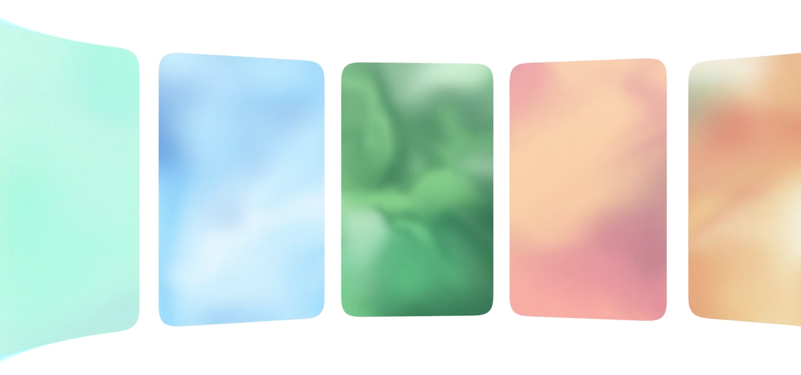
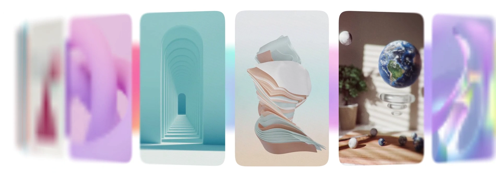

# 021 · 景深环形卡片与流体渐变 / Depth Card Ring

在选定页面、区块或组件中，把真实卡片排成可拖拽、可吸附的空间环。Inside 环内视角让两侧卡片靠近并经过玻璃边缘；Outside 环外视角呈现前清后虚的环形队列，切换时依次翻面，从流动渐变变为图片。适合少量精选内容的探索与展示，普通列表、表格与需要逐项比较的信息不自动改成卡片环。

先查当前渲染方式、框架版本、图片来源、滑块组件、主题和减弱动态，再确定放置位置、卡片内容、初始视角、是否允许切换和参数面板可见范围。图片必须来自用户已有素材或明确选定资源；图片未提供时保留渐变或占位，说明缺口。下方完整提示词含选择流程；已有明确选择与实施授权时直接复用，不重复逐项询问或索要 go-ahead。

## 效果与参数起点

所有尺寸为演示逻辑单位，需映射到当前组件的实际尺寸；不是固定页面布局或性能承诺。

| 部分 | 默认值与行为 | 实现要点 |
|---|---|---|
| 卡片环 | N=22，180×300，gap=18，step=198，R=N×step/(2π)≈693 | 按真实数据与尺寸重算；有限数据不为了凑数伪造内容 |
| 弧线 | s=wrap(i×step−offset)，c=bend/R；a=s×c，x=sin(a)/c，z=(1−cos(a))/c | bend=1 为环内，−1 为环外；c→0 时连续趋向 x=s、z=0 |
| 透视 | 环内 860px，环外 1500px；P 按 bend 混合 | 投影为 xP/(P−z)、yP/(P−z)；近眼裁切阈值 140，按整张卡检查 |
| 表面 | 连续圆角 32px，指数 4 超椭圆；正面四色渐变，背面图片 | 正反面 UV／朝向一致；避免背面图片镜像或双重翻转 |
| 流体 | 3 层 fBm，两次域扭曲；seed=i×3.7+.43，Flow=20% | 相位逐帧积分，调速不跳变；颗粒约 ±1.75%，随模糊衰减 |
| 环内玻璃 | 每侧 160px，k=(1−d/rim)^2.4，偏移 .4×rim×k；色散 25% | 先绘卡片纹理，再采样偏移与七段色散；只在环内启用 |
| 环外景深 | blur=14px，中心约 220px 清晰，远侧 fade=50% | 按屏幕位置与深度取更大模糊；内容细节与覆盖边缘同时处理 |
| 视角切换 | bend 1100ms，曲线 (.65,0,.35,1)；flip 1800ms，(.3,0,.6,1) | 从当前状态接续；翻面由前方卡片向外错峰，返回反向恢复 |
| 拖拽与吸附 | 指针跟手；惯性投影约 260ms；吸附 420–1100ms | 确定速度符号与单位，取最近卡片及最短环绕路径 |
| 点击与按压 | 点击居中 760ms；按压 .95，140ms 缩小、320ms 恢复 | 区分拖拽与点击，保留卡片真实业务动作 |
| 开场演示 | 可选 16 张／2800ms，曲线 (.4,0,.12,1) | 仅在选定演示范围使用，不把持续自动旋转当默认产品行为 |

Flow 的 20% 对应演示中约每秒 .2 个噪声格；17.07s 为演示循环周期。相位、轨道半径 rho 与速度需一起定义，不把百分比、弧度每秒和线性场速度混用。四色调色板与完整噪声混色步骤见提示词；保留项目品牌选择。

## 参数面板

| 参数 | Inside | Outside |
|---|---|---|
| Perspective | 860px；600–1400 | 1500px；900–2400 |
| Glass rim | 160px；0–240 | 不显示／不作用 |
| Dispersion | 25%；0–60 | 不显示／不作用 |
| Depth blur | 不显示／不作用 | 14px；0–30 |
| Far fade | 不显示／不作用 | 50%；0–100 |
| Flow | 20%；0–60 | 20%；0–60 |
| Corner | 32px；0–60 | 32px；0–60 |

面板使用已有滑块，每项包含标签、值与单位、键盘操作和数值输入；按选定范围向所有人、仅开发环境或开关后显示。修改立即生效并中止演示轨迹，重置恢复全部默认值；面板事件不同时拖动卡片。演示不要求把调参面板加入所有生产页面。

## 清晰效果参考

从 2160×2880 视频直接解码，按原像素裁切并以质量 98 编码。仅保留两种不同视角各一张 WebP，无放大、锐化、涂抹或跨帧修补；去掉参数面板、说明、计数和署名光标。两图共约 250 KiB。

### Inside · 1900×890



右侧局部裁去以避开光标，保留左侧边缘与中央完整卡片；不是完整对称视口。渐变本身柔和，表面细颗粒属于材质，不能用这张静态图证明流速或色散连续性。

### Outside · 1900×700



右端裁去以排除光标；中心卡片完整，边缘虚化为刻意的景深。静态图只展示该状态，不证明翻面顺序、环的全周遮挡、吸附或渲染性能。

## 实施边界与演示公式解释

- **环、相机与切换**：统一模型坐标、投影像素和 DPR；接近零曲率时用极限或稳定展开，避免除零与 1−cos(a) 的精度损失。完整闭环只在端点曲率满足一周时成立，中途展开时处理 wrap 接缝，不能让远端瞬间穿过画面。整个卡片及其模糊外扩都参与近眼与离屏判断，不能只看中心；滑块拉近相机时仍不能出现爆大、反向投影或闪现。
- **正反面、排序与数据**：按实际相机深度、翻面与透明度确定遮挡，不能仅按数据索引排序。背面 UV 只校正一次，保证图片文字可读；换视角不会换业务 ID。少于两张、数据增删、尺寸重排与贴图失败均有静态或二维回退；调尺寸时保留当前项，贴图数组按统一尺寸／格式准备层与 mipmaps，不拉伸原图。
- **圆角与噪声**：提示词给出的超椭圆 outline 公式用于近似轮廓，不把它当作全域精确欧氏距离；半径限制在卡片可用范围，边缘抗锯齿与模糊宽度需按屏幕像素核对。反序 smoothstep 不直接照抄成 shader 内建调用：顶部提亮用等价的 `1−smoothstep(−.6,.1,y/h)`。fBm 旋转矩阵按所用语言的行列约定核对，避免旋向与尺度不一致。
- **玻璃与色散**：偏移只采样本区块渲染纹理，不假定能直接读取任意 DOM；边缘采样安排足够有效内容并处理纹理边界。rim=0 时跳过计算；.4×2.4<1 仅约束基础一维位移，不能证明最大色散时所有通道或二维映射都无折叠。随 0–60% 调参检查各通道 Jacobian／采样方向，必要时限制偏移，避免重复卡边。七个样本按 RGB 各通道权重归一化；玻璃强度随正 bend 平滑归零，Outside 不留残影。
- **景深与颜色**：blur=0 使用清晰路径，不能除零；卡边覆盖近似、噪声衰减和 mipmap LOD 是演示的快速景深方法，不等于完整卷积。斜转卡片仍预留屏幕像素模糊外扩，前后层合成使用一致的预乘 alpha。远侧淡化与玻璃提亮按当前主题背景处理，深色页面不能机械混白；颜色空间、透明边缘和贴图采样一致，避免黑边与色带。
- **拖拽、打断与输入**：定义 velocity 是指针速度还是 offset 速度；例如 offset 随 pointerX 反向变化时，用同一符号推导惯性目标，不直接拼接矛盾符号。逻辑坐标缩放后仍视觉跟手，使用单一运动状态处理拖拽、吸附、点击、翻面和重置，从当前值接续；切换时固定本次翻面排序基准，快速再次切换不重排跳闪。保留页面纵向触摸滚动，处理取消与捕获丢失，不劫持全页滚轮。
- **内容、键盘与可达性**：提供可聚焦的前后切换或等价列表入口，按业务顺序暴露名称与选中状态，不让 22 张重叠卡片产生不可见焦点。Canvas／GPU 画面有对应的语义结构；卡片居中动作与链接／操作的激活语义需明确，不因演示按压反馈改变真实操作。图片有合适的替代文本，装饰渐变不重复播报。
- **性能、平台与降级**：WebGL 2 两遍渲染、96 列网格和纹理数组为候选路径，按当前平台版本验证；不自动新增渲染框架。DPR、纹理尺寸、卡数、噪声层数和模糊成本按设备预算调整，60fps 是验收目标而非保证。离屏与后台暂停，清理 GPU 资源，处理 context loss／恢复；原生平台候选 API 不代表已验证的等价实现。无 GPU 路径按提示词回退 CSS 3D 或二维列表，并明确未启用真实玻璃采样与逐像素景深。
- **减弱动态与手机**：关闭渐变流动、开场甩动与逐张翻面，视角立即切换，必要移动不超过约 200ms；运行时偏好变化也生效。按容器而非整页宽度适配卡高、透视、玻璃带和中心清晰区，小屏不保证恰好五张可见。页面缩放、方向变化、触控、深色与失败回退均保持内容和控件可用。

## 完整实现提示词

```text
Build a ring of cards in my project, in two views. Inside: the viewer stands in the middle of the ring, the cards near the edges come closer and grow, and they pass under a rim of glass at each side of the frame that bends them and splits their colors. Outside: the ring is seen at eye level from outside, the front card is in focus, the sides and the far side soften with distance, and switching to it turns the cards over, one after another, from flowing gradients to pictures. Every card's gradient flows slowly. A settings panel shows the key numbers as sliders, set to the defaults below, so they can be tuned live.

Every value here comes from a working demo and is the default, not a requirement. Build it with these values first, then let me tune them with the panel (section 8).

Before building, look at my project (section 0) and ask me these, one at a time, with the recommended answer marked: 1. Where it goes: its own page or section (recommended), or a component I name. 2. What the cards hold: flowing gradients on the front and my pictures on the back (recommended; tell me where the pictures come from), gradients only, or pictures only (then skip the turn-over and show the pictures in both views). 3. The view it opens in: Inside (recommended) or Outside, and whether people can switch (a two-option segmented control, recommended). 4. The settings panel: shown to everyone, shown only in development, or hidden behind a toggle. Then sum up my answers, say how you will build it on my platform (section 9), and wait for my go-ahead.

0. Start from what exists
- Find how the project draws (DOM, canvas or WebGL, a native view tree, a GPU renderer), its framework and versions, where the pictures live, its slider or form components, and whether it has a dark mode and a reduced-motion setting.
- Tell me in a few lines what you found before asking.

1. The ring
- N cards of w x h, a gap between them, one step = w + gap apart along an arc. Default: N = 22, 180 x 300, gap 18, so step 198 and radius R = N * step / (2 * PI) ≈ 693. The ring's circumference is exactly the row, so it closes on itself.
- Each card i sits at s = wrap(i * step
- offset) along the arc, wrapped into [-N * step / 2, N * step / 2). offset is how far the row has moved; the front card is round(offset / step) mod N.
- One signed curvature c = bend / R places every card: for c = 0, x = s, z = 0, a = 0; otherwise a = s * c, x = sin(a) / c, z = (1
- cos(a)) / c. x runs across, z toward the viewer, and the card turns by a about its upright middle. bend = 1 is Inside (the ring curves toward the viewer), bend = -1 is Outside.
- Switching views eases bend from one to the other over 1100ms with cubic-bezier(0.65, 0, 0.35, 1), so the row visibly bends from one ring into the other.

2. The camera
- Perspective P is the eye's distance from the front card: P = mix(pIn, pOut, (1
- bend) / 2), so it moves with the switch. Defaults: pIn 860 (a little behind the ring's center, so the row curves without pulling the side cards too far; at P = R the eye is exactly at the center), pOut 1500 (well back, so the ring turns away gently).
- The eye looks straight on, at the cards' middle height. A point (x, y, z) lands on screen at x * P / (P
- z), y * P / (P
- z), from the frame's center.
- Leave out a card when any part of it is less than 140 units in front of the eye, or when it is wholly off the frame.
- Inside, the 22-card ring at pIn 860 shows five cards: three whole, the outer two going into the glass. Outside it shows the whole ring, the far side between and beyond the near cards.

3. The card face
- Corners: a continuous curve, a superellipse of exponent 4 over a 32px radius, the same curve as CSS corner-shape: superellipse(2). In a shader, the distance to the outline is: d = abs(p)
- (w, h) / 2 + r; m = max(d, 0); dist = (m.x^4 + m.y^4)^(1/4) + min(max(d.x, d.y), 0)
- r.
- Front: a flowing gradient of four colors (section 4). Back: a picture, shown mirrored so it reads the right way round when the card is turned.
- No shadow, no reflection, no darkening as cards turn away: on a white page they only look dirty. Depth comes from size, blur and fade (section 6).
- Pressing a card shrinks it to 0.95 in 140ms and back in 320ms, about its middle.

4. The fluid gradient
- Value noise in fBm, 3 octaves; after each octave turn the point by the matrix (0.8, -0.6; 0.6, 0.8), scale it by 2.02, add (1.7, 9.2), and halve the amplitude.
- With p the point on the card in pixels from its middle: uv = p / w * 0.9 + seed (seed = i * 3.7 + 0.43, so every card differs).
- The flow moves the field around a circle: o1 = rho * (cos(phi), sin(phi)), o2 = rho * (cos(phi + 2.1), sin(phi + 2.1)). phi grows with time so the field moves 0.2 noise cells a second (the Flow slider, 20%); rho is the circle's radius. Because the field comes back to where it began, a recording or a loop never jumps. In the demo one turn takes the length of the animation loop (17.07s).
- Warp it twice: w1 = (fbm(uv + o1), fbm(uv + (5.2, 1.3)
- o1)); w2 = (fbm(uv + 1.5 * w1 + (1.7, 9.2) + o2), fbm(uv + 1.5 * w1 + (8.3, 2.8)
- o2)); f = fbm(uv * 0.9 + 1.7 * w2).
- Color: mix(c0, c1, smoothstep(0.3, 0.7, f)), then toward c2 by smoothstep(0.42, 0.72, w2.x) * 0.9, then toward c3 by smoothstep(0.5, 0.8, w1.y) * 0.7; a soft light across the top (toward white by smoothstep(0.1, -0.6, y / h) * 0.12); film grain of ±1.75% that fades out under blur.
- Palettes, four colors each, one per card, for example: Tangerine #ff7a3d #ff3d77 #ffc46b #7a2cff; Lagoon #00c2c7 #2f6bff #9ff3e0 #0b2a6f; Peony #ff8fb1 #ffd1dc #b84dff #ff5a5f; Citrus #ffe14d #7ee081 #ff9f1c #2ec4b6; Iris #6a5cff #b18cff #ff7ad9 #1b1464; Aurora #2af598 #009efd #b3ffab #12123a. Or derive them from my brand colors and show me.

5. Inside: the glass rim
- Draw the cards into a texture first, then lay it on screen in a second pass. Along each side of the frame is a band of glass, rim = 160px wide.
- A pixel at distance d from its side (d < rim) shows the picture from further in: k = (1
- d / rim)^2.4, and the offset is 0.4 * rim * k across, toward the middle, along the line toward the eye point (so it also moves toward the eye's height). The cards' top and bottom edges flare out under the glass, and the flare grows smoothly from nothing at the band's inner side.
- Keep 0.4 * 2.4 under 1: the band then squeezes the picture toward the edge but never folds it back on itself. A fold repeats a card, or a gap between cards, inside the glass.
- Dispersion: take the offset at seven strengths, red bending furthest and blue least: for t = i / 6, i = 0..6, the offset times 1 + spread * (1
- 2t), with spread = 0.25 * k (the Dispersion slider, 25%). Weight each sample by w(t) = clamp((1.5
- 3t, 1
- 1.5 * |2t
- 1|, 3t
- 1.5), 0, 1) and divide by the summed weights, so the fringe runs smoothly through the colors.
- A faint light along the glass: toward white by k^3 * 0.12.
- The rim belongs to Inside only: it fades out as bend goes to 0, and a 0 rim switches it off.

6. Outside: depth of field
- Blur b, in screen pixels, is the larger of two: across the frame, blur * smoothstep(110, half the frame's width, |screen x|)^1.4, so the middle 220px stays sharp and the blur grows smoothly toward the sides; and with distance, blur * smoothstep(0.25, 0.8, back)^1.2, where back = -z / (2R) goes from 0 at the front card to 1 at the far side. Default blur 14px.
- Work the blur out per pixel, never with a backdrop blur over moving content (it shimmers). For a card, take its coverage as a box blur in screen pixels, separately across and up: across = clamp((min(dl, b) + min(dr, b)) / (2b), 0, 1), where dl and dr are the screen distances to the card's left and right sides; the same for up and down; alpha = smoothstep(across) * smoothstep(down), capped by the corners softened by the same b. A card narrower than the blur never reaches full cover and fades, as a real blur would.
- Draw each card with a margin of (the largest blur + 4) screen pixels around it, so a blurred edge always has room, however steeply the card is turned.
- Blur the content too: fade out the noise octaves finer than the blur, and read the pictures from a smaller mipmap level, log2(max(1, b * texels per screen pixel)).
- The far side fades toward the page: toward white by fade * smoothstep(0.3, 1, back). Default fade 50%.

7. Turning over, and motion
- Switching to Outside turns every card over about its upright middle, one after another from the front card out: for the whole run flip going 0 to 1 over 1800ms with cubic-bezier(0.3, 0, 0.6, 1), each card's lag = min(|s| / (6 * step), 1) and its turn = PI * smoothstep(0, 1, flip * 1.55
- lag * 0.55). The front half ends showing pictures and the far half its gradients. Switching back turns them back.
- Drag: the row follows the pointer one pixel for one pixel. On release it glides on with the release speed (target = offset
- velocity * 260ms), snaps to the nearest card, and takes clamp(|distance| * 1.6, 420, 1100) ms with cubic-bezier(0.25, 0.6, 0.2, 1). Pressing a card brings it to the front in 760ms.
- A hard flick, fast then slow (used to open Inside): 16 cards in 2800ms with cubic-bezier(0.4, 0, 0.12, 1). It picks up speed in a moment rather than jumping to full speed, so a loop that begins with it has no jolt.
- Any new motion stops the one before it. Reduced motion: no flow, an instant switch, slides of 200ms at most.

8. The settings panel
- One row per number: its name, a slider and its value with the unit. The rows change with the view. Moving a slider updates the picture at once and stops any demo animation. A reset puts every value back to its default.
- Inside: Perspective 860px (600 to 1400), Glass rim 160px (0 to 240), Dispersion 25% (0 to 60), Flow 20% (0 to 60), Corner 32px (0 to 60).
- Outside: Perspective 1500px (900 to 2400), Depth blur 14px (0 to 30), Far fade 50% (0 to 100), Flow 20%, Corner 32px.
- Use my slider component if I have one; otherwise a plain range input with a filled track, an upright handle and a number box beside it.
- Changing Flow adds to the flow's angle each frame instead of multiplying time, so the gradients never jump.

9. How to build it, by platform These are suggestions; check them against my stack and versions.
- Web (as in the demo): WebGL 2, two passes. Each card is one strip of upright columns (96 across, plus one past each side for the margin) placed in the vertex shader; upright lines stay straight under the perspective, so a top and a bottom point per column are enough. The pictures go in one texture array with mipmaps. Draw the cards farthest first with premultiplied alpha into a texture, then the glass pass to the screen. Run one requestAnimationFrame loop; at 2x pixel density it holds 60 fps on a laptop.
- iOS: Metal (MTKView) with the same two passes, or SwiftUI with a Metal [[stitchable]] layerEffect for the glass pass and visualEffect for the cards.
- Android: OpenGL ES 3 or Vulkan; on API 33+ an AGSL RuntimeShader can draw the gradient and the glass pass in Compose.
- Flutter: FragmentProgram shaders for the gradient and the glass pass, the cards in a CustomPainter with drawVertices.
- If the platform has no GPU path: CSS 3D transforms can place the cards (preserve-3d, the same x, z and a), with CSS gradients standing in for the fluid; leave out the glass pass and use a few stepped blur layers per card instead of the per-pixel blur.

10. Check
- Inside: the outer cards flare smoothly in the glass with a soft color fringe, no fold, no repeated card; five cards in view.
- Outside: reads as a ring at eye level; the middle is sharp, the blur grows smoothly to the sides and the far side, with no shimmer while the ring turns and no hard edge on a steeply turned card.
- The turn-over runs from the middle out; the pictures read the right way round; the far side shows gradients.
- Every slider changes the picture at once, the values match section 8, and reset restores them.
- 60 fps on a mid-range phone; reduced motion, light and dark pages, and keyboard use of the panel all checked.
```

## 实施后核对

- 环内中央与边缘的大小、弯曲、色散正确；rim=0、色散最大和相机最近时无折叠、重复卡片或爆大。
- 环外中央清晰，侧面与远侧平滑虚化；模糊边缘无裁断、闪烁或硬框，blur=0 和深色主题正常。
- 完整旋转、反向拖动、首尾环绕、快速切换视角、翻面中再次输入均连续，图片文字方向正确。
- 所有滑块、数值输入与 reset 一致，不跳相位；拖拽不误触点击，不阻断手机纵向滚动。
- 验证数据增删、长标题、缺图、跨域失败、GPU 不可用和恢复；键盘、读屏、减弱动态可用。
- 报告修改文件、实际设备帧率、启用渲染路径与缺失效果；不以静态截图代替连续行为验证。

关联参考：[普通轮播](../cards-tables.md#carousel)、[翻转卡片](../cards-tables.md#flip-card)、[019 滚动驱动卡片](scroll-card-interactions.md)、[018 镭射卡片](holographic-card.md)、[020 选择控件](control-selection.md)。
