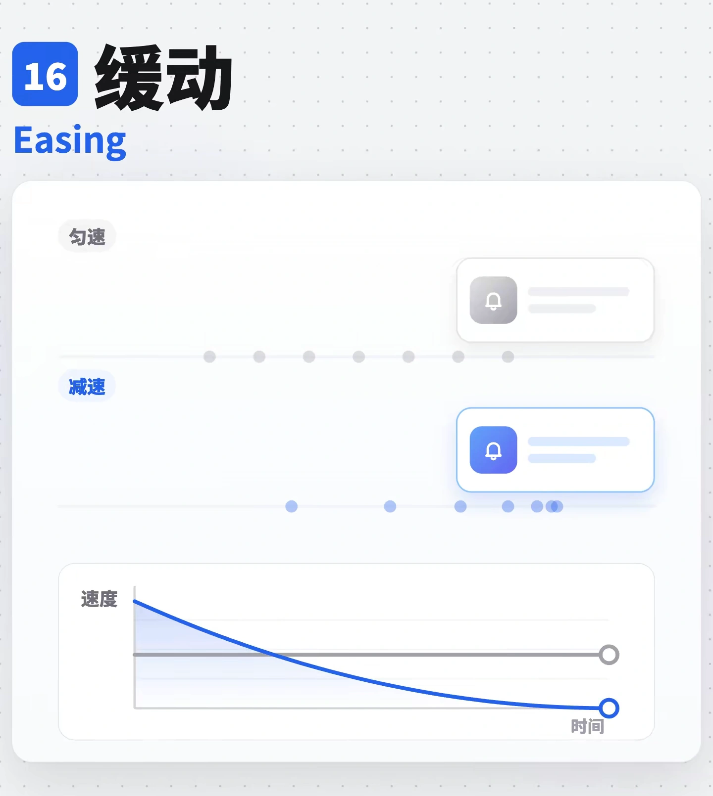

# 011 · 如何选择更合适的动画节奏？ / Easing and Motion Rhythm

在现有代码与设计系统内，按入场、离场、屏内移动、细小反馈和手势释放的角色统一缓动，修正不合适的时长。保留动画对象、触发条件、位移距离和最终状态。

## 效果参考



复用库内已有的 1440×1610 原尺寸参考图，不增加重复媒体。图片用于理解缓动概念，不能证明下方各条曲线的实际速度和手感；需要在项目中连续播放并操作验证。

## 适用与边界

两段提示词连续使用：Prompt (1) 包含盘点、曲线、时长与角色映射；Prompt (2) 接续一致性、减弱动态与交付要求。先读取两段，再执行修改；盘点范围遵循用户本次指定的页面、组件或项目，不因 every、product 自动扩大范围。

本配方的核心是调整时间函数与必要时长。下文的 8–24 px、96% 缩放、约 8 px 模糊和 100–200 ms 内部错峰是选型示例：仅在原动画已有对应属性或用户明确要求新增时采用。不能为统一节奏而新增位移、缩放、模糊、错峰或修改触发条件。减弱动态模式按下文保留必要淡入淡出并去掉位移和缩放。

| 动作角色 | 曲线／方案 | 使用边界 |
|---|---|---|
| 入场 | `--ease-out` | Toast、菜单、浮层、弹窗、抽屉 |
| 点击后的细小归位反馈 | `--ease-out-strong` | 图标、文字、选中胶囊等小部件 |
| 离场 | `--ease-in` | 关闭、收起、移除；通常短于对应入场 |
| 屏内位置或尺寸变化 | `--ease-in-out` | Tab 指示器、排序让位、轮播、侧栏调整；不能改动原位移范围 |
| 小型趣味确认 | `--ease-overshoot` | 约 64 px 以下的小元素，避免大面板与高频重复操作 |
| 拖拽或滑动释放后的归位 | 动画库原生弹簧优先 | 尽量传入释放速度；无原生弹簧才用 `--ease-spring`，不支持 `linear()` 时回退强 ease-out |
| 持续匀速循环 | `linear` | 转圈、跑马灯等；进度显示仍跟随真实数据，不制造虚假进度 |

时长以小型 UI 入场 150–250 ms、离场 120–200 ms，中型 250–350 ms，大型／全屏 350–500 ms 为起点；悬停和按压约 100–150 ms。弹簧／过冲可预留约 1.5 倍收敛时间，实际仍按组件和动画库验证；不能把原生物理弹簧简单当作固定时长的贝塞尔曲线。

已有 motion token 时复用或映射现有命名，避免建立第二套互相冲突的 token。CSS 曲线用于 CSS／WAAPI 时按其语法传入；Framer Motion、GSAP 和手写循环按对应 API 映射，不把 CSS 字符串直接塞进不兼容的参数。

## Prompt (1)

```text
Give the motion in my product the right easing curves, so things arrive, leave and move the way they should feel. Work inside my existing code and design system: keep what each animation does, how far it goes and what triggers it. Change how it moves over time, and its duration where that is off.

0. Start from what exists
- Find every transition and animation: CSS transitions and keyframes, animation libraries (Framer Motion, GSAP, the Web Animations API) and hand-written requestAnimationFrame loops. List each with its component, its trigger, its duration and its curve.
- Flag the ones left on the CSS default `ease`, `linear` on something that moves, and `ease-in` on something that appears.

1. The curves as tokens
Define them once, next to the other motion tokens, and use only these:
- --ease-out: cubic-bezier(0, 0, .58, 1). Anything that enters: toasts, menus, popovers, dialogs, drawers.
- --ease-out-strong: cubic-bezier(.22, 1, .36, 1). Small parts settling in right after a click: an icon, a label, a selected pill. It feels the most responsive.
- --ease-in: cubic-bezier(.42, 0, 1, 1). Anything that leaves, and only that: a toast timing out, a dialog or drawer closing, a menu collapsing, a list item swiped away. It starts slow and leaves at full speed, so on an entrance it feels late and then stops with a bump.
- --ease-in-out: cubic-bezier(.42, 0, .58, 1). Something that stays on screen and only changes place or size: the indicator under tabs or a segmented control, a carousel turning a page, items making room during a reorder, a sidebar resizing, smooth-scrolling to an anchor. Not for coming in: its slow start reads as lag.
- --ease-overshoot: cubic-bezier(.34, 1.56, .64, 1). Runs about 10% past its place and comes back. Small, playful confirmations: a checkbox tick, a like, a badge count popping in, a switch knob settling. Never on a dialog, a drawer or anything larger than about 64px, and not on actions people repeat all day.
- --ease-spring: linear(0, .32, .78, 1.04, 1.09, 1.06, 1.02, 1, .99, .99, 1). Things let go after a drag or a swipe, so they settle like an object: a bottom sheet snapping open or back, a card returning after a half swipe, pull-to-refresh springing back, a reordered item dropping into place. Prefer the animation library's own spring fed with the release velocity; use this token only where there is none, and fall back to --ease-out-strong where linear() is not supported.
- linear: only for things that run rather than move: spinners, progress bars, marquees.
- The CSS default `ease` is not a choice. Replace it wherever a curve was left unset.

2. Durations
- Small UI (toasts, tooltips, menus, checks): 150-250ms in, 120-200ms out. Exits are shorter than entrances.
- Medium (dialogs, popovers with content, drawers): 250-350ms.
- Large or full-screen (sheets, page transitions): 350-500ms. Longer feels slow.
- Springs and overshoots: about 1.5x the plain duration, since the settle takes time.
- Keep the durations as tokens beside the curves (--duration-sm, -md, -lg).

3. Apply them by role
- Entrances: ease-out, coming from where the thing belongs (a toast from the top edge, a menu from its trigger), over a short distance (8-24px), growing from 96% and fading in a little sooner than it moves. A light blur (about 8px) that clears as it lands is a nice touch on toasts.
- Exits: ease-in, the same path reversed, and shorter.
- Moves on screen: ease-in-out.
- Parts inside something that has just appeared (its icon, its text, a count) may follow 100-200ms later on the strong ease-out, so it lands in steps rather than all at once.
- Gestures: while the pointer or finger moves, follow it 1:1 with no easing. On release, finish on the spring, from the release velocity if the library allows.
- Hover and press: 100-150ms ease-out. Never animate layout on hover.
- Animate transform and opacity (filter sparingly), not top, left, width or height, which lay out and repaint every frame.
```

## Prompt (2)

```text
4. Keep it consistent and accessible
- One curve per role across the product. Don't tune each component by hand.
- Respect prefers-reduced-motion: keep the opacity changes, drop movement and scale, and turn springs and overshoots into a plain 150ms fade.
- Never make a user wait on an animation: nothing blocks input, and a new action interrupts the old animation from where it is.

5. Deliver
- First list every animation you found, its current curve and duration, and the role and curve you will give it.
- Then add the tokens, switch each animation over, and list every file you touched.
- Don't change what animates, how far it goes or what triggers it. If an animation has no clear role, ask me first.
```

## 核对

- 修改前列出范围内动画的组件、触发、当前曲线与时长、角色及目标曲线；无明确角色时只暂停该项并询问，继续其他已明确的项。
- 入场、离场、屏内移动和手势释放使用各自角色的 token；`linear()` 的兼容性回退实际生效，原生弹簧保留释放速度。
- 连续开关、反向操作或快速重复点击能从当前状态中断并继续；动画不拦截输入，也不改变真实请求的重复提交保护、禁用条件或完成时机。
- 跟手阶段保持原手势映射；检查释放后归位、取消与反向拖动。侧栏调整等确需影响布局的行为沿用原功能，优先用 transform、FLIP 或合适的布局动画实现，不能仅因性能建议删掉真实尺寸变化。
- 开启减弱动态后去掉位移、缩放、弹簧和过冲，只保留必要的淡入淡出；焦点、键盘、触摸、可读性与真实状态反馈保持可用。
- 交付列出修改文件和实际验证结果；原参考静态图不能作为各曲线已验证的证据。

关联参考：[缓动](../motion.md#easing)、[动效时长与性能](../motion.md#motion-rules)、[弹性](../motion.md#spring)。
