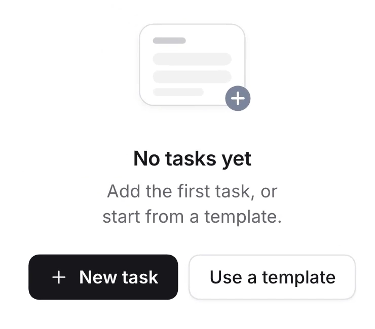
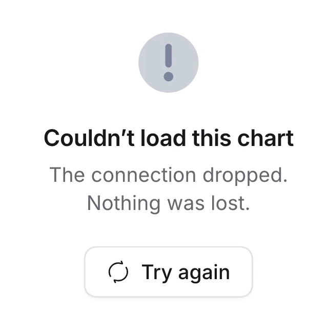
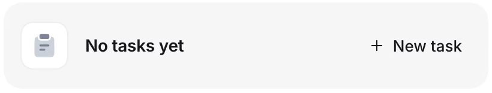

# 022 · 空状态的三种画法 / Empty States

先判断当前区域为什么没有内容，再按可用空间决定结构、文案与下一步。三种画法为当前页面的微缩线框、双色图标和紧凑横排；页面、卡片、列表行与菜单分别适配，不能把所有空内容都做成带插画和主按钮的整页。

在现有产品中盘点：原本显示什么、为什么为空、区域大小、当前呈现、真实可执行动作，以及现有 EmptyState、图标、按钮、骨架、错误组件和主题。先给出诊断表，再实施用户选中的改动；已有明确选择与授权时直接复用，不重复索要 go-ahead。优先扩展已有组件，不为本配方引入新依赖或全面迁移无关页面。

## 为什么为空

| 类型 | 文案与图示 | 操作与保留内容 |
|---|---|---|
| First use · 首次使用 | “暂无任务”与一句开始方式；微缩真实页面线框或代表内容的双色图标 | 一个创建入口，至多再给模板／导入；创建后真实内容原位替换 |
| No results · 无匹配 | 标明查询对象与关键词，说明一种调整办法；小图至多 80×60，或无图 | 保留搜索文本和全部筛选；次要 Clear search／Clear filters，存在时提供扩大搜索范围 |
| All done · 全部处理完 | “已全部处理”与之后会出现什么；图示不使用强调色 | 默认无按钮，不强迫用户继续；仅在确有处理完的依据时这样描述 |
| Failed／Offline · 失败或离线 | 指明哪部分没加载，解释实际原因与恢复方式；双色警示图标 | 仅替换失败区域，保留已加载区域与框架；就地次要 Retry，重试状态真实 |
| No access · 无权限 | 按允许披露的信息解释无法打开的对象；普通线框加锁，无强调色 | 有实际能力时提供 Request access 和返回；真实请求成功后原位显示已发送 |
| None needed · 无需空状态 | 为空就按既有规则收起的可选区域 | 保留既定收起方式；不能为了消除空白把错误、加载或必需入口藏掉 |

空数组不自动等于首次使用或全部处理完：先看请求是否成功、当前筛选、权限、历史与业务语义。加载、失败、无权限和空结果分别呈现；真实数字 0、零值图表和有效的部分数据仍是内容，不误判为无数据。

## 按空间选尺寸

| 尺寸 | 默认结构与尺寸 | 适用范围 |
|---|---|---|
| Page／大面板 | 图示、标题、说明、最多两个动作；组中心位于区域高度约 40% | 整页或大内容区；上下文标题、Tab、搜索、筛选和边框保留 |
| Card | 40×40 底座内 22px 图标、标题、行尾 Ghost 动作；默认不放说明 | Dashboard 卡片与侧栏；不与页面主按钮竞争 |
| Row | 原列表行高，一行状态文字，可有行尾链接／Ghost | 一组邀请等局部空内容 |
| Menu | 一行状态文字，无图、无按钮 | 搜索建议、选择器和操作列表无匹配项 |

图标版与线框版是图示选择，迷你版是紧凑布局；“为空的原因”与尺寸独立。大图表所在面板可能适合 Page 结构，小卡片失败则用紧凑结构；需要说明的错误不能因 Card 默认省略描述而失去恢复信息。窄屏和长翻译允许换行，不强行固定单行或裁断操作。

## 文案、图片与动效起点

- **结构与语言**：图示 → 标题 → 必要说明 → 动作。标题沿用产品偏好的状态式或行动式，避免责怪与无意义感叹；需要用户理解的状态不只写“无数据”。说明用一句话解释原因、已知保障或直接办法，复杂恢复最多列约三步；新字符串随现有国际化处理。
- **动作权重**：每个区域最多一个主动作和一个替代入口作为起点；首次使用和有能力的申请权限可用 Primary，无匹配和 Retry 按类型用 Secondary，紧凑区域用 Ghost／链接。类型规则优先于“整页一律主按钮”，全部处理完与菜单仍可没有动作。
- **图标**：页级约 48px，卡内约 22px；复用项目图标或自含 SVG，双色来自 currentColor／主题 token，不自动增加图标依赖。图示是装饰，标题、说明和动作是可访问的真实文字；有悬停小动效时仅在对应交互期间运行，并遵守减弱动态。
- **克制配色**：沿用现有 token，可从浅色 `#7a869d`、深色 `#9aa4b8` 的静灰起步；图标主体约为同色 38% 叠在背景上。强调色主要留给真实动作，图示至多一个能引导下一步的强调点；无行动或权限不由本人决定时不加强调色。
- **线框**：默认 viewBox 120×90、对象 2–3 个、周围至少约 14 留白；使用真实页面结构，文字简化为圆头条，正文高 4、标题高 5。表面卡片圆角约 10–11、1px 边框，影子约 0 2px 3px／6%；slot／正文条／标题条透明度约 14%／28%／52%，线图标约 1.5。自含 inline SVG 读取主题变量，不依赖外部图片或外部引用；重复实例的 ID 唯一，阴影按提示词采用模糊与偏移组合或已有方案。
- **过渡**：入场约 300ms 淡入并上移 6px，内容到达时约 180ms 淡出；减弱动态只淡化或立即替换。动画只表现真实状态，不能延迟创建、请求结果或重新操作，不在紧凑菜单中机械套用大幅出现效果。

参数为设计起点，复用产品当前间距、圆角、字体和按钮层级。装饰条和图标可淡，但状态文字、链接、焦点与按钮仍需满足项目可读性和对比要求。

## 清晰效果参考

三张 WebP 从 2160×2880 视频直接解码，原像素裁切、质量 98，不放大、不锐化、不涂抹、不跨帧修补。每种画法只保留一张，合计约 48 KiB，替换旧同类两图；讲解面板、教学标注、指针和署名不在图中。

### 线框版 · 740×650



展示完整图示、标题、说明和两个按钮的局部，不代表整页比例或 40% 的定位。线框中的淡灰占位属于设计，标题与操作文字保持清晰。

### 图标版 · 640×615



保留警示图标、文案与完整 Retry 入口；外围图表框架未包含。图中“没有丢失内容”只是示例，只有代码与真实状态支持时才可使用。

### 迷你版 · 820×155



展示紧凑结构与动作权重；列表行与菜单的无图纯文字方案以本文说明为准，不重复增加相近截图。静态图不能证明创建、重试、布局替换、权限请求或读屏行为。

## 应用边界

下方保留整理后的完整提示词，图标推荐段落改用项目现有资源。应用时按本节解释演示中的简化：

- **状态来自真实数据**：保留既有 loading／error／data 逻辑与缓存；成功的空查询才进入无结果或业务空态，不能靠 `!data?.length` 把未加载、网络失败和权限拒绝当成没内容。已有内容刷新失败时优先保留旧内容并说明局部失败，不无条件整块清空；超时终态服从实际请求规则，不为了避免 spinner 自动判错。
- **文案只说已知事实**：“内容未丢失”“网络已断开”“恢复后会同步”和具体责任人均需证据；没有离线队列就不能承诺自动同步，未知失败用诚实的通用解释。错误消息映射为可理解且可翻译的文字，详情和日志按产品现有权限处理，不暴露 token、个人数据或堆栈；404、无权限与普通业务空态不互换。
- **权限与申请**：无权查看时不通过标题、owner 或线框泄露受保护名称、成员、真实内容或布局细节；仅画通用占位。Request access 必须对应已有真实流程，不在演示中假装发出申请；本配方不自动授权发送。真正成功才显示 Request sent，重复、待审核、失败和无申请能力都有合理状态；返回沿用既有安全导航。
- **操作与输入保持**：Clear search 只清搜索，Clear filters 按明确范围清条件，扩大搜索不偷偷改租户或权限；保留焦点与可复原的上下文。创建、导入、模板、邀请与重试调用现有能力，成功后更新真实数据；不能因切换空态清草稿、重置筛选或重复提交。快速输入和并发重试时旧响应不得覆盖当前查询，按当前产品请求机制处理。
- **空间与组件**：复用／扩展已有 EmptyState，按 Page／Card／Row／Menu 变体输出；只迁移用户选中的位置。容器允许正常内容增长，约 40% 的位置在短屏／软键盘下退回正常流，不能遮挡动作。没有“绝对零布局变化”的保证，保持外壳、图片比例与合理最小高度，清理占位后不留大空洞。Card 等紧凑变体可在附近或可达详情中承载必要错误恢复信息。
- **无结果与无动作**：完成态默认无按钮，但不能移除用户仍需的查看历史／撤销等既有入口；可选区域确需隐藏时保留可发现性与焦点去向。菜单提示不是可选择的数据项，也不将含动作的组件塞入 option；真实语义由原菜单／Combobox 实现负责，搜索状态可放在独立公告区。
- **可访问性与性能**：标题层级与区域名称沿用当前页，装饰图退出读屏和 Tab；无结果在本次查询确定后 polite 公告，避免每次键入重复播整段，必要时使用现有防抖。通常保留搜索／Retry 焦点，新页面依既有路由焦点管理处理，不默认抢到主按钮；原聚焦元素被删除时给出合理去向。浅深主题、200% 字号、窄屏和触控下文字及动作可见，SVG 变量、唯一 ID 与阴影不形成光晕；静态图示不新增持续动画循环。

## 诊断表与交付

按类型分组，每个实际位置一行，正确项和无需空态项也记录：

| 位置／正常内容 | 当前空时呈现 | 原因与状态依据 | 类型／尺寸 | 图示及选择理由 | 标题、说明与动作 | 改动范围与待确认项 |
|---|---|---|---|---|---|---|
| 按实际产品填写 | 当前文案、占位或空白 | 请求、筛选、权限与历史 | 五种类型或无需；Page／Card／Row／Menu | 线框／图标／无图 | 写出具体产品文案 | 只实施选中项 |

列出需要复用或扩展的组件、尺寸变体、图标与骨架转失败模式。默认沿用当前栈与图标，不因附件的平台示例安装新库。

## 完整实现提示词

```text
Review every place in my product that can be empty, and decide for each one what kind of empty it is, how big it should be, and what it should say and show. Then, if I want it, change the ones I approve. This is about judgment first: diagnose and recommend, and change only what I approve.

This is a change to my product, not a demo. Work inside my code, on my stack, with my components, tokens, icons and copy style. Do not add a dependency or a new visual pattern without asking. Every value below is a default to start from.

0. Read the product first
- Find every place that can show nothing: lists and tables, boards and calendars, inboxes and notifications, search and filter results, dashboards and chart cards, folders and uploads, comments and activity, members and invites, trash and archives, menus and pickers with no options, pages that can fail to load, and pages a person may not be allowed to open.
- For each one, note: what normally fills it; why it can be empty (nothing made yet, a search or filter, everything handled, a failed load, no permission, offline); how big the empty area is (a page, a card, one row of a list, a line in a menu); and what it shows today (nothing at all, a bare "No data", a stock illustration or emoji, a spinner that never ends).
- Find the shared pieces: an EmptyState component if there is one, the icon set and whether it has a two-tone or filled style, the button styles, the skeleton and error components, and how light and dark mode are switched.
- Tell me in a few lines what you found before going on.

1. The kinds of empty
a. First use: nothing has been made yet (a new project, a new account, a first folder).
  - Show what will be here: a wireframe of this very screen, filled in, in miniature (see 4), or a two-tone icon of what lives here.
  - Title: the state in a few words (No tasks yet). Description: how to start, in one sentence.
  - Buttons: one main action that makes the first thing (New task), and at most one other way in (Use a template, Import).
  - When the first thing is made, it takes the empty state's place at once; nothing else on the page moves.
b. No results: a search or filter found nothing. The product is not empty, so never say it is.
  - Keep the search text and every active filter in view, exactly as the person left them.
  - The title names what was searched (No tasks match "invoice q3"). The description offers one fix (check the spelling, search every project).
  - Buttons: Clear search or Clear filters, as a secondary button; and, when it exists, a wider search as a ghost button.
  - The picture is small (80 × 60 at most), or there is none.
  - In a search menu or a picker, it is one grey line with no picture (No tasks match "invo"), updated as the person types.
c. All done: everything was handled (an inbox cleared, a queue emptied, no notifications, an empty trash).
  - Say so plainly (You're all caught up), and in the description what will show up here next.
  - No button, and no accent colour in the picture: there is nothing to do.
d. Failed: the content could not be loaded.
  - Show it only where the failure is: the one card, list or panel that did not load, never the whole page when the rest of it loaded.
  - While loading, that area shows a skeleton in its own shape (the real rows, the real chart's columns); when the load fails, the skeleton gives way to the empty state in the same place, at the same size.
  - The picture is a two-tone alert icon, not a wireframe. Title: what did not load (Couldn't load this chart). Description: what happened and what is safe (The connection dropped. Nothing was lost.).
  - Button: Try again, as a secondary button whose own reload icon turns while it retries; on success the content comes in where the empty state was.
  - Offline is this kind too: say the work will sync when the connection is back, and offer Try again.
e. No access: the person opened something they may not see.
  - The picture: a wireframe of what is behind the door, with a lock, and no accent colour: getting in is the owner's call.
  - Title: what they cannot open, by name. Description: who owns it and how to get in.
  - Buttons: Request access as the main action, and a ghost button back to where they were.
  - After a request, the button turns in place into Request sent, with a check, and the description says what happens next. Nothing else moves.
f. Places that need no empty state: an area that simply closes or hides when empty (a notification tray that closes, a section that is left out). Say which ones these are, and leave them.

2. Sizes
a. Page: the empty state fills a page or a large panel. Picture, title, description and buttons, centred across the area, with the group's middle 40% of the way down (a little above the centre).
b. Card: a card on a dashboard or a sidebar panel. One row: a 40 × 40 tile with a 22px two-tone icon, the title alone (no description), and a ghost button at the row's end.
c. Row: one part of a list is empty (no pending invites under the members). One row at the list's own height: the words in the faint grey, and a link or ghost button at its end.
d. Menu: a menu, a picker or a search's suggestions. One line in the faint grey, no picture, no button.
Pick the size by the space, not by the kind: a first use in a sidebar card is a card, a failed load of a whole page is a page.

3. Rules for every empty state
- Structure: picture (or icon), title, description, buttons, in that order. Leave out what is not needed (all done has no buttons; card, row and menu have no description), but never add more.
- Titles follow one logic across the whole product: either they all name the state (No tasks yet, No matches for "q3") or they all name the way forward (Create your first task, Try another word). Pick the one the product already leans to and use it everywhere. Never an apology (no "Oops", no "Uh-oh"), and never blame the person.
- Description, when there is room: one of three things. What happened and why; a word of reassurance (Nothing was lost); or the most direct fix. A fix that takes steps may be a short numbered list of up to three steps. Card, row and menu sizes have no description.
- Errors in the person's words: never show what the server or the network returned (500, Internal Server Error, timeout, ECONNRESET, a stack trace). Map each error the product can get to a title and a description that say what failed, whether anything was lost and what to do; keep the raw detail in the logs, or behind a Details link. Translate these strings with the rest of the product.
- Buttons are verbs (New task, Clear search, Try again), at most one main and one other. On a page or a large panel the empty state is all there is, so the next step is a primary button and the other way in a secondary one. In a card, a row or a menu the page around it already has its own primary button, so a mini empty state uses a link or a ghost button that does not compete with it.
- Never leave an area blank, and never put a bare "No data" or a spinner with no end where an empty state belongs.
- Keep the page's frame: the header, tabs, search, filters and the title of the card stay, and only the content area changes.
- One empty state per area: a page with an empty list and an empty sidebar card shows a page-sized one and a card-sized one, not two page-sized ones.
- Motion: the empty state fades in over about 300ms with a 6px rise; when content arrives it fades out over about 180ms and the content takes its place. Under reduced motion, no rise, only the fade.
- Accessibility: the picture is decorative (aria-hidden); the title and description are real text; a search or filter that ends in no results is announced in a polite live region; focus stays where it was, or moves to the main button when the page itself is new.

4. The picture
a. Two styles, both drawn from my product. Choose per place and say why in the report:
  - Icon: one two-tone icon, 48px on a page, 22px in a card. Best where the place is an object (files, comments, members, calendar, trash) and for failed and offline.
  - Wireframe: a small, plain copy of this very screen, filled in. Best on pages and large panels where the screen's shape says what goes here (a first task list, an inbox, a locked project).
  - Never a stock illustration, a person, a mascot or an emoji.
b. Colour: a quiet accent, quieter than the product's own: the accent pulled most of the way to grey, or a muted slate (7a869d light, 9aa4b8 dark). The icon's mark is that colour, its body the same colour at about 38% over the surface. The product's real accent stays for the real buttons.
c. Icons: use my icon set's two-tone or filled style when it has one. If it has none, adapt an existing icon or draw a small self-contained SVG in the product's style, using currentColor and theme tokens. Do not add an icon dependency without asking. If the chosen icon has a hover animation, play it only while the pointer is over the icon, never on its own, and respect reduced motion.
d. The wireframe (defaults; use my tokens for the same roles):
  - viewBox 0 0 120 90 on a page; 80 × 60 for no results. No base, no background, no hatching: it sits on the page.
  - One scene, 2 or 3 objects, centred, with at least 14 clear on every side.
  - Objects are cards in the surface colour, corner 10 to 11, a 1px border in the line colour, and a soft shadow (0 2px 3px at 6%).
  - Words become placeholder bars with round ends: body 4 high, titles 5 high. Empty places are slots. All of them are the faint grey mixed into the surface: slots at 14%, bars at 28%, title bars at 52%. Line icons in the faint grey, 1.5 wide.
  - At most one accent element, and only for the next step the person can take here (add, upload, retry): a small round button in the quiet accent with a white mark. No next step, or not the person's call: no accent.
  - Draw it as one self-contained inline SVG: colours as CSS variables of my tokens so it follows light and dark mode, no external resources, no <image> or <use>, every id with its own prefix, shadows built from feGaussianBlur and feOffset (or a CSS drop-shadow) rather than feDropShadow.
e. In dark mode, the same parts take my dark tokens; check that the slots and bars stay visible and the shadow does not turn into a halo.

5. Report before changing anything
Give me a table first, and do not change code yet. One row per place:
- Where: the screen or component, and what normally fills it.
- Now: what it shows when empty.
- Kind and size: first use, no results, all done, failed, no access, or none needed; and page, card, row or menu.
- Picture: icon (which one) or wireframe (of what), or none.
- Copy: the title, the description and the button labels you propose.
Group the rows by kind. Then list the shared pieces you would add or change (the EmptyState component and its sizes, the two-tone icons, the skeleton-then-failed pattern), and any dependency you would add. Wait for me to choose what to change.

6. Change what I approve
- Build one EmptyState component with the sizes in 2 (page, card, row, menu) and props for the picture, title, description and up to two actions; use it everywhere instead of one-off markup.
- Keep each place's existing loading, error and data logic; only what is shown when empty changes.
- Write the copy in the product's own voice and languages; translate the new strings where the product is translated.

7. How to build it, by platform
These are suggestions; check them against my stack and its versions, and prefer what the product already uses.
- Web: a React (or Vue, Svelte) EmptyState component with a size prop; the picture as an inline SVG component that reads CSS variables; with React Query or SWR, decide the kind from the query's state (isError, an empty array, an active search); announce no results with aria-live="polite". Use the existing icon component or a self-contained inline SVG with theme tokens for both tones.
- iOS: ContentUnavailableView for page-sized states (its search variant for no results), with a custom label for the picture; for card and row sizes, a small HStack view. SF Symbols in hierarchical rendering give a two-tone icon.
- Android: a composable EmptyState(size, picture, title, description, actions) in Compose, driven by the screen's UI state; the picture as an ImageVector or a drawn Canvas in theme colours.
- Flutter: one EmptyState widget with a size enum; the picture with CustomPaint or flutter_svg in theme colours.
- Rust and other native desktops (egui, iced, GPUI, Tauri): the same component in the UI model, its picture drawn from the theme's colours.

8. Check
- Open every place in each kind: new account, a search for nonsense, everything cleared, the network off (and a slow network, to see the skeleton before the failure), and a link to something without access.
- Nothing is blank, nothing says only "No data", no spinner runs forever, and the search text and filters survive no results.
- Making the first item, clearing a search, a successful retry and a sent request each change the area in place, with nothing else on the page moving.
- Light and dark, a narrow phone width, long translated strings, a screen reader on the no-results announcement, reduced motion; existing tests still pass.
```

## 实施后核对

- 新账号、已有数据但搜索无匹配、筛选无结果、全部处理完、局部加载失败、离线、无权限与无需空态分别验证，不能互相误报。
- 保留标题、Tab、表头、筛选、输入、缓存和有效的零值；创建首项、清条件、重试成功和真实请求成功后原位更新。
- 无无限骨架／spinner，无裸“无数据”，无无能力的动作；失败只影响对应区域，说明和保障真实。
- 快速搜索、连续重试、保存失败、失效权限、待审核与路由返回正确，旧响应不覆盖当前状态。
- 核对 Page／Card／Row／Menu、长翻译、200% 字号、短屏、手机、浅深主题、键盘、读屏与减弱动态。
- 报告所改文件、真实操作验证与尚未验证部分，静态截图不当作业务或连续行为通过的证据。

关联配方：[017 等待状态](loading-states.md)、[016 消息反馈](toast-vs-notification.md)、[020 选择控件](control-selection.md)。相关组件：[空状态](../loading-errors.md#empty-state)、[错误页](../loading-errors.md#error-page)、[断网提示](../loading-errors.md#offline)、[没有权限](../loading-errors.md#no-permission)。
