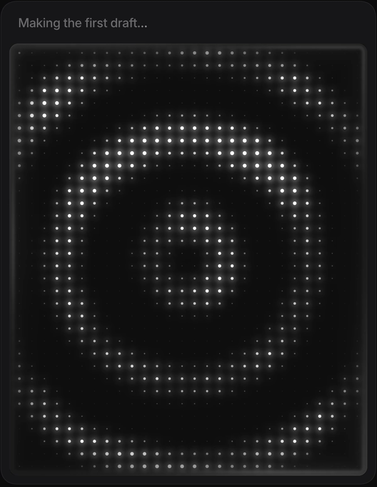
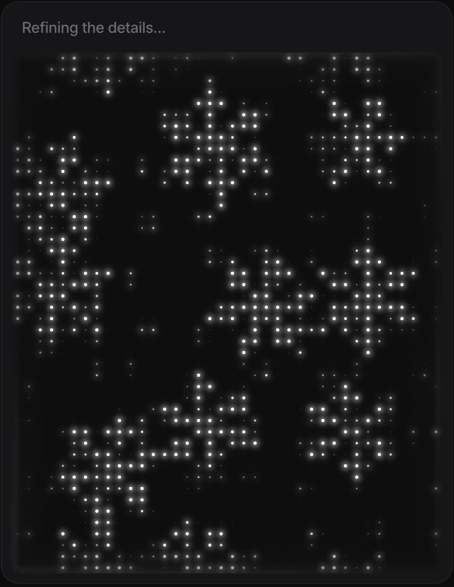
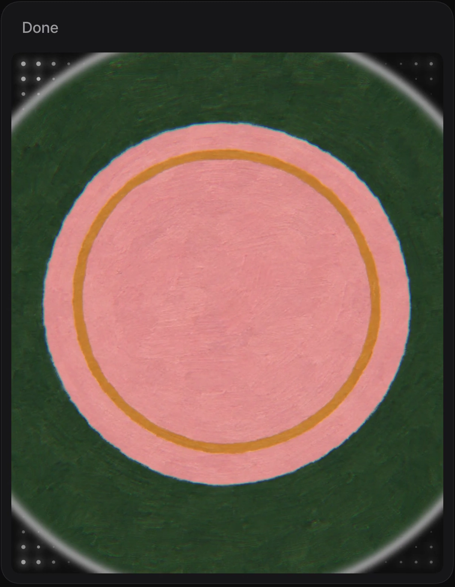
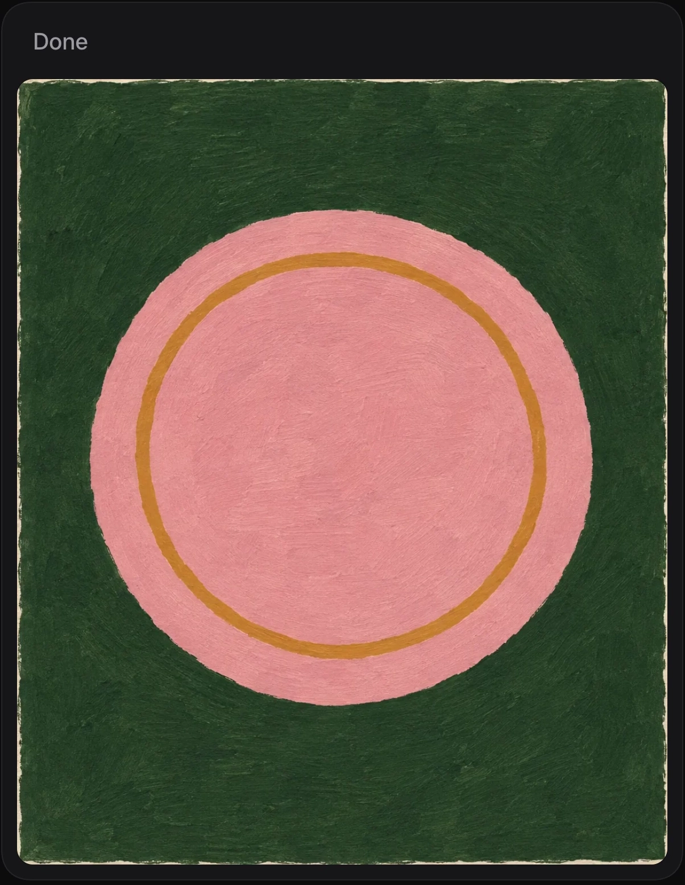

# 024 · 程序化生成点阵与图片入场 / Generated Image Reveal

为现有产品的图片生成区域提供真实等待反馈：中性点阵在图片框内呼吸，最终图像解码可用后再通过所选遮罩入场，逐渐归于清晰、无扭曲的原图。九种等待模式可与九种入场任意搭配；玻璃边缘采样、色散和冲击波只作用于该图片区域。

先查生成请求、最终与部分结果的来源、图片组件、渲染方式、已有参数控件、主题与减弱动态，再选目标位置、模式组合和面板可见范围。默认候选为 fBm breath + Halftone grow，参数面板仅开发环境显示；不是自动改造所有图片的授权。已有明确位置、选择和实施授权时沿用，不重复逐项询问或索要 go-ahead。普通图片占位见 [Blur-up](../loading-errors.md#blur-up)，等待策略见 [017 配方](loading-states.md)。

## 九种模式与入场选型

| 等待模式 | 识别特征 | 推荐入场 | 入场特征 |
|---|---|---|---|
| Ripple | 从中心扩散的同心环，与噪声混合 | Fisheye lens | 中央圆形揭开、鱼眼鼓起，边缘后方衰减波 |
| fBm breath | 连贯噪声场中的点阵缓慢明暗呼吸 | Halftone grow | 点逐渐带上图片颜色、膨大，再转为完整清晰图片 |
| Double helix | 两条转动的正弦链与间隔横档 | Unzip | 从中线向上下揭开，前沿随链条摆动后变直 |
| Static grain | 各点独立平滑随机变化，无闪烁 | Denoise | 从柔和图块与颗粒逐步去噪、清晰 |
| Spiral arms | 三条旋转螺旋臂 | Spiral wipe | 从中心向外的单臂螺旋揭开 |
| Domain warp | 被噪声扭曲并单向漂移的烟流 | Noise dissolve | 固定的平滑噪声阈值渐次溶解 |
| Sine plasma | 四组正弦叠加的明暗干涉 | Interference wipe | 对移动的干涉阈值图逐步揭开 |
| Light band | 斜向扫过的柔和亮带 | Top-down stream | 从上到下，前沿粗像素逐渐变成完成行 |
| Snowflakes | 六臂雪花、分叉与较细背景雪点 | Cell bloom | Voronoi 种子分时长出圆形区域 |

Halftone grow、Denoise、Cell bloom 可带一次冲击波；其余模式不自动附加。任意配对保留同一状态生命周期，Halftone、Dissolve、Denoise、Cell bloom 适配范围较广。只有用户选择做模式浏览器时，才显示模式 Tab、入场行与 S 曲线连线；这套展示界面不自动成为生产图片组件。

## 状态与参数起点

| 部分 | 默认起点 | 约束 |
|---|---|---|
| 快速完成 | 请求开始后约 300ms 内可用时跳过点阵、短淡入 | 以解码成功可显示为依据；不为播放等待动画扣住结果 |
| 点阵入场 | 约 500ms 淡入；pitch=20px，radius=.55px→pitch×15%，opacity=.1→1 | 图片框保持真实比例与布局，点值按格计算 |
| 状态文字 | 20px；96px 高亮窗约 1.7s 扫过 | 使用真实阶段与产品语言，不按 1.3s 计时伪造“细化中” |
| 图片入场 | 1400ms，cubic-bezier(.16,1,.3,1) | `R` 为缓动后进度，decode 成功后开始；各模式预设可覆盖时长 |
| 缩放与清晰 | 图片 scale=1+.10×(1−R)，默认 mip bias=3×(1−R)^.8 | 图片框不缩放；Halftone 与 Denoise 使用自身清晰过程 |
| 边缘采样 | 外缘 26px、前沿内约 20px；bend=6px | 仅移动图片采样，不移动容器边界；前沿扭曲在 R>.85 衰减 |
| 色散 | 默认 30%；红沿位移更远、蓝更近 | 仅在有采样位移处出现，不画彩色描边；终态归零 |
| 光效 | Dark 才用点晕与双层边缘光；Light 无加载光晕 | 点晕跨九格取样；2.4／3.7s 呼吸、8／11s 反向弧光 |
| 冲击波 | 半对角线×1.25 的半径终点、×.12 环宽 | 只作用于已经揭开的图片，弱四色情况与曲线见完整提示词 |
| 完成／失败 | 完成后静态原图；失败停止呼吸、显示原因及真实 Retry | 不丢草稿、原图、任务入口或部分结果 |

四层 fBm 默认 scale=180px，空间频率逐层翻倍、振幅减半，时间项约 t×.32。呼吸时钟按速度逐帧积分，调速不跳相位；固定噪声图与随机种子按任务／图片实例保持稳定。图片框示例 600×772、内圆角 14、卡片圆角 28，实际沿用当前比例与圆角体系。

## 参数面板

| 参数 | 默认值 | 范围 |
|---|---|---|
| Breathing | 100% | 0–300% |
| Reveal time | 1400ms | 400–3000ms |
| Dot pitch | 20px | 12–36px |
| Dot size | 15% | 5–30% |
| Noise scale | 180px | 80–360px |
| Zoom in | 10% | 0–30% |
| Blur in | 50% | 0–100% |
| Dispersion | 30% | 0–100% |
| Edge bend | 6px | 0–20px |
| Edge glow | 30% | 0–100%；仅深色 |
| Dot glow | 40% | 0–100%；仅深色 |
| Theme | Auto | Auto／Dark／Light |

| 模式 | 覆盖基础默认值 |
|---|---|
| fBm breath | reveal 1600ms、zoom 8%、blur 30%、bend 8px |
| Domain warp | scale 220px、breathing 120%、reveal 1600ms、blur 70% |
| Snowflakes | pitch 15px、dot 14%、reveal 1800ms、dispersion 35%、bend 8px |
| Ripple | breathing 90%、reveal 1600ms、zoom 6%、dispersion 35% |
| Light band | breathing 110%、reveal 1300ms、zoom 8%、bend 8px |
| Sine plasma | scale 200px、reveal 1600ms |
| Double helix | pitch 18px、breathing 110%、dispersion 25% |
| Static grain | pitch 16px、dot 13%、reveal 1800ms、zoom 12%、blur 30%、dispersion 25%、bend 8px |
| Spiral arms | breathing 120%、reveal 1500ms、dispersion 35% |

每模式独立保存数值，Tab 只切当前面板；Reset 恢复该模式的完整预设，改过才出现。双击行恢复默认可作为捷径，同时提供键盘／触摸可用的重置入口。滑块与数值输入带名称、单位、范围并即时更新视觉，不重新请求生成图片、不因预览调参产生付费调用。Blur in 50% 可映射为普通入场 3 级 mip 软化；映射需显式定义，0% 不模糊，不机械叠加 Halftone／Denoise 自带的软化。

## 清晰效果参考

四张 WebP 从 2160×2880 视频直接解码，原像素裁切为 1205×1555，质量 98，无放大、锐化、涂抹或跨帧拼接。仅保留两种点阵结构、一个入场过程与同一画面的完成态；不含模式选择器、参数面板、演示公式、署名或光标。图中状态文字是产品 UI 的示例，真实阶段需由数据驱动。

### Ripple 等待



### Snowflakes 等待



两图用于辨认环形与雪花的形态差别；柔和点晕为效果，不代表低清放大。其他七种等待模式只有公式与文字说明，不借用这两图证明其外观。

### Fisheye 入场过程



### 清晰完成态



过程中的扭曲、软化和细微色边是动效；完成态用于对照细节。静态图不能证明解码时机、完整路径、九种入场、取消或帧率。

## 实施边界与公式解释

- **真实生命周期**：复用当前请求、任务 ID 与结果解析，区分请求返回、生成完成、图片下载、解码和纹理就绪；保留已有真实流式／部分图展示。仅最终图可用时播放最终入场，不能把 timer 或网络头到达当完成。没有后端阶段遥测时使用通用“正在生成”，不在固定 1.3s 后谎称进入细化；不以动画假造百分比。失败、取消、超时、解码失败、图片撤换与快速重试及时终止旧实例，旧结果不能覆盖新任务。
- **到达与批量**：decode／等价操作失败有恢复入口，沿用实际鉴权、CORS 与图片读取机制，不擅自绕过资源访问限制。Blob／临时资源在安全时机释放；静态图片与渲染纹理采用相同裁切、尺寸、方向和颜色。批量的非均匀延迟只作为选定的视觉错峰，不拖延真实结果、下载／操作入口或让完成项继续声称生成中；每项独立失败与重试，保持稳定 ID、比例与滚动位置。
- **掩码与终态**：每种遮罩都明确 R=0 完全遮住、R=1 完全显示且去掉扭曲／噪点／前沿。Fisheye 初始前沿可能为负，先处理未开始、零半径和中心除零；螺旋角度接缝、噪声阈值上下界与 Cell bloom 的最慢单元需收尾。Halftone 的圆长到半 pitch 只在轴线上相切，格角仍有空洞；需继续覆盖至格角或交叉淡化为整图，不能把“相切”当完全覆盖。干涉的四个正弦和先按实际范围归一化，再与 0–1 的阈值比较。
- **像素、噪声与采样**：点中心、图像 UV、布局 CSS px 与设备像素分开，圆角距离、模糊与前沿宽度按同一单位。小纹理存每点数值，随机变化平滑插值；Spiral 中心与雪花角折叠、边界循环无闪跳，小尺寸雪花至少约四点臂长，容不下时降低复杂度。Top-down 的 2→16px 粗化按相对前沿距离计算，完成区回到连续清晰图像；最终输出不残留像素化。
- **玻璃与冲击波**：仅重采样可读取的图片纹理；位移、纹理边界、圆角裁切及预乘 alpha 一致，零 bend／dispersion 时无残留色边。冲击波只在已揭开的 image mask 内染色／加光，不能点亮等待点阵；前沿白线与四彩淡光分开。Halftone／Denoise 特有模糊不重复叠加公共 bias；按纹理尺寸、可用 mip 层与缩放钳制采样等级。无可用 GPU 采样时保留二维点阵与普通淡入／遮罩，明确高级扭曲和色散未启用。
- **主题与性能**：默认深浅配色在提示词中保留，实际按产品 token；中性点阵、浅色无 glow，Auto 服从已有主题。WebGL 2 两遍与共享调度是候选，不能假定所有平台等价支持或中档手机必达 60fps。共享 canvas 需正确处理各框可见矩形、滚动、DPR、裁切、重叠与页面层级，不能遮住真实控件。更新只限运行且可见的区域；完成后停调度，使用保留的静态帧或真实图片承接，context loss／恢复或尺寸变化时可重画，而不是持续空转。释放纹理与监听，不仅停动画标志。
- **减弱动态与操作**：关闭呼吸、扫光、zoom、bend、dispersion 与冲击波，静态点阵后约 200ms 淡入或立即呈现；运行时变化同样生效。图像有真实 alt，DOM 状态按阶段适度公告，不每帧／每点播报；参数面板不抢焦点。Retry 与取消按实际业务能力提供，隐藏画面不等于取消任务，不能为视觉等待锁住页面或改用户选定功能。

## 完整实现提示词

```text
Build the wait and the arrival for generated images in my product. While an image is being made, its box shows a grid of dots that breathe in one of nine loading patterns, under a status line with a moving sheen. When the image is ready it comes in through the dots in one of nine reveals, enlarged and soft at first and settling sharp, its edges bending like glass, with a colour split where the picture bends; three of the reveals also send a shockwave across it. Any pattern can be paired with any reveal. A settings panel shows the key numbers as sliders, set to the defaults below, so they can be tuned live.

Every value here comes from a working demo and is a default, not a requirement. Build it with these values first, then let me tune them with the panel (section 9).

Before building, look at my project (section 0) and ask me these, one at a time, with the recommended answer marked: 1. Where it goes: every place a generated image appears (recommended; list them), or the ones I name. 2. Which pattern and reveal: one pair everywhere (recommended: fBm breath with Halftone grow, or let me pick from section 3 and 5), a pair per place, or a different pair for each new image. 3. The settings panel: only in development (recommended), behind a toggle, or for everyone. Then sum up my answers, say how you will build it on my platform (section 10), and wait for my go-ahead.

0. Start from what exists
- Find how images are generated and shown: where a request starts, where the result arrives (URL, blob, base64 or stream), whether progress or a partial image is reported, and the component that draws the image box.
- Find how the project draws (DOM, canvas, WebGL, a native view tree), its framework and versions, its slider components, its dark mode and its reduced-motion setting.
- Tell me in a few lines what you found before asking.

1. Timing
- The pass: the dots fade in over 500ms; the status line reads "Making the first draft…", then "Refining the details…" after 1.3s, and "Done" once the image is decoded and starts to come in. Use my product's own wording and language if it has some.
- The reveal starts when the image is decoded (await image.decode() or its equivalent), never on the network response alone. It runs 1400ms with cubic-bezier(0.16, 1, 0.3, 1): fast in, a long settle. Call its progress R, 0 to 1, eased.
- If the image is ready within 300ms of the request, skip the dots and just fade it in, or the loading state flashes. If the request fails, stop the dots where they are, say what happened and offer a retry.
- Several images at once (a batch or a grid): each comes in after its own delay, picked unevenly, for example 0, 560, 220, 820, 380, 1040, 120, 700, 300ms across a 3 x 3 grid, so they arrive at uneven moments rather than together or as a sweep.

2. The box and the dots
- The image box has the image's own proportions and rounded corners (14px in a 600 x 772 card, the card 28px, concentric). Above it sits the status line, 20px type, in a dim ink; a 96px window of full ink, soft at both ends, crosses the text every 1.7s. Move the window and a copy of the text inside it in opposite directions as transforms, so the text never repaints.
- Dots on a square grid, pitch 20px, centred in the box. Each dot's value v (0 to 1) comes from its loading pattern (section 3), worked out once per dot, not per pixel. The dot's radius goes from 0.55px to 15% of the pitch with v, its opacity from 0.1 to 1. A vignette dims the dots near the box's edge: 0.45 + 0.55 * smoothstep(8, 72, distance to the edge).
- Dot glow (dark theme only): a soft halo round each lit dot, a Gaussian of sigma 0.3 * pitch, strength v^2, summed over the dot's own cell and its eight neighbours so halos cross cells without a seam.
- Edge glow while loading (dark theme only), in two layers set apart so they never swell together. Outer: a wide haze (exp(-d / 12)) and a thin line on the rim (exp(-d / 2.5)), d the distance in from the box's edge, breathing every 2.4s, with two brighter arcs turning clockwise once in 8s. Inner: a soft band about 6px in (a Gaussian 3.5px wide) plus a faint wide haze, breathing every 3.7s from the opposite point of its swell, with three arcs turning anticlockwise once in 11s. Both fade out over the first third of the reveal.
- Light theme: dark dots on a pale box, no glows, a softer rim on the reveals.

3. The nine loading patterns All take p, the dot's centre in px, and t, the breathing clock in seconds (scaled by the Breathing slider, so changing speed never jumps). n is value noise in fBm: four octaves, each at twice the frequency and half the amplitude, read at p / scale (scale 180px) and t * 0.32.
- Ripple: rings from the centre, w = 0.5 + 0.5 * sin(r * 5.2 * PI / 2
- 2.6t), r = |p
- centre| / scale; v = smoothstep(0.15, 0.85, mix(n, w, 0.6) * (0.55 + 0.6n)).
- fBm breath: v = smoothstep(0.28, 0.74, n). The base the others build on.
- Double helix: two strands lying across the box and turning, y = ±72 * sin(x / 44
- 1.8t) (in units of the box's height / 306), each a Gaussian 10 wide, the nearer one brighter (by cos of the phase), with base pairs on every second column between them.
- Static grain: each dot eases from one random level to the next about 2.5 times a second, on its own offset, mixed 42% over n. Ease between levels (smoothstep), or it blinks.
- Spiral arms: three arms, s = 0.5 + 0.5 * sin(3θ + 5.5r
- 2.2t); v = smoothstep(0.12, 0.85, mix(n, s, 0.55) * (0.6 + 0.5n)).
- Domain warp: the noise read at a point pushed far by more noise, the whole drifting one way so it streams like smoke: drift = (0.22t, -0.1t); w = (fbm(q * 1.1 + drift), fbm(q * 1.1 + drift + 5.2)); v = smoothstep(0.34, 0.7, fbm(q + 4(w
- 0.5) + 1.6 drift)).
- Sine plasma: four sines summed, sin(2.6x + 0.9t) + sin(3.1y
- 1.1t) + sin(2.2(x + y) + 0.7t) + sin(4.4r
- 1.5t), x, y in noise cells; v = smoothstep(0.2, 0.8, mix(0.5 + 0.125 * sum, n, 0.35)).
- Light band: a Gaussian band, 0.15 wide, sweeping diagonally across every 3.3s over half-strength noise.
- Snowflakes: six-armed flakes, each arm with a branch at half its length, one to a square of side z = max(0.27 * box height, 11 * pitch), placed at random in it, with an arm 0.37 to 0.5 z long, turning slowly as they fall (18px/s) with a little sway; behind them single-dot snow, one grain to a square of 0.4z, falling twice as fast at 35 to 60% brightness; noise at 12% beneath. Fold the angle into one twelfth of a turn so one arm and its branch, drawn once, make all six. Keep a flake's arm at least four dots long, or it reads as a blob.

4. How every image comes in These apply to all nine reveals.
- Zoom in: the picture is read about the box's centre at 1 + 0.10 * (1
- R), so it arrives 10% enlarged and settles to its own size. The box itself never scales.
- Blur in: read the picture 3 mip levels softer at the start, easing to sharp: bias = 3 * (1
- R)^0.8. Halftone and Denoise blur on their own; skip it there.
- Edge bend: the box's rounded edge acts like the bevel of a glass slab. In the last 26px, read the picture from further in by bend * 2 * (1
- R)^0.7 * (1
- d / 26)^2 px (bend 6), so it stretches toward the edge; the edge itself stays put. Along a reveal's own front, the 20px just inside it bend the same way, by bend * exp(-(d / 14)^2), with a slow noise wobble of ±67% along the front, fading out as R passes 0.85.
- Dispersion: wherever the picture is read from a moved place, read red from 30% further along the move and blue from 30% less. Colour then splits only where the picture bends, never where it holds still. Do not draw a coloured outline on the edge; the split belongs to the picture.
- A thin white line rides each front (strength 0.55 on dark, 0.22 on light), fading as R passes 0.85.

5. The nine reveals Each opens the picture over the dots by a mask a; R is the eased progress.
- Fisheye lens: a circle grows from the centre to cover the box (front = 1.3R
- 0.1 of the half-diagonal). Inside, the picture bulges like a fisheye (read at centre + d * (1
- k + k * u^2), u = distance / front, k = 0.5(1
- R)), a damped wave runs behind the edge, and red and blue split toward the rim; all of it relaxes to flat.
- Halftone grow: each dot takes the picture's colour averaged over its cell and swells to half the pitch, until the circles touch; then the picture focuses in from 4.5 mip levels soft over the second half.
- Unzip: opens from the middle outward, |y| < R * (half height + 30px) + 22 * sin(x / 44
- 1.8t) * (1
- R) (the wave in the helix's units, box height / 306), so its edges wave with the strands until they settle straight.
- Denoise: the picture from 6 mip levels soft to sharp, (1
- R)^1.4, under 1.5px grain of ±45% * (1
- R)^2 that refreshes 24 times a second: diffusion run backwards.
- Spiral wipe: one arm sweeps out from the centre: key = 0.72 * r / half-diagonal + 0.28 * angle / 2PI; open where key < 1.12R
- 0.06.
- Noise dissolve: a smooth two-octave noise map, drawn once at half size; open where it is below 1.3R
- 0.15, with a soft edge of ±0.03.
- Interference wipe: the same four-sine sum as Sine plasma as a threshold map, still moving; open where it is below 1.25R
- 0.1.
- Top-down stream: rows arrive from the top (front at 1.22R
- 0.06 of the height); the band of 16% just above the front is still coarse, in blocks of 2px where it meets the finished rows growing to 16px at the front, the way a streamed image fills in.
- Cell bloom: Voronoi cells about a fifth of the box's height; each starts at a random moment in the first 55% of R and opens as a circle growing from its seed.

Shockwave (on Halftone grow, Denoise and Cell bloom): as the image comes in, a ring runs out from the centre to 1.25 x the half-diagonal, 0.12 x the half-diagonal wide. With x = (distance
- ring radius) / width and z = 0.75x, the picture is pushed outward by bend * 1.6 * 2.33 * z * exp(-z^2) * A (it stretches beyond the ring and squeezes behind it), with the same dispersion, and A = smoothstep(0, 0.08, R) * (1
- smoothstep(0.55, 1, R)). A faint glow rides the ring in four colours blending softly, inside to out #508CFF, #A06EFF, #FF6EB4, #FFBE8C, strength A * exp(-0.5x^2) * 0.16 on dark (screen: added light) and 0.12 on light (a tint), only on the part of the image already in, never on the dots.

6. Pairing patterns and reveals
- Each pattern has a reveal it suits: Ripple with Fisheye lens, fBm breath with Halftone grow, Double helix with Unzip, Static grain with Denoise, Spiral arms with Spiral wipe, Domain warp with Noise dissolve, Sine plasma with Interference wipe, Light band with Top-down stream, Snowflakes with Cell bloom. Any pattern still works with any reveal; Halftone, Dissolve, Denoise and Cell bloom are the most general.
- If my product shows a gallery of the options (a picker or a settings page), show the patterns as tabs and the reveals in a row beneath, each wired to its pattern by a faint S-curve. As an image comes in, a bright run draws down its wire from the pattern to the reveal, with a dot at its head, and the reveal's name lights up with it (brightness p^2).

7. Theme
- Dark: page #0b0b0c, card #161618, box #0e0e0f, dots #f2f2f2. Light: page #f7f7f7, card #ffffff, box #f4f4f4, dots #1c1c1c. Use my product's own colours if it has them; keep the dots neutral.
- The theme crossfades over 480ms; the dots, box and glows follow it.

8. Keep it cheap
- Work the pattern out once per dot into a small texture (one texel per dot), then draw the box at full size and only read it back. Never evaluate noise per pixel.
- Masks that never change (the dissolve map) are drawn once at start, at half size.
- Once an image is fully in and not fading, draw it once and stop; such a frame does no GPU work.
- The canvas covers only the image boxes, at no more than 2x pixel density. Nothing draws while the box is off screen.
- Reduced motion: no breathing (a still pattern), no zoom, bend, dispersion or shockwave; the image fades in over 200ms.

9. The settings panel
- One row per number: its name, a slider and its value with the unit. Moving a slider updates the picture at once. Each pattern keeps its own values (the tab on show sets the panel); double-clicking a row puts it back to the pattern's default, and a Reset button, shown only once something has moved, puts the whole pattern back.
- Rows and defaults: Breathing 100% (0–300), Reveal time 1400ms (400–3000), Dot pitch 20px (12–36), Dot size 15% (5–30), Noise scale 180px (80–360), Zoom in 10% (0–30), Blur in 50% (0–100), Dispersion 30% (0–100), Edge bend 6px (0–20), Edge glow 30% (0–100, dark only), Dot glow 40% (0–100, dark only), and the theme (Auto, Dark, Light).
- Per-pattern defaults on top of those: fBm breath reveal 1600, zoom 8, blur 30, bend 8; Domain warp scale 220, breathing 120, reveal 1600, blur 70; Snowflakes pitch 15, dot 14, reveal 1800, dispersion 35, bend 8; Ripple breathing 90, reveal 1600, zoom 6, dispersion 35; Light band breathing 110, reveal 1300, zoom 8, bend 8; Sine plasma scale 200, reveal 1600; Double helix pitch 18, breathing 110, dispersion 25; Static grain pitch 16, dot 13, reveal 1800, zoom 12, blur 30, dispersion 25, bend 8; Spiral arms breathing 120, reveal 1500, dispersion 35.
- Use my slider component if I have one; otherwise a plain range input with a filled track, an upright handle and a number box beside it.

10. How to build it, by platform These are suggestions; check them against my stack and versions.
- Web (as in the demo): one WebGL 2 canvas over the image boxes. Pass 1 draws the pattern into a texture of one texel per dot; pass 2 draws each box with its viewport set to the box, reading that texture, the picture (with mipmaps, for the blur and the halftone colours) and the masks. One requestAnimationFrame loop for every box on the page. Keep the status line in the DOM.
- iOS: Metal (MTKView) with the same two passes, or SwiftUI on iOS 17+: a colorEffect for the dots and a layerEffect for the reveal, bend and dispersion.
- Android: on API 33+, AGSL RuntimeShader in Compose (graphicsLayer with RenderEffect); otherwise OpenGL ES 3.
- Flutter: FragmentProgram shaders, the dot texture drawn with a CustomPainter. React Native: react-native-skia RuntimeEffect.
- Without a GPU path: draw the dots on a 2D canvas (one arc per dot), and reveal the image with CSS: a mask-image for the shape, transform: scale for the zoom and filter: blur for the softness; leave out the bend, dispersion and shockwave.

11. Check
- Each pattern reads as itself on a small box as well as a large one (the snowflakes as six-armed flakes, the helix as two strands).
- The image starts to come in only once decoded; a fast image skips the dots; a failure stops them and says why.
- On arrival the picture is enlarged and soft and settles sharp; its edges bend and split colour only where they move; the white front line is plain, never coloured.
- The shockwave's glow stays faint and never lights the dots.
- Every slider changes the picture at once; each pattern keeps its own values; Reset restores them.
- 60 fps on a mid-range phone with several boxes loading; no GPU work once the images are in; light and dark, reduced motion and keyboard use of the panel all checked.
```

## 实施后核对

- 九种模式在小图与大图中可辨认，实际选定组合及每模式预设、滑块、主题和 Reset 一致。
- 快速完成跳过等待，decode 失败、请求失败、取消、重试与部分结果保持真实；批量不延迟用户获得已完成图。
- 各遮罩首尾正确，Halftone 无格角漏洞，所有模式完成后为原图；采样位移处才有色散，无持续彩边。
- 光晕不泄到点阵之外的无关界面，冲击波不点亮未揭开点阵；浅深主题和减弱动态正常。
- 验证滚动离屏、后台、缩放、重排、多个并发框、纹理失败和渲染回退；报告实际设备性能与未实现模式。

关联配方：[017 等待状态](loading-states.md)、[022 空状态与失败恢复](empty-state.md)、[物理冲击波](shockwave-halo.md)、[011 动画节奏](easing.md)。
