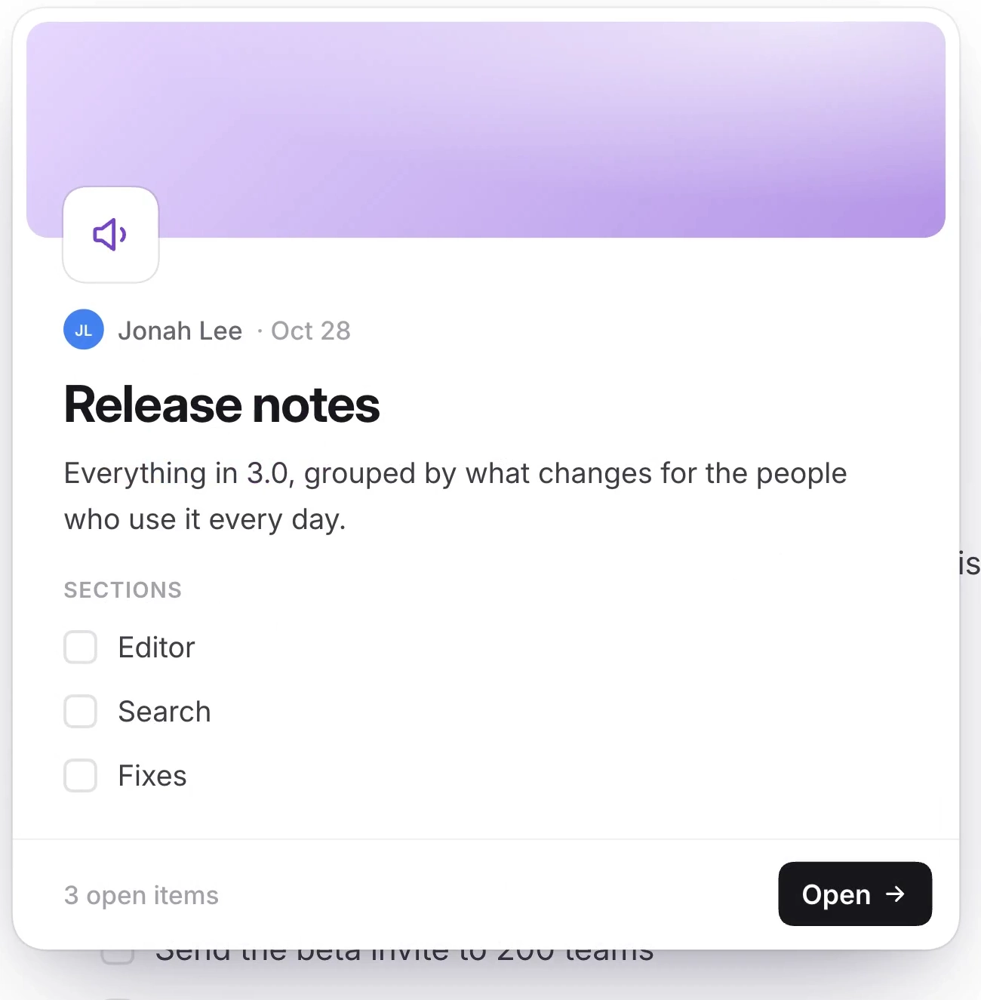

# 025 · 悬停延时与切换意图 / Hover Intent

先按浮层内容、遮挡体量与交互职责选时序，再处理组内连续浏览、移入间隙和路过其他触发器。轻量标签快，含操作的资料卡更谨慎，大预览更慢；一旦确认正在浏览，同组切换减少重复等待。延时控制的是浮层呈现，不延迟按钮业务动作、键盘输入或真正的点击。

盘点 Tooltip、HoverCard、图片／文件／链接预览、导航预览和级联菜单，记录触发器位置、分组、浮层尺寸、可交互内容、间距、现有库与时序。先输出诊断表，再按用户选中的行实施；已有明确选择与授权时沿用，不重复索要许可。沿用现有组件与依赖，以内容角色而非组件名判断：含按钮的“Tooltip”应按可交互卡片处理，输入和决策操作优先显式点击入口。

## 时序选型

| 角色 | 打开起点 | 离开与切换 | 呈现动效起点 |
|---|---|---|---|
| Label／Tooltip | 初次停留 500ms | 未打开前换触发器重计时；同组已打开后邻项立即替换，离组后 400ms 内可热启动 | 入约 140ms，退约 60ms；组内复用浮层原位改文案，无先关再开 |
| Card／HoverCard | 700ms | trigger／card／必要间隙联合热区；离开有 300ms grace，返回取消关闭；停稳新触发器后原位换内容 | 入约 200ms + 4px 下落，退约 120ms，切换约 200ms 交叉淡化与锚点移动 |
| Preview／大预览 | 900ms | 列表、面板与必要连接区联合热区；离开 400ms grace，快速路过其他行不切换 | 入约 250ms + 8px 位移，退约 140ms；停稳新行后原位替换 |
| Click instead | 点击／明确激活 | 主职为动作、输入或选择决策，保留菜单与焦点语义 | 不因本配方把现有点击改成 hover |

这些是完整提示词的默认值；初次标签可约 300–500ms、轻微离开容错可约 150–300ms，需结合现有产品调优，不额外叠加到表中默认值。点击 trigger 后标签抑制到离开该 trigger 再解除；Escape／外部点击关闭可交互浮层，取消未完成的打开／切换计时，避免立即自动重开。具体菜单的方向键与安全区仍见 [002 配方](safe-cascade-menu.md)。

## 指针意图与共享状态

- **打开前**：进入当前触发器开始计时，进入另一项取消旧计时并重新开始，快速扫过一排不打开。已明确的 hover 延时与 motion duration 是两件事，不能重复相加。
- **已打开后**：保存约 90ms 的近期指针位置估算速度，约 .1 CSS px/ms 为初始慢速阈值；在新目标上连续低速约 60ms 才接管 Card／Preview。提示词另称停止后约 100–150ms，是采样与停稳总体验的估计，不再额外加一段固定等待；参数根据触控板、缩放和真实轨迹调整。
- **跨间隙**：联合热区覆盖 trigger 与浮层之间的短路径；斜向通往侧面预览时可使用安全三角／现有 safePolygon。不能用铺满屏幕的透明层拦住其他目标，阴影也不充当可达区域；浮层翻向另一侧或尺寸变化后重算连接区。
- **同组浏览**：Tooltip 的热启动窗口、Card／Preview 的停稳切换按明确的局部 group 隔离，不把全应用所有提示共享成一个暖状态。每个作用域中同类只开一个；键盘已在交互卡内时不因鼠标掠过邻项偷换内容。
- **单一状态机**：同一时钟管理 idle／opening／open／switching／closing／suppressed，timer 携带当前 target／代次；指针、键盘、点击、卸载、滚动、blur 与路由离开时清理相关任务。无 pointermove 时也要能在停稳计时到期打开，不因最后一段速度缓存较快就永远等不到。

## 诊断表

| 位置 | 类型 | 当前打开／关闭／间隙／切换 | 问题 | 建议范围 | 参数 |
|---|---|---|---|---|---|
| 按实际组件与用途填写 | Label／Card／Preview／Click | 列出当前代码或库设置 | 正确项也标“保持” | 共享设置与单项改动分开 | 记录目标值与行为差异 |

先列共享库选项、是否确需 hover-intent helper，再列每处修改。优先设置已有组件库的 delay、group、safe area 和 controlled state；不另写一组 timer 与库内部竞争。提示词中的库名和参数是候选示例，实施前核对当前版本能力，不能仅设置 delay 就声称已完成速度判断、原位切换或透明桥接。

## 清晰效果参考

两张 WebP 从 2160×2880 视频直接解码，质量 98，按原像素裁切，无放大、锐化、涂抹或跨帧拼补。仅保留含操作的资料卡与大预览各一张局部，避开计时标签、署名光标与底部讲解；Label 复用 [已有 Tooltip 参考](../overlays.md#tooltip)，不新增近似图片。

### Card · 945×510


### Preview · 1300×1325



示例人物、头像与文档署名是产品内容示例，不是素材来源账号；不自动复制到真实产品。两图不含完整触发器与连接路径，不能证明热区、指针速度、700／900ms 延时、键盘、连续切换或时序已经正确；这些必须在实际交互中验证。

## 应用边界

- **角色与原行为**：Tooltip 无交互、无按钮，触发器已有可访问名称，短说明通过正确关联呈现；需要点击／输入的内容采用现有可交互 Popover 或面板语义。现有点击菜单、链接导航、截断文本查看与重要信息入口保持原触发与业务动作，改触发方式需在诊断表明确，不能因“应点击”便自动重做所有菜单。
- **离开与可悬停性**：标签的“离组即隐藏”只适用于不需要跨到浮层的布局；对用户需要悬停阅读的内容，trigger 与实际浮层都算可停留区域，指针进入内容时不立即消失。可交互卡片在焦点仍位于内部时保持，不用 pointerleave 的 timer 关闭键盘操作中的内容；最后离开联合区域才启动对应 grace。安全区有明确边界与退出条件，避免永久锁住目标或无法点击别处。
- **关闭与焦点**：键盘聚焦 Label 立即显示但不抢焦点；交互卡／预览沿用现有 Enter／Space 等显式入口，单纯 hover 打开不移动焦点。Escape 关闭当前适用浮层并阻止同一停留周期重开；只在原焦点位于被关闭浮层内且需要恢复时回到有效触发器，不能在外部点击或指针离开后把别处焦点抢回。库已有角色和按键优先，不给所有浮层套同一种 focus trap。
- **组内替换与数据**：文案与锚点同步到当前目标，必要交叉淡化期间旧层不接受点击、不重复读屏；任意时刻真实操作对象唯一。只做显示预览，不因打开就执行 Follow、Message 或 Open。异步预览保留加载／错误与访问控制，过时响应不能盖住新目标，关层与卸载取消显示任务；已挂载请求是否中止沿用当前数据层。
- **移动与定位**：指针采样使用同一坐标系和实际 delta time，不只看相邻事件的距离；采样、监听与 timer 仅在相关交互期间运行，无需全页持续 RAF。滚动、resize、碰撞翻转和 portal 的跨 DOM 热区都需验证；定位或交换内容不让 trigger 布局跳动，长文与窄屏仍能进入和操作。
- **触摸与混合输入**：`@media (hover: none)`／`(hover: hover)` 是样式能力线索，结合当前 pointer 类型与已有可访问入口，不把有触屏的笔记本一律当无鼠标。标签优先可见文字或信息按钮；长按仅可选，不能挡系统手势或成为唯一入口。点击卡片／预览入口不误执行其内容动作，重要链接与按钮首次点击的既定行为不被吞掉。
- **减弱动态与辅助技术**：关闭下落、滑动和缩放，只用短淡化或立即换内容；保留正常延时判断以防闪出。焦点、名称、展开状态和当前对象可识别，重复渲染不创建多套 ID／aria-describedby；同组替换避免重复播报与读到旧对象。必要信息不只藏在 hover 内。

## 完整实现提示词

```text
Review everything in my product that opens on hover, and decide for each one how long it waits before it opens, how long it stays once the pointer leaves, and what happens when the pointer moves on to the next one. Then, if I want it, change the ones I approve. This is about judgment first: diagnose and recommend, and change only what I approve.

This is a change to my product, not a demo. Work inside my code, on my stack, with my components, tokens and motion. Do not add a dependency without asking. Every value below is a default to start from.

The rule behind all of it: the larger an overlay is, the more of the page it covers and the more there is to click inside it, the longer it waits before it opens and the longer it stays when the pointer leaves. Once the person has shown they want to look, stop making them wait.

0. Read the product first
- Find everything that opens on hover: tooltips on icon buttons and on cut-off text, hover cards (people, links, mentions, tags), previews (a document or file beside a list, a link preview, an image enlarged on hover, a panel that opens from a navigation item), and menus or submenus that open on hover.
- For each one, note: what triggers it and how close the triggers sit to each other (a toolbar, a row of avatars, a list); how big the overlay is and what it covers; whether there is anything to click inside it; how far it sits from its trigger; and how it is timed today (no delay, one fixed delay, its own timers, a library's defaults).
- Find the shared pieces: a Tooltip, HoverCard or Popover component, the library behind them if any (Radix, Floating UI, Headless UI, MUI, Ant Design, a hand-written hook), the timers they use, and how touch and keyboard are handled.
- Tell me in a few lines what you found before going on.

1. Sort each one by size a. Label: a tooltip. A few words, nothing to click.

- Opens after the pointer has rested on the trigger for 500ms. Moving to another trigger starts the wait again.

- Once one label is showing, moving to a neighbour shows its label at once. While the pointer is still inside the group (a toolbar, including the gaps between buttons), the label moves to the new trigger and changes its text in place: no fade out and back.

- Leaving the group hides it at once. For 400ms after that, the next label in the group still shows at once; after that, the 500ms wait is back.

- Pressing the trigger hides its label, and it does not show again until the pointer has left that trigger. b. Card: a hover card with buttons or links in it (Follow, Message, Open).

- Opens after 700ms on the trigger.

- Leaving the trigger or the card starts a 300ms grace time; coming back within it keeps the card open.

- The gap between the trigger and the card counts as the card: cover it with an invisible area as wide as the card, so crossing it never starts the grace time.

- While a card is open, resting on another trigger of the same kind swaps the card's content in place (see 2): the card slides to its new trigger and its content cross-fades; it does not close and open again.

- Escape or a click outside closes it at once. c. Preview: a large panel that covers part of the page (a document beside a list, a link or file preview).

- Opens after 900ms on the trigger.

- Leaving starts a 400ms grace time. The list, the panel and any gap between them all count as inside.

- Rows the pointer crosses quickly on its way to the panel do not count (see 2); resting on another row swaps the panel's content in place. d. Should not open on hover at all: anything whose main job is an action, anything that needs typing, and menus that are a choice rather than a glance. Open those on click, and say which ones these are. Pick the kind by what the overlay is, not by what component it uses today: a "tooltip" with a button in it is a card.

2. Reading the pointer
- Keep the pointer's last few positions and work out its speed over the last 90ms. It is moving fast above about 0.1px per ms (10px in 100ms); below that it is slowing down or resting.
- Waiting to open: the timer starts when the pointer enters a trigger and starts again whenever it enters another one, so a pointer passing over a row of triggers opens nothing.
- Swapping while open: another trigger takes the open card or preview only after the pointer has been slow on it for about 60ms (about 100-150ms after it stops). Triggers crossed fast are passed over.
- When the panel sits to one side and the person may move at an angle across other triggers, the speed check is usually enough. If it is not, add a safe triangle from the pointer to the panel's near edge, as for cascading menus.
- All timers run on one clock, are cancelled when the pointer moves on, and are cleared when the component unmounts. Only one overlay of each kind is open at a time.

3. Rules for every one
- Motion: a label fades in over about 140ms and out over 60ms; a card fades in with a 4px drop over about 200ms and out over 120ms; a preview fades in with an 8px slide over about 250ms and out over 140ms. Swaps in place cross-fade over about 200ms. Closing is always faster than opening.
- Nothing around the trigger moves when an overlay opens or closes.
- Keyboard: focus on a trigger shows its label at once; a card or preview opens on Enter or after the same delay as hover; Escape closes it and returns focus to the trigger. Labels are linked with aria-describedby.
- Touch has no hover. Under @media (hover: none), labels show on long press or as visible text, and cards and previews open on tap. Keep :hover styles inside @media (hover: hover), so a tapped button does not stay in its hover look.
- Reduced motion: no drop, slide or scale; fades only.
- If the product uses a library, set its own options rather than adding timers next to it. For example: Radix Tooltip.Provider delayDuration 500 and skipDelayDuration 400; Radix HoverCard openDelay 700 and closeDelay 300; Floating UI useHover with delay { open, close } and handleClose: safePolygon() for cards and previews, and useDelayGroup for labels.

4. The report Before changing anything, give me one table, one row per place: | Place | Kind (label, card, preview, or click instead) | Today (open delay, close, gap, moving to the next) | Problem | Change | Values | Then list the shared changes (a hover-intent helper, the library settings) separately from the per-place ones. Ask me which rows to change, and change only those.

5. Check the result
- Sweeping the pointer across a toolbar opens no labels; resting on one opens it after 500ms; moving along the toolbar changes it at once, in place, with no flicker; leaving for more than 400ms brings the wait back.
- A card opens after 700ms, and the pointer can cross the gap and press a button inside it. Slipping out of the card and back within 300ms keeps it open.
- Moving at an angle from a list to its preview, across other rows, never changes the preview. Resting on another row swaps it in place, without closing.
- Touch and keyboard reach everything that hover reaches.
```

## 实施后核对

- 扫过工具栏不闪出标签，首次停留与同组热启动正确，组间互不污染；超过热启动窗口后恢复初次延时。
- 穿过 trigger／浮层间隙、短暂离开返回、斜向跨行、左右翻转时保持目标，真正停稳新项后原位切换。
- 点击与 Escape 立即关闭且不自动重开；触发器移除、滚动、路由切换和卸载无孤立 timer。
- 卡内按钮操作对象正确，异步数据不串项；键盘焦点不被指针切换或外部点击夺回。
- 验证鼠标、触控板、触摸、混合设备、短屏、长文、减弱动态和读屏；报告实测参数及未验证部分。

关联配方：[002 安全三角级联菜单](safe-cascade-menu.md)、[009 浮层决策](overlay-decision.md)、[020 选择控件](control-selection.md)、[011 动画节奏](easing.md)。
