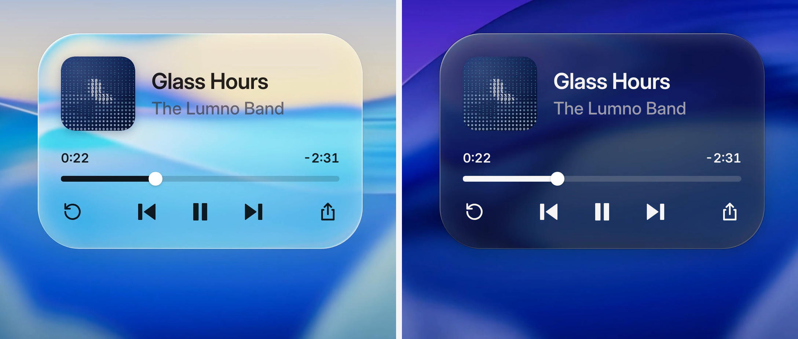

# 自适应液态玻璃材质 / Adaptive Liquid Glass

实现配方附高清演示截图；参数是可调起点。材质在项目现有代码内实现，采用 CSS 基础层与按能力启用的折射增强，不依赖外部材质工具、安装器或运行时服务。

## 效果参考



静态图用于核对构图、材质与可见状态；触发、连续运动和焦点管理需在实际项目中验证。

沿用原有图片与连续片段，它们展示材质外观，不作为 Safari、微信内置浏览器或视频背景性能已通过验证的证据。

## 适用与边界

将投影、背景模糊与提亮、边缘折射和色散、着色、边缘光与前景着色组合成共享 token，并按背景亮度与深浅主题适配。

浅色起点：白色着色 6–22%、blur 2px、saturate 180%、brightness 1.06；深色：rgb(20 20 24) 16–38%、2px、160%、0.8。边缘宽度 min(44px,短边/3.5)，偏移 1.1 × rim × (1-d/rim)^2.6，色散 ±15%；中间保持平整。5×3 采样丢弃最亮暗各两点，平均亮度 0.5 阈值与 ±0.05 滞回切换前景。同排面板共享决策；采样不可读时跟随主题并提高着色密度。

保留布局、字号、圆角、图标、业务状态与操作行为。材质只应用于用户指定范围；着色调节默认作为内部 token，用户要求可调设置时才增加设置入口。

## 跨引擎实现路径

| 路径 | 适用条件 | 实现与回退 |
|---|---|---|
| 实心表面 | 无模糊支持、减少透明、强制颜色或增强失败 | 默认即可读、可操作；不等待滤镜资源加载 |
| CSS 玻璃 | 背后是普通页面内容，或无可读取背景源 | 着色、内外边缘光、阴影，加标准 `backdrop-filter` 与按目标需要的前缀声明；保留实心回退 |
| SVG 背景折射 | 目标浏览器与组件合成环境实际绘制通过 | 在独立材质层启用位移与可选色散；失败撤掉该层增强，继续 CSS 玻璃 |
| 受控背景折射 | 背景是项目掌握的图片、Canvas 或可用作纹理的视频，且需要跨引擎真实折射 | 在本地 Canvas／WebGL 材质层重绘同一背景的对应区域并做边缘采样，正文与控件仍为 DOM；资源不可读、上下文丢失或性能不足时回到 CSS／实心 |

受控背景路径是本配方的独立实现建议，不代表任意 DOM 页面都能被实时读作纹理。必须沿用同一背景的 cover／position、滚动、缩放和设备像素比坐标；纹理偏移后应能看见背景线条在边缘弯折，不能只给渐变、亮边或模糊就称为真实折射。跨域资源按合法可读能力处理，不绕过安全限制。

`CSS.supports()` 只用于语法筛选。兼容结论需在实际目标版本的桌面浏览器、iPhone Safari、微信内置浏览器内观察；没有设备或对应环境时记录未验证，不根据浏览器名称或单个版本号宣称已兼容。CSS 玻璃、SVG 增强与受控背景路径分别核对。

## 移动端可见性与资源生命周期

- 先确保无滤镜时面板、文字、图标、焦点和操作可见，再启用材质增强。模糊与位移不能施加在整个交互根节点上；装饰层不接收指针，不改变正文可访问性与层级。
- 出现空白、贴图直出或背景未折射时，先关闭 URL 滤镜检查 CSS 基础层，再逐项排查祖先的 opacity、filter、mask、裁切、背景采样边界、层叠与动画合成。不要全局添加 `translateZ(0)`、`will-change` 或改写业务布局来碰运气。
- 位移资源解码成功后再切换增强；组件挂载／卸载、路由切换和多实例使用稳定且不冲突的滤镜 ID，移除引用后再释放资源，避免渲染层指向已销毁贴图。
- 几何缓存键包含尺寸、圆角形状、边缘宽度和 DPR。位置改变只更新坐标；尺寸或圆角改变时重建受影响的映射，不能把同一张位移图直接拉伸到任意长宽比。
- 显式背景重绘需同步裁切与外观坐标；上下文丢失、图片解码失败或视频源切换时立即显示基础层，恢复成功再启用增强。

## 视频背景与性能

- 为同一背景共享采样与帧调度。支持时按 `requestVideoFrameCallback` 更新新视频帧，否则在播放期间使用单个动画循环；避免每张卡片单独复制视频、解码或读取整帧像素。
- 几何／位移映射只在尺寸、圆角或 DPR 等输入改变时生成；视频播放只更新纹理与必要坐标。静态背景没有变化时不持续重画，视频暂停、离屏或页面隐藏时暂停非必要更新。
- 自适应明暗用低分辨率采样与节流，沿用 5×3 采样和滞回；采样时间间隔可从约 100–200 ms 起调，不将这个建议冒充已测性能。无法读像素时使用主题与高密度着色。
- 先降低色散通道、折射分辨率、有效 DPR、更新频率和模糊开销，再关闭折射；每次降级仍保留清晰前景、边缘与基础着色。用实际目标设备记录掉帧、长任务与交互响应，不承诺未经测试的帧率。

## 核对与交付

检查忙碌／明暗背景、文字实际对比、圆角与位移贴图边缘、主题切换、逐主题着色设置。SVG backdrop 折射必须实测，解析支持不等于绘制可用；失败用纯 CSS 玻璃，小尺寸或不稳定合成层跳过折射，减少透明或强制颜色时回退实心。

交付列出每个表面的实际渲染路径、测试浏览器／设备版本、图片与视频背景结果及已触发的降级。覆盖首次加载、多实例、弹层打开／关闭、路由切换、旋转与缩放、视频暂停／继续、页面后台／恢复；未实测的环境明确列出。既有参考图不证明这份兼容方案已在产品中实现。

## 实现提示词

将下方配方应用于用户指定的组件或页面；其中 product、global、every 等范围以用户本次授权为界，不自动扩大到整站。已有设计系统和提交语义优先，新增设置面板、全局扫描和演示风格仅在任务需要时采用。

```text
Give the cards and panels in my product a liquid glass material: clear glass that takes its color from the scene behind it, reads as a thick slab at the rim, adapts to what is behind it, and keeps its text readable in light and dark mode. Work inside my existing design system. This is a change of surface, not of layout: keep my markup, spacing, radii, fonts, icons and copy.

Implement the material directly inside my project's code. Do not add an external material toolkit, installer, hosted editor or runtime service. Reuse the project's rendering facilities where available. Treat cross-browser compatibility and video performance as requirements to test, not claims already proven by the reference images.

0. Start from what exists
- Find every surface that sits over an image, a wallpaper, video or a busy background: cards, players, search bars, toolbars, menus, popovers, toasts. List them with their component and where they are.
- Find how the product switches between light and dark mode, and where its color tokens live. The glass goes into those tokens, not into each component.
- Leave surfaces over a plain background alone; glass over a flat color only looks gray.
- Stay inside the requested scope. Record the actual target browsers and devices, which backgrounds the project owns and can read, and which surfaces animate or live in portals. Reuse existing controls; keep tint settings as internal tokens unless a settings UI was requested.

1. The material as tokens
Build it as one set of variables per state, so a surface opts in by using them. The numbers are a starting point, for a UI at its normal size.
- Light glass, dark text (the default): tint white at 6–22% (by density, step 4); backdrop filter blur(2px) saturate(180%) brightness(1.06), so the color comes from behind and stays vivid instead of milky.
  Edge: inset 1.5px 1.5px 1px -1px white 95%, inset -1.5px -1.5px 1px -1px white 55%, inset 0 0 0 0.5px white 30%, 0 0 0 0.5px black 6%, 0 6px 24px black 8%.
  Inner light, on a layer inside the surface: a radial highlight from the top left (white 30% fading out by 55%), and soft inset glows just inside the rim, brighter at the top and left, a little shade at the bottom.
- Light mode over a dark area, light text: tint rgb(16 18 22) at 10–30%; filter blur(2px) saturate(170%), then brightness(0.85); edge: a faint inset white line on top and a 0.5px dark outline.
- Dark mode: tint rgb(20 20 24) at 16–38%; filter blur(2px) saturate(160%) brightness(0.8), which dims like a multiply with black instead of going muddy; the same edge and inner light at about a third of their strength, with a darker outline and shadow.
- Ink, one color in fixed steps, used for everything drawn on the glass:
  on light glass black 86% (titles, icons, times, progress), rgb(60 60 67) at 70% (secondary); mix-blend-mode multiply;
  on dark glass white 94%, rgb(235 235 245) at 64%; mix-blend-mode plus-lighter.
  Draw icons in the opaque color and fade the whole icon with opacity: a translucent color darkens where a shape's strokes and fills overlap.
- A highlighted row on light glass is a lighter layer of the glass: white 42% on hover, 76% when selected, with a white stroke. Never a gray wash.
- Register the numeric and color tokens with @property so a surface glides between states instead of jumping.

2. Apply it in four declarations
The surface's material interface exposes these four properties. Keep the existing semantic markup and interaction; use an existing pseudo-element or a non-interactive decoration layer where needed, leaving text and controls outside the filtered layer:
- background: the tint.
- backdrop-filter: the material's filter, then the rim lens (step 3) last, so the color steps fold into one pass and the bend stays crisp.
- box-shadow: the edge.
- color: the ink, with the blend mode on everything drawn inside.
Hover brightens the tint by about 14% instead of lifting a shadow.
- Start with a readable solid fill. Add the CSS backdrop functions only where available, including the prefixed declaration if the target needs it. Keep a normal opaque ink fallback where blending fails or harms contrast.
- Never put displacement or blur on the whole component's text, controls or focus ring. A decoration layer must not capture pointer events, become focusable or change the component's public props.

3. The rim lens
- Build a displacement map for each surface: red is the sideways bend, green the vertical one, 128 is none. Only a rim bends; the middle stays flat.
- The rim is about 44px wide on a card (min(44px, the short side / 3.5), never under 4px). For a thick slab, a point d from the edge looks inward by 1.1 × rim × (1 - d / rim)^2.6: hard at the edge, where the scene folds back on itself, easing to nothing at the rim's inner edge.
- Draw the map for the same corner the CSS draws. If the surface uses corner-shape: superellipse(), follow that curve, not a circle, or the bend and the rim light miss each other at the corners.
- Put it in an SVG filter with feImage (the map) and feDisplacementMap (scale = 2 × the largest offset), and add url(#id) at the end of backdrop-filter.
- Split it into colors: three passes, red 15% further and blue 15% less, each kept to its channel with feColorMatrix and added back with screen blends. Check the corners of wide rims over busy backgrounds; lower the split where it turns into a haze.
- SVG filters in backdrop-filter need a real rendering check in each target engine. CSS.supports('backdrop-filter', 'url(#a)') only checks parsing; verify the actual backdrop is displaced. Everywhere else the CSS-only glass stays.
- Wait for the map image to decode before enabling the enhancement; the CSS-only surface stays visible throughout loading or failure. Keep filter IDs stable and unique across instances. Remove references before freeing their resources on unmount.
- Cache maps by width, height, radius shape, rim width and device pixel ratio. Movement only updates coordinates. A size, radius or DPR change regenerates the affected map; do not stretch one corner map across arbitrary aspect ratios.
- Skip the lens on surfaces under 32px. For animated or separately composited panels, verify the actual result before enabling it. If a map appears as an image, the component disappears or displacement is absent, disable that enhancement and retain CSS glass. Diagnose ancestors and layers instead of adding will-change or translateZ to every component.
- When a target cannot draw the SVG backdrop lens and the project controls a readable image, canvas or video background, a local Canvas/WebGL decoration layer may render that same source through the rim displacement. Match the source's cover/position, scroll, transforms and DPR; keep text and controls in the DOM. Use the red/green displacement and optional channel split above in that local renderer. This is an implementation option, not permission to capture arbitrary DOM as a texture or replace the whole app renderer.
- If the source cannot be used as a texture, the context is lost, or the rendering budget is exceeded, keep CSS-only glass or the solid fallback. Do not call a highlight-only approximation true refraction. Test actual target Safari and embedded browser versions before reporting compatibility.

4. Adapt to what is behind
- For each surface, sample the background under it at a 5 × 3 grid, drop the two darkest and two brightest points, and average. Luminance is (0.299 R + 0.587 G + 0.114 B) / 255; texture is the brightest point minus the darkest.
- Ink: in light mode, light text when the luminance is under 0.5. Keep the current ink within ±0.05 of the line so a surface never flickers at it. Dark mode is always light text. Neighbouring surfaces in one row share one decision.
- Density (0 thin, 1 dense) = clamp(0.55 × how close the background is to the ink's own brightness + 0.7 × texture + 0.3 × chroma, 0, 1). It moves the tint between its thin and dense alpha.
- Saturation kept = 1 - 0.75 × chroma, at least 0.45, so a vivid background doesn't stain the glass.
- Sample again when the background, the theme or a surface's position changes, and remember the last ink so the next load opens in it.
- If the background cannot be sampled (for example cross-origin content or an unreadable video), pick the ink from the theme and use the dense tint.
- Read background pixels from a source the project actually owns and can legally sample, not an imaginary screen-read API. Treat the luminance, texture and chroma formulas as tuning heuristics; define their normalization in the implementation and check real text contrast after compositing.

5. Let people set the tint
- Define one token for light mode and one for dark that scale the tint, from 0 to 1.5 (1 is the material as designed). Expose controls only if requested, using the product's existing settings pattern. Below 1 the brightness lift in the filter thins with it, so at 0 only the blur, the rim and the shadow are left.
- Each theme keeps its own value; switching themes glides to that theme's value.

6. Keep it accessible
- Check text contrast on the busiest and the darkest background the product allows, at the default tint; raise density, not the ink's opacity, until it passes.
- Respect prefers-reduced-transparency and forced colors: fall back to a solid surface in the same tint at full opacity.
- Keep focus rings, disabled states and error colors as they are; failures keep their red.

7. Keep video work within budget
- Share background resources and frame scheduling across surfaces. Where supported, use requestVideoFrameCallback for new video frames; otherwise use one animation loop while playing. Do not create one decoder or full-frame CPU pixel read per panel.
- Rebuild geometry and displacement maps only when their inputs change. Update only the source texture and necessary coordinates for new video frames. Stop unnecessary rendering for unchanged static backgrounds, paused video, offscreen surfaces and hidden pages; resume from the current source state.
- Use a small shared sampling image and throttle adaptive color work; about 100-200ms is an initial interval to measure, not a guaranteed performance value.
- Reduce color-split passes, render resolution, effective DPR and update rate before removing the lens. Keep the readable CSS/solid fallback available at every stage. Measure on target devices and do not promise an unmeasured frame rate.

8. Verify mobile visibility and recovery
- Verify the baseline surface, content, focus and actions before enabling filters. On blank output, remove the URL-filter enhancement first, then inspect ancestor opacity/filter/mask/clipping, backdrop boundaries, stacking and animation compositing one at a time.
- Check first load, multiple instances, opening/closing overlays, route changes, rotation/resizing, video pause/resume and background/foreground transitions. Decode failures and rendering-context loss must immediately fall back to a visible surface.
- Test Safari and the actual in-app browser on the target device. If that environment is unavailable, state that it remains unverified; never infer success from another engine or a browser name.

9. Deliver
- First list the surfaces you will change, which get the lens and the color split, and which you leave solid and why.
- Then add the tokens and the required local lens helper, switch the surfaces over, and list every file you touched. Add tint controls only within the requested scope.
- Don't change layout, fonts, radii or copy. If a surface would need a new component to work as glass, explain the necessary component change and keep it within the requested scope.
- Report each surface's actual rendering path, tested browser/device versions, video behavior, fallback behavior and environments not tested. Screenshots or CSS parsing checks alone do not prove refraction, mobile visibility or smooth video.

```

参考片段：[连续动效片段](../../assets/recipes/liquid-glass.gif)。
