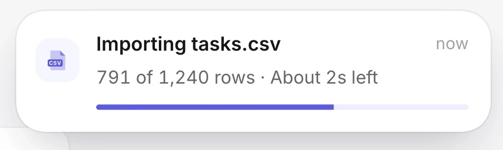

# 017 · 巧用等待状态，让产品响应更丝滑 / Loading States

先盘点真实等待，再按任务语义、已知布局、可计量程度和可逆性选择反馈。保持用户当前工作区、已知内容与操作结果；时长是调优起点，不能只凭秒数决定组件。

## 等待状态选型

| 场景 | 选择 | 行为与结果 |
|---|---|---|
| 通常不足 300ms | 不额外显示 loader | 直接呈现结果；原本就表示同步／刷新的图标可从按下开始转动 |
| 一次短操作、耗时未知 | 就地 Spinner 或动作图标旋转 | 保持按钮文案和宽度，只阻止请求中的重复提交，页面其余部分可用 |
| 首次加载且结构已知 | Skeleton | 标题、Tab、筛选和表头立即显示；数据区域按真实行高、头像和图片比例占位 |
| 可计量的较长工作 | Progress | 真实数量／百分比、进度条与可估算的剩余时间；条目任务就地呈现，跨页任务沿用全局任务入口 |
| 耗时较长但无法计量 | 真实阶段与恢复入口 | 显示实际已知的连接／处理阶段；约 10s 后说明超时预期，按能力取消或转后台 |
| 成功率高且容易撤回 | Optimistic UI | 立即更新同一对象和相关计数，后台保存；失败撤回该次改动、保留输入并提供 Retry |
| 结果逐段到达 | AI／流式结果 | 呈现真实阶段和实际收到的内容；预留空间，完成后提供 Copy、Retry，按能力停止 |
| 预取、草稿与后台同步 | 无提示或固定位置的轻状态 | 不遮挡页面；必要结果和失败可以重访 |

先记录每项等待的触发、实测时长或明确标注的估计、当前占位、布局变化、可继续操作范围、失败和取消方式。输出 `Where / Now / Should be / Change` 表并按类型分组，再列出可共用的延迟 helper、骨架与任务卡。仅诊断请求停在建议；已有选择与授权直接推进，不重复索要 go-ahead。

## 参数与时序起点

- **延迟与最短显示**：独立指示器可延迟 300ms，出现后约保留 500ms 以减少闪烁；这只控制视觉，不延迟请求、结果写入、错误或重新操作。刷新保留已有数据，每个等待只有一个主指示器。
- **按钮**：普通 Spinner 12–16px、约 .9s 一圈；原本表示操作的同步／刷新图标从按下旋转，至少一整圈约 640ms，前后各约 18% 加减速，较长约 600°/s，停于整圈。替换图标约 180ms 轻模糊／缩放交叉淡化；文案和宽度稳定。完成反馈按 [016 消息反馈](toast-vs-notification.md) 判断是否需要 Toast，不为已清晰呈现的结果重复提示。
- **骨架**：浅色 `rgb(240 240 242)`、深色白色 8%；文字条约高 12px／圆角 6px，头像圆形。整列表共用白色 75%、宽约 320px 的扫光，周期 1.2s。真实内容原位淡入 200ms、行间 40ms；长列表仅对可见范围短错峰，多余占位移除不留下空洞。
- **进度卡**：宽 344px、圆角 24px、内距 14px／右侧 16px；32px 图标底座、18px 双调图标、标题与数量／预计时间、4px 真实进度条。约运行 300–500ms 再出现；从 y=-56px、blur=4px、scale=.96 在 420ms 入场。完成时旧文案 160ms 淡出、新文案 420ms 进入，收起进度条并换为完成图标，结果保持可访问。
- **乐观更新**：示例勾选框 20px，计数 320ms 过渡，行尾 12px Saving／Saved 状态；失败原位说明并提供 Retry。6px、两次、360ms 摇动为可选装饰，不移动目标命中区；减弱动态时移除。
- **流式回答**：阶段文字 13px、图标 16px；正文 15/24、光标 2px，按实际到达文本轻淡入。首段目标约 1–2s 是性能目标，不能靠虚构阶段冒充达到。长任务和 AI 的停止按真实能力提供。
- **减弱动态与辅助技术**：保留状态，用短淡化或静止图标，移除扫光、旋转、摇动与模糊；加载区域使用真实 `aria-busy`，状态在区域外或独立公告区适度播报，装饰骨架不进入读屏与 Tab 顺序。不抢焦点，busy 按钮仍可聚焦。

## 清晰效果参考

四张不同用途的 WebP 直接从 2160×2880 视频解码，按原像素裁切，质量 98；不放大、不锐化、不涂抹、不跨帧修补。只保留实现 UI，参数、讲解和验证要求放在本文中。同一组素材供综合入口与具体组件条目复用。

### 动作图标按钮 · 280×118


核对图标、文字与按钮边界；静态帧不能证明整圈停止、即时响应或防重提交。

### 列表骨架 · 1820×570


只保留三行代表占位；扫光、真实行高匹配与内容到达后的布局稳定需在产品中验证。

### 真实数量与剩余时间 · 1020×305



核对进度信息与卡片层级；图中数字是示例，项目实现必须由真实任务数据驱动。

### 乐观更新失败与 Retry · 2045×100


核对失败状态与恢复入口；不能从单张图断定已完成请求回滚、并发处理或真实重试。

## 在现有产品中应用

下方保留完整提示词。应用时按本节解释其中的简化规则，再采用具体参数。

- **范围与时长**：复用现有组件、数据层、token 和请求生命周期。300／500ms、1／3／10s 是可调起点，实测慢网络并区分缓存、服务端处理和客户端渲染；Spinner／Skeleton 的选择同时取决于动作与内容语义。新增依赖、数据层或交互模式须符合用户已有授权。
- **请求与视觉分离**：请求立即开始，防重提交从实际 pending 开始；视觉延迟／最短时长只影响动画。成功和失败立即进入真实数据状态，不能为了转满一圈扣住结果或锁住输入。helper 按任务 ID／代次隔离 timer，快速重试、并发、卸载和路由切换清理旧状态，旧响应不能覆盖新操作；预取不触发全局遮罩。
- **布局与刷新**：首次加载才用未知内容的骨架；已知标题、表头、筛选和旧数据保留。骨架按真实响应式布局、图片比例、换行和可见行预留空间；空结果和错误及时变为对应状态，不能永远停在骨架。保留滚动锚点，减少布局跳动；内容确实变多时允许正常向下增长，不承诺未知终态尺寸绝对不变。
- **真实进度与估时**：百分比、总数和阶段来自实际任务；网络上传完成不等于服务端处理结束。无总量时用阶段或不定进度，绝不模拟递增到 99%。有足够稳定样本才显示平滑的预计时间，不因已过一秒就声称可精确估计；分阶段总量变化时说明含义，停滞／失败保留恢复入口。
- **取消与后台**：取消请求、取消服务器任务、隐藏任务卡和关闭完成结果分开处理。关闭按钮默认按产品既有语义；只有明确标注为取消、后端支持且符合所选设计时才取消运行任务，不把 hover 上的 × 默认为 Cancel。取消入口对键盘／触摸可见且可达，等实际确认后再显示已取消；仅 Abort 客户端读取不声称后台已停止。无后台能力不伪造“继续运行”；跨页任务采用稳定 job ID 与真实持久状态，按 [016](toast-vs-notification.md) 保留历史与结果。
- **乐观更新与并发**：仅适用于业务允许、成功率高、容易撤回的操作；支付、永久删除、对外发送保持真实确认与提交语义。示例里的“添加评论”不代表默认可把发送当成功。按 mutation ID／版本保存该次改动及其关联计数、缓存和临时 ID；失败仅撤回该次影响并重放后续有效改动，不把整个旧快照覆盖回去。服务端结果用于校准，不丢失后续编辑、草稿或离线输入；重试复用安全标识，避免重复创建。
- **流式内容与真实阶段**：仅显示已知步骤，不为维持动感伪造读取数量、进度或检查成功；没有阶段遥测时用诚实的等待状态。按协议处理 UTF-8 与 chunk 边界、SSE／NDJSON、终止标记和异常；复用安全的文本／Markdown 渲染，不能把生成 HTML 直接插入页面。Stop 依真实能力终止并保留标记清楚的部分结果，失败原位可重试；用户滚离底部时不强拉回、不重复播报整篇内容。
- **可访问与性能**：`aria-busy` 表示真实工作，不为凑动画延长；live region 避免被 busy 容器阻塞、重复公告每个字／百分比。busy 控件用正确语义和处理器防重，`aria-disabled` 本身不会拦请求；取消／重试与焦点位置保持稳定。扫光尽量用独立渐变层的 transform 配合占位遮罩，避免无界逐帧布局／重绘；必要动画仅在可见、运行期间执行。按项目平台版本核对下文候选 API，不能假定 Suspense 自动接管所有请求、startTransition 自动缓存数据或取消网络传输。

## 完整实现提示词

```text
Review how my product handles waiting, and decide for each wait which loading state fits: nothing, a spinner, a skeleton, progress, an optimistic change, or an AI answer written as it arrives. Then, if I want it, change them along the lines below. This is about judgment first: diagnose and recommend, and change only what I approve.

This is a change to my product, not a demo. Work inside my code, on my stack, with my components, tokens, motion values and copy style. Do not add a dependency, a data library or a new visual pattern without asking. Every value below is a default to start from.

0. Read the product first
- Find every place a person waits: page and route loads, lists and tables, search and filters, buttons that call the server (save, send, sync, delete), uploads, imports and exports, background jobs, and AI calls.
- For each one, note: what starts it; how long it usually takes (measure it, or estimate from the call: cached, one request, several, a job); what is shown meanwhile (a spinner, a skeleton, nothing, a blocking overlay); whether the layout moves when the data arrives; whether the person can keep working; what happens when it fails; and whether it can be cancelled.
- Find the shared pieces: the spinner, skeleton and progress components, the data layer (a fetch wrapper, React Query, SWR, Apollo, a store), and any global loading bar or overlay.
- Tell me in a few lines what you found before going on.

1. The kinds of waiting
a. Under 300ms: show no separate loader (no spinner, skeleton or bar): one that appears and goes in under 300ms reads as a flicker. The one exception is a button whose own icon already means the action, which turns from the press (b). The result is the feedback: when it shows where the person is looking, nothing more is needed; when it doesn't (a sync, a copy, a save off-screen), confirm it with a short toast.
b. A short wait for one action, length unknown (about 0.3 to 3s): show it where the person acted, with the label and the width unchanged. If the button's icon already means the action (sync, refresh), turn that icon from the press: at least one whole turn even when the answer is instant, and on until the answer lands, always stopping on a whole turn. Otherwise the icon becomes a spinner, started only after 300ms and kept at least 500ms. Block a second press while it runs, but never grey out the page. When it is done, the button goes back as it was and a short toast gives the result (Synced, 1 task updated): at the top centre, a few words, gone after about 3s.
c. Content whose layout is known (a page, a list, a card, a table): a skeleton.
  - Show what does not depend on the data at once: the title, tabs, filters, column headers.
  - After 300ms, draw skeleton shapes for the rest, at the real sizes and places: the same row height and avatar size, lines a little shorter than the text, their lengths varying a little.
  - A light band crosses the whole list together, every 1.2s.
  - When the data arrives, the real rows take the same places, top to bottom, each fading in over 200ms, 40ms apart. Nothing jumps. If fewer rows come back, the extra shapes fade out.
  - Never put a lone spinner in the middle of an empty page instead.
d. Long work that can be counted (uploads, imports, exports, batch jobs, over about 3s): progress.
  - Say what it is doing, how far (a count or a percentage, and a bar), and the time left once there is a second of data to estimate from; before that, "Estimating…".
  - Show it in a notification at the top right when the work goes on while the person moves on (an import, an export, a batch job): it keeps the page free, stays on every page and is kept until handled. Work that only concerns one item can show in that item's place instead, at the same size, so nothing on the page moves.
  - Keep the page usable and offer Cancel. If it can go on without the person, let it run in the background and tell them when it is done.
  - Show it once the work has run 300 to 500ms; a job done sooner needs only the result.
  - At the end it turns into the result in place, and opens it when clicked.
  - Long work that cannot be counted: name the stage it is in (Connecting, Processing 3 files) rather than an endless spinner; after about 10s, say it is taking longer than usual and offer to keep it running in the background.
e. An action that almost always works and is easy to reverse (mark done, like, rename, reorder, move, add a comment): optimistic.
  - Show the result at once, before the server answers, everywhere it appears (the tick, the status, the totals), and save behind it. Say quietly that it is saving, in a fixed place on the item (Saving, then Saved, fading after a moment), never with a spinner over the change itself.
  - If the save fails, put every part of the change back, say why on the item in a few words (Couldn’t save), and offer Retry in the place of the saving status. Keep what the person typed.
  - Not for payments, deleting for good, sending something to other people, or anything that cannot be quietly put back.
f. AI answers and other results that arrive in pieces:
  - First say what it is doing, as steps (Reading 4 tasks, Checking 3 events, Writing the summary), each turning into a check.
  - Then write the answer as the words arrive, each fading in from a slight blur as the next begins, with a caret after the last.
  - Keep the answer's space from the start (a card at its final size, or a minimum height that only grows downward), so the page does not move as it writes.
  - At the end, show Copy and Retry. Offer a way to stop only when answers often run long.
  - Aim for the first words within 1 to 2s; when that is not possible, the steps must keep moving.
g. Waits the person does not need to see (prefetching, saving a draft, syncing in the background): nothing, or a quiet status in a fixed place (Saved). Never block the page for them.

2. Rules for every kind
- Thresholds: under 300ms nothing but a button's own icon turning; 300ms to 1s a spinner or skeleton; 1 to 10s a skeleton, or progress that says what it is doing; over 10s progress, the time left and a way out. Measure on a slow mobile network, not on localhost.
- Delay and minimum: what appears after 300ms stays at least 500ms. Write one helper for this and use it everywhere.
- The layout never moves when content arrives: reserve the space (skeletons at real size, minimum heights, fixed image ratios).
- One indicator per wait: never a spinner on the button, an overlay on the page and a bar at the top all at once.
- Keep what is known: when refreshing, keep showing the old data with a quiet refresh state, rather than a skeleton.
- Failures stay where they happened, say what failed and what to do, and offer Retry. A toast that disappears is not enough for something the person has to fix.
- Reduced motion: keep every state; drop the moving band and the spin, and use a soft opacity pulse or nothing.
- Accessibility: aria-busy on the region that is loading, a polite live region for done and failed, focus left where it was, and a busy button still reachable by keyboard.

3. Report before changing anything
Give me a table first, and do not change code yet. One row per wait:
- Where: the screen or component, and what starts the wait.
- Now: how long it takes, and what is shown.
- Should be: nothing, spinner, skeleton, progress, optimistic, AI answer, or background; and why, in a phrase that points to the rule above.
- Change: what you would do, in a phrase.
Group the rows by kind. Then list the shared pieces you would add or change (the delay helper, skeleton shapes, the progress notification). Wait for me to choose what to change.

4. How it looks (defaults; fit them to my design)
- Spinner: the loading icon from my icon set (or a ring segment on a faint track), 12 to 16px, a turn every 0.9s, in the accent or the text colour. In a button, an icon that already means the action turns instead, speeding up over the first 18% and slowing over the last 18% so it starts and stops at rest: one turn in 640ms at the least, and on at about 600° a second for longer waits (three turns in 1.7s), always ending on a whole turn; otherwise the icon cross-fades into the spinner over 180ms with a little blur and scale. The label and width stay.
- Toast: 40px tall with a 16px corner, a check on a soft tile and a few words, top centre of the content; it comes down 10px from a slight blur over 500ms, and leaves after about 3s.
- Skeleton: shapes in the raised grey (rgb(240 240 242) on white; on dark, white at 8%), 6px corners for lines, circles for pictures, 12px lines for 14px text. The band is white at 75%, 320px wide, crossing the whole list at once.
- Progress in a notification: 344px wide, 24px corners, 14px padding (16px on the right), at the top right. A 32px icon tile centred on the words beside it, holding the file's type as a two-tone filled icon at 18px, the title (Importing tasks.csv), the count and time left in one line (568 of 1,240 rows · About 2s left), and a 4px bar in the accent on the accent at 10%; no row of buttons: the card opens what it is about, and a close mark on hover cancels. It comes down 56px onto the page out of a 4px blur and from 96% over 420ms. When it is done, the same card changes in place: the old words blur out over 160ms and the new ones in over 420ms (Imported 1,240 tasks, Added to Backlog.), the bar folds away and the tile turns solid green with a heavy white check, the same 18px. It then stays until opened or closed.
- Optimistic: a 20px checkbox in the task icon's place, shown on hover and filled green when ticked; totals roll to the new figure over 320ms; Saving with a 12px spinner, then Saved with a check, at the start of the row's last column, in 12px grey. When a save fails the row shakes 6px, twice, over 360ms, the reason in red takes the place of the row's counts, and Retry takes the place of Saving, until it is fixed.
- AI answer: steps at 13px with a 16px spinner that turns into a check; the answer at 15/24; the caret 2px wide in the accent; Retry and Copy at the end.

5. How to build it, by platform
These are suggestions; check them against my stack and its versions, and prefer what the product already uses.
- Web: the delay and minimum as one hook or helper, for example useDelayedFlag(loading, 300, 500). React: Suspense with a skeleton fallback, startTransition to keep the old content while the new loads, useOptimistic or a mutation's onMutate with a rollback; React Query or SWR keep the previous data while they refetch. Read streamed answers from fetch with a ReadableStream, or the AI SDK's useChat. Draw the band as one gradient fixed to the list, moved by background-position, and stop it under prefers-reduced-motion.
- iOS: .redacted(reason: .placeholder) for skeletons, ProgressView for progress, Task cancellation for Cancel, optimistic changes in the view model with a rollback, AsyncSequence for streamed text.
- Android: a shimmer brush over placeholder shapes in Compose, LinearProgressIndicator with a value, Paging's LoadState for lists, optimistic state in the ViewModel with a rollback, Flow for streamed text.
- Flutter: the real widgets as placeholders under a shimmer (or Skeletonizer), LinearProgressIndicator(value:), a Stream for streamed text.
- Rust and other native desktops (egui, iced, GPUI, Tauri): the same states in the UI model, with the 300 and 500ms timers in the update loop.

6. Check
- Throttle the network (Slow 4G) and time every wait: nothing shows a separate loader under 300ms, nothing flashes, nothing moves the layout when the data comes.
- Turn the network off during an optimistic change: it goes back, says why, and Retry works.
- Cancel a long job, and leave the page during one: nothing is lost, nothing keeps spinning.
- A screen reader hears loading and done; reduced motion has no moving band; light and dark both checked; existing tests still pass.
```

## 项目核对

- 每项等待有正确类型和真实入口；诊断表包含时长证据或明确估计、失败与取消能力，仅实施选中范围。
- 在缓存命中、慢网络、断网、快速完成、长任务和真实失败下核对：无闪烁、无额外阻塞，不用视觉 timer 延迟结果。
- 骨架与真实布局对齐，旧数据刷新、少行／空结果、长文、缺图、窄屏、缩放与滚动锚点正确。
- 乐观更新覆盖并发、连续改动、失败回滚、离线输入、服务端校准和幂等重试，不覆盖后续编辑。
- 进度和阶段真实；取消确认、离页返回、完成结果与恢复入口可达，无孤立 loader 或过时响应。
- 流式内容处理截断、分块、停止与异常；焦点、手动滚动、减弱动态、浅深主题和读屏分别验证。

关联配方：[016 消息反馈选型](toast-vs-notification.md)、[011 动画节奏](easing.md)、[015 连续转场](continuous-transitions.md)。具体组件见 [加载与错误页](../loading-errors.md)。
