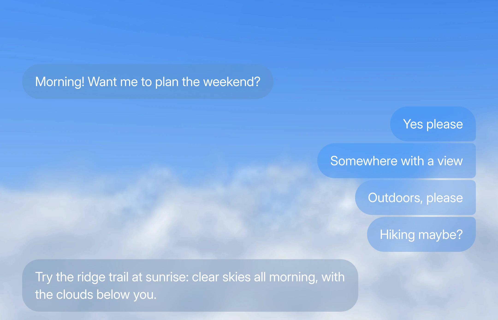
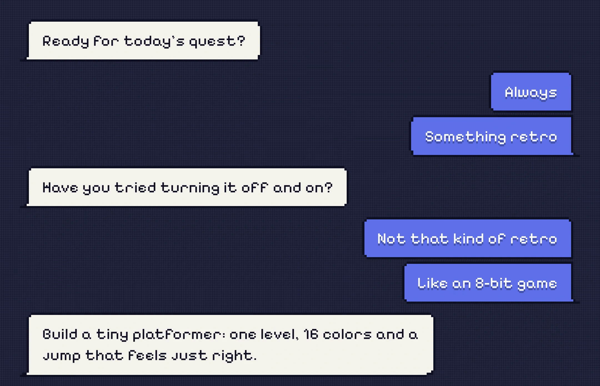
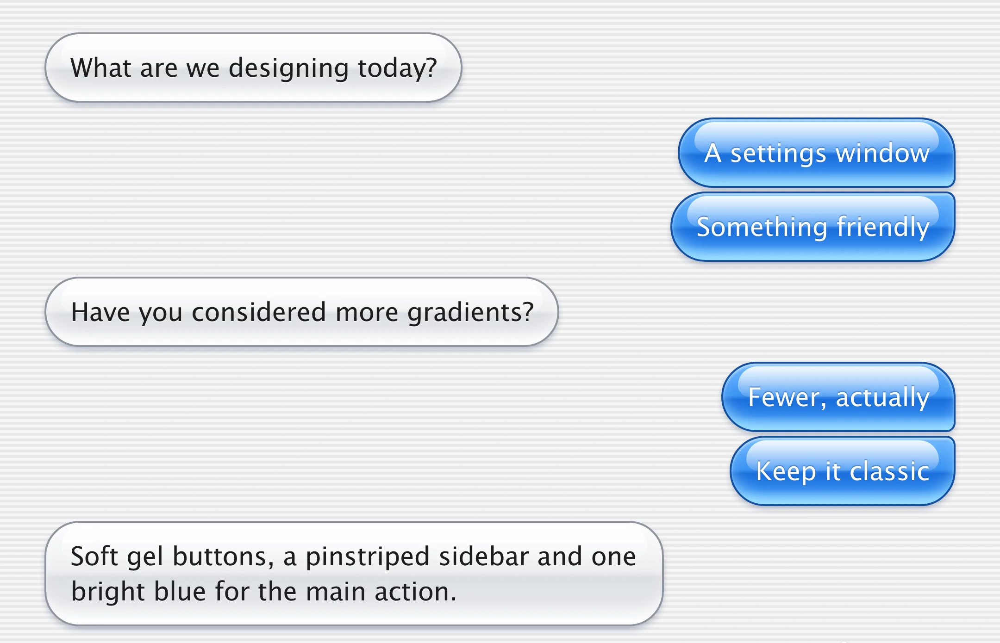
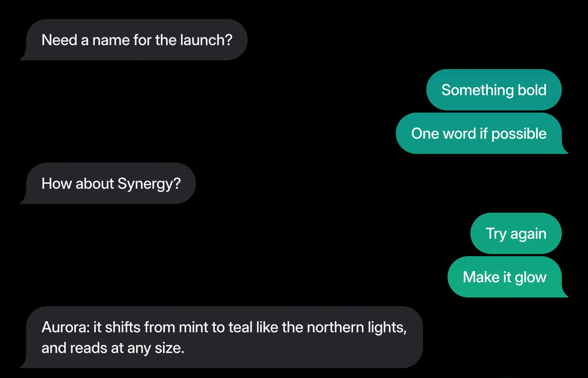
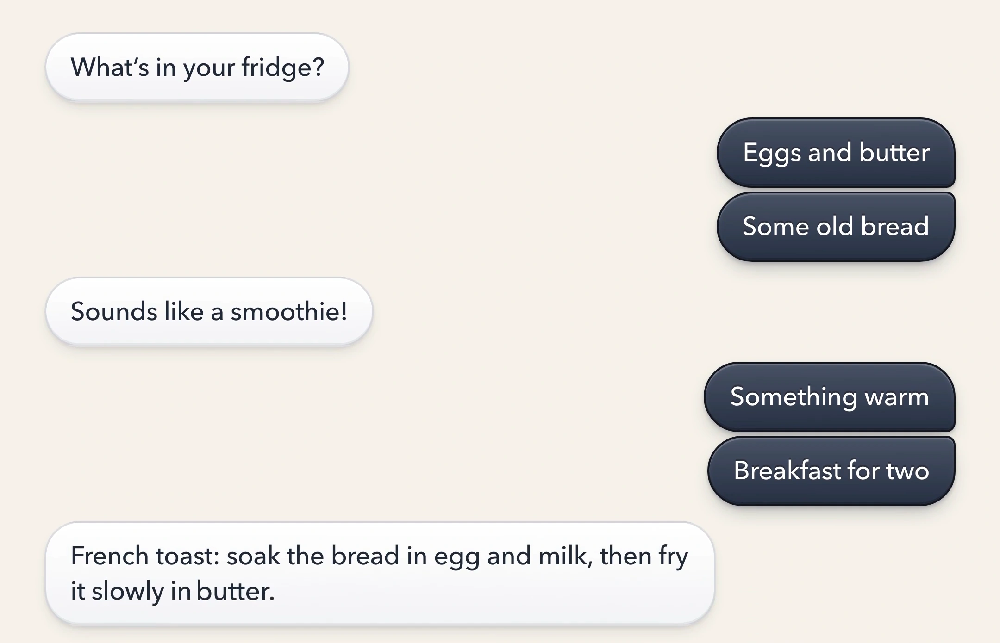
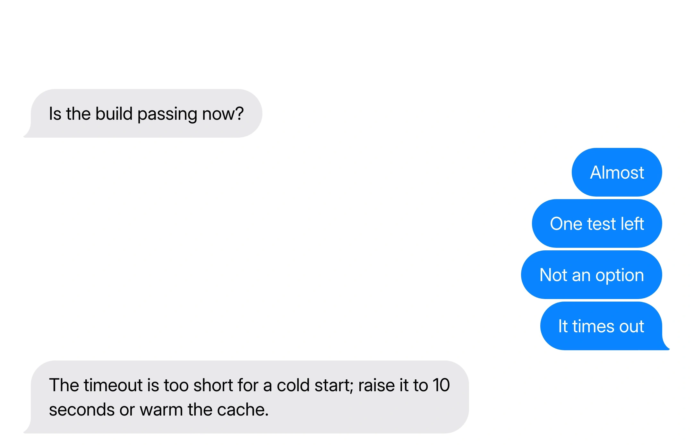

# 012 · 消息气泡的材质与动效（探索版） / Message Bubble Materials and Motion

为聊天或 AI 对话界面选择气泡材质，并让发送、长回复展开和中间删除的运动跟随材质。提供 Cirrus、像素、Aqua、共享渐变、拟物、纯色六种方向。本配方用于风格探索；按用户目标选其中一种或几种，不默认把现有产品做成六主题演示。

## 效果参考

六张图片分别展示不同材质，按 2160×2880 视频的原像素裁出 2160×1390 的消息区域，WebP 质量 95；不放大、不锐化、不涂抹。不保留重复帧或整段视频。静态图仅用于核对材质与布局，不能证明完整缓动、碰撞、删除补位或真实流式交互。

### Cirrus 薄磨砂



### 像素



### Aqua 果冻



### 共享渐变



### 拟物



### 纯色



## 适用与边界

- **独立演示（Rebuild）**：按明确需求创建聊天演示，可用材质标签切换并演示发送、长回复与删除。演示文案不成为真实产品需求。
- **现有界面改造（Retrofit）**：默认只调整气泡材质及其入场、长回复展开、长按反馈和离场；保留消息数据、组件 props、加载与流式协议、所有图标。输入框与发送按钮、消息菜单、思考指示器、页面背景分别按用户授权范围处理。已明确模式、材质与范围时直接执行，不重复询问；仍未明确且会影响实现时才补问。
- 数值是演示基准：28/38 px 字号／行高、680 px 长消息宽度、48 px 侧距等需要映射到现有设计系统与视口，不把固定宽度硬塞进手机。单行胶囊、多行圆角矩形与分组语义保持一致。
- 六种材质共享分组结构与最终文本布局；发送者侧的分组圆角或末尾尾巴随成员变化更新。Cirrus 的噪声层、Aqua 高光与纯色／渐变尾巴都是各自材质的伪元素规则，不能把同名选择器的片段全部叠到一个气泡上。
- 渐变是整段对话共享的一张色场，每个气泡按其当前位置取片段，尾巴与气泡底部取色连续；不能给每个气泡各放一张相同的独立渐变。滚动坐标和线程坐标要在实现中明确并验证。
- 像素材质的形状与拖影在 Canvas 网格绘制，正文仍保留可选择、可读取的 DOM 文本。像素格是设计效果，不是低分辨率图片的替代。
- Aqua 的宽高对向形变通过独立背景层的 `scaleX`／`scaleY` 表达，不每帧改真实布局宽高、不挤压正文重新换行。正文先按最终宽度排版，再裁切揭示；位置变化使用 transform 或 FLIP，边框圆角的分组变化是明确的外观过渡。
- `response`／`damping` 是示例弹簧语义，按所用库映射并操作验证，不能直接当作任意库的 stiffness／damping 原值。此探索配方的具体时序优先于通用节奏起点，不把 011 的小型过冲范围机械套到本例的果冻实验。
- 真实流式回复、网络失败、重试、重新生成、复制和删除沿用现有语义；不为展示“长回复落下”而等待全部响应再显示。删除仅在原有删除动作真实触发后播放；离场画面可保留不参与布局的视觉副本。
- 底部跟随仅在用户处于底部时启用；用户上翻阅读时保持锚点，不抢滚动。连续发送、删除与反向操作从当前状态接续，避免同组气泡重叠。
- Cirrus 先验证忙碌背景下的文字对比与模糊性能；不支持 backdrop-filter、减少透明或强制颜色时提供清晰实心回退。天空预渲染为静态图片，避免每帧在对话区做完整光线步进。字体不可用时用现有适当后备。

## 材质与运动速查

| 材质 | 表面特征 | 发送 | 长回复与思考 | 删除 |
|---|---|---|---|---|
| Cirrus | 无描边薄磨砂、26 px 模糊、天空背景 | 逐渐磨砂并淡入 | 热扩散点阵、柔和展开与文字上移 | 清玻璃化后淡出 |
| 像素 | 4 px 网格、单格描边、Bayer 抖色拖影 | 网格缩放与抖色显现 | 摆锤点阵、文字按序出现 | 像素格散序消失，无拖影 |
| Aqua | 分段渐变、顶部高光与底部内发光 | 有限纵向过冲的果冻形变 | 水波点阵、弹性展开 | 膨胀后消失 |
| 共享渐变 | 全线程共享 mint／teal 色场 | 从模糊中聚焦 | 双光点绕转、逐词去模糊 | 扩散模糊溶解 |
| 拟物 | 分层内外阴影与有厚度的表面 | 按键式压落 | 弹球点阵、文字盖印 | 压低后下落淡出 |
| 纯色 | 简洁实色、无阴影、末组尾巴 | 轻缩放淡入 | 弦振点阵、文字淡入 | 缩小离场 |

点阵仅在用户同意更换现有思考指示器或明确创建独立演示时实现；默认改造继续使用原指示器。

## 实现提示词

下方保留完整配方的 0–8 节及六种材质参数。先按用户已确定的模式、材质与范围应用上述边界，再实现相应部分；原文的逐项询问不覆盖用户已给出的明确授权。

```text
Message bubbles with a material, and motion that follows the material: sending, a long reply coming in, and deleting one from the middle, in an AI chat. Six materials are specified below with exact values. Use them either way:
- Rebuild: make a standalone demo of a chat thread that plays the three motions in one material, with tabs to switch between materials.
- Retrofit: give the bubbles in my existing chat a material and this motion, inside my code and design system, keeping the message data, the components and how messages load.
Ask me which one, and which material(s), before you start.

Retrofit scope: by default, change only the bubbles: their material (sections 1 and 2) and their motion (sections 3, 4, the reply opening and words in 5, and the bubble's long press and exit in 6). Leave every icon as it is. The cursor is for the rebuild demo only. Ask me separately, one at a time, before touching each of these, and change it only if I say yes:
- the composer: the input field and the send button;
- the message menu: its look, its items and how it opens and closes;
- the typing indicator: replacing it with the dot matrix in section 5.

0. Start from what exists (retrofit)
- Find the thread, the bubble component and wherever messages are added, edited or removed, and note the composer, the message menu and the typing indicator. List how the thread is laid out and scrolls, and every animation it has now.
- Flag a thread that jumps when a message arrives or leaves, a bubble whose lines rewrap while it animates, and anything that animates top, height or margin.

1. The bubble box (the same in every material)
- Text 28px on a 38px line, letter-spacing -0.01em, padding 17px 26px, a 2px border (transparent unless the material gives it a color), radius 38px: a capsule for one line, a rounded rectangle when it wraps. Plain circular arcs only, no superellipse or corner-shape. The send button is a circle.
- Mine on the right, theirs (the AI) on the left, 48px from the sides. Long messages wrap inside a fixed width (680px here); lay the text out at that width from the start.
- Messages in a row from one sender form a group: 4px apart inside a group, 16px between groups. Mark each bubble single, first, middle or last, and reshape the group with a 200ms border-radius transition when a message joins or leaves:
  - Aqua, skeuomorphic, cirrus: where two bubbles of a group meet, the corners on the sender's side close to 10px.
  - Solid, gradient: every bubble stays round; only the last of a group gets a tail, two pseudo-elements at the bottom corner on the sender's side (shown here for mine; mirror them for theirs):
    .bubble::before { bottom: -2px; right: -14px; width: 64px; height: 38px; background: <bubble color>;
      border-bottom-left-radius: 18px 14px; border-bottom-right-radius: 3px; }
    .bubble::after { bottom: -2px; right: -34px; width: 32px; height: 42px; background: <page background>;
      border-bottom-left-radius: 20px 24px; }
    The blob sticks out 12px; the scoop beside it cuts it into a curl. Fade them in over 160ms when a bubble becomes the last of its group.

2. The six materials
Each one sets the paint, the type and the background (and, in the rebuild demo, the composer, the menu and the cursor). Keep them as tokens. In a retrofit, use the bubble values; take the background only if the material needs it to read (cirrus needs its sky, gradient a dark background) and ask me first. The CSS below is exact: copy it to match the look. ".me" is my bubble, ".them" the AI's; the base font is Inter.

Cirrus (light, clean): thin frosted panes with no edge and no shadow, over a blue sky.
  .bubble { border-color: transparent; background: none; box-shadow: none;
    backdrop-filter: blur(26px) saturate(130%); }
  .bubble::before { content: ''; position: absolute; inset: -2px; border-radius: inherit;
    background: var(--grain), var(--tint); }   /* text sits above it */
  .bubble.me { --tint: rgb(46 128 232 / 0.34); color: rgb(255 255 255); }
  .bubble.them { --tint: rgb(104 134 168 / 0.34); color: rgb(255 255 255); }
  --grain: a 160px SVG tile, feTurbulence type="fractalNoise" baseFrequency="0.9" numOctaves="2" stitchTiles="stitch", then feColorMatrix "0 0 0 0 0.5  0 0 0 0 0.5  0 0 0 0 0.5  0 0 0 0.09 0" (mid gray at 9%).
  The sky: render it once, at twice the page size, and use the image. For each pixel, a ray from an eye at height 1.25, looking ahead along z with a focal length of 1.25 and slightly down (uv.y - 0.02), marches through a cloud layer: density = clamp(2.8 * fbm(p * 0.95) - 1.05 - 0.75 * p.y, 0, 1), fbm being 6 octaves of value noise (each octave x2.03, half the weight). Step 0.03 or 2.5% of the distance, up to 160 steps or until opaque. At each step with cloud, light = clamp((d - density(p + 0.25 * sun)) / 0.4, 0, 1) with the sun at normalize(-0.35, 0.75, 0.55); color = mix(rgb(0.5, 0.6, 0.74), white, 0.2 + 0.8 * light), mixed 25% toward rgb(0.9, 0.93, 0.97) by density; alpha = 0.6 * density; fade it into the sky by 1 - exp(-0.0016 * t * t). The sky behind: mix(rgb(0.66, 0.82, 0.97) at the horizon, rgb(0.15, 0.45, 0.9) overhead) by clamp(rd.y * 1.6 + 0.35, 0, 1)^0.85, plus a faint warm glow toward the sun. The result is deep blue overhead and a sea of white cumulus in the lower half. Let the image drift sideways slowly (100px each way, one sway per loop).
  Menu: background var(--grain), rgb(70 98 134 / 0.52); backdrop-filter: blur(36px) saturate(130%); white text; Delete rgb(255 138 126).

Pixel (retro game): drawn in a canvas on a fixed grid of 4px cells, not with the DOM.
  Every frame, for each cell, test the cell's center against the bubble's current shape: its position, scale, size, corners of radius 16px (4px where a group joins), and on the last of a group a stepped tail: in the bubble's own frame, with the origin at its bottom corner on the sender's side and x pointing outward, the triangle -10 <= x <= 14, -16 <= y <= 0, y >= -16 + (x + 10) * 16 / 24. Cells inside are filled; cells inside with a neighbor outside are the one-cell outline.
  Outline rgb(14 15 34); fill mine rgb(93 112 232), theirs rgb(244 243 236). Dimming mixes the fill toward the background.
  Each cell keeps a trace = max(trace * exp(-dt / 0.06s), coverage now) and is drawn when the trace is above the 4x4 Bayer threshold for its position ((value + 0.5) / 16 for 0 8 2 10 / 12 4 14 6 / 3 11 1 9 / 15 7 13 5), so moving bubbles leave a dithered trail. A trace below 1 is drawn in its color mixed toward the background by 0.25 + 0.75 * trace, so the trail keeps its size but stays light. Scale the canvas up with image-rendering: pixelated.
  Background: rgb(27 30 52) with 1px lines of white at 3.5% every 4px both ways.
  Text stays in the DOM: font-family 'Pixelify Sans'; letter-spacing: 0.02em; mine color rgb(255 255 255) with text-shadow 0 4px 0 rgb(14 15 34 / 0.35); theirs color rgb(14 15 34); its position snapped to the 4px grid. Composer, menu and tabs: square corners, background rgb(244 243 236), and a stepped outline box-shadow: 0 -4px 0 rgb(14 15 34), 0 4px 0 rgb(14 15 34), -4px 0 0 rgb(14 15 34), 4px 0 0 rgb(14 15 34); the send button rgb(93 112 232).

Aqua (playful, nostalgic):
  .bubble { border-color: var(--edge); background: var(--face);
    box-shadow: inset 0 -14px 18px -8px var(--glow), inset 0 2px 2px rgb(255 255 255 / 0.5), 0 4px 8px -2px rgb(0 30 80 / 0.32);
    font-family: 'Lucida Grande'; letter-spacing: -0.01em; }
  .bubble.me { --face: linear-gradient(180deg, rgb(116 188 255) 0%, rgb(58 146 242) 48%, rgb(28 111 220) 54%, rgb(43 132 236) 78%, rgb(138 210 255) 100%);
    --edge: rgb(21 80 160); --glow: rgb(160 228 255 / 0.95); color: rgb(255 255 255); text-shadow: 0 -1px 1px rgb(0 40 110 / 0.45); }
  .bubble.them { --face: linear-gradient(180deg, rgb(253 253 254) 0%, rgb(236 238 241) 48%, rgb(220 223 228) 54%, rgb(228 231 235) 78%, rgb(251 252 253) 100%);
    --edge: rgb(141 148 159); --glow: rgb(255 255 255 / 0.95); color: rgb(29 29 31); text-shadow: 0 1px 0 rgb(255 255 255 / 0.7); }
  .bubble::before { content: ''; position: absolute; top: 3px; left: 16px; right: 16px; height: min(46%, 36px);
    border-radius: 30px 30px 18px 18px; background: linear-gradient(180deg, rgb(255 255 255 / 0.92), rgb(255 255 255 / 0.12)); }
  Background: repeating-linear-gradient(180deg, rgb(246 246 246) 0 3px, rgb(233 233 233) 3px 6px).

Gradient (brand):
  .bubble.me { --grad: linear-gradient(180deg, rgb(11 127 134) 0%, rgb(13 148 136) 28%, rgb(16 163 127) 60%, rgb(31 191 143) 100%);
    background: var(--grad) 0 calc(-1 * var(--top)) / 100% var(--thread-height); color: rgb(255 255 255); }
  .bubble.them { background: rgb(38 38 42); color: rgb(244 244 245); }
  .bubble { font-weight: 500; letter-spacing: -0.015em; }
  --top is the bubble's current offset in the thread, set every frame as it moves, so each bubble shows the slice at its height and changes color as it moves up; the tail of mine shows the slice at the bubble's foot. Background rgb(0 0 0). The send button: linear-gradient(160deg, rgb(31 191 143), rgb(13 148 136) 60%, rgb(11 127 134)) border-box.

Skeuomorphic (warm, tactile):
  .bubble { font-family: 'Avenir Next'; font-weight: 500; }
  .bubble.me { border-color: rgb(18 22 31); background: linear-gradient(180deg, rgb(72 81 100) 0%, rgb(39 48 66) 100%);
    box-shadow: inset 0 2px 0 rgb(255 255 255 / 0.18), inset 0 2px 6px rgb(255 255 255 / 0.08), inset 0 -2px 0 rgb(0 0 0 / 0.22),
      0 2px 4px rgb(15 23 42 / 0.18), 0 10px 22px -8px rgb(15 23 42 / 0.36);
    color: rgb(255 255 255); text-shadow: 0 -2px 0 rgb(0 0 0 / 0.28); }
  .bubble.them { border-color: rgb(15 23 42 / 0.14); background: linear-gradient(180deg, rgb(255 255 255) 0%, rgb(242 243 245) 100%);
    box-shadow: inset 0 2px 0 rgb(255 255 255), inset 0 -2px 0 rgb(15 23 42 / 0.06), 0 2px 4px rgb(15 23 42 / 0.06), 0 8px 18px -8px rgb(15 23 42 / 0.18);
    color: rgb(31 41 55); text-shadow: 0 1px 0 rgb(255 255 255); }
  Background rgb(245 242 233).

Solid (the default):
  .bubble.me { background: rgb(10 132 255); color: rgb(255 255 255); }
  .bubble.them { background: rgb(233 233 235); color: rgb(0 0 0); }
  No shadow; white background.

3. The thread moves as one
- Lay the thread out from the bottom up, above the composer, and place each bubble with transform: translateY. When a message is added, removed or resized, compute every bubble's new place and let each one follow it on its own spring, from where it is now. No other bubble needs an animation of its own. If the list must stay in normal flow, do the same with FLIP.
- Springs (response, damping): cirrus 0.5s 0.88, pixel 0.42s 0.8, aqua 0.46s 0.74, gradient 0.52s 0.92, skeuomorphic 0.34s 0.84, solid 0.42s 0.86.
- Never animate top, height or margin, and never let two bubbles overlap.

4. Send
The bubble rises from about 40px below its place and comes in the material's way:
- Cirrus: clear glass that frosts over: backdrop blur and tint from 0 to full over 560ms ease-out, scale 0.94 to 1 over 420ms, fade in over 200ms.
- Pixel: scale 0.3 to 1 over 380ms on cubic-bezier(.22, 1, .36, 1), stepping on the grid; it fades in through the dither over 200ms; text appears once it is nearly full size.
- Aqua: jelly: scale 0.5 to 1 on a spring (response 0.5s, damping 0.5) while width and height wobble against each other, 12% apart at first and dying out in about 0.2s; never let it grow taller than 1.04 of its size, so it can't reach the message above.
- Gradient: out of focus: blur 16px to 0 and scale 0.96 to 1 over 440ms on cubic-bezier(.22, 1, .36, 1), fade in over 300ms.
- Skeuomorphic: like a key: scale 1.1 to 1 on a spring (response 0.36s, damping 0.55) that dips under 1 first.
- Solid: scale 0.9 to 1 over 380ms on cubic-bezier(.22, 1, .36, 1), fade in over 120ms.

5. Long reply
- While the AI is typing, show a small dot matrix on its own, with no bubble around it: about 48px square, where the reply will start. Each material runs a small piece of physics on it, on a loop:
  - Cirrus 6x6: warmth let out along a slow circle (one turn in 2.2s) spreading like heat: the sum of Gaussians left behind over the last second, each wider and fainter with age.
  - Pixel 6x6: a pendulum hung from the top middle, angle 0.9 cos(2πt / 1.1s), the bob bright and the rod faint, shown as square dots in four levels.
  - Aqua 5x5: drops on water every 0.9s, rings travelling out and dying away (an exponentially decaying cosine in radius minus time).
  - Gradient 6x6: two equal lights orbiting their center, one turn in 1.3s, colored mint to teal across the grid.
  - Skeuomorphic 4x4: a ball bouncing: a parabola in time between bounces (0.62s apart) and a steady drift across, turned back by the walls.
  - Solid 5x5: a plucked string, the fundamental plus a quieter second mode at twice the frequency.
  Write each as a smooth function of time so brightness changes continuously, never on or off. Give the moving ones motion blur by averaging each frame over a short shutter (1/30 to 1/20s). Keep the dots flat, one color per material that stands out on its background, faint at rest and fuller as they light; no gloss or bevel.
- When the reply lands, the bubble appears where the matrix was and opens from that corner to the message's size while the matrix fades out: cirrus on a soft spring over 640ms, aqua on a spring a little past its size over 760ms, skeuomorphic on a short spring over 520ms, the others over 520 to 600ms on cubic-bezier(.22, 1, .36, 1). Clip the text, already laid out, so lines never rewrap. Hold the thread above to the opening bubble instead of the spring, so nothing overlaps.
- The words come in one after another, starting 160ms in: rising 10px as they fade in (cirrus, 18ms apart, 360ms each), typed in at once (pixel, 26ms apart), popping up from 0.4 on cubic-bezier(.34, 1.56, .64, 1) (aqua, 16ms, 300ms), sharpening out of an 8px blur while rising 6px (gradient, 14ms, 320ms), stamped in from 1.14 (skeuomorphic, 22ms, 160ms), fading in (solid, 14ms, 240ms).

6. Delete from the middle
- A long press presses the bubble to 0.94 to 0.97, then lifts it to 1.02 to 1.04, while the others dim to 35 to 50% (gradient also blurs them 4px). The menu opens under it, on the bubble's side, with Copy, Regenerate, Read aloud and Delete (Delete in red), coming in the material's way: frosting over (cirrus), a stepped wipe from the top in five steps (pixel), a pop from 0.7 (aqua), a focus pull from a 12px blur (gradient), a short drop from 14px above on a spring (skeuomorphic), a scale from 0.88 (solid).
- On Delete the menu leaves in 160 to 200ms ease-in and the bubble goes in the material's way: melts back to clear glass, then fades (cirrus, 420ms); breaks up into cells that vanish at once in a scattered order, with no trail (pixel, 360ms); swells to 1.14 and pops (aqua, 320ms); dissolves into a 24px blur while growing to 1.12 (gradient, 380ms); is pressed to 0.94, then drops 36px and fades, with no blur (skeuomorphic, 320ms); shrinks to 0.7 with an 8px blur (solid, 260ms).
- Take it out of the layout as it starts to leave. The messages above settle into the gap while the ones below stay put, the one nearest the gap first, about 60ms in, and each one above it 50 to 80ms after the one below. Let each land on the message below it: when it reaches its place still moving down, flip its velocity and keep 20 to 45% of it (aqua most, gradient least), so it bounces up a little and never sinks into the one below. If the messages either side of the gap are from the same sender, they join into one group.

7. Keep it right
- Animate transform, opacity and filter only (backdrop-filter for the glass).
- A new action interrupts the running one from where it is; nothing waits for an animation. Switching material mid-motion fades the thread out and back in the new material from wherever it is.
- Respect prefers-reduced-motion: keep the fades, drop movement, scale and blur, hold the typing matrix on one still frame, and place the thread at once.
- Keep the thread pinned to the bottom while messages arrive, unless the user has scrolled up.

8. Deliver
- First list what you found (retrofit) or what you will build (rebuild), and the material(s) you will use.
- Then build it, and list every file you touched.
- Retrofit: don't change the message data, the components' props, the way messages load or any icon, and leave the composer, the menu and the typing indicator alone unless I said yes to them. If something does not fit this plan, ask me first.
```

## 核对

- 六种材质只实现已选择的部分，材质 token、字体后备、前景对比与分组尾巴／圆角一致；渐变取色与像素网格保持各自坐标规则。
- 分别操作短消息发送、长回复展开、真实流式追加、发送失败与重试、中间删除、连续操作、同发送者分组合并；动画过程中正文不重新换行，气泡不互相穿过。
- 长按同时有键盘与触摸可达的原有入口；菜单能力、焦点管理和删除语义不因材质改变。输入区、菜单、图标和思考指示器只按用户范围修改。
- 用户在底部时消息跟随，用户上翻时滚动位置稳定；窄屏、长词、换行、图片／代码消息与不同字号不会溢出或遮挡输入区。
- 开启 `prefers-reduced-motion` 时去掉位移、缩放和模糊，点阵固定一帧，线程即时归位，只留必要淡入淡出。切换材质、取消或新操作可接续当前状态。
- 实际项目中验证动画时序、弹簧参数、性能与兼容性；仅看上述静态图片时不能宣称动态效果已经匹配。

关联配方：[011 动画节奏](easing.md)、[001 拟物按钮](tactile-button.md)、[010 液态玻璃](liquid-glass.md)。
