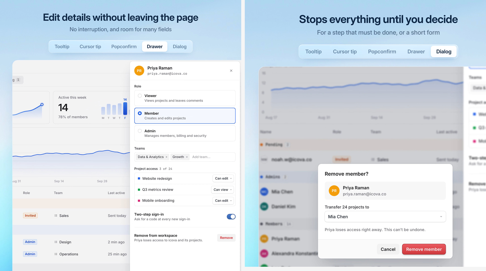

# 提示、跟随气泡与浮层决策 / Floating UI Decision Guide

实现配方附高清演示截图；参数是可调起点，仍需在目标项目与浏览器中验证。

## 效果参考



静态图用于核对构图、材质与可见状态；触发、连续运动和焦点管理需在实际项目中验证。

## 适用与边界

按解释对象、可逆性、影响范围、表单长度和是否需要对照页面，在 Tooltip、Cursor Tip、Popover、Popconfirm、Dialog、Drawer 与独立页之间选型。

元素的简短解释用 Tooltip；区域内持续读数用跟随气泡；有可点击操作改为 Popover。可撤销操作在产品规则允许时执行并提供真实 Undo；单项不可逆操作可用就地确认，影响大、批量或需决策用 Dialog。短表单且无需参照页面用弹窗；长表单或需对照页面用抽屉；主要任务或需独立 URL 用页面。现有保存机制优先，不把所有抽屉表单改为即时保存。

## 核对

逐个记录触发、内容、当前与目标类型；检查确认前不执行、取消可恢复、未保存退出提示、焦点回归、视口避让，以及键盘与触摸入口。

## 实现提示词

将下方配方应用于用户指定的组件或页面；其中 product、global、every 等范围以用户本次授权为界，不自动扩大到整站。已有设计系统和提交语义优先，新增设置面板、全局扫描和演示风格仅在任务需要时采用。

```text
Review how my product uses floating UI (tooltips, tooltips that follow the pointer, popovers, popconfirms, drawers and dialogs) and decide which kind each case should be. Work inside my existing design system. This is about choosing the right kind, not about restyling: keep my components, colours, radii, shadows, fonts, motion and copy style.

0. Start from what exists
- Find every overlay in the product and the components behind it: tooltips, hover cards, popovers, confirm bubbles, menus that confirm, side panels, drawers, sheets, modals and dialogs.
- For each use, note where it is, what opens it, what it holds and what happens when the user confirms.
- Find the design system's own component for each kind. Reuse it. If two components do the same job, say so and suggest which one to keep.

1. What each kind is for
- Tooltip: adds text about what the pointer is on, such as long text that has been cut short, an icon-only button or a disabled control. Text only. If it needs actions, it becomes a popover opened by a click.
- Tooltip that follows the pointer: keeps giving information across an area. It appears when the pointer enters, follows it, and goes when the pointer leaves. Common on charts and on other self-contained elements.
- Popconfirm: the second check for an irreversible action on a single item, right where it was clicked. The path stays short and nothing else is interrupted.
- Dialog: for something the user must stop and confirm or complete before going on: an action with a large impact, one that affects other people, a bulk action, or one that needs another decision first (such as who takes over the projects). Also for a short form that doesn't need anything else on the page for reference.
- Drawer: for a long form, for work that needs the page in view to compare against, or to make better use of horizontal space. Never use a drawer to confirm something.
- Full page: when the task is the user's main job there, or it needs a link that can be shared and survives a reload.

2. Questions that settle a case
- Can the action be undone? Then don't confirm: do it at once and offer Undo (a toast, or a way back such as a trash).
- If it can't: is it one item of the user's own, with a button to anchor to? Popconfirm. Large impact, other people, a bulk selection, or a decision still to make? Dialog.
- Is it a form? Short, and nothing on the page is needed for reference: dialog. Long, needs the page in view, or wants the width: drawer. The main task, or needs its own URL: a page.
- Is the information about one element, or about wherever the pointer is inside an area? One element: tooltip. An area: tooltip that follows the pointer. Either way, does it need anything to click? Then it is a popover.
- On touch screens there is no hover: anything shown on hover must also be reachable by a tap.

3. What each kind should do
Fill in only what is missing, with the design system's existing parts.
- Tooltip: shows on hover and on keyboard focus, after about 500ms for the first one, then at once when moving to a neighbour. Stays inside the viewport, lets the pointer through, one at a time, linked with aria-describedby.
- Tooltip that follows the pointer: sits beside the pointer without covering it and flips near the edges of the viewport. On a chart, the guide line follows the pointer and the value snaps to the nearest data point. On touch, a tap shows the value.
- Popconfirm: anchored to the button that opened it and grows from it. Escape or a click outside closes it, and focus goes back to that button. The confirm button names the action.
- Dialog: the system's modal or a native dialog opened with showModal(). Keeps focus inside and Escape cancels. It says who or what is affected and what cannot be undone. Buttons name the action ("Remove member", not "OK").
- Drawer: comes in from the edge it is attached to and leaves the page in view. Preserve the product's existing explicit-save or live-update model; reflect changes only when that model allows it. Closes with Escape and a close button; focus moves into it and back out to what opened it.
- Drawers, dialogs and pages with a form: closing with unsaved changes asks first.

4. Keep the design as it is
- Change only the kind where the current one is wrong, plus the missing behaviour from step 3.
- Don't change colours, radii, shadows, fonts, spacing or animations, and don't add new visual patterns.
- Keep copy as it is, except confirm buttons and the line that explains what cannot be undone.
- If a case needs a component the system doesn't have (an undo toast, a popover), reuse another suitable primitive or add one within the requested scope; clarify only when the interaction semantics are unresolved.

5. Deliver the decisions first
- Before changing any code, give me a table: each use, where it is, its current kind, the kind you recommend, and why in one line.
- Mark the ones that are already right, and the ones that could fit two kinds, with what decides between them.
- Implement the decisions within the user's requested scope and list every file you touched. Ask only when unresolved semantics change the task.
```

参考片段：[连续动效片段](../../assets/recipes/overlay-decision.gif)。
