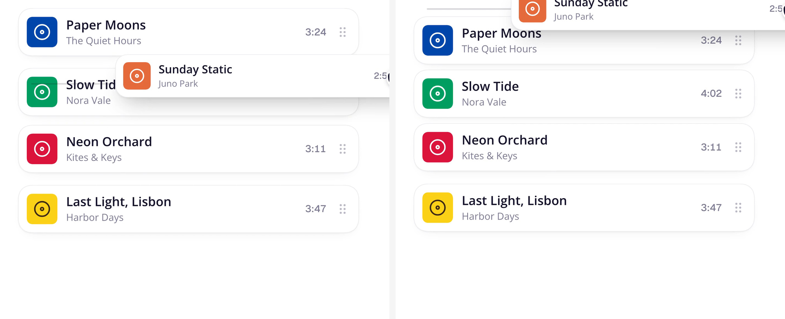

# 拖拽插入线与递减让位 / Ripple Drag Reorder

实现配方附高清演示截图；参数是可调起点，仍需在目标项目与浏览器中验证。

## 效果参考



静态图用于核对构图、材质与可见状态；触发、连续运动和焦点管理需在实际项目中验证。

## 适用与边界

横向或纵向拖拽时以插入线标明落点，两侧按距离递减位移并错峰让位；释放提交真实顺序，Esc 或落在外侧恢复。

可拖目标悬停为 pointer、拖动为 grabbing。被拖项浮起并避开落点；插入线从中心展开，在自身原位置不显示。邻项 n 从 0 计，位移 A × 0.7ⁿ，延迟 24ms × n；图标 A≈10px、卡片≈8px，回弹约 250ms 收敛。视觉位移用 transform，拖拽结束才提交数据；取消恢复拖前快照。

## 核对

检查首尾与相邻换位、横竖布局、键盘重排、触摸滚动冲突、落在外部与 Esc 取消；保存失败回滚并显示原因；减弱动态时仅保留插入线。

## 实现提示词

将下方配方应用于用户指定的组件或页面；其中 product、global、every 等范围以用户本次授权为界，不自动扩大到整站。已有设计系统和提交语义优先，新增设置面板、全局扫描和演示风格仅在任务需要时采用。

```text
Make drag-to-reorder in my product feel like this. Apply it to the lists,
rows and docks I name, and reuse any drag helper the project already has.

1. Cursor: a pointing hand over anything draggable, a grabbing hand while
   dragging.
2. Lift: the picked item follows the pointer, raised off the list so it
   never hides where it will land: above a horizontal row, or pulled aside
   and shrunk to about 90% in a vertical list. Its old slot closes up.
3. Drop hint: a faint, thin line in the gap where it will land (vertical in
   a row, horizontal in a list), about 15% of the text color. It grows from
   its middle when it appears and glides to each new gap. No line over the
   item's own slot.
4. Ripple: items on both sides of the line lean away from it. Counting n
   from the line (0 = the item touching it), item n moves
   A x 0.7^n (A is about 10px for icons, 8px for cards)
   and starts 24ms x n later, on a quick spring that barely overshoots and
   settles in about 0.25s. Nearer items move sooner and further, so the
   push spreads out like a ripple.
5. Drop: the item takes the gap and every item springs into its new place.
   Escape or dropping outside the list cancels, and everything springs back.
6. Give each motion its own curve (hand-like for the pointer, a small pop
   for the lift, springs for settling) instead of one ease-out everywhere.

Move things with transforms, not layout. Let the keyboard reorder too, and
with reduced motion keep only the line.
```

参考片段：[连续动效片段](../../assets/recipes/ripple-reorder.gif)。
