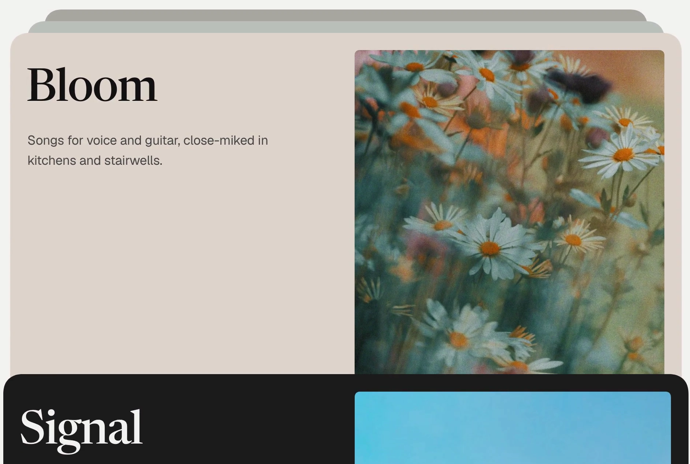
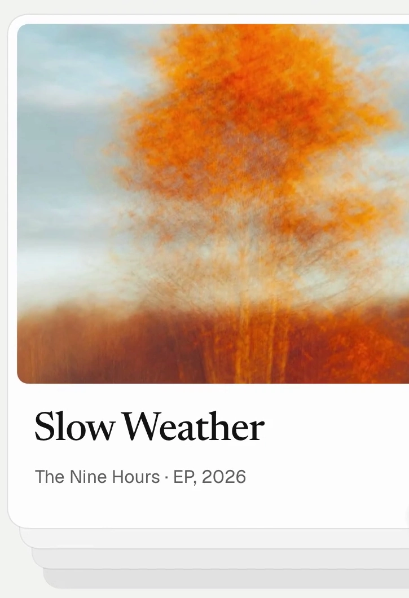
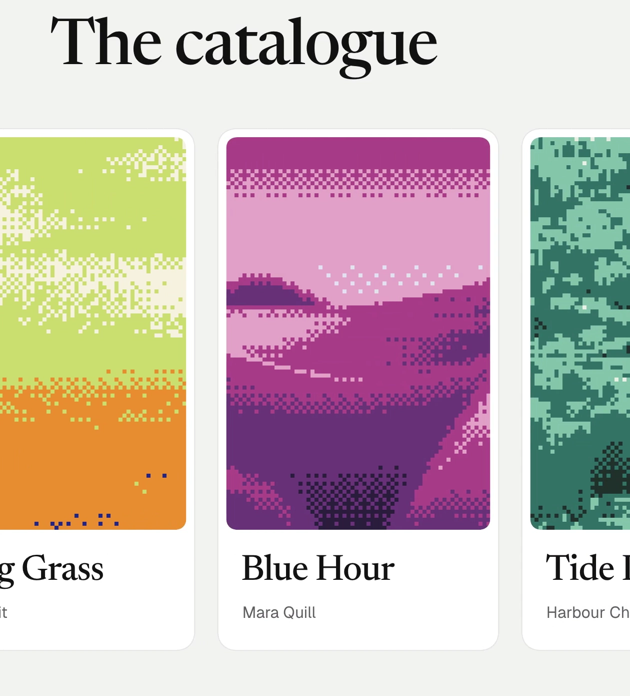
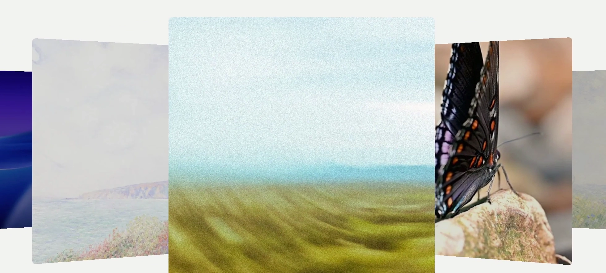
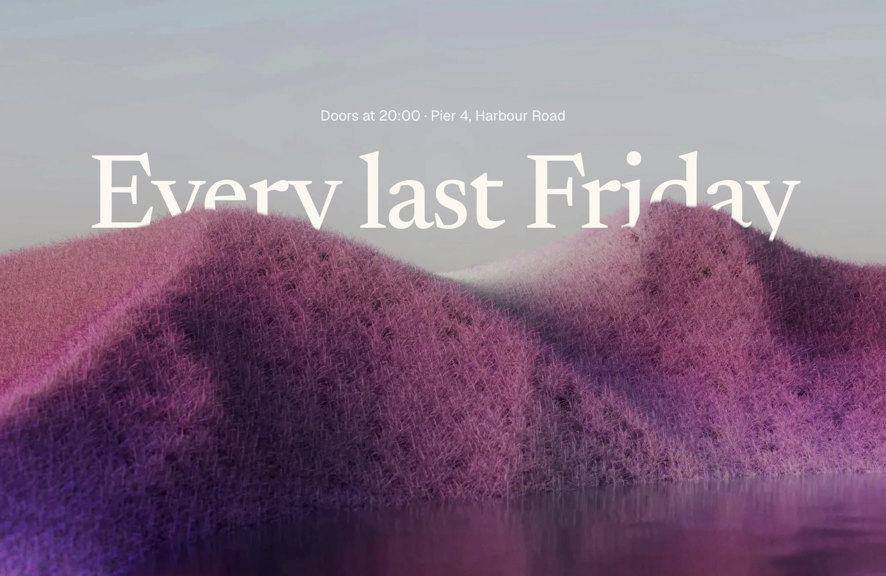

# 019 · 五种经典的卡片滚动交互 / Scroll-driven Cards

在已有长页面中，为适合逐项阅读的卡片安排滚动交互，保留真实内容、组件、设计 token、文案和导航。五种模式分别是层叠卡片、卡组飞出、横向展廊、封面轮播和图片展开；每个状态直接由滚动位置决定，停止滚动即停在当前位置，反向滚动沿原路径恢复。

## 按内容选型

| 模式 | 内容与数量起点 | 核心区别 |
|---|---|---|
| Stacked cards · 层叠卡片 | 3–5 个步骤、特性或章节 | 新卡覆盖旧卡；旧卡缩小、变暗并露出顶部条带 |
| Card deck · 卡组飞出 | 3–6 个精选、评价或亮点 | 顶卡交替向两侧旋转飞出，下层递次上升，最后一张保留 |
| Pinned gallery · 横向展廊 | 5–12 个作品、商品或发行物 | 限定展示区吸附，纵向滚动映射为一排卡片的横向位移 |
| Cover flow · 封面轮播 | 5–9 个同形封面 | 中央封面最大，两侧缩小、倾斜、变暗；由滚动推进焦点 |
| Image expand · 图片展开 | 一个能开启下一章节的主图或视频 | 画框扩展到展示区，前后层遮挡与不同位移形成景深 |

同一种模式每页至多一段作为起点，段间保留普通内容；需要快速比较、搜索、填写或扫描的信息优先使用正常布局。不是要求一页必须同时出现五种效果。

先盘点各段内容、固定页头／横幅、滚动容器、现有动画库、断点与短屏问题，再确定使用位置、长度、手机方案、减弱动态与引擎。下方完整提示词给出逐项选择流程；已有明确选择和实施授权时直接复用，不重复五轮询问或索要 go-ahead。没有真实用户分析数据时说明未知，不编造受众设备分布。

## 进度、参数与适配起点

每段使用 `p = clamp((scrollOffset − start) / distance, 0, 1)`，同段所有视觉属性由 p 推导；`start` 和 `distance` 来自真实滚动容器与布局。固定展示区使用有足够父级高度的 sticky，额外高度就是滚动过程所需距离。静态帧不能证明进度函数、连续路径或回滚正确。

| 模式 | Standard 起点（1000×896 示例视口） | 适配重点 |
|---|---|---|
| 层叠 | 卡片 936×720、圆角 28px、相隔 48px；吸附 top 为页头高度 + 40px + i×16px；每层缩放 −.05、暗层 +.12；最后停留 320px | 卡高按可用视口缩小，露边和正文仍须完整；752px 为示例推进距离 |
| 卡组 | 432×456；每张飞出用 420px 滚动，末尾停留 240px；x=side×t²×1000px，y=t×(160t−40)px，旋转 side×t×16°；后层下移 18px、缩小 .05 | 距离按实际张数为 `(N−1)×step + hold`；始终保留最后一张 |
| 展廊 | 示例卡宽 280px、间距 24px；位移 −p×overflow，默认横纵 1:1，2px 进度线 | overflow 由轨道真实宽度减可视宽度得出；无溢出不固定，约超过三屏时优先网格 |
| 封面 | 封面 432px、步距 320px；x=d×260px，rotateY=clamp(d,−1,1)×−30°，scale=max(.6,1−abs(d)×.2)，暗层 min(abs(d),3)×.15；透视 1400px | `r` 限制在 0…N−1，`c=floor(r)+smoothstep(0,1,fract(r))`；中心附近短暂停稳仍是进度映射 |
| 展开 | 584×352 初始画框，900px 展开 + 300px 停留；clip inset 与圆角逐渐归零，图片 scale 1.2→1，曲线 (.45,0,.25,1) | 标题与前景分别按滚动的 .25／.5 位移；下一段覆盖时 28px 顶部圆角在最后 120px 归零，旧图暗层最多 .35 |

Short／Standard／Long、层叠深度、抛出幅度、封面透视和初始图片大小见完整提示词第 10 节。卡片数量、实际高度或预设变化时，重新推导距离和终点，不照抄示例总高度。

手机默认保留适配后的层叠、卡组和展开；展廊、封面采用原生横向列表与吸附点。可用高度不足约 560px 时全部回到普通列表／横向行／全宽图。固定展示区以稳定的小视口高度 `svh` 为起点，扣除固定页头、安全区和必要边距；卡片容不下长文或 200% 字号时进一步降级，不能裁断内容来凑一屏。

## 清晰效果参考

以下五张 WebP 直接从 **2160×2880** 视频解码，按原像素裁切、质量 98，无放大、锐化、涂抹或跨帧修补。只保留不同模式各一张 UI 局部，裁掉窗框、讲解面板、署名光标和进度标注；综合入口与已有层叠／横向条目复用同一文件。

### 层叠 · 1885×1270



展示层叠过程局部，下方新卡未全幅保留；不能据此推断整卡高度或退出时机。

### 卡组 · 725×1060



保留正面左侧与下层卡边，右侧裁出画面以排除光标；不作为完整卡片或抛出路径的截图。

### 横向展廊 · 1260×1390



只显示轨道局部；像素化画作是 UI 内容本身，不代表文字或参考图被低清缩放。

### 封面轮播 · 1960×885



保留中央与两侧封面，底部略作裁切；不含圆点与完整展示区。画作中的颗粒与虚焦属于原画风格。

### 图片展开 · 1980×1290



展示接近全幅后的前后遮挡关系；不能证明初始画框、缩放速度、视差或下一段覆盖。示例标题、署名性质的作品文案和图片不自动成为产品内容。

## 在现有产品中应用

应用下方完整提示词时，以本节解释其中的演示简化，保留用户已选范围。

- **进度区间与引擎**：窗口或嵌套滚动容器分别测量；sticky 起点包含页头偏移，过程距离不等于整个 section 高度。CSS view timeline 的默认区间不自动等于此公式，按实际开始／结束位置设置 range、填充与映射；横向位移显式线性，只有指定模式局部使用缓动。CSS 与脚本择一驱动同一属性，防止双重写入；不能用 observer 触发后独立播放来冒充可逆滚动。
- **无滚动劫持**：不拦截 wheel／touchmove、不更改全站滚动速度，不新增平滑滚动库。手机原生横向行的 snap 是所选局部浏览方式，不是纵向页滚动捕获。沿用项目已用的引擎，不为这份配方强制添加依赖。
- **测量与内容变化**：轨道溢出取实际可视容器宽度，扣除真实边距；step 与 hold 共同决定总距离，首尾留白计入。统一同一套测量值驱动高度与变换；字体、图片解码、数据、折叠和页头变化后批量重新测量，避免逐帧读写交错。未加载图片预留比例，恢复滚动位置时正确初始化 p。
- **短屏与浏览器工具栏**：约 120px 的“忽略高度变化”只是工具栏启闭的演示启发式，不能忽略键盘、桌面拖动、辅助放大、分屏或真实可用高度变化；按平台识别来源，必要时暂停固定或恢复普通流。宽度、方向、内容尺寸和跨阈值变化都需处理，切换布局保持读者当前内容附近的位置，不强拉回页首。
- **内容与布局**：图文列、文字宽度、字号、间距和图片比例服从当前产品。演示的字体组合、无阴影、无标签、每卡一行说明等不是删减真实信息的授权；200% 文本放大和多语言优先可读。卡片高度不足即降级，不靠 overflow hidden 隐藏必要内容；遮罩只裁视觉图像，不截断正文与焦点。
- **层次与公式**：层叠只缩放内层，避免测量被变换污染；区分父级滚动距离与卡片吸附时刻，最后一张结束后整体离开。封面端点与索引 clamp，最近项的叠放顺序确定，不能让两个面反复争夺层级。平滑步进写成 `smoothstep(0,1,f)` 或 `f*f*(3−2*f)`；JS 使用三角函数时弧度／角度明确，CSS cubic-bezier 用真实 x→y 求值，不把其控制点当作直接插值公式。
- **键盘、链接与焦点**：所有真实条目按阅读顺序可达，辅助技术仍读到原内容。被遮住或抛出的操作不能留下不可见 Tab 焦点：聚焦时让对应卡片和焦点可见，或提供可访问的普通列表；不要简单把非当前所有卡片 inert 后又没有导航入口。原生横向行允许键盘与触摸，锚点用正确 scroll margin 定位段落开头，固定页头不遮挡目标。进度装饰不重复公告，真正可点击的圆点才用有名称的按钮。
- **图片分层与视频**：只在有可靠前景透明层或已有遮罩时做前后遮挡；无分层资产保留二维展开，不把粗糙矩形裁切声称为真实景深，不自动替换主图。前后层共用对齐、尺寸和裁切坐标。必要标题有真实可读文本，装饰副本退出读屏。视频是否静音循环服从原内容用途；装饰视频离屏暂停，拒绝自动播放时显示海报，不改变用户主动播放的媒体语义。
- **性能与降级**：transform／opacity 优先，clip-path、filter 与大图绘制需要实测，不能承诺都在合成线程。JS 回退只在滚动／重测时合并到一帧更新，读取一次滚动量，仅写当前相关段的局部变量；离屏无持续循环，卸载清理监听和观察器。基础普通流先可见，按目标浏览器实际结果启用增强；SSR、无脚本和引擎不可用仍可读。按版本核对下方平台候选 API。
- **减弱动态**：默认移除 pin 与大幅空间运动，保留普通列表、横向行和全宽图，不留原来长空白滚动区；运行时切换偏好同样生效。选择“保留固定但去掉运动”时也必须让所有卡片可访问、短屏能退出，不能让静止顶卡遮住其余内容。

## 完整实现提示词

```text
Rework a long page that already exists in my product so its cards move with scrolling. This changes my product, not a new page or a demo: keep my content, components, tokens and copy, find the sections that deserve it, and give each one of five scroll-driven card interactions: stacked cards (each new card covers the last, which shrinks and dims), a card deck (the top card flies off to one side and the next rises), a pinned gallery (the section holds still while scrolling moves a row sideways), a cover flow (the middle cover is largest; the others shrink, turn away and dim), or an image expand (a picture grows from a frame to the whole screen, with words behind and in front of it rising at different speeds for depth). The scroll position drives every effect, so the reader sets the pace and scrolling back plays it in reverse. It must hold up on every screen, phones above all, and at every viewport height (section 8).

Every value here is a recommendation. Sections 2 to 8 are a tested set (Standard); section 10 gives presets. I choose; you build what I choose.

First look at my product (section 0). Then ask me these one at a time, each as a short list of options with key values and the recommended one marked, and wait for my answer:
1. Which sections get which interaction (section 1): at most one of each per page, with ordinary sections between them.
2. Length: Short, Standard (recommended) or Long (section 10).
3. Phones and short screens: Standard (recommended: on phones the stack, deck and image expand stay, sized to the viewport; the gallery and cover flow become native horizontal rows with snap points; below 560px of viewport height nothing pins), the same as desktop, or plain sections on all phones. Tell me which screen sizes my analytics or audience suggest, if you can find out.
4. Reduced motion: plain sections (recommended: lists, horizontal rows, a full-width picture), or keep the pinning and drop the motion.
5. Engine: CSS scroll-driven animations with a small script as fallback (recommended), or the scroll library my project already uses. Never smooth-scrolling or scroll-hijacking.
Then sum up my choices in one table, propose how you will build it on my platform (section 9), with cost and fallback, and wait for my go-ahead.

0. Start from what exists
- The page: its sections in order, their content, cards, images and videos, and anything fixed or sticky (header, banner, cookie bar) with its height per breakpoint.
- For each section, which interaction fits and which sections must stay as they are (anything people scan, compare or search).
- How the layout responds today: breakpoints, how it sizes to the viewport (vh, svh, dvh, JS reading innerHeight), what already breaks on short screens.
- How the page scrolls: window or inner container, smooth-scroll libraries, anchor links, existing scroll effects.
- Platform and versions, tokens for radius and motion, dark mode. Tell me in a few lines before asking.

1. Which interaction for which content
- Stacked cards: 3 to 5 parallel items worth a screen each (steps, features, plans, chapters).
- Card deck: 3 to 6 items seen one at a time (picks, testimonials, highlights).
- Pinned gallery: 5 to 12 items wider than the screen, to browse (work, products, releases).
- Cover flow: 5 to 9 items of the same shape, one in focus (albums, books, plans, people).
- Image expand: one strong picture or video that opens the next chapter.

2. The rule behind all five
- Each section has one progress p = clamp((scrollY - start) / distance, 0, 1), and every property is a function of p, never a timed animation that scroll merely starts. Stopping halfway leaves it halfway; scrolling back reverses it exactly. Never change scroll speed, snap or catch the wheel.
- Pinning is position: sticky inside a section taller than the screen; the extra height is the distance the effect plays over.
- Animate only transform, opacity, clip-path and filter. Text stays in the page and readable at every p.
- When a section is pinned, show where the reader is as quietly as possible: a thin bar or dots, never a label.

3. Stacked cards (demo: 1000 x 896 viewport)
- Cards 936 x 720 (all 12 columns, bled 24px so their 24px padding puts content back on the columns), corners 28px, 48px apart.
- Each sticks 16px lower than the last: top = 40px + i * 16px (add a fixed header's height). Newer cards cover older ones, leaving a 16px strip of each.
- A card recedes as later ones arrive: k = clamp((scrollY - when it stuck) / 752px, 0, cards after it); scale = 1 - k * 0.05 from its top center (0.85 under three), dark layer at k * 0.12.
- Inside a card, the name and one line sit on columns 0 to 5 and wrap there, never into the picture; the name starts 48px below the card's top, the line 24px under it.
- Give each card its own muted tint and picture (demo: stone, sage, clay, then one ink card). No shadows.
- After the last card sticks, hold 320px, then the stack leaves together.
- Optional opening: the section's title sized to span the grid exactly (not cropped), the first card covering its foot; it moves at half the scroll and fades out over the 280px before the first card sticks.

4. Card deck
- Five cards in a pile, 432 x 456 (six columns, centred) under the title; each holds a picture 8px in, then a name and one line 24px in, nothing else.
- Section 100vh + 1920px, pinned: 420px of scrolling throws each of the first four cards, then a 240px hold. The last card stays.
- Card i: t = clamp((scrollY - start) / 420 - i, 0, 1). It flies to one side, alternating: x = side * t * t * 1000px, y = t * (160px * t - 40px), rotate = side * t * 16deg about its bottom center. Hidden once thrown; scrolling back returns it on the same path.
- Cards below sit 18px lower and 0.05 smaller per place, dark layer 0.04 per place, at most three deep, rising a place as the top card goes.

5. Pinned gallery
- 5 to 12 cards in a row: demo eight, 280 wide (four columns) and 24px apart, each a white card with its picture 8px in, then name and artist. Title above, 48px clear of the row; a 2px bar below (track 6% black, fill 30%).
- Section 100vh + overflow (row width minus viewport width, 1520px in the demo); content sticky at top 0, 100vh tall.
- p = (scrollY - start) / overflow; the row moves translateX(-p * overflow), no easing: scrolling turned sideways. It lets go at the last item.
- Keep the pinned distance under about three screens; more items belong in a grid.

6. Cover flow
- 5 to 9 square covers, 432 (six columns, centred), under the title, dots below, no text on the covers.
- Section 100vh + 320px per step, pinned. r = clamp((scrollY - start) / 320, 0, count - 1); c = floor(r) + smoothstep(fract(r)), so each cover rests in the middle a moment.
- For cover i, d = i - c: translateX = d * 260px, rotateY = clamp(d, -1, 1) * -30deg, scale = max(0.6, 1 - |d| * 0.2), dark layer min(|d|, 3) * 0.15, nearest on top. Perspective 1400px. Hide beyond 3.5 places. Dots light by 1 - |i - c|.

7. Image expand
- Section 100vh + 1200px, pinned: 900px to grow, 300px to hold.
- At the start the title and a 584 x 352 frame (columns 2 to 9, 48px below it) are centred together, corners 8px.
- The picture always covers the viewport; clip-path: inset() shows the frame and opens to 0 with no corners, while the picture settles from scale 1.2 to 1, so it reads as growing. Both on e = ease(p), cubic-bezier(0.45, 0, 0.25, 1). The title fades at twice the speed and rises 60px.
- Depth: cut the main shape out of the picture as its own layer (demo: the hills), set a title behind it with its foot hidden by the shape, and one small line in front. As it opens, each settles from its own scale (picture and shape 1.2, title 1.25, line 1.4). Once full, the picture and shape stay still while the title rises at 0.25 of the scroll and the line at 0.5. Something behind something, moving at another speed, reads as perspective.
- Then the next section slides over it with 28px top corners that flatten over its last 120px, while the picture darkens to 35% black. A video works the same, muted and looping, only while on screen.

8. Screens and viewport heights
The demo's sizes are for a 1000 x 896 viewport. Scale them to the screen; never a fixed height that assumes a tall window.
- Size pinned sections with 100svh, not 100vh: on phones 100vh is the height with the toolbar hidden, so content runs under the toolbar. Never dvh for pinned content; it jumps as the toolbar moves.
- Measure on load, on orientation change and when the width changes. Ignore height-only resizes under about 120px (the toolbar showing and hiding); recomputing then makes cards jump mid-scroll.
- Fit each pinned section into one screen:
  - Stacked card height = min(720px, 100svh - sticky top - (cards - 1) * 16px - 32px); the distance between cards sticking follows it.
  - Deck: title + 48px + card fit in 100svh - 64px; the picture gives up height first.
  - Gallery card height = min(520px, 100svh - title - 48px - 96px).
  - Cover size = min(432px, 48svh, 70vw); the spread scales with it.
  - Image frame = min(584px, 100vw - 2 * margin) wide at 5:3; the insets follow from it.
- Scale every scroll distance by clamp(0.7, viewport height / 896, 1.2).
- Below 560px of height (a phone in landscape, a short window), nothing pins: lists, horizontal rows, a full-width picture.
- Type follows the width: section titles clamp(36px, 7vw, 64px), card names clamp(28px, 5vw, 36px).
- Full-bleed moments respect env(safe-area-inset-*). Subtract a fixed header from every fit and sticky top.

Layout and type (all sections)
- Lay everything on the column grid first. Every text box is as wide as its columns, so long names wrap instead of running into a picture.
- What a title introduces starts 48px below it; in a pinned section the title and content are centred in the viewport together; centred titles over centred content, left-aligned over left content.
- Keep the cards in focus: outside them one short title per section, no tags, side copy, counters or captions; inside them one structure: picture, name, one line.
- Two typefaces in four sizes (demo: Newsreader 64 and 36, Geist 18 and 16). Pull large serif lines left by their first letter's side bearing; above about 100px use a text optical size so serifs stay blunt.
- No dividers except between list rows, no drop shadows, the accent colour once at most. One picture style per group, and never the same picture twice on a page.
- Anchor links land at a section's start. Keyboard scrolling works like the wheel; items in pinned sections stay reachable with Tab.

Check
- Each section slow, fast and backwards: no jumps, flicker or gaps.
- Viewports 375x667, 390x844, 430x932 (toolbar shown and hidden), 844x390, 768x1024, 1280x720, 1440x900, 1920x1080, and a 600px-tall desktop window: nothing cut off, no card taller than the screen, nothing under a toolbar or fixed header.
- 200% text zoom, reduced motion, keyboard, light and dark; full frame rate on a mid-range phone; the values built match my table.

9. How to build it
Check these against my stack and versions.
- Web: position: sticky for pinning; scroll-driven animations (animation-timeline: view() or a named timeline, animation-range). Where unsupported, or where keyframes are not enough (the deck's per-card ranges, the cover flow's resting steps), one passive scroll listener reads scrollY once per frame, computes each section's p from offsets measured on resize, and writes it as a custom property on that section only.
- If the project already uses GSAP ScrollTrigger (scrub, pin) or Motion (useScroll, useTransform), use it with these values; never add one only for this.
- iOS (SwiftUI): .scrollTransition or .visualEffect on the view's frame in the scroll view (onScrollGeometryChange on iOS 18), scaleEffect, rotation3DEffect, offset, clipShape; gallery and cover flow as horizontal ScrollViews with .scrollTargetBehavior(.viewAligned).
- Android (Compose): LazyListState for p, Modifier.graphicsLayer for scale, rotationY, alpha, translation and clip; LazyRow with snapping or HorizontalPager.
- Flutter: CustomScrollView with slivers, a ScrollController for p, Transform and ClipRRect; PageView for gallery and cover flow.

10. Presets
- Length: Short (stack 560px, deck 300px, gallery 1.25px sideways per 1px, cover step 240px, picture 600 + 200px), Standard (752, 420, 1:1, 320, 900 + 300, recommended), Long (900, 560, 1:1 with 200px held at each end, 420, 1200 + 400).
- Stack depth: Flat (scale 0.03, shade 0.08 per card), Standard (0.05, 0.12), Deep (0.07, 0.16, 24px strips).
- Deck throw: Gentle (8deg, 700px, always right), Standard (16deg, 1000px, alternating), Lively (24deg, 1200px, 60px lift).
- Cover flow: Flat (no turn, sides at 0.85), Standard (30deg, 0.8), Deep (45deg, 0.75, 180px apart).
- Picture start: Small (420 x 280), Standard (584 x 352), Wide band (full width, 340 tall).
```

## 实施后核对

- 慢滚、快滚、停在中途、反向、锚点跳转与返回恢复：状态由当前位置决定，无独立播放、闪烁或空档。
- 核对 375×667、390×844、430×932、844×390、768×1024、1280×720、1440×900、1920×1080 与 600px 高桌面；工具栏启闭、方向、键盘与固定页头分别验证。
- 长标题、多语言、图片加载失败、数据变更、200% 文字放大、减弱动态与无脚本回退仍可读可操作。
- 首尾条目、末尾 hold、横向溢出为零、不同条目数量、连续进入离开及手机横向列表正确；所有链接和焦点可见。
- 按实际设备报告帧率与绘制成本，列出修改文件、所选参数、已测平台与尚未验证的模式，不用静态图代替连续行为验证。

关联参考：[滚动卡片堆叠](../motion.md#stacking-cards)、[横向展陈](../motion.md#horizontal-scroll)、[滚动进度绑定](../motion.md#scroll-linked)、[视差](../motion.md#parallax)、[20 种动效选型](../motion-selection.md)。
