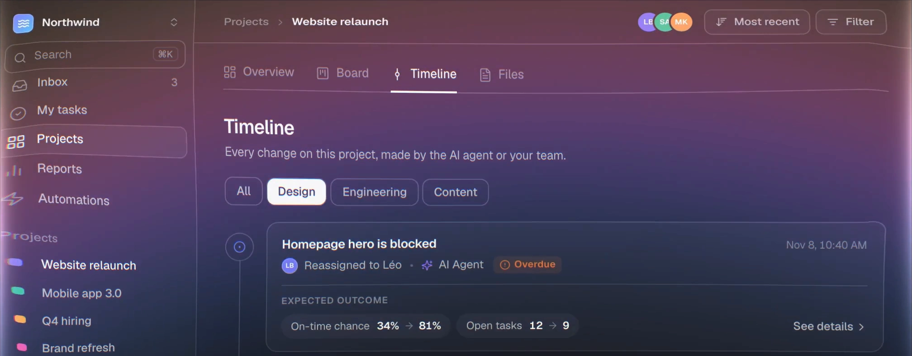
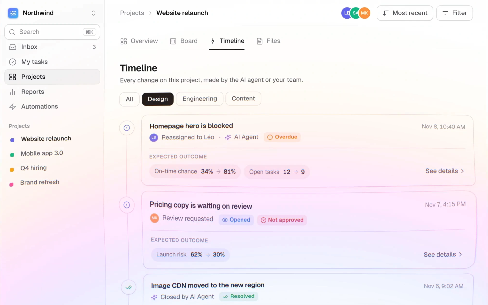

# 有物理质感的冲击波（含扭曲与通道分离） / Shockwave Halo

从输入框、按钮或指定位置扩散一圈柔和光环。整道光环作为一个透镜，经过时轻微拉伸、压缩页面，并产生克制的通道分离；四道色环、边缘折射和边线反光共同建立空间感。静止时恢复原页面，不改变业务行为。

## 效果参考

两张独立图分别展示深、浅主题下的 Aurora 配色，直接从 2160×2880 视频解码后按原像素裁切，以 WebP 质量 98 编码。深色图 2016×790，浅色图 2016×1260；只保留无光标署名、地址栏和讲解面板的 UI 局部，不放大、不锐化、不涂抹。它们不是完整页面或连续演示，其他配色没有附图。





静态帧用于查看光环经过时的材质、局部变形与文字状态。扩散速度、边缘折射、连续中断和性能必须在实际项目中操作验证。画面边缘的轻微色散属于效果，不能把整页文字长期失焦作为目标。

## 选用与实现边界

- 适合 AI 输入激活、消息发送、明确的状态反馈或单次强调。先沿用用户已经明确的触发、原点、作用区、主题和叠层选择；缺少会改变行为的信息时再补问。默认保留已有输入框，胶囊展开只是可选方案，不把整套演示界面带入产品。
- 六层分别是页面快照、整环透镜扭曲、RGB 通道分离、四道色环、内容边缘折射、边线反光。前三种采样效果依赖可读的页面纹理；边线反光还需独立线条遮罩，或由真实 DOM 边框参与。无纹理时保留彩环与可实现的边线反馈，并说明未实现扭曲、通道分离和内容折射。
- 与普通点击波纹不同，这个效果会重采样光环下的内容；与边缘流光不同，它扫过限定内容区，不沿边框永久循环。不能用一个放大的半透明圆圈宣称已完成物理透镜效果。
- 下文像素值使用内容区的 CSS／逻辑像素，时间 `t` 归一化到 `[0, 1]`。纹理 UV 偏移需除以内容尺寸；DPR 只影响实际绘制分辨率，不能再把逻辑位移重复乘一次。移动端按容器几何重新测量。
- 快照须排除效果层自身，避免递归采样；原 DOM 保持可操作与语义可读。一次快照只适合短暂且内容稳定的反馈；输入、流式回复、滚动或布局已变化时更新纹理、取消旧画面或退回透明彩环，不能把旧截图盖在正在变化的页面上。
- 普通 DOM 不能直接传给 `drawImage()` 当作页面截图。HTML-in-Canvas 只在目标环境的实际 API 与绘制验证通过后采用，需要正确设置可绘制后代和几何信息；不能靠浏览器名称或未经核验的版本号判定可用。现有跨域媒体、字体、视频与玻璃背景单独核对，失败时保持原页面并降级。

## 实现提示词

下面是可直接交给实现代理的完整整理版。参数都是调节起点；在现有代码和设计系统中应用，只实现本次请求的范围。

```text
为我的产品添加有物理质感的冲击波光环：触发后从指定位置扫过内容区，整道光环轻微扭曲经过的内容，叠加微弱通道分离、四道柔和色环，以及选择启用的边缘折射和边线反光。保持静止外观、页面功能、输入焦点和业务时序。

0. 先检查项目与已知需求
- 找到触发入口、AI 输入区、内容容器、容器圆角、上方工具栏、主题系统与当前动画能力。
- 判断页面来自 DOM、Canvas、原生视图还是 GPU 渲染器，列出目标平台与版本范围、可读内容纹理的获取方式及成本。
- 沿用已经明确的触发方式；未指定时建议 AI 输入框首次点击或聚焦。点击导致 focus 时只触发一次；动画中再次触发采用 restart 或 ignore 中已选的一种，缺失时明确建议并说明。
- 明确原点与作用区：输入框、按钮、点击点或面板中心；作用于内容区或单个面板。浏览器／应用工具栏保持清晰。
- 明确可选层：透镜扭曲、通道分离、边缘折射、边线反光；色环是基本层。说明依赖纹理的层和无法实现时的回退。
- 选择 Aurora、Halo、Frost、Spark 或现有品牌色，并分别适配实际存在的深浅主题。默认保留现有输入区，只有明确要求时采用第 5 节的胶囊展开。
- 对已授权且已确定的部分直接实施；仅在缺失信息会改变交互语义、作用范围或平台方案时询问，不重复要求用户批准已确定的选择。

1. 形状、路径和时间
- 光环是一个增长的圆，起点、中心和终点由作用区几何决定。
- 底部输入框示例：圆心在输入框横向中心、内容底边下方 650px；初始半径 650px，增长量 800px，持续 1000ms：
  radius = 650 + 800 * (1 - pow(2, -9*t)) / (1 - pow(2, -9))
  strength = min(1, t/0.03) * (1 - pow(t, 2.2))
  前段快、末段慢，结束时强度精确归零。
- 从内容区内部的点触发时，圆心就是该点，起始半径约 0–40px；终点覆盖最远角并留出光环宽度的余量。从边缘出发可把圆心放在边界外约容器宽度的 2/3 处。不要把固定 650/800px 用于所有屏幕，也不要让 strength 归零时尚未扫过目标区域。
- 无输入展开时直接响应触发；有展开时，从展开开始后 40ms 发出光环。
- 所有效果裁切到内容区；工具栏下是直边，其他边沿用容器自身圆角（示例 12px）。不要对浏览器外框或应用工具栏做后处理。

2. 四道色环
- 在逻辑像素中计算 d = length(position - center)，w = 110px，x = (d - radius)/w。
- 环 i = 0,1,2,3，中心 c = i - 1.5，权重 weight_i = exp(-pow((x-c)/0.8, 2))；ring 是四种颜色按权重归一化后的混合。权重和接近零时安全返回原画面，避免除零。
- 统一包络 alpha = strength * exp(-1.1 * pow(x/2, 2))，不把四道环各做成独立水波。统一颜色空间，计算后的颜色按渲染管线处理有效范围。
- 浅色为柔和染色：mix(page, ring, alpha*0.24) + ring*alpha*0.24*0.2。
- 深色为 screen 加光：1 - (1-page)*(1-ring*alpha*0.3*1.5)。不要对已算完 screen 的画面重复 screen 一遍。
- 使用本配方下方的四组深浅配色；或从品牌色派生四道环，在深色上更明亮、浅色上更柔和。切换主题时随页面渐变，不突然跳色。

3. 整环透镜与微弱通道分离
- 扭曲来自整个光环的一道透镜，不是每道色环各自位移。
- z = x*0.75；基础径向位移 push = 7px*2.33*z*exp(-z*z)。沿远离圆心的方向构造 offset，并用 strength 和边缘衰减包络控制它，保证起止状态无残余扭曲。
- 采样位置为 position - offset，光环中线外侧拉伸、内侧压缩；可见扭曲限制在色环附近，远处趋于零。圆心处归一化方向要避免除零。
- 红通道在 1.08 倍 offset 采样，绿通道在 1.00 倍、蓝通道在 0.92 倍。这个 8% 是位移差，不是 RGB 强度变化。通道分离随扭曲一起淡出，正文保持可读，不让整页长期出现彩色重影。
- 接近内容边界的最后 56px 将主透镜平滑衰减到零；边界与窗框保持稳定。边缘距离按真实裁切轮廓计算，圆角不能泄漏。

4. 边线反光与玻璃斜边
- 边线反光只作用于真实分割线、边框、标签／卡片／节点的描边，文字、图标、图片与阴影不参与。
- 有纹理管线时，再生成一张黑底白线遮罩：仅画各条真实描边，沿用其真实宽度，1px 线不能膨成光带。遮罩与页面使用同一变形坐标采样。
- 反光目标色为 ring 向白色混合 20%；强度 strength*exp(-1.4*pow(x/2,2))，浅色再乘 0.3，深色再乘 0.14。不能把整张截图的亮度边缘自动当作边框，否则文字也会发光。
- 无线条纹理的 DOM 改造可预先收集真实边框／分割线，每帧按其与波前的距离写 0–1 的 CSS 变量，轻微混合 border-color；批量测量并缓存位置，不逐帧对每个元素交错读写布局。
- 斜边折射作用于内容左右与底边，不包括工具栏下方。离边缘 dEdge 为 0–60px 时，向内部取样最多 22px：bevelOffset = 22*pow(1-dEdge/60,2)*该处的光环强度，使边缘附近内容轻微向边缘拉伸。
- 主透镜的边缘归零与这层内容内的斜边采样分开计算；不移动裁切轮廓或窗框。角落合成偏移需限幅，UV 保持在有效范围内，避免黑缝或相邻纹理泄漏。
- 光环接触边缘时加一条 exp(-dEdge/7) 衰减的细亮线，颜色为 ring 向白色混合 45%，仍乘该处的光环包络，不让整圈边框持续发亮。

5. 可选：带金属边缘的输入胶囊
- 仅明确选择这项时实现；否则保留原输入区和图标。
- 收起为 300×44px、半径 22px 的胶囊；浅色白底，深色 rgb(30 30 33)，1px 细边，闪光图标、14px 提示与右侧快捷键。位于内容区横向中心、底边上方 48px。窄屏用容器宽度限制尺寸。
- 点击先用 90ms 压到 97%，随后从中心展开为 460×100px、半径 16px 的卡片，底边保持原位。展开 580ms，progress = 1-exp(-8*t)*cos(6*t)，结束精确落到目标尺寸；宽高和圆角跟随同一进度。内容预先按最终宽度排版，用裁切揭示，进度约 30% 时开始淡入，不让文字反复换行或整体拉伸。
- 展开后单行输入 15px／22px，左距 16px；下面细分割线和 52px 工具区。原有添加、模型／模式、语音和发送动作沿用现有语义，32px 控件只是示例，不凭示例新增产品能力。
- 阴影示例：0 0 0 1px rgb(15 23 42 / .09), 0 2px 4px rgb(15 23 42 / .04), 0 28px 64px -16px rgb(15 23 42 / .22)。保留可辨识的键盘焦点，不能只因演示省略了 focus ring 就删除现有焦点反馈。
- 1px 金属边缘用 linear-gradient(120deg, rgb(238 240 243), rgb(196 202 210) 28%, rgb(241 243 245) 50%, rgb(188 195 204) 74%, rgb(233 236 239))；深色映射到 rgb(74 79 87) 至 rgb(51 55 61)。
- 边缘高光用 conic-gradient(from <angle>, transparent 0 280deg, rgb(255 255 255 / .8) 325deg, transparent 360deg)，900ms ease-out 内角度 -60deg→300deg，透明度 .75*sin(pi*t)。用内容盒排除遮罩把渐变限制在边框，不覆盖正文。
- 关闭约 320ms ease-in-out 返回胶囊。按原关闭语义管理焦点、未发送文字和再次打开；不要为动效丢失输入。

6. 渲染与回退
- Web：有可读快照时，用覆盖内容区的 WebGL2 canvas 做纹理采样与合成；DPR 上限以 2 为起点，canvas 不接收指针事件，保留底层 DOM 交互与可访问性。先验证纹理、文字、字体与裁切，再打开高级层。
- HTML-in-Canvas 仅在实际支持时使用，按目标 API 设置 content/drawable 与几何同步；不要假定任何 DOM 都能直接截图。WebGL／WebGPU 路径还需维护几何信息，不把 canvas 变成无语义替身。
- SVG foreignObject 截图方案如 html-to-image、modern-screenshot：可考虑在触发时生成一次纹理；字体、图片需可读，根背景明确，backdrop-filter 不能假定准确。测量实际耗时与失败表现；图片过期或截图未完成时先显示透明彩环，不拦截用户输入。
- html2canvas 类 CSS 重绘方案仅在验证目标画面后采用；现代渐变、颜色和玻璃效果可能不一致。捕获失败时不能把黑底、缺字或模糊快照当成成品。
- 无可靠快照：透明 canvas 只画彩环；浅色普通 alpha、深色 screen 或适当的加光混合。跳过依赖内容采样的扭曲、通道分离和斜边折射。SVG backdrop 位移仅作单独实测通过后的候选，不作为通用保证。
- iOS：支持时可用 Metal stitchable shader 和 SwiftUI layerEffect 采样视图；maxSampleOffset 按所有采样偏移的合成上限配置（约 30px 是示例，不能固定忽略色散和角落），不支持时只做彩环覆盖。
- Android：在支持 AGSL RuntimeShader／RuntimeShader RenderEffect 的设备上把内容作为 shader 输入，作用在限定内容容器；Compose 通过相应 graphicsLayer 桥接，较旧设备只做覆盖层。
- Flutter：检查 ImageFilter.isShaderFilterSupported，通过 Impeller 支持的 ImageFilter.shader 与已裁切的 BackdropFilter 采样内容；按当前 API 的采样器与尺寸参数顺序设置，使用 FlutterFragCoord 并核对后端坐标方向，不支持时只做覆盖层。
- Rust／wgpu：已有 GPU 界面可先渲染到离屏纹理，再以 WGSL 全屏后处理。纹理需允许采样，源与目标分开；Bevy 可按现有版本的自定义后处理节点接入，egui／iced 需接入渲染管线，普通控件自身不能随意读取背后像素。
- Electron／Tauri 沿用各自 WebView 的能力；Electron 可评估 webContents.capturePage 获取快照，不把同一 API 假定存在于 Tauri。

7. 节奏、生命周期与交付
- 可选输入按压 90ms→展开 580ms，展开开始后 40ms 启动 1000ms 光环，边框高光并行运行 900ms；无输入展开时光环直接启动。触发时刻不要与按压开始混淆。
- 动画中重复触发遵循已选 restart／ignore 规则。重启时清理旧帧、纹理与遮罩任务，异步快照以最新触发为准，旧请求不能覆盖新状态。不堆叠多个永久 canvas。
- prefers-reduced-motion：移除扩散位移、透镜、通道分离、边缘折射、边线闪动及可选输入的弹性／缩放；原地以一半强度在 600ms 内淡入淡出。保留输入、状态和焦点反馈。
- 只在可见动画期间调度帧；结束、取消、隐藏或卸载时停止循环并释放临时资源，静止时没有持续动画开销。
- 先列出选用的触发、原点、作用区、主题、层和纹理方案／回退，再实现；交付修改文件、实际验证结果和未启用的层。不能把静态参考或只画彩环称为已验证完整扭曲。
```

## 四组配色

颜色按内环到外环排列，RGB 值为 0–255；用于 shader 时先映射到管线要求的数值和颜色空间。

| 配色 | 主题 | 四道色环 RGB |
|---|---|---|
| Aurora · 蓝紫粉桃 | 深 | `(80,140,255)` · `(160,110,255)` · `(255,110,180)` · `(255,190,140)` |
| Aurora | 浅 | `(110,150,255)` · `(180,130,255)` · `(255,130,190)` · `(255,180,120)` |
| Halo · 橙黄金 | 深 | `(255,150,60)` · `(255,190,70)` · `(255,225,120)` · `(255,245,210)` |
| Halo | 浅 | `(255,140,50)` · `(255,175,60)` · `(245,200,80)` · `(255,225,150)` |
| Frost · 薄荷青绿 | 深 | `(80,220,175)` · `(70,195,225)` · `(180,240,150)` · `(235,255,245)` |
| Frost | 浅 | `(40,190,150)` · `(50,170,210)` · `(140,210,90)` · `(180,235,215)` |
| Spark · 紫金 | 深 | `(140,100,255)` · `(200,130,255)` · `(255,200,110)` · `(255,235,170)` |
| Spark | 浅 | `(130,95,240)` · `(185,125,245)` · `(245,185,80)` · `(250,215,120)` |

## 核对

- 在真实触发点验证开始、扩散、最强状态与结束；改变容器尺寸后仍覆盖目标区，圆角和工具栏边缘无泄漏、黑缝或框体移动。
- 整环透镜向外拉伸、向内压缩；RGB 差异只是微弱位移。测试小字、细线、图标、高对比卡片和四组深浅颜色，文字在全程可读。
- 边框反光只沿原线宽；边缘斜面只影响内容内部，不误亮正文，不把四道色环做成四道独立水波。
- 输入、点击、焦点、键盘、触摸、滚动及流式内容正常工作；快照不覆盖新状态，连续触发与异步快照竞争不会留下旧纹理。
- 测试缺失 WebGL、快照失败、跨域素材、字体未就绪、主题切换、减弱动态和卸载；实际测量截图耗时和动画帧表现，确认结束后无持续循环。

关联参考：[动画节奏](easing.md)、[液态玻璃](liquid-glass.md)、[边缘流光](../motion.md#border-beam)、[点击波纹按钮](../buttons-controls.md#ripple-button)。
